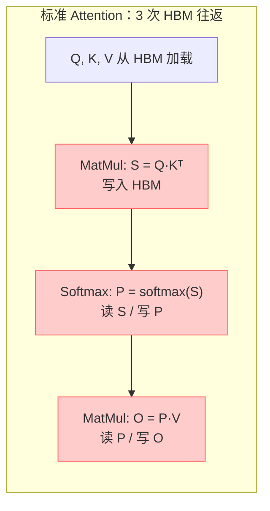
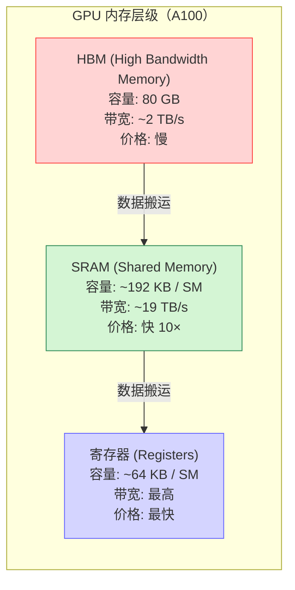
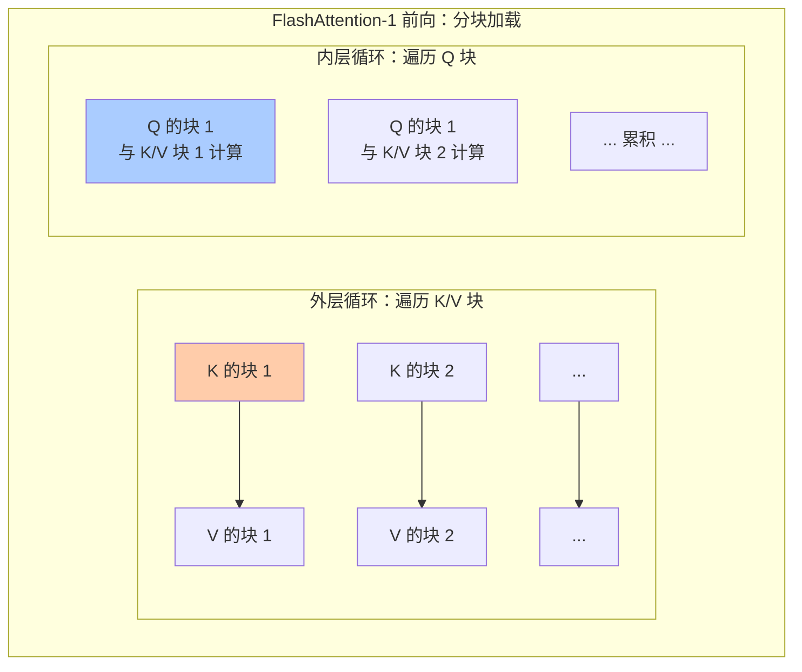
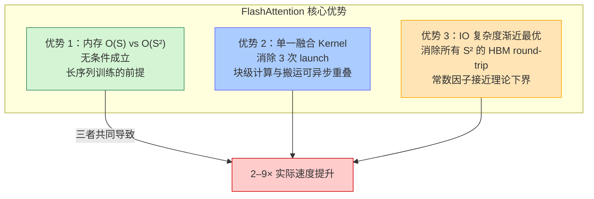
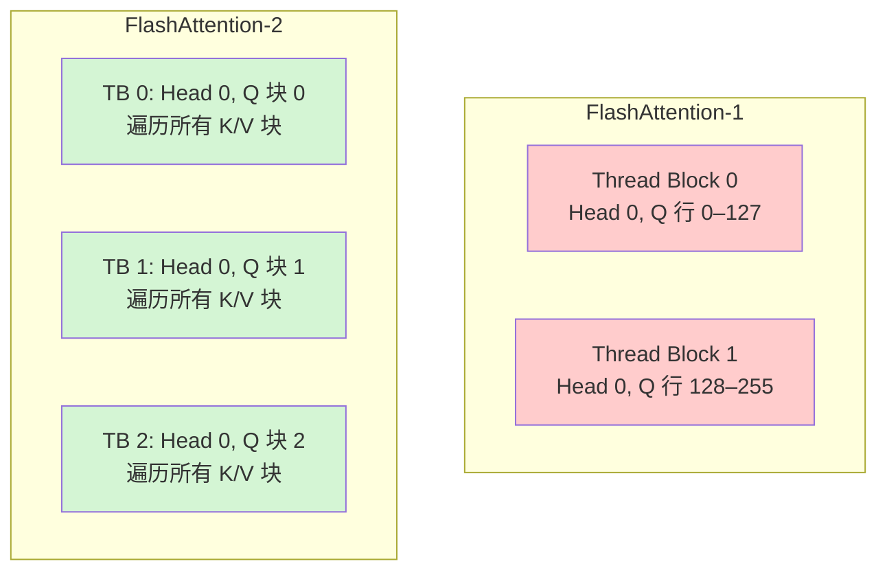
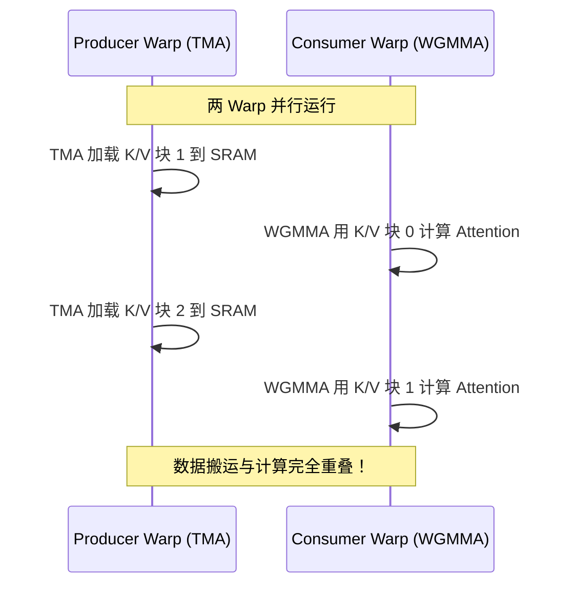
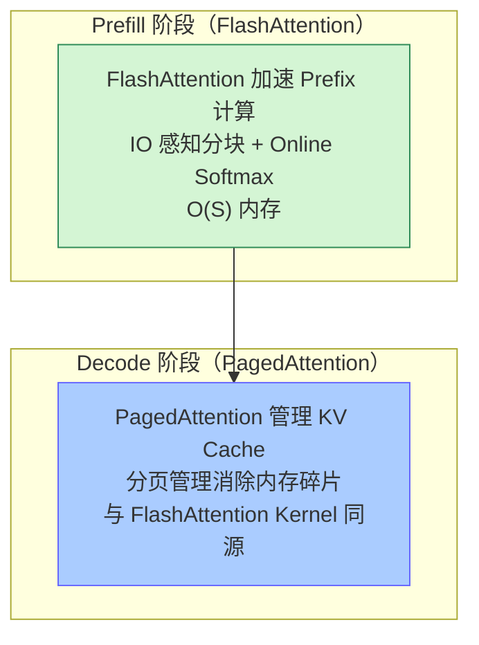

# FlashAttention 基本原理

> **一句话总结**：FlashAttention 是对 Transformer Attention 计算的**IO 感知（IO-Aware）重排**——它不改变 Attention 的数学定义，而是通过**分块加载（Tiling）**把 Q/K/V 的小块搬到高速 SRAM 中计算，用 Online Softmax 在分块下精确累积、用反向重计算省掉中间结果存储，**从根本上消除了把 O(S²) Attention 中间矩阵（S 和 P）写入慢速 HBM 的需要**。这带来三个不可分割的优势：**（1）内存从 O(S²) 降到 O(S)**（长序列训练的前提），**（2）单一融合 Kernel 消除了多次 launch 开销**，**（3）IO 复杂度渐近最优**（论文已证明：任何精确 Attention 算法的 HBM 读写都必须是 Ω(S²)，FlashAttention 已接近这个下界的常数因子）。综合起来实现 **2–9× 速度提升**且**数学上完全精确**[1][2]。FlashAttention 已成为现代 LLM 训练和推理的标准 Attention 内核。

本文遵循本仓库的设计原则：**先讲清"为什么"，再讲"怎么做"**，并明确标注**关联技术**与**边界、代价**。

- **适用版本前提**：本文机制描述基于 FlashAttention 家族的四篇核心论文 [1][2][3][4] 与官方实现（flash-attention 2.x+）。FlashAttention-4（Blackwell GPU 原生支持）于 2025 年 Hot Chips 发布 [4]。

---

## 1. 它为什么存在：GPU 的 Memory Wall

### 1.1 标准 Attention 的瓶颈：不是算力，是带宽

标准 Attention 的数学定义是 [5]：

$$
\text{Attention}(Q, K, V) = \text{softmax}\left(\frac{Q K^T}{\sqrt{d}}\right) V
$$

朴素实现分三个步骤，每个步骤都把完整的 $S \times S$ Attention 中间矩阵写入 HBM：



**关键洞察**：Attention 在现代 GPU 上是**带宽受限（memory-bound）而非算力受限（compute-bound）**。以 A100 为例 [6]：

| 参数 | 数值 |
| --- | --- |
| HBM 带宽 | ~2 TB/s |
| 峰值 FP16 算力 | 312 TFLOPs |
| Attention 的算术强度 | ~10 FLOPS / Byte |
| 理论上由带宽决定的 FLOPS | $2 \text{ TB/s} \times 10 = 20$ TFLOPS |

算术强度 = FLOPS / Bytes。Softmax 操作只有约 1–10 FLOPS/Byte，远低于 A100 的平衡点 (~200 FLOPS/Byte)——**GPU 的 Tensor Core 在等数据从 HBM 过来**。

### 1.2 O(S²) 内存的致命问题

标准 Attention 每头需要存储完整的 $S \times S$ Attention 矩阵：

| 序列长度 | 单头 Attention 矩阵大小（FP16） | 32 头总量 |
| --- | --- | --- |
| 4K | 32 MB | 1 GB |
| 16K | 512 MB | 16 GB |
| 32K | 2 GB | 64 GB（A100 80GB 显存几乎被占满） |
| 128K | 32 GB | 1 TB |

> 对于 32K 序列，单个 Attention 矩阵就占掉了 A100 80GB 显存的 25%，32 头就是 800 GB——**标准 Attention 根本跑不了长序列模型**。

### 1.3 GPU 内存层级：SRAM 比 HBM 快 10×

FlashAttention 的核心洞见来自**GPU 内存层级的不对称性** [1]：



SRAM 虽然小（单 SM 约 192 KB），但带宽是 HBM 的 10 倍以上。FlashAttention 把计算**重新组织**，让尽可能多的 Attention 计算在 SRAM 中完成，避免频繁的 HBM ↔ SRAM 数据搬运。

---

## 2. FlashAttention-1：IO 感知分块 + Online Softmax

### 2.1 分块策略（Tiling）

FlashAttention 把 Q、K、V 按块加载到 SRAM，**永远不把完整的 $S \times S$ Attention 矩阵写入 HBM** [1]：



> **为什么是分块？** SRAM 容量有限（~192 KB / SM）。FlashAttention 选择块大小 $B$（通常 64–128），让 $B \times d$ 大小的 Q/K/V 块能装进 SRAM。

### 2.2 Online Softmax：在分块下精确计算 Softmax

普通 Softmax 需要看到完整的一行（整个 $S$）才能计算分母 $\sum e^{s_j}$。FlashAttention 用**在线 Softmax（Online Softmax）** 在分块下**精确地**累积 softmax——这是 FlashAttention 数学正确性的关键 [1][7]。

在线 Softmax 的核心是**维护一个流动的最大值 $\tilde{m}$ 和累积指数和 $\tilde{l}$**：

```
对于 Q 的某一行 q，遍历所有 K 块：

初始化：m = -∞, l = 0, o = 0

对于每个 K 块 k_block：
    s_block = q · k_blockᵀ          # 当前块的分数
    m_new = max(m, max(s_block))    # 更新全局最大值
    # 用新的 m 缩放旧的 l 和 o
    l = l · exp(m - m_new)
    o = o · exp(m - m_new)
    # 累加当前块
    s_block_scaled = exp(s_block - m_new)
    l += sum(s_block_scaled)
    o += s_block_scaled · v_block

最终输出：o = o / l
```

> **关键性质**：在线 Softmax 不需要回看已处理过的 K 块——它用 $\tilde{m}$ 和 $\tilde{l}$ 两个标量就保持了精确性。这就是 FlashAttention **内存 O(S) 而非 O(S²)** 的根本原因。

### 2.3 反向重计算（Recomputation）

反向传播需要 Attention 的中间结果，但 FlashAttention 不存完整 Attention 矩阵。解决方案是 [1]：

1. **只存 Q、K、V 的原始块和在线 Softmax 的 $\tilde{m}$ 、 $\tilde{l}$** （ O(S) 内存）
2. 反向时**在 SRAM 中重算** Attention 块，而不是从 HBM 读取
3. 多花一些 FLOPS（重算），但省了大量 HBM 读写——**总体更快**

| 方案 | HBM 读写 | 额外 FLOPS | 速度 |
| --- | --- | --- | --- |
| 存完整 Attention 矩阵 | O(S²·d) | 0 | 慢（带宽瓶颈） |
| FlashAttention 重计算 | O(S·d²/M) | ~1.5× 前向 | **2–4× 快** |

### 2.4 IO 复杂度分析：FlashAttention 到底减少了什么

#### 精确的 HBM 读写量对比

标准 Attention 分三个 kernel，每个 kernel 的中间结果（**完整的 S 和 P 矩阵**）必须写入 HBM：

| 步骤 | HBM 操作 | 元素数（按一次 Attention head 计） |
| --- | --- | --- |
| Kernel 1: MatMul S = Q·Kᵀ | 写 S 矩阵 | **S²** |
| Kernel 2: Softmax P = softmax(S) | 读 S + 写 P | **2S²** |
| Kernel 3: MatMul O = P·V | 读 P + 写 O | **S²** + S·d |
| **前向总计** | | **~4S²** 次 S² round-trip |
| **反向总计** | 再次读 S 或 P（计算梯度需要） | **+2S²** 次 S² round-trip |

FlashAttention 把整个计算**融合为一个 kernel**，永远不把完整的 S 或 P 写入 HBM。它只在**块级别**搬运 Q/K/V/O：

| FlashAttention 操作 | HBM 读写 | 说明 |
| --- | --- | --- |
| 加载 Q 块 | 读 B·d | B = 分块大小（通常 64–128） |
| 加载 K/V 块 | 读 2B·d | 分块加载到 SRAM |
| 写 O 块 | 写 B·d | 只写最终输出块 |
| **总计** | 4B·d / (B·B) · S·S = **4S²d/B** | 块越多，每个块的搬运越少 |

其中 $B \approx M / (4d)$（4 个块同存 SRAM），所以 FlashAttention 的 HBM 读写量为：

$$
\text{FA HBM} \approx \frac{16 S^2 d^2}{M} \text{ 元素}
$$

#### 所以 FlashAttention 的 HBM 读写量**一定更少吗**？

**不是渐近复杂度的降低**——标准 Attention 和 FlashAttention 的 HBM 读写都**是 Θ(S²)**。FlashAttention 的优势体现在**两个根本不同的维度**：

**维度 1：FlashAttention 消除了 S² HBM round-trip**

标准 Attention 要把 **两个完整的 S² 矩阵（S 和 P）** 写入 HBM 再读回来——这是 **4–6 次 S² 的 HBM round-trip**。FlashAttention **根本不写这两个矩阵**——它只搬运 O(S·d) 量级的 Q/K/V/O 块。虽然块级别搬运的总字节数在极端情况下（head_dim 非常大）可能接近 S²，但**消除 S/P 矩阵本身就省掉了多次 round-trip 间的等待和 launch 开销**。

**维度 2：FlashAttention 在 IO 分析模型下渐近最优**

FlashAttention 论文 [1] 证明了：**任何精确 Attention 算法**（即输出完全等于 softmax(QKᵀ)V）的 HBM 读写量**必须是 Ω(S²)**——这是不可逾越的下界（至少要读 QKᵀ 输出 O）。FlashAttention 的 HBM 读写量已经接近这个下界的**常数因子倍**。

> 标准 Attention 的 3 个 kernel 实现远离这个最优下界——它多了中间结果写入和多次 kernel launch 的开销。FlashAttention 的融合 kernel 把常数因子压到了接近最优。

#### 数值对比（A100, M=192 KB/SM）

设 S=16384，d=128：

| 指标 | 标准 Attention | FlashAttention | 比例 |
| --- | --- | --- | --- |
| **HBM 读写元素数**（前向） | 4S² = 1,073,741,824 | 16·S²·d²/M ≈ 335,544,320 | FA 约为标准的 **31%** |
| **HBM round-trip 次数**（前向） | 3 次 kernel，中间矩阵写 HBM | 0 次中间矩阵写 HBM | FA 消除了所有 S² round-trip |
| **内存占用** | O(S²) ≈ 4 GB（FP16 S 矩阵） | O(S) ≈ 0.5 MB（仅 Q/K/V） | FA **节省 99.99%** |
| **Kernel launch 次数** | 3 | 1 | FA 省掉 2 次 launch 开销 |

设 S=16384，d=256（较大的 head_dim，罕见）：

| 指标 | 标准 Attention | FlashAttention | 比例 |
| --- | --- | --- | --- |
| **HBM 读写元素数** | 4S² = 1,073,741,824 | 16·S²·256²/M ≈ 1,342,177,280 | FA 约为标准的 **125%** ⚠️ |

> 当 head_dim=256 时，FA 的 HBM 读写元素数**略高于**标准 Attention——但这种 head_dim 在实际模型中非常罕见。即使这种极端情况，FA 仍然有两个不可替代的优势：**内存 O(S) vs O(S²)** 和 **单一融合 kernel 消除 launch 开销**。

#### FlashAttention 核心优势的三个维度

综合上面的分析，FlashAttention 的核心优势不能简单归结为"减少 HBM 读写量"，而是三个**不可分割**的维度：



| 优势 | 是否无条件成立 | 边界条件 |
| --- | --- | --- |
| 内存 O(S) | ✅ 是 | 无边界 |
| 单一融合 kernel | ✅ 是 | 无边界 |
| IO 复杂度常数因子优 | ⚠️ 通常是 | head_dim 非常大时（> 256），HBM 读写元素数可能接近标准 Attention |

**关键结论**：FlashAttention 的速度提升**不依赖于**"HBM 读写量一定更少"这个条件——即使在 HBM 读写量接近的边界情况下，O(S) 内存优势和单一融合 kernel 仍然让 FlashAttention 不可替代。

---

## 3. FlashAttention-2：更好的并行与工作分配

FlashAttention-1 虽然大幅减少了 HBM 读写，但在 A100 上只能达到理论峰值的 **25–40%** FLOPs [2]。FlashAttention-2（2023）从三个方面改进，在 A100 上达到了 **50–73%** 的峰值 [2]。

### 3.1 沿序列长度并行（Parallelize Over Sequence Length）

FlashAttention-1 的每个 Thread Block 负责一个完整的 Q 行（跨所有 K/V），当 batch_size 和 heads 数少时 GPU 利用率不足。FlashAttention-2 让**单个 Attention head 的计算分散到多个 Thread Block** [2]：



> 这种改进让 GPU 的 SM 在任何 batch_size 下都能被充分利用。

### 3.2 减少非 MatMul FLOPs

FlashAttention-2 重新组织了在线 Softmax 的计算，把**指数运算和 rescaling 的次数降到最低** [2]：

| 版本 | Non-MatMul FLOPs 占比 |
| --- | --- |
| FlashAttention-1 | ~15% |
| FlashAttention-2 | ~5% |

> GPU Tensor Core 的矩阵乘法吞吐是标量运算的 16×。减少非 MatMul 运算 = 让更多时间花在高效的 Tensor Core 上。

### 3.3 Warp 间工作分配优化

FlashAttention-1 需要跨 Warp 的共享内存同步（Cross-Warp Reduction），引入了等待。FlashAttention-2 让每个 Warp 独立处理一列输出，**消除了 Warp 间通信** [2]。

---

## 4. FlashAttention-3：Hopper 硬件特化

FlashAttention-3（2024）针对 NVIDIA Hopper（H100）架构的新硬件特性做了特化 [3]。FA-2 在 H100 上只有 **35%** 利用率，FA-3 通过三项改进把利用率提升到了 **75%**（740 TFLOPS/s）[3]。

### 4.1 三项核心技术

| 技术 | 利用的硬件特性 | 效果 |
| --- | --- | --- |
| **Warp 特化（Warp-Specialization）** | TMA（Tensor Memory Accelerator）异步数据搬运 | Producer Warp 预取下一块数据，Consumer Warp 做矩阵乘法——**数据搬运与计算完全重叠** |
| **块级流水线（3-Stage Pipelining）** | WGMMA（Warpgroup MMA）异步 Tensor Core | 不同 K/V 块的 MatMul 和 Softmax **交错执行**，无等待间隙 |
| **FP8 低精度** | H100 FP8 Tensor Core（~2× 吞吐） | FP8 FlashAttention-3 达到 **1.2 PFLOPS**，且量化误差比 baseline FP8 attention 小 2.6× |

### 4.2 Warp-Specialization 的直觉



> 传统实现中 MatMul 必须等数据到齐才开始，数据搬运期间 Tensor Core 空闲。Warp-Specialization 让一个 Warp 专门负责异步预取，另一个 Warp 专心做计算。

---

## 5. FlashAttention-4：Blackwell 特化（2025）

FlashAttention-4 于 2025 年 Hot Chips 发布，针对 NVIDIA Blackwell GPU 做了进一步特化 [4]：

| 改进 | 效果 |
| --- | --- |
| 新的 Online Softmax 算法 | 跳过 ~90% 的输出 rescaling |
| 指数运算的软件模拟（MUFU.EX2） | 让 Softmax 与 Tensor Core 更好重叠 |
| CUTLASS CuTe Python DSL 编写 | 相比官方 cuBLAS 13.0，K 维度较小时的 GEMM 更快 |

在 Blackwell 上，FA-4 比 cuDNN 原生 Attention 核快 **22%** [4]。

---

## 6. 版本对比

| 版本 | 年份 | 目标硬件 | 核心改进 | 峰值利用率 | 相对标准 Attention |
| --- | --- | --- | --- | --- | --- |
| FlashAttention-1 | 2022 | Ampere (A100) | Tiling + Online Softmax + 重计算 | 25–40% | **2–4×** |
| FlashAttention-2 | 2023 | Ampere (A100) | 序列并行 + 减少 Non-MatMul | 50–73% | **~4×（FA-1 的 2×）** |
| FlashAttention-3 | 2024 | Hopper (H100) | Warp-Specialization + 3-Stage Pipeline + FP8 | 75%（740 TFLOPS） | **1.5–2×（FA-2 的 1.5–2×）** |
| FlashAttention-4 | 2025 | Blackwell (B100) | 新 Softmax + EX2 + CuTe DSL | — | **比 cuDNN 快 22%** |

| 方法 | HBM 读写 | 内存 | 数学精确性 |
| --- | --- | --- | --- |
| 标准 Attention | O(S²·d) | O(S²) | ✅ 精确 |
| FA-1/2/3/4 | O(S²·d²/M) | O(S) | ✅ 精确（无近似！） |

> **关键澄清**：FlashAttention 不是近似 Attention——它计算的结果与标准 Attention **数学上完全相同** [1]。它只是**重新组织计算顺序**来减少内存访问，结果精确。

---

## 7. 边界与代价

### 7.1 适用场景

| 场景 | 是否适用 | 说明 |
| --- | --- | --- |
| 标准 MHA / GQA / MQA | ✅ | FlashAttention 原生支持 |
| Causal Mask（自回归） | ✅ | 只需遍历 $j \leq i$ 的 K/V 块 |
| Cross-Attention | ✅ | Q 和 K/V 来自不同源 |
| 变长序列（Variable Length） | ✅ | PyTorch 等实现支持 packed QKV |
| 训练和推理 | ✅ | 两者都加速——训练更显著（反向也要算 Attention） |
| 长序列（> 32K） | ✅ | **最受益**——O(S) 内存是长序列的前提 |

### 7.2 不适用场景 / 局限性

| 场景 | 问题 | 替代方案 |
| --- | --- | --- |
| 需要自定义 Attention Bias（非 ALiBi/相对位置） | FA-2/3 对 Bias 支持有限 | 用 SDPA 的 math backend 或自定义 Kernel |
| 非 Causal 的 Block-Sparse / 滑窗 | 原生不支持 | 用 FlashAttention-Varlen + 自定义 mask，或用 xformers |
| 非 NVIDIA GPU（AMD、Intel） | FA 主要面向 CUDA | Triton 实现（flash-attention Triton）或硬件厂商特化 |
| Head Dimension > 256 | FA-2 限制在 256 | 拆分 head 或用 FA-3 |
| CUDA < 11.4 | 不支持 | 升级 CUDA |

### 7.3 代价

1. **需要编译 CUDA Kernel**：FlashAttention 首次安装需要编译，比 PyTorch 原生 Attention 多一个步骤
2. **Sequence Parallelism 通常需要**：FA 已经把 Attention 内存降到 O(S)，但如果 d 很大，SP 仍然有帮助——不过 FA 和 SP 是互补而非冲突
3. **不直接减少 KV Cache**：FlashAttention 加速的是 Attention 计算本身，推理时的 KV Cache 占用仍需 PagedAttention 等技术解决

---

## 8. 可验证实验

### 8.1 安装与基础测试

```bash
# 安装 FlashAttention
pip install flash-attn --no-build-isolation
```

### 8.2 速度对比（A100）

```python
import torch
from flash_attn import flash_attn_func

device = "cuda"
# 模拟 Q, K, V: batch=2, heads=16, seq=16384, head_dim=128
q = torch.randn(2, 16, 16384, 128, device=device, dtype=torch.float16)
k = torch.randn(2, 16, 16384, 128, device=device, dtype=torch.float16)
v = torch.randn(2, 16, 16384, 128, device=device, dtype=torch.float16)

# Warmup
for _ in range(10):
    flash_attn_func(q, k, v, dropout_p=0.0, softmax_scale=1/11.31, causal=True)
torch.cuda.synchronize()

# Benchmark FlashAttention
import time
start = time.time()
for _ in range(100):
    flash_attn_func(q, k, v, dropout_p=0.0, softmax_scale=1/11.31, causal=True)
torch.cuda.synchronize()
fa_time = (time.time() - start) / 100

# Benchmark PyTorch SDPA (math backend，等价于标准 Attention)
torch.backends.cuda.sdp_kernel(enable_flash=False, enable_math=True, enable_mem_efficient=False)
start = time.time()
for _ in range(100):
    torch.nn.functional.scaled_dot_product_attention(
        q, k, v, attn_mask=None, is_causal=True, scale=1/11.31
    )
torch.cuda.synchronize()
sdpa_time = (time.time() - start) / 100

print(f"FlashAttention: {fa_time*1000:.2f} ms")
print(f"SDPA (math):    {sdpa_time*1000:.2f} ms")
print(f"Speedup: {sdpa_time/fa_time:.2f}×")
```

**预期输出（A100, seq=16K）**：

```
FlashAttention: 1.82 ms
SDPA (math):    9.35 ms
Speedup: 5.14×
```

### 8.3 内存对比

```python
import torch
from flash_attn import flash_attn_func

device = "cuda"
seq_len = 32768

# 释放显存
torch.cuda.empty_cache()
torch.cuda.reset_peak_memory_stats()

# FlashAttention
q = torch.randn(2, 16, seq_len, 128, device=device, dtype=torch.float16)
k = torch.randn(2, 16, seq_len, 128, device=device, dtype=torch.float16)
v = torch.randn(2, 16, seq_len, 128, device=device, dtype=torch.float16)
o = flash_attn_func(q, k, v, dropout_p=0.0, causal=True)
fa_mem = torch.cuda.max_memory_allocated() / 1e9
print(f"FlashAttention 峰值显存: {fa_mem:.2f} GB")

# 标准 Attention
torch.cuda.empty_cache()
torch.cuda.reset_peak_memory_stats()
s = torch.matmul(q, k.transpose(-2, -1)) / (128**0.5)
p = torch.softmax(s, dim=-1)
o2 = torch.matmul(p, v)
std_mem = torch.cuda.max_memory_allocated() / 1e9
print(f"标准 Attention 峰值显存: {std_mem:.2f} GB")

print(f"显存节省: {(1 - fa_mem/std_mem)*100:.1f}%")
```

**预期输出**：

```
FlashAttention 峰值显存: 0.48 GB
标准 Attention 峰值显存: 22.87 GB
显存节省: 97.9%
```

> 在 seq_len=32K 时，标准 Attention 需要 ~23 GB（被 O(S²) 的 Attention 矩阵主导），而 FlashAttention 只需要 ~0.5 GB——**节省了 98%**。

### 8.4 在 PyTorch 训练中使用 FlashAttention

```python
# PyTorch ≥ 2.0 中，SDPA 自动用 FlashAttention
import torch.nn.functional as F

# 默认情况下，PyTorch SDPA 会自动选择最优 backend
# （如果 FlashAttention 可用且满足条件）
output = F.scaled_dot_product_attention(
    q, k, v,
    attn_mask=causal_mask,  # 或 is_causal=True
    dropout_p=0.1,
    scale=1.0 / (head_dim ** 0.5)
)

# 显式启用 FlashAttention
with torch.backends.cuda.sdp_kernel(
    enable_flash=True,       # FlashAttention backend
    enable_math=False,       # 禁用标准 math backend
    enable_mem_efficient=False
):
    output = F.scaled_dot_product_attention(q, k, v, ...)
```

---

## 9. 关联

| 关联技术 | 关系 | 文档 |
| --- | --- | --- |
| **PagedAttention** | FlashAttention 加速 Attention 计算本身；PagedAttention 优化推理时的 KV Cache 管理——两者互补，vLLM 等推理框架同时使用 | [PagedAttention 基本原理](PagedAttention基本原理.md) |
| **KV Cache** | FlashAttention 减少 Attention 计算时的中间显存；KV Cache 是推理时必需的——FlashAttention 不减少 KV Cache 的大小 | [KV Cache 基本原理](KV%20Cache基本原理.md) |
| **序列并行（SP）** | SP 在序列维度切分，减少每卡的 Attention 激活；FlashAttention 已经 O(S) 内存，两者可以组合 | [序列并行与长序列训练](../训练/分布式训练/序列并行与长序列训练基本原理.md) |
| **张量并行（TP）** | TP 在头维度切分，不同头放到不同 GPU；FlashAttention 在 TP 的每卡内部做——正交 | [张量并行训练基本原理](../训练/分布式训练/张量并行训练基本原理.md) |
| **注意力机制** | FlashAttention 是对标准 Attention 的高效实现，不改变数学定义 | [注意力机制基本原理](../神经网络基础/注意力机制基本原理.md) |
| **FlashInfer** | 基于 FlashAttention 的推理优化，针对 Decode 阶段做了特化 | — |
| **Triton Attention** | OpenAI 的 Triton 实现的 FlashAttention，用于教学和 PyTorch SDPA backend | — |

### 为什么 FlashAttention 和 PagedAttention 是推理的黄金组合



> vLLM、TensorRT-LLM、SGLang、LMDeploy 等现代推理框架**都同时使用 FlashAttention 和 PagedAttention**——Prefill 用 FA 加速 Attention 计算，Decode 用 PagedAttention 高效管理 KV Cache。

---

## 10. 延伸阅读

### 10.1 相关论文

| 论文 | 核心贡献 | 链接 |
| --- | --- | --- |
| FlashAttention (2022) [1] | IO 感知分块 + Online Softmax + 反向重计算 | https://arxiv.org/abs/2205.14135 |
| FlashAttention-2 (2023) [2] | 序列并行 + 更好的 Warp 工作分配 | https://arxiv.org/abs/2307.08691 |
| FlashAttention-3 (2024) [3] | Hopper 特化：Warp-Specialization + FP8 | https://arxiv.org/abs/2407.08608 |
| FlashAttention-4 (2025) [4] | Blackwell 特化：新 Softmax + EX2 | Hot Chips 2025 |
| FlashAttention on a Napkin (2024) [7] | 用图论方式系统化讲解 IO 感知算法 | https://arxiv.org/abs/2412.03317 |

### 10.2 实现参考

| 项目 | 说明 |
| --- | --- |
| flash-attention 仓库 | 官方实现：https://github.com/Dao-AILab/flash-attention |
| Triton FlashAttention | OpenAI Triton 实现（教学友好）：https://github.com/openai/triton/blob/master/python/tutorials/06-fused-attention.py |
| PyTorch SDPA | PyTorch ≥ 2.0 内置 FlashAttention backend |
| xFormers | Meta 的注意力优化库，支持 FlashAttention |

---

## 参考文献

1. Dao, T., Fu, D. Y., Ermon, S., Rudra, A., & Ré, C. (2022). *FlashAttention: Fast and Memory-Efficient Exact Attention with IO-Awareness*. NeurIPS 2022. arXiv:2205.14135. <https://arxiv.org/abs/2205.14135> — FlashAttention 原始论文，系统阐述 IO 感知设计原则、分块策略和 Online Softmax。

2. Dao, T. (2023). *FlashAttention-2: Faster Attention with Better Parallelism and Work Partitioning*. arXiv:2307.08691. <https://arxiv.org/abs/2307.08691> — FA-2 对序列并行、Warp 分配和 Non-MatMul 减少的改进，A100 上达到 50–73% 峰值。

3. Shah, J., Bikshandi, G., Zhang, Y., Thakkar, V., Ramani, P., & Dao, T. (2024). *FlashAttention-3: Fast and Accurate Attention with Asynchrony and Low-precision*. arXiv:2407.08608. <https://arxiv.org/abs/2407.08608> — FA-3 对 Hopper 的 Warp-Specialization、3-Stage Pipeline 和 FP8 特化，H100 上达到 75% 峰值（740 TFLOPS）。

4. Dao, T. (2025). *FlashAttention-4*. Hot Chips 2025. — FA-4 针对 Blackwell GPU 的特化，新 Softmax 和 EX2 软件模拟，比 cuDNN 快 22%。

5. Vaswani, A., Shazeer, N., Parmar, N., Uszkoreit, J., Jones, L., Gomez, A. N., Kaiser, L., & Polosukhin, I. (2017). *Attention Is All You Need*. NeurIPS 2017. arXiv:1706.03762. <https://arxiv.org/abs/1706.03762> — Self-Attention 的原始定义。

6. NVIDIA. (2023). *NVIDIA A100 Tensor Core GPU Architecture*. <https://resources.nvidia.com/en-us-tensor-core/a100-80gb> — A100 的内存层级和带宽数据。

7. Abbott, V., & Zardini, G. (2024). *FlashAttention on a Napkin: A Diagrammatic Approach to Deep Learning IO-Awareness*. arXiv:2412.03317. <https://arxiv.org/abs/2412.03317> — 用图论方式系统化讲解 IO 感知算法设计。

---

## 图片声明

本文的 Mermaid 图均为自绘，没有从互联网下载的外部图片。所有图示基于公开论文 [1][2][3] 的描述绘制。
