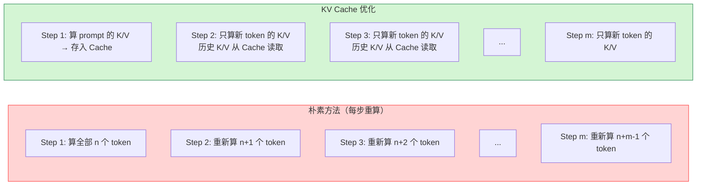
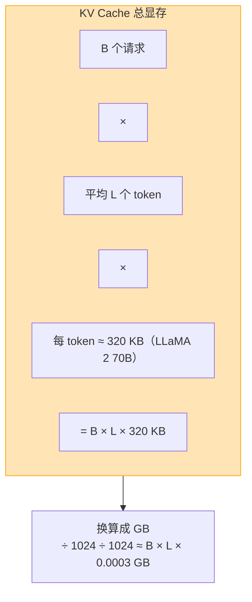
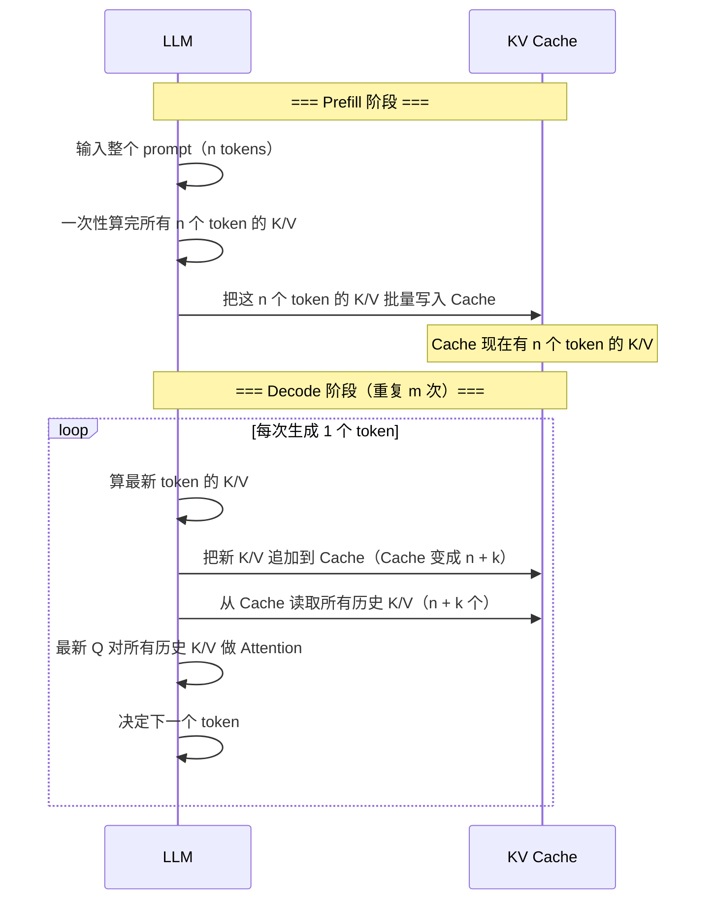
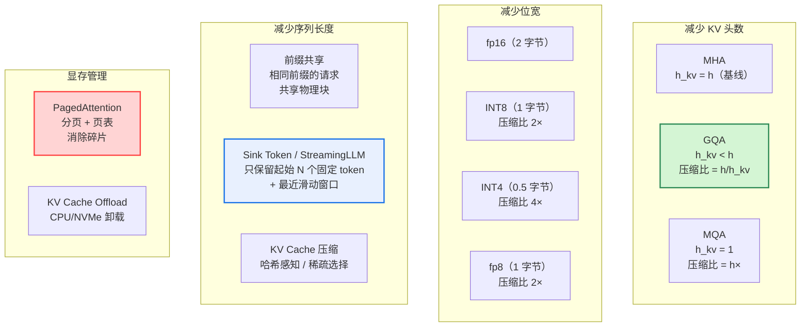
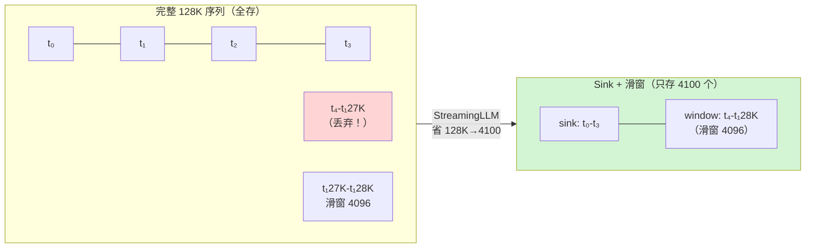
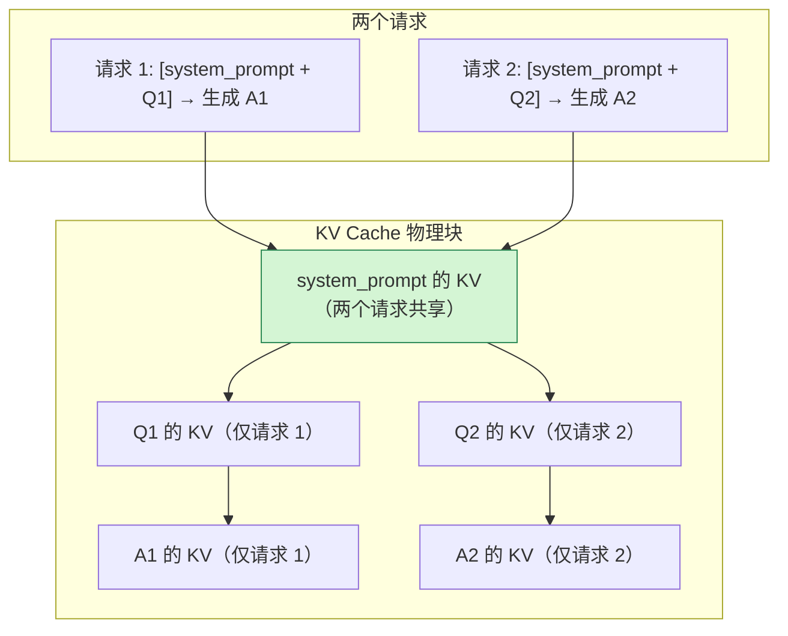
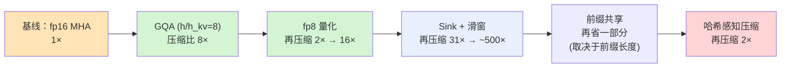
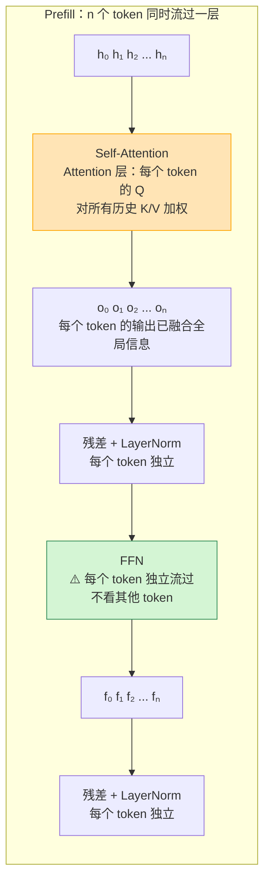
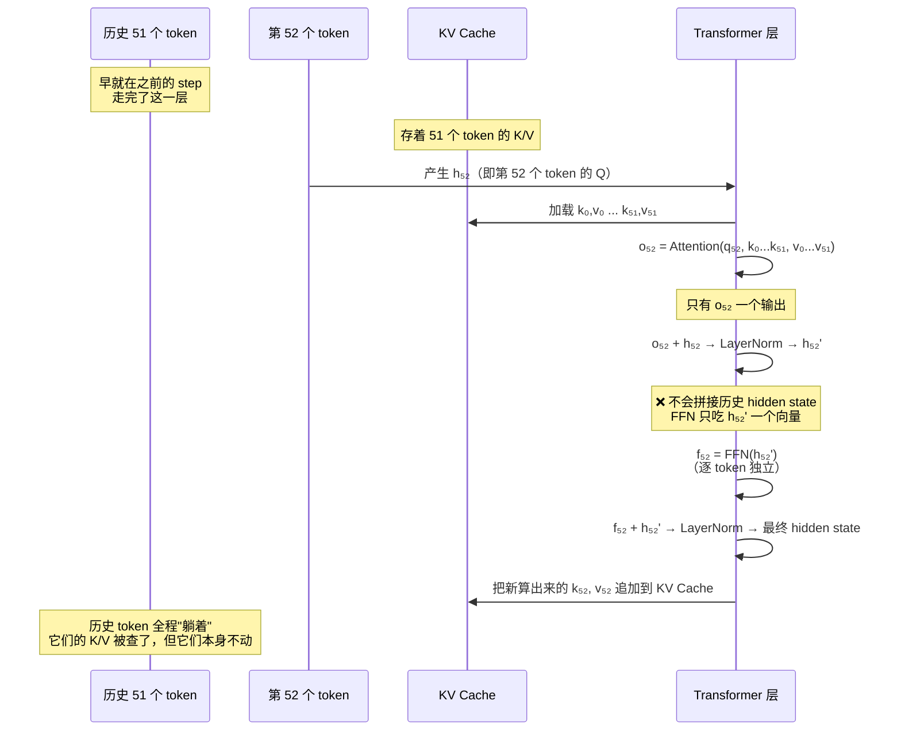
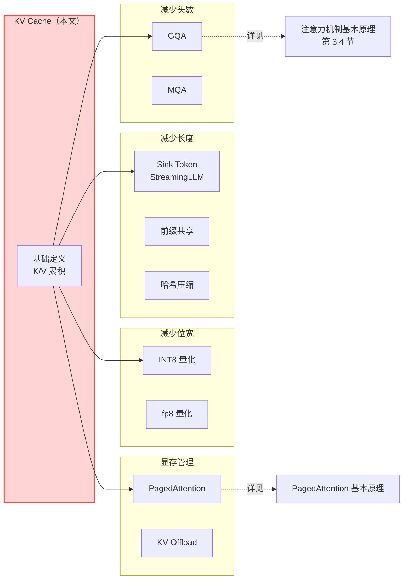

# KV Cache 基本原理

> **一句话总结**：KV Cache 是 LLM 推理提速的核心技术——它把**每一层、每一个注意力头、每一个历史 token 的 Key 和 Value 向量存起来**，避免 Decode 阶段反复计算历史 token 的 K/V，把每步生成的 Attention 计算量从 O(n²·d) 降到 O(n·d)。代价是**显存占用与序列长度线性增长**（典型大模型需要 10–50 GB/单卡），且成为推理吞吐的主要瓶颈。围绕 KV Cache 有一系列优化技术：GQA/MQA 减少头数、量化减少位宽、PagedAttention 管理碎片、Sink Token/StreamingLLM 压缩长度、前缀共享（Prefix Cache）提升复用。

本文遵循本仓库的设计原则：**先讲清"为什么"，再讲"怎么做"**，并明确标注**关联技术**与**边界、代价**。

- 适用版本前提：KV Cache 是所有自回归 Transformer 模型（LLaMA、GPT、Mistral 等）共有的推理基础设施。本文机制描述基于 Transformer 原始论文 [1] 与 vLLM / HuggingFace transformers 实现（2024–2026）。

---

## 1. 它为什么存在：从朴素自回归到 KV Cache

### 1.1 朴素自回归生成：重复计算的灾难

朴素自回归生成（autoregressive generation）的做法是：

```
for step = 1 to max_tokens:
    把 [prompt + 已生成 token 序列] 送入模型
    跑完整前向传播 → 得到第 step 个 token
```

问题在于：每生成一个新 token，模型都要**重新计算整个序列所有历史 token 的 K、V、Q**。对于长度为 `n` 的 prompt + `m` 个生成 token：

- Prefill 阶段：一次计算 `n` 个 token 的完整 Attention，计算量 O(n²·d)
- Decode 阶段：生成第 k 个 token 时，需要计算 `n + k` 个 token 的完整 Attention，计算量 O((n + k)²·d)
- **总计算量**：O(n²·d) + O(Σ_{k=1}^{m} (n+k)²·d) = **O(m·(n+m)²·d)**

这是一个**三次方**复杂度。生成长序列时（m 很大），朴素方法根本跑不动。

### 1.2 KV Cache 的核心优化

**关键观察**：历史 token 的 K 和 V 在后续 step 中**永远不变**——因为它们的值只由 token embedding 和位置编码决定，不会因为后面生成了新 token 而改变。

所以只要把**历史 token 的 K 和 V 存下来**，生成新 token 时就可以直接用，**无需重新计算**：



### 1.3 计算量对比

| 阶段 | 朴素方法 | KV Cache | 节省倍率 |
| --- | --- | --- | --- |
| Prefill（prompt 长度 n） | O(n²·d) | O(n²·d)（无差异） | 1× |
| Decode 第 k 步 | O((n+k)²·d) | O((n+k)·d) | O(n+k)× |
| Decode m 步总量 | O(m·(n+m)²·d) | O(m·(n+m)·d) | **O(n+m)×** |

KV Cache 把 Decode 阶段的总计算量从**三次方**降到了**二次方**——在长序列场景下（n+m ≈ 10K tokens）是数量级的提升。这是**现代 LLM 推理可用的前提条件**。

> 注意：KV Cache **只存 K 和 V，不存 Q**。因为 Q 在每个 Decode step 只有最新那个 token 产生，不需要缓存历史 Q——历史 Q 在它们那步生成后已经"用完"了，不会再被用到。

---

## 2. KV Cache 的内存构成

### 2.1 存了什么

KV Cache 是一个**嵌套张量结构**，形状是：

```
KV Cache[layer_id][head_id][token_idx]
         ────────────────   ────────────   ────────────
         哪一层            哪一个头        第几个 token
```

对于每个层、每个 KV 头、每个历史 token，存储两个向量 [2]：
- **K**（Key）∈ R^{d_k}：该 token 的"标签"
- **V**（Value）∈ R^{d_k}：该 token 的"内容"

### 2.2 一个 token 的 KV 大小

以 LLaMA 2 70B 为例 [3]：

| 参数 | 数值 |
| --- | --- |
| 层数 | 80 |
| KV 头数 | 8（GQA） |
| 每个头的维度 `d_k` | 128 |
| 精度 | fp16（2 字节/元素） |

一个 token 在**整个模型**的 KV Cache 大小：

```
单层单头：K(128 × 2) + V(128 × 2) = 512 字节
整个模型：80 层 × 8 头 × 512 字节 = 327,680 字节 ≈ 320 KB / token
```

### 2.3 KV Cache 总显存公式

| 模型配置 | 公式 |
| --- | --- |
| 标准 MHA（`h_kv = h`） | `2 × h × n_layers × n_tokens × d_k × bytes_per_element` |
| GQA（`h_kv = g`） | `2 × g × n_layers × n_tokens × d_k × bytes_per_element` |

设 batch 有 **B** 个并发请求、每个平均 **L** 个 token，则总 KV Cache 显存：



### 2.4 量化影响

如果 KV Cache 从 fp16 量化到 INT8 或 INT4，显存可进一步压缩：

| 精度 | 字节/元素 | KV Cache / token（LLaMA 2 70B） | 压缩比 |
| --- | --- | --- | --- |
| fp16（基线） | 2 | ~320 KB | 1× |
| INT8 | 1 | ~160 KB | 2× |
| INT4 | 0.5 | ~80 KB | **4×** |

---

## 3. Prefill vs Decode：两个阶段的 KV Cache 行为

KV Cache 在两个阶段的写入/读取模式完全不同：



| 阶段 | KV Cache 写入 | KV Cache 读取 | 计算量瓶颈 |
| --- | --- | --- | --- |
| **Prefill** | 一次性写入 n 个 token 的 K/V | 无（Attention 当场算完） | **计算**（O(n²·d)） |
| **Decode（每步）** | 追加 1 个 token 的 K/V | 读取全部历史（n + k 个）的 K/V | **内存带宽**（每步读 O(n·d) 数据） |

Decode 阶段的瓶颈是**内存带宽**——每步要把越来越长的 KV Cache 读出来，而 KV Cache 存的是**历史所有层、所有头、所有 token 的 K/V**，数据量很大。这也是为什么：

> **长序列推理越来越慢**——每生成一个新 token，它的 Q 都要和越来越多的历史 K/V 做 Attention，每步的内存读取量线性增长。

---

## 4. KV Cache 的核心瓶颈

### 4.1 显存占用：线性增长

KV Cache 显存随**序列长度**线性增长。以 LLaMA 2 70B（80 层、8 个 GQA KV 头、d_k=128）、fp16 精度为例：

| 上下文长度 | 单请求 KV Cache | 32 并发请求 |
| --- | --- | --- |
| 4K tokens | 1.28 GB | 41 GB |
| 32K tokens | 10.24 GB | 328 GB |
| 128K tokens | 40.96 GB | 1,310 GB ≈ 1.3 TB |

推理集群的单卡显存通常是 80 GB（H800）或 96 GB（H20）。多长上下文 + 高并发场景下，KV Cache 显存很快就会成为瓶颈——**模型参数可能才 140 GB（FP4 量化后），但 KV Cache 可以吃掉数 TB**。

### 4.2 内存带宽瓶颈

Decode 阶段每步要把**所有层的 KV Cache** 从显存读出来。H800 的 HBM 带宽约为 **3 TB/s**，假设 80 层、单层 KV Cache 读取量为 L × 8 × 128 × 2 bytes，当 L=32K 时单层读取量 ≈ 64 MB，80 层总计 ≈ 5 GB——**每步 5 GB，3 TB/s 带宽下需要 ≈ 1.7 ms**。这还没算模型计算的时间。

### 4.3 内存碎片

朴素实现为每个请求分配一段**连续内存**来存 KV Cache，但不同请求的序列长度差异很大、生命周期不同，导致：
- 请求结束后释放的空闲内存块**无法拼成连续大块**
- 新请求可能因为"找不到足够大的连续块"而无法启动
- vLLM 论文测量：朴素实现下**只有 40%–60% 的 KV Cache 显存可用** [4]

这正是 **PagedAttention** 要解决的问题（详见本目录《PagedAttention 基本原理》）。

---

## 5. 压缩与管理技术全景

围绕 KV Cache 的三个瓶颈（显存占用、带宽、碎片），业界发展出三大类技术：



### 5.1 减少 KV 头数：GQA / MQA

**原理**：让多个 Query 头**共享同一套 K/V 头**。标准 MHA 每个 Q 头对应一套独立 K/V，GQA 把 Q 头分组、每组共享一套 K/V，MQA 则让所有 Q 头共享一套 K/V [5][6]。

| 方案 | KV 头数 | KV Cache 压缩比 | 精度影响 | 代表模型 |
| --- | --- | --- | --- | --- |
| MHA | `h` | 1× | 基线 | GPT-3、BERT |
| GQA | `g`（1 < g < h） | `h/g ×` | 几乎无损（g ≥ h/8） | LLaMA 2/3、Gemma 2 |
| MQA | 1 | `h ×` | 明显有 | Shazeer 原型 |

这是**成本最低、精度影响最小**的压缩方式——现代大模型几乎**全部**选择 GQA（`h/h_kv ≈ 8`）。详见《注意力机制基本原理》第 3.4 节。

### 5.2 减少位宽：KV Cache 量化

把 K/V 从 fp16 量化到更低精度。关键问题是**量化方式**：

| 方案 | 原理 | 压缩比 | 精度影响 | 实现 |
| --- | --- | --- | --- | --- |
| **逐 token 量化** | 每个 token 的 K/V 张量独立量化 | 2× / 4× | 最小 | vLLM 默认 KV Cache 量化 |
| **逐头量化** | 每个注意力头的 K/V 独立量化 | 2× / 4× | 稍大 | LLM.int8() |
| **滑窗量化** | 只量化最近窗口内的 K/V | 混合 | 平衡 | NVIDIA TensorRT-LLM |
| **FP8 量化** | 用 fp8（1 字节）存储，比 INT8 精度更高 | 2× | 极小 | H20/H800 硬件原生支持 |

### 5.3 减少序列长度：Sink Token + 滑动窗口

StreamingLLM（2023）[7] 提出的关键观察：

> LLM 的长上下文能力主要由**起始的 sink token**（包括 BOS 和少数系统 token）和**最近的滑窗内 token** 贡献，中间大部分 token 的注意力权重很低——保留它们对输出质量几乎没影响。

**Sink Token 策略**：
- 固定保留前 **4 个 token**（BOS、第一个 token 等）
- 保留最近 **N 个 token**（如 4096）组成滑动窗口
- 中间的 token **丢弃**它们的 KV Cache



**效果**：理论上 128K 上下文可以把 KV Cache 从 128K token 压缩到 4 + 4096 = **4100 token**——节省超过 **30×**。LLaMA 3 原生支持 Sink Token 推理 [3]。

### 5.4 前缀共享（Prefix Cache）

多个请求如果有**相同的前缀**（如系统 prompt），它们的 KV Cache 可以**共享物理块** [4]。



在 PagedAttention 的实现中，前缀共享表现为**页表映射到相同的物理 block**——请求 1 和 2 的页表前几个 entry 指向同一个物理 block。

### 5.5 KV Cache 压缩（DeepSeek V4.1-Flash）

DeepSeek V4.1-Flash（2025）[8] 提出了更激进的方案：**对 KV Cache 做哈希感知压缩**。核心思想是：

1. 对所有 token 的 K/V 做哈希聚类（如 Locality-Sensitive Hashing）
2. 把**相似哈希桶内的 K/V 合并/压缩**成更紧凑的表示
3. 推理时用合并后的压缩表示做 Attention

论文声称这个方案在几乎不损失精度的前提下，把 KV Cache 再压缩 **2×**，同时推理时延降低 20–30% [8]。

### 5.6 显存管理：PagedAttention + Offload

- **PagedAttention**（详见本目录《PagedAttention 基本原理》）：把 KV Cache 分页管理，消除**外部碎片**，把显存利用率从 40–60% 提升到 **90%+** [4]
- **KV Cache Offload**：当 GPU 显存满了，把**冷的 KV Cache（长时间不被访问的 token）卸载到 CPU 内存甚至 NVMe SSD**。代价是访问延迟增加（PCIe 带宽远低于 HBM），需要精细的**冷热驱逐策略**

---

## 6. 压缩技术叠加效果

不同技术可以**叠加使用**，最终把 KV Cache 从 fp16 基线压缩到原来的 **1/32 ~ 1/128**：



以 LLaMA 3 70B、128K 上下文、32 并发为例：

| 方案 | KV Cache / 请求 | 32 请求总显存 |
| --- | --- | --- |
| 基线 MHA + fp16 | ~164 GB | ~5,248 GB ≈ **5.1 TB** |
| GQA (×8) | ~20.5 GB | ~640 GB |
| + fp8 (×2) | ~10.25 GB | ~328 GB |
| + Sink/Window (×31) | ~0.33 GB | ~10.6 GB |
| + 前缀共享（省 50%） | ~0.17 GB | ~5.3 GB |

叠加后，**从 5 TB 降到 5 GB**——省了 **1000×**。这就是为什么现代推理框架能在单卡上跑几十个长上下文并发请求。

---

## 7. KV Cache 不存什么？

上面已经讲了 KV Cache **存 K 和 V**。但它**不存什么**，以及背后的数据流逻辑，也是理解 KV Cache 设计的关键。

### 7.1 Decode 阶段的完整数据流：Attention 之后是 FFN 吗？

> **一个常见的问题**：Decode 阶段，最新 token 的 Q 和历史 K/V 算出 Attention 输出后，要不要把**历史 token 的 hidden state 也拼起来**送进 FFN？

**答案是：不需要拼接**。FFN 的输入就是**最新那个 token 的 hidden state（加上残差）**——历史 token 的 hidden state 早在 Prefill 阶段或之前的 Decode step 就已经**各自独立**地流过了 FFN 和后续所有层，它们的工作完成了，不会再被"重走"一次。

#### Transformer 层中哪些跨 token，哪些逐 token

一个标准 Transformer Decoder 层的完整结构是：

```
h → Self-Attention → 残差 + LayerNorm → FFN → 残差 + LayerNorm → output
```

其中每个子层对"序列中不同 token 之间的依赖"完全不同：

| 子层 | 对每个 token 的依赖 | 说明 |
| --- | --- | --- |
| **Self-Attention** | 依赖**所有历史 token** 的 K/V | **唯一跨 token 交互的层** |
| **残差 + LayerNorm** | **只依赖自己**的 hidden state | 逐 token 独立 |
| **FFN** | **只依赖自己**的 hidden state | Position-wise MLP，逐 token 独立 |
| **残差 + LayerNorm** | **只依赖自己**的 hidden state | 逐 token 独立 |

**关键**：FFN 全称是 **Position-wise Feed-Forward Network**——"Position-wise" 的意思就是**对序列中的每个位置独立做相同的非线性变换**。它根本不关心序列里还有哪些 token，只关心当前 token 自己的 d_model 维向量。

#### Prefill 阶段：所有 token 同时流过



Prefill 阶段，Attention 层把**全局信息"汇聚"到每个 token**的 hidden state 里。之后的残差、LayerNorm、FFN 都是**每个 token 独立**地"消化"这些信息、进一步变换。历史 token 在这一整层里只出现一次——不会被"拉回来"再走一遍。

#### Decode 阶段：只有最新 token 走完整层

当前已经生成了 51 个 token，要生成第 52 个：



**这里绝对不会**把 `[h₀, h₁, ..., h₅₂]` 拼在一起送 FFN——FFN 根本不需要序列信息，它只看当前 token 自己的 d_model 维向量。

那**历史 token 在做什么**？——它们早就在 Prefill 或之前 51 个 Decode step 中**已经独立走完了这一层和所有后续层**，它们的 K/V 被存进 KV Cache。它们的工作**完成了**，不会再被激活。

#### 为什么会有"要拼接"的错觉

这个错觉来自对 Transformer 层结构的误读——容易把它想成"整段序列一起流进一个黑盒再一起出来"。实际上：

- **Attention 是唯一跨 token 交互的层**——它让最新 token 通过"加权汇聚历史 K/V"而**融合了全局信息**
- Attention 之后，**每个 token 的 hidden state 就已经"吃进了"历史信息**，后面的子层（残差、LayerNorm、FFN）只是对**每个 token 独立**地"消化"这些信息
- 不需要把历史 hidden state 再拼回来——它们早就在之前走完了整层，不会"回场重走"

### 7.2 为什么不存 Hidden State？

理解了上面的数据流之后，这个问题就很自然了：

> 历史 token 的 hidden state 不存的原因有两个——**已经用完了** 和 **KV Cache 已经蕴含了**。

1. **历史 hidden state 已经用完了**：历史 token 在前向传播中已经流过了 Attention → 残差 → LayerNorm → FFN → 残差 → LayerNorm，完成了它在这一层和所有后续层的使命。它的 hidden state 在算完输出 token 之后就没用了——后续 step 不需要再看它的 hidden state。
2. **KV Cache 已经蕴含了需要的信息**：后续 step 只需要历史 token 的 **K 和 V** 来做 Attention 计算——而 K 和 V 正是由历史 hidden state 乘以投影矩阵 `W^K`、`W^V` 得到的。存 K/V 就够了，**不需要再存一份原始 hidden state**——那将造成重复占用显存。

一句话：**K/V 是"被反复查询的数据库表"，hidden state 是"一次性用完的中间变量"**。我们缓存数据库表，不缓存一次性变量。

### 7.3 为什么不存 Q？

这个问题的逻辑和上面完全一致。Q 在每个 step 的角色不同：

- **Prefill 阶段**：每个 token 都产生 Q、K、V，同时做完整 Attention（Q·K^T·V）。之后**历史 token 的 Q 就没用了**——它们的"输出"已经变成 hidden state 传给下一层了。
- **Decode 阶段**：只有**最新生成的那个 token** 需要产生 Q，用这个 Q 去和**所有历史 K/V** 做 Attention。这个 Q 在算完一次后也"用完"了，不需要缓存。

而 K 和 V 的角色不变：**历史 token 的 K/V 被后续所有 step 的所有 Q 反复使用**。每生成一个新 token，它的 Q 都要和全部历史 K/V 做 Attention——所以 K/V 必须缓存。

> 换句话说：**K 和 V 是"被反复查询"的数据（像数据库的行），而 Q 是"一次性的查询请求"（像数据库的 SQL）**。我们缓存的是数据库表（K/V），而不是每次的查询语句（Q）。

---

## 8. 边界与代价

### 8.1 GQA / MQA 的精度损失

KV 头数减少 → 多头多样性部分或完全丧失。group_size = 4 时几乎无损，group_size = 16 时可能有明显下降；MQA（group_size = h）在长上下文任务上通常有可测量的精度损失 [5][6]。

### 8.2 KV Cache 量化的精度影响

量化会引入**精度损失**，特别是对模型敏感的层或头：
- INT4 量化在某些模型上会导致明显的困惑度上升
- 逐 token 量化优于逐头量化
- fp8 比 INT8 精度更高，新硬件（H20/H800）原生支持 fp8 计算

### 8.3 Sink Token 的信息损失

保留前 N 个固定 token + 滑动窗口，会**丢弃中间 token 的信息**。如果模型依赖中间 token 的长距离依赖信息，可能会生成质量下降。StreamingLLM 原文推荐保留前 4 个 sink token + 最近 4096 个 token，这两个参数需要**针对具体模型调优** [7]。

### 8.4 Offload 的延迟

KV Cache Offload 把冷数据卸载到 CPU/NVMe，但访问延迟比 HBM 高 **100–1000×**：
- HBM：~100 ns
- PCIe 访问 CPU：~10 μs
- NVMe 读取：~100 μs

如果 Offload 策略不好，会导致频繁搬运数据，反而变慢。

### 8.5 与 FlashAttention 的协同

KV Cache 存的是**完整的 K/V 张量**，但 FlashAttention 在 Decode 阶段只需要把新 Q 和历史 K/V 做 Attention——这正是 FlashAttention 的单 query 计算模式。PagedAttention 的计算内核**就是 FlashAttention 风格的**块内计算 + 跨块 Online Softmax，两者完全互补。

---

## 9. 关联：它在知识网络中的位置



- **与 GQA/MQA**：GQA/MQA 直接减少 KV 头数，是 KV Cache 最优先的压缩方案——现代大模型几乎全部使用。
- **与 PagedAttention**：PagedAttention 是 KV Cache 的**显存管理层**，解决碎片问题，让叠加压缩后的 KV Cache 能在有限显存里塞下更多并发请求。
- **与 Sink Token**：StreamingLLM 是 KV Cache 长度方向的压缩，与 PagedAttention 可以叠加。
- **与 FlashAttention**：计算内核层面的协同——FlashAttention 的分块计算模式和 KV Cache 的分页存储天然匹配。

---

## 10. 可验证：用 vLLM 观测 KV Cache

```python
from vllm import LLM, SamplingParams

llm = LLM(
    model="meta-llama/Llama-3-70B-Instruct",
    gpu_memory_utilization=0.95,       # 尽量多占显存
    max_model_len=32768,               # 长上下文
)

params = SamplingParams(
    temperature=0.8,
    max_tokens=2048,
)

# 多请求并发，观察 KV Cache 增长
prompts = ["写一个 2000 字的小说开头"] * 16

# 生成过程中可以看到 vLLM 打印的 KV Cache 信息
outputs = llm.generate(prompts, params)
```

### 观测要点

| 想验证什么 | 怎么做 |
| --- | --- |
| KV Cache 大小估算 | 用 2.3 节的公式手工算，对比 vLLM 日志中的实际值 |
| Prefill vs Decode 的时间分布 | 开启 vLLM timing profiler（`--enable-profile`），观察两阶段时间 |
| GQA 的 KV 头数 | 在 vLLM 源码中查找模型的 `num_key_value_heads` 配置 |
| PagedAttention 的 block 使用率 | 调用 `engine.get_kv_cache_info()` 查看物理 block 利用率 |
| Sink Token 生效 | LLaMA 3 + Sink Token 模式下，对比长文本生成质量 |

---

## 11. 延伸阅读

- 本仓库姊妹文档：《PagedAttention 基本原理》（本目录）、《注意力机制基本原理》（神经网络基础，第 3.4 节 GQA/MQA）
- VLLM 官方 PagedAttention 设计介绍：<https://docs.vllm.ai/en/latest/design/paged_attention.html> [4]
- StreamingLLM 原论文：<https://arxiv.org/abs/2309.16534> [7]
- DeepSeek V4.1-Flash 技术报告（KV Cache 哈希压缩）：<https://arxiv.org/abs/2609.19969> [8]

---

## 参考文献

1. Vaswani, A., Shazeer, N., Parmar, N., et al. *Attention Is All You Need*. NeurIPS 2017. arXiv:1706.03762. <https://arxiv.org/abs/1706.03762>
2. Kwon, W., Li, Z., Zhuang, S., et al. *Efficient Memory Management for Large Language Model Serving with PagedAttention*. SOSP 2023. arXiv:2309.06180. <https://arxiv.org/abs/2309.06180>
3. Touvron, H., Lavril, T., Izacard, X., et al. *LLaMA 2: Open Foundation and Fine-Tuned Chat Models*. arXiv:2307.09288 (2023). <https://arxiv.org/abs/2307.09288>
4. VLLM Team. *PagedAttention*（官方文档）。<https://docs.vllm.ai/en/latest/design/paged_attention.html>
5. Shazeer, N. *Fast Transformer Decoding: One Write-Head is All You Need*. NeurIPS 2019 Workshop. arXiv:1911.02150. <https://arxiv.org/abs/1911.02150> — MQA 原始论文
6. Ainslie, J., Lee-Thorp, J., de Jong, M., et al. *GQA: Training Generalized Multi-Query Transformer Models from Multi-Head Checkpoints*. Findings of ACL 2023. arXiv:2305.13262. <https://arxiv.org/abs/2305.13262> — GQA 原始论文
7. Xiao, G., Tian, Y., Chen, B., et al. *Efficient Streaming Language Models with Attention Sinks*. arXiv:2309.16534 (2023). <https://arxiv.org/abs/2309.16534> — StreamingLLM 原论文
8. DeepSeek. *DeepSeek-V4.1-Flash: Pushing the Limits of KV Cache Compression*. arXiv:2609.19969 (2025). <https://arxiv.org/abs/2609.19969>

### 图片来源与许可声明

本文所有机制图均为 **Mermaid 自绘**，GitHub 原生渲染：

| 图 | 类型 | 说明 |
| --- | --- | --- |
| 朴素方法 vs KV Cache 流程对比（第 1.2 节） | Mermaid flowchart | 自绘 |
| KV Cache 总显存公式图解（第 2.3 节） | Mermaid flowchart | 自绘 |
| Prefill vs Decode 时序对比（第 3 节） | Mermaid sequenceDiagram | 自绘 |
| 压缩技术全景图（第 5 节） | Mermaid flowchart | 自绘 |
| Sink Token + 滑窗图解（第 5.3 节） | Mermaid flowchart | 自绘 |
| 前缀共享图解（第 5.4 节） | Mermaid flowchart | 自绘 |
| 叠加效果流水线（第 6 节） | Mermaid graph LR | 自绘 |
| 关联知识网络（第 9 节） | Mermaid flowchart | 自绘 |
