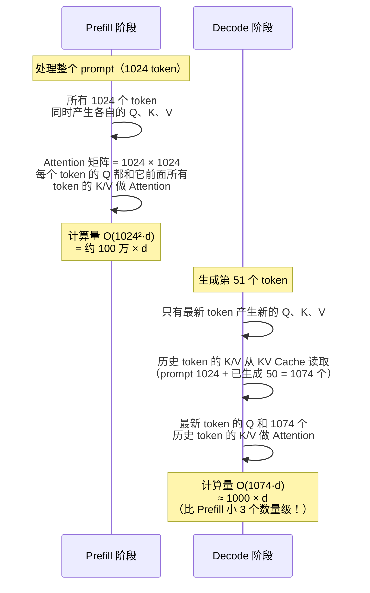
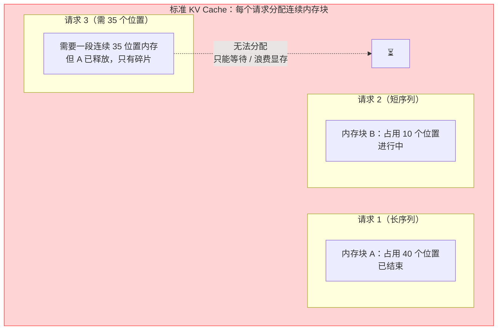
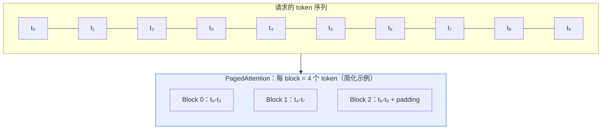
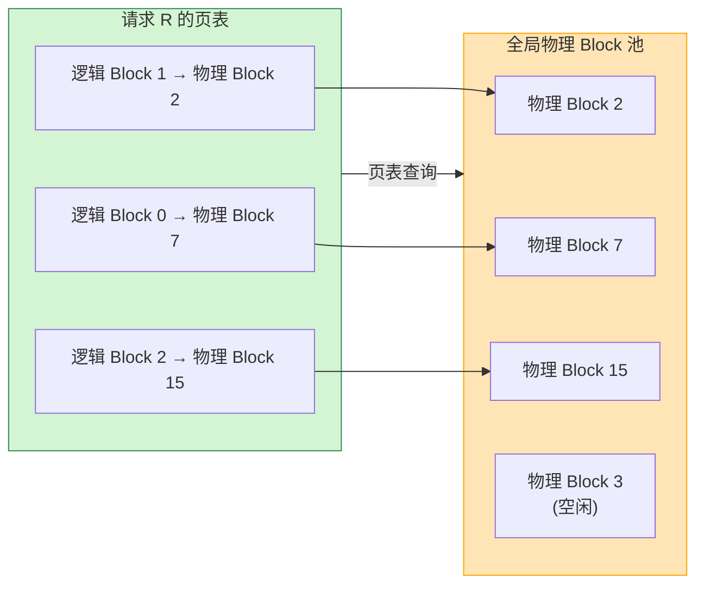
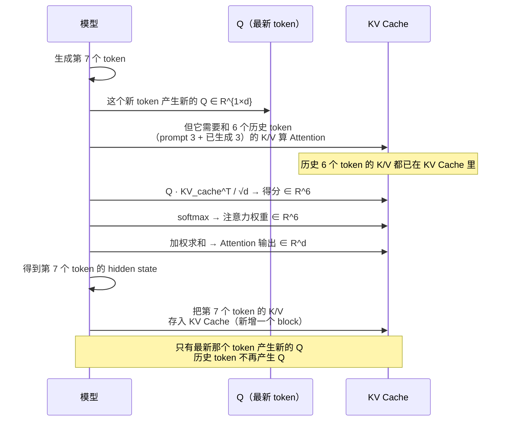
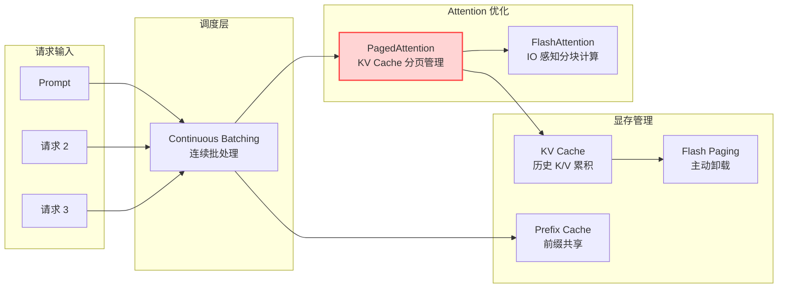

# PagedAttention 基本原理

> **一句话总结**：PagedAttention 是 VLLM 的核心技术——它把 LLM 推理时的 **KV Cache 像操作系统的虚拟内存一样分页管理**，用固定大小的"页"（block）代替连续内存区域，通过"页表"做虚拟到物理的映射，彻底消除了传统 KV Cache 管理中的**内存碎片**。同时它的计算内核与 FlashAttention 同源（分块 Attention + IO 感知），让推理吞吐比 HuggingFace `transformers` 实现高出 **2–4×** [1][2]。

本文遵循本仓库的设计原则：**先讲清"为什么"，再讲"怎么做"**，并明确标注**关联技术**与**边界、代价**。

- 适用版本前提：本文机制描述基于 vLLM 的原始 PagedAttention 论文 [1]（SOSP 2023）与 vLLM 源码实现（v0.6+）。PagedAttention 已成为几乎所有现代 LLM 推理框架（vLLM、TensorRT-LLM、SGLang、LMDeploy）的标准 KV Cache 管理方案 [2]。

---

## 1. 它为什么存在：LLM 推理的 KV Cache 困境

### 1.1 LLM 推理的两阶段

LLM 推理（自回归生成）分为两个完全不同的阶段 [1][2]：

| 阶段 | 描述 | 典型行为 |
| --- | --- | --- |
| **Prefill** | 输入整个 prompt，所有 token 同时做前向 | 用户提问后，模型一次性处理完 1024 个 prompt token |
| **Decode** | 逐 token 生成输出，每步只计算一个新 token | 模型每秒钟生成 30–50 个 token |

这两个阶段的计算模式完全不同，是理解 PagedAttention 的基础。

### 1.2 为什么需要 KV Cache

在 Decode 阶段，模型逐 token 生成第 1、2、3... 个输出 token。如果每生成一个新 token 都把**整个序列**（prompt + 已生成 token）重新做一遍前向计算，那生成 n 个 token 的总计算量是 O(n²·d)——代价大到不可接受。

**KV Cache** 的核心优化是：**把每个层、每个头、每个历史 token 的 K 和 V 向量存起来**，生成新 token 时直接复用，避免重复计算历史 token 的 K/V。

> **关键澄清：Decode 阶段最后一个 token 要不要和前面的 token 计算 Attention？**
>
> **答案是：要——但只有它自己的 Q 会和前面所有历史 token（包括自己）的 K/V 做 Attention。**
>
> 更准确地说：
> - **最新生成的那个 token** 会产生新的 Q、K、V
> - 它的 **Q** 必须和**所有历史 token（包括自己）** 的 K/V 做 Scaled Dot-Product Attention
> - **历史 token 不再产生新的 Q**——因为它们的输出已经固定了，不需要再算
> - 所以每步 Decode 的 Attention 计算量是 **O(n·d)**，而不是 O(n²·d)
>
> KV Cache 存在的**根本原因**就是：把历史 token 的 K/V 存下来供"最新那个 token"的 Q 使用。如果最新 token 不需要和历史 token 算 Attention，那 KV Cache 就没有存在的必要了。

下面用一个具体例子把这两阶段的 Attention 计算量摊开看：

### 1.3 Prefill vs Decode 的 Attention 计算差异

设 prompt 长度 = 1024，已生成 50 个 token，现在要生成第 51 个 token。



| 阶段 | Q 的来源 | K/V 的来源 | Attention 矩阵形状 | 计算量 |
| --- | --- | --- | --- | --- |
| **Prefill** | 所有 n 个 token | 所有 n 个 token | `[n × n]`（方阵） | **O(n²·d)** |
| **Decode（第 t 步）** | 仅最新的 1 个 token | 所有 t 个历史 token | `[1 × t]`（行向量 × 长矩阵） | **O(t·d)** |

Decode 阶段每步的计算量随已生成长度线性增长，这就是为什么长输出的推理速度会越来越慢——每生成一个新 token，它的 Q 都要和越来越多的历史 K/V 做 Attention。

### 1.4 标准 KV Cache 的内存碎片问题

朴素的 KV Cache 实现方式是：**为每个请求分配一段连续内存**来存它的所有 K/V 张量。这种方式在多请求并行（连续批处理）场景下会产生严重的**内存碎片** [1]：



VLLM 论文原文给出了量化结果：**标准连续内存管理下，实际可用 KV Cache 显存只有总显存的 **40%–60%**——剩下的 40%–60% 是碎片** [1]。这直接导致两个问题：

1. **显存利用率低**：实际能并发处理的请求数远低于理论最大值
2. **吞吐量受限**：不得不频繁做内存拷贝（defragmentation）来整理碎片，引入额外延迟

### 1.5 PagedAttention 的核心洞见

VLLM 团队的核心洞见是 [1]：

> LLM 的 KV Cache 和操作系统的**虚拟内存**是同构的——两者都具有（a）访问顺序随机、（b）生命周期各异、（c）需要高效管理有限物理内存这三个特征。

操作系统用**分页**（Paging）+ **页表**（Page Table）+ **按需分配**（Demand Paging）解决物理内存碎片问题。PagedAttention 把这套思路原封不动地搬到了 GPU 显存上管理 KV Cache。

---

## 2. KV Cache 的内存构成

在讲 PagedAttention 之前，先搞清楚 KV Cache 里**到底存了什么**。

### 2.1 一个 token 的 K/V 有多大

以 LLaMA 2 70B 为例 [3]：

| 参数 | 数值 |
| --- | --- |
| 层数 | 80 |
| 注意力头数 | 64 |
| 每个头的维度 `d_k` | 128 |
| KV 头数 | 8（GQA） |
| 精度 | fp16（2 字节/元素） |

一个 token 在**单层、单头**的 K/V 张量大小：
```
K 大小 = d_k × bytes_per_element = 128 × 2 = 256 字节
V 大小 = 同上 = 256 字节
单头 K+V = 512 字节
```

一个 token 在**整个模型**的 KV Cache 大小：
```
总大小 = 层数 × KV 头数 × 单头 K+V 大小
      = 80 × 8 × 512 bytes
      = 327,680 bytes ≈ 320 KB
```

### 2.2 KV Cache 总显存估算

设 batch 有 16 个并发请求，平均序列长度 4096：

```
KV Cache 总元素数 = 16 请求 × 4096 token × 80 层 × 8 KV 头 × 128 d_k × 2 (K+V)
                  ≈ 107 亿 个 fp16 元素
                  ≈ 21.4 GB
```

这就是为什么 LLM 推理的显存瓶颈通常在 KV Cache 而不是模型参数——特别是多请求并发 + 长序列场景。

---

## 3. PagedAttention 的核心机制

### 3.1 把 KV Cache 分页

PagedAttention 把所有 KV Cache 张量切分成**固定大小的"页"（block）**，和操作系统的内存页概念一致 [1]：

- 每个 page 包含 `block_size` 个 token 的 K/V
- 每个模型层、每个 KV 头都需要独立的 page 空间
- 所有 page 组成一个**全局页池**（global block pool），类似操作系统的物理内存

论文中默认 `block_size = 16`（即每个 page 存 16 个 token 的 K/V）[1]。



### 3.2 页表：虚拟到物理的映射

每个请求都有自己的**页表**（page table），记录它的逻辑 block 序列映射到全局页池中的**物理 block ID** [1]：



**核心好处**：物理 block 可以在全局页池里**乱序存放**——请求 R 的第 0 个逻辑 block 可能在物理 block 7，第 1 个在物理 block 2。这种设计彻底消除了对连续内存的依赖：

> 当一个请求结束释放它的物理 block 后，这些 block 立即回到全局池，可被任何新请求**复用**，完全不需要做内存碎片整理 [1]。

### 3.3 PagedAttention 的 Attention 计算内核

有了分页的 KV Cache，Attention 计算怎么进行？PagedAttention 的算法和 FlashAttention 同源——**把 Q 和 K/V 都按 block_size 分块，逐块计算 Attention，块内用 Softmax 归一化，块间做 Online Softmax 融合** [1][4]。

#### Decode 阶段的 Attention 计算（每步 1 个 query）

Decode 阶段每次只有 **1 个新 query**，需要和历史所有 block 的 K/V 做 Attention：

```
输入：Q ∈ R^{1×d_k}（最新 token 的 query）
      已填充的 block 列表 B₁, B₂, ..., Bₙ（每个包含 block_size 个 token 的 K/V）
      页表 P（记录逻辑 block → 物理 block 的映射）

for 每个逻辑 block Bᵢ（按顺序遍历）：
    根据 P 查到物理地址 → 加载 Kᵢ, Vᵢ ∈ R^{block_size × d_k}
    Sᵢ = Q · Kᵢ^T / √d_k          # 局部分数
    Aᵢ = softmax(Sᵢ)              # 局部注意力权重
    Oᵢ = Aᵢ · Vᵢ                  # 局部输出
    # Online Softmax 融合（类似 FlashAttention）
    O = merge(O, Oᵢ, local_max, global_max)

返回 O（最终输出，包含所有历史 token 的信息）
```

关键点：
- 因为 Decode 阶段 Q 只有 1 行，**不需要在 Q 维度做分块**（直接就是一个 block）
- K/V 从页表指定的物理地址加载，可以**乱序**——这是 PagedAttention 的意义所在
- Online Softmax 保证跨 block 的 softmax 归一化正确（不同 block 的分数尺度不同，不能直接拼接）

#### Prefill 阶段的 Attention 计算

Prefill 阶段的 Q 也按 block_size 分块，然后 Q 块和 K/V 块做**块对块**的 Attention 计算。因为 causal mask 的存在，第 i 个 Q 块只能关注 ≤ i 的 K/V 块——和 FlashAttention 的 tiled 计算完全一致 [1][4]。

### 3.4 动态增长：按需申请物理 block

当一个新 token 生成后，它的 K/V 需要存入新的物理 block：

1. 检查请求当前最后一个逻辑 block 是否还有空位（即填充的 token 数 < block_size）
2. 如果还有空位，直接把新 token 的 K/V 写进去——**零额外开销**
3. 如果已满，从全局页池**按需申请**一个新的物理 block，在页表里追加映射——类似操作系统的 Demand Paging [1]

这种"按需分配 + 全局复用"的策略，让 PagedAttention 能把**90%+ 的 KV Cache 显存利用起来**，几乎消除了碎片 [1]。

---

## 4. 再谈 Decode 阶段的 Attention：答用户的核心问题

> **"Decoding 阶段最后一个 token 要不要和前面的 token 计算 Attention？"**

这个问题值得再深入讲一遍，因为它是 KV Cache 存在的根本原因，也是理解 PagedAttention 的关键。

### 4.1 一个时序例子

设 prompt = `[我, 爱, 北京]`（3 个 token），现在开始 Decode，已经生成了 `[是, 中国, 的]`（3 个 token），现在要生成**第 7 个 token**（历史共 6 个）。



### 4.2 为什么必须和所有历史 K/V 做 Attention

这是 Transformer causal mask 的内在要求：Decoder 侧（包括 LLaMA/GPT 这类因果语言模型的整个模型）的 Self-Attention 必须满足：

> 位置 i 的 hidden state 只能依赖位置 ≤ i 的所有 token 的信息 [5]

所以当模型在第 7 步生成时：
- 第 7 个 token 的 hidden state 必须融合 **token 0–6**（包括 prompt 和已生成 token）的信息
- 它的 Q 必须和 token 0–6 的 K/V 都做 Attention
- 这就是为什么 KV Cache 需要**累积所有历史 K/V**，不能丢

### 4.3 为什么历史 token 不再产生新的 Q

这是 Decode 阶段的**计算对称性打破**：

- **Prefill 阶段**：所有 token 同时计算，每个 token 都产生 Q，每个 Q 和它前面的所有 K/V 做 Attention——这是一个 `n×n` 的方阵计算
- **Decode 阶段**：历史 token 的 hidden state 已经算完、已经决定了它们各自的输出 token，不需要再重新算了。所以历史 token 不需要产生新的 Q

这就解释了为什么 KV Cache **只需要存 K 和 V，不需要存 Q**——Q 在 Decode 阶段只存在于**最新那一个 token**。

### 4.4 用张量形状总结

| 阶段 | Q 的形状 | KV Cache 的形状 | Attention 计算 |
| --- | --- | --- | --- |
| Prefill（长度 n） | `[n, h, d_k]` | 无（当场算） | `[n, n]` 方阵 × V |
| Decode 第 t 步（新生成 1 个 token） | `[1, h, d_k]` | `[t, h_kv, d_k]` | `[1, t]` 行向量 × V |

> **一句话结论**：在 Decode 阶段，**最新生成的那个 token 的 Q 必须和所有历史 token（包括自己）的 K/V 做 Attention**——这是 causal mask 的数学要求，也是 KV Cache 存在的唯一理由。但历史 token 不再产生新的 Q，所以每步只有 1 个 query 需要计算。

---

## 5. Prefill vs Decode 在 PagedAttention 下的差异

PagedAttention 对两阶段的处理方式也不同：

| 维度 | Prefill | Decode |
| --- | --- | --- |
| **Q 的块化** | Q 按 block_size 分块（和 K/V 块对块） | Q 就是 1 行，不分块 |
| **块访问模式** | 连续顺序访问（causal mask 只看前面的块） | 按页表乱序访问所有历史块 |
| **KV Cache 写入** | 一次性写入 prompt 的所有 block | 每步追加 1 个 token 的 K/V（可能填满当前块或申请新块） |
| **计算模式** | 块 × 块矩阵乘 | 行向量 × 块矩阵乘 |
| **FlashAttention 协同** | 完全一致（FlashAttention 就是为这种 tiled 设计的） | 类似 FlashAttention-2 的单 query 模式 |
| **瓶颈** | 计算（O(n²·d)） | 内存带宽（每步从 KV Cache 读 O(t·d) 数据） |

> 值得注意的是，Decode 阶段从块中**乱序读取 K/V**（因为页表的物理映射可以跳着来）——这在硬件上可能比连续读取略慢，但**和消除碎片带来的显存利用率提升相比，这点开销完全可接受** [1]。

---

## 6. 与 FlashAttention 的关系

PagedAttention 和 FlashAttention 是**互补而非替代**的关系：

| 技术 | 解决的问题 | 核心方法 |
| --- | --- | --- |
| **FlashAttention** [4] | Attention 计算的 **IO 瓶颈**（显式物化 `n×n` 注意力矩阵） | 分块计算 + Online Softmax + 不物化完整矩阵 |
| **PagedAttention** [1] | KV Cache 管理的 **内存碎片** | 分页 + 页表 + 全局复用 |

实际上 PagedAttention 的计算内核**就是 FlashAttention 风格的**——它用 Online Softmax 在块间融合结果，不物化完整的注意力矩阵 [1]。可以理解为：

> **PagedAttention = FlashAttention 的块内计算内核 + 虚拟内存式的 KV Cache 管理**

vLLM 中 PagedAttention 的实现位于 `vllm/model_executor/layers/attention.py`，它调用 CUDA kernel（如 `paged_attention_v1` / `paged_attention_v2`）来完成**块内 FlashAttention 式的计算 + 跨块 Online Softmax 融合**。

---

## 7. 边界与代价

### 7.1 Block Size 的权衡

`block_size` 是 PagedAttention 最关键的配置参数 [1]：

| 维度 | block_size 大 | block_size 小 |
| --- | --- | --- |
| **内部碎片** | 大（最后一个 block 可能只填充了一半） | 小 |
| **块数量 / 页表大小** | 少（页表小） | 多（页表大） |
| **块内计算效率** | 高（GPU 喜欢大矩阵乘） | 低 |
| **按需分配开销** | 低（申请频率低） | 高 |

论文默认 `block_size = 16`，是在内部碎片和计算效率之间的平衡点 [1]。

### 7.2 页表开销

每个请求需要一个页表来记录逻辑 block → 物理 block 的映射。对于长序列（128K tokens），页表会变得很大：

```
128K tokens / 16 per block = 8192 个 block
8192 个逻辑 block × 8 bytes/entry = 64 KB / 每个请求
```

多请求并发（1000 个请求）时页表本身需要 ~64 MB——可接受但不可忽略。

### 7.3 跨块 Online Softmax 的精度

PagedAttention 的块间 Online Softmax 需要在每个 block 计算时维护全局 softmax 的 running max 和 running sum（类似 FlashAttention 的 online normalization）[1][4]。如果实现不当，可能引入数值精度损失。现代实现都做了严格的 fp32 累加来避免这个问题。

### 7.4 外部碎片为零，内部碎片仍存在

PagedAttention 彻底消除了**外部碎片**（块与块之间的空隙），但无法消除**内部碎片**（最后一个 block 只填充了部分 token）。内部碎片的期望是 `block_size / 2`——在 block_size = 16 时，平均浪费 8 个 token 的空间，约 **50%** 的最后一个 block 空间是浪费的。但这种浪费是可预测且有限的，远好于标准 KV Cache 的随机 40–60% 外部碎片。

### 7.5 不改变 Attention 的数学结果

PagedAttention 的分页和块内计算**不改变 Attention 的数学定义**——它只是换了一种更高效的内存管理和计算方式。这意味着：
- 用 PagedAttention 推理出的结果和"用标准连续 KV Cache 推理"的结果**在数学上等价**
- 精度损失只可能来自块间 Online Softmax 的数值实现细节（通常 fp32 累加可消除）

---

## 8. 可验证：vLLM 中观察 PagedAttention

### 8.1 用 vLLM 启动一个服务

```bash
pip install vllm
vllm serve meta-llama/Llama-2-7b-chat-hf \
    --max-num-batched-tokens 4096 \
    --block-size 16          # PagedAttention 的 block_size
```

### 8.2 观测要点

| 想验证什么 | 怎么做 |
| --- | --- |
| PagedAttention 的 block 大小 | 在 vLLM 日志中找 `block_size` 参数，或查看 `vllm/config.py` 默认值 |
| KV Cache 利用率 | 用 `vllm.LLMEngine` 启动后调用 `engine.get_kv_cache_info()`，观察 `num_free_blocks` 和碎片化率（应接近 0%） |
| Prefill vs Decode 的 token 处理差异 | 开启 vLLM 的 timing profiler（`--enable-profile`），观察 prefill step 和 decode step 的时间分布 |
| 页表映射 | 在 `vllm/worker/worker.py` 中打印 `model.llm_engine.kv_cache` 的 page table 内容 |
| 动态 block 申请 | 单请求长 prompt 场景，观察 `num_total_blocks` 随请求序列长度增长的曲线 |

### 8.3 对比实验

```python
# 用 vLLM vs HuggingFace transformers 跑相同的推理任务
from vllm import LLM, SamplingParams

llm = LLM(model="meta-llama/Llama-2-7b-chat-hf")
params = SamplingParams(temperature=0.8, max_tokens=512)

prompts = ["写一首关于春天的诗" for _ in range(32)]
outputs = llm.generate(prompts, params)

# 对比 HF transformers 的推理时间
# 预期：vLLM 吞吐约为 HF 的 2–4×
```

---

## 9. 关联：它在知识网络中的位置



- **与 FlashAttention**：计算内核复用，PagedAttention 是 FlashAttention + 虚拟内存管理的组合。
- **与 Continuous Batching**：PagedAttention 是连续批处理的显存基础设施——没有 PagedAttention，多请求并行的 KV Cache 碎片问题会让吞吐很低。
- **与 Prefix Cache**：前缀共享（多个请求有共同的系统 prompt）可以让它们**共享物理 block**（页表映射到相同的物理 block），进一步节省 KV Cache。
- **与 KV Cache 压缩**（量化 / Sink Token / StreamingLLM）：可叠加使用——先 GQA 减少 KV 头数，再 PagedAttention 管理分页，再量化减少每个元素的位数。

---

## 10. 延伸阅读

- VLLM 官方文档 *Introduction to PagedAttention*：<https://docs.vllm.ai/en/latest/design/paged_attention.html> [2]
- 原论文 Kwon et al. *Efficient Memory Management for Large Language Model Serving with PagedAttention*：<https://arxiv.org/abs/2309.06180> [1]
- FlashAttention 原论文（PagedAttention 计算内核的理论基础）：<https://arxiv.org/abs/2205.14135> [4]
- 本仓库《注意力机制基本原理》第 3.4 节：MHA / GQA / MQA 与 KV Cache 大小推导

---

## 参考文献

1. Kwon, W., Li, Z., Zhuang, S., Sheng, Y., Zheng, L., Yu, C. H., Gonzalez, J. E., Zhang, H., Stoica, I. *Efficient Memory Management for Large Language Model Serving with PagedAttention*. 29th ACM Symposium on Operating Systems Principles (SOSP 2023). arXiv:2309.06180. <https://arxiv.org/abs/2309.06180>
2. VLLM Team. *PagedAttention*（官方设计介绍与实现）。<https://docs.vllm.ai/en/latest/design/paged_attention.html>
3. Touvron, H., Lavril, T., Izacard, X., et al. *LLaMA 2: Open Foundation and Fine-Tuned Chat Models*. arXiv:2307.09288 (2023). <https://arxiv.org/abs/2307.09288>
4. Dao, T., Fu, D. Y., Ermon, S., Rudra, A., Ré, C. *FlashAttention: Fast and Memory-Efficient Exact Attention with IO-Awareness*. NeurIPS 2022. arXiv:2205.14135. <https://arxiv.org/abs/2205.14135>
5. Vaswani, A., Shazeer, N., Parmar, N., et al. *Attention Is All You Need*. NeurIPS 2017. arXiv:1706.03762. <https://arxiv.org/abs/1706.03762>

### 图片来源与许可声明

本文所有机制图均为 **Mermaid 自绘**，GitHub 原生渲染，无第三方版权：

| 图 | 类型 | 说明 |
| --- | --- | --- |
| 标准 KV Cache 连续内存管理示意图（第 1.4 节） | Mermaid flowchart | 自绘 |
| Prefill vs Decode 两阶段时序图（第 1.3 节） | Mermaid sequenceDiagram | 自绘 |
| 分页示意图（第 3.1 节） | Mermaid flowchart | 自绘 |
| 页表映射图（第 3.2 节） | Mermaid flowchart | 自绘 |
| Decode 阶段 Attention 时序图（第 4.1 节） | Mermaid sequenceDiagram | 自绘 |
| 知识网络图（第 9 节） | Mermaid flowchart | 自绘 |

> Mermaid 是一种广泛使用的图表描述语言，GitHub 2022 年起原生支持渲染（GitHub Blog: "Mermaid is now supported in markdown on GitHub"）。文中所有 Mermaid 图均可在 GitHub Markdown 查看器中直接渲染，无需外部图片文件。
