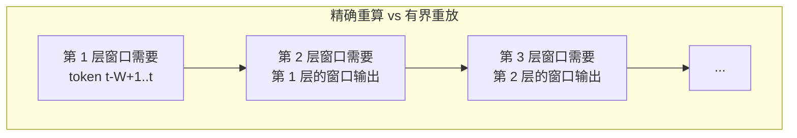
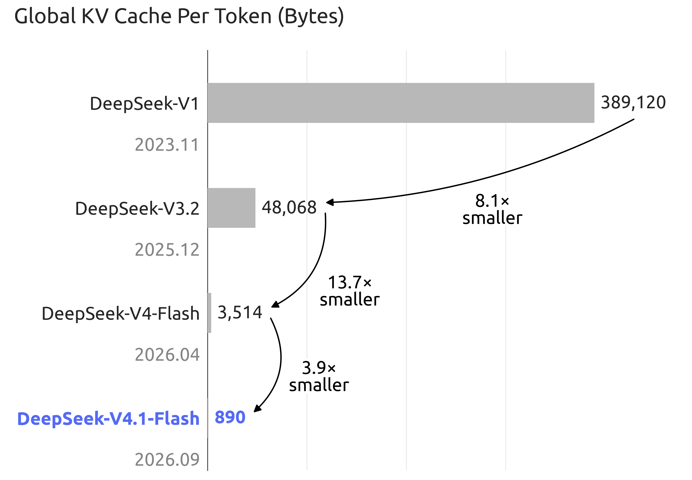
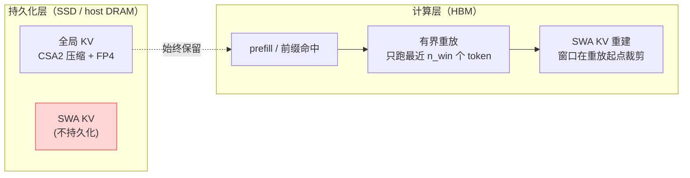
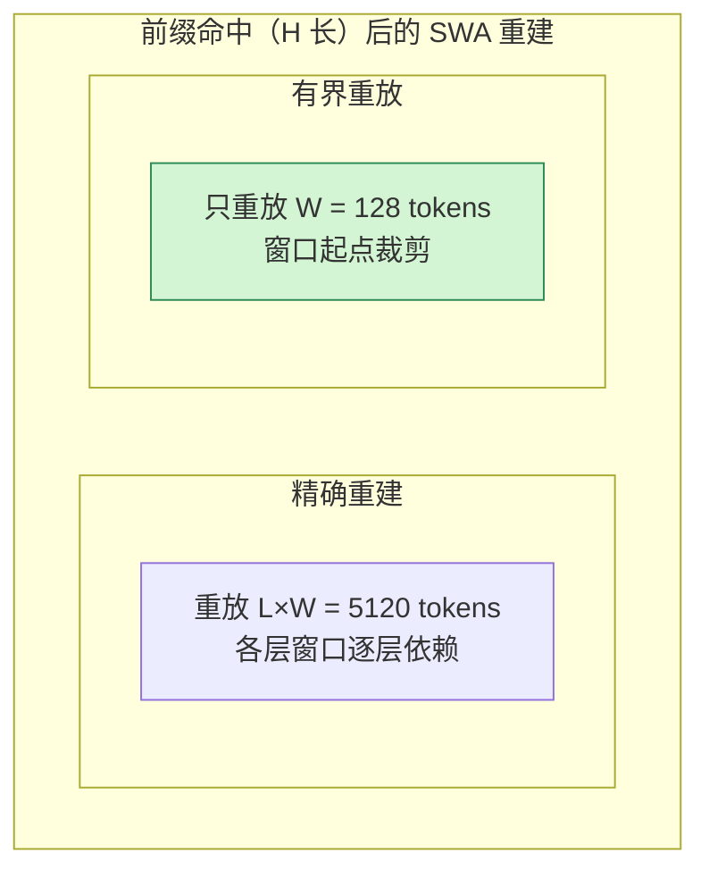
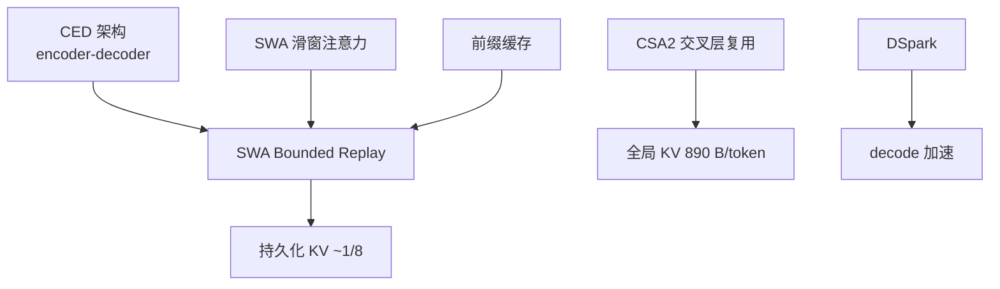

# SWA 有界重放基本原理

> **一句话总结**：SWA 有界重放（SWA Bounded Replay）是一种面向滑动窗口注意力（Sliding Window Attention, SWA）的**部署级 KV Cache 优化**：不再把每层 SWA 的 KV 完整持久化到 SSD / 主机内存，而是只**持久化全局 KV、在需要时重放最近 $n_{win}$ 个 token 来近似重建 SWA KV 状态**。它把"跨层 SWA KV 精确重建需要重放 $L \times n_{win}$ 个 token"压缩为"只重放 $n_{win}$ 个 token"，从而把 DeepSeek-V4.1-Flash 的**持久化 KV 占用降到上一代的约 1/8**，同时质量损失可忽略 [1][2]。

本文遵循本仓库的设计原则：**先讲清"为什么"，再谈"怎么做"**，并明确标注**关联技术**与**边界、代价**。

- 适用版本前提：SWA 基于 Beltagy et al. (Longformer, 2020) [3]；有界重放概念源自 Gemini 1.5 报告中的 bounded replay 变体 [4]；本文以 DeepSeek-V4.1-Flash 的 SWA Bounded Replay 工程实现为主要对象（arXiv:2609.19969 [1] 与 vLLM 落地 [2]）。**脱离 CED 架构、前缀缓存与路由分布的加速比结论不成立**。

---

## 1. 它为什么存在：SWA 的"有界 KV"但"无边存储"

### 1.1 SWA 让单层 KV 有界，但跨层存储失控

滑动窗口注意力限制每个 token 只能注意到前 $W$ 个 token：

- **优点**：单层 KV Cache 大小固定为 $O(W)$，不随序列长度增长；
- **隐患**：模型有 $L$ 层，每层都有自己的 SWA KV。

DeepSeek-V4.1-Flash 共 40 层（20 层 encoder + 20 层 decoder），每层都有 SWA（窗口 $n_{win}=128$）。虽然全局 KV 已压缩到 890 B/token，但 **SWA KV 覆盖每个缓存命中边界的最近 128 个位置，存储开销超过全局 KV 的 10 倍** [2]。

### 1.2 前缀缓存放大了存储矛盾

长会话 / Agent 场景大量复用前缀（prompt prefix）。前缀缓存（prefix caching）需要在**每一个可能的命中边界**都保存各层的 SWA KV，使得 SWA KV 成为持久化缓存的主要部分（V4 中 SWA KV 约占持久化缓存的近一半 [5]）。随着并发会话增多，这部分存储与带宽成本线性放大。

### 1.3 精确重建太贵，只能"近似重放"

有人会问：既然 SWA KV 只有 $W$ 个 token，为何不直接**重算**？

- **精确重算**：每层窗口依赖下层窗口，跨 $L$ 层重建需要**重放约 $L \times n_{win}$ 个 token**（V4.1-Flash 为 $40 \times 128 = 5120$）[1][2]，计算量与层数线性放大，生产环境不可接受；
- **有界重放**：只重放最近 $n_{win}=128$ 个 token，并在重放起点处**裁剪 SWA 窗口**，一次前向近似得到各层 SWA KV。

### 1.4 可行的前提：SWA 的有效感受野很小

DeepSeek 指出，已有研究（[1] 引用）表明 **SWA 的实际有效感受野远小于理论值 $n_{win} \times L/2$**。因此"只重放最近 $n_{win}$ 个 token"足以近似重建各层 SWA 状态——这是整个方案成立的经验基础。

---

## 2. 核心机理

### 2.1 总体思路

SWA Bounded Replay 的核心是**把"存储 SWA KV"替换成"按需重放重建"**：

### 2.2 Encoder SWA Bounded Replay：前缀命中后重建窗口

当请求前缀命中缓存时，全局 KV 可直接恢复，但每层的 SWA KV 不在缓存中。Encoder 侧的处理 [2]：

- 重建所有层 SWA KV，需要把**命中点之前的最后 $W$ 个 token 重新跑一遍 encoder**；
- 精确重建需要 $L \times W$ 个 token 的重放（5120 个）；
- 有界重放：**只重放最后 $W=128$ 个 token**，并在每层的窗口起点处裁剪（clipped），近似重建。

### 2.3 Decoder SWA Bounded Replay：prefill 只跑最后 $n_{win}$ 个 token

Decoder 侧更进一步 [1][5]：

- Decoder 的全局 KV 由 encoder 末层隐状态经投影生成（YOCO 风格），**prompt token 不必进入 decoder**；
- Decoder 每层仍有 SWA，但其有效感受野很小；
- 因此 **prefill 阶段只对 prompt 的最后 $n_{win}=128$ 个 token 执行 decoder SWA 计算**，其余 token 的 decoder 前向整体跳过。

效果：**Decoder 侧 prefill 计算量近乎减半**，这与 CED 架构的 $O(N \times L/2)$ 分析一致 [5]。

### 2.4 为什么"有界"是安全的

- **窗口裁剪**：重放起点之外的历史本来就在 SWA 窗口之外，裁剪不额外丢失信息；
- **近似而非精确**：结果不是 bit-exact，但 DeepSeek 实验表明质量损失**可忽略**（negligible）[1][2]；
- **代价可控**：缓存 miss 时才需要重建，TTL 级（分钟级）的 DRAM 池承接短期复用 [5]。

---

## 3. 关联关系

| 技术 | 关系 | 说明 |
| --- | --- | --- |
| **[SWA / 滑窗注意力](稀疏与滑窗注意力基本原理.md)** | 上游机制 | Bounded Replay 解决的是 SWA 的 KV 持久化问题，不改变 SWA 语义 |
| **CED（Causal Encoder-Decoder）** | 架构前提 | 全局 KV 由 encoder 投影生成，prompt 不进 decoder，才使"只重放最后 $n_{win}$ 个 token"可行 |
| **CSA2（压缩稀疏注意力）** | 姊妹技术 | 交叉层 KV / index 复用解决**全局** KV 占用；Bounded Replay 解决**SWA** KV 持久化 |
| **FP4 KV Cache** | 姊妹技术 | 数值精度压缩，与 Bounded Replay 正交叠加 |
| **DSpark 投机解码** | 正交优化 | 降低 decode 计算，不涉及 KV 持久化 |
| **前缀缓存（prefix caching）** | 触发场景 | Bounded Replay 让前缀命中不再需要存储 10 倍以上的 SWA KV |
| **YOCO（You Only Cache Once）** | 思想源头 | decoder 全局 KV 复用 encoder 隐状态 [6] |

---

## 4. 边界与代价

### 4.1 优点

| 优点 | 说明 |
| --- | --- |
| **持久化 KV 大幅下降** | SWA KV 不再落 SSD / host DRAM，持久化占用约为上一代的 1/8 [1] |
| **prefill 计算减少** | decoder 只跑最后 $n_{win}$ 个 token，prefill 近乎减半 [1][5] |
| **TTFT 降低** | vLLM 实测约 **30% TTFT 减少**（配合 CUDA Graph）[2] |
| **前缀缓存友好** | 命中边界不再需要保存每层 SWA KV，缓存复杂度从 $O(L \cdot W \cdot \mathrm{numHitBoundaries})$ 骤降 |
| **质量损失可忽略** | DeepSeek 报告近似重放性能退化可忽略 [1] |

### 4.2 缺点与代价

| 缺点 | 说明 | 严重程度 |
| --- | --- | --- |
| **非 bit-exact** | 窗口裁剪 + 近似重放，输出与精确执行不完全一致 | 🟡 质量风险（实验认为可忽略，但非数学保证 [5]） |
| **依赖经验观察** | 成立前提是"SWA 有效感受野远小于 $n_{win} \times L/2$"，对特定架构未必成立 | 🟡 前提风险 |
| **缓存 miss 需要重建** | miss 时仍需重放最近 $W$ 个 token，重建有计算开销 | 🟡 中等 |
| **强耦合 CED 架构** | 离开"prompt 不进 decoder"的结构，decoder 侧无法跳过 prefill | 🔴 架构绑定 |
| **实现复杂度** | 需要引擎级支持（vLLM 提供 `--[no-]swa-bounded-replay` 开关）[2] | 🟡 中等 |

### 4.3 适用模型与场景

**适用模型特征**：
- CED / YOCO 风格架构（decoder 全局 KV 由 encoder 投影生成）；
- 每层含 SWA 与全局注意力（如 DeepSeek-V4.1-Flash、Gemini 1.5 的稀疏层 [4]）；
- 窗口 $W$ 与层数 $L$ 乘积巨大、精确重放不可行的模型。

**适用场景**：
- **长上下文 Agent / 工具调用**：前缀反复复用，KV 持久化成本主导 [1]；
- **输入密集型工作负载**（读长文档、看长视频、多轮长会话）：prefill 计算占比高；
- **并发大规模长会话部署**：持久化 KV 决定单节点可承载会话数 [5]。

**不适用场景**：
- 无 SWA 的纯全局注意力模型（无窗口可重建）；
- 对输出精确性有硬性要求、不能容忍近似重放的应用；
- SWA 有效感受野接近理论值的小窗口 / 少层模型（近似误差被放大）。

---

## 5. 可验证实验

### 5.1 DeepSeek 官方结论 [1]

| 指标 | 数值 |
| --- | --- |
| 全局 KV | 890 B/token（V4-Flash 的约 1/4，V1 的约 1/437） |
| 持久化 KV | V4-Flash 的约 1/8（SWA KV 不再持久化） |
| 质量损失 | 报告为可忽略 |

### 5.2 vLLM 端到端验证 [2]

vLLM 实现 `--[no-]swa-bounded-replay`（DeepSeek-V4.1 默认开启），配合 CUDA Graph：

- **~30% TTFT 降低**；
- 叠加 MegaAttention / DeepSelect 等 kernel 优化后，Agentic 工作负载吞吐提升约 5×（见下图，从 2026-09-11 基线到 2026-10-02 优化版）。

> 注意：5.8× / 5× 是全栈优化的综合结果（SWA Bounded Replay + kernel 融合 + 调度），SWA Bounded Replay 单独贡献约为 30% TTFT 减少 [2]。

---

## 6. 对比表

### 6.1 SWA KV 三种处理方式

| 维度 | 全量持久化 | 精确重算 | SWA 有界重放 |
| --- | --- | --- | --- |
| 存储开销 | $O(L \cdot W \cdot \mathrm{numHitBoundaries})$，占持久化缓存近半 | 无存储 | **无存储** |
| 重建计算 | 无 | $L \times W$ 个 token（5120） | **$W$ 个 token（128）** |
| 精确性 | bit-exact | bit-exact | 近似（损失可忽略） |
| 适用性 | 存储充足、会话短 | 层数少、窗口小 | **CED 长上下文、前缀复用密集** |

### 6.2 有界重放的两个语境

| 语境 | 出处 | 作用对象 | 机制 |
| --- | --- | --- | --- |
| **Gemini 1.5 bounded replay** | [4] | 模型架构（稀疏层） | 把窗口外 token 的摘要以有界数量重放回窗口，保留长程信息 |
| **SWA Bounded Replay** | [1][2] | 部署系统（KV 持久化） | 不持久化 SWA KV，按需重放最近 $n_{win}$ 个 token 近似重建 |

两者理念相通：**"重放是低成本的，存储是有上限的"**。

---

## 7. 延伸阅读

- [稀疏与滑窗注意力基本原理](稀疏与滑窗注意力基本原理.md) — SWA 语义与长上下文稀疏化背景
- [张量并行推理基本原理](../分布式推理/张量并行推理基本原理.md) — KV Cache 在并行下的切分
- [MoE 基本原理](../../神经网络基础/MoE基本原理.md) — CED 中 MoE 层与 attention 的配合

---

## 参考文献

[1] DeepSeek-V4.1-Flash: Pushing the Limits of KV Cache Compression. DeepSeek-AI, arXiv:2609.19969, 2026. <https://arxiv.org/abs/2609.19969>

[2] DeepSeek-V4.1-Flash on vLLM: 5x Agentic Throughput Since Day 0. Inferact & vLLM Team, vLLM Blog, 2026-10-07. <https://vllm.ai/blog/2026-10-07-deepseek-v41-flash>

[3] Longformer: The Long-Document Transformer. Beltagy, Peters, Cohan, arXiv:2004.05150, 2020. <https://arxiv.org/abs/2004.05150>

[4] Gemini 1.5: Unlocking multimodal understanding across millions of tokens of context. Gemini Team, Google, arXiv:2403.05530, 2024. <https://arxiv.org/abs/2403.05530>

[5] DeepSeek V4.1 Flash: KV-Cache Compression — What the Reported 890 Bytes per Token Includes. flozi00, 2026-09-25. <https://flozi.net/en/guides/ai/deepseek-v41-flash-kv-compression-techniques>

[6] YOCO: You Only Cache Once. Sun et al., arXiv:2405.05254, 2024. <https://arxiv.org/abs/2405.05254>

---

## 图片来源声明

- [swabr-kvcache-evolution.png](assets/swabr-kvcache-evolution.png)：DeepSeek-V4.1-Flash 论文 Figure 1(b)（各代模型每 token 全局 KV 大小），作者 DeepSeek-AI，arXiv:2609.19969。下载自 <https://arxiv.org/html/2609.19969v1>，已本地化保存。
- [swabr-ttft-vs-throughput.png](assets/swabr-ttft-vs-throughput.png)：vLLM Blog 插图（DeepSeek-V4.1-Flash 在 GB300 NVL72 上的吞吐-延迟曲线，数据来源 SemiAnalysis InferenceX），作者 Inferact & vLLM Team，2026-10-07。下载自 <https://vllm.ai/blog/2026-10-07-deepseek-v41-flash>，已本地化保存。
- 其余流程图、示意图均由作者使用 Mermaid 语法在文档中直接绘制，无外部依赖。
