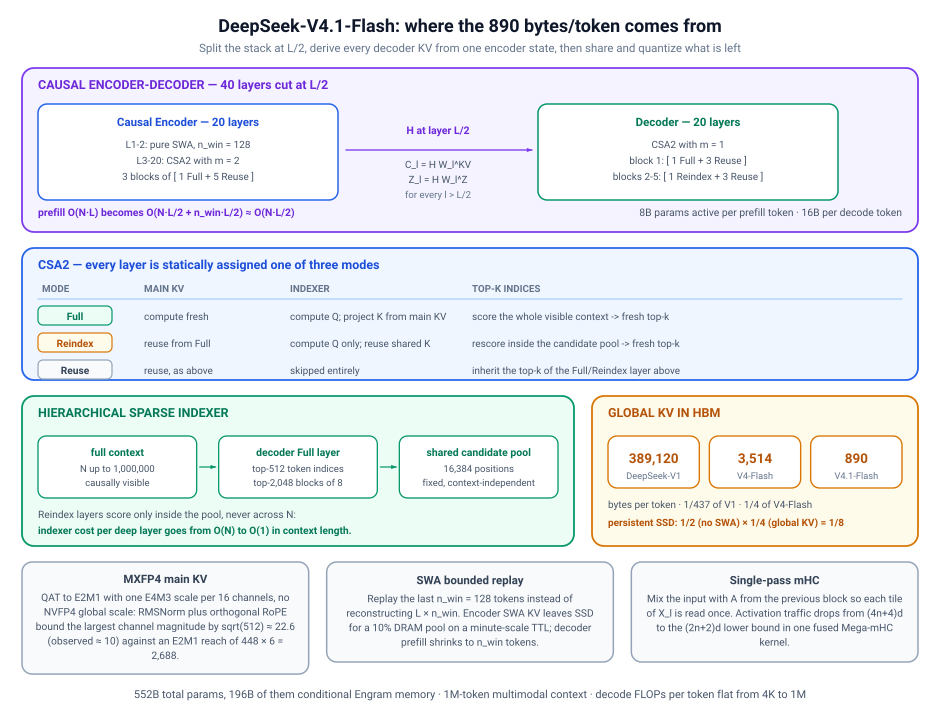
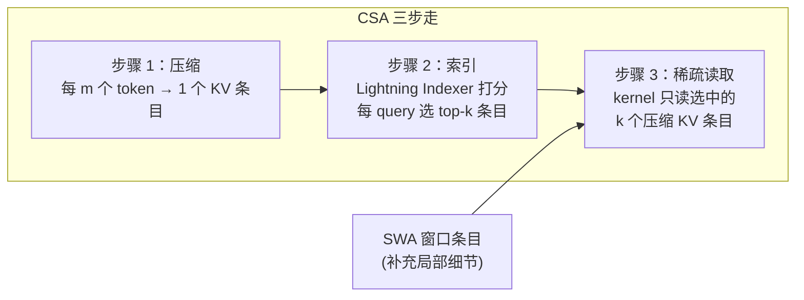
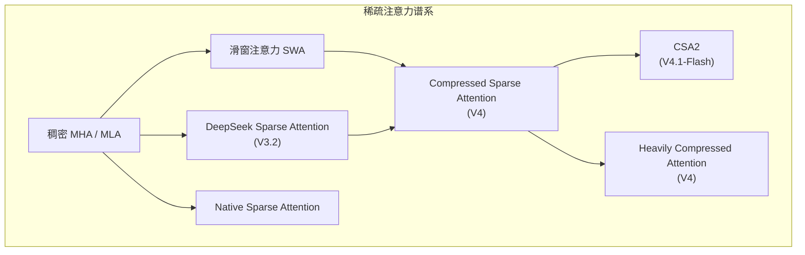
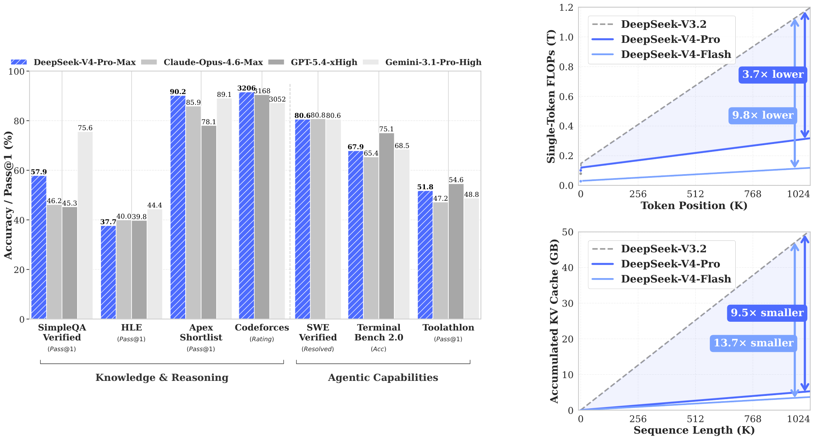

# 压缩稀疏注意力基本原理

> **一句话总结**：压缩稀疏注意力（Compressed Sparse Attention，CSA）是 DeepSeek 提出的一类面向超长上下文的稀疏注意力架构：先按固定块把 KV Cache 压缩成少量"压缩条目"，再用一个轻量索引器（Lightning Indexer）对压缩条目打分、挑出每 query 的 top-k 个条目，稀疏注意力 kernel 只读取这些条目。它把注意力计算从 $O(n^2)$ 降到 $O(n\cdot k)$（k 为稀疏选中的条目数），并把每 token 的全局 KV Cache 压缩到远低于 MLA 的水平 [1][2]。其第二代 CSA2 进一步加入**跨层 KV 与索引复用**和**层级稀疏索引器**，把 DeepSeek-V4.1-Flash 的全局 KV Cache 压到 890 B/token（V4-Flash 的约 1/4，V1 的约 1/437）[3][4]。

本文遵循本仓库的设计原则：**先讲清"为什么"，再谈"怎么做"**，并明确标注**关联技术**与**边界、代价**。

- 适用版本前提：CSA 基于 DeepSeek Sparse Attention（DSA，DeepSeek-V3.2 [5]）与 DeepSeek-V4 [1]；CSA2 基于 DeepSeek-V4.1-Flash [3]。**脱离稀疏度、压缩率、索引器质量与具体实现 kernel 的 CSA 收益结论不成立**。

---

## 1. 它为什么存在：长上下文的两堵墙

### 1.1 注意力计算是 $O(n^2)$，KV Cache 随序列线性膨胀

标准多头注意力（MHA）对长度 $n$ 的序列，每层注意力计算量为 $O(n^2 \cdot d)$，KV Cache 每层每 token 存 2 个 $d$ 维向量。到 1M token 上下文，无论算力还是显存都不可承受：

| 成本项 | 规模（1M token 时） | 瓶颈 |
| --- | --- | --- |
| Prefill 注意力 FLOPs | $O(n^2)$，随长度平方增长 | 算力 |
| KV Cache | 每层每 token 数百字节，1M token 下数百 GB | 显存/带宽 |

DeepSeek-V3 使用的 **MLA（Multi-head Latent Attention）** 用低秩潜变量压缩 KV，把单 token 的 KV 降到数百字节，但注意力仍是**稠密**的——每个 query 仍要扫过全部 key。长上下文下，稠密扫描的计算量成为主要矛盾。

### 1.2 已有稀疏注意力的取舍

长上下文稀疏化通常有两个极端 [5][6]：

| 方案 | 思路 | 代价 |
| --- | --- | --- |
| **启发式稀疏**（滑窗、间隔采样） | 规则模式，无需学习 | 无法适应内容，可能漏掉关键 token |
| **完全可学习 top-k** | 每个 query 用门控网络选 top-k | 需要为每个 query 维护并读取完整 KV 才能打分，KV 未减少 |

关键困境：**想稀疏就得先打分，而打分要读完整 KV；想省 KV 就得压缩，但压缩后如何准确选出有用的条目？**

### 1.3 CSA 的核心洞察

> **先压缩、后索引、再稀疏读取** —— 把"选择"建立在"压缩条目"上：KV 数量先除以压缩率 $m$，索引器在压缩条目上打分选 top-k，注意力只读这 k 个条目。**压缩负责省显存，索引负责省计算，两者叠加。**

```
标准注意力:      query × (全部 n 个 KV)            → O(n²) 计算, O(n) KV
DSA(仅稀疏):     query × top-k(全部 n 个 KV)       → O(n·k) 计算, O(n) KV
CSA(压缩+稀疏):  query × top-k(压缩后 n/m 个条目)  → O((n/m)·k) 计算, O(n/m) KV
```

---

## 2. 核心机理

### 2.1 总体流程





### 2.2 步骤 1：压缩 KV 条目（Compressed Key-Value Entries）

设输入隐藏态 $H \in \mathbb{R}^{n \times d}$。CSA 先计算原始 KV 条目 $C \in \mathbb{R}^{n \times c}$ 与对应的压缩权重 $Z \in \mathbb{R}^{n \times c}$ [1]：

$$
C = H \cdot W^{KV}, \qquad Z = H \cdot W^{Z}
$$

其中 $W^{KV}, W^{Z} \in \mathbb{R}^{d \times c}$ 为可训练参数。随后把**每 $m$ 个连续 token** 的 KV 条目压缩为 1 个，生成 $C^{Comp} \in \mathbb{R}^{\frac{n}{m} \times c}$。第 $i$ 个压缩条目为：

$$
C_i^{Comp} = \sum_{j = mi}^{m(i+1)-1} S_j \odot C_j, \qquad S_{mi:m(i+1)-1} = \mathrm{Softmax}_{row}(Z_{mi:m(i+1)-1} + B)
$$

其中 $B \in \mathbb{R}^{m \times c}$ 是学习到的位置偏置（类似 positional bias）， $S$ 是压缩权重经 softmax 归一化后的结果， $\odot$ 为逐元素乘。**压缩后的 KV 数量降为原来的 $1/m$**。CSA 还使用 overlapped compression（滑动块），HCA 则用更大的 $m'$ 且不重叠 [1]。

### 2.3 步骤 2：Lightning Indexer 稀疏选择

对每个 query token $t$，索引器用低秩方式产生查询 $\{\mathbf{q}_{t,1}, \ldots, \mathbf{q}_{t,n_h}\}$，并对所有压缩条目打分，选 top-k [1][2]：

$$
\text{score}(t, i) = \sum_{h=1}^{n_h} w_{t,h} \cdot \mathrm{ReLU}(\mathbf{q}_{t,h} \cdot K_i^{Comp})
$$

$$
\mathcal{T}_t = \mathrm{top}\text{-}k\Big(\{\text{score}(t, i) : i = 1, \ldots, \tfrac{n}{m}\}\Big)
$$

关键点：
- **打分成本低**： $K^{Comp}$ 已压缩为 $n/m$ 个，打分复杂度为 $O(\frac{n}{m} \cdot n_h)$；
- **每 query 不同**：每个 query 有自己的 top-k 集合，与启发式稀疏不同；
- **索引器 KV 独立**：索引器有自己的 Q/K 投影（indexer Q、indexer K），可与主 KV 分开量化。

### 2.4 步骤 3：稀疏注意力读取

稀疏注意力 kernel 只读取 $\mathcal{T}_t$ 选中的压缩条目（加上少量滑窗条目补充局部细节），并配合 **Shared Key-Value MQA** 与 **Grouped Output Projection** 降低投影开销 [1]。整体：

- 注意力计算：每 query 从 $O(n)$ 降为 $O(k)$；
- 显存：KV 从 $O(n)$ 降为 $O(n/m)$。

### 2.5 CSA2：跨层复用与层级索引（DeepSeek-V4.1-Flash）

CSA2 [3] 在 CSA 基础上沿三个维度同时压缩：

1. **头部潜变量压缩**（沿用 MLA 思路）；
2. **序列块压缩**（因子 $m$）；
3. **跨层 KV 与索引复用** —— 这是 CSA2 的核心新增。

每个注意力层被静态分配为三种模式之一 [3][4]：

| 模式 | Main KV | Indexer | Top-K 索引 |
| --- | --- | --- | --- |
| **Full** | 自己计算 | 计算 indexer Q，indexer K 从 main KV 投影 | 对全部可见上下文打分，产出全新 top-k |
| **Reindex** | 复用上层 Full 的 | 只算 indexer Q，复用共享 indexer K | 在**候选池**内重新打分，产出新 top-k |
| **Reuse** | 复用上层 Full/Reindex 的 | 完全跳过 | 直接继承上层 top-k |

层布局（40 层 = 20 encoder + 20 decoder）[4]：

- **Encoder（L1-2 纯 SWA；L3-20 为 CSA2， $m=2$）**：3 个相同的 6 层块，每块 1 Full + 5 Reuse；
- **Decoder（CSA2， $m=1$）**：5 个 4 层块，块 1 为 1 Full + 3 Reuse，块 2-5 为 1 Reindex + 3 Reuse。

这样 40 层中只有 3（encoder）+ 5（decoder）= 8 个层真正做索引打分，其余层直接复用。

**层级稀疏索引器（Hierarchical Sparse Indexer）**：Decoder 的 Full 层从完整上下文选 top-k（如 top-512 token、top-2048 个 8-token 块），落成一个固定的**共享候选池**（16,384 个位置，与上下文长度解耦）；后续 Reindex 层只在这个池内打分。这样**深层索引成本从 $O(n)$ 降到 $O(1)$（在上下文长度上）** [3][4]。

---

## 3. 关联关系



| 技术 | 关系 | 说明 |
| --- | --- | --- |
| **DSA（V3.2）** | 前身 | CSA = DSA + 压缩。DSA 已有 lightning indexer + top-k 稀疏读取，但 KV 未压缩 [5] |
| **HCA（V4）** | 姊妹 | 更大压缩率 $m'$ + 稠密注意力，与 CSA 互补处理不同层级 [1] |
| **SWA 滑窗** | 互补 | CSA 全局稀疏 + SWA 局部窗口，V4 各层两者并行 [1] |
| **[SWA 有界重放](SWA有界重放基本原理.md)** | 部署配套 | CSA2 管全局 KV，SWA Bounded Replay 管 SWA 持久化，合计 KV 1/8 [3] |
| **FP4 KV Cache** | 正交叠加 | 数值量化（E2M1 + E4M3 per-16-channel scale）与 CSA2 乘法叠加，890 B/token [3] |
| **CED 架构** | 架构前提 | Decoder 全局 KV 从 encoder 末层隐状态投影，才使跨层复用可行 [3] |
| **FlashAttention** | 底层 kernel | 稀疏读取仍需 IO 感知 kernel 配合，见 [FlashAttention 基本原理](FlashAttention基本原理.md) |
| **StreamIndex** | 工程优化 | CSA 的索引打分中间张量 $[B, S, H_I, T]$ 在长序列下 OOM，用流式 top-k 分块合并解决 [7] |

---

## 4. 边界与代价

### 4.1 收益

| 收益 | 数值 | 来源 |
| --- | --- | --- |
| 注意力计算量 | $O(n^2) \to O(\frac{n}{m} \cdot k)$，1M 上下文下单 token FLOPs 约为 V3.2 的 10%（V4-Flash）/ 27%（V4-Pro） | [1] |
| 全局 KV Cache | V4-Flash 3,514 → V4.1-Flash 890 B/token（约 1/4）；V1 的约 1/437 | [3] |
| 索引器开销 | CSA2 40 层中仅 8 层真正索引；Reindex 层索引成本与上下文长度解耦 $O(1)$ | [3][4] |
| 端到端 | V4 系列 1M 上下文 KV 总量为 V3.2 的 7-10% | [1] |



### 4.2 代价与限制

| 代价 | 说明 | 严重程度 |
| --- | --- | --- |
| **压缩是有损的** | 块内信息被压缩为单条目，细微局部模式可能丢失（靠并行 SWA 分支补偿） | 🟡 中等 |
| **索引器必须够准** | 选错 top-k 会漏掉关键上下文，索引器质量直接决定稀疏注意力质量 | 🔴 核心风险 |
| **模型必须专门训练** | 压缩器、索引器、位置偏置都是训练中学习的，无法对已有模型即插即用 | 🔴 架构绑定 |
| **索引打分仍有成本** | 每 query 要对 $n/m$ 个压缩条目打分；且朴素实现会物化 $[B, S, H_I, T]$ 的 FP32 打分中间张量（V4-Flash 在 64K 序列时达 256 GB），需流式 top-k 优化 | 🟡 工程复杂 |
| **跨层复用限制表达** | CSA2 的 Reuse 层共享 KV 与索引，牺牲层间多样性换显存 | 🟡 中等 |
| **kernel 依赖** | 稀疏 gather 读取需要专门的 CUDA/Triton kernel，软硬件栈要求高 | 🟡 中等 |

### 4.3 适用模型与场景

**适用模型特征**：
- 需要 100K-1M 超长上下文的 LLM；
- 使用 MoE + MLA 家族架构（DeepSeek-V4/V4.1-Flash 是代表作 [1][3]）；
- 有训练预算、愿意为长上下文专门训练注意力。

**适用场景**：
- 长文档、长视频/音频多模态理解；
- 长视野 Agent 多轮工具调用（上下文反复复用、输入密集型）；
- 高并发长上下文服务（KV 显存/带宽受限）。

**不适用场景**：
- 短上下文任务（压缩与索引开销大于收益）；
- 无法重训、需即插即用的已有稠密模型；
- 对检索精确性敏感、无法接受压缩失真的任务。

---

## 5. 可验证实验

### 5.1 官方效率数据 [1][3]

| 指标 | V4-Flash vs V3.2（1M ctx） | V4.1-Flash vs V4-Flash |
| --- | --- | --- |
| 单 token FLOPs | 10% | decode FLOPs 4K→1M 恒定 |
| 全局 KV Cache | 7% | 890/3514 ≈ 25% |
| 累计 KV（1M） | 3.4 GB vs 47 GB | — |

### 5.2 索引器瓶颈的工程验证 [7]

StreamIndex 指出 CSA 朴素实现的索引器打分会物化 $[B, S, H_I, T]$ 中间张量：V4-Flash 维度（$H_I=64$, $m=4$）在 $S=65,536$ 时中间量为 **256 GB**，单卡 H200（140 GB）直接 OOM。用分块 partition-merge top-k 后：

- $S=1,048,576$ 时峰值 HBM 仅 **6.21 GB**（扩展 32×）；
- 与物化 ground truth 的集合重叠召回率 $\geq 0.998$；
- $S=262,144$ 时 paired TileLang 注意力运行 1.97 s / 18.56 GB peak [7]。

```bash
# 复现 StreamIndex（Triton，V4 形状 CSA 索引器）
git clone https://github.com/RightNow-AI/StreamIndex.git
cd StreamIndex && python scripts/benchmark.py --model v4-flash --seq_len 262144
```

---

## 6. 对比表

### 6.1 CSA 谱系对比

| 维度 | DSA (V3.2) | CSA (V4) | CSA2 (V4.1-Flash) |
| --- | --- | --- | --- |
| KV 压缩 | 无 | 块压缩 $m$ | 块压缩 + **跨层 KV 复用** |
| 索引器 | lightning indexer | lightning indexer | **层级索引器**（候选池） |
| 每层开销 | 每层独立打分 | 每层独立打分 | Full/Reindex/Reuse 三模式，多数层复用 |
| 与 SWA | 并行分支 | 并行分支 | Encoder L1-2 纯 SWA，其余 CSA2 |
| 全局 KV/token | MLA 级 | 数百 B 级 | 890 B |

### 6.2 压缩+稀疏 vs 单纯压缩 vs 单纯稀疏

| 方案 | KV 压缩 | 注意力稀疏 | 代表 |
| --- | --- | --- | --- |
| 稠密注意力 | 无 | 无 | MHA |
| MLA | 低秩潜变量（压缩维度） | 无 | DeepSeek-V3 |
| 启发式稀疏 | 无 | 规则模式 | Longformer、滑窗 |
| 可学习稀疏（NSA） | 无 | 可学习 top-k 结构 | MiniMax NSA [8] |
| **CSA** | **块压缩 $m$** | **索引器 top-k** | DeepSeek-V4 |
| **CSA2** | **块压缩 + 跨层复用** | **索引器 top-k + 层级候选池** | DeepSeek-V4.1-Flash |

---

## 7. 延伸阅读

- [稀疏与滑窗注意力基本原理](稀疏与滑窗注意力基本原理.md) — 稀疏注意力谱系与 SWA 背景
- [SWA 有界重放基本原理](SWA有界重放基本原理.md) — 与 CSA2 配套的 SWA 持久化优化
- [FlashAttention 基本原理](FlashAttention基本原理.md) — IO 感知 kernel 与稀疏读取的实现基础
- [MoE 基本原理](../../神经网络基础/MoE基本原理.md) — DeepSeek 系列模型主干

---

## 参考文献

[1] DeepSeek-V4: Towards Highly Efficient Million-Token Context Intelligence. DeepSeek-AI, arXiv:2606.19348, 2026. <https://arxiv.org/abs/2606.19348>

[2] DeepSeek-V3.2: From Efficient Inference to Efficient Thinking. DeepSeek-AI, 2025. <https://arxiv.org/abs/2512.06462>

[3] DeepSeek-V4.1-Flash: Pushing the Limits of KV Cache Compression. DeepSeek-AI, arXiv:2609.19969, 2026. <https://arxiv.org/abs/2609.19969>

[4] DeepSeek-V4.1-Flash: Pushing the Limits of KV Cache Compression（阅读笔记）. jianyuh.github.io, 2026-09-14. <https://jianyuh.github.io/architecture/inference/2026/09/14/DeepSeek-V4.1-Flash-KV-Cache-Compression.html>

[5] DeepSeek Sparse Attention（DSA）机制说明. DeepSeek-AI / DeepSeek-V3.2 Technical Report, 2025. <https://arxiv.org/abs/2512.06462>

[6] Longformer: The Long-Document Transformer. Beltagy, Peters, Cohan, arXiv:2004.05150, 2020. <https://arxiv.org/abs/2004.05150>

[7] StreamIndex: Memory-Bounded Compressed Sparse Attention via Streaming Top-k. Jaber, RightNow AI, arXiv:2605.02568, 2026. <https://arxiv.org/abs/2605.02568>

[8] Native Sparse Attention: Hardware-Aligned and Natively Trainable Sparse Attention. Yuan et al., arXiv:2502.11089, 2025. <https://arxiv.org/abs/2502.11089>

---

## 图片来源声明

- [csa2-layers.svg](assets/csa2-layers.svg)：CSA2 架构总览图（CED 层切分、Full/Reindex/Reuse 三模式、层级稀疏索引器候选池、全局 KV 演进），作者 jianyuh.github.io（《DeepSeek-V4.1-Flash: Pushing the Limits of KV Cache Compression》阅读笔记，2026-09-14）。下载自 <https://jianyuh.github.io/assets/images/deepseek_v41_flash_kv.svg>，已本地化保存。
- [csa-v4-flops-kv.png](assets/csa-v4-flops-kv.png)：DeepSeek-V4 论文 Figure 1（基准性能 + 单 token FLOPs 与累计 KV Cache 对比），作者 DeepSeek-AI，arXiv:2606.19348。下载自 <https://arxiv.org/html/2606.19348v1>，已本地化保存。
- 其余流程图、公式与示意图均由作者使用 Mermaid 语法在文档中直接绘制，无外部依赖。
