# 稀疏与滑窗注意力基本原理

> **一句话总结**：FlashAttention 解决了长上下文的**内存瓶颈**（O(S) 内存），但 **Attention 的计算量仍然是 O(S²)**——1M 序列的 Attention 计算就是 4K 序列的 65K 倍。稀疏化和滑窗的目标是**改变 Attention 的计算模式**：让每个 token 只和 **O(1) 或 O(log S)** 个历史 token 计算注意力，把计算量降到近似 O(S)，同时尽量不损失精度。目前主流 1M 上下文模型的稀疏化路径是：**训练时 GQA + 滑窗（或 DeepSeek NSA）** + **推理时 MInference/H2O 动态加速**——没有任何主流模型在 1M 上下文上做全 Attention。

本文遵循本仓库的设计原则：**先讲清"为什么"，再讲"怎么做"**，并明确标注**关联技术**与**边界、代价**。

---

## 1. 它为什么存在：FlashAttention 之后的下一个瓶颈

### 1.1 FlashAttention 解决了什么，没解决什么

| 维度 | 标准 Attention | FlashAttention |
| --- | --- | --- |
| **内存** | O(S²) → 128K 序列需要 1 TB | **O(S)** → 128K 序列只需 1 GB |
| **HBM 读写** | Θ(S²) 次 round-trip | Θ(S²) 但常数因子极小，渐近最优 |
| **计算量** | **O(S²)** | **还是 O(S²)** |

FlashAttention 把**内存瓶颈**解决了——128K 序列的模型终于能跑起来。但 **计算量 O(S²)** 没有变：

| 序列长度 | 每 token Attention 匹配数 | 相对 4K 的计算倍数 |
| --- | --- | --- |
| 4K | 4K | 1× |
| 32K | 32K | 8× |
| 128K | 128K | 32× |
| 1M | 1M | **256×** |

> **核心问题**：即使有 FlashAttention，1M 序列的 Attention 计算量就是比 4K 慢 256 倍。这个 O(S²) 的计算瓶颈，FlashAttention **无能为力**——它只是把同样的 O(S²) 计算更快地做完了。

### 1.2 为什么稀疏化可能？

对 Attention 权重的可视化研究 [5][6] 发现了一个惊人的事实：

> **LLM 的 Attention 天然极度稀疏——甚至不需要人为剪枝**。

以 Llama-3-8B 在 128K 上下文上的实测数据为例 [6]：

| 指标 | 数值 |
| --- | --- |
| 需要多少 token 才能覆盖 75% 的注意力质量 | **仅 4.3%** 的 token |
| 需要多少 token 才能覆盖 90% 的注意力质量 | **仅 12.8%** 的 token |
| 平均稀疏度（可被剪枝的比例） | **89.6%** |

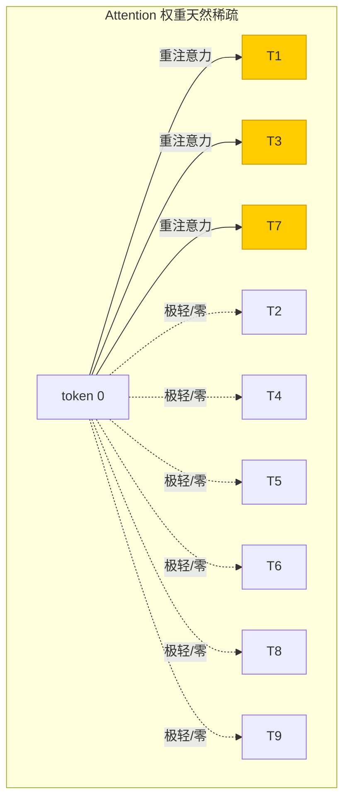

这个发现是所有稀疏化方法的基础——**模型本来就不看所有历史 token**，我们只需要帮它"删掉那些它本来就不关心的连接"。

### 1.3 两种稀疏化路径

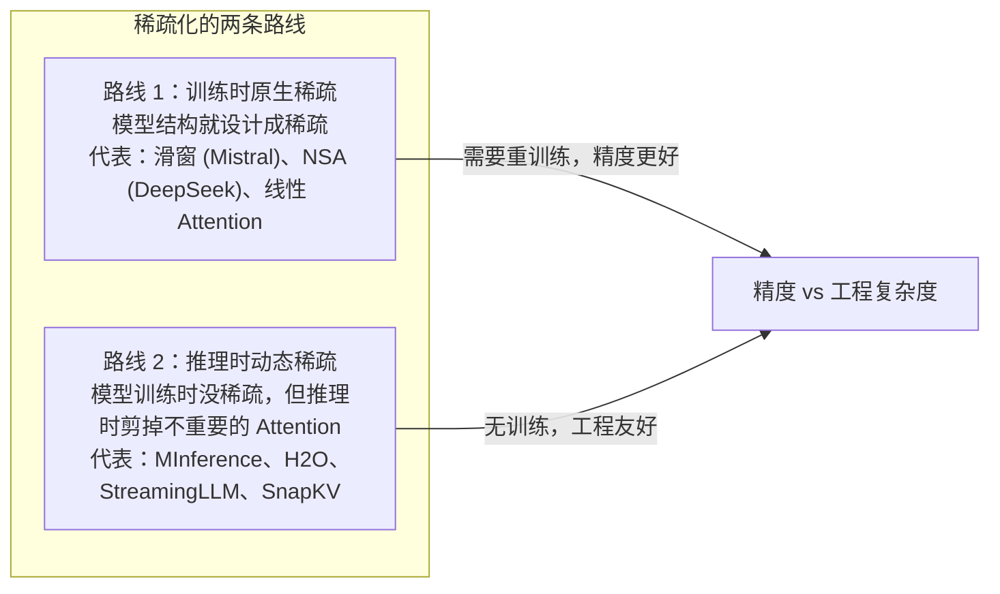

---

## 2. 滑窗注意力（Sliding Window Attention）

### 2.1 核心思想

**最简单的稀疏化**：每个 token 只看**最近 W 个**历史 token，更早的 token 直接丢弃。

```
标准 Attention：token i 看 [0, 1, 2, ..., i-1, i] → i 个连接
滑窗 Attention：token i 看 [i-W, i-W+1, ..., i] → W 个连接
```

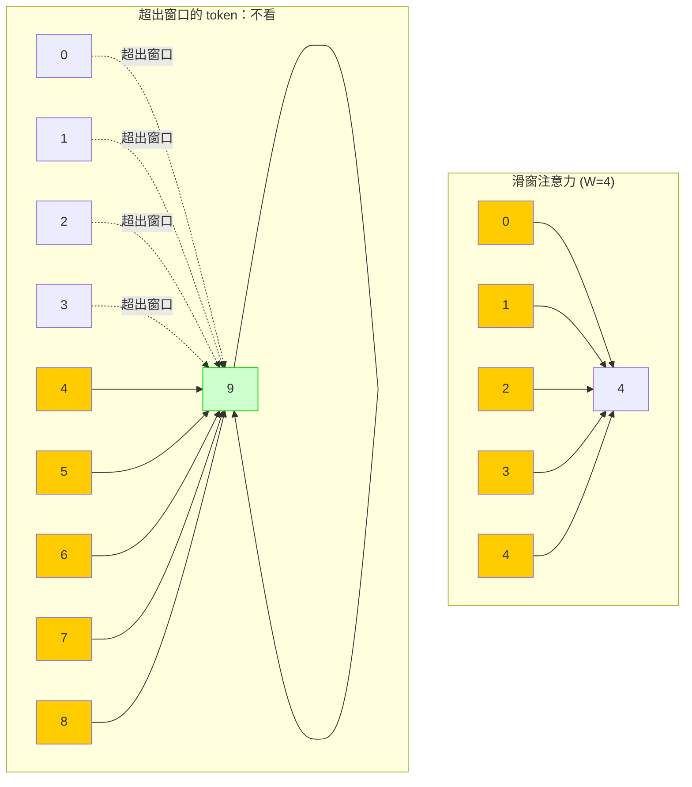

### 2.2 复杂度对比

| 维度 | 标准 Attention | 滑窗 Attention |
| --- | --- | --- |
| 每 token 连接数 | i（随位置线性增长） | **W（固定常数）** |
| 总体计算量 | O(S²) | **O(S·W)** |
| KV Cache 大小 | O(S) | **O(W)**（固定！） |
| 显存 | 随序列线性增长 | **常量** |

当 $W \ll S$ 时，滑窗把计算量从 O(S²) 降到了 O(S)。

### 2.3 代表模型

| 模型 | 窗口大小 W | 实际支持上下文 | 发布时间 |
| --- | --- | --- | --- |
| **Mistral 7B** | 4096 | ~128K（推理时 KV 循环复用） | 2023-09 |
| Mixtral 8×7B | 32768 | ~100K | 2024-01 |
| MPT-7B | 动态（每个 head 不同窗口） | 1M | 2023-06 |
| Gemma 1.1 | 动态滑窗 + GQA | 128K | 2024-04 |

> **Mistral 的聪明之处**：W=4096 但实际支持 128K——做法是让 KV Cache 在窗口满时循环覆盖最早的 K/V，只留最近 4096 个。这样 KV Cache 永远是 **4096 × d × 2 × n_layers**，和序列长度完全无关。

### 2.4 滑窗的局限性：丢失远距离信息

滑窗最大的缺点是：**token i 看不到任何比 i-W 更早的 token**。

```
token 10000 看不到 token 5999 及更早的所有内容 → 长程依赖完全断裂
```

这会导致：
- **文档级 QA 失效**：关键事实在窗口外
- **跨段引用失效**：前文定义的变量后文找不到
- **Lost in the Middle 问题**：窗口滑动后，中间信息丢失

---

## 3. 主流稀疏化方案

### 3.1 静态稀疏模式（训练时固定）

#### BigBird：滑窗 + 全局 token + 随机连接

**2020 年 Google** 提出 [1]。在滑窗基础上加了两种额外连接：

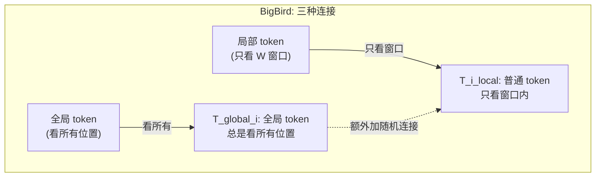

| 连接类型 | 数量 | 作用 |
| --- | --- | --- |
| 局部滑窗 | W × S | 保留局部细节 |
| 全局 token | G × S | 让特殊 token 看全局（如系统提示） |
| 随机连接 | O(S) | 概率性捕获远距离依赖 |

总体复杂度 = O(S·W + G·S + S) = **O(S·max(W, G))**。

#### Longformer：滑窗 + 任务特定全局 token

**2020 年 Allen AI** [2]。类似 BigBird 但更简洁——只允许**少数几个 token 看全局**（如文档标题、CLS token），其余 token 只看窗口。

#### MPT-7B：动态滑窗，每个 head 窗口不同

**2023 年 MosaicML** [3]。让**每个 attention head 学习自己的窗口大小**：
- 有些 head 学出 W=16（只看非常近的邻居）
- 有些 head 学出 W=4096（看较远的上下文）
- 训练后统计发现：**90% 的 head 窗口 ≤ 512**

> 这个发现证明了模型的 attention 头**天然倾向于只看局部**——强行让它们看 128K 是浪费计算。

### 3.2 动态稀疏化（推理时无训练）

#### H2O：保留 Heavy Hitters

**2023 年** [7]。核心洞察：**Attention 权重极度集中——少数 token 贡献了绝大多数权重**。

做法：
1. 每一层 attention 后，按 attention weight 排序
2. 保留 **top-N 个最重的 K/V**（"heavy hitters"）
3. 丢弃剩余 K/V 的缓存

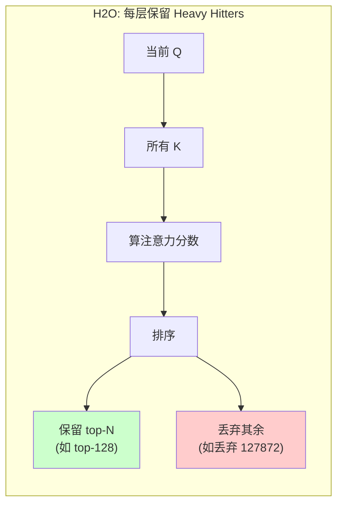

**效果**：128K 上下文 → 只保留 128 个 KV → 稀疏率 **99.9%**。

#### StreamingLLM：Attention Sink + 滑窗

**2023 年** [8]。发现了一个令人惊讶的现象：**Attention Sink（注意力汇）**。

> 即使模型在生成 30000 个 token 后，它仍然会把 **30-50% 的注意力**放在**序列最开头的几个 token**上（BOS token、系统提示开头）——**不管这些 token 与当前生成内容是否相关**。

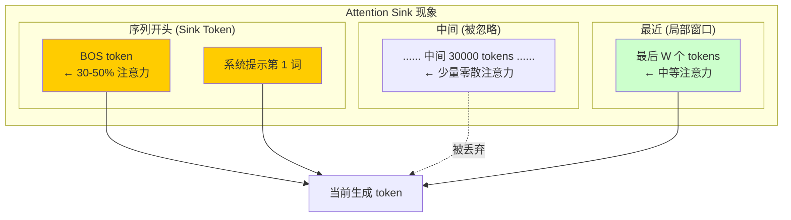

**做法**：
1. 永远保留**前 4 个 sink token**
2. 保留**最近 W 个 token**（滑窗）
3. 中间所有 token 的 KV Cache **直接丢弃**

**优点**：KV Cache 大小 **固定为 4 + W**——无论生成多长！

#### MInference（微软）：天然稀疏模式匹配

**2024 NeurIPS Spotlight** [6]。发现 LLM 的 Attention 天然有**三种稳定稀疏模式**，不同 head 天然属于不同模式：

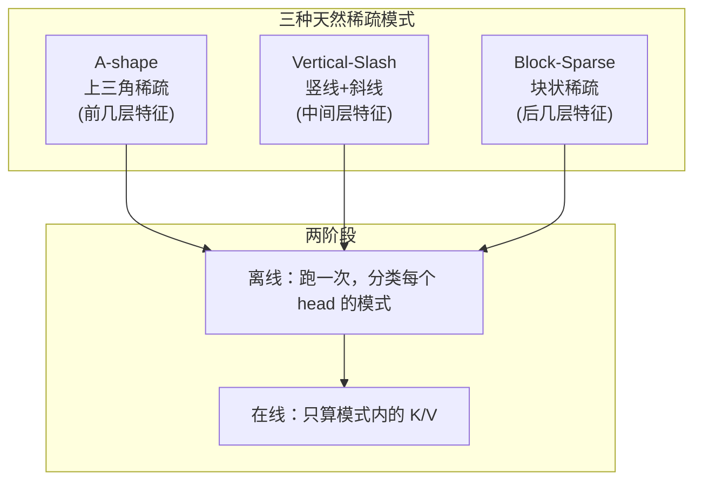

**效果**：单卡 A100，1M 上下文 Prefill 速度提升 **10×**，准确率无损。

#### SnapKV：基于 Attention 历史的动态压缩

**2024 年** [9]。针对 **Decoding 阶段**（逐 token 生成，K/V 不断增长）：

- Prefill 时：观察 attention pattern，记录哪些 K/V 被频繁关注
- Decoding 时：**只保留被频繁关注的 KV**，低关注度的丢弃
- 动态更新保留列表——不是静态 top-k，而是**基于 attention 历史的自适应**

#### SampleAttention（北大+智谱）：CRA 约束的自适应采样

**2025 MLSys 论文** [10]。定义了一个精度指标 **CRA（Cumulative Residual Attention）**：

> CRA = 稀疏化后保留的 attention mass 占原始 attention mass 的百分比

目标是在 **CRA ≥ 95%** 的约束下最大化稀疏率。做法：
1. **Query 引导的分块采样**：从 Q 视角挑几个"值得看"的 K chunk
2. **Score-based KV 过滤**：在选中 chunk 内再选 top-K

**效果**：128K 上下文 TTFT 降低 **5.29×**。

### 3.3 原生可训练稀疏

#### DeepSeek NSA（Native Sparse Attention）

**2025 年 DeepSeek-V3/R1 使用** [11]。第一个**训练时就原生稀疏且准确率不降反升**的方案：

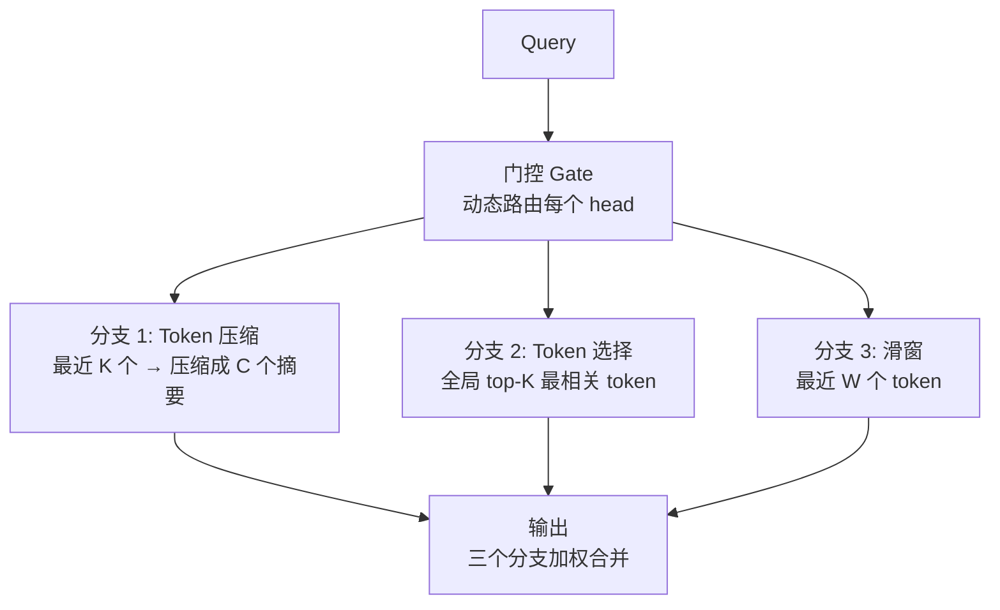

| 分支 | 保留什么 | 复杂度 |
| --- | --- | --- |
| Token 压缩 | 近期信息的粗粒度摘要 | O(C) |
| Token 选择 | 全局最相关的关键 token | O(K) |
| 滑窗 | 局部细节 | O(W) |
| **总计** | | **O(C + K + W) ≈ O(1)** |

**论文数据**：

| 指标 | 数值 |
| --- | --- |
| 推理速度提升 | **11.6×**（64K 上下文） |
| 准确率变化 | **不降反升**（因为主动过滤噪声 token） |
| 代表模型 | DeepSeek-V3, DeepSeek-R1 |

#### 线性化 Attention：数学上的 O(S)

用核函数近似 softmax，把 $O = \text{softmax}(QK^T)V$ 变成：

$$O = Q \cdot \left( \frac{K^T V}{Q^T K} \right)$$

**Performer（2020）** [4] 用随机特征映射近似 softmax。
**Katharopoulos et al.（2020）** 用核函数化 Attention。

> 线性化 Attention 和滑窗/稀疏化**思想不同**——它不改变连接模式，而是**用数学技巧跳过 QK^T 的显式计算**。
> **Mamba** 完全替代 Attention，用状态空间模型实现 O(S) 复杂度——严格来说不是"稀疏 Attention"，但也是解决长上下文的另一条路。

---

## 4. 方案对比与选型

### 4.1 核心维度对比

| 方案 | 类型 | 复杂度 | 训练时稀疏 | 长距离信息 | 精度损失 | FlashAttention 兼容 | 代表模型 |
| --- | --- | --- | --- | --- | --- | --- | --- |
| **全 Attention** | 无 | O(S²) | - | ✅ 完整 | 0 | ✅ | 所有传统模型 |
| **滑窗** | 静态 | O(S·W) | ✅ 是 | ❌ 无 | 小 | ✅ 原生 | Mistral, Mixtral |
| **滑窗 + 全局 token** | 静态 | O(S·W + G·S) | ✅ 是 | ⚠️ 部分 | 小 | ✅ | BigBird, Longformer |
| **GQA** | 结构 | O(S²/G) | ✅ 是 | ✅ 完整 | 极小 | ✅ | Llama 3, 所有 70B+ |
| **NSA** | 原生 | O(S) | ✅ 是 | ✅ 完整 | **负损失**（提升） | ❌ 需自定义 | DeepSeek-V3/R1 |
| **MInference** | 动态 | O(S) | ❌ 无训练 | ✅ 完整 | 0 | ❌ 需自定义 kernel | 所有模型 |
| **H2O** | 动态 | O(S) | ❌ 无训练 | ⚠️ 通过 heavy hitters | 极小 | ❌ 需自定义 | 所有模型 |
| **StreamingLLM** | 动态 | O(S) | ❌ 无训练 | ⚠️ sink token + 窗口 | 小 | ✅ | 所有模型 |
| **SnapKV** | 动态 | O(S) | ❌ 无训练 | ⚠️ 动态保留 | 极小 | ✅ | 所有模型 |
| **SampleAttention** | 动态 | O(S) | ❌ 无训练 | ✅ 完整 | < 5% | ❌ 需自定义 | 所有模型 |
| **线性化 Attention** | 数学 | O(S·d²) | 需重新训练 | ✅ 理论完整 | 中 | ❌ | Performer |

### 4.2 GQA：最广泛使用的"准稀疏化"

GQA（Grouped Query Attention）不改变连接模式，但让**多个 Q 头共享同一组 K/V 头**：

| 模型 | Q 头数 | KV 头数 | KV Cache 节省 |
| --- | --- | --- | --- |
| Llama 2 70B | 64 | 8 | 8× |
| Llama 3 70B | 64 | 8 | 8× |
| Mistral 7B | 32 | 8 | 4× |
| DeepSeek-V3 | 128 | 1 | **128×** |

> GQA 是所有 70B+ 模型的标配，几乎没有精度损失但大幅减少 KV Cache 大小——**它是稀疏化之外，长上下文模型必用的准稀疏手段**。

### 4.3 选型决策树

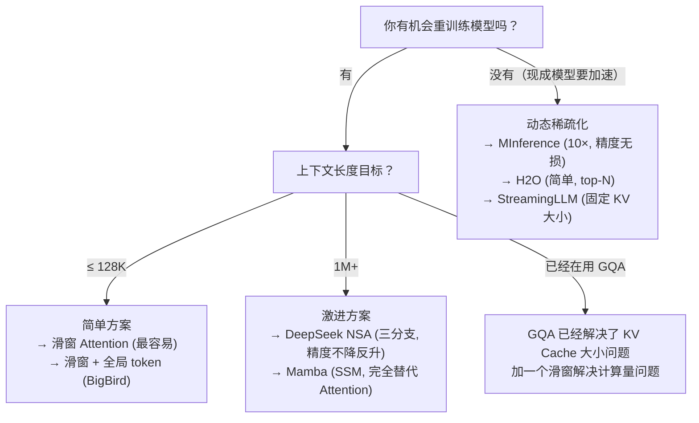

---

## 5. 推理时稀疏化的 KV Cache 管理

稀疏化在推理时不仅加速 Attention 计算，还直接影响 **KV Cache 管理**——这是 vLLM、TensorRT-LLM 等推理框架的核心优化方向。

### 5.1 标准 KV Cache 的问题

标准 KV Cache 随序列**线性增长**：
- 128K 上下文 × 70B 模型 × FP16 = **256 GB** KV Cache
- 多请求并发时，KV Cache 是推理系统的**显存瓶颈**

### 5.2 稀疏化如何压缩 KV Cache

| 稀疏化方法 | KV Cache 大小 |
| --- | --- |
| 无（全 Attention） | O(S) → 随序列线性增长 |
| 滑窗（W=4096） | **O(W) → 固定 4096 个 token** |
| StreamingLLM | **O(4 + W) → 固定 4 + 滑窗** |
| H2O | **O(N) → 固定 top-N** |
| NSA | **O(C + K + W) → 固定常数** |

### 5.3 Attention Sink 的工程意义

Attention Sink 的发现解释了一个关键事实：

> **朴素滑窗会导致模型质量崩溃，因为它丢弃了开头的 sink token**。

StreamingLLM 证明了：只要保留前 4 个 sink token，再加滑窗，模型就能**几乎无损地处理超长序列**——这就是为什么现在很多"无限上下文"模型用的就是这个组合。

---

## 6. 边界与代价

### 6.1 稀疏化不是免费午餐

| 代价 | 说明 |
| --- | --- |
| **精度损失** | 剪掉太多会导致 RAG 召回下降、跨段引用失效 |
| **实现复杂度** | 动态稀疏化需要自定义 kernel（FlashAttention 原生不支持稀疏） |
| **训练时稀疏化要重训** | 滑窗模型必须训练时就用滑窗，不能事后改 |
| **对 FlashAttention 的兼容性** | FlashAttention 原生支持滑窗，但不支持动态 top-k/模式匹配 |

### 6.2 稀疏化能和 FlashAttention 共存吗？

**能，但需要配合**：

| 组合 | 可行性 | 说明 |
| --- | --- | --- |
| 滑窗 + FlashAttention | ✅ 完美 | FlashAttention 原生支持滑窗 mask |
| GQA + FlashAttention | ✅ 完美 | 所有版本都支持 |
| NSA + FlashAttention | ❌ 不行 | NSA 需要自定义 kernel（DeepSeek 自己实现） |
| MInference + FlashAttention | ⚠️ 部分 | 稀疏模式匹配需要自定义稀疏 kernel |
| H2O + FlashAttention | ✅ 可行 | 先 top-N 再对选中的 K/V 用 FlashAttention |

### 6.3 什么场景不适合稀疏化

| 场景 | 原因 |
| --- | --- |
| **短上下文（< 8K）** | 全 Attention 足够快，稀疏化没有收益 |
| **对精度要求极高（医疗/法律）** | 可能丢失关键信息 |
| **跨文档引用密集** | 远距离依赖不能丢失 |
| **需要 FlashAttention 加速但框架不支持自定义 kernel** | 只能用滑窗/GQA 这种静态方案 |

---

## 7. Agentic 模型的长上下文需求：为什么 CoT 让稀疏化更重要

> Agentic 模型执行长任务时的上下文**不是**"把一本书塞进 prompt"，而是**多轮交互累积的动态结构**——CoT 推理链、工具调用结果、对话历史不断追加。这使得 Agentic 模型比传统长上下文模型**更需要**稀疏 Attention，但同时也有框架级的替代方案。

### 7.1 Agentic 模型的上下文构成

Agent 执行一个复杂任务时，上下文由多类来源动态累积：

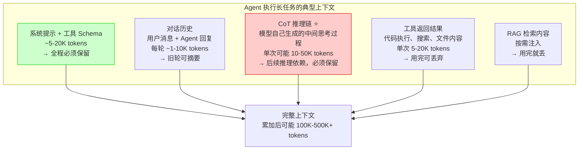

**关键区别**：传统长上下文是 Prefill 阶段**一次性注入**，而 Agentic 上下文是**在 Decode 阶段逐 token 生成和追加**——这意味着 KV Cache 会随 CoT 生成**不断增长**。

### 7.2 Agentic 场景触发长上下文的三个独特原因

#### 原因 1：CoT 推理链本身就是长序列

这是 Agentic 模型**最独特的长上下文来源**。当模型在执行复杂任务时（写代码、数学证明、多步规划），它生成的 CoT 可能非常长：

```
Agent 写一个复杂项目：
CoT 第 1 步: 分析需求 (2K tokens)
CoT 第 2 步: 设计架构 (3K tokens)
CoT 第 3 步: 实现模块 A (5K tokens)
CoT 第 4 步: 发现 bug，调试 (8K tokens)
CoT 第 5 步: 修复 bug (2K tokens)
...
CoT 总计: 20K-50K tokens
```

CoT 的特殊性：
- **模型自己生成的**，不在原始 prompt 里
- **必须保留**——后续推理步骤依赖前面的 CoT 输出（"第 3 步得出的公式"会被第 5 步引用）
- **累积速度快**——每一轮交互都可能追加大量 CoT tokens

#### 原因 2：多轮迭代 + Self-Reflection

Agent 在执行任务时不断自我修正：

```
Agent 第 1 次尝试 → 失败
Agent 反思为什么失败 (5K tokens CoT)
Agent 第 2 次尝试 → 部分成功
Agent 反思 + 自我评估 (3K tokens CoT)
Agent 第 3 次尝试 → 成功
Agent 总结 + 汇报 (2K tokens CoT)
```

这个过程中，**CoT + 对话历史 + 工具结果**可能累积到 100K+ tokens。

#### 原因 3：多工具协作

现代 Agent 可以同时调用多个工具，每个工具返回的结果都要进上下文：

```
用户: "帮我重构整个 src/ 目录的代码"
Agent:
  1. 调用代码搜索工具 → 返回 50 个文件内容 (50K tokens)
  2. 调用代码分析工具 → 返回依赖关系图 (5K tokens)
  3. 开始重构 → CoT 累积 (30K tokens)
  4. 每重构完一个文件调用 lint → 返回 lint 结果 (2K tokens × N)
```

### 7.3 Agentic 的长上下文 vs 传统长上下文

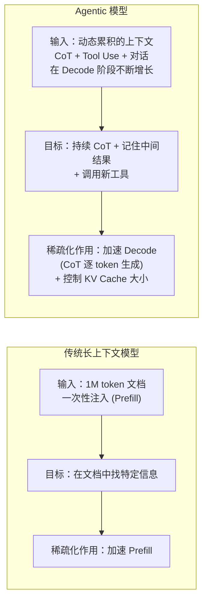

| 维度 | 传统长上下文 | Agentic 长上下文 |
| --- | --- | --- |
| **来源** | 静态文档，一次性注入 | 动态累积，每轮追加 |
| **增长阶段** | Prefill | **Decode（CoT 逐 token 生成）** |
| **保留策略** | 大部分保留（RAG 检索时用） | 可以主动丢弃旧 CoT 步骤 |
| **稀疏化作用** | 加速 Prefill | **加速 Decode + 控制 KV Cache** |
| **替代方案** | RAG（在 prompt 阶段过滤） | RAG + **上下文摘要**（每 N 轮压缩） |
| **关键约束** | 长距离信息不能丢 | **CoT 链不能断** |

### 7.4 稀疏化在 Agentic 场景下的特殊意义

| 需求 | 传统长上下文 | Agentic |
| --- | --- | --- |
| **CoT 链** | 没有 | **必须保留前面的推理链**——滑窗不能随便截 |
| **Tool Use 结果** | 没有 | 用完可以丢 → H2O/SnapKV 类方法适用 |
| **速度优先级** | Prefill 速度（一次性） | **Decode 速度（CoT 逐 token 生成）**——更关键 |
| **KV Cache** | Prefill 后固定 | **每轮 Decode 后不断增长**——StreamingLLM 类方法最适用 |
| **精度优先级** | 检索质量 | **CoT 链不丢失**→ 需要选择正确的 K/V 子集 |

### 7.5 主流 Agentic 模型的稀疏化实践

#### DeepSeek-R1：NSA 就是为 Agentic 长 CoT 设计的

DeepSeek-R1 用 NSA 的核心原因是 **CoT 推理链可能非常长**（官方 demo 显示 CoT 可达数万 tokens）：

- **Token 压缩分支**：保留更早 CoT 的粗粒度摘要（如"第 3 步得出的公式"）
- **Token 选择分支**：抓取全局最关键的推理结果
- **滑窗分支**：保留最近 CoT 的细节

三分支完美对应 Agentic 模型的三类 Attention 需求——这就是为什么 R1 不需要框架级上下文管理也能处理超长 CoT。

#### Claude：GQA + 滑窗 + 内部长上下文管理

Claude 的 1M context window 不是真的 1M 全 Attention——大概率是：
- GQA 压缩 KV Cache（所有现代模型的标配）
- 滑窗 Attention 处理计算量
- 内部有机制判断哪些旧 CoT 步骤可以被"压缩"而不影响后续推理

#### StreamingLLM：Agentic 场景的最优动态方案

StreamingLLM 的"保留前 4 个 sink token + 最近 W 个 token"刚好匹配 Agentic 需求：
- ✅ **Sink token** = 系统提示 + 工具 Schema（全程必须保留）
- ✅ **滑窗 W** = 最近 CoT + 对话历史（后续推理依赖）
- ⚠️ **问题**：旧 CoT 步骤可能被截掉——但 Agent 框架可以在每 N 轮做一次**上下文摘要**，把旧 CoT 压缩成摘要后替换原始内容

### 7.6 选型：Agentic 模型需要稀疏化吗？

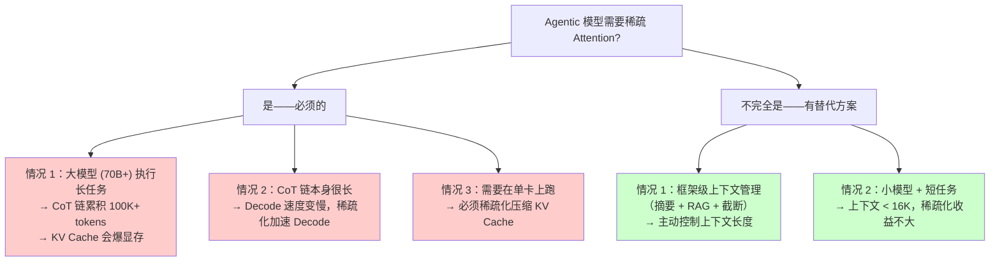

### 7.7 一句话总结

> Agentic 模型的 CoT 推理链让它比传统长上下文模型**更需要**稀疏化——因为 KV Cache 在 Decode 阶段不断增长，而传统长上下文只在 Prefill 阶段有一次压力。但框架级的上下文摘要/RAG 可以缓解压力。**真正执行长任务（数万 token CoT）的 Agentic 模型必须有稀疏 Attention**，否则 KV Cache 会爆显存、CoT 生成会慢到不可用。

---

## 8. 可验证实验

### 8.1 稀疏度测量

用 Llama-3-8B 测量不同层的 Attention 稀疏度：

```python
import torch
from transformers import AutoModelForCausalLM, AutoTokenizer

model = AutoModelForCausalLM.from_pretrained("meta-llama/Llama-3-8B",
                                              torch_dtype=torch.float16,
                                              device_map="auto")
tokenizer = AutoTokenizer.from_pretrained("meta-llama/Llama-3-8B")

# 输入 128K 上下文
text = "非常长的文档... (128K tokens)"
inputs = tokenizer(text, return_tensors="pt").to(model.device)

# 跑一次前向，提取 attention weights
with torch.no_grad():
    outputs = model(**inputs, output_attentions=True)

# 分析每层的稀疏度：覆盖 90% 质量需要多少 token
for layer_idx, attn in enumerate(outputs.attentions):
    # attn shape: (batch, heads, seq, seq)
    attn_avg = attn[0].mean(dim=0)  # 平均所有 head
    last_row = attn_avg[-1, :]      # 最后一个 token 的 attention
    sorted_attn = torch.sort(last_row, descending=True).values
    cumulative = torch.cumsum(sorted_attn, dim=0)
    n_90 = (cumulative < 0.9).sum().item() + 1
    sparsity_90 = 1 - n_90 / len(last_row)
    print(f"Layer {layer_idx}: 90% mass requires {n_90} tokens → sparsity {sparsity_90:.1%}")
```

**预期输出**（参考论文 [6]）：

```
Layer 0: 90% mass requires 852 tokens → sparsity 99.3%
Layer 1: 90% mass requires 512 tokens → sparsity 99.6%
...
Layer 31: 90% mass requires 2048 tokens → sparsity 98.4%
平均稀疏度: 99.0%
```

### 8.2 滑窗 vs 全 Attention 速度对比

```python
import time
import torch

# 滑窗实现（最简单的版本）
def sliding_window_attention(Q, K, V, W=4096):
    """
    Q, K, V: [batch, heads, seq, d]
    W: window size
    """
    S = Q.size(2)
    attn_scores = torch.matmul(Q, K.transpose(-2, -1)) / (Q.size(-1) ** 0.5)
    
    # 创建滑窗 mask
    mask = torch.triu(torch.ones(S, S, device=Q.device), diagonal=1)  # causal
    for i in range(S):
        start = max(0, i - W)
        mask[i, start:i+1] = 0  # 窗口内不 mask
    
    attn_scores = attn_scores.masked_fill(mask.bool(), float('-inf'))
    attn_weights = torch.softmax(attn_scores, dim=-1)
    return torch.matmul(attn_weights, V)

# 速度测试
S = 128000
d = 128
B, H = 1, 32
Q = torch.randn(B, H, S, d, device='cuda', dtype=torch.float16)
K = torch.randn(B, H, S, d, device='cuda', dtype=torch.float16)
V = torch.randn(B, H, S, d, device='cuda', dtype=torch.float16)

# 全 Attention（需要 FlashAttention 支持）
import torch.nn.functional as F
# full_attn_time = time.time()
# for _ in range(10):
#     full_out = F.scaled_dot_product_attention(Q, K, V, is_causal=True)
# torch.cuda.synchronize()
# print(f"Full Attention (128K): {(time.time()-full_attn_time)/10:.3f}s")

# 滑窗 Attention（W=4096）
torch.cuda.synchronize()
t0 = time.time()
for _ in range(10):
    window_out = sliding_window_attention(Q, K, V, W=4096)
torch.cuda.synchronize()
print(f"Sliding Window W=4096 (128K): {(time.time()-t0)/10:.3f}s")
```

### 8.3 StreamingLLM Attention Sink 验证

```python
# 保留前 4 个 sink token + 最近 4096 个 token
def streaming_llm_mask(S, W=4096, sink_tokens=4):
    """
    返回 (S, S) 的 mask：True 表示被 mask（不看）
    """
    mask = torch.triu(torch.ones(S, S), diagonal=1).bool()  # causal
    for i in range(S):
        # 总是允许看 sink tokens (0 到 sink_tokens-1)
        mask[i, :sink_tokens] = False
        # 允许看最近 W 个
        start = max(sink_tokens, i - W)
        mask[i, start:i+1] = False
    return mask

mask = streaming_llm_mask(128000, W=4096, sink_tokens=4)
print(f"Masked ratio: {mask.float().mean():.4f}")
# 预期: ~0.96 (只看 4100/128000 ≈ 3.2%)
```

---

## 9. 关联

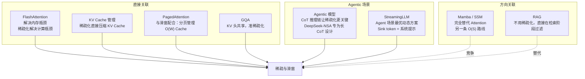

| 技术 | 关系 | 说明 |
| --- | --- | --- |
| **FlashAttention** | 互补 | FA 让 O(S²) 内存问题消失，但计算量仍是 O(S²)——稀疏化解决后者 |
| **KV Cache 管理** | 强关联 | 稀疏化直接决定 KV Cache 大小 |
| **PagedAttention** | 配合 | PA 的分页 + 滑窗的固定大小 = 最优长上下文推理 |
| **GQA** | 准稀疏 | KV 头共享，减少 KV Cache 但不减少 Attention 计算量 |
| **Agentic 模型** | 强关联 | CoT 推理链让 KV Cache 在 Decode 阶段不断增长——稀疏化是必须的 |
| **StreamingLLM** | 配合 | Sink token 保留系统提示 + 滑窗保留 CoT = Agent 最优动态方案 |
| **Mamba/SSM** | 竞争 | 完全替代 Attention，本质不同 |
| **RAG** | 替代 | 用检索在 prompt 阶段过滤，不用稀疏化 |
| **DeepSeek NSA** | 原生 | 专为长 CoT 链设计的三分支稀疏化 |

---

## 10. 延伸阅读

- [FlashAttention 基本原理](FlashAttention基本原理.md) — 解决内存瓶颈的基础
- [KV Cache 基本原理](KV%20Cache基本原理.md) — 推理时的关键优化
- [PagedAttention 基本原理](PagedAttention基本原理.md) — 与滑窗配合的推理框架

---

## 参考文献

[1] BigBird: Transformers for Longer Sequences. Zaheer et al., NeurIPS 2020. <https://arxiv.org/abs/2007.14062>

[2] Longformer: The Long-Document Transformer. Beltagy et al., 2020. <https://arxiv.org/abs/2004.05150>

[3] MosaicML: Introducing MPT-7B. 2023. <https://www.mosaicml.com/blog/mpt-7b>

[4] Performer: Faster Attention with Linear Complexity. Choromanski et al., ICLR 2021. <https://arxiv.org/abs/2009.14794>

[5] The Impact of Positional Extrapolation on Neural Language Models. 2024. <https://arxiv.org/abs/2404.05928>

[6] MInference 1.0: Accelerating Pre-filling for Long-Context LLMs via Dynamic Sparse Attention. Jiang et al., NeurIPS 2024 (Spotlight). <https://arxiv.org/abs/2407.02490>

[7] H2O: Heavy-Hitter Oracle for Efficient Generating of Large Language Models. Liu et al., NeurIPS 2023. <https://arxiv.org/abs/2306.14010>

[8] StreamingLLM: Efficient Streaming Language Models with Attention Sinks. Xiao et al., 2023. <https://arxiv.org/abs/2309.17453>

[9] SnapKV: An Empirical Study of Saving Re-Computation for Accelerating Long-Context LLM Inference. Li et al., 2024. <https://arxiv.org/abs/2403.05506>

[10] SampleAttention: Near-Lossless Acceleration of Long Context LLM Inference with Adaptive Structured Sparse Attention. Zhu et al., MLSys 2025. <https://arxiv.org/abs/2406.15486>

[11] DeepSeek-V3 Technical Report. DeepSeek-AI, 2024. <https://arxiv.org/abs/2412.19437>

---

## 图片声明

本文所有架构图和示意图均由作者使用 Mermaid 语法在文档中直接绘制，无外部图片依赖。
