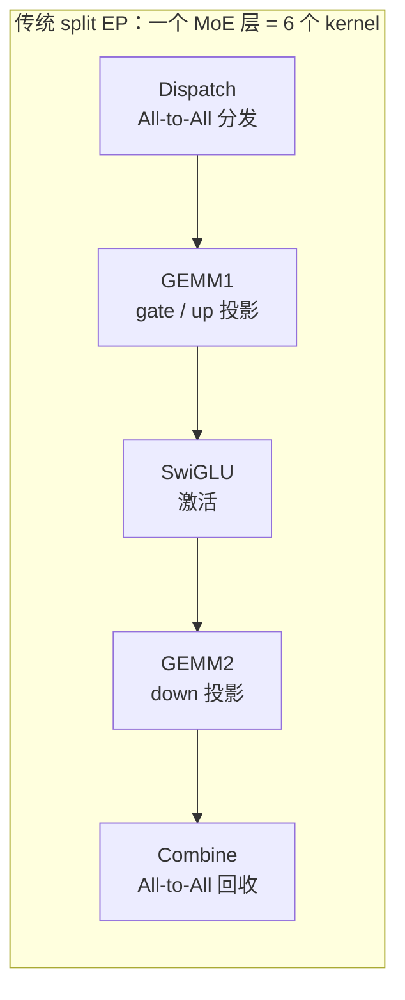
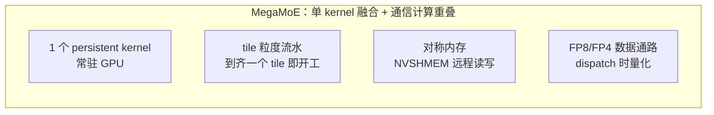
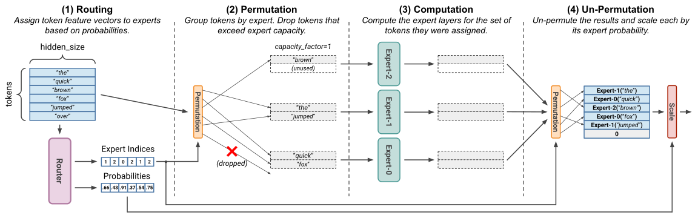
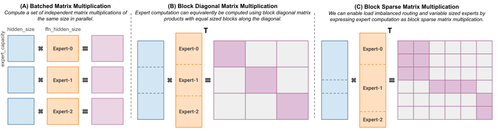
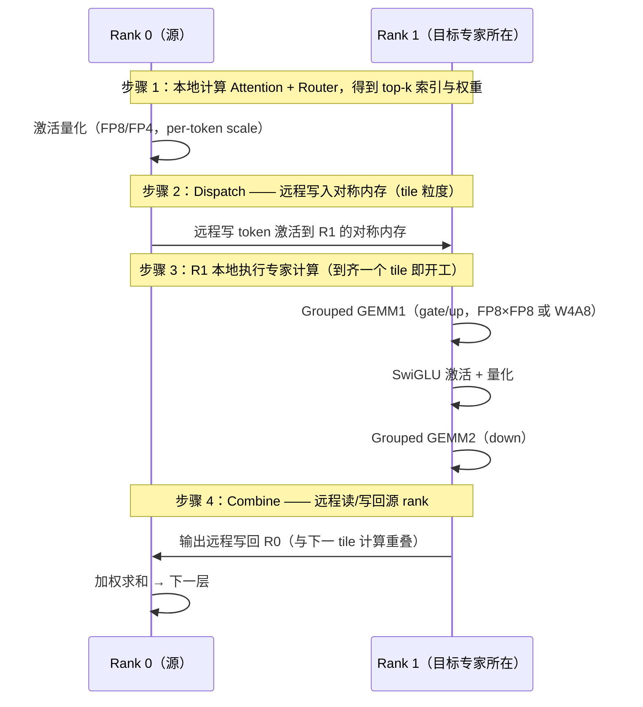
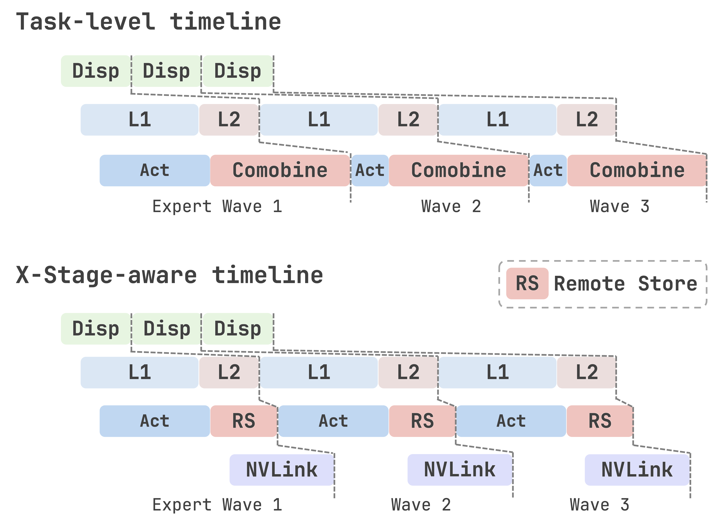
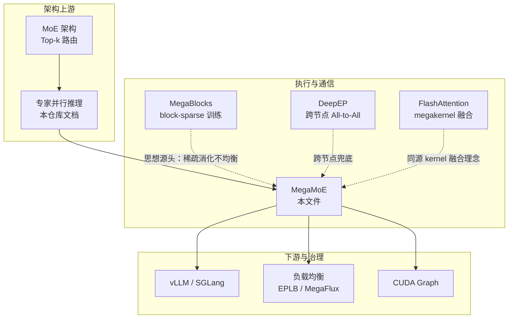
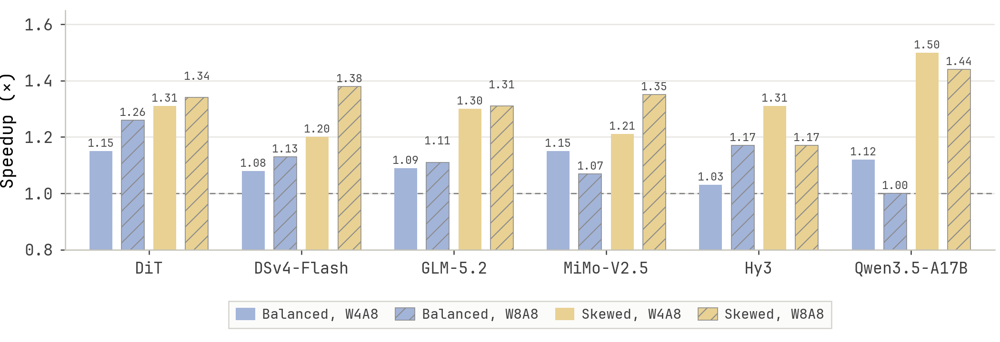

# MegaMoE 基本原理

> **一句话总结**：MegaMoE 是把 MoE 专家并行（EP）推理中"token 分发（dispatch）→ 专家 GEMM → 结果聚合（combine）"整条数据通路**融合进单个常驻 megakernel** 的执行范式：通过对称内存（NVSHMEM）在 tile 粒度上重叠通信与专家计算，并配合 FP8/FP4 低精度数据通路，解决传统分阶段 EP 执行中"kernel 启动频繁、激活反复进出 HBM、通信与计算串行"三大瓶颈。它继承自 MegaBlocks 的 block-sparse MoE 思想 [1]，当前以 DeepGEMM [2]、FlashInfer [3]、NVIDIA CuTeDSL [4] 等形态成为 MoE EP 推理的标准执行形态。

本文遵循本仓库的设计原则：**先讲清"为什么"，再谈"怎么做"**，并明确标注**关联技术**与**边界、代价**。

- 适用版本前提：block-sparse 思想基于 Gale et al. (MLSys 2023) [1]；推理 megakernel 基于 DeepGEMM fp8_fp8_mega_moe [2]、FlashInfer MoEEpLayer [3] 与 NVIDIA CuTeDSL MegaMoE [4]，主要面向 Blackwell 世代 GPU 与单节点 NVLink 拓扑。**脱离精度格式、专家放置与路由分布的 MegaMoE 收益结论不成立**。

---

## 1. 它为什么存在：EP 推理的执行瓶颈

### 1.1 MoE 推理必须 EP

MoE 模型总参数可达数百 B 甚至 1T（如 DeepSeek-V3 671B），专家 FFN 占绝对多数，**任何单卡都装不下**，因此推理必须把专家切分到多张 GPU 上——这就是[专家并行推理](专家并行推理基本原理.md)。每个 token 经路由网络选出 top-k 专家后，要通过 All-to-All 把激活值送到目标专家所在卡，计算完再收回来。

### 1.2 传统分阶段 EP 执行的问题

传统 EP 把一个 MoE 层的前向拆成多个**独立 kernel 顺序执行**：



| 问题 | 具体表现 |
| --- | --- |
| **kernel 启动与同步频繁** | 每层 5-6 次 launch，每次 launch 都有固定开销与隐式同步点 |
| **激活反复进出 HBM** | GEMM1 输出写回 HBM、SwiGLU 读回、GEMM2 再写回，中间结果全部落盘 |
| **通信与计算串行** | All-to-All 发送期间 GPU 计算单元闲置，反之亦然 |
| **整批同步等待** | dispatch 必须等整批 token 凑齐才发，combine 必须等全部专家算完才做 |

在 DeepSeek-V3 这类 256 专家的模型上，每个 MoE 层都要经历一轮上述流水线，层数越多开销越放大。

### 1.3 MegaMoE 的核心洞察

> **把"分发、计算、回收"整个 MoE 层融成一个常驻的 kernel，让 token 以 tile 为单位在 GPU 间"边通信边计算"，通信与计算在时间上重叠，而不是先后发生。**



---

## 2. 核心机理

### 2.1 思想源头：MegaBlocks 的 block-sparse MoE

MegaBlocks [1] 最初是**训练侧**系统，它指出现有框架（Tutel、Switch Transformer）对 MoE 计算施加硬性约束：为了凑成"每个专家批大小相同"的 batched matmul，必须引入 capacity factor——要么 **drop token**（丢数据、损质量），要么 **padding 对齐**（浪费算力和显存）。



MegaBlocks 的解法是把 MoE 计算**重构为 block-sparse 运算**：按专家 ID 把 token 分组，用可变块大小的块稀疏矩阵乘处理负载不均衡的路由，**既不丢 token 也不需要 padding**。块稀疏格式用 Blocked-CSR（稀疏输入）/ Blocked-COO（稀疏输出）/ Transpose Index 三种视图描述同一稀疏结构，元数据开销不到 0.1%（128×128 块）。



MegaBlocks 端到端训练比 Tutel 的 padding 方案快 1.38×/2.0×/4.35×（MoE-XS/Small/Medium），且模型越大收益越明显（padding 显存开销随规模放大）[1]。

> **关键认知**：MegaMoE 推理继承了同一个世界观——**动态、不均衡的路由不应被"强行拉齐"，而应被稀疏/融合机制直接消化**。训练侧靠 block-sparse GEMM，推理侧则靠 megakernel + 对称内存。

### 2.2 MegaMoE megakernel 的四根支柱

推理侧 MegaMoE（DeepGEMM [2] / FlashInfer [3] / NVIDIA CuTeDSL [4]）把上述思想落地为四个设计：

| 支柱 | 设计 | 解决什么 |
| --- | --- | --- |
| **整层融合** | 一个 forward 只启动一个 persistent kernel，内部完成 dispatch、GEMM1、激活、GEMM2、combine | kernel 启动/同步开销 |
| **对称内存** | 通信基于 NVSHMEM 对称内存（每个 rank 一段全局可见内存），dispatch 靠远程写、combine 靠远程读 | All-to-All 先落地本地再拷贝的往返 |
| **tile 粒度重叠** | token 按 tile（如 128 行）组织，接收方到齐一个 tile 立即开始 GEMM；发送方 combine 的远程写与下一波计算重叠 | 通信-计算串行、整批同步等待 |
| **低精度通路** | 权重预处理成 FP8/FP4 布局，dispatch 时对激活量化，combine 输出格式可配（BF16/MXFP8/NVFP4） | 通信字节与算力放大 |

### 2.3 一次 MoE 层前向的数据流



整个过程只有**一次 kernel launch**，所有跨 GPU 数据交换发生在对称内存中，不被反复搬进搬出 HBM。

### 2.4 通信-计算重叠的时间线

X-Stage 论文 [4] 对比了两种 MegaMoE 调度：任务级时间线（每波专家计算结束后阻塞 combine）与 X-Stage-aware 时间线（combine 拆成非阻塞远程写，与下一波专家计算重叠）。



核心收益：
- **消除全局屏障**：combine 不再阻塞整层，改成异步远程写；
- **GPU 空闲消除**：NVLink 传输期间 SM 继续算下一 tile 的专家；
- **关键路径缩短**：每层耗时从"计算 + 通信"变成"计算 与 通信取较大者"。

---

## 3. 关联关系



| 技术 | 关系 | 说明 |
| --- | --- | --- |
| **[专家并行推理](专家并行推理基本原理.md)** | 上游前提 | MegaMoE 是 EP 的执行形态，EP 决定专家放置，MegaMoE 决定怎么算 |
| **MegaBlocks** | 思想源头 | 训练侧用 block-sparse 消化不均衡路由，推理侧 MegaMoE 用融合 kernel 消化 |
| **DeepEP** | 互补 | DeepEP 负责跨节点低延迟 All-to-All；MegaMoE 的对称内存只覆盖单节点 NVLink |
| **FlashAttention** | 同源理念 | 都是"减少 HBM 往返、融合成单 kernel"的 IO 优化哲学 |
| **CUDA Graph** | 需要配合 | MegaMoE 是持久 kernel，天然适配 CUDA Graph 捕获与回放 |
| **负载均衡（EPLB/MegaFlux）** | 下游治理 | MegaMoE 不解决专家放置；路由 skew 时仍需运行时复制/重排（见第 4 节） |

---

## 4. 边界与代价

### 4.1 硬性边界

| 约束 | 说明 | 影响 |
| --- | --- | --- |
| **单节点拓扑** | NVSHMEM 对称内存依赖 NVLink，基本限定单节点内 EP（如 1×8） | 跨节点仍需传统 All-to-All（DeepEP）拼接 |
| **精度格式** | 原生 FP8/FP4（NVFP4/MXFP8/W4A8），BF16 模型需先转换 | 引入量化精度代价，需按模型评估 |
| **形状整除约束** | 如 DeepGEMM 要求 `num_experts % world_size == 0`、`hidden % 128 == 0`、`intermediate_hidden % 256 == 0`、激活函数仅 SwiGLU | 非整除配置无法直接使用 |
| **硬件世代** | Blackwell（SM100/SM103）效果最佳；Hopper 上 FP4 需软件模拟 | 收益随硬件能力缩放 |

### 4.2 核心代价

| 代价 | 说明 | 严重程度 |
| --- | --- | --- |
| **路由 skew 放大** | 专家放置固定时，路由不均衡会让热点卡成为瓶颈（实测比均衡慢 7.3%-41% [5]） | 🔴 核心代价 |
| **量化精度损失** | W4A4/W4A8 数据通路对模型输出质量有影响，需评估 | 🟡 中等 |
| **调试困难** | 单持久 kernel 内部状态不可观测，出问题难定位 | 🟡 中等 |
| **调参空间大** | 后端（NVFP4/MXFP8/DeepGEMM）、tile 大小、combine 格式、autotune 组合爆炸 | 🟡 中等 |
| **显存规划** | 对称内存 buffer 需预分配最大容量，存在峰值预留 | 🟡 中等 |

> **关键经验**：MegaMoE 优化的是"执行效率"，不是"负载均衡"。路由 skew 问题要靠 EPLB/MegaFlux 这类专家放置与复制机制解决，两者是正交的[5]。有趣的是，MegaMoE 的通信-计算重叠调度在 **skewed 路由下收益反而更大**（见第 5 节数据）——因为负载不均正是通信间隙最大、重叠价值最高的场景 [4]。

### 4.3 不适用场景

- **单卡/小模型推理**：没有 EP，就没有对称内存融合的必要；
- **跨节点大规模 EP**：对称内存不可用，通信要走 DeepEP；
- **纯 BF16 高精度要求**：量化通路损失不可接受时；
- **专家数不可整除**：无法满足形状约束时。

---

## 5. 可验证实验

### 5.1 FlashInfer 端到端数据（vLLM 0.25.1，DeepSeek-V4-Flash，EP8 单机 8×SM100）[3]

| 场景 | native（vLLM DeepGEMM） | fi_dg（FlashInfer 转 DeepGEMM） | fi_cutedsl（NVFP4 CuTeDSL） |
| --- | --- | --- | --- |
| prefill-8k | 38986 tok/s | 40225（1.032×） | 46584（**1.195×**） |
| decode-1k | 30845 tok/s | 31494（1.021×） | 32741（**1.061×**） |
| 100K ISL / 1K | 29632 tok/s | 30230（1.020×） | 32913（**1.111×**） |
| 32K ISL / 32 | 35700 tok/s | 36597（1.025×） | 42028（**1.177×**） |

延迟同样改善：100K 上下文下 TTFT 从 49.3s 降至 42.2s，ITL p50 从 56.1ms 降至 51.9ms [3]。

> 说明：native 与 fi_dg 走 MX 原始权重，fi_cutedsl 走 NVFP4 转换权重，吞吐对比需结合精度门槛一起解读。

### 5.2 X-Stage 论文调度加速比（跨模型、精度、路由分布）[4]



读图要点：
- **偏斜路由（skewed）收益普遍大于均衡路由**：均衡约 1.07-1.26×，偏斜最高可达 1.5×（Qwen3.5-A17B，W4A8）；
- W8A8 与 W4A8 各有胜负，取决于模型与内存带宽压力；
- 没有低于 1.0× 的组合——交织调度在所有测试组合上都是非负收益 [4]。

### 5.3 复现路径

```bash
# DeepGEMM Mega MoE 单测与基准（含 legacy deep_ep / tilelang 基线对比）
git clone https://github.com/deepseek-ai/DeepGEMM.git
cd DeepGEMM && python tests/test_mega_moe.py --num_max_tokens_per_rank 4096 --num_experts 256 --hidden 4096

# FlashInfer moe_ep 统一层 API（NVFP4 / MXFP8 / DeepGEMM 三后端可换）
python -c "from flashinfer.moe_ep import MoEEpLayer, MegaConfig, SplitConfig"
```

---

## 6. 对比表

### 6.1 传统 split EP vs MegaMoE

| 维度 | 传统 split EP | MegaMoE |
| --- | --- | --- |
| **kernel 数量/层** | 5-6 个独立 kernel | 1 个 persistent kernel |
| **通信机制** | All-to-All（NCCL / DeepEP） | NVSHMEM 对称内存远程读写 |
| **通信粒度** | 整批 token 一次性交换 | tile 级流水 |
| **通信-计算关系** | 串行 | 重叠 |
| **激活路径** | 每步写回 HBM 再读 | 片上/tile 直接流转 |
| **原生精度** | BF16 / FP8 | FP8 / FP4（W4A8、W4A4、W8A8） |
| **适用拓扑** | 节点内 + 跨节点 | 单节点 NVLink 内 |
| **典型收益** | 基线 | 均衡 1.07-1.26×，偏斜最高 1.5× [3][4] |

### 6.2 主流 MegaMoE 实现对比

| 实现 | 精度数据通路 | 技术栈 | 目标硬件 | 出处 |
| --- | --- | --- | --- | --- |
| DeepGEMM `fp8_fp8_mega_moe` | W4A8 / FP8×FP8 | CUDA 自研 | Blackwell SM100 | [2] |
| FlashInfer NVFP4 CuTeDSL | W4A4（block-16 scale） | CUTLASS DSL | Blackwell | [3] |
| FlashInfer MXFP8 CuTeDSL | W8A8（block-32 scale） | CUTLASS DSL | Blackwell | [3] |
| NVIDIA CuTeDSL MegaMoE（TensorRT-LLM） | NVFP4 | CUTLASS DSL | Blackwell | [5][6] |
| MATE `fp8_fp8_mega_moe`（摩尔线程） | FP8 | MATE runtime | MTT 系列 | [7] |

---

## 7. 延伸阅读

- [专家并行推理基本原理](专家并行推理基本原理.md) — EP 的放置、通信量与负载问题，MegaMoE 的上游
- [张量并行推理基本原理](张量并行推理基本原理.md) — 与 EP 互补的另一种 MoE 推理并行
- [MoE 基本原理](../../神经网络基础/MoE基本原理.md) — 路由、负载均衡与容量因子的模型侧背景
- [FlashAttention 基本原理](../Attention优化/FlashAttention基本原理.md) — 同样的"单 kernel 融合 + 减少 HBM 往返"哲学

---

## 参考文献

[1] MegaBlocks: Efficient Sparse Training with Mixture-of-Experts. Gale, Narayanan, Young, Zaharia, MLSys 2023. <https://arxiv.org/abs/2211.15841>

[2] DeepSeek-AI. DeepGEMM：Mega MoE（Fusing Expert Parallel Communication with Computation），GitHub PR #304. <https://github.com/deepseek-ai/DeepGEMM>

[3] MegaMoE in FlashInfer: Fused Expert-Parallel MoE Kernels. Gopal et al., FlashInfer Blog, 2026-09-22. <https://flashinfer.ai/2026/09/22/mega-moe.html>

[4] X-Stage: An Overlooked Pipeline Stage for Communication–Computation Overlap in DiT Inference. Xian et al., arXiv:2607.23264, 2026. <https://arxiv.org/abs/2607.23264>

[5] MegaFlux: Skew-Resilient MoE Megakernels via Pipelined Expert Replication. Yao et al., arXiv:2610.00671, 2026. <https://arxiv.org/abs/2610.00671>

[6] Accelerate LLM Inference with Open Kernels and Smarter Autotuning with FlashInfer v0.7. Yang et al., FlashInfer Blog, 2026-09-22. <https://flashinfer.ai/2026/09/22/flashinfer-v07.html>

[7] MATE 0.2.5 文档：Mega MoE API. <https://mate-docs.mthreads.com/0.2.5/api/mega_moe.html>

---

## 图片来源声明

- [megablocks-moe-layer.svg](assets/megablocks-moe-layer.svg)：MegaBlocks 论文 Figure 1（MoE 层 batched matmul 的 padding 浪费），作者 Trevor Gale et al.，MLSys 2023。下载自 arXiv HTML 版 <https://arxiv.org/html/2211.15841v1>，已本地化保存。
- [megablocks-blocksparse.svg](assets/megablocks-blocksparse.svg)：MegaBlocks 论文 Figure 3（block-sparse MoE 计算重构），作者 Trevor Gale et al.，MLSys 2023。下载自 arXiv HTML 版 <https://arxiv.org/html/2211.15841v1>，已本地化保存。
- [megamoe-ep-vs-fused.png](assets/megamoe-ep-vs-fused.png)：X-Stage 论文 Figure 2（MegaMoE 任务级 vs X-Stage-aware 时间线），作者 Jianwen Xian et al.，arXiv:2607.23264。下载自 <https://arxiv.org/html/2607.23264v1>，已本地化保存。
- [megamoe-speedup.png](assets/megamoe-speedup.png)：X-Stage 论文 Figure 8（MegaMoE 交织调度加速比），作者 Jianwen Xian et al.，arXiv:2607.23264。下载自 <https://arxiv.org/html/2607.23264v1>，已本地化保存。
- 其余架构图、时序图和流程图均由作者使用 Mermaid 语法在文档中直接绘制，无外部依赖。
