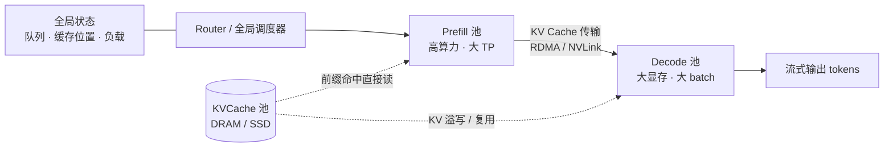
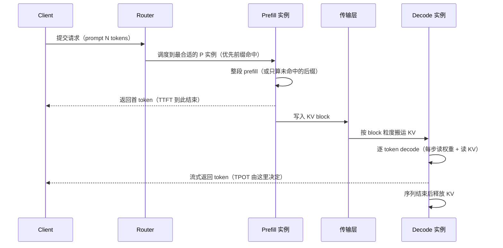
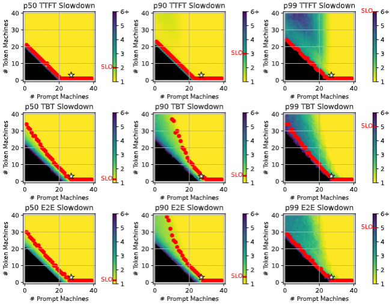
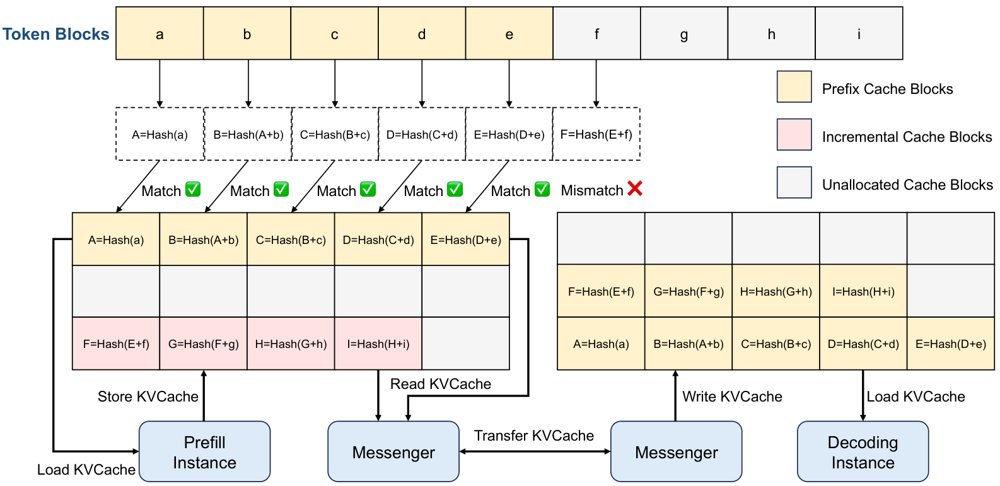

# Prefill-Decode 分离基本原理

> **一句话总结**：Prefill-Decode 分离（PD 分离，Prefill-Decode Disaggregation）把一次 LLM 请求拆成两段——**一次性算完 prompt 的 prefill** 与**逐 token 自回归的 decode**——并分别放到不同的 GPU / 实例池上执行，使两个阶段的**资源配比、并行策略、扩缩容**彼此解耦。代价是必须把 prefill 产出的 **KV Cache 跨节点搬运**给 decode 实例，因此是否划算取决于"KV 传输耗时"与"消除阶段干扰后换回的 goodput"之间的比较 [1]。

本文遵循本仓库的设计原则：**先讲清"为什么"，再谈"怎么做"**，并明确标注**关联技术**与**边界、代价**。

- 适用版本前提：以 DistServe（OSDI'24）[1]、Splitwise（ISCA'24）[2]、Mooncake（arXiv:2407.00079）[3] 三条主线为理论依据，工程实现参考 vLLM 与 SGLang 的分离式部署文档 [4][5]。**当 KV 传输成本高于干扰损失时（短 prompt、小模型、宽松 SLO），PD 分离的收益不成立**。

---

## 1. 它为什么存在：一个请求里住着两种完全不同的计算

### 1.1 两个阶段的算力画像几乎相反

同一个请求的前半段和后半段，对硬件的要求是矛盾的：

| 维度 | Prefill（预填充） | Decode（解码） |
| --- | --- | --- |
| 输入 | 整段 prompt，一次前向并行处理 $N$ 个 token | 每步只处理 1 个新 token |
| 计算形态 | 大矩阵乘（GEMM），算术强度高 | 每步要把**全部权重**从 HBM 读一遍 |
| 瓶颈 | 算力（FLOPS） | 显存带宽（bytes/s），即"读权重 + 读 KV" |
| 典型 MFU | 高（可实现 40% 以上） | 低（常常只有个位数到十几个百分点） |
| Attention 复杂度 | 随 prompt 长度平方增长 $O(N^2)$ | 每步线性读取 KV， $O(N)$ |
| 最优 batch | 中等（太大反而拉长 TTFT 排队） | 越大越好（摊薄权重读取） |
| 并行偏好 | 大 TP，把单次前向切开 | 大 batch + 小 TP 或 EP，优先 KV 容量 |
| 对应用负责的指标 | **TTFT**（首 token 时间） | **TPOT / ITL**（每 token 间隔） |
| 硬件偏好 | 高算力 | 大显存、高带宽，算力可降级 |

一句话：**prefill 在"算"，decode 在"搬"**。前者把 GPU 的算力吃满，后者把 GPU 的带宽吃满而算力闲置 [2]。

### 1.2 混在一起为什么互相拖累

把两阶段放进同一个 batch（即传统的 continuous batching），会出现两类问题 [1]：

- **计算干扰**：prefill 的长请求一旦插入，正在进行的 decode 步就被拉长，表现为 TPOT 出现尖峰；若为了保证 TPOT 而限制 prefill 的插入粒度，就必须改用 chunked prefill（把长 prompt 切成小块分步插入），而切得越碎，prefill 的 MFU 越低、TTFT 越长。
- **资源耦合**：两阶段被迫共用**同一套并行策略和同一批 GPU**。想给 prefill 配大 TP（切开单次前向），就得让 decode 也承受同样的切分开销；想给 decode 配大显存，就得让 prefill 一起买这份显存。

这就是"要么牺牲 TTFT，要么牺牲 TPOT，要么靠超配算力同时硬扛"的来源——**混部系统的瓶颈往往不是算力不够，而是两套互相冲突的最优解无法同时成立**。

### 1.3 分离换来四个自由度

| 自由度 | 混部 | 分离后 |
| --- | --- | --- |
| **资源配比** | 固定，P 与 D 抢同一批卡 | 可按流量形态独立调整 P : D 比例 |
| **并行策略** | 被迫一致 | P 用大 TP，D 用小 TP / 大 batch 或 EP |
| **硬件选型** | 同一型号 | 可异构：P 用高算力卡，D 用大显存、低功耗卡 [2] |
| **扩缩容** | 同步扩缩 | 长 prompt 突发时只扩 P 池，输出型流量只扩 D 池 |

### 1.4 目标函数也随之改变：从"吞吐"到"goodput"

DistServe 指出，只看总吞吐会掩盖问题：一个系统可能吞吐很高，但大量请求的 TTFT 或 TPOT 不达标。真正该优化的是 **goodput**——**单位时间内同时满足 TTFT 与 TPOT 双 SLO 的请求数** [1]。PD 分离的所有设计选择（配比、放置、调度）都应回到这个目标上评判。

---

## 2. 核心机理

### 2.1 全局视图

关键点：**P 池与 D 池之间只有一条数据通路，即 KV Cache**。请求本身不流动，流动的是"已经算好的上下文状态"。

### 2.2 请求生命周期

这条链路暴露了分离方案的**全部额外成本**：多了一次跨实例调度、一次 KV 写入、一次网络搬运、一次 KV 重挂载。设计的好坏，基本就是这四步做得多便宜。

### 2.3 关键设计一：KV 传输通道

搬运的是 KV，不是文本，所以通道选择直接决定成败：

| 场景 | 通道 | 说明 |
| --- | --- | --- |
| 同节点不同 GPU | NVLink / P2P | 带宽最高，但受单机拓扑限制 |
| 跨节点 | RDMA（InfiniBand / RoCE）+ GPUDirect | 主流生产方案，需 GPU 显存直通网卡 |
| 经存储中转 | DRAM / SSD 缓存池 | Mooncake 的路线：把集群里闲置的 CPU、DRAM、SSD 组成分布式 KVCache 池 [3] |

工程实现上，vLLM 用 `KVTransferConfig` 配合可插拔 connector（NIXL、Mooncake、PyNccl、LMCache 等）[4]，SGLang 用 `--disaggregation-mode prefill/decode` 指定角色 [5]。它们共同的抽象是：**传输单位是 KV block，不是整段序列**——这样才能与分页管理和前缀缓存对齐。

### 2.4 关键设计二：KV 布局与并行度必须对得上

这是实践中最容易踩的坑，也是论文里最容易被略过的一节：

- **block 粒度要对齐**：KV 按 PagedAttention 的 block 管理，"搬运"实际是"块对齐拷贝"。两端的 block 大小、页表结构若不同，需要重新打包。
- **token 到 block 的映射要重建**：D 侧除了拿到 KV 数据，还必须拿到 slot mapping / block table，否则不知道第 $i$ 个 token 的 KV 落在哪个块。
- **TP 度不同要重切**：P 侧用 TP=8、D 侧用 TP=4 时，KV head 的切分方式不同（GQA 下按 KV head 切），必须做 **repack / reshard**。跨不同 TP 度传输是最贵的一种，因为要跨实例做 all-to-all 式重排。
- **精度要一致**：P 侧写 FP8 KV、D 侧读 BF16 KV，就需要转换，等于把量化收益又赔进去一次。

一句话：**分离的自由度（P/D 用不同并行策略）和传输的代价（要重新切分）是同一枚硬币的两面**。

### 2.5 关键设计三：P : D 资源配比

配比是分离架构里最核心的调参问题：设总卡数为 $M$，P 占 $p$、D 占 $1-p$。P 太少 → D 等不到 KV，出现**D 饥饿**；D 太少 → KV 堆在传输缓冲或溢写到 SSD，出现**KV 积压**。两者都会让 goodput 掉下悬崖。

这张图（[2] 的 Figure）把配比问题画得很直白：三个面板分别是 p50/p90/p99 的 TTFT、TBT、E2E 违反率，**红色边界线围出的区域就是"满足 SLO 的可行配比范围"**，边界之外无论加多少机器都无法达标（因为另一侧的机器数不够）。这也说明配比不是"越多越好"，而是**沿边界走**。

经验规律：

- **prompt 长、输出短**（如文档摘要、RAG 首答）→ P 是瓶颈，配比向 P 倾斜；
- **prompt 短、输出长**（如代码生成、长推理）→ D 是瓶颈，配比向 D 倾斜；
- 流量形态随时间变化时，需要用**独立的自动扩缩容**分别调整两个池——这是混部做不到的。

### 2.6 关键设计四：调度与前缀缓存

分离后调度器看到的不是一个队列，而是**两张网**：P 池的算力余量、D 池的 batch 余量，再加上 KV 池里已有的前缀。于是调度目标变成"三元匹配"：把请求送到**有缓存命中、P 侧排队短、D 侧还有 batch 空间**的组合上。

上图（[3] 的 Figure）展示了 Mooncake 的做法：前缀按**链式哈希**组织成 block（`A=Hash(a)`、`B=Hash(a+b)`……），命中则直接复用，未命中才真正计算；KV 通过 Messenger 在 Prefill 实例与 Decoding 实例之间搬运，并可下沉到 DRAM/SSD 池。这带来两个额外收益：

- **前缀命中直接跳过 prefill**，等价于凭空多出算力；
- **KV 池化解耦了显存上限**，使 D 池可以处理超过自身显存容量的并发上下文（代价是访存层级下降）。

Mooncake 还引入了**基于预测的提前拒绝**：在过载场景下，与其让所有请求都超时，不如早拒一部分以保住整体 SLO [3]。

### 2.7 什么时候**不**该分离：一条可算的判据

分离的收益必须覆盖传输成本。先算 KV 有多大：

$$
S_{kv} = 2 \times L \times n_{kv} \times d_{head} \times b \times N
$$

其中 $L$ 是层数、 $n_{kv}$ 是 KV head 数、 $d_{head}$ 是每头维度、 $b$ 是每元素字节数、 $N$ 是 prompt 长度；系数 2 来自 K 与 V 两份。MLA 类结构只存一份压缩隐变量，则为：

$$
S_{kv}^{MLA} = L \times (d_c + d_{rope}) \times b \times N
$$

传输耗时为 $T_{kv} = S_{kv} / B$ ，其中有效带宽 $B$ 通常由 RDMA 实测得出。判据是：

$$
T_{kv} \ll T_{prefill}(N)
$$

两个量级估算（假设有效带宽 $B = 25\ \mathrm{GB/s}$，prompt $N = 4096$）：

| 模型 | 每 token KV | 4K prompt 的 KV | 传输耗时 |
| --- | --- | --- | --- |
| LLaMA-3-70B（GQA，80 层，8 个 KV head，128 维，FP16） | 320 KiB | 约 1.25 GiB | 约 54 ms |
| DeepSeek-V3（MLA，61 层， $d_c=512$ 、 $d_{rope}=64$ ，FP16） | 约 69 KiB | 约 274 MiB | 约 11 ms |

对照 prefill 本身：70B 模型处理 4K token 需要 $2 \times 7\times10^{10} \times 4096 \approx 5.7\times10^{14}$ FLOPs，按 TP=8、单卡有效算力 400 TFLOPS 估算约 **180 ms**。于是传输占比约 30%（GQA 案例）——**不算可以忽略，但也不是致命**，这就是分离在长 prompt 场景能赢、在短 prompt 场景会输的量化原因。

---

## 3. 关联关系

| 技术 | 关系 | 说明 |
| --- | --- | --- |
| **[PagedAttention](PagedAttention基本原理.md)** | 前置依赖 | KV 以 block 为单位管理，才使"块级搬运"和"块级复用"成为可能 |
| **[KV Cache 基本原理](KV Cache基本原理.md)** | 前置依赖 | KV 的大小、布局、增长方式决定了传输成本的上限 |
| **连续批处理 / chunked prefill** | 同机替代方案 | 用"时间片隔离"代替"物理隔离"，不搬 KV，但资源与并行策略仍耦合 |
| **前缀缓存（prefix caching）** | 协同优化 | 与 PD 分离组合成 cache-aware 路由；命中即免算，放大分离收益 |
| **[张量并行推理](张量并行推理基本原理.md)** | 策略来源 | P 池倾向大 TP；但 P/D 的 TP 度不同会引入 repack 成本 |
| **[专家并行推理](专家并行推理基本原理.md)** | 策略来源 | D 池大 batch 场景常用 EP；MoE 下 P/D 的并行方案差异更大 |
| **KV 量化 / FP8 / FP4** | 正交优化 | 直接缩小 $S_{kv}$，降低传输量，但也要求两端精度对齐 |
| **MLA / CSA / SWA 等 KV 压缩** | 正交优化 | 每 token KV 越小，分离越便宜；DeepSeek 的 MLA 让 4K prompt 的 KV 只有 274 MiB |
| **[投机采样](投机采样基本原理.md)** | 改变配比 | 缩短 decode 每 token 时间，等效于降低 D 池需求，配比要向 P 倾斜 |
| **分布式 KV Cache / 3FS / Transfer Engine** | 基础设施 | 提供跨节点 KV 搬运与持久化，是分离架构的下限保障 |
| **AFD（Attention-FFN 分离）** | 更细粒度的同族思路 | 把 FFN 与 Attention 再拆开，属于"按计算形态切分"的延伸方向 |

---

## 4. 边界与代价

| 代价 | 具体表现 | 缓解思路 |
| --- | --- | --- |
| **多一跳传输** | 增加 TTFT 与带宽占用；跨机架、跨机房时急剧放大 | 拓扑感知放置：让 P 与 D 尽量同机架（DistServe 的 placement 策略 [1]） |
| **失效域变大** | P 实例挂掉，尚未送达的 KV 全丢，请求必须整体重算 | 幂等重试、KV 副本、快速重建路径 |
| **两端负载必须联合调度** | 一端空转、一端排队，配比失衡时 goodput 断崖 | 全局调度器 + 预测式配比调整 |
| **并行度对齐成本** | P/D 的 TP、量化精度、block 大小不同时需要 repack | 尽量保持两端布局一致，把"自由度"用在配比而非布局上 |
| **小请求不友好** | 短 prompt 时 $T_{kv}$ 在 TTFT 中占比过高 | 短请求走混部或同机路径，长请求走分离路径（混合路由） |
| **运维复杂度翻倍** | 两套镜像、两套扩缩容、两套监控 | 统一资源抽象，但复杂度不会消失，只是被封装 |
| **目标容易被误读** | 混部在宽松 SLO 下加上大 batch，总吞吐往往更高 | 用 **goodput** 而非吞吐做验收指标 [1] |

**特别强调一条边界**：PD 分离不是"性能优化开关"，而是**用带宽换调度自由度**。当带宽充裕、SLO 严格、prompt 又长时，它划算；当带宽紧张、SLO 宽松、请求又短时，它只是多了一次网络跳数。

---

## 5. 可验证方法

1. **控制变量对照**：固定 GPU 总数，分别跑"同机混部 / chunked prefill / PD 分离"三种拓扑，记录 TTFT p90、ITL p90 与 goodput（满足双 SLO 的 QPS）。若分离的 goodput 不涨，说明配比或带宽有问题。
2. **量测真实带宽**：用 RDMA 带宽测试工具或 `nccl-test` 测出 $B$，再用上面的公式预测 $T_{kv}$，与实测传输时间比对；偏差过大通常说明有 repack 或 block 重打包开销。
3. **三档 prompt 长度扫描**： $N$ 取 512 / 4K / 32K，观察"传输耗时 / TTFT"的比例是否随 $N$ 下降——下降趋势成立即符合 $T_{kv} \ll T_{prefill}$ 的假设。
4. **观察两侧利用率**：P 池 SM 利用率低而 D 池队列长 → 应向 P 倾斜；反之向 D 倾斜。这条比任何经验比例都可靠。
5. **压测找 SLO 破裂点**：并发阶梯递增，记录 TTFT 与 ITL 首次越线的并发数，作为 goodput 的实际上限。
6. **复现路径**：vLLM 提供分离式部署的示例（`examples/online_serving/disaggregated_prefill.sh` 一类脚本）[4]，SGLang 提供 `--disaggregation-mode` 参数 [5]，可直接作为最小验证环境。

---

## 6. 对比表：四类部署拓扑

| 方案 | 隔离方式 | 资源配比 | KV 传输 | 并行策略 | 适用场景 |
| --- | --- | --- | --- | --- | --- |
| 同机混布（continuous batching） | 无 | 固定 | 无 | 两阶段一致 | SLO 宽松、请求短、追求总吞吐 |
| 同机 chunked prefill | 时间片 | 固定 | 无 | 两阶段一致 | 单机部署、中等 SLO，缓解但不消除干扰 |
| PD 分离（同构集群） | 物理隔离 | 可独立调整 | 跨实例搬运 | 可分别设定 | 长 prompt、TTFT 与 TPOT 都严格 [1] |
| PD 分离（异构集群） | 物理 + 硬件异构 | 可独立调整 | 跨实例搬运 | 可分别设定 | 兼顾成本与功耗，token 阶段用低功耗卡 [2] |
| KVCache-centric 分离（Mooncake） | 物理 + 缓存池化 | 可独立调整 | 经 DRAM/SSD 池中转 | 可分别设定 | 超长上下文、前缀复用率高、过载需保护 [3] |

论文报告的量化效果（均为各自论文的原口径，测试条件不同，不可直接横比）：

| 工作 | 基线 | 报告结果 |
| --- | --- | --- |
| DistServe [1] | 主流同机混部系统 | 同等延迟约束下可多服务 **7.4 倍**请求，或在 **12.6 倍**更严的 SLO 下仍有 >90% 请求达标 |
| Splitwise [2] | 同构混部集群 | **1.4 倍**吞吐且成本降 20%；或同等成本与功耗下 **2.35 倍**吞吐 |
| Mooncake [3] | 常规分离/混部方案 | 真实负载下 Kimi 多承接 **75%** 请求；特定模拟长上下文场景吞吐最高 **525%** |

---

## 7. 延伸阅读

- 先读 [KV Cache 基本原理](KV Cache基本原理.md) 与 [PagedAttention基本原理.md](PagedAttention基本原理.md)：不理解 block 级 KV 管理，就无法理解"KV 为什么能搬"。
- 再读 [张量并行推理基本原理](张量并行推理基本原理.md) 与 [专家并行推理基本原理](专家并行推理基本原理.md)：PD 分离真正的价值是让两个阶段各自选并行策略，前提是知道并行策略怎么选。
- 想理解"为什么 decode 阶段算力被浪费"，可对照 [投机采样基本原理](投机采样基本原理.md)：它是另一条"用更少步数完成 decode"的路线，与 PD 分离正交但会影响 P : D 配比。
- 若关心 MoE 模型在 D 池的执行效率，见 [MegaMoE基本原理.md](MegaMoE基本原理.md)：EP 通信与计算重叠本身就是为 decode 的低算术强度场景设计的。

---

## 8. 参考文献

1. Zhong Y., Liu S., Chen J., et al. **DistServe: Disaggregating Prefill and Decoding for Goodput-optimized Large Language Model Serving**. OSDI 2024. [arXiv:2401.09670](https://arxiv.org/abs/2401.09670)
2. Patel P., Choukse E., Zhang C., et al. **Splitwise: Efficient Generative LLM Inference Using Phase Splitting**. ISCA 2024. [arXiv:2311.18677](https://arxiv.org/abs/2311.18677)
3. Qin R., Li Z., He W., et al. **Mooncake: A KVCache-centric Disaggregated Architecture for LLM Serving**. [arXiv:2407.00079](https://arxiv.org/abs/2407.00079)
4. vLLM. **Disaggregated Prefill and Decoding**. [vLLM 文档](https://docs.vllm.ai/en/latest/features/disagg_prefill.html)
5. SGLang. **PD Disaggregation**. [SGLang 文档](https://docs.sglang.ai/advanced_features/pd_disaggregation.html)
6. NVIDIA. **NVIDIA Dynamo（分离式推理编排框架）**. [文档](https://docs.nvidia.com/dynamo/)
7. **llm-d：面向 Kubernetes 的分布式推理栈**. [llm-d.ai](https://llm-d.ai)
8. DeepSeek-AI. **DeepSeek-V3 Technical Report**（MLA 的 KV 压缩结构，决定每 token KV 大小）. [arXiv:2412.19437](https://arxiv.org/abs/2412.19437)
9. Kwon W., Li Z., Zhuang S., et al. **Efficient Memory Management for Large Language Model Serving with PagedAttention**. SOSP 2023. [arXiv:2309.06180](https://arxiv.org/abs/2309.06180)
10. Yu G.-I., Jeong J. S., Kim G.-W., et al. **Orca: A Distributed Serving System for Transformer-Based Generative Models**（连续批处理，PD 分离的对照基线）. OSDI 2022. [arXiv:2208.03743](https://arxiv.org/abs/2208.03743)

---

## 9. 图片来源声明

本文图片均已下载至本地 `assets/` 目录后引用，未使用远程链接：

| 文件 | 原始出处 | 说明 |
| --- | --- | --- |
| `assets/splitwise-sweep.png` | Splitwise 论文 HTML 版 Figure（[arxiv.org/html/2311.18677v2](https://arxiv.org/html/2311.18677v2)） | SLO 违反率随 prompt/token 机器数变化的热力图 |
| `assets/mooncake-cache-unit.png` | Mooncake 论文 HTML 版 Figure（[arxiv.org/html/2407.00079v3](https://arxiv.org/html/2407.00079v3)） | 前缀块链式哈希与 Prefill/Decoding 实例间的 KV 搬运 |

文中其余示意图为本仓库自绘的 Mermaid 图，不涉及外部版权。
