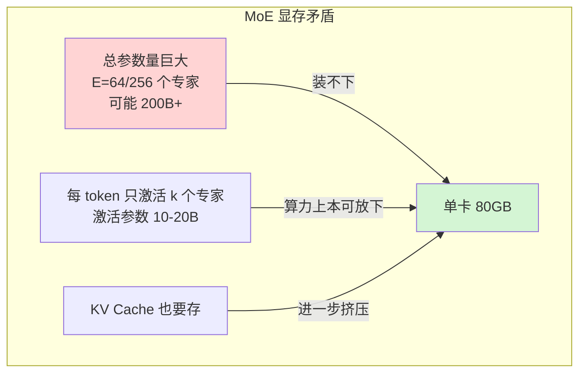
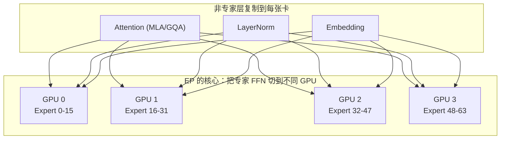
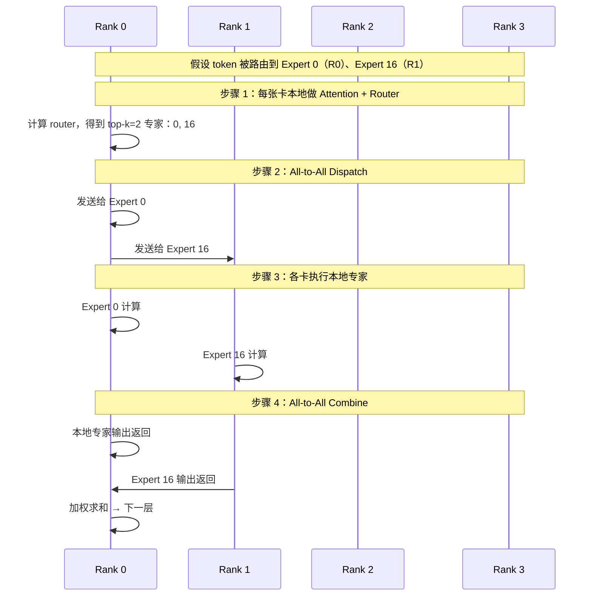
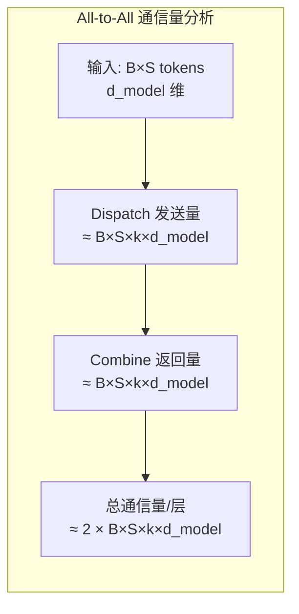
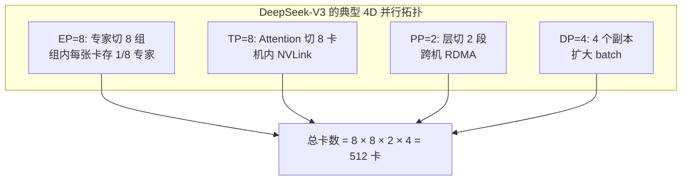
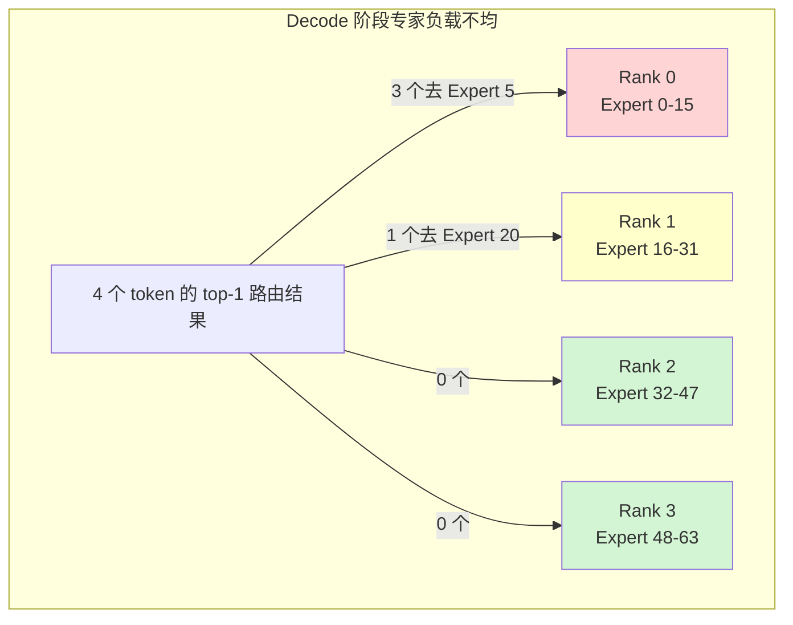
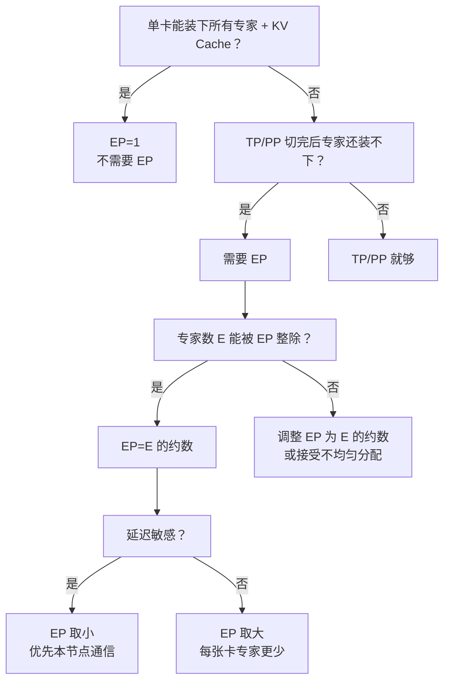
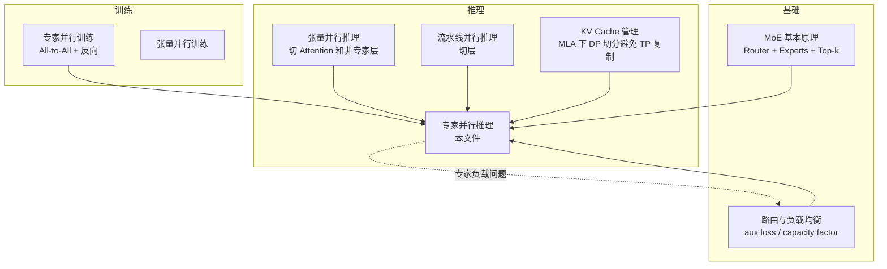

# 专家并行推理基本原理

> **一句话总结**：专家并行推理（Expert Parallelism for Inference, EP）把 MoE 模型中**数量多、体量大、但每次只稀疏激活**的专家 FFN 切分到多张 GPU 上，让每张卡只驻留部分专家；每个 token 通过路由网络决定去哪几个专家，通过 **All-to-All 通信**把自己的激活值送到目标专家所在的卡，再把专家输出聚合回来。它解决了"MoE 总参数量太大、单卡装不下"的问题，代价是引入**专家间 All-to-All 通信**和**推理时的专家负载不均衡风险**。

本文遵循本仓库的设计原则：**先讲清"为什么"，再谈"怎么做"**，并明确标注**关联技术**与**边界、代价**。

- 适用版本前提：MoE 路由与专家并行基于 Shazeer et al. (2017) [1]；Switch Transformer 负载均衡基于 Fedus et al. (2022) [2]；DeepSeek-V3/V4 的 EP 实现基于 DeepSeek-AI (2024/2025) [3][4]。**脱离 batch 大小、路由分布和并行拓扑的 EP 结论不成立**。

---

## 1. 它为什么存在：MoE 推理的显存瓶颈

### 1.1 MoE 模型的参数矛盾

MoE 的核心价值是"**总参数量很大，但每 token 只激活一小部分**"。这在推理时造成一个独特问题：



| 模型 | 总参数 | 激活参数 | 专家数 E | Top-k | 单卡 FP16 专家参数 |
| --- | --- | --- | --- | --- | --- |
| Mixtral 8×7B | 47B | 13B | 8 | 2 | ~14 GB |
| Mixtral 8×22B | 141B | 39B | 8 | 2 | ~44 GB |
| DeepSeek-V3 | 671B | 37B | 256 | 8 | ~340 GB |
| DeepSeek-V4-Flash | 284B | 13B | 256 | 6 | ~250 GB |

> DeepSeek-V3 的 671B 总参数中，专家 FFN 占了绝大部分。如果不做 EP，仅专家参数就需要数百 GB 显存——**任何单卡都放不下**。

### 1.2 为什么不用 TP 或 PP 解决 MoE 显存问题

| 并行方式 | 切什么 | 对 MoE 的问题 |
| --- | --- | --- |
| **TP** | 单层内矩阵 | 只能切 Attention 和非专家层；专家 FFN 仍按 head 维度切，无法把 256 个专家分片 |
| **PP** | 层 | 可以把专家层整体放到不同 stage，但一个 stage 仍要装下该 stage 的所有专家 |
| **EP** | **专家** | **直接切分专家 FFN 本身**——这是唯一能处理 256 个专家的方法 |

### 1.3 EP 的核心思想



- **专家 FFN**：按专家 ID 切分到 EP 组内各 GPU；
- **Attention / LayerNorm / Embedding / Router**：**每张卡复制一份**；
- 一个 token 先在本机做 Attention，然后把 FFN 输入通过 All-to-All 送到目标专家所在的卡。

---

## 2. 核心机制：一次 MoE 层前向的数据流

### 2.1 单 token 的旅程



### 2.2 两个 All-to-All 阶段

| 阶段 | 名称 | 方向 | 发送什么 | 作用 |
| --- | --- | --- | --- | --- |
| **1** | **Dispatch** | 所有 rank → 目标 expert 所在 rank | token 的 FFN 输入隐藏态 | 把 token 送到正确的专家 |
| **2** | **Combine** | 目标 expert 所在 rank → 源 rank | token 经过专家后的输出隐藏态 | 把结果送回来做加权求和 |

### 2.3 All-to-All 的通信量

一个 micro-batch 有 $B \times S$ 个 token，每个 token 的隐藏态大小为 $d_{model}$，激活 $k$ 个专家，EP 度数为 $N$。



注意：
- **通信量和专家总数 E 无关**（只和激活数 k 有关）——这是 EP 的核心优势；
- 但通信量**随 batch 和序列长度线性增长**——所以 EP 对 batch 敏感；
- 每个 token 平均要发送到 $k$ 个目标 rank，每个 rank 会收到来自其他 rank 的 token。

### 2.4 EP 与 TP 的组合：2D/3D 并行

实际部署中 EP 几乎不会单独使用，而是和 TP/PP 组合：



| 并行 | 切什么 | 通信原语 | 在 MoE 推理中的作用 |
| --- | --- | --- | --- |
| **TP** | Attention / 非专家 FFN | All-Reduce | 切单层，处理 MLA/Attention 显存 |
| **PP** | 层 | Send/Recv | 切层数，处理超多层模型 |
| **EP** | 专家 FFN | All-to-All | 切专家，唯一能把 256 个专家分开的手段 |
| **DP** | 数据 | All-Reduce（梯度）/ 无 | 推理时主要是多副本扩大吞吐 |

---

## 3. 推理 EP 的特殊挑战

### 3.1 负载不均衡比训练更严重

训练时 batch 很大（百万 token 级别），路由统计上接近均匀。推理时 batch 小得多：

| 阶段 | 典型 batch 大小 | 专家负载波动 |
| --- | --- | --- |
| 训练 | 全局 batch 数 M | 统计上非常均匀 |
| Prefill | batch × seq，可能 K-M | 较均匀 |
| **Decode** | **batch × 1** | **非常容易不均匀** |



在极端情况下，某个 rank 可能收到大量 token，其他 rank 空闲——这就是**专家热点（Expert Hotspot）**。

### 3.2 通信延迟对 Decode 影响大

Decode 阶段每个 token 都要做 EP 的 All-to-All：

```
每 token 延迟构成:
  = Attention 时间
  + Router 时间
  + All-to-All Dispatch 时间
  + Expert 计算时间
  + All-to-All Combine 时间
  + 后续层时间
```

在 batch=1 时，All-to-All 的**延迟**（latency）成为主导因素；在 batch 大时，**带宽**成为主导因素。

### 3.3 专家参数无法预取

由于路由是**动态的**——每个 token 路由到哪些专家要在运行时决定——EP 无法像 Dense 模型那样静态切分计算图。这导致：
- 难以做 CUDA Graph 捕获（vLLM 等框架正在逐步支持）；
- 专家权重无法像 Dense FFN 那样做算子融合优化；
- 内存访问模式不规则，对 GPU cache 不友好。

---

## 4. 主流框架的 EP 实现

### 4.1 vLLM

vLLM [5] 从 v0.6+ 开始加强对 MoE/EP 的支持，特别是 DeepSeek-V3/R1 的流行推动了实现：

| 特性 | vLLM 做法 |
| --- | --- |
| **EP 切分** | `pipeline_parallel_size` + `tensor_parallel_size` + `enable_expert_parallel` |
| **All-to-All** | NCCL All-to-All + 自定义 kernel 做 dispatch/combine |
| **KV Cache** | MLA 模型下 KV Cache 按 DP 切分（避免 TP 复制） |
| **Continuous Batching** | 支持跨 EP rank 的连续批处理 |
| **EP+TP 组合** | 官方支持，用于 DeepSeek-V3 部署 |

### 4.2 TensorRT-LLM

NVIDIA TensorRT-LLM [6] 对 MoE 做了高度优化：

| 特性 | TensorRT-LLM 做法 |
| --- | --- |
| **专家分组 GEMM** | 把不同 token 的专家计算打包成 grouped GEMM |
| **All-to-All 优化** | 与 NCCL 深度集成，支持多流 overlap |
| **FP8/INT8 专家** | 专家权重可量化，进一步降显存 |
| **MoE Mamba 支持** | 支持 MoE + Mamba 混合架构 |

### 4.3 DeepSpeed-Inference / DeepSeek 内部框架

DeepSeek 的 EP 实现是最激进的 [3][4]：

| 优化 | 说明 |
| --- | --- |
| **Fine-grained EP** | 每个专家进一步切小，增加并行度 |
| **DualPipe** | 双向流水线调度，重叠 EP 通信和计算 |
| **Node-limited routing** | 限制 token 路由到本节点内的专家，减少跨节点 All-to-All |
| **Top-k group routing** | DeepSeek-V3 的 shared expert + routed expert 分离 |

### 4.4 SGLang

SGLang [7] 的 MoE 支持相对较新，主要特点是：
- 与 vLLM 共享部分底层（如 PagedAttention）；
- 在 RadixAttention 缓存场景下与 MoE 结合做 KV 复用；
- EP 支持不如 vLLM/TensorRT-LLM 成熟。

---

## 5. EP 度数选择与拓扑设计

### 5.1 决策树



### 5.2 EP 度数的上限

| 约束 | 说明 |
| --- | --- |
| **EP ≤ E / k** | 至少要保证每个 rank 上有事做；理想是 EP 能整除 E |
| **EP ≤ 节点数 × 单节点 GPU 数** | 物理限制 |
| **EP 优先取 E 的约数** | 如 E=256，EP 可取 1, 2, 4, 8, 16, 32, 64, 128, 256 |

### 5.3 典型配置

| 模型 | E | 推荐 EP | 说明 |
| --- | --- | --- | --- |
| Mixtral 8×7B | 8 | 1 或 2 | 专家少，EP 收益有限 |
| Mixtral 8×22B | 8 | 2 或 4 | 专家参数大，EP 更有价值 |
| DeepSeek-V3 | 256 | 8–64 | 专家多，EP 是必需的 |
| DeepSeek-V4-Flash | 256 | 8–32 | 激活参数小，但专家参数仍大 |

---

## 6. 边界与代价

### 6.1 EP 的核心代价

| 代价 | 说明 | 严重程度 |
| --- | --- | --- |
| **All-to-All 通信** | 每个 MoE 层两次 | 🔴 核心代价 |
| **负载不均衡** | 小 batch/Decode 时专家热点 | 🔴 严重 |
| **动态路由开销** | 无法静态优化、CUDA Graph 受限 | 🟡 中等 |
| **实现复杂度高** | 需要与 TP/PP/DP 协调 | 🟡 中等 |
| **Embedding/Attention 复制** | 非专家层每张卡都有 | 🟢 可接受 |

### 6.2 EP 的收益边界

EP **不是越多越好**：
- EP 太小 → 单卡专家太多，显存不够；
- EP 太大 → All-to-All 跨节点次数增加，延迟上升；
- 最佳 EP 通常是**本节点内 EP**，把跨节点通信降到最低。

### 6.3 不适用场景

| 场景 | 原因 |
| --- | --- |
| **Dense 模型** | 没有专家，不需要 EP |
| **专家数很少的 MoE**（E=8） | EP 收益有限，直接用 TP/PP 更简单 |
| **极低延迟推理**（batch=1，实时） | All-to-All 延迟不可接受 |
| **广域网部署** | 跨节点 All-to-All 太慢 |

---

## 7. 可验证实验

### 7.1 用 vLLM 测试 EP 对 MoE 推理的影响

```python
from vllm import LLM, SamplingParams

# 不使用 EP：TP=8
llm_no_ep = LLM(
    model="deepseek-ai/DeepSeek-V3",
    tensor_parallel_size=8,
    pipeline_parallel_size=2
)

# 使用 EP：TP=8 + EP=8
llm_ep = LLM(
    model="deepseek-ai/DeepSeek-V3",
    tensor_parallel_size=8,
    pipeline_parallel_size=2,
    enable_expert_parallel=True  # 假设参数名
)

prompt = "Explain the concept of mixture of experts in LLMs."
params = SamplingParams(temperature=0, max_tokens=128)

# 测试 TTFT 和吞吐
for name, llm in [("No EP", llm_no_ep), ("EP=8", llm_ep)]:
    outputs = llm.generate([prompt] * 32, params)
    # 通过 vLLM metrics 或 nvtx 测量
    print(f"{name}: TTFT=... TPOT=...")
```

### 7.2 模拟 All-to-All 通信量

```python
import torch
import torch.distributed as dist

def estimate_ep_communication(
    batch_size, seq_len, hidden_size, top_k, ep_size, num_layers
):
    """
    估算 EP 推理一次前向的 All-to-All 通信量
    """
    tokens = batch_size * seq_len
    # 每个 token 激活 k 个专家，每个隐藏态 h 维
    dispatch_bytes = tokens * top_k * hidden_size * 2  # FP16
    combine_bytes = dispatch_bytes
    per_layer_bytes = dispatch_bytes + combine_bytes
    total_bytes = per_layer_bytes * num_layers
    return {
        "dispatch_per_layer_GB": dispatch_bytes / 1e9,
        "combine_per_layer_GB": combine_bytes / 1e9,
        "total_GB": total_bytes / 1e9,
    }

# DeepSeek-V3 规模估算
result = estimate_ep_communication(
    batch_size=16,
    seq_len=4096,
    hidden_size=7168,
    top_k=8,
    ep_size=8,
    num_layers=61
)
print(result)
```

**预期输出量级**：

```
{
  'dispatch_per_layer_GB': ~7.5,
  'combine_per_layer_GB': ~7.5,
  'total_GB': ~915
}
```

> 915 GB 的 All-to-All 通信量对于一次完整 Prefill 来说非常可观——这就是 EP 必须和计算 overlap 的原因。

### 7.3 模拟专家负载不均衡

```python
import numpy as np

def simulate_expert_load(num_tokens, num_experts, top_k):
    """
    模拟随机路由下的专家负载
    """
    # 随机路由（均匀分布）
    routing = np.random.choice(num_experts, size=(num_tokens, top_k))
    counts = np.bincount(routing.flatten(), minlength=num_experts)
    return counts

# 小 batch Decode：负载波动大
for batch in [1, 8, 64, 512]:
    counts = simulate_expert_load(batch, 64, 2)
    print(f"batch={batch}: max={counts.max()}, min={counts.min()}, "
          f"std={counts.std():.2f}")
```

**预期趋势**：batch 越小，专家负载标准差越大，负载越不均衡。

---

## 8. 关联



| 技术 | 关系 | 说明 |
| --- | --- | --- |
| **MoE 基本原理** | 基础 | EP 是 MoE 在分布式场景下的必然产物 |
| **专家并行训练** | 原理同源 | 训练 EP 有反向 All-to-All，推理只有前向 |
| **张量并行推理** | 正交组合 | TP 切 Attention，EP 切专家；两者必须同时存在 |
| **流水线并行推理** | 正交组合 | PP 切层，EP 切专家；超大模型三者都用 |
| **KV Cache 管理** | 强关联 | MLA 模型下 KV Cache 用 DP 切分，避免 TP 复制 |
| **负载均衡** | 强关联 | EP 推理的性能高度依赖路由均衡 |
| **模型量化** | 配合 | INT4/FP8 量化专家权重，进一步降显存 |

---

## 9. 延伸阅读

- [MoE 基本原理](../神经网络基础/MoE基本原理.md) — MoE 的路由、专家结构和负载均衡
- [张量并行推理基本原理](张量并行推理基本原理.md) — 与 EP 正交组合，切 Attention 和非专家层
- [流水线并行推理基本原理](流水线并行推理基本原理.md) — 与 EP 正交组合，切层
- [计算与显存复杂度估算及分布式策略选择](../训练/分布式训练/计算与显存复杂度估算及分布式策略选择.md) — DeepSeek-V4-Flash 的 EP 显存估算实例

---

## 参考文献

[1] Outrageously Large Neural Networks: The Sparsely-Gated Mixture-of-Experts Layer. Shazeer et al., ICML 2017. <https://arxiv.org/abs/1701.06538>

[2] Switch Transformers: Scaling to Trillion Parameter Models with Simple and Efficient Sparsity. Fedus et al., JMLR 2022. <https://arxiv.org/abs/2101.03961>

[3] DeepSeek-V3 Technical Report. DeepSeek-AI, arXiv:2412.19437, 2024. <https://arxiv.org/abs/2412.19437>

[4] DeepSeek-V4-Flash: Large Mixture-of-Experts Language Model with Dynamic Routing. DeepSeek-AI, arXiv:2606.19348, 2026. <https://arxiv.org/abs/2606.19348>

[5] vLLM: Easy, Fast, and Cheap LLM Serving with PagedAttention. Kwon et al., SOSP 2023. <https://arxiv.org/abs/2309.06180>

[6] TensorRT-LLM: Accelerating Large Language Model Inference with TensorRT. NVIDIA, arXiv:2406.09293, 2024. <https://arxiv.org/abs/2406.09293>

[7] SGLang: The Next Generation LLM Serving Engine. Zheng et al., MLSys 2024. <https://arxiv.org/abs/2401.07108>

---

## 图片声明

本文所有架构图、时序图和流程图均由作者使用 Mermaid 语法在文档中直接绘制，无外部图片依赖。
