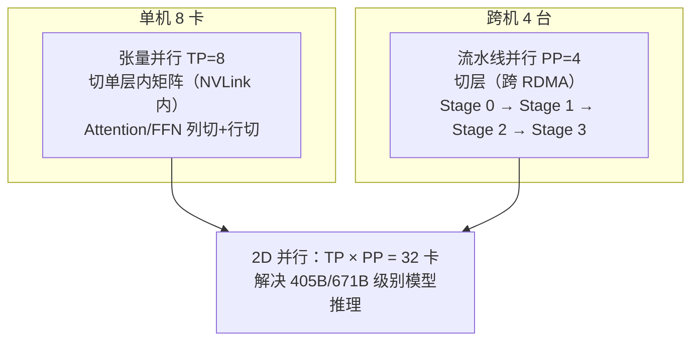
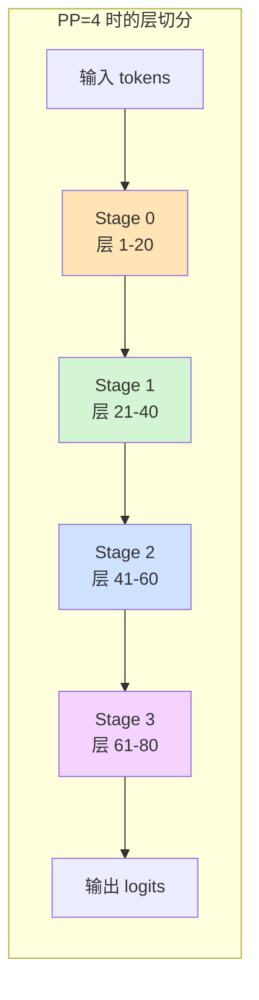
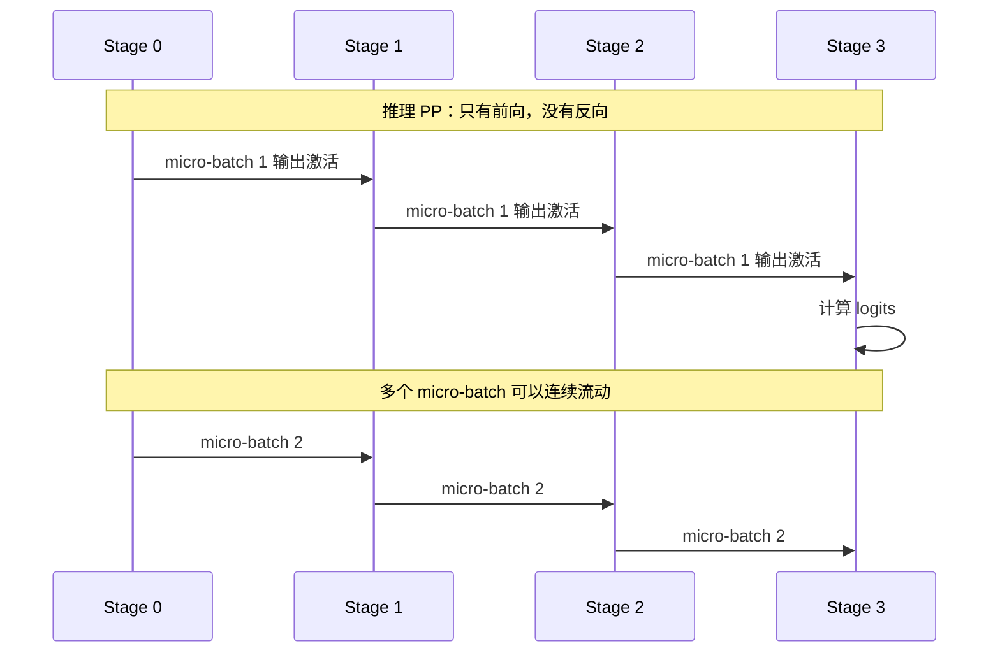
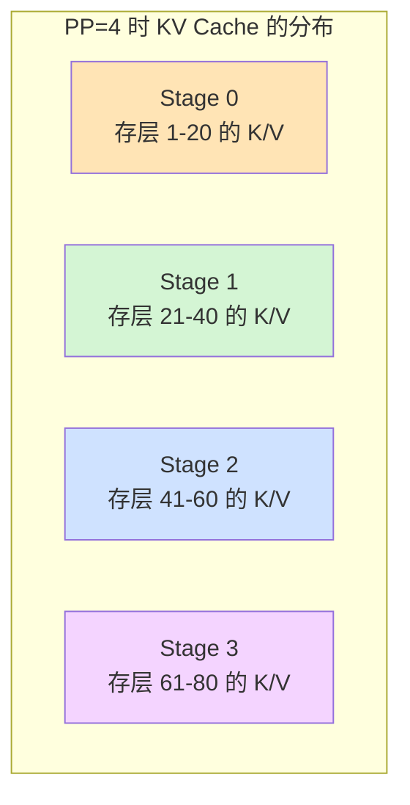
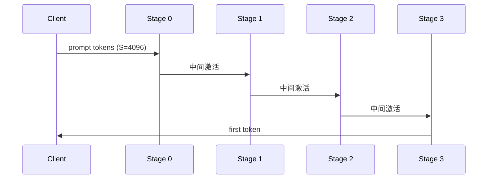
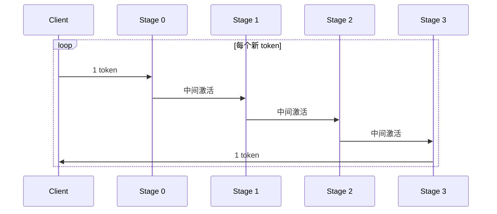
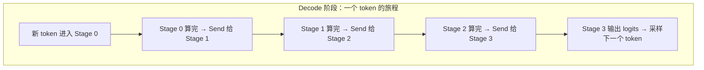
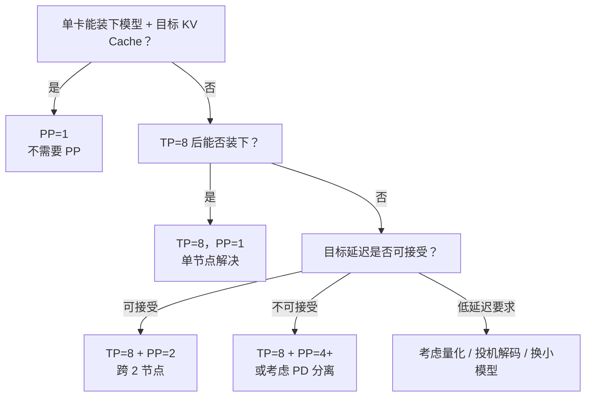
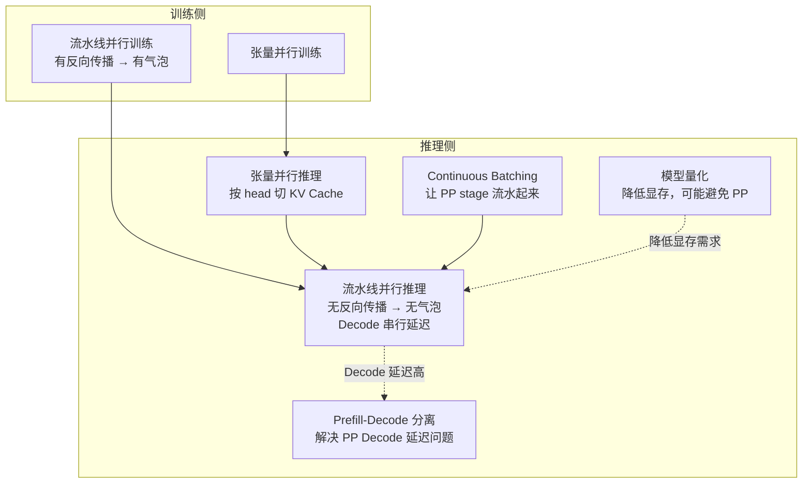

# 流水线并行推理基本原理

> **一句话总结**：流水线并行推理（Pipeline Parallelism for Inference, PP）把模型按**层**切分成多个 stage，放到不同设备上，请求像流水线一样逐层流过。与训练时 PP 最大的不同是——**推理只做前向传播，没有反向传播，因此完全没有流水线气泡**；但代价是 **Decode 阶段每个 token 都要串行经过所有 stage，端到端延迟显著增加**。它适用于"TP 已经到顶、模型层数/参数量仍超过单机显存"的超大模型推理场景，通常和 TP 组合成 2D 并行。

本文遵循本仓库的设计原则：**先讲清"为什么"，再谈"怎么做"**，并明确标注**关联技术**与**边界、代价**。

---

## 1. 它为什么存在：推理和训练的显存瓶颈不同

### 1.1 推理 PP 解决什么问题

和训练一样，推理 PP 也是把模型按**层**切到多张卡上。但它要解决的问题和训练有微妙差别：

| 场景 | 训练 | 推理 |
| --- | --- | --- |
| **触发原因** | 8 卡 TP 后单层仍装不下整模型 | 8 卡 TP 后整模型仍装不下 + KV Cache 也要占显存 |
| **主要矛盾** | 参数、梯度、优化器、激活都占显存 | **参数 + KV Cache** 占显存（没有梯度/优化器） |
| **数据流** | 前向 + 反向 | **只有前向** |
| **核心代价** | 流水线气泡（反向传播导致） | **Decode 串行延迟** |
| **是否能跨节点** | ✅ 可以 | ✅ 可以，但 Decode 延迟敏感 |

### 1.2 推理时 PP 和 TP 的分工



| 并行 | 切什么 | 通信方式 | 主要解决 | 典型度数 |
| --- | --- | --- | --- | --- |
| **TP** | 单层内矩阵 | All-Reduce / All-Gather（集合通信） | 单层装不下 | ≤ 8（单机） |
| **PP** | 层 | Send / Recv（点对点） | 层数太多、整模型装不下 | 2–8（可跨机） |

> **关键设计**：TP 负责机内高速通信，PP 负责跨机扩展层数。两者正交，组合成 2D 并行。

### 1.3 推理 PP 的核心价值

以 Llama-3-405B 为例：

| 配置 | 单卡参数量 | 能否装下？ |
| --- | --- | --- |
| 单卡 | 810 GB (FP16) | ❌ |
| TP=8 | 101 GB/卡 | ❌ 加上 KV Cache 仍可能爆 |
| **TP=8 + PP=2** | **50.6 GB/卡** | ✅ 充裕 |
| TP=8 + PP=4 | 25.3 GB/卡 | ✅ 可支持更大 batch |

PP 让推理可以从**单机 8 卡扩展到多机 32/64 卡**，这是部署 405B、671B 级别模型的必要手段。

---

## 2. 核心机制：推理 PP 的单向流水线

### 2.1 模型按层切分



每个 stage 只包含模型的一部分层：
- Stage 0：层 1–20
- Stage 1：层 21–40
- Stage 2：层 41–60
- Stage 3：层 61–80

每张卡只存 **1/PP 的参数 + 1/PP 的 KV Cache**。

### 2.2 推理 PP 没有气泡：和训练 PP 的根本差异

这是推理 PP 最重要的性质。训练 PP 有气泡是因为需要**反向传播**——反向流和前向流方向相反，导致设备等待。推理 PP 只有前向：



### 2.3 连续批处理（Continuous Batching）下的 PP

推理 PP 通常和 **continuous batching** 配合：多个请求/序列组成 micro-batch，连续流入流水线。

```mermaid
gantt
    title 推理 PP 时序（PP=4，continuous batching）
    dateFormat X
    axisFormat %s
    section Stage 0
    req1 :a1, 0, 1
    req2 :a2, 1, 1
    req3 :a3, 2, 1
    req4 :a4, 3, 1
    section Stage 1
    wait1 :b1, 0, 1
    req1 :b2, 1, 1
    req2 :b3, 2, 1
    req3 :b4, 3, 1
    req4 :b5, 4, 1
    section Stage 2
    wait2 :c1, 0, 2
    req1 :c2, 2, 1
    req2 :c3, 3, 1
    req3 :c4, 4, 1
    req4 :c5, 5, 1
    section Stage 3
    wait3 :d1, 0, 3
    req1 :d2, 3, 1
    req2 :d3, 4, 1
    req3 :d4, 5, 1
    req4 :d5, 6, 1
```



前几个请求会经历 warmup（流水线填充），但只要请求足够多，stage 利用率可以接近 100%——**没有训练 PP 那种前向-反向交替造成的气泡**。

### 2.4 KV Cache 的 PP 切分

推理 PP 中，每个 stage 只负责一部分层，因此 KV Cache 也**按层切分到各 stage**：



**关键性质**：
- Prefill 阶段：token 依次流过 stage，每个 stage 把自己负责层的 K/V 写入本地 KV Cache
- Decode 阶段：每个新 token 生成时，按同样路径流过各 stage，各 stage 只追加自己负责层的 K/V
- **不同 stage 的 KV Cache 不共享**——这和 TP 下 KV Cache 按 head 切分不同

---

## 3. Prefill 与 Decode 在 PP 下的差异

这是理解推理 PP 性能特征的核心。PP 在 Prefill 和 Decode 两个阶段的体验完全不同：

### 3.1 Prefill 阶段：计算主导，PP 效率高



| 特征 | Prefill + PP |
| --- | --- |
| 计算量 | O(S²) Attention + O(S·d²) FFN |
| 通信 | 层间 Send/Recv，数据量 = batch × seq × d |
| 流水线效率 | 高，可以连续 batching |
| 延迟 | 首次 token 时间（TTFT）≈ sum(stage latency) + 通信 |

### 3.2 Decode 阶段：串行延迟主导，PP 效率低



| 特征 | Decode + PP |
| --- | --- |
| 计算量 | 每个 token 只做一次矩阵 × 向量 |
| 通信 | **每个 token 都要经过 PP-1 次跨 stage 传输** |
| 流水线效率 | 低，单次请求像 ping-pong 一样串行 |
| 延迟 | **每 token 延迟 = 所有 stage 处理时间之和 + (PP-1) × 通信延迟** |

### 3.3 为什么 Decode 阶段 PP 很痛苦



对于单个请求，Decode 时 PP 完全没有"流水线并行"的感觉——token 必须串行经过每个 stage。PP 的收益在 Decode 阶段主要来自：
- **batch 足够大时**：多个请求的 token 可以连续流入，stage 之间形成流水线
- **显存能放下更大模型**：这是使用 PP 的根本理由，不是为了 Decode 加速

### 3.4 数值对比：PP 对 TTFT 和 TPOT 的影响

| 指标 | 含义 | PP 影响 |
| --- | --- | --- |
| **TTFT**（首个 token 时间） | Prefill 结束到第一个输出 token | 增加，因为要串行过所有 stage |
| **TPOT**（每个输出 token 时间） | Decode 阶段每 token 耗时 | **显著增加**——这是 PP 最大的代价 |
| **Throughput**（总吞吐） | 单位时间生成 token 数 | 高 batch 下可接受 |

> 如果目标是**低延迟对话**，PP 不是好选择；如果目标是**能跑起来 405B 模型**，PP 是必需的。

---

## 4. 通信分析

### 4.1 每层 stage 间的通信量

Stage $i$ 和 Stage $i+1$ 之间传递的是该 stage 输出的**激活值**：

```
通信量/层 = batch_size × seq_len × d_model × 2 bytes (FP16/BF16)
```

对于 70B 模型（d=8192），batch=1，seq=1（Decode）：

```
每个 stage 间传输 = 1 × 1 × 8192 × 2 = 16 KB
```

单次 16 KB 很小，但 Decode 阶段**每个 token 都要传 PP-1 次**。

### 4.2 PP 的通信 vs TP 的通信

| 并行 | 通信原语 | 通信量 | 通信频率 | 对网络要求 |
| --- | --- | --- | --- | --- |
| **TP** | All-Reduce | O(batch × d) / token | 每层 2 次 / token | **极高**（必须 NVLink） |
| **PP** | Send/Recv | O(batch × d) / token | PP-1 次 / token | 中等（RDMA 可接受） |

> **PP 比 TP 更适合跨节点**，因为：
> 1. 点对点通信比集合通信对网络更友好
> 2. 通信量本身不大（激活值，不是梯度）
> 3. Decode 阶段计算轻，通信占比高但绝对量小

---

## 5. 主流推理框架的 PP 实现

### 5.1 vLLM

vLLM [1] 的 PP 支持相对较晚加入（v0.6+ 逐步完善），主要用于超大模型：

| 特性 | vLLM 做法 |
| --- | --- |
| **PP 切分** | 按层切，每个 worker 负责一段连续层 |
| **通信** | 层间 Send/Recv（PyTorch RPC / NCCL P2P） |
| **KV Cache** | 每个 PP stage 管理自己负责层的 KV page |
| **Continuous Batching** | ✅ 支持跨 PP stage 的连续批处理 |
| **TP+PP 组合** | ✅ 支持 2D 并行 |

vLLM 的 PP 设计重点是**和 continuous batching 配合**，让多个请求在 stage 间流水起来。

### 5.2 TensorRT-LLM

NVIDIA 官方框架 [2] 对 PP 支持更成熟：

| 特性 | TensorRT-LLM 做法 |
| --- | --- |
| **PP 切分** | 编译时静态确定 stage 边界 |
| **通信** | 优化的 NCCL P2P + CUDA Graph 捕获 |
| **Inflight Batching** | 原生支持 |
| **FP8** | Hopper 上 PP 可与 FP8 量化叠加 |

### 5.3 DeepSpeed-Inference

DeepSpeed-Inference [3] 的 PP：

| 特性 | 说明 |
| --- | --- |
| **Pipeline Engine** | 自动切分 stage |
| **Zero Bubble 调度** | 减少前向-反向气泡（训练时思想借鉴） |
| **MoE 支持** | PP + EP 组合 |

### 5.4 HuggingFace Accelerate

Accelerate 也支持 pipeline parallelism [4]，但主要用于**推理 demo**，不是生产级高性能方案。

---

## 6. PP 度数选择与组合策略

### 6.1 决策树



### 6.2 常见配置

| 模型 | 推荐配置 | 说明 |
| --- | --- | --- |
| Llama-3-70B | TP=8（单节点） | 70B 通常不需要 PP |
| Llama-3-405B | TP=8 + PP=2/4 | 必须跨节点 |
| DeepSeek-V3 (671B) | TP=8 + PP=2 + EP=8 | 需要 3D/4D 并行 |
| Qwen-2.5-72B | TP=8 | 单节点可解决 |
| Mixtral 8×22B | TP=8 + EP=8 | MoE 用 EP，通常不需要 PP |

---

## 7. 边界与代价

### 7.1 推理 PP 的核心代价

| 代价 | 说明 | 严重程度 |
| --- | --- | --- |
| **Decode 串行延迟** | 每个 token 要过所有 stage | 🔴 严重——低延迟场景杀手 |
| **TTFT 增加** | Prefill 也要过所有 stage | 🟡 中等 |
| **跨节点通信** | RDMA 延迟在 Decode 阶段被放大 | 🟡 中等 |
| **KV Cache 不共享** | 不同 stage 各自管理，无法像 TP 那样按 head 复用 | 🟡 中等 |
| **实现复杂度** | 需要处理 stage 间调度、错误恢复 | 🟢 可控 |

### 7.2 和训练 PP 的对比

| 维度 | 训练 PP | 推理 PP |
| --- | --- | --- |
| **是否有反向传播** | ✅ 有 | ❌ 没有 |
| **是否有气泡** | ✅ 有（前向-反向冲突） | ❌ **没有** |
| **调度复杂度** | 高（1F1B、Interleaved） | 低（连续前向） |
| **通信方向** | 双向（前向 + 反向） | 单向 |
| **KV Cache 管理** | 不需要 | **必须按 stage 切分** |
| **主要瓶颈** | 气泡 + 梯度同步 | **Decode 串行延迟** |

### 7.3 不适用场景

| 场景 | 原因 |
| --- | --- |
| **低延迟在线服务**（如实时聊天） | Decode 串行延迟太高 |
| **小模型（< 70B）** | TP 单节点足够，PP 增加延迟无收益 |
| **高并发但每个请求很短** | PP 的流水线填充时间占比高 |
| **跨广域网部署** | RDMA 不可用，PP 通信延迟不可接受 |

---

## 8. 可验证实验

### 8.1 用 vLLM 验证 PP 的延迟特征

```python
from vllm import LLM, SamplingParams

# 单节点 TP=8
llm_tp_only = LLM(
    model="meta-llama/Llama-3-70B",
    tensor_parallel_size=8,
    pipeline_parallel_size=1
)

# 双节点 TP=8 + PP=2
llm_pp = LLM(
    model="meta-llama/Llama-3-70B",
    tensor_parallel_size=8,
    pipeline_parallel_size=2
)

prompt = "Explain quantum computing in simple terms." * 50  # ~200 tokens
params = SamplingParams(temperature=0, max_tokens=100)

# 测量 TTFT
import time
for name, llm in [("TP only", llm_tp_only), ("TP+PP", llm_pp)]:
    t0 = time.time()
    out = llm.generate([prompt], params)
    t1 = time.time()
    ttft = out[0].metrics.first_token_time - out[0].metrics.first_scheduled_time
    print(f"{name}: TTFT={ttft*1000:.1f}ms, total={t1-t0:.2f}s")
```

**预期结果**：
- TP only：TTFT 较低，Decode 较快
- TP+PP：TTFT 增加 20-50%，Decode 每 token 延迟增加明显

### 8.2 手写 PP 的前向数据流

```python
import torch
import torch.distributed as dist

class PPStage:
    def __init__(self, stage_id, num_stages, layers):
        self.stage_id = stage_id
        self.num_stages = num_stages
        self.layers = layers  # 该 stage 负责的层
    
    def forward(self, x):
        # 本地前向
        for layer in self.layers:
            x = layer(x)
        
        # 如果不是最后一个 stage，发送给下一个 stage
        if self.stage_id < self.num_stages - 1:
            next_rank = self.stage_id + 1
            dist.send(x, dst=next_rank)
            return None  # 当前 stage 不产出最终输出
        else:
            return x  # 最后一个 stage 输出 logits
    
    def recv_from_prev(self):
        if self.stage_id == 0:
            # 第一个 stage 从外部接收输入
            return get_input_from_scheduler()
        else:
            prev_rank = self.stage_id - 1
            # 假设形状已知
            x = torch.empty(batch_size, seq_len, hidden_size, 
                          device=f"cuda:{self.stage_id}")
            dist.recv(x, src=prev_rank)
            return x

# 推理主循环
def pp_inference(stage, input_ids):
    x = stage.recv_from_prev()
    output = stage.forward(x)
    return output
```

### 8.3 估算 PP 对 Decode 延迟的影响

```python
def estimate_pp_decode_latency(
    num_stages, 
    stage_compute_time_ms, 
    stage_comm_time_ms
):
    """
    单个 token 在 PP 下的端到端延迟
    """
    # 每个 token 经过所有 stage
    compute = num_stages * stage_compute_time_ms
    # 每个 token 经过 (num_stages - 1) 次 stage 间通信
    comm = (num_stages - 1) * stage_comm_time_ms
    return compute + comm

# 假设单 stage 计算 2ms，通信 0.5ms
for pp in [1, 2, 4, 8]:
    lat = estimate_pp_decode_latency(pp, 2.0, 0.5)
    print(f"PP={pp}: per-token latency = {lat:.1f} ms")
```

**预期输出**：

```
PP=1: per-token latency = 2.0 ms
PP=2: per-token latency = 4.5 ms
PP=4: per-token latency = 9.5 ms
PP=8: per-token latency = 19.5 ms
```

> 这说明 PP 度数每翻一倍，单请求 Decode 延迟大致翻倍——这是 PP 不适合低延迟场景的根本原因。

---

## 9. 关联



| 技术 | 关系 | 说明 |
| --- | --- | --- |
| **流水线并行训练** | 原理同源 | 都是按层切分，但推理没有反向传播，所以没有气泡 |
| **张量并行推理** | 正交组合 | TP 切单层，PP 切层；TP 在机内，PP 跨机 |
| **Continuous Batching** | 强配合 | 多请求连续流入 PP stage，提高利用率 |
| **Prefill-Decode 分离** | 演进方向 | PP 的 Decode 延迟问题推动了 PD 分离架构 |
| **模型量化** | 替代方案 | INT4/INT8 降低显存，可能让 TP 单节点解决 |
| **投机解码** | 配合 | 用小模型猜测 + PP 大模型验证，减少大模型 Decode 次数 |

---

## 10. 延伸阅读

- [流水线并行训练基本原理](../训练/分布式训练/流水线并行训练基本原理.md) — 训练侧 PP 的完整调度策略（GPipe/1F1B/PipeDream）
- [张量并行推理基本原理](张量并行推理基本原理.md) — 推理 TP 的切分与 KV Cache 管理
- [3D 并行与混合策略基本原理](../训练/分布式训练/3D并行与混合策略基本原理.md) — TP + PP + DP 的组合策略
- [计算与显存复杂度估算及分布式策略选择](../训练/分布式训练/计算与显存复杂度估算及分布式策略选择.md) — 模型规模与并行策略的量化选择

---

## 参考文献

[1] vLLM: Easy, Fast, and Cheap LLM Serving with PagedAttention. Kwon et al., SOSP 2023. <https://arxiv.org/abs/2309.06180>

[2] TensorRT-LLM: Accelerating Large Language Model Inference with TensorRT. NVIDIA, arXiv:2406.09293, 2024. <https://arxiv.org/abs/2406.09293>

[3] DeepSpeed Inference: Enabling Efficient Inference of Transformer Models at Unprecedented Scale. Aminabadi et al., SC 2022. <https://arxiv.org/abs/2207.00032>

[4] Accelerate: Training and inference at scale made simple, reusable and open source. Hugging Face. <https://huggingface.co/docs/accelerate>

[5] Efficient Large-Scale Language Model Training on GPU Clusters Using Megatron-LM. Narayanan et al., SC 2021. <https://arxiv.org/abs/2104.04473>

---

## 图片声明

本文所有架构图、时序图和流程图均由作者使用 Mermaid 语法在文档中直接绘制，无外部图片依赖。
