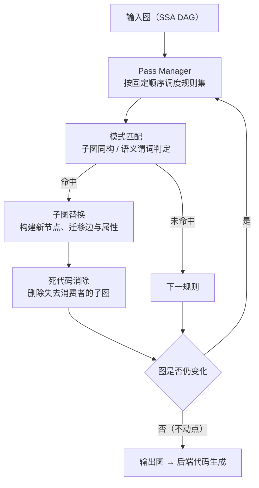
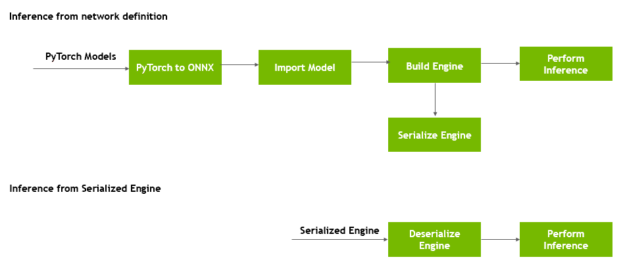

# 图重写基本原理

> **一句话总结**：图重写（Graph Rewriting）是在计算图的有向无环结构上，以语义等价的子图替换既有子图的一类编译期变换，目标是最小化算子数量、中间张量规模与设备内存往返次数。推理场景中权重、位置编码与形状集合在服务期内恒定，使常量折叠、代数化简与算子融合成为主要收益来源；其代价是编译产物与权重及后端绑定、数值语义可能偏离逐算子执行、以及图与源码的对应关系被破坏 \[1]\[4]。

本文遵循本仓库的设计原则：先形式化问题与目标，再展开重写系统的机理，最后给出代价分析与框架侧的工程取舍。

- 适用版本前提：理论基础源自深度学习编译器对图层变换的抽象 \[1]\[2]，工程形态参照 TensorRT 的构建期优化 \[4]、ONNX Runtime 的图优化分级 \[5]、TVM Relay 的 pass 基础设施 \[6]，以及 vLLM 基于 `torch.compile` 的编译集成 \[7]。**当模型未被编译器捕获（eager 执行）、或后端对候选算子无对应实现时，图重写不生效**。

***

## 1. 问题界定

### 1.1 图层面的三类低效

单个算子的实现优劣由 kernel 决定，而**算子之间的组织方式**由计算图决定。后者引入三类与硬件执行模型直接相关的低效：

1. **冗余节点**：恒等映射（identity）、无意义的 cast 链、`reshape`/`transpose` 的往返组合、可被静态判定为常量的计算；
2. **碎片化结构**：语义上等价的运算被拆成多个细粒度算子，每个算子独立读写设备内存。归一化被拆为"求均值 — 求方差 — 逐元素缩放"即属此类，其瓶颈不在算术，而在多次全局内存往返；
3. **每 step 重复的常量工作**：旋转位置编码的角度表、注意力掩码、量化 scale 等在同一次服务期内恒定，却被逐 step 重新计算。

形式化地，设图 $G=(V,E)$，节点 $v$ 的执行代价可分解为算术代价与访存代价。对访存受限的推理负载，总体代价近似为中间张量的字节数与往返次数之积：

$$
T_{\mathrm{g}} \approx \sum_{v \in V} \left( \frac{B_{\mathrm{in}}(v) + B_{\mathrm{out}}(v)}{\beta_{\mathrm{HBM}}} \right) + T_{\mathrm{launch}}(\lvert V \rvert)
$$

其中 $B$ 为张量字节数， $\beta_{\mathrm{HBM}}$ 为有效带宽。该式表明：**减少** $\lvert V \rvert$ 与减少中间张量规模是同一目标的两个方面，这正是图重写的着力点。

### 1.2 与相邻优化的分工

| 层次       | 关注对象        | 典型手段               | 不改变的内容    |
| -------- | ----------- | ------------------ | --------- |
| kernel 级 | 单算子内部的并行与访存 | tiling、向量化、warp 特化 | 图的拓扑      |
| **图级**   | 算子的组织方式     | **重写、融合、常量折叠、消除**  | 单算子实现     |
| 执行级      | 提交与调度方式     | 计算图捕获、流并行          | 图的拓扑与算子实现 |
| 集群级      | 请求与资源的分配    | 批处理、路由、分离部署        | 单次前向的结构   |

图重写位于 kernel 之上、执行之下：它**改变了"算什么、以什么粒度算"**，但不负责单个 kernel 的优劣，也不改变请求的调度方式。

### 1.3 推理侧收益更大的结构性原因

训练与推理在同一条重写规则集下收益不同，原因有三：其一，推理期权重固定，使"权重预处理"成为合法的编译期工作；其二，推理的形状集合有限（批大小与序列长度的桶），使形状特化可行；其三，推理无反向传播，重写只需保持前向等价，不必考虑梯度图的变换。第 1 条是常量折叠在推理侧成立的根本前提。

***

## 2. 核心机理

### 2.1 表示与元数据

重写系统通常以 SSA 形式的 DAG 表示计算图：节点携带算子类型与属性（如卷积的 padding、矩阵乘的转置标志），边携带张量，张量附带形状、数据类型与布局元数据。**元数据的完备性决定了规则的适用面**：缺少布局信息的图无法判定 `reshape` 是否为零拷贝，缺少形状信息的图无法判定某子图是否全为常量。

### 2.2 重写系统：匹配、替换与不动点



三个工程要点：

1. **顺序敏感**：规则集合的执行顺序影响最终形态。典型策略是先做折叠以获得常量权重，再做融合，使融合看到已合并的算子；
2. **收敛性**：替换可能引入新节点从而再次匹配，故需迭代至不动点；规则设计须避免相互抵消导致的震荡，通常以优先级与单调性约束保证终止；
3. **可回退性**：若后端无对应实现，替换须能回退到原结构，否则编译失败。

### 2.3 规则类别

| 类别    | 规则形态                       | 收益                         | 推理侧典型实例            |
| ----- | -------------------------- | -------------------------- | ------------------ |
| 消除    | 删除无消费者节点、合并等价子表达式、折叠恒等链    | 降低 $\lvert V \rvert$       | 恒等 cast、重复 mask 计算 |
| 代数化简  | 常量吸收律、结合律重排、转置与 reshape 归约 | 降低 $\lvert V \rvert$ 与中间张量 | 权重合并后消除多余转置        |
| 融合    | 生产者–消费者合并为单算子              | 消除中间张量往返                   | 归一化 + 激活 + 量化      |
| 常量    | 常量折叠、常量传播                  | 将工作移出运行期                   | 位置编码表、QKV 权重拼接     |
| 布局与精度 | 插入或消除布局转换、Q/DQ 折叠          | 避免隐式拷贝                     | 量化线性层的 scale 折入    |
| 形状特化  | 按具体形状生成专用图                 | 消除动态分支开销                   | 解码批的固定形状路径         |

### 2.4 融合的合法性条件

融合并非任意合并。一次合法的生产者–消费者融合需同时满足：

- **数据依赖闭合**：生产者输出仅被该消费者使用（否则融合会切断其他消费者）；

- **属性兼容**：数据类型与布局一致，或融合算子内部能够完成转换；

- **数值语义许可**：若融合改变了累加顺序或重结合了浮点运算，则结果不再逐位等价。对要求确定性复现的路径，此类规则须禁用；

- **后端可表达**：存在覆盖该组合的 kernel。



上图虽出自构建期优化的工程文档 \[4]，其结构恰好对应重写的两种部署形态：**离线构建**（左侧路径，完成优化并序列化引擎）与**在线加载**（右侧路径，直接反序列化）。这一划分是第 4 节代价表中"产物绑定"一行的直接来源。

### 2.5 常量折叠的流水线

常量折叠的有效性依赖三阶段协同：


推理侧的常量来源及其折叠形态：

| 常量来源     | 折叠后的形态                 | 备注            |
| -------- | ---------------------- | ------------- |
| 归一化缩放系数  | 折入相邻线性层权重              | 要求缩放为对角、可结合   |
| 多头投影权重   | 拼接为单次矩阵乘               | 改变布局但不改变语义    |
| 位置编码角度表  | 预计算张量，运行期仅索引           | 需固定最大序列长度     |
| 量化 scale | 折入算子或转为 per-channel 属性 | 需通道对齐，否则逐元素修正 |
| 常量条件分支   | 静态选中一支，另一支整段删除         | 等价于结构化剪枝      |

### 2.6 等价性的薄弱点

"语义等价"在浮点算术下是近似的。实践中的三类偏离须显式声明：

- **非结合性**：在有限精度下 $(a+b)+c \neq a+(b+c)$ 成立，融合与重排会改变结果；

- **例外语义**：除零、溢出、`NaN` 传播在不同算子实现间的行为可能不同；

- **随机性**：推理期虽关闭 dropout，但采样类算子的随机源位置改变会影响可复现性。

因此工程上通常区分"数值近似允许"与"逐位一致要求"两档编译策略，后者禁用重结合类规则。

### 2.7 最小实现：PyTorch FX 上的三条规则

以一个含 RMSNorm、门控前馈与残差连接的块为例，可在同一张图上演示三类规则：eval 模式下 Dropout 为恒等（消除）；归一化缩放可折入相邻线性层（代数重写 + 常量折叠）；`silu` 与 `mul` 可合并（融合）。

```python
import operator
import torch
import torch.nn as nn
import torch.nn.functional as F
import torch.fx as fx

MUL_TARGETS = (operator.mul, torch.mul)


def rms_norm(x, gamma, eps=1e-6):
    return x * torch.rsqrt(x.pow(2).mean(-1, keepdim=True) + eps) * gamma


class FusedSiluMul(nn.Module):
    def forward(self, a, b):
        return F.silu(a) * b


class Block(nn.Module):
    def __init__(self, d=16):
        super().__init__()
        self.gamma = nn.Parameter(torch.rand(d) + 0.5)
        self.gate = nn.Linear(d, d, bias=False)
        self.up = nn.Linear(d, d, bias=False)
        self.down = nn.Linear(d, d, bias=False)
        self.drop = nn.Dropout(0.5)

    def forward(self, x):
        h = rms_norm(x, self.gamma)             # x_hat * gamma
        h = F.silu(self.gate(h)) * self.up(h)   # 门控，两个节点
        h = self.down(h)
        return x + self.drop(h)                 # eval 下为恒等


# 规则一：消除 eval 模式下的 Dropout
def pass_eliminate_identity(gm: fx.GraphModule):
    changed = False
    for node in list(gm.graph.nodes):
        if node.op == "call_module":
            m = gm.get_submodule(node.target)
            if isinstance(m, nn.Dropout) and not m.training:
                node.replace_all_uses_with(node.args[0])
                gm.graph.erase_node(node)
                changed = True
    return changed


# 规则二：(x_hat * gamma) @ W^T  ==>  x_hat @ (W * gamma)^T
def pass_fold_norm_scale(gm: fx.GraphModule):
    changed = False
    for node in list(gm.graph.nodes):
        if node.op != "call_module":
            continue
        lin = gm.get_submodule(node.target)
        if not isinstance(lin, nn.Linear) or lin.bias is not None:
            continue
        src = node.args[0]
        if not (src.op == "call_function" and src.target in MUL_TARGETS):
            continue
        a, b = src.args
        if a.op == "get_attr" and b.op != "get_attr":
            gamma_node, xhat = a, b
        elif b.op == "get_attr" and a.op != "get_attr":
            gamma_node, xhat = b, a
        else:
            continue                       # 两侧均非常量，规则不适用
        gamma = gm.get_parameter(gamma_node.target).detach()
        if gamma.dim() != 1 or gamma.numel() != lin.weight.shape[1]:
            continue                       # 属性不兼容，回退
        name = f"_folded_{node.target}"
        if not hasattr(gm, name):
            gm.register_buffer(name, (lin.weight.detach() * gamma).clone())
        w = gm.graph.get_attr(name)
        with gm.graph.inserting_before(node):
            new = gm.graph.call_function(F.linear, (xhat, w))
        node.replace_all_uses_with(new)
        gm.graph.erase_node(node)
        changed = True
    return changed


# 规则三：F.silu(a) * b  ==>  fused_silu_mul(a, b)
def _is_silu(node):
    return node.op == "call_function" and node.target is F.silu


def pass_fuse_silu_mul(gm: fx.GraphModule):
    changed = False
    if not hasattr(gm, "fused_silu_mul"):
        gm.add_module("fused_silu_mul", FusedSiluMul())
    for node in list(gm.graph.nodes):
        if not (node.op == "call_function" and node.target in MUL_TARGETS):
            continue
        a, b = node.args
        if _is_silu(a):
            silu, other = a, b
        elif _is_silu(b):
            silu, other = b, a
        else:
            continue
        with gm.graph.inserting_before(node):
            new = gm.graph.call_module("fused_silu_mul", (silu.args[0], other))
        node.replace_all_uses_with(new)
        gm.graph.erase_node(node)
        changed = True
    return changed


# pass manager：迭代至不动点
def optimize(gm: fx.GraphModule, max_rounds=8):
    passes = [pass_eliminate_identity, pass_fold_norm_scale, pass_fuse_silu_mul]
    for _ in range(max_rounds):
        changed = False
        for p in passes:
            changed = p(gm) or changed
        gm.graph.eliminate_dead_code()
        gm.graph.lint()
        gm.recompile()
        if not changed:
            break
    return gm


if __name__ == "__main__":
    torch.manual_seed(0)
    block = Block().eval()
    x = torch.randn(4, 16)

    ref = block(x)                        # 逐算子执行的基准
    gm = fx.symbolic_trace(block)
    n_before = sum(1 for n in gm.graph.nodes if n.op not in ("output", "placeholder"))

    optimize(gm)
    n_after = sum(1 for n in gm.graph.nodes if n.op not in ("output", "placeholder"))

    out = gm(x)
    print(f"节点数: {n_before} -> {n_after}")
    print("最大偏差:", (out - ref).abs().max().item())
    assert torch.allclose(out, ref, atol=1e-5), "重写破坏了语义"
```

实现上有五个与第 2.2 至 2.6 节直接对应的要点：

1. **匹配依据元数据，而非命名**：折叠规则只检查"`mul` 的一个操作数是 `get_attr`、且该常量长度与线性层输入维对齐"，因此能同时命中 `gate` 与 `up` 两个消费点，而不依赖变量名；
2. **折叠产物以常量节点表达**：折叠后的权重注册为 buffer，图中留下 `get_attr` 节点，正是 2.5 节"折叠 → 传播 → 死代码消除"的落地形态；
3. **合法性守卫是规则的一部分**：`bias` 存在、形状不对齐、操作数两侧皆为非常量三种情况直接跳过，对应 2.4 节"属性兼容"与"后端可表达"条件；
4. **顺序与收敛**：折叠先于融合，融合才能看到已改写的 `F.linear`；外层循环迭代至不动点，并在每轮执行死代码消除，使被替换节点的上游链路被整体回收；
5. **语义回归**：折叠与融合改变了浮点结合顺序，故以容差比较而非逐位相等，对应第 5 节的逐位一致性与数值近似两档校验。

该示例的局限亦与第 4 节一致：产物与权重绑定（buffer 由具体权重算出）、不支持动态形状特化、且融合节点需后端具备对应实现。

***

## 3. 与其他优化方案在 vLLM / SGLang 中的组合

### 3.1 与 `torch.compile`

编译器的分层为：图捕获（Dynamo）→ 图变换（AOTAutograd 与 Inductor passes）→ 代码生成。图重写处于第二层，其输入是捕获到的 FX 图，输出是可供融合与代码生成的规范化图。vLLM 的做法是把注意力、归一化、MoE 等关键结构**注册为自定义算子**，使重写不会误将其拆解，同时保留融合机会 \[7]。

### 3.2 与计算图捕获

二者作用于不同开销项：重写降低 $T_{\mathrm{exec}}$ 与 $\lvert V \rvert$，图捕获降低 $T_{\mathrm{submit}}$。由于 $T_{\mathrm{submit}}$ 与算子数成正比，重写会**削弱**提交受限的程度，从而降低图捕获的相对收益；反之，图捕获要求算子序列静态，重写须在捕获之前完成并冻结。详见 [计算图捕获基本原理.md](计算图捕获基本原理.md)。

### 3.3 与量化

量化引入的 Q/DQ 节点对在推理图上是恒等映射，属常量折叠的首选对象；per-channel scale 可折入相邻算子的属性。此处存在一个易错点：**scale 的折叠要求通道维对齐**，若相邻算子沿不同轴量化，折叠必须引入逐元素修正，反而增加访存。

### 3.4 与 PagedAttention

将标准注意力替换为分页实现，本质是一次**算子级替换重写**。其合法性依赖 KV 布局与块表结构在运行期保持稳定，且替换后注意力算子通常退出图捕获范围。相关结构见 [PagedAttention基本原理.md](../Attention优化/PagedAttention基本原理.md)。

### 3.5 与 MoE 与投机解码

MoE 的专家路由依赖运行期数据，无法整体折叠；工程上以**单个融合算子吸收"路由 + 专家计算"**，从而在保持动态性的同时减少节点数。投机解码引入的验证分支亦难以静态化，通常保留为独立子图。二者共同构成"重写收益被动态性稀释"的典型场景。

### 3.6 与连续批处理

连续批处理使形状逐 step 变化，形状特化类重写只能在桶集合内生效。批组成对重写的影响体现为：桶越粗，特化越少但回退越频繁。见 [连续批处理基本原理.md](../调度优化/连续批处理基本原理.md)。

### 3.7 框架能力对照

| 维度     | vLLM \[7]               | SGLang \[8]  | TensorRT \[4] | ONNX Runtime \[5]         |
| ------ | ----------------------- | ------------ | ------------- | ------------------------- |
| 重写时机   | 运行期首次编译（可缓存）            | 运行期编译        | 离线构建引擎        | 离线/加载期，按优化级别              |
| 规则载体   | Inductor passes + 自定义算子 | 编译后端 + 自定义算子 | 构建器内建 pass    | 图优化分级（basic/extended/all） |
| 常量折叠   | 权重预处理 + 编译期折叠           | 编译期折叠        | 权重与层属性融合      | 显式 `ConstantFolding`      |
| 回退策略   | `enforce_eager` 绕过编译    | 可关闭编译路径      | 无实现则构建失败      | 优化级别可降级                   |
| 产物可移植性 | 与权重、后端版本绑定              | 同左           | 引擎与 GPU 架构绑定  | 优化后模型可序列化                 |

***

## 4. 边界与代价

| 类别    | 具体代价                          | 工程缓解                 |
| ----- | ----------------------------- | -------------------- |
| 冷启动   | 首次编译与常量求值耗时，随图规模增长            | 编译产物缓存并以权重与配置哈希为键    |
| 产物绑定  | 折叠使产物依赖具体权重，无法跨 checkpoint 复用 | 缓存失效策略需显式设计          |
| 峰值内存  | 折叠提前物化大常量，与原权重短暂共存            | 逐层折叠并即时释放源张量         |
| 数值偏离  | 重结合与融合改变浮点结果，破坏逐位复现           | 双档策略：可近似路径 vs 逐位一致路径 |
| 可调试性  | 图与源码不再一一对应，错误定位困难             | 保留逐 pass 的图快照与算子命名   |
| 后端耦合  | 融合形态依赖后端实现，跨硬件不可移植            | 以能力查询驱动规则集，而非硬编码     |
| 动态性冲突 | 路由、动态形状、投机分支抑制折叠与特化           | 明确划分子图边界，动态段保留为独立算子  |
| 收益饱和  | 算子数已很少或访存本已主导时，重写收益递减         | 以节点数与中间张量字节为指标做收益评估  |

**边界结论**：图重写优化的是**图的组织形态**。它不提升单 kernel 效率，也不改变调度与通信；其对端到端延迟的贡献上界，等于"被消除的中间张量往返时间"与"被移出运行期的常量计算时间"之和。当这两项在总时间内占比很低时，重写仅降低编译复杂度而无实际性能收益。

***

## 5. 可验证方法

1. **节点计数与中间张量统计**：对比重写前后的节点数、按 dtype 统计的中间张量总字节数，作为一阶指标；二者下降但吞吐不变，说明瓶颈在别处。
2. **kernel 级时间线**：以设备侧时间线统计每 step 的 kernel 数量、平均时长与相邻 kernel 间的空泡，验证融合是否真正减少了内存往返。
3. **逐位一致性校验**：对同一输入，分别在"编译后"与 `enforce_eager` 两种路径下贪婪解码，比较逐 token 输出；出现差异时须判定是否属于允许的数值近似。
4. **常量折叠有效性**：统计编译产物中常量节点的字节占比与运行期不再出现的算子（如三角函数、mask 构造），确认折叠实际发生而非被后端回退。
5. **冷启动分解**：分别测量捕获、重写、代码生成与实例化的耗时，评估缓存策略的收益空间。
6. **规则集消融**：逐条关闭规则，观察节点数与延迟的变化，识别对当前负载真正有效的规则子集。
7. **复现入口**：vLLM 的编译集成设计文档给出自定义算子与融合的接入方式 \[7]；ONNX Runtime 的优化级别可直接对照图变换前后的模型结构 \[5]。

***

## 6. 对比表：四种执行形态

| 形态             | 算子数 | 中间张量往返 | 数值等价性 | 编译成本   | 适用情形      |
| -------------- | --- | ------ | ----- | ------ | --------- |
| Eager          | 原样  | 高      | 逐位基准  | 无      | 调试、极动态负载  |
| 仅图重写           | 下降  | 下降     | 近似    | 中      | 访存受限的稳定结构 |
| 重写 + 图捕获       | 下降  | 下降     | 近似    | 高（含捕获） | 解码路径低延迟   |
| 重写 + 专用 kernel | 最低  | 最低     | 依实现   | 最高     | 结构稳定的生产负载 |

***

## 7. 延伸阅读

- 提交模式层面的优化：见 [计算图捕获基本原理.md](计算图捕获基本原理.md)。

- 被替换为融合算子的注意力实现：见 [PagedAttention基本原理.md](../Attention优化/PagedAttention基本原理.md)。

- 形状动态性对特化重写的约束：见 [连续批处理基本原理.md](../调度优化/连续批处理基本原理.md)。

- 以单算子吸收动态路由的工程路线：见 [MegaMoE基本原理.md](../分布式推理/MegaMoE基本原理.md)。

***

## 8. 参考文献

1. Chen T., Moreau T., Jiang Z., et al. **TVM: An Automated End-to-End Optimizing Compiler for Deep Learning**. OSDI 2018.（图层变换与算子融合的系统化描述）[arXiv:1802.04799](https://arxiv.org/abs/1802.04799)
2. Li M., Liu Y., Liu X., et al. **The Deep Learning Compiler: A Comprehensive Survey**.（图级优化的分类体系）[arXiv:2002.03794](https://arxiv.org/abs/2002.03794)
3. PyTorch. **torch.compile 文档（Dynamo / AOTAutograd / Inductor 分层）**. [docs.pytorch.org](https://docs.pytorch.org/docs/stable/torch.compiler.html)
4. NVIDIA. **Speeding Up Deep Learning Inference Using TensorRT**（构建期优化与引擎序列化的两条路径）. [developer.nvidia.com](https://developer.nvidia.com/blog/speeding-up-deep-learning-inference-using-tensorrt-updated/)
5. ONNX Runtime. **Graph Optimizations（优化级别与常量折叠等规则）**. [onnxruntime.ai](https://onnxruntime.ai/docs/performance/model-optimizations/graph-optimizations.html)
6. Apache TVM. **Pass Infrastructure（Relay 的 pass 管理与序列）**. [tvm.apache.org](https://tvm.apache.org/docs/arch/pass_infra.html)
7. vLLM. **torch.compile 集成设计（自定义算子与融合接入）**. [docs.vllm.ai](https://docs.vllm.ai/en/latest/design/torch_compile.html)
8. SGLang. **文档与仓库（编译后端与自定义算子）**. [docs.sglang.ai](https://docs.sglang.ai/) / [GitHub](https://github.com/sgl-project/sglang)

***

## 9. 图片来源声明

| 文件                       | 原始出处                                                                                                                                                                 | 说明                                          |
| ------------------------ | -------------------------------------------------------------------------------------------------------------------------------------------------------------------- | ------------------------------------------- |
| `assets/gw-trt-fig3.png` | NVIDIA 技术博客《Speeding Up Deep Learning Inference Using TensorRT》（[原文](https://developer.nvidia.com/blog/speeding-up-deep-learning-inference-using-tensorrt-updated/)） | TensorRT 的两条推理路径：从网络定义构建引擎（含优化），或反序列化已构建的引擎 |

其余示意图为本仓库自绘的 Mermaid 图，不涉及外部版权。
