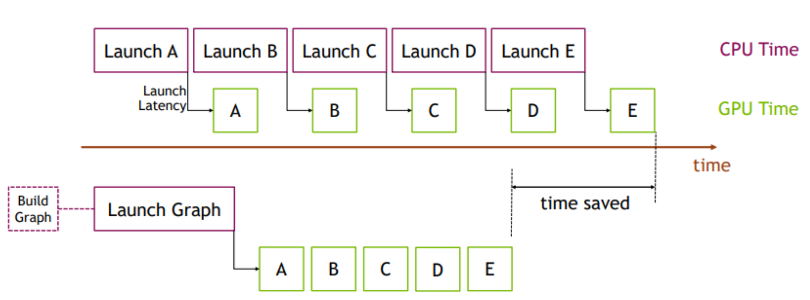
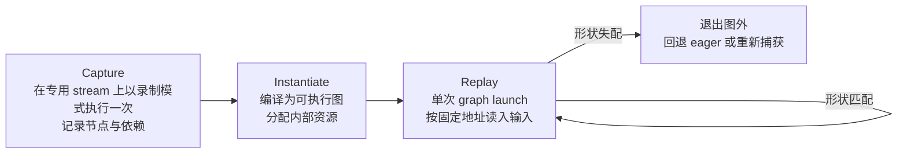

# 计算图捕获基本原理

> **一句话总结**：计算图捕获（CUDA Graph Capture）将一段重复执行的算子序列连同其参数、显存地址与依赖关系一次性录制为有向无环图（DAG），运行时以单次图启动（graph launch）完成整段提交，使 CPU 侧提交开销由与算子数量成正比降为常数级。其收益集中在**提交受限（launch-bound）的解码阶段**；其代价是**地址、形状与控制流必须静态化**，因而与变长 batch、动态 KV 元数据、MoE 路由及投机解码等动态性来源构成结构性冲突 [1][3]。

本文遵循本仓库的设计原则：先界定问题与适用条件，再展开实现机理，最后给出代价与框架侧的工程取舍。

- 适用版本前提：以 CUDA Graph 的通用语义 [1][2] 与 PyTorch 的捕获封装 [4] 为基础，工程形态参照 vLLM V1 的 `cudagraph_mode` 分派机制 [3] 与 SGLang 的按阶段图配置 [5]。**当单算子执行时间显著大于提交开销，或算子序列本身逐 step 变化时，图捕获不产生有效收益，甚至引入额外开销**。

---

## 1. 问题界定：解码阶段的提交受限

### 1.1 时间构成与瓶颈判据

一次模型前向的墙钟时间由两部分决定：主机侧完成全部算子提交所需的时间 $T_{\mathrm{submit}}$，以及设备侧执行这些算子的时间 $T_{\mathrm{exec}}$。在理想的重叠执行下：

$$
T_{\mathrm{step}} \approx \max\left(T_{\mathrm{submit}},\ T_{\mathrm{exec}}\right)
$$

$$
T_{\mathrm{submit}} = \sum_{i=1}^{N} t_{\mathrm{launch},i} + t_{\mathrm{framework}}
$$

其中 $N$ 为该 step 的算子数量，$t_{\mathrm{launch}}$ 为单次 kernel launch 的主机侧开销，$t_{\mathrm{framework}}$ 为框架层的调度与元数据处理开销。判定是否处于提交受限状态，可直接比较 $T_{\mathrm{submit}}$ 与 $T_{\mathrm{exec}}$。当算子粒度较细、 $t_{\mathrm{launch}}$ 与单算子执行时间处于同一量级时，GPU 在相邻 kernel 之间出现提交空泡（bubble），SM 利用率下降而设备并未饱和。

上图给出了该瓶颈的直观形态 [4]：逐算子提交时，GPU 的执行区间之间被 CPU 侧的 `Launch A/B/C/...` 串行插入空隙；改为整图启动后，同一批算子以连续区间执行，缩减的时间即提交开销的累积量。

### 1.2 为何解码阶段最敏感

解码阶段具有三个使提交开销占比被放大的性质：

1. **算子数量大而单算子时长短**：每步需遍历全部层，层内的归一化、线性变换、激活、残差等算子粒度均在微秒级；
2. **并行度低**：每步仅处理一个（或少量投机）token，kernel 的数据并行规模受限于批大小，单 kernel 执行时间难以拉开；
3. **重复性高**：各 step 的算子序列几乎完全一致，仅张量内容不同。

与之相对，预填充阶段以大尺寸 GEMM 为主，单算子执行时间远高于提交开销，图捕获的边际收益有限。这一不对称性决定了图捕获在工程上几乎总是**面向解码路径**部署 [3]。

### 1.3 替代手段的局限

| 手段 | 作用层次 | 局限 |
| --- | --- | --- |
| 算子融合（编译器） | 减少 $N$ | 注意力、MoE 路由、自定义算子难以融合，剩余小算子数量仍可观 |
| 多流并行 | 掩盖部分依赖等待 | 不减少主机侧提交总量，CPU 仍是串行瓶颈 |
| 异步执行与流水 | 重叠提交与执行 | 受限于 CUDA 队列深度与依赖结构，收益存在上限 |
| 图捕获 | 将提交次数降为 $O(1)$ | 要求静态形状、静态地址、静态控制流 |

前三类手段均在"减少或掩盖"提交开销，唯有图捕获改变了提交模式本身，因而成为解码路径的标准配置。

### 1.4 适用条件的形式化

图捕获成立需同时满足：算子序列在多次执行间**拓扑不变**，所有张量的**地址可固定**，图内**不含依赖主机返回值的控制流或同步点**。任一条件不满足，该段必须退出图外执行（eager），或触发重新捕获。

---

## 2. 核心机理

### 2.1 生命周期：捕获、实例化、重放

| 阶段 | 触发时机 | 主要成本 | 产物 |
| --- | --- | --- | --- |
| 捕获 | 启动预热阶段，按预设形状集合逐一套 | 需完整执行一次，图规模大时耗时显著 | 未实例化的图拓扑 |
| 实例化 | 捕获后立即进行 | 编译与内部显存分配，一次性 | 可重放的执行图 |
| 重放 | 每个推理 step | 主机侧单次提交，近似常数 | 输出写入固定缓冲 |

重放阶段"近似常数"的含义是：主机侧仅需提交一次图启动，图内部节点由设备侧调度器展开，主机不再参与逐算子的参数打包。

### 2.2 静态化三要素

图捕获的收益以三项静态性为交换条件：

1. **地址静态**：图内节点记录的是捕获时刻的具体显存地址。输入若来自变址缓冲区，则必须通过固定的中转缓冲区完成 copy-in / copy-out，或在设计上使中间缓冲跨 step 复用。前者引入额外的拷贝开销，后者限制内存规划的自由度。
2. **形状静态**：kernel 的 grid/block 维度与张量形状绑定，批大小或序列长度变化即意味着图失效。工程上的标准做法是**按桶捕获**（capture sizes），运行时将实际形状填充（padding）至最近的桶。
3. **控制流静态**：主机侧分支（如条件早退、动态候选数）与 host-device 同步点不能进入图。若模型中存在此类逻辑，必须切分图，将其置于图外。

### 2.3 与 KV Cache 元数据的交互

解码阶段的 KV 访问依赖每 step 变化的元数据：分页块表（block table）、序列长度、槽位映射。这构成了图捕获与 PagedAttention 之间的核心张力：

- **元数据原地更新**：将块表、长度等元数据安置在固定缓冲内，每 step 由图外的轻量 kernel 原地改写，图内仅按固定地址读取。该方案保留了整图捕获的可能，但要求元数据的存储布局对图内算子透明。
- **注意力退出图外**：注意力算子的形状与元数据依赖最强、且部分后端不支持整图捕获。将其排除在图层之外，其余算子入图，即为**分段捕获（piecewise capture）**的基本动机 [3]。

vLLM V1 的 `PIECEWISE` 模式正是后者的制度化形态：除注意力等不支持图捕获的算子保持 eager 外，其余算子均纳入图；`FULL` 模式则要求注意力后端本身支持图捕获 [3]。

### 2.4 整图与分段：边界选择的判据

| 方案 | 覆盖范围 | 收益 | 限制 |
| --- | --- | --- | --- |
| 整图（full） | 完整前向 | 提交开销最小化 | 要求全部算子与注意力后端可捕获；形状组合需穷举 |
| 分段（piecewise） | 注意力以外的算子 | 兼容性最好，适用于多数后端 | 段边界仍需逐段提交；注意力段每次 eager 执行 |
| 混合（full + piecewise） | 按批次类型分别采用 | 低延迟场景性能最优 | 显存与捕获时间成本最高 [3] |

分段边界的选取原则是：**将形状与元数据动态性最高的算子置于段外**。段数越多，提交次数随段数线性增长，故边界数量应受控。

### 2.5 桶化：批维度的离散化

设捕获的批大小集合为 $S = \{s_1, s_2, \ldots, s_m\}$，实际批大小为 $b$，则填充后的执行规模为：

$$
\tilde{b} = \min\{s \in S \mid s \ge b\}
$$

填充造成的算力浪费比例约为 $(\tilde{b}-b)/\tilde{b}$。桶过粗则浪费显著，桶过密则图数量与显存占用同步增长（每张图持有独立的内部内存池），捕获与实例化的启动时间亦随之上升。因此桶集合的确定是一个显式的资源规划问题，而非默认参数即可覆盖。

此外，填充后的批在执行语义上必须与原批等价：需以掩码约束注意力与采样，且要求 kernel 具备**批不变性（batch invariance）**，否则同一请求在不同填充规模下可能产生数值差异 [3]。

### 2.6 多卡与通信算子

集合通信（如 NCCL 的 all-reduce / all-to-all）可被纳入图，但需满足：通信缓冲区地址固定、参与方拓扑在捕获时确定、图内不含主机同步。张量并行下的通信段通常可捕获；专家并行的路由决策因依赖主机侧动态计算，往往被迫置于图外，从而使该段的提交开销无法消除。此即超大规模 MoE 推理中"图捕获收益被通信与路由稀释"的来源，亦是大内核（megakernel）路线试图以算子内融合替代图捕获的背景，详见 [MegaMoE基本原理.md](../分布式推理/MegaMoE基本原理.md)。

---

## 3. 与其他优化方案在 vLLM / SGLang 中的组合

### 3.1 与编译（torch.compile）的关系

分段编译（piecewise compilation）将前向切为若干 FX 图段，图捕获以这些段为捕获单元。因此二者的关系为：**编译决定"段"，捕获决定"段的提交方式"**。vLLM V1 已将捕获逻辑与编译逻辑解耦，使整图与分段图可共享同一份编译产物，并可在无法编译时退化为"仅捕获、不编译" [3]。

### 3.2 与连续批处理

连续批处理使批组成逐 step 变化，与静态图直接冲突。工程上的耦合方式为：

- 以批描述符（vLLM 的 `BatchDescriptor`：token 数 + 是否 uniform decode）作为图分派的键；
- 运行时将实际批分派到 `FULL`、`PIECEWISE` 或 `NONE`，按 `FULL > PIECEWISE > NONE` 的优先级查找可用图，未命中则回退 eager [3]；
- 批规模先填充至桶，再按桶查图。

这意味着图捕获并非与批处理"叠加"，而是**内嵌于批调度器的一次查表**。相关调度语义见 [连续批处理基本原理.md](../调度优化/连续批处理基本原理.md)。

### 3.3 与 PagedAttention

块级 KV 管理提供固定的元数据槽位，使块表可原地更新，从而保留整图捕获的可能；代价是 PagedAttention 的注意力实现必须在元数据读取上与图内固定地址假设兼容。实践中多数注意力后端仅在 uniform decode 情形下支持整图捕获 [3]。

### 3.4 与 Chunked Prefill

分块预填充使预填充批的 token 数每 step 变化，归入非 uniform 批，通常走 `PIECEWISE` 或退化为 eager。这与解码批的 `FULL` 路径并行存在，由分派器按批次组成选择，而非由配置静态决定。

### 3.5 与投机解码

投机解码的验证阶段每步处理 $1 + k$ 个 token（其中 $k$ 为草稿数），构成一类独立的 uniform 批。vLLM 将其 `uniform_query_len` 记为 $1+k$，并与纯解码的 $1$ 区分，作为图分派键的组成部分 [3]。因此开启投机后，需针对新的 $1+k$ 组合重新捕获，桶集合与图数量相应扩大。详见 [投机采样基本原理.md](../解码优化/投机采样基本原理.md)。

### 3.6 与专家并行 / MoE

MoE 层的专家路由依赖主机侧或前一层的动态结果，难以整段捕获；若将路由与专家计算整体置于图外，则该段回到逐算子提交。可捕获的替代路径是将若干算子融合为单一内核以减少提交次数，其效果与图捕获同向但机制不同（前者减少 $N$，后者降低提交模式）。

### 3.7 与 PD 分离

分离部署中，解码实例不再承担预填充，批组成恒为 uniform decode。vLLM 为此提供了 `FULL_DECODE_ONLY` 模式：仅捕获解码整图，不为预填充/混合批保留分段图，从而节省后者所需显存 [3]。这是"架构约束简化图配置"的典型例证。

### 3.8 与量化

权重量化与 KV 量化缩短单算子执行时间，在批规模不变的前提下提升 $T_{\mathrm{submit}} / T_{\mathrm{exec}}$ 的比值，即**使系统更接近提交受限**。因此量化程度越高，图捕获的相对收益越显著；反之，大幅提升批规模会稀释该收益。

### 3.9 框架能力对照

| 维度 | vLLM V1 [3] | SGLang [5] |
| --- | --- | --- |
| 配置入口 | `CompilationConfig.cudagraph_mode` | 按阶段的后端选择（`--cuda-graph-backend-decode` / `--cuda-graph-backend-prefill`） |
| 模式集合 | `NONE` / `PIECEWISE` / `FULL` / `FULL_DECODE_ONLY` / `FULL_AND_PIECEWISE` | `full` / `tc_piecewise` / `breakable` / `disabled` |
| 分派机制 | `CudagraphDispatcher`：按 `BatchDescriptor` 与优先级 `FULL > PIECEWISE > NONE` 选择 | 按阶段（解码/预填充）分别配置 |
| 捕获规模控制 | `cudagraph_capture_sizes`（桶集合） | `--cuda-graph-max-bs` 与显式桶列表 |
| 后端兼容降级 | `AttentionCGSupport` 排序：`ALWAYS > UNIFORM_BATCH > UNIFORM_SINGLE_TOKEN_DECODE > NEVER`，自动降级到最近支持模式 | 由后端能力决定可用配置 |
| 预填充图 | 通常走分段或 eager | 支持按 token 数捕获整段预填充图（含前缀分块参数） |

---

## 4. 边界与代价

| 类别 | 具体代价 | 工程缓解 |
| --- | --- | --- |
| 显存 | 每张图持有独立内存池，多桶叠加显著抬高显存占用；混合模式下整图与分段图并存 | 限制桶数量；采用 `FULL_DECODE_ONLY`；按阶段启用 |
| 启动时间 | 捕获与实例化在启动期完成，图数量与模型规模决定耗时 | 预热阶段并发捕获；持久化编译产物 |
| 形状失配 | 未命中桶时回退 eager，性能出现阶跃式下降，且难以从外部观测 | 记录分派命中率与降级事件，纳入监控 |
| 数值语义 | 填充改变批组成，需掩码与批不变性保证等价性 | 逐桶做一致性校验（第 5 节） |
| 可调试性 | 图内错误难以定位，与性能分析工具交互受限 | 保留 `NONE` 模式用于问题复现；分段粒度不宜过细 |
| 动态特性冲突 | 动态形状、动态路由、结构化输出约束等无法进图 | 明确划定图外区段，避免反复"部分捕获" |
| 版本耦合 | 图捕获依赖驱动、CUDA 版本与后端实现细节 | 固定运行时版本矩阵；在 CI 中做捕获冒烟测试 |
| 提交次数下限 | 分段捕获下，段数决定提交次数下限 | 段边界数量受控；与算子融合协同设计 |

**边界结论**：计算图捕获优化的是**提交模式**，而非计算量。它不降低 $T_{\mathrm{exec}}$，也不改变算子语义；其收益上限即 $T_{\mathrm{submit}}$ 中可被消除的部分。当批规模增大或算子粒度变粗使 $T_{\mathrm{exec}}$ 占优时，收益自然收敛。

---

## 5. 可验证方法

1. **提交与执行的时间分解**：使用设备侧时间线工具分别统计每 step 的主机提交区间与设备执行区间，直接读取 $T_{\mathrm{submit}}$ 与空泡长度；与关闭图捕获（`NONE` 或 `enforce_eager`）的同一负载对照。
2. **模式命中率**：采集图分派结果（`FULL` / `PIECEWISE` / `NONE`）的分布。若 `NONE` 占比异常，说明桶集合与真实批分布不匹配。
3. **逐桶一致性校验**：对同一输入在不同填充规模下执行贪婪解码，比较逐 token 输出是否一致，以验证填充与掩码的语义等价性。
4. **显存基线对比**：分别记录开启与关闭图捕获时的常驻显存，差值即图内存池开销；与桶数量做回归，验证显存随桶数的增长关系。
5. **启动开销测量**：统计从进程启动到首请求可服务的时间，区分捕获、实例化与预热各自的占比。
6. **收益边界验证**：固定模型与桶集合，扫描批规模，观察吞吐提升随批规模的衰减曲线，验证 3.8 中"提交占比随批增大而下降"的推断。
7. **复现入口**：vLLM 的 `cudagraph_mode` 各模式可直接对照测试 [3]；SGLang 可按解码/预填充阶段分别配置图后端，便于分离测量 [5]。

---

## 6. 对比表：执行模式的取舍

| 模式 | 提交开销 | 兼容性 | 显存 | 适用情形 |
| --- | --- | --- | --- | --- |
| Eager（`NONE`） | $O(N)$ 逐算子 | 最高 | 最低 | 调试、动态性极强的负载 |
| 仅编译 | 降低但非常数 | 高 | 中 | 算子数多但形状多变 |
| 分段图（`PIECEWISE`） | 按段数提交 | 高（注意力可在图外） | 中 | 后端支持不统一、需广泛兼容 |
| 整图（`FULL`） | 常数级 | 依赖后端全支持 | 高 | 小模型、小 prompt、低延迟优先 |
| 整图 + 分段（`FULL_AND_PIECEWISE`） | 解码常数级、其余按段 | 中 | 最高 | 低延迟优先且资源充足 |
| 仅解码整图（`FULL_DECODE_ONLY`） | 解码常数级 | 中 | 中 | PD 分离的解码实例 |

---

## 7. 延伸阅读

- 批组成如何影响图分派：见 [连续批处理基本原理.md](../调度优化/连续批处理基本原理.md)。
- KV 元数据如何被固定与更新：见 [PagedAttention基本原理.md](../Attention优化/PagedAttention基本原理.md)。
- 以算子融合替代图捕获的另一条路径：见 [MegaMoE基本原理.md](../分布式推理/MegaMoE基本原理.md)。
- 改变 uniform 批构成的解码加速手段：见 [投机采样基本原理.md](../解码优化/投机采样基本原理.md)。

---

## 8. 参考文献

1. NVIDIA. **Getting Started with CUDA Graphs**. NVIDIA Technical Blog. [developer.nvidia.com](https://developer.nvidia.com/blog/cuda-graphs/)
2. NVIDIA. **CUDA C++ Programming Guide — CUDA Graphs**. [docs.nvidia.com](https://docs.nvidia.com/cuda/cuda-c-programming-guide/index.html)
3. vLLM. **CUDA Graphs（vLLM V1 的 cudagraph_mode、CudagraphDispatcher 与 AttentionCGSupport 设计）**. [docs.vllm.ai](https://docs.vllm.ai/en/latest/design/cuda_graphs.html)
4. PyTorch. **Accelerating PyTorch with CUDA Graphs**. [pytorch.org](https://pytorch.org/blog/accelerating-pytorch-with-cuda-graphs/)
5. SGLang. **Server 参数与 CUDA Graph 配置（按 phase 的图后端、桶与最大批）**. [docs.sglang.ai](https://docs.sglang.ai/) / [GitHub](https://github.com/sgl-project/sglang)
6. vLLM Blog. **vLLM V1: A Major Upgrade to vLLM's Core Architecture**（torch.compile 与图捕获的架构整合）. [blog.vllm.ai](https://blog.vllm.ai/2025/01/27/v1-alpha-release.html)
7. vLLM. **torch.compile 集成设计**. [docs.vllm.ai](https://docs.vllm.ai/en/latest/design/torch_compile.html)
8. PyTorch. **CUDAGraph Trees（torch.compile 的图内存池与重放机制）**. [pytorch.org](https://pytorch.org/docs/stable/torch.compiler_cudagraph_trees.html)

---

## 9. 图片来源声明

| 文件 | 原始出处 | 说明 |
| --- | --- | --- |
| `assets/cudagraph-pytorch-flow.png` | PyTorch 博客《Accelerating PyTorch with CUDA Graphs》（[原文](https://pytorch.org/blog/accelerating-pytorch-with-cuda-graphs/)） | 逐 kernel 提交与整图启动的时间线对比，标注被消除的提交空泡 |

其余示意图为本仓库自绘的 Mermaid 图，不涉及外部版权。
