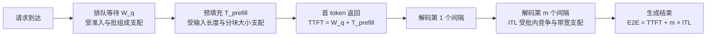
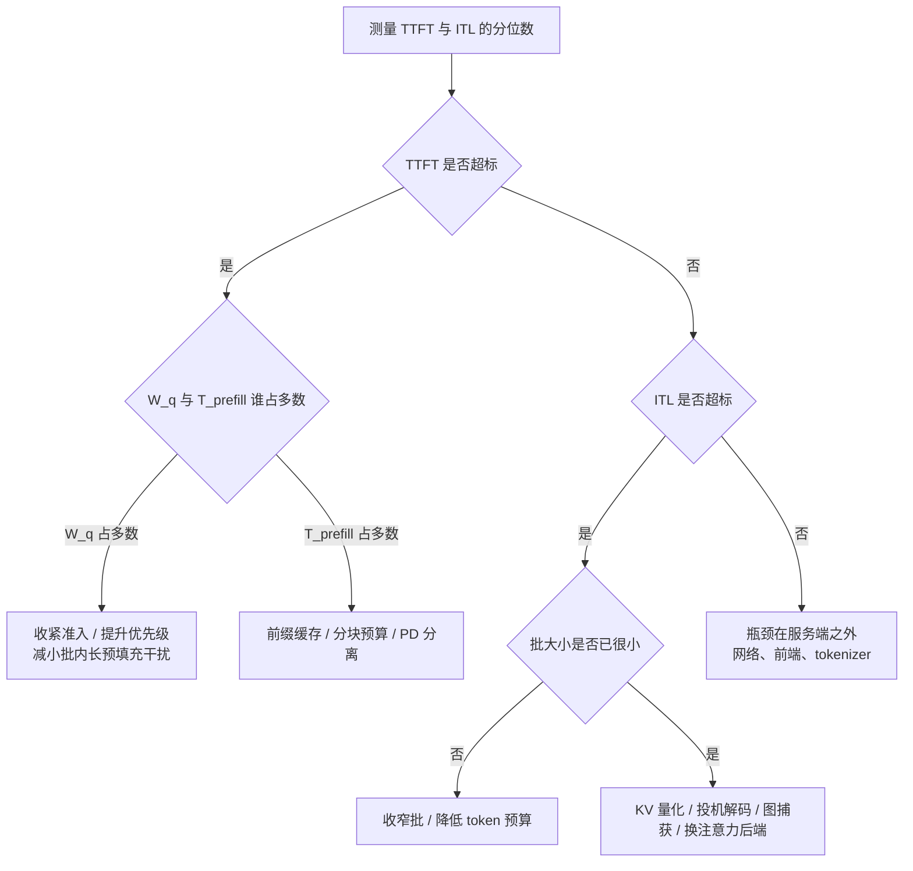

# 低延迟生成策略基本原理

> **一句话总结**：低延迟生成策略不是单一技术，而是一组把资源优先分配给"用户可感知时延"的取舍：以吞吐、成本与并发容量换取 TTFT 与 ITL 的分位数下降。其有效性取决于能否把端到端时延分解为可加项并定位主导项；代价是并行度利用率下降、单位请求成本上升，以及与批处理、图捕获、抢占机制的冲突 \[1]\[2]。

本文遵循本仓库的设计原则：先界定"延迟"的测量对象与优化边界，再按延迟分解展开四类杠杆，最后给出框架侧组合与代价。

- 边界说明：单步内多 token 生成的机制见 [并行解码基本原理.md](并行解码基本原理.md) 与 [投机采样基本原理.md](投机采样基本原理.md)；批与抢占的机制见 [连续批处理基本原理.md](../调度优化/连续批处理基本原理.md) 与 [请求调度与抢占基本原理.md](../调度优化/请求调度与抢占基本原理.md)。本文讨论的是**面向延迟目标选择与组合这些机制**的方法。
- 适用版本前提：TTFT 与 TPOT 由不同资源支配的结论源自预填充—解码分离的分析 \[2]；分块预填充对延迟与吞吐的权衡源自 Sarathi-Serve \[1]。工程形态参照 vLLM 的引擎参数与编译配置 \[4]\[5]、SGLang 的服务参数 \[6]。**当端到端时延主要由网络、前端或 tokenizer 占据时，服务端优化不再产生可感知收益**。

***

## 1. 问题界定

### 1.1 延迟的三个可感知量

用户感知的延迟并非单一数值，而是三段可分开测量的时间：

| 指标 | 定义 | 主导资源 | 典型约束 |
| --- | --- | --- | --- |
| TTFT | 请求到达到首 token 返回 | 排队 + 预填充计算 | P90 或 P99 |
| ITL | 解码阶段相邻 token 的间隔 | KV 读取带宽、批内竞争 | P90 或 P99 |
| E2E | 请求到达到生成结束 | 三者之和 | 平均值或分位数 |

端到端时延可加性分解为

$$
T_{\mathrm{e2e}} \approx W_{q} + T_{\mathrm{prefill}}(n_{\mathrm{in}}) + m \cdot \mathrm{ITL}
$$

其中 $W_{q}$ 为排队等待， $n_{\mathrm{in}}$ 为输入长度， $m$ 为输出长度。三项由不同机制支配：排队由准入与调度决定，预填充由计算与分块决定，ITL 由批内竞争与带宽决定。**低延迟策略的本质是逐项压缩，而不是寻找一个全局更快的开关**。

### 1.2 为什么均值不是目标

生成任务的完成时间分布重尾：少量长输出请求与偶发的批内长预填充会把 P99 推高数倍，而均值几乎不动。以均值衡量会得到"平均已经很快"的错误结论，因此工程目标统一为分位数：在给定 $\alpha$ 达成率下最小化 P99，而非平均时延。

### 1.3 延迟—吞吐前沿

在固定硬件上，延迟与吞吐构成一条前沿：任何降低延迟的手段都会把工作点沿前沿向左移动，代价是每秒可服务的 token 数下降。三类常见工作点：

- **吞吐点**：宽批、大 token 预算，单卡吞吐最高，P99 最差；
- **延迟点**：窄批、小预算，单请求时延最低，单位 token 成本最高；
- **折中点**：按请求等级划分，把延迟敏感流量与批量流量隔离到不同实例。

前沿本身可以被技术推动：分块预填充、PD 分离、前缀缓存、投机解码、图捕获都在**扩展前沿**（同等延迟下获得更高吞吐），而准入与优先级只是**在前沿上选点**。这一区分决定了优化的上限——选点不改变前沿，扩前沿才改变。

### 1.4 与相邻优化的分工

| 优化 | 主要影响的延迟项 | 机制 |
| --- | --- | --- |
| 准入与优先级调度 | $W_{q}$ | 限制并发、按等级排序 |
| 分块预填充 | $T_{\mathrm{prefill}}$ 的分布形状 | 把长预填充切成多步 |
| 前缀缓存 | $T_{\mathrm{prefill}}$ 的量 | 复用已计算的公共前缀 |
| PD 分离 | 两项的资源来源 | 预填充与解码使用不同实例 |
| 投机 / 并行解码 | $\mathrm{ITL}$ | 每步产出多个 token |
| 计算图捕获 | 单步提交开销 | 降低固定启动成本 |
| KV 量化 | $\mathrm{ITL}$ | 降低每步 KV 读取量 |

***

## 2. 核心机理

### 2.1 时间线分解



该分解的工程价值在于**可观测性**：只有把违约定位到具体项，才知道该动哪个杠杆。把排队问题当作计算问题去优化，是延迟调优中最常见的误判。

### 2.2 主导项判定



判定的前提是分项计时可得。vLLM 与 SGLang 均暴露队列长度、运行请求数与时延分桶指标，可直接支撑该判定 \[5]\[6]。

### 2.3 四类杠杆

**排队侧**：限制运行集合大小、按等级排序、必要时抢占。它只能压缩 $W_{q}$，而对预填充与解码无影响。收益是即时的，代价是并发容量与拒绝率。

**预填充侧**：分块预算决定单块时长，直接影响 TTFT 的**分布**——块越小，首 token 越早返回，但块过小会反复读取历史 KV 而浪费带宽，且对同批解码请求造成周期性抖动 \[1]。前缀缓存直接减少需要计算的 token 数，是唯一能同时改善 TTFT 与吞吐的手段。PD 分离把预填充从解码实例移走，使两条约束不再相互挤压 \[2]。

**解码侧**：窄批降低单步竞争，是最直接的 ITL 手段，但利用率随之下降。注意力后端、KV 量化与计算图捕获降低单步固定开销与访存量，属于**扩前沿**而非选点。投机与并行解码用额外计算换取每步更多 token，其收益依赖接受率。

**输出侧**：流式返回的缓冲间隔直接决定用户感知的"打字机"平滑度。SGLang 的 `--stream-interval` 以 token 数为单位控制该缓冲，其文档明确给出"值越小流式越平滑、值越大吞吐越高"的取舍 \[6]。该参数不影响服务端计算，只影响感知延迟与传输次数。

### 2.4 参数语义：三个维度的分工

上一节的四类杠杆在参数上分别落到三个不同的量，混用会导致语义误判：

| 诉求 | 参数 | 控制的量 | 影响的延迟项 | 性质 |
| --- | --- | --- | --- | --- |
| 窄批 | `--max-num-seqs`、`--max-num-active-seqs`；SGLang `--max-running-requests` | 同时运行的请求数 $N$ | ITL 与排队 | 在前沿上选点 |
| 小预算 | `--max-num-batched-tokens`；SGLang `--chunked-prefill-size` | 单步 token 预算 | TTFT 的分布 | 在前沿上选点 |
| 长度上界 | `--max-model-len`；SGLang `--context-length` | 单请求长度上界 $L_{\max}$ | 并发上限与 TTFT 可行下界 | 可行性边界 |

三者的约束关系为

$$
N_{\mathrm{concurrent}} \le \frac{M_{\mathrm{kv}}}{L_{\max} \cdot S_{\mathrm{kv}}}
$$

其中 $M_{\mathrm{kv}}$ 为 KV 池容量（由 `--gpu-memory-utilization` 扣除权重与激活后剩余）， $S_{\mathrm{kv}}$ 为每 token 的 KV 字节数。**窄批调节 $N$ ，小预算调节每步 token 数，长度上界调节 $L_{\max}$**；前者在既定容量内重排时延分布，后者决定容量本身是否够用。

需要区分两处易混语义：

1. **窄批不等于批大小**：它限制的是运行集合宽度；`--max-num-seqs` 仍决定 runner 缓冲与图捕获容量，二者可以大于实际运行数；
2. **长度上界同时约束输出**：生成 token 计入 $L_{\max}$ ，设得过小会让长回答中途截断，表现为生成停止而非报错。

长度上界与预算存在耦合：$L_{\max}$ 取 128K 而预算取 2048 时，一次预填充需串行 64 块，TTFT 必然偏长； $L_{\max}$ 压到 8K 时同样预算只需 4 块，TTFT 分布才可控。因此长度上界应按业务真实长度的分位数设定，并配合分级部署——交互实例取小、长文实例取大并独立限流，避免长请求与交互流量共用同一前沿。

### 2.5 抖动的来源

P99 的恶化往往不是均值变差，而是离散事件：

1. **长预填充插入**：一个长请求进入批内会拉长同批解码间隔；
2. **批形状跨桶**：触发图捕获回退或重捕获；
3. **抢占与恢复**：被抢占请求恢复时占用的突发资源；
4. **前缀缓存未命中**：命中率波动使预填充量在请求间跳变。

对应手段是稳定批组成（长预填充阈值）、固定桶集合、以准入替代抢占。

***

## 3. 与其他优化方案的组合

### 3.1 vLLM 侧

| 目标 | 参数 | 作用方向 | 代价 |
| --- | --- | --- | --- |
| 降低 $W_{q}$ | `--max-num-active-seqs`、`--max-num-queued-reqs` | 收紧运行集合，超出快速失败 | 并发容量下降 |
| 降低 TTFT 分布 | `--max-num-batched-tokens` 调小 | 每步预算更小，首 token 更早 | 吞吐下降、KV 重复读取 |
| 隔离长预填充 | `--long-prefill-token-threshold` 及 adaptive 变体 | 超阈值预填充让出预算 | 长请求完成时间后移 |
| 降低 $T_{\mathrm{prefill}}$ | `--enable-prefix-caching` | 复用公共前缀 | 显存与块表开销 |
| 降低 ITL | `--max-num-seqs` 调小 | 批内竞争减少 | 利用率下降 |
| 降低单步固定开销 | `--compilation-config` 中设置 `cudagraph_mode` 为 `FULL` | 整图捕获，去掉分段边界 | 显存与捕获时间 |
| 降低 KV 读取 | `--kv-cache-dtype fp8` | 每步读取量减半 | 精度与接受率影响 |
| 每步多 token | `--speculative-config` | 降低等效 ITL | 验证开销，低接受率时反噬 |

上表的语义已按官方参数文档核对 \[4]\[5]。交互式部署的典型形态是"窄批 + 小预算 + 长预填充隔离 + 全图捕获"：

```bash
vllm serve <model> \
  --max-num-seqs 32 \
  --max-num-active-seqs 8 \
  --max-num-queued-reqs 16 \
  --max-num-batched-tokens 2048 \
  --long-prefill-token-threshold 2048 \
  --enable-prefix-caching \
  --kv-cache-dtype fp8 \
  --compilation-config '{"cudagraph_mode":"FULL"}'
```

### 3.2 SGLang 侧

| 目标 | 参数 | 作用方向 | 代价 |
| --- | --- | --- | --- |
| 降低 $W_{q}$ | `--max-running-requests`、`--max-queued-requests` | 限制运行与排队集合 | 容量与拒绝率 |
| 降低 TTFT 分布 | `--chunked-prefill-size` 调小 | 块更小，首 token 更早 | 吞吐下降 |
| 稳定调度 | `--schedule-conservativeness` 调大 | 更保守的回收阈值 | 预算利用率下降 |
| 降低 ITL | `--page-size` 调整、注意力后端选择 | 寻址与内核效率 | 需按模型后端实测 |
| 感知平滑 | `--stream-interval` 调小 | 流式更平滑 | 吞吐下降 |
| 小批加速 | `--enable-torch-compile` | 文档给出的定位是"小模型、小批时加速" | 编译时间与兼容性 |

```bash
python -m sglang.launch_server --model-path <model> \
  --max-running-requests 8 \
  --max-queued-requests 16 \
  --chunked-prefill-size 2048 \
  --schedule-conservativeness 1.2 \
  --stream-interval 1 \
  --enable-torch-compile
```

### 3.3 与投机 / 并行解码

二者降低的是 $\mathrm{ITL}$ ，与窄批手段方向一致但机制不同：窄批减少竞争，投机减少步数。组合时需注意，投机解码在**低并发**下收益最大，而窄批恰好制造低并发，因此二者常同时启用；但在批已饱和时，投机验证会与解码请求争夺算力，应关闭。见 [并行解码基本原理.md](并行解码基本原理.md)。

### 3.4 与 PD 分离

PD 分离把 TTFT 与 ITL 的资源来源拆开，使"为 TTFT 优化"不再以牺牲 ITL 为代价。分离部署下，低延迟策略变为两侧独立选点：预填充侧用小块预算压低首 token时延，解码侧用窄批与图捕获压低间隔；KV 传输时延成为新的、不可忽略的加性项 \[2]。见 [Prefill-Decode分离基本原理.md](../分布式推理/Prefill-Decode分离基本原理.md)。

### 3.5 与计算图捕获

低延迟场景下批形状小且相对稳定，桶数量少、命中率高，图捕获收益最明显；反过来，若为压 TTFT 频繁调整预算，批形状跨桶会导致回退，抵消收益。二者组合的正确做法是**固定预算档位**，而非连续微调。见 [计算图捕获基本原理.md](../图优化/计算图捕获基本原理.md)。

### 3.6 何时无效

1. **网络与前端占主导**：首 token 前的网关、鉴权、tokenizer 开销超过模型侧时延；
2. **批已为 1 且预算已最小**：此时唯一的杠杆是模型侧（量化、蒸馏、更小模型）与硬件；
3. **长输出为主**：ITL 的累计项 $m \cdot \mathrm{ITL}$ 主导端到端时延，压 TTFT 收益有限，应转向提高每步 token 数与带宽效率。

***

## 4. 边界与代价

| 类别 | 具体代价 | 工程缓解 |
| --- | --- | --- |
| 吞吐折损 | 窄批与小预算降低利用率 | 按等级分实例，批量流量走独立部署 |
| 成本上升 | 同等 QPS 需要更多副本 | 以前沿扩展类手段（缓存、PD、投机）替代单纯加机器 |
| 拒绝与公平 | 严格准入造成 503 与长尾排队 | 明确排队上限与降级通道 |
| 尾延迟方差 | 分块与批组成变化引入抖动 | 固定档位、稳定批组成、限制单步最大 token 数 |
| 缓存依赖 | 前缀缓存未命中时延迟跳变 | 监控命中率，按未命中路径单独标定 |
| 精度影响 | KV 量化降低 ITL 但影响输出质量 | 分任务验证；对精度敏感路径保持高精度 |
| 工程复杂度 | 参数耦合，单点调整常牵动多个指标 | 单变量 A/B；记录配置与版本 |
| 观测成本 | 分项计时需要额外埋点 | 使用框架内建指标，避免自建统计口径 |

**边界结论**：低延迟生成策略是**资源再分配**，不增加硬件能力；它把成本从"平均每 token"转移到"尾部每请求"。当延迟目标低于前沿下界时，唯一出路是改变模型、精度或部署结构，而非继续调参。

***

## 5. 可验证方法

1. **分项计时**：分别记录排队、预填充、解码三段耗时，确认违约落在哪一段；缺少分解的优化属于盲调。
2. **分位数报告**：统一报告 P50 / P90 / P99，禁止只用均值验收。
3. **单变量扫描**：对 `--max-num-batched-tokens` 或 `--chunked-prefill-size` 做网格，绘制 TTFT-P99 与 token 吞吐的二维曲线，识别拐点。
4. **流式间隔实验**：在 `--stream-interval` 上取 1、2、4、8，测量感知平滑度（相邻 token 到达间隔的方差）与吞吐，验证 2.3 节的取舍。
5. **关闭对照**：逐一关闭前缀缓存、图捕获、投机解码，量化各自的边际贡献，避免把组合收益归给单一手段。
6. **抖动归因**：统计 P99 请求中"批形状跨桶""长预填充插入""抢占恢复"的占比。
7. **成本核算**：以"满足 SLO 的每千 token 成本"作为验收指标，而非 GPU 利用率。
8. **框架指标**：vLLM 的请求级时延与队列指标、SGLang 的运行请求与回收计数可作为统一数据源 \[5]\[6]。

***

## 6. 对比表：七类手段的取舍

| 手段 | 压缩的延迟项 | 是否扩展前沿 | 主要代价 | 适用场景 |
| --- | --- | --- | --- | --- |
| 准入与优先级 | $W_{q}$ | 否 | 容量、拒绝率 | 多等级混合流量 |
| 分块预填充 | TTFT 分布 | 否（改善分布） | 吞吐与抖动 | 长输入、交互式 |
| 前缀缓存 | $T_{\mathrm{prefill}}$ | 是 | 显存、命中率依赖 | 公共系统提示、多轮 |
| PD 分离 | 两项解耦 | 是 | 部署复杂度、传输时延 | 阶段特征差异大 |
| 投机 / 并行解码 | $\mathrm{ITL}$ | 是 | 验证计算，低接受率反噬 | 低并发、高接受率 |
| 计算图捕获 | 单步固定开销 | 是 | 显存、形状约束 | 小批、稳定形状 |
| KV 量化 | $\mathrm{ITL}$ | 是 | 精度风险 | 带宽受限、长上下文 |

***

## 7. 延伸阅读

- 每步多 token 的并行结构：见 [并行解码基本原理.md](并行解码基本原理.md)。
- 草稿—验证与分布校正：见 [投机采样基本原理.md](投机采样基本原理.md)。
- 批组成与抢占如何影响排队时间：见 [连续批处理基本原理.md](../调度优化/连续批处理基本原理.md)、[请求调度与抢占基本原理.md](../调度优化/请求调度与抢占基本原理.md)。
- 延迟目标如何转成调度参数：见 [SLO感知调度基本原理.md](../调度优化/SLO感知调度基本原理.md)。
- 固定形状对单步开销的影响：见 [计算图捕获基本原理.md](../图优化/计算图捕获基本原理.md)。

---

## 8. 参考文献

1. Agrawal A., Kedia N., Panwar A., et al. **Taming Throughput-Latency Tradeoff in LLM Inference with Sarathi-Serve**. OSDI 2024.（分块预填充与无停顿批处理对 TTFT 与 TBT 的影响）[arXiv:2403.02310](https://arxiv.org/abs/2403.02310)
2. Zhong Y., Liu S., Chen J., et al. **DistServe: Disaggregating Prefill and Decoding for Goodput-optimized Large Language Model Serving**. OSDI 2024.（TTFT 与 TPOT 由不同资源支配、分离部署的收益）[arXiv:2401.09670](https://arxiv.org/abs/2401.09670)
3. Kwon W., Li Z., Zhuang S., et al. **Efficient Memory Management for Large Language Model Serving with PagedAttention**. SOSP 2023.（KV 读取与块管理的时延贡献）[arXiv:2309.06180](https://arxiv.org/abs/2309.06180)
4. vLLM. **Optimization and Tuning**（吞吐与延迟导向的配置建议）. [docs.vllm.ai](https://docs.vllm.ai/en/latest/configuration/optimization.html)
5. vLLM. **Engine Arguments**（`--max-num-seqs`、`--max-num-active-seqs`、`--long-prefill-token-threshold`、`--compilation-config` 等语义）. [docs.vllm.ai](https://docs.vllm.ai/en/latest/configuration/engine_args.html)
6. SGLang. **Server Arguments**（`--stream-interval`、`--chunked-prefill-size`、`--schedule-conservativeness`、`--enable-torch-compile` 的语义）. [docs.sglang.io](https://docs.sglang.io/docs/advanced_features/server_arguments)
7. vLLM Team. **vLLM V1: A Major Upgrade to vLLM's Core Architecture**（token 预算、持久批与图捕获模式的实现）. [blog.vllm.ai](https://blog.vllm.ai/2025/01/27/v1-alpha-release.html)

---

## 9. 图片来源声明

- 文中两张 Mermaid 图为本仓库自绘；未使用外部图片，故无第三方版权素材。
