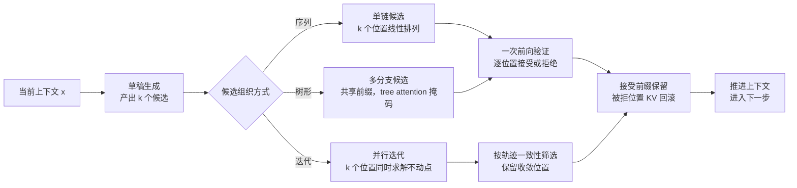
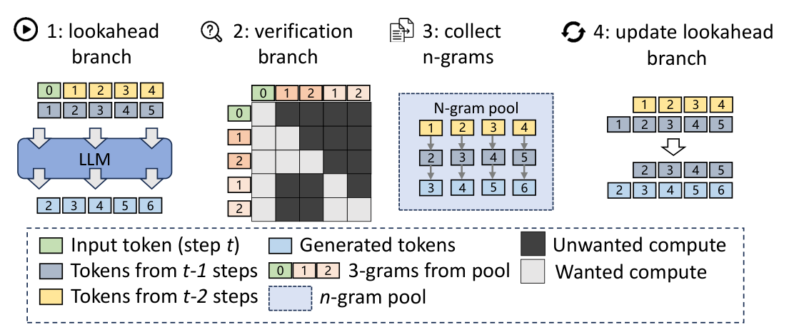

# 并行解码基本原理

> **一句话总结**：并行解码（Parallel Decoding）在一次前向中为多个未来位置同时产生候选 token，以并行宽度 $k$ 换取对被打破的自回归依赖；其收益来自"每步被接受 token 数"与"验证开销"之比，代价是验证阶段的无用计算、草稿源的额外显存与每步 token 数不定带来的调度复杂度。按验证方式分为两条路线：验证式并行保持输出分布严格不变，迭代式并行以固定点收敛换取无需草稿模型 \[1]\[5]。

本文遵循本仓库的设计原则：先界定串行依赖造成的浪费，再展开并行结构与验证机理，最后讨论代价与框架侧组合。

- 边界说明：草稿源的构造细节（独立草稿模型、Medusa 头、EAGLE 特征、MTP、Prompt Lookup）见 [投机采样基本原理.md](投机采样基本原理.md)。本文不重复该部分，讨论对象是**并行结构本身**——多 token 如何组织、如何验证、如何与批处理和图捕获共存。
- 适用版本前提：无损性结论源自投机采样的接受—拒绝校正 \[1]\[2]；树形候选与多头结构源自 Medusa 与 EAGLE \[3]\[4]；无草稿的迭代式并行源自 Jacobi 解码与 Lookahead Decoding \[5]。工程形态参照 vLLM 的 `--speculative-config` 与 SGLang 的 `--speculative-algorithm` 系列参数 \[6]\[7]。**当批大小已接近算力饱和、或草稿接受率极低时，并行解码不产生收益甚至变为净损失**。

***

## 1. 问题界定

### 1.1 串行依赖与访存受限的双重约束

自回归解码每步只产出 1 个 token，且第 $t+1$ 步依赖第 $t$ 步的输出。这带来两个并存的低效：

1. **并行度受限**：单请求解码的可用并行度仅为批内请求数，无法沿序列方向展开；
2. **算术强度低**：每步需读取全部权重与 KV，fp16 下权重读取量约为 $2N_{\mathrm{params}}$ 字节，而对应乘加仅约 $2N_{\mathrm{params}}$ FLOP，算术强度约 1 FLOP/字节，远低于硬件的计算/带宽比。

二者共同构成"算力闲置、带宽饱和"的状态：设备的大部分乘加单元在等待权重从显存读出。并行解码的出发点正是**把闲置算力用于生成额外的候选 token**，再用一次覆盖多位置的前向完成验证。

### 1.2 目标量的形式化

设并行宽度为 $k$，即每步提出 $k$ 个额外候选；单词接受率为 $\alpha$（各位置独立近似）。一步内被接受 token 数的期望为

$$
\tau(k,\alpha) = \frac{1-\alpha^{k+1}}{1-\alpha}
$$

单步耗时由草稿与验证两部分构成，基线单 token 步时为 $T_{0}$ 。在访存受限区间，验证 $k+1$ 个位置的权重读取量与验证 1 个位置相同，故近似有

$$
\mathrm{Speedup} \approx \frac{\tau(k,\alpha) \cdot T_{0}}{T_{\mathrm{draft}}(k) + T_{\mathrm{verify}}(k+1)}
$$

该式给出三条判据：接受率 $\alpha$ 决定分子，草稿开销决定分母，而 $k$ 的边际收益随 $\alpha$ 衰减——**$\alpha$ 低时增大 $k$ 只增加验证浪费**。这一权衡是后文所有代价分析的起点。

### 1.3 与投机采样的边界

二者描述的是同一现象的不同侧面，不宜混用：

| 视角 | 关注对象 | 典型问题 |
| --- | --- | --- |
| 投机采样 | 草稿从哪来、如何校正分布 | 用什么模型起草、如何保证无损 |
| 并行解码 | 多 token 如何组织与验证 | 序列还是树、并行宽度取多少、如何回滚 KV |

工程上二者叠加使用：草稿源决定 $\alpha$ ，并行结构决定 $k$ 的组织方式与验证成本。

***

## 2. 核心机理

### 2.1 三类并行结构



三类结构的差别在"候选之间是否共享前缀"与"是否需要草稿模型"：

| 结构 | 候选来源 | 候选间关系 | 验证方式 | 输出分布 |
| --- | --- | --- | --- | --- |
| 序列并行 | 草稿模型或启发式 | 线性依赖 | 逐位置接受—拒绝校正 | 严格不变 |
| 树形并行 | 多头或多次采样 | 共享前缀的分支 | tree attention 一次覆盖多分支 | 严格不变 |
| 迭代并行 | 无草稿，历史轨迹 | 各位置独立求解 | 轨迹一致性筛选 | 近似 |

### 2.2 验证式并行的正确性

序列并行的无损性来自接受—拒绝机制：候选 token 以草稿分布提出，按目标分布与草稿分布的比值接受，被拒位置之后全部丢弃并重新采样 \[1]\[2]。其结论是**输出分布与逐 token 解码完全一致**，因此对贪心解码可做到逐位一致，对采样解码可做到分布等价。

树形并行是序列并行的推广：多个候选分支在一次前向中通过自定义注意力掩码并行验证，每个分支只看到自己的祖先节点。Medusa 以多个解码头产生候选、以树形结构组织并验证 \[3]；EAGLE 在特征层起草并复用目标模型的分类头 \[4]。树形结构提高单次前向的"有效候选密度"，但也使 KV 管理从线性变为树形。

### 2.3 迭代式并行的近似性

Jacobi 解码把逐位置求解改写为联立方程组，用并行迭代逼近不动点：第 $n$ 轮用第 $n-1$ 轮的整段估计同时更新所有位置 \[5]。Lookahead Decoding 在此基础上引入固定窗口与 n-gram 池：



上图给出其单步结构：左侧以固定窗口对多个未来位置并行生成轨迹，中间以掩码验证轨迹自洽性（深色为无效计算、浅色为有效计算），随后把验证通过的多 token 片段收入 n-gram 池，供后续步直接命中。**其收益不依赖草稿模型，但正确性依赖轨迹收敛**：位置正确但顺序错乱的 token 会被后续迭代替换，因此该路线不保证与逐 token 解码逐位一致，只保证在收敛时等价 \[5]。

### 2.4 每步 token 数不定带来的系统约束

并行解码把"每步恰好 1 个 token"变为"每步 0 到 $k+1$ 个 token"，这一变化穿透整个执行栈：

1. **批形状不定**：同批内各请求接受数不同，单步总 token 数在 $0$ 与 $B(k+1)$ 之间浮动；
2. **KV 回滚**：被拒位置的 KV 必须丢弃或标记无效，块表需支持按位置截断；
3. **图捕获**：固定形状假设被打破，需按"每请求 $k+1$ 个查询位"的固定上界捕获；
4. **调度语义**：一步可能推进多个位置，token 预算与槽位的记账方式随之变化。

第 3 节逐项展开这些交互。

### 2.5 接受率的影响因素

$\alpha$ 不是常数，它随工作负载漂移：

| 因素 | 方向 | 原因 |
| --- | --- | --- |
| 采样温度 | 温度升高， $\alpha$ 下降 | 分布变平坦，草稿与目标分歧增大 |
| 任务类型 | 结构化输出（代码、JSON）高于开放生成 | 高概率路径集中，易被猜中 |
| 草稿质量 | 草稿与目标同分布程度越高， $\alpha$ 越高 | 分布距离决定接受概率 |
| 上下文长度 | 长上下文通常降低 $\alpha$ | 条件分布更分散，草稿更难命中 |
| 批内竞争 | 批增大时验证成本上升，但 $\alpha$ 不变 | 收益被成本抵消而非被接受率抵消 |

因此并行宽度 $k$ 应按 $\alpha$ 在线调整：$\alpha$ 高时增大 $k$ 收益显著， $\alpha$ 低时应收缩至 1 至 2，避免纯验证浪费。

***

## 3. 与其他优化方案的组合

### 3.1 与连续批处理

连续批处理按步重组批，天然容纳"每步 token 数不定"；但调度器需要把投机步的额外查询位计入 token 预算，否则实际计算量会超出预算假设。二者组合的净效果取决于批大小：**低并发时并行解码填补算力空闲，高并发时验证的额外计算与批内其他请求争夺算力**。见 [连续批处理基本原理.md](连续批处理基本原理.md)。

### 3.2 与计算图捕获

图捕获要求固定形状。vLLM 的处理方式是把"每请求 $1 + k$ 个查询位"的批视为 uniform decode 的一种，并按该上界建立捕获桶；桶外的混合批退回分段捕获 \[6]。这意味着**开启并行解码会改变 uniform decode 的判定条件与桶集合**，捕获成本随 $k$ 增大。见 [计算图捕获基本原理.md](../图优化/计算图捕获基本原理.md)。

### 3.3 与分页 KV 管理

被拒 token 的 KV 需要回滚。页式管理使回滚以"截断逻辑长度 + 释放尾块"实现，代价是块表更新与可能的碎片；树形候选还需为每个树节点维护位置编号，使块表从线性映射变为树映射。见 [PagedAttention基本原理.md](../Attention优化/PagedAttention基本原理.md)。

### 3.4 与预填充解码分离

并行解码只作用于解码侧，预填充侧不受影响；在 PD 分离部署中，它改变解码实例的算力—带宽平衡，从而改变解码实例的并发上限。二者组合时需重新标定解码侧容量，不能沿用逐 token 解码时的并发数。见 [Prefill-Decode分离基本原理.md](../分布式推理/Prefill-Decode分离基本原理.md)。

### 3.5 与量化

量化降低权重读取量，使解码从访存受限向算力受限移动，**削弱并行解码的前提**：验证的边际成本上升，而 $\alpha$ 因数值误差略有下降。实践中低比特量化与并行解码同时启用时，需重新测量 $\alpha$ 与单步耗时，不能沿用全精度下的参数。

### 3.6 与前缀缓存

基于 n-gram 与后缀匹配的草稿源依赖上下文中重复出现的片段；前缀缓存提高这类片段的复用概率，二者方向一致。而基于草稿模型的路线与前缀缓存无直接耦合，其收益主要体现在预填充侧。

### 3.7 框架参数对照

两侧都提供并行解码的机制，参数形态不同（语义已按当前官方文档核对 \[6]\[7]）：

| 维度 | vLLM | SGLang |
| --- | --- | --- |
| 入口 | `--speculative-config` JSON | `--speculative-algorithm` |
| 可选方法 | `draft_model`、`ngram`、`suffix`、`mtp`、`eagle3`、`dflash` \[6] | `EAGLE`、`EAGLE3`、`NGRAM` \[7] |
| 并行宽度 | `num_speculative_tokens` \[6] | `--speculative-num-draft-tokens`、`--speculative-num-steps`、`--speculative-eagle-topk` \[7] |
| 参数整定 | 手工设定宽度 | 三项未设置时走自动整定；显式设置需同时给出三项 \[7] |
| 词表压缩 | 未见对应开关 | `--speculative-token-map`（配合 FR-Spec 降低分类头开销）\[7] |

配置示例，语义为"以草稿模型起草 5 个 token 并由目标模型一次验证"：

```bash
vllm serve <model> \
  --speculative-config '{"method":"draft_model","model":"<draft-model>","num_speculative_tokens":5}'
```

```bash
python -m sglang.launch_server --model-path <model> \
  --speculative-algorithm EAGLE \
  --speculative-num-steps 3 \
  --speculative-eagle-topk 1 \
  --speculative-num-draft-tokens 4
```

### 3.8 何时应当关闭

以下三类情形下并行解码为净损失，应在部署层直接关闭：

1. **批已饱和**：并发接近算力上限时，验证的额外位置挤占本可用于其他请求的算力，goodput 下降；
2. **接受率过低**：温度高、输出开放、上下文长且无重复片段时， $\alpha$ 与随机猜测接近，期望接受 token 数趋近 1；
3. **形状敏感**：批形状频繁跨桶、图捕获命中率低时，回退与重捕获开销可能超过收益。

***

## 4. 边界与代价

| 类别 | 具体代价 | 工程缓解 |
| --- | --- | --- |
| 额外显存 | 草稿模型或解码头权重、树形候选的中间 KV | 共享词表与嵌入；限制树深与分支数；按需启用 |
| 无用计算 | 被拒候选的验证计算不可回收 | 按 $\alpha$ 在线调整 $k$；低 $\alpha$ 时收缩 |
| 延迟方差 | 接受数波动导致 ITL 抖动 | 以分位数而非均值评估；限制单步最大宽 |
| 调度复杂度 | 单步 token 数不定，预算与槽位记账改变 | 以 $(1+k)$ 为上界记账；预算含投机位 |
| 形状约束 | 图捕获桶需按 $k$ 扩展，桶数增加 | 固定 $k$ 取常见值；避免频繁跨桶 |
| 正确性分档 | 迭代式并行只保证收敛等价 | 对确定性要求高的路径禁用；以贪心验证 |
| 后端要求 | 树形验证依赖自定义注意力掩码与内核支持 | 选择支持该掩码的注意力后端；不支持则回退序列式 |
| 容量标定 | 解码实例的并发上限随 $\alpha$ 漂移 | 在线监控接受率并重新标定 |

**边界结论**：并行解码把"算力换带宽"，其有效区间是**低并发、高接受率、访存受限**。三个条件任一不满足，收益即被验证开销吞没；它不改变单 token 的计算量，只改变每步承载的 token 数。

***

## 5. 可验证方法

1. **接受率与宽度扫描**：固定模型与负载，令 $k$ 从 1 递增至硬件允许上限，记录实测接受长度与单步耗时，绘出 speedup 曲线，确认拐点位置与 1.2 节公式一致。
2. **批大小二维扫描**：在同一 $k$ 下扫描并发数，观察 speedup 随批增大的衰减，定位"并行解码失效"的批阈值。
3. **温度敏感性**：以不同采样温度重放同一 prompt 集，测量 $\alpha$ 与接受长度的变化，验证 2.5 节的第一行结论。
4. **关闭对照**：以关闭并行解码的配置为基线，比较 P50 / P90 ITL 与 goodput，而非仅比较平均吞吐。
5. **输出一致性检查**：贪心解码下比对并行与逐 token 路径的逐位一致性；采样解码下比较固定种子下的分布统计，确认验证式路线无损、迭代式路线仅收敛等价。
6. **KV 回滚正确性**：构造高拒绝率负载，检查回滚后的块表与位置编号是否一致，重点观察长会话中的错位与重复。
7. **图捕获命中率**：统计捕获桶覆盖率与回退次数，确认 $k$ 变化没有把批推出捕获集合。
8. **框架指标入口**：vLLM 提供投机解码的接受数与接受率指标，SGLang 提供草稿与接受统计 \[6]\[7]；二者的计数口径不同，跨框架对比时须先对齐定义。

***

## 6. 对比表：六种并行解码形态

| 形态 | 草稿来源 | 是否无损 | 额外显存 | 额外算力来源 | 适用场景 |
| --- | --- | --- | --- | --- | --- |
| 独立草稿模型 | 小模型 | 是 | 草稿权重 + 其 KV | 草稿前向 | 高接受率、显存充裕 |
| Medusa 多头 | 目标模型的多解码头 | 是 | 头权重 | 多头前向 | 单模型部署、免第二模型 |
| EAGLE 特征起草 | 特征层 + 复用分类头 | 是 | 轻量头 | 特征前向 | 追求高 $\alpha$ 与低开销 |
| MTP 训练头 | 预训练的多 token 头 | 是 | 头权重 | 头前向 | 模型原生支持时开销最低 |
| n-gram / 后缀匹配 | 上下文片段 | 是 | 无 | 无 | 输出与上下文重复度高 |
| Jacobi / Lookahead | 无 | 近似 | 无 | 并行迭代 | 无草稿模型、可接受近似 |

***

## 7. 延伸阅读

- 草稿源构造与分布校正的完整推导：见 [投机采样基本原理.md](投机采样基本原理.md)。
- 每步 token 数变化如何影响批组成：见 [连续批处理基本原理.md](连续批处理基本原理.md)。
- 固定形状假设下的桶化与回退：见 [计算图捕获基本原理.md](../图优化/计算图捕获基本原理.md)。
- 被拒 token 的 KV 回收机制：见 [PagedAttention基本原理.md](../Attention优化/PagedAttention基本原理.md)。
- 解码实例容量如何随并行度改变：见 [Prefill-Decode分离基本原理.md](../分布式推理/Prefill-Decode分离基本原理.md)。

---

## 8. 参考文献

1. Leviathan Y., Kalman M., Matias Y. **Fast Inference from Transformers via Speculative Decoding**. ICML 2023.（接受—拒绝机制与无损性证明）[arXiv:2211.17192](https://arxiv.org/abs/2211.17192)
2. Chen C., Borgeaud S., Irving G., et al. **Accelerating Large Language Model Decoding with Speculative Sampling**. 2023.（独立提出的投机采样与加速比分析）[arXiv:2302.01318](https://arxiv.org/abs/2302.01318)
3. Cai T., Li Y., Geng Z., et al. **Medusa: Simple LLM Inference Acceleration Framework with Multiple Decoding Heads**. 2024.（多头候选与树形验证）[arXiv:2401.10774](https://arxiv.org/abs/2401.10774)
4. Li Y., Wei F., Zhang C., Zhang H. **EAGLE: Speculative Sampling Requires Rethinking Feature Uncertainty**. ICML 2024.（特征层起草与分类头复用）[arXiv:2401.15077](https://arxiv.org/abs/2401.15077)
5. Fu Y., Bailis P., Stoica I., Zhang H. **Break the Sequential Dependency of LLM Inference Using Lookahead Decoding**. ICML 2024.（Jacobi 迭代、固定窗口与 n-gram 池）[arXiv:2402.02057](https://arxiv.org/abs/2402.02057)
6. vLLM. **Speculative Decoding**（`--speculative-config`、方法枚举、`num_speculative_tokens`、无损性说明与图捕获条件）. [docs.vllm.ai](https://docs.vllm.ai/en/latest/features/speculative_decoding.html)
7. SGLang. **Speculative Decoding**（`--speculative-algorithm`、`--speculative-num-steps`、`--speculative-eagle-topk`、`--speculative-num-draft-tokens` 与自动整定）. [docs.sglang.io](https://docs.sglang.io/docs/advanced_features/speculative_decoding)
8. Santilli A., Severino A., Postolache E., et al. **Accelerating Transformer Inference for Translation via Parallel Decoding**. ACL 2023.（并行迭代解码的来源）[arXiv:2305.10427](https://arxiv.org/abs/2305.10427)

---

## 9. 图片来源声明

- `assets/pd-lookahead-fig1.png`：裁剪自 Lookahead Decoding 论文（ICML 2024）第 3 页图 1，原始文件取自 [arXiv:2402.02057](https://arxiv.org/abs/2402.02057)，版权归原作者所有，此处仅用于技术说明，引用请遵循原论文许可。
- 文中 Mermaid 图为本仓库自绘。
