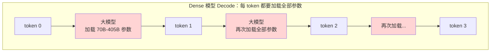
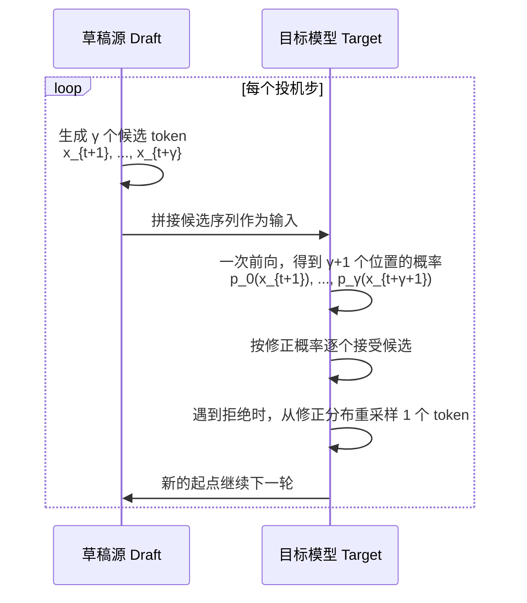
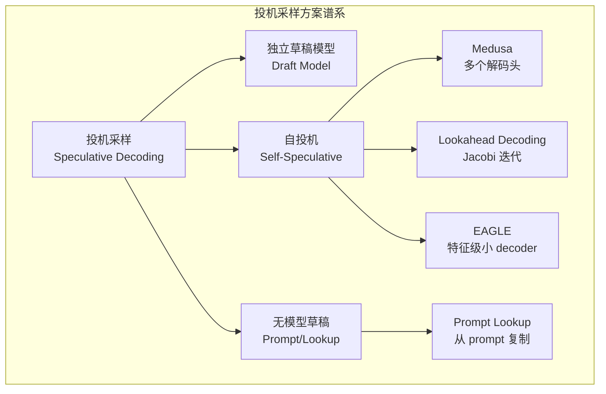
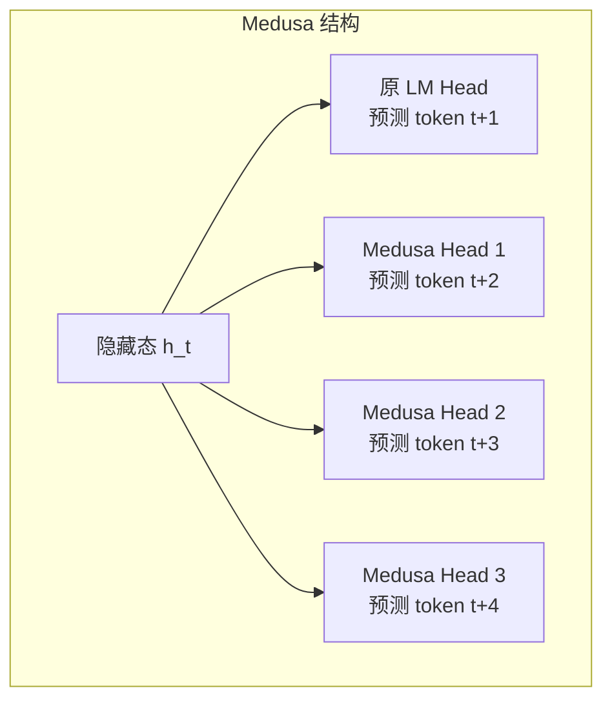
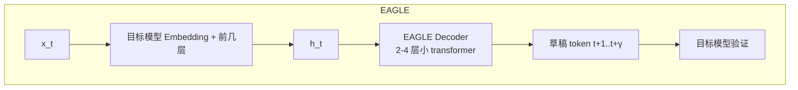
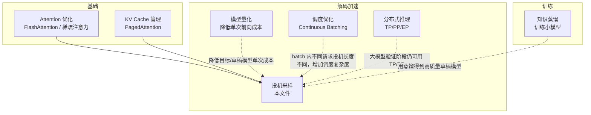

# 投机采样基本原理

> **一句话总结**：投机采样（Speculative Decoding）用**一个或多个低成本草稿源快速生成候选 token 序列**，再由**目标大模型一次性并行验证**，按概率决定是否接受；在保持输出分布不变的前提下，把自回归解码中"一次前向只生成 1 个 token"的限制打破为"一次前向平均生成多个 token"，从而加速 Decode 阶段。它属于**解码阶段延迟优化**范畴，代价是引入额外的草稿计算、内存与调度复杂度。

本文遵循本仓库的设计原则：**先讲清"为什么"，再谈"怎么做"**，并明确标注**关联技术**与**边界、代价**。

- 适用版本前提：经典投机解码基于 Leviathan et al. (ICML 2023) [1]；自投机方法 Medusa 基于 Cai et al. (2024) [2]；基于 Jacobi 迭代的 Lookahead Decoding 基于 Fu et al. (2023) [3]；EAGLE 基于 Li et al. (2024) [4]。**脱离目标模型与草稿模型分布匹配度的加速比结论不成立**。

---

## 1. 它为什么存在：自回归 Decode 的瓶颈

### 1.1 Decode 阶段为什么慢

大语言模型推理分为两个阶段：

| 阶段 | 计算特征 | 延迟来源 |
| --- | --- | --- |
| **Prefill** | 一次处理整个 prompt，矩阵-矩阵乘 | 计算量 O(S²·d) |
| **Decode** | 每次只输入 1 个新 token，矩阵-向量乘 | **访存带宽** + **反复加载大模型权重** |

Decode 阶段的核心矛盾：

> 大模型**每次前向传播只生成 1 个 token**，但生成 1 个 token 却要**加载一次几乎整个模型参数**。



### 1.2 为什么不能用更大 batch 解决

Continuous batching 能提升**系统总吞吐**，但对**单请求延迟**帮助有限：

- batch 内每个 token 仍然来自不同请求，彼此独立；
- 大 batch 下矩阵-向量变成矩阵-矩阵，计算效率提高，但**首 token 生成时间（TTFT）和单请求 TPOT 并未降低**。

### 1.3 投机采样的核心洞察

> 很多序列中的连续 token 其实是**可预测的**。如果能提前知道接下来可能是什么，就可以让大模型一次性验证多个，而不是逐个生成。

例如：

```
Prompt: "The capital of France is"
目标模型大概率会输出：" Paris"
小模型（或 prompt 本身）也能大概率猜出：" Paris"
```

与其让大模型一次一次确认每个字符，不如让小模型先写出整段草稿，大模型一次性检查并采纳。

---

## 2. 核心机制：两步法

### 2.1 整体流程

投机采样由两个阶段循环组成：



### 2.2 详细步骤

设当前已生成序列到位置 $t$，目标是继续生成。

#### 步骤 1：草稿生成

草稿源（draft model / 树状头 / n-gram 查找）生成 $\gamma$ 个候选 token：

$$
x'_{t+1}, x'_{t+2}, \ldots, x'_{t+\gamma}
$$

#### 步骤 2：目标模型并行验证

目标模型把完整序列 $x_{1:t+\gamma}$ 输入一次前向，得到每个候选位置的目标分布：

$$
p_i(x) = p_{\text{target}}(x \mid x_{1:t+i-1}), \quad i = 1, \ldots, \gamma
$$

以及如果前 $\gamma$ 个候选全对，额外得到的 $p_{\gamma+1}(x)$。

#### 步骤 3：逐个接受/拒绝

对每个候选位置 $i$，从 $q_i$（草稿分布）和 $p_i$（目标分布）中抽取一致性判断：

$$
\alpha_i = \min\left(1, \frac{p_i(x'_{t+i})}{q_i(x'_{t+i})}\right)
$$

- 以概率 $\alpha_i$ **接受**该候选 token；
- 以概率 $1 - \alpha_i$ **拒绝**，并在位置 $i$ 停止；
- 从修正分布重采样 1 个 token 作为该位置的最终输出：

$$
x_{t+i} \sim \max\left(0, p_i - q_i\right) \text{ 归一化后的分布}
$$

### 2.3 为什么能保证输出分布不变

这是投机采样最核心的数学性质：

> **投机采样等价于直接从目标模型 $p$ 中自回归采样。**

直观理解：
- 草稿分布 $q$ 只是"提议"了一个候选；
- 目标分布 $p$ 做了"修正性接受/拒绝"；
- 当 $q$ 高估某个 token 概率时，算法会用低接受率把它拉回；
- 当 $q$ 低估时，拒绝后的修正分布会补上概率质量。

最终每个 token 的边缘分布都等于目标模型 $p$ 的分布——**不损失精度**。

---

## 3. 草稿源的种类



### 3.1 独立草稿模型

用一个小模型（通常是目标模型的 1/10 到 1/100）做草稿：

| 优点 | 缺点 |
| --- | --- |
| 实现最简单 | 需要额外加载一个模型 |
| 理论分析清晰 | 草稿模型与目标模型分布需匹配 |
| 可即插即用 | 多占一份显存 |

典型做法：
- Llama-2-70B 目标 + Llama-2-7B 草稿；
- CodeLlama-34B 目标 + CodeLlama-7B 草稿（代码任务匹配度高）。

### 3.2 自投机：Medusa

Medusa [2] 不给大模型配小模型，而是在大模型顶层加多个**解码头**：



这些头只在训练阶段加，推理时一起算。

| 优点 | 缺点 |
| --- | --- |
| 不需要额外模型 | 需要训练 Medusa 头 |
| 不增加显存加载权重 | 加速比受限于头的能力 |
| 适合已部署模型 | 对分布变化敏感 |

### 3.3 Jacobi 迭代：Lookahead Decoding

Lookahead Decoding [3] 不依赖任何草稿模型，而是用** Jacobi 迭代**同时猜测未来多个位置：

```
初始猜测：w1, w2, w3, ..., wγ
迭代 1：用这些猜测算 Attention，更新猜测
迭代 2：继续更新
...
直到收敛或找到可验证序列
```

| 优点 | 缺点 |
| --- | --- |
| 不需要草稿模型 | 加速比不稳定 |
| 不增加内存 | 需要多次内部迭代 |
| 适合通用场景 | 长程依赖强的文本效果差 |

### 3.4 特征级自投机：EAGLE

EAGLE [4] 用目标模型**上一层的隐藏特征**训练一个极小的 decoder：



| 优点 | 缺点 |
| --- | --- |
| 草稿质量高 | 需要训练 EAGLE decoder |
| 特征级信息丰富 | 增加少量显存 |
| 加速比通常最好 | 实现复杂 |

### 3.5 无模型草稿：Prompt Lookup

某些任务中，输出 token 可以直接从 prompt 中复制：

```
Prompt: "把下面英文翻译成中文：Hello world"
草稿源：prompt 中直接有 "Hello world" → 可直接猜 "你好世界"
```

适用场景：
- 文本编辑/改写；
- RAG（检索内容作为草稿）；
- 代码补全（从代码库中复制）。

---

## 4. 加速比分析

### 4.1 理想加速比

设：
- $c$：目标模型一次前向时间
- $d$：草稿模型生成 $\gamma$ 个 token 的时间
- $\gamma$：草稿长度
- $\alpha$：平均接受率

理想情况下（所有候选都被接受），加速比约为：

$$
\text{Speedup} \approx \frac{\gamma \cdot c}{c + d}
$$

### 4.2 实际加速比

更精确地，考虑接受率 $\alpha$ 后，**每个目标模型前向实际生成的期望 token 数**为：

$$
E[\text{tokens per target forward}] = \frac{1 - \alpha^{\gamma+1}}{1 - \alpha}
$$

当 $\alpha$ 接近 1（草稿质量很好）且 $\gamma$ 较大时，这个值趋近于 $\gamma+1$。

### 4.3 不同草稿源的典型加速比

| 方案 | 典型加速比 | 前提条件 |
| --- | --- | --- |
| 独立 Draft Model | 1.5×–2.5× | 草稿模型与目标模型分布匹配 |
| Medusa | 1.5×–2.0× | Medusa 头训练充分 |
| Lookahead Decoding | 1.3×–2.0× | 文本可预测性强 |
| EAGLE | 2.0×–3.0× | EAGLE decoder 训练充分 |
| Prompt Lookup | 1.0×–5.0× | 强依赖于 prompt 与输出重叠度 |

> **关键经验**：投机采样的收益高度依赖"草稿质量"和"目标模型接受率"。如果小模型经常猜错，反而会因为草稿计算开销而变慢。

---

## 5. 边界与代价

### 5.1 核心代价

| 代价 | 说明 | 严重程度 |
| --- | --- | --- |
| **草稿计算/内存开销** | 额外草稿模型或多个解码头的显存与计算 | 🔴 核心代价 |
| **拒绝后修正开销** | 虽然单次重采样便宜，但频繁拒绝会降低有效加速比 | 🟡 中等 |
| **调度复杂度** | Continuous batching 下投机步长不一致，增加调度难度 | 🟡 中等 |
| **分布匹配要求** | 草稿分布必须与目标分布足够接近，否则加速比低 | 🔴 核心限制 |
| **长尾 token 难猜** | 创意性/低概率 token 草稿很难命中 | 🟡 中等 |

### 5.2 不适用场景

| 场景 | 原因 |
| --- | --- |
| **短输出请求** | 投机启动开销可能抵消收益 |
| **高度创意/开放式生成** | 草稿命中率低，频繁拒绝 |
| **目标模型与草稿模型分布差异大** | 接受率低，反而更慢 |
| **显存极其紧张** | 额外草稿模型或多头的显存不可接受 |
| **低延迟首 token 场景** | 投机解码降低的是 TTFT 之后的 TPOT，不是 TTFT |

### 5.3 和蒸馏/量化的区别

| 方法 | 范畴 | 是否改变输出分布 |
| --- | --- | --- |
| **投机采样** | 解码策略优化 | ❌ 不改变 |
| **知识蒸馏** | 训练阶段 | ✅ 改变（小模型近似大模型） |
| **模型量化** | 数值格式优化 | ✅ 可能改变（有损量化） |
| **小模型直接替代** | 模型选择 | ✅ 显著改变 |

> 投机采样的独特价值在于：**既享受了小模型/多头的高速，又完全保留了大模型的输出分布**。

---

## 6. 可验证实验

### 6.1 手写投机采样流程

```python
import torch
import torch.nn.functional as F

def speculative_decode_step(target_model, draft_model, prefix, gamma=5):
    """
    单步投机解码，返回 (accepted_tokens, new_prefix)
    简化版：假设 model(input_ids) 返回 logits
    """
    # 1. 草稿模型生成 gamma 个候选 token
    draft_tokens = []
    cur = prefix
    for _ in range(gamma):
        logits = draft_model(cur)
        next_token = torch.argmax(logits[:, -1, :], dim=-1)
        draft_tokens.append(next_token.item())
        cur = torch.cat([cur, next_token.unsqueeze(1)], dim=1)

    # 2. 目标模型一次前向验证 gamma 个候选
    draft_seq = torch.cat([
        prefix,
        torch.tensor([draft_tokens], device=prefix.device)
    ], dim=1)
    target_logits = target_model(draft_seq)

    # 3. 逐个接受/拒绝
    accepted = []
    for i in range(gamma):
        draft_pos = len(prefix[0]) + i
        q = F.softmax(draft_logits_guess(draft_model, draft_seq[:, :draft_pos]), dim=-1)
        p = F.softmax(target_logits[:, draft_pos - 1, :], dim=-1)
        x = draft_tokens[i]
        alpha = min(1.0, (p[0, x] / q[0, x]).item())
        if torch.rand(1).item() < alpha:
            accepted.append(x)
        else:
            # 从修正分布重采样
            corrected = torch.clamp(p[0] - q[0], min=0)
            corrected = corrected / corrected.sum()
            resampled = torch.multinomial(corrected, 1).item()
            accepted.append(resampled)
            break
    else:
        # 全部接受，额外从 p_{gamma+1} 采样一个 bonus token
        bonus_logits = target_logits[:, -1, :]
        bonus = torch.argmax(F.softmax(bonus_logits, dim=-1), dim=-1)
        accepted.append(bonus.item())

    return accepted, torch.cat([
        prefix,
        torch.tensor([accepted], device=prefix.device)
    ], dim=1)
```

### 6.2 估算加速比

```python
def estimate_speedup(gamma, alpha, c_target, c_draft_per_token):
    """
    估算投机采样加速比
    """
    # 每个目标模型前向实际生成的期望 token 数
    tokens_per_target = (1 - alpha ** (gamma + 1)) / (1 - alpha)
    # 每个目标前向花费的时间
    time_per_target = c_target + gamma * c_draft_per_token
    # 基准：每个 token 一次目标前向
    baseline_time = c_target
    return tokens_per_target * baseline_time / time_per_target

for gamma in [3, 5, 7]:
    for alpha in [0.6, 0.75, 0.9]:
        sp = estimate_speedup(gamma, alpha, c_target=100, c_draft_per_token=5)
        print(f"γ={gamma}, α={alpha}: speedup={sp:.2f}x")
```

**预期趋势**：
- $\alpha$ 越高，加速比越接近 $\gamma \cdot c_{target} / (c_{target} + \gamma \cdot c_{draft})$；
- $\alpha$ 低于某个阈值后，投机反而变慢。

---

## 7. 关联



| 技术 | 关系 | 说明 |
| --- | --- | --- |
| **FlashAttention / 稀疏注意力** | 上游优化 | 降低 Prefill/Decode 基础成本，但不改变每次 1 token 的本质 |
| **PagedAttention** | 上游优化 | 管理投机过程中不断增长的 KV Cache |
| **模型量化** | 正交/配合 | 量化目标模型或草稿模型，进一步降低单次验证成本 |
| **知识蒸馏** | 相关 | 蒸馏出的小模型可以作为投机解码的草稿模型 |
| **Continuous Batching** | 需要配合 | 投机解码让不同请求的前向长度不一致，调度器需要适配 |
| **分布式推理（TP/PP/EP）** | 正交 | 目标模型验证阶段仍可用 TP/PP/EP 加速 |
| **KV Cache 量化** | 下游优化 | 降低投机解码中 KV Cache 增长带来的显存压力 |

---

## 8. 延伸阅读

- [FlashAttention 基本原理](../Attention优化/FlashAttention基本原理.md) — 降低 Attention 基础成本，为投机解码提供更高效的基础前向
- [PagedAttention 基本原理](../Attention优化/PagedAttention基本原理.md) — 管理投机解码过程中增长的 KV Cache
- [张量并行推理基本原理](../分布式推理/张量并行推理基本原理.md) — 目标模型验证阶段仍可用 TP 加速
- [KV Cache 基本原理](../Attention优化/KV%20Cache基本原理.md) — 投机过程中 KV Cache 的变化与管理

---

## 参考文献

[1] Fast Inference from Transformers via Speculative Decoding. Leviathan et al., ICML 2023. <https://arxiv.org/abs/2211.17192>

[2] Medusa: Simple LLM Inference Acceleration Framework with Multiple Decoding Heads. Cai et al., arXiv:2401.10774, 2024. <https://arxiv.org/abs/2401.10774>

[3] Lookahead Decoding: Breaking the Token-by-Token Bottleneck for Advanced LLM Inference. Fu et al., arXiv:2402.02057, 2024. <https://arxiv.org/abs/2402.02057>

[4] EAGLE: Speculative Sampling Requires Rethinking Feature Uncertainty. Li et al., ICML 2024. <https://arxiv.org/abs/2401.15077>

[5] Accelerating Large Language Model Decoding with Speculative Sampling. Chen et al., arXiv:2302.01318, 2023. <https://arxiv.org/abs/2302.01318>

---

## 图片声明

本文所有架构图、时序图和流程图均由作者使用 Mermaid 语法在文档中直接绘制，无外部图片依赖。
