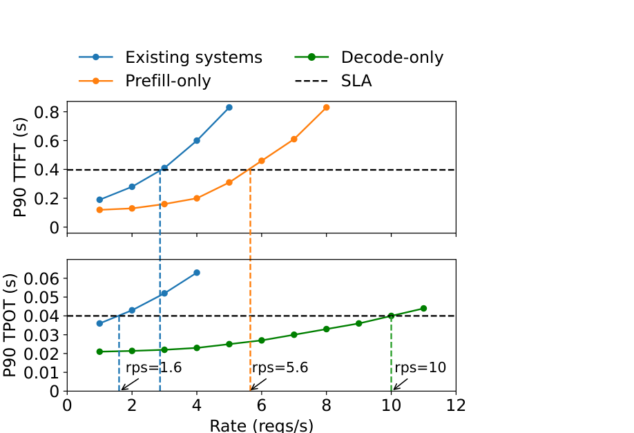
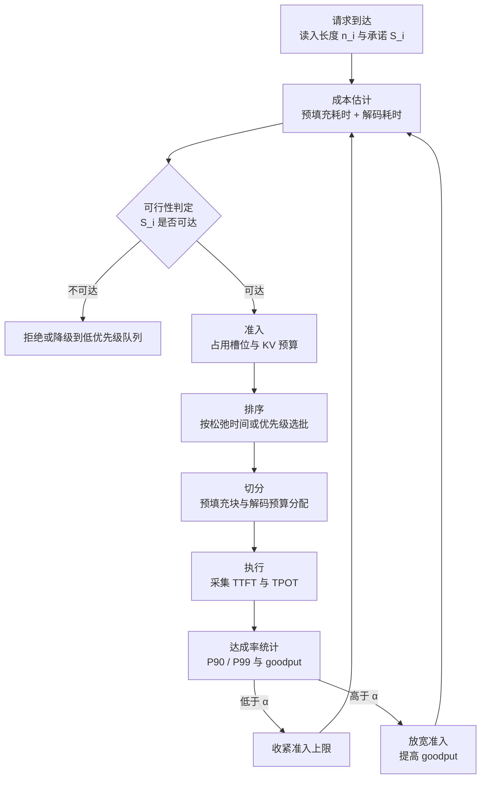

# SLO 感知调度基本原理

> **一句话总结**：SLO 感知调度把推理服务的目标函数从"最大化吞吐"替换为"在满足时延约束的前提下最大化有效吞吐（goodput）"，其核心是把每个请求的承诺时延折算为可调度量（松弛时间或可行性判定），据此决定准入、排序与切分。它本身不产生计算加速，只改变资源在时间与请求之间的分配；代价是必须依赖负载估计与反馈控制，估计误差直接转化为违约或吞吐损失 \[1]\[2]\[3]。

本文遵循本仓库的设计原则：先界定 SLO 的度量与优化目标，再展开调度机理，最后讨论其与其他调度策略的差异、代价以及框架侧的组合方式。

- 适用版本前提：理论形式化源自推理服务对 goodput 与 prefill/decode 阶段异质性的分析 \[1]\[2]，跨实例重调度源自以迁移换取隔离与优先级的手段 \[3]，统计复用视角源自 AlpaServe \[4]。工程形态参照 vLLM 的优先级调度与准入参数 \[5]\[6]、SGLang 的保守度与回收策略 \[7]。**当负载平稳、请求同质、且时延约束宽松时，SLO 感知调度退化为普通批处理，收益可忽略**。

***

## 1. 问题界定

### 1.1 SLO 的度量对象

LLM 服务的时延由两个阶段决定：预填充产出首 token，解码逐 token 生成。据此定义三项常用指标：

| 指标 | 定义 | 主导资源 | 典型约束形态 |
| --- | --- | --- | --- |
| TTFT | 请求到达到首 token 返回 | 预填充计算 | 分位数约束，如 P90 ≤ 0.4 s |
| TPOT | 解码阶段相邻 token 的平均间隔 | KV 读取带宽与批大小 | 分位数约束，如 P90 ≤ 40 ms |
| E2E | 端到端完成时间 | 两者之和 | 平均值或分位数 |

端到端时延可近似分解为

$$
T_i^{\mathrm{e2e}} \approx W_i + P_i(n_i) + m_i \cdot t_{\mathrm{dec}}
$$

其中 $W_i$ 为排队等待， $P_i(n_i)$ 为长度 $n_i$ 的预填充耗时， $m_i$ 为输出 token 数， $t_{\mathrm{dec}}$ 为单步解码间隔。该式说明：**排队时间与预填充时间共同决定 TTFT，而解码间隔由批内竞争决定**，三者由不同机制支配，这是单一调度目标失效的根源。

### 1.2 优化目标的替换

传统批处理最大化 token 吞吐 $\sum m_i / T$ 。SLO 感知调度改以达成率为约束、以 goodput 为目标 \[1]：

$$
\mathrm{Attain} = \frac{1}{\lvert R \rvert} \sum_{i \in R} \mathbf{1}\left[ T_i \le S_i \right] \ge \alpha
$$

$$
G = \frac{1}{N_{\mathrm{gpu}} \cdot T} \sum_{i \in R} \mathbf{1}\left[ T_i \le S_i \right]
$$

其中 $S_i$ 为请求 $i$ 的承诺时延， $\alpha$ 为达成率目标（常取 90%）。二者含义不同：达成率是**服务质量约束**，goodput 是**每卡每秒的有用产出**，即在单位成本下真正满足承诺的请求数。该替换带来的直接后果是：**吞吐与成本不再是同一张表上的两个刻度，而是"满足约束的吞吐"**，任何以违约换取的吞吐都不计入收益。



上图给出该目标替换的实证：同卡共置预填充与解码时，"Existing systems"曲线最先触顶，受更严格的 TTFT 约束限制，最大速率约为 1.6 req/s；仅预填充的实例可到 5.6 req/s，仅解码的实例可到 10 req/s。**两条曲线各自触顶的位置说明 TTFT 与 TPOT 由不同资源支配**，共置会迫使系统按更紧的那一条约束运行 \[1]。

### 1.3 与相邻调度机制的分工

| 层次 | 关注对象 | 典型手段 | 与 SLO 的关系 |
| --- | --- | --- | --- |
| 目标层 | 满足承诺的产出 | 准入、松弛排序、分级配额 | **本文对象** |
| 执行层 | 批如何组成与执行 | 连续批处理、分块预填充 | 提供可调的执行粒度 |
| 资源层 | 显存与实例如何分配 | 分页 KV、PD 分离、并行策略 | 改变可行性边界 |
| 成本层 | 重复计算与访存 | 前缀缓存、图捕获 | 降低单位请求代价 |

SLO 感知调度**不替代**上述任何一层，而是为它们提供决策依据：连续批处理回答"批怎么变"，SLO 感知调度回答"变到哪个形态才不违约"。

***

## 2. 核心机理

### 2.1 反馈闭环

SLO 感知调度的本质是一个闭环控制器：以承诺时延为设定值，以实测时延为反馈量，以准入上限与批组成为执行量。



闭环中存在两处延迟：**测量延迟**（违约只能在请求完成后确认）与**执行延迟**（已准入的请求无法瞬时撤回）。两者决定了控制器必须工作在"预测—校正"模式而非"事后补偿"模式。

### 2.2 松弛时间：把承诺折算为可调度的量

对请求 $i$，定义松弛时间

$$
\mathrm{slack}_i = S_i - \left( t - a_i + \hat{m}_i \cdot t_{\mathrm{dec}} \right)
$$

其中 $a_i$ 为到达时刻， $t$ 为当前时刻， $\hat{m}_i$ 为剩余输出长度的估计。松弛时间表示"在仍满足承诺的前提下还能等待多久"。三类排序准则由此导出：

| 准则 | 排序键 | 优化对象 | 缺陷 |
| --- | --- | --- | --- |
| FCFS | 到达时刻 | 公平性与顺序性 | 不识别承诺，临界请求可能被长请求阻塞 |
| 优先级 | 外部指定优先级 | 业务等级差异 | 优先级是手段而非目标，等级划分粗于 SLO |
| 最小松弛优先 | $\mathrm{slack}_i$ | 违约风险最小化 | 依赖输出长度估计，估计偏差导致误判 |
| 最短剩余处理时间 | 估计剩余工作量 | 平均完成时间 | 与承诺无关，长请求饥饿 |

最小松弛优先（least slack time first）是 SLO 语义在调度层的直接映射：**它不关心请求有多长，只关心距离违约还剩多少余量**。这与 FCFS 和优先级调度的差别不在实现细节，而在排序键的信息来源——前者需要承诺与成本模型，后两者不需要。

### 2.3 三类可调动作

调度器实际只有三种动作，SLO 信息必须落到其中之一才有效：

1. **准入控制**：决定哪些请求进入运行集合，其余排队或拒绝。这是唯一能在违约发生前生效的动作，也是超长上下文场景下最有效的手段；
2. **排序**：决定已准入请求在本步的批组成。它影响排队时间与解码间隔，但对已投入的预填充无法回收；
3. **切分与放置**：决定单步预算在预填充与解码之间的分配，以及请求落在哪个实例。分块预填充的块大小、PD 分离的路由都属于此类。

三者之间存在替代关系：准入收紧可以换取排序自由度，排序无法弥补容量缺口。**当容量不足以支撑承诺时，任何排序都只是决定谁先违约**。

### 2.4 估计误差的传导

SLO 感知调度的决策依赖两个估计量：输入长度（精确可得）与输出长度（不可精确预知）。输出长度误差通过 $\hat{m}_i$ 进入松弛时间，其后果分两类：

- 低估输出长度：请求被判定为宽裕，实际临近违约，表现为尾部违约率上升；
- 高估输出长度：请求被过早判定为临界，挤占其他请求，表现为 goodput 下降。

工程上常以"剩余输出长度的保守上界 + 周期性重估"抑制误差：每次解码若干 token 后更新 $\hat{m}_i$，使松弛时间随生成过程收敛。该做法的代价是重估频率与调度开销之间的权衡。

### 2.5 分位数控制而非均值控制

SLO 通常约束分位数（P90、P99），而调度器每步只能观测到已完成请求的样本。二者之间存在结构性错位：**均值控制会让少数极端请求长期拉低达成率，而分位数控制要求对尾部显式建模**。常用手段是为高等级请求预留余量（headroom）、对临界请求给予优先级加成、并限制单步抢占数量。Llumnix 的做法是把余量管理与跨实例迁移合并为一个统一的调度策略，以迁移替代等待 \[3]。

### 2.6 可行性判定

承诺可达的前提是存在一个调度顺序使请求在期限内完成。对单请求，其下界为

$$
\mathrm{TTFT}_i \ge P_i(n_i)
$$

即预填充本身的时间不可压缩。若 $S_i^{\mathrm{TTFT}} < P_i(n_i)$ ，则在任何调度下都无法满足，唯一正确的动作是**在准入阶段拒绝或降级**，而非接纳后尝试优化。该判据在超长上下文下尤为关键：1M token 的预填充耗时远高于常见的 TTFT 承诺，可行域可能只包含极少数并发请求。

***

## 3. 与其他调度策略的差异与组合

### 3.1 策略族对比

| 策略 | 决策依据 | 目标函数 | 是否需要成本模型 | 典型失效 |
| --- | --- | --- | --- | --- |
| FCFS | 到达顺序 | 顺序公平 | 否 | 长短请求混合时尾部恶化 |
| 静态批 | 固定批大小 | 利用率 | 否 | 批内等待与填充浪费 |
| 优先级调度 | 外部优先级 | 等级差异 | 否 | 等级粗于 SLO，易发生优先级反转 |
| 最短剩余优先 | 剩余工作量 | 平均完成时间 | 是 | 长请求饥饿 |
| SLO 感知 | 松弛时间与可行性 | goodput | 是 | 估计误差导致误拒或违约 |

关系上，SLO 感知调度是**目标层的约束优化**，其余策略是**机制层的排序规则**。它可以复用 FCFS 作为同级请求内部的次序，也可以复用优先级作为跨等级的初始划分；区别在于它额外引入了"承诺—成本"比较，从而能拒绝不可行的请求。

### 3.2 与连续批处理

连续批处理提供"每步重建批"的能力，使批组成可随承诺变化调整；SLO 感知调度决定每步批组成的目标形态。没有连续批处理，SLO 信息只能影响批间顺序，无法影响批内结构。见 [连续批处理基本原理.md](连续批处理基本原理.md)。

### 3.3 与请求抢占

抢占是 SLO 感知调度的兜底手段，也是其代价来源。抢占可把资源从低价值请求转移到临界请求，但被抢占请求的恢复成本（重算或搬运）会反过来消耗松弛时间；在超长上下文下恢复成本与已处理 token 数成正比，抢占几乎等价于违约。因此 **SLO 调度的优先级顺序应是"准入 > 排序 > 抢占"**。见 [请求调度与抢占基本原理.md](请求调度与抢占基本原理.md)。

### 3.4 与缓存感知调度

前缀缓存改变的是成本模型中的 $P_i(n_i)$ ：命中公共前缀后预填充只需处理未命中部分，可行性判定与松弛时间随之改善。二者组合的方向是"以缓存降低单位请求成本，再用 SLO 约束重新分配释放出的容量"。缓存感知的路由与亲和性见 [缓存感知调度基本原理.md](缓存感知调度基本原理.md)。

### 3.5 与预填充解码分离

PD 分离把 TTFT 与 TPOT 从同一资源上解耦，使两条约束可以分别优化，这是 1.2 节图中曲线分离的直接来源 \[1]。SLO 感知调度在分离部署下的形态变为**两级准入**：预填充侧按 TTFT 承诺与预填充吞吐分配，解码侧按 TPOT 承诺与 KV 容量分配，中间以 KV 传输时延作为耦合项。见 [Prefill-Decode分离基本原理.md](../分布式推理/Prefill-Decode分离基本原理.md)。

### 3.6 与计算图捕获

SLO 驱动的批组成变化会改变静态批形状，触发图捕获的桶切换；桶数量过少则形状被迫填充，浪费预算，桶过多则启动与显存开销上升。SLO 越严格，批形态越需要精细调整，与图捕获的固定形状假设冲突越明显。见 [计算图捕获基本原理.md](../图优化/计算图捕获基本原理.md)。

### 3.7 框架能力对照

vLLM 与 SGLang 都只提供**机制**，不提供 SLO 策略本身：缺少"承诺时延"这一输入，也无内建的松弛排序。可用的构件如下（参数语义已按当前官方文档核对 \[5]\[7]）。

| 构件 | vLLM | SGLang |
| --- | --- | --- |
| 排序规则 | `--scheduling-policy fcfs` 或 `priority`；priority 下**数值越小越先** \[5] | `--enable-priority-scheduling`；priority 下**数值越大越先** \[7] |
| 准入上限 | `--max-num-active-seqs`（限制 RUNNING，不缩 runner 与图捕获容量）、`--max-num-queued-reqs`（超出返回 503）\[5] | `--max-running-requests`、`--max-queued-requests`（分离部署模式下后者不生效）\[7] |
| 保守度 | 无直接旋钮，经并发上限与显存比例间接调节 | `--schedule-conservativeness`，越大越保守，默认 1.0，回收频繁时应调大 \[7] |
| 回收策略 | 仅重算式恢复 | `--retraction-policy length` 优先回收短输出、长输入请求；`priority` 按优先级回收 \[7] |
| 预算切分 | `--max-num-batched-tokens`、`--long-prefill-token-threshold` 及其 adaptive 变体；分块预填充默认开启 \[5] | `--chunked-prefill-size` \[7] |
| 成本削减 | 前缀缓存、块级 KV 管理 \[8] | 基数树前缀缓存、页大小可调 \[7] |

**优先级方向相反是一项实际的配置风险**：两侧都以整数表达优先级，但 vLLM 取小值为先、SGLang 取大值为先，跨框架迁移配置时若直接复用数值，等级会整体倒置。

### 3.8 组合形态

SLO 感知调度在单实例内的最小可用组合是：**优先级排序（表达等级）+ 准入上限（表达容量）+ 分块预填充（表达时延平滑）**，三者共同把承诺转成参数。跨实例的形态则需在此基础上增加路由与迁移，Llumnix 以请求级迁移实现负载均衡、隔离与优先级区分，报告尾部时延数量级改善、高优先级请求最高 1.5 倍加速与 36% 成本节省 \[3]。

单实例配置示例，含义为"高等级请求先执行、准入严格、长预填充互不阻塞"：

```bash
vllm serve <model> \
  --scheduling-policy priority \
  --max-num-seqs 128 \
  --max-num-active-seqs 32 \
  --max-num-queued-reqs 64 \
  --max-num-batched-tokens 8192 \
  --long-prefill-token-threshold 8192 \
  --enable-prefix-caching
```

```bash
python -m sglang.launch_server --model-path <model> \
  --enable-priority-scheduling \
  --max-running-requests 32 \
  --max-queued-requests 64 \
  --chunked-prefill-size 8192 \
  --schedule-conservativeness 1.1
```

需要说明：这些参数只改变机制行为，**承诺时延仍须由外部控制面写入请求优先级并做达成率统计**。若没有控制面，SLO 感知退化为"手工调参 + 事后观测"。

### 3.9 1M 上下文场景

超长上下文把 SLO 问题推向两个极端：预填充成本不可压缩，KV 容量决定并发上限。

1. **先做可行性过滤**。按 2.6 节判据，若 $S^{\mathrm{TTFT}} < P(L)$ ，请求在准入阶段即不可行；1M 提示的预填充通常为数十秒量级，故交互式 TTFT 承诺基本无法覆盖，正确做法是把这类请求路由到低优先级批处理通道，而不是放宽整条通道的承诺；
2. **分级而非统一承诺**。把流量分为交互（短提示、严 TTFT）、长文问答（可容忍 TTFT、严 TPOT）、离线处理（仅约束完成时间）三类，各自设定准入上限与优先级，避免长请求以单条全局约束绑架整机；
3. **以准入替代抢占**。V1 仅支持重算，1M 请求被抢占后的恢复代价与已处理 token 数成正比，等效于违约；因此应下调 `--max-num-active-seqs` 或 `--max-running-requests`，使超额承诺为零；
4. **用前缀缓存压缩 $P_i$** 。长文档多轮问答的公共前缀可命中缓存，实际预填充只处理增量部分，这是 1M 场景下唯一能显著改变可行性边界的单点手段；
5. **分离两条约束**。在 PD 分离下，预填充实例按 TTFT 与预填充吞吐定容量，解码实例按 TPOT 与 KV 容量定并发；两侧上限需分别设定，不能用一个全局并发数表达；
6. **统计口径用分位数**。1M 请求的完成时间分布重尾，均值会掩盖尾部违约，应以 P90 / P99 达成率与 goodput 作为唯一验收指标。

此时 SLO 感知的实际形态是"**分级 + 可行性准入 + 前缀缓存**"，而不是更复杂的排序算法。

***

## 4. 边界与代价

| 类别 | 具体代价 | 工程缓解 |
| --- | --- | --- |
| 模型依赖 | 松弛排序需要成本模型与输出长度估计，模型不准即误判 | 保守上界 + 周期性重估；以实测校准系数 |
| 测量滞后 | 违约只能在请求完成后确认，反馈晚于决策 | 以中间指标（TTFT、队列长度）提前预警 |
| 吞吐折损 | 为达成率预留余量，等价于过度配置 | 按负载分时段调整 $\alpha$ 与余量比例 |
| 饥饿与反转 | 严格按松弛排序可使低等级请求长期等待 | 配额与老化；等级内再用 FCFS 保序 |
| 配置脆弱 | 达成率对硬件、批组成、长度分布高度敏感 | 以 goodput—达成率曲线做离线标定，参数随版本回归 |
| 目标冲突 | 多租户下各租户承诺互不相容 | 显式配额与准入计价，把冲突前移到接入层 |
| 语义陷阱 | 跨框架优先级方向相反，等级易倒置 | 统一在控制面归一化后再下发 |

**边界结论**：SLO 感知调度只能**在给定容量内重新分配违约风险**，不能提升容量本身。当容量不足时，它的正确输出是拒绝或降级，而非制造"看起来更聪明"的排序；当负载同质且约束宽松时，它与 FCFS 的差异小于测量噪声。

***

## 5. 可验证方法

1. **达成率与 goodput 基线**：固定 trace，分别以 FCFS、优先级、SLO 感知三种策略回放，报告 P90 / P99 达成率与每卡 goodput；三者应在同一硬件与同一到达过程下对比。
2. **可行性过滤效果**：统计被准入拒绝的请求比例及其"若接纳是否会违约"，验证 2.6 节判据是否把不可行请求挡在了错误的位置。
3. **估计误差敏感性**：人为注入输出长度估计偏差（低估与高估各若干档），观察违约率与 goodput 的移动方向，确认误差传导路径与 2.4 节一致。
4. **准入上限扫描**：在 `--max-num-active-seqs` 或 `--max-running-requests` 上做网格，绘制"达成率—goodput—队列长度"曲线，识别拐点；拐点左侧为保守区，右侧为违约区。
5. **阶段解耦验证**：在 PD 分离与共置两种部署下重复实验，验证 TTFT 与 TPOT 的触顶顺序与 1.2 节图一致 \[1]。
6. **优先级方向自检**：分别用 vLLM 与 SGLang 下发同一组优先级数值，确认高等级请求的实际执行次序，排除 3.7 节所述的方向反转。
7. **尾部请求追踪**：对违约请求记录其排队时间、预填充时间与解码间隔的分解，定位违约发生在哪一段，避免把排队问题误判为计算问题。
8. **复现入口**：vLLM 的 Prometheus 指标与调度日志、SGLang 的 `#retracted_reqs` 与 token 利用率可作为达成率统计的数据源 \[5]\[7]；trace 回放可用公开数据集构造，论文中的实验设置可作为对照 \[1]\[2]。

***

## 6. 对比表：五类调度的取舍

| 策略 | 何时有效 | 何时失效 | 主要代价 | 与 SLO 的关系 |
| --- | --- | --- | --- | --- |
| 静态批 | 请求同质、约束宽松 | 长度分布分散 | 填充浪费、批内等待 | 无承诺概念 |
| FCFS | 负载平稳、公平优先 | 长短混合、尾部敏感 | 临界请求被阻塞 | 可作为同级次序 |
| 优先级调度 | 等级清晰、容量充足 | 等级划分粗于承诺 | 饥饿与反转 | 承诺的粗粒度近似 |
| 最小松弛优先 | 有可靠成本模型 | 输出长度不可估 | 估计误差、调度开销 | 承诺的直接映射 |
| 两级准入 + PD 分离 | 阶段异质、超长上下文 | 规模小、通信占比高 | 传输开销、部署复杂度 | 把两条约束分开满足 |

***

## 7. 延伸阅读

- 承诺时延如何转化为 token 预算与槽位约束：见 [请求调度与抢占基本原理.md](请求调度与抢占基本原理.md)。
- 批的形态如何随请求变化：见 [连续批处理基本原理.md](连续批处理基本原理.md)。
- 前缀命中如何改变预填充成本：见 [缓存感知调度基本原理.md](缓存感知调度基本原理.md)。
- 阶段解耦如何改变约束结构：见 [Prefill-Decode分离基本原理.md](../分布式推理/Prefill-Decode分离基本原理.md)。
- 固定形状假设与动态批组成的冲突：见 [计算图捕获基本原理.md](../图优化/计算图捕获基本原理.md)。

---

## 8. 参考文献

1. Zhong Y., Liu S., Chen J., et al. **DistServe: Disaggregating Prefill and Decoding for Goodput-optimized Large Language Model Serving**. OSDI 2024.（goodput 定义、SLO 达成率与阶段干扰的实测）[arXiv:2401.09670](https://arxiv.org/abs/2401.09670)
2. Agrawal A., Kedia N., Panwar A., et al. **Taming Throughput-Latency Tradeoff in LLM Inference with Sarathi-Serve**. OSDI 2024.（分块预填充与无停顿批处理对 TTFT / TBT 的影响）[arXiv:2403.02310](https://arxiv.org/abs/2403.02310)
3. Sun B., Huang Z., Zhao H., et al. **Llumnix: Dynamic Scheduling for Large Language Model Serving**. OSDI 2024.（跨实例重调度、迁移、优先级与 SLO 区分）[arXiv:2406.03243](https://arxiv.org/abs/2406.03243)
4. Li Z., Zheng L., Zhong Y., et al. **AlpaServe: Statistical Multiplexing with Model Parallelism for Deep Learning Serving**. OSDI 2023.（以模型并行做统计复用以满足时延目标）[arXiv:2302.11665](https://arxiv.org/abs/2302.11665)
5. vLLM. **Engine Arguments**（`--scheduling-policy`、`--max-num-active-seqs`、`--max-num-queued-reqs`、`--long-prefill-token-threshold` 的语义与默认值）. [docs.vllm.ai](https://docs.vllm.ai/en/latest/configuration/engine_args.html)
6. vLLM Team. **vLLM V1: A Major Upgrade to vLLM's Core Architecture**（token 预算、持久批与分块预填充的设计）.[blog.vllm.ai](https://blog.vllm.ai/2025/01/27/v1-alpha-release.html)
7. SGLang. **Server Arguments**（`--enable-priority-scheduling`、`--retraction-policy`、`--schedule-conservativeness`、`--max-running-requests` 的语义与默认值）. [docs.sglang.io](https://docs.sglang.io/docs/advanced_features/server_arguments)
8. Kwon W., Li Z., Zhuang S., et al. **Efficient Memory Management for Large Language Model Serving with PagedAttention**. SOSP 2023.（块级 KV 管理与共享前缀的代价结构）[arXiv:2309.06180](https://arxiv.org/abs/2309.06180)

---

## 9. 图片来源声明

- `assets/slo-distserve-fig1.png`：裁剪自 DistServe 论文（OSDI 2024）第 1 页图 1，原始文件取自 [arXiv:2401.09670](https://arxiv.org/abs/2401.09670)，版权归原作者所有，此处仅用于技术说明，引用请遵循原论文许可。
- 文中 Mermaid 图为本仓库自绘。
