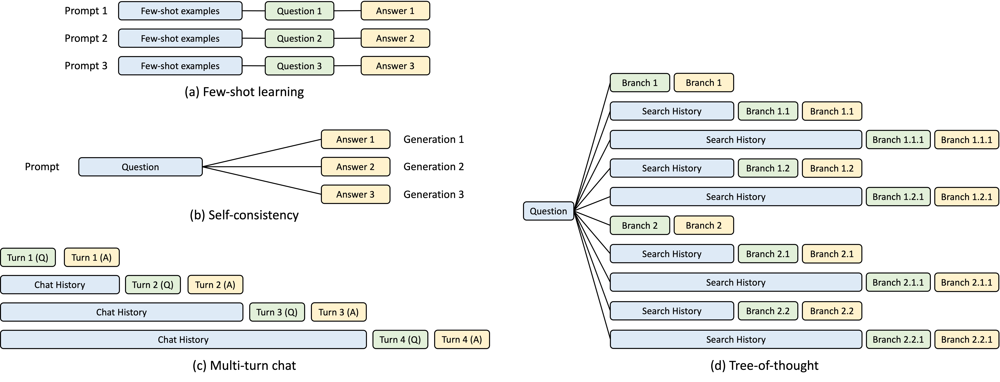
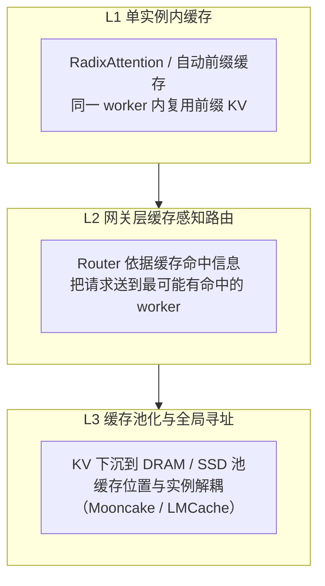
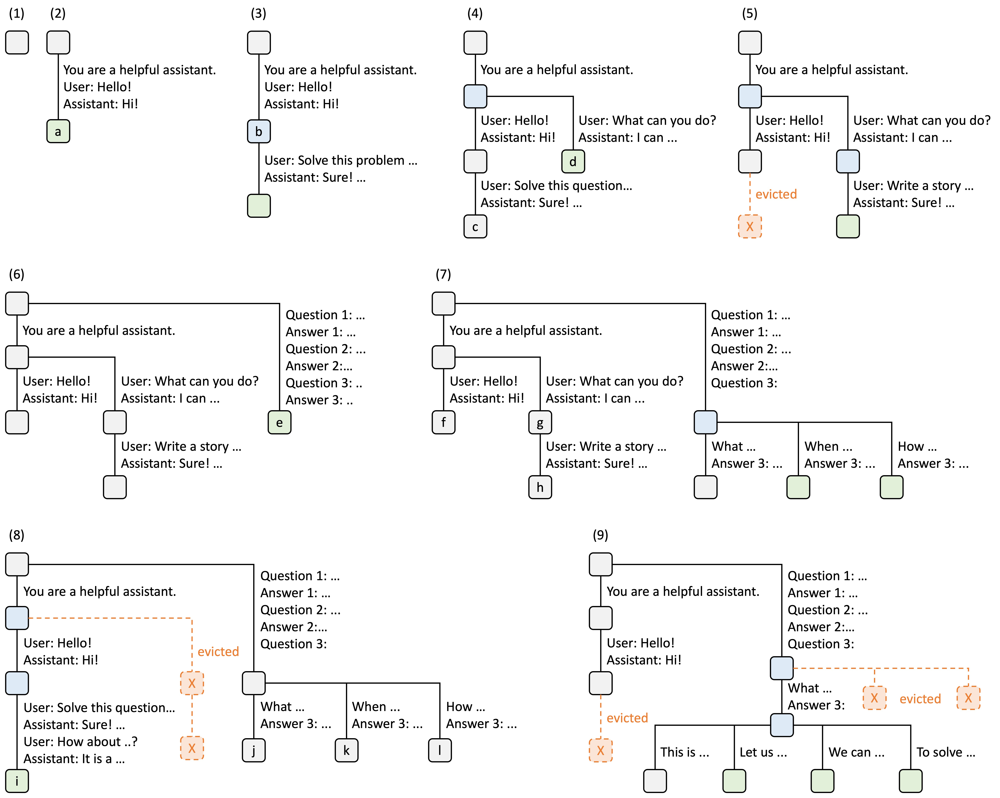
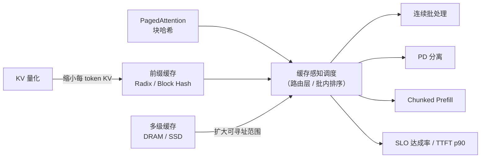

# 缓存感知调度基本原理

> **一句话总结**：缓存感知调度（cache-aware scheduling / cache-aware routing）把"**哪个实例手里已经有这段前缀的 KV Cache**"变成调度决策的一等约束，而不是只看队列长度或连接数。它解决的是**跨实例路由把前缀复用打散**的问题：同一段 system prompt 被反复送到不同 worker，前缀缓存的收益就会归零。代价是**缓存亲和性与负载均衡天然冲突**，并引入缓存一致性、热点倾斜与显存被历史占用三类新风险 [1][2]。

本文遵循本仓库的设计原则：**先讲清"为什么"，再谈"怎么做"**，并明确标注**关联技术**与**边界、代价**。

- 适用版本前提：单实例内的前缀复用机制见 RadixAttention（SGLang）[1] 与自动前缀缓存（vLLM）[3]；跨实例的缓存感知路由见 SGLang Router [4]、Mooncake 的全局调度 [5] 与 llm-d / Dynamo 的 KV 感知路由 [6][7]。**前缀重复率低、或集群规模很小时，缓存感知调度的收益不足以抵消其复杂度**。

---

## 1. 它为什么存在：缓存有效，但缓存"有位置"

### 1.1 前缀复用是确定性收益，但它绑定在具体显存上

现代推理负载的 prompt 高度重复：多轮对话的系统提示词、工具定义、few-shot 示例、RAG 召回的同一批文档、以及分支搜索（树状推理）中的共同历史。

上图列出四种共享形态 [1]：**(a) few-shot** 是"同一段示例前缀被不同问题复用"；**(b) self-consistency** 是"同一问题生成多条路径"；**(c) 多轮对话** 是"历史不断累积"；**(d) tree-of-thought** 是"分叉后共享主干"。它们的共同点是 **前缀完全相同、后缀不同**——这正是 KV 前缀缓存能省掉 prefill 的前提。

但关键事实是：**KV Cache 存在某个具体 GPU 的 HBM 里**，不是集群级的公共资源。于是出现一个容易被忽略的落差：

> 缓存命中与否，不只取决于"这段前缀有没有被算过"，还取决于 **"算过它的那个 worker 是不是恰好接下了这个请求"**。

把请求按轮询（round-robin）分给 8 个实例，同一段前缀的命中率上限就只有 1/8 左右——**缓存的收益被路由策略悄悄丢掉了**。

### 1.2 传统负载均衡器的目标与缓存天然冲突

| 路由策略 | 目标 | 对缓存的影响 |
| --- | --- | --- |
| 轮询 / 随机 | 均匀分摊请求 | 缓存命中率约等于 $1/N$，几乎归零 |
| 最少连接 / 最小队列 | 消除排队不均 | 会主动绕开"最近很忙"的实例，而热门缓存往往恰在这些实例上 |
| 一致性哈希 | 让同一 key 落到同一实例 | 只能做到"尽力而为"，无法知道真实命中长度，也无法感知实例当前内存压力 |
| **缓存感知路由** | 命中长度 + 负载的联合优化 | 需要实例上报缓存状态，调度器做加权决策 |

前三种策略共同的问题是：**它们把请求当作同质的无状态任务**，而 LLM 请求带着一段"可能已经算过的上下文"。

### 1.3 三层演进：从"单实例缓存"到"缓存可寻址"

- **L1**：解决"同一实例内重复算"的问题，收益确定，实现简单；
- **L2**：解决"跨实例被路由打散"的问题，**这就是本文的主角**；
- **L3**：解决"缓存容量受单机显存限制"的问题，把命中判断从"哪些 worker 有"变成"池子里有没有"，也让路由不再受实例绑定的限制 [5]。

### 1.4 收益的量级

SGLang 论文报告，RadixAttention 加持下在 few-shot、多轮对话、RAG 等任务上可获得**最高 6.4 倍**吞吐提升 [1]。注意这个倍数是"**缓存机制 + 缓存感知调度**"共同作用的整体结果——只开缓存但不做感知调度，跨实例场景下大部分收益会流失。

---

## 2. 核心机理

### 2.1 数据结构：用前缀树表示"哪些前缀可复用"

SGLang 的 RadixAttention 把 KV Cache 组织成一棵**基数树（radix tree）**：节点代表一段 token 序列，边上的路径共享前缀，叶子节点持有对应的 KV block；每个节点带引用计数与最近使用时间，内存不足时按 **LRU 淘汰**。

这张图（[1] 的图解）说明了几件在实现里至关重要的事：

- **命中判断是一次树上的最长前缀匹配**，返回可复用的 token 数 $k$；只有第 $k$ 个 token 之后的"后缀"需要真正计算；
- **分叉是常态**：同一 system prompt 下不同的用户轮次会挂在同一父节点上，形成子树（图 (4)(6)(7)）；
- **淘汰会改变命中结果**：图 (5)(8)(9) 中被淘汰的分支以虚线标出——缓存不是永久资产，**同一条请求在不同时刻可能得到不同的命中长度**，这直接影响调度的可预测性。

### 2.2 三种缓存粒度，决定了"命中"能有多细

| 粒度 | 键的构成 | 命中单位 | 典型实现 |
| --- | --- | --- | --- |
| **token 前缀** | token 序列本身（树上路径） | 任意长度 $k$ | SGLang RadixAttention [1] |
| **block 哈希** | 块内 token + 上层块的哈希（链式） | 固定块大小（如 16 token）的整数倍 | vLLM 自动前缀缓存 [3]、Mooncake [5] |
| **非前缀复用** | 段落级 KV + 少量重算恢复 | 段落集合 | CacheBlend [8] |

粒度直接影响两件事：**命中判定的成本**与**对齐损失**。块哈希实现简单、可用整数索引快速查表，但前缀长度不是块大小整数倍时，**末尾不足一块的部分无法命中**；token 级更精细，但树的维护与哈希开销更高。非前缀复用更激进——它允许复用"不是前缀"的段落，代价是必须重算一部分 KV 才能恢复精度 [8]。

### 2.3 路由决策：命中长度与负载的加权

缓存感知路由的本质是一个**带约束的打分问题**。对一个候选 worker $w$，调度器需要同时考虑：

$$
\mathrm{score}(w) = \alpha \cdot \mathrm{hit}(w) - \beta \cdot \mathrm{queue}(w) - \gamma \cdot \mathrm{mem}(w)
$$

- $\mathrm{hit}(w)$：该 worker 上可命中的前缀长度（token 数）；
- $\mathrm{queue}(w)$：当前排队工作量（请求数 × 预估 token）；
- $\mathrm{mem}(w)$：剩余 KV 显存压力，显存紧的 worker 即使命中高也可能很快触发抢占。

三个系数的取舍就是策略本身。**最重要的判断是一条阈值规则**：只有当"命中所省下的 prefill 时间"大于"为等这台 worker 而多排的队"时，才值得放弃负载均衡：

$$
\mathrm{hit} \times t_{\mathrm{prefill}} > \Delta t_{\mathrm{queue}}
$$

这条不等式解释了实践中的两个常见现象：**短前缀不值得等**（即 $\mathrm{hit}$ 小），**长前缀值得跨节点追**（即 $\mathrm{hit}$ 大，例如几万 token 的共享文档）。SGLang 的调度策略枚举内建了 `lpm`（longest prefix match）与 `dfs-weight` 等**缓存感知（cache-aware）**策略，与 `fcfs`、`random` 等**缓存无关（cache-agnostic）**策略并列；`lpm` 做的就是"命中长度优先，把共享前缀的请求排在一起" [4]。vLLM 则在缓存块哈希的基础上做前缀匹配调度 [3]。

### 2.4 缓存键的构成与失效边界

"命中"必须是**语义上等价**的前缀，否则会产出错误结果。因此缓存键至少要绑定：

| 维度 | 为什么必须进键 |
| --- | --- |
| token 序列 | 复用的是这段 token 的 KV |
| 位置编码参数 | 同一段 token 在不同起始位置，RoPE 相位不同 |
| 模型版本 / 权重哈希 | 换模型后旧 KV 完全无效 |
| 量化精度与 KV 布局 | FP8 KV 与 BF16 KV 不能混用 |
| LoRA / adapter 标识 | 适配器改变了隐状态分布 |
| 多模态输入指纹 | 图像/音频的编码结果必须一致 |

任何一项变化都必须使缓存失效。**漏掉一项的表现不是崩溃，而是"输出看起来合理但内容错了"**——这是缓存类优化最危险的一类缺陷。

### 2.5 与淘汰、抢占的相互作用

缓存占的是显存，而显存同时要装"正在服务的 batch"。三者是一个此消彼长的三角：

- 缓存留得多 → 命中率高，但并发数下降，抢占风险上升；
- 缓存留得少（激进 LRU 淘汰）→ 并发高，但长前缀刚算完就被淘汰，命中率骤降；
- 抢占一个正在 decode 的序列，可能顺带丢弃它的中间 KV，进一步降低未来命中。

因此**缓存容量策略（保留多少显存给历史）本身就是调度的一部分**，不能交给框架默认值了事。

---

## 3. 与其他优化方案如何组合（vLLM / SGLang）

### 3.1 与前缀缓存：机制与策略的关系

前缀缓存回答"**这段前缀的 KV 能不能被复用**"，缓存感知调度回答"**该把它送到谁的显存里去复用**"。单独开启任一者，收益都不完整：

- 只开缓存不做感知路由 → 跨实例命中率被稀释；
- 只做感知路由但底层没有前缀缓存 → 调度器没有可用的命中信息。

vLLM 用 `enable_prefix_caching` 控制自动前缀缓存（V1 起默认开启），以块哈希为键 [3]；SGLang 的 RadixAttention 是运行时的默认能力 [1][4]。

### 3.2 与连续批处理：命中会改变 token 预算

连续批处理的调度单元是"每步的 token 预算"。命中前缀后，新请求实际需要 prefill 的 token 数从 $N$ 降到 $N-k$，**同一份预算里能塞进更多请求**——所以缓存命中不只是省算力，还会**放大批处理的装载量**。

反过来，批处理的排序策略也影响命中：把"共享同一前缀的请求"排在一起处理，可以让后来者直接吃到前者刚写入的缓存，这就是 `lpm` 策略的直觉 [4]。详见 [连续批处理基本原理](连续批处理基本原理.md)。

### 3.3 与 PagedAttention：块哈希是缓存键的天然载体

分页 KV 管理把序列切成固定大小的 block，块哈希（本块 token + 上层块哈希链）就是现成的缓存键 [3][5]。二者是**同一套数据结构的两面**：分页解决"显存怎么分配"，块哈希解决"这段分配结果能否被别处复用"。命中后，新请求的 block table 可以直接指向已有的物理块（写时复制），**连 KV 拷贝都省了**。

### 3.4 与 PD 分离：先问"能不能不搬"，再问"怎么搬"

PD 分离中，prefill 实例算完 KV 要传给 decode 实例。缓存感知调度在这里有优先级：**如果某台 prefill 实例已经持有该前缀，就不必重算、也不必传那段 KV**。因此合理的顺序是"**先做缓存感知的放置，再做 KV 传输**"，而不是先传再问。当缓存放不下时，才退化到 L3 的池化方案（Mooncake 把 KV 下沉到 DRAM/SSD，用全局调度器统一寻址 [5]）。详见 [Prefill-Decode 分离基本原理](../分布式推理/Prefill-Decode分离基本原理.md)。

### 3.5 与 chunked prefill：命中之后只剩后缀

命中 $k$ 个 token 后，剩余 $N-k$ 个 token 若仍然很长，依旧需要切块以控制 TBT 抖动。两者是**串联**关系：缓存感知决定"要算多少"，chunked prefill 决定"怎么分摊到各步"。

### 3.6 与 KV 量化 / 压缩：缩小单位、放大容量

KV 量化降低每 token 的字节数，等价于**同容量显存能装下更长的缓存**，命中率与可缓存前缀长度同时提升。但注意 2.4 的一致性要求：**量化参数必须进缓存键**，否则会跨精度错命中。相关机制见 [压缩稀疏注意力基本原理.md](../Attention优化/压缩稀疏注意力基本原理.md) 与 [SWA有界重放基本原理.md](../Attention优化/SWA有界重放基本原理.md)。

### 3.7 框架落点对照

| 能力 | vLLM | SGLang |
| --- | --- | --- |
| 单实例前缀缓存 | 自动前缀缓存（`enable_prefix_caching`，块哈希）[3] | RadixAttention（基数树 + LRU）[1] |
| 缓存感知批内排序 | 前缀匹配优先 | `lpm`（最长前缀匹配）、`dfs-weight` 等 cache-aware 策略 [4] |
| 跨实例缓存感知路由 | 需外部网关（如 llm-d / Dynamo 的 KV 感知路由）[6][7] | SGLang Router 可感知 worker 缓存状态 [4] |
| 缓存池化 / 分层 | 依赖 LMCache 等外部组件 | 依赖全局 KV 池（Mooncake 一类方案）[5] |

---

## 4. 边界与代价

| 代价 | 具体表现 | 缓解思路 |
| --- | --- | --- |
| **亲和性与均衡冲突** | 热门前缀形成热点 worker，排队变长 | 阈值规则（2.3）+ 命中长度的收益封顶，避免无限追热点 |
| **显存被历史挤占** | 缓存越多、可并发越少，抢占更频繁 | 显式设置缓存容量上限与淘汰策略，而非依赖默认值 |
| **命中判定开销** | 每次请求都要算哈希 / 走树匹配 | 块哈希用整数前缀链，成本可接受；超长前缀可用分层索引 |
| **对齐损失** | 块粒度下不足一块的尾部无法复用 | 块大小与典型前缀长度匹配；或改用 token 级树 |
| **一致性风险** | 键漏维度 → 错命中，输出"看似合理"但错误 | 键必须覆盖 2.4 的六项；上线前做命中/未命中双路径一致性校验 |
| **跨租户数据隔离** | 共享缓存可能造成提示词或上下文泄露 | 按租户/会话隔离命名空间，禁止跨租户复用 |
| **缓存收益不确定** | 命中长度随时间波动（淘汰、抢占），容量规划困难 | 用命中率与"节省的 prefill token 数"作为监控指标，而非仅看 QPS |
| **集群规模小时不划算** | 实例少则亲和性收益天然小，反而引入路由复杂度 | 单机或小集群直接开前缀缓存即可，不必上 L2 路由 |

**核心边界一句话**：缓存感知调度优化的是**"重复前缀的 prefill 是否被真正省掉"**，它**不减少首次出现的 prompt 成本**，也不改善 decode 阶段的每 token 开销。当前缀重复率低时，它退化为一个更复杂的负载均衡器。

---

## 5. 可验证方法

1. **命中率与节省量**：开启框架的缓存指标（vLLM 的前缀缓存命中统计、SGLang 的 cache hit token 数），记录 **命中 token 占比** 与 **等价省下的 prefill FLOPs**；两项都要看，命中次数多但每次只命中几十 token 时收益有限。
2. **三组对照实验**：固定请求集，分别跑（a）关闭缓存、（b）开启缓存 + 轮询路由、（c）开启缓存 + 缓存感知路由。若 (c) 相比 (b) 没有明显提升，说明该负载的前缀在实例间本来就分散，或路由没生效。
3. **正确性校验**：同一请求分别在"命中"和"未命中"两条路径下生成（贪婪解码、固定种子），输出应逐 token 一致。这是**必须做**的回归项 [3]。
4. **热点观察**：统计各 worker 的缓存占用、命中率与 QPS 分布。若某个 worker 的 QPS 显著高于均值而队列长期非空，说明阈值规则里的 $\beta$ 太小。
5. **压测前缀分布**：分别用"共享长 system prompt"和"完全随机 prompt"两套负载，前者收益应显著，后者应接近零——若随机负载也"提升明显"，通常意味着看到了噪声或度量口径有误。
6. **复现入口**：SGLang 的多轮对话 / few-shot 示例可直接观察 RadixAttention 的树增长与命中 [1][4]；vLLM 的自动前缀缓存文档给出了开关与块哈希说明 [3]。

---

## 6. 对比表：四种路由策略

| 维度 | 轮询 / 随机 | 最少连接 | 一致性哈希 | 缓存感知路由 |
| --- | --- | --- | --- | --- |
| 是否感知缓存 | 否 | 否 | 间接（同 key 同实例） | 是，按命中长度 |
| 负载均衡 | 好 | 最好 | 一般 | 可调（通过 $\beta$） |
| 跨实例命中率 | 约 $1/N$ | 低 | 中 | 高 |
| 实现复杂度 | 低 | 低 | 中 | 高（需状态上报与打分） |
| 主要风险 | 缓存收益流失 | 缓存收益流失 | 热点 key 倾斜 | 热点实例 + 状态不一致 |
| 适用场景 | 无前缀重复 | 前缀重复率低 | 有稳定 key 的会话粘性 | Agent / 多轮 / RAG / 长共享前缀 |

---

## 7. 延伸阅读

- 想理解"批内怎么装"：见 [连续批处理基本原理](连续批处理基本原理.md)，缓存命中会直接改变 token 预算。
- 想理解"KV 为什么能按块复用"：见 [PagedAttention基本原理.md](../Attention优化/PagedAttention基本原理.md) 与 [KV Cache基本原理.md](../Attention优化/KV Cache基本原理.md)。
- 想理解"缓存放不下时往哪走"：见 [Prefill-Decode分离基本原理.md](../分布式推理/Prefill-Decode分离基本原理.md) 中的 Mooncake 池化方案。
- 想理解"前缀很长时索引本身的开销"：见 [压缩稀疏注意力基本原理.md](../Attention优化/压缩稀疏注意力基本原理.md) 的分层稀疏索引器。

---

## 8. 参考文献

1. Zheng L., Yin L., Xie Z., et al. **SGLang: Efficient Execution of Structured Language Model Programs**（RadixAttention）. NeurIPS 2024. [arXiv:2312.07104](https://arxiv.org/abs/2312.07104)
2. LMSYS Blog. **Fast and Expressive LLM Inference with RadixAttention and SGLang**（基数树缓存与前缀共享图解）. [lmsys.org](https://lmsys.org/blog/2024-01-17-sglang/)
3. vLLM Docs. **Automatic Prefix Caching**（块哈希与开关说明）. [docs.vllm.ai](https://docs.vllm.ai/en/latest/features/automatic_prefix_caching.html)
4. SGLang Docs / 仓库. **Router 与调度策略（cache-aware：`lpm` / `dfs-weight`；cache-agnostic：`fcfs` / `random`）**. [docs.sglang.ai](https://docs.sglang.ai/) / [GitHub](https://github.com/sgl-project/sglang)
5. Qin R., Li Z., He W., et al. **Mooncake: A KVCache-centric Disaggregated Architecture for LLM Serving**（全局缓存寻址与调度）. [arXiv:2407.00079](https://arxiv.org/abs/2407.00079)
6. **llm-d：面向 Kubernetes 的分布式推理栈**（KV 感知路由）. [llm-d.ai](https://llm-d.ai)
7. NVIDIA. **NVIDIA Dynamo**（KV 感知路由与分离式编排）. [docs.nvidia.com](https://docs.nvidia.com/dynamo/)
8. Yao J., Li H., Liu Y., et al. **CacheBlend: Fast Large Language Model Serving for RAG with Cached Knowledge Fusion**（非前缀 KV 复用）. EuroSys 2025. [arXiv:2405.16444](https://arxiv.org/abs/2405.16444)

---

## 9. 图片来源声明

| 文件 | 原始出处 | 说明 |
| --- | --- | --- |
| `assets/cacheaware-prompt-sharing.jpg` | LMSYS 博客《SGLang: Fast Structured Decoding…》RadixAttention 章节（[原文](https://lmsys.org/blog/2024-01-17-sglang/)） | 四类前缀共享场景：few-shot、self-consistency、多轮对话、tree-of-thought |
| `assets/cacheaware-radix-tree.jpg` | 同上 | 基数树缓存的 9 个演进阶段，含分叉与 LRU 淘汰（虚线） |

其余示意图为本仓库自绘的 Mermaid 图，不涉及外部版权。
