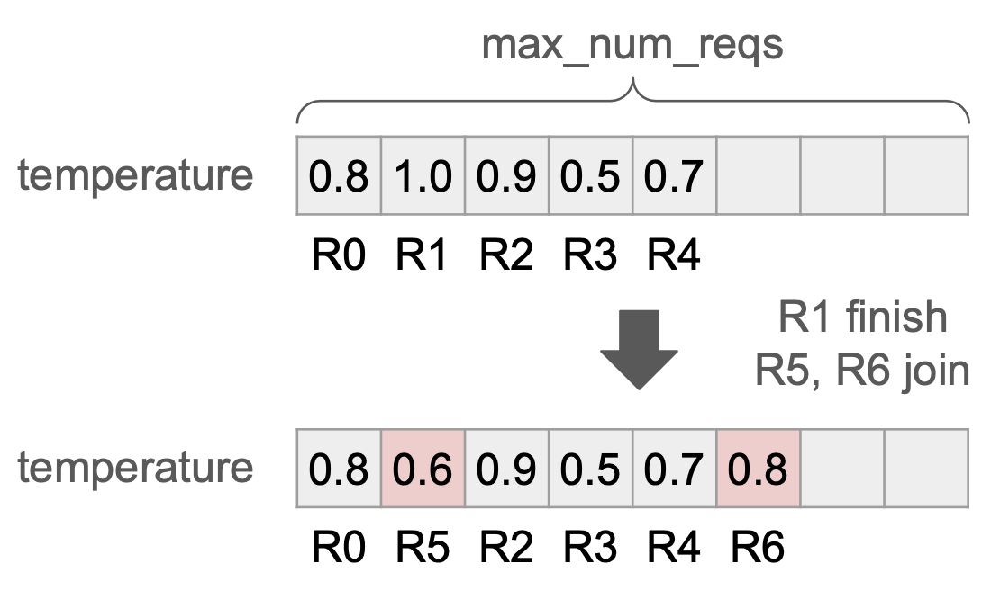
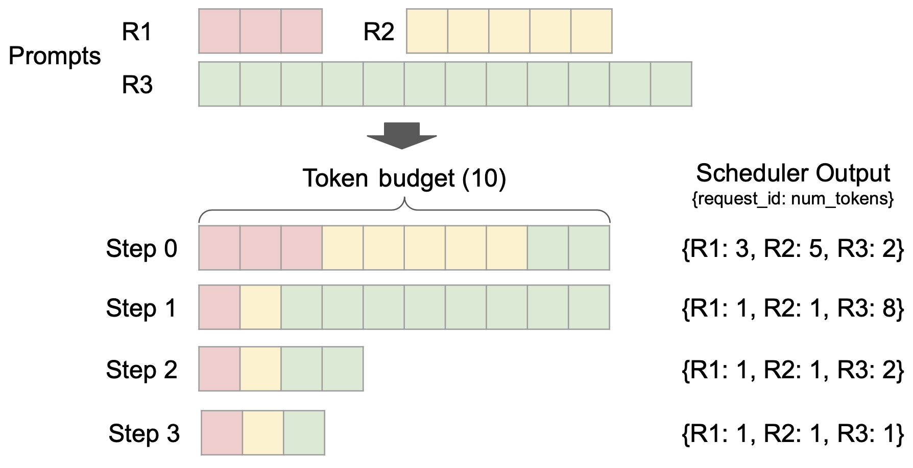
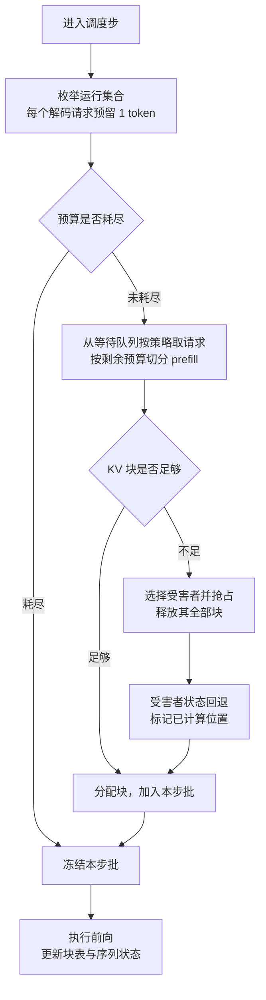
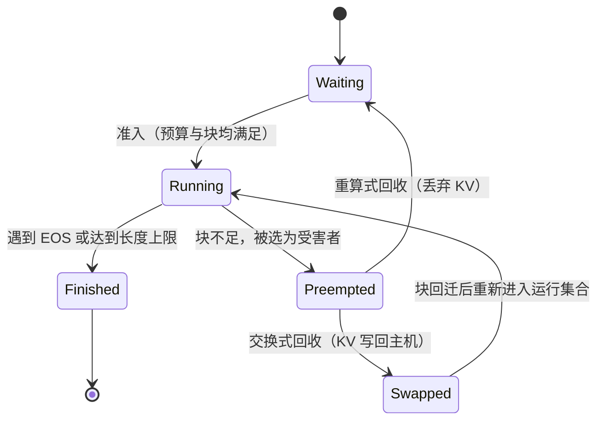

# 请求调度与抢占基本原理

> **一句话总结**：请求调度在每个解码步把有限的 token 预算、序列槽位与 KV 块分配给等待队列与运行集合中的请求；抢占是在 KV 块不足时回收已分配资源的手段，以"重复计算或 KV 搬运"换取接纳率与显存利用率。其本质是对"输出长度不可预知"这一不确定性的对冲：若严格按最坏情况预留显存，则接纳率受限、排队时延上升；若允许超额承诺，则必须准备抢占路径。vLLM V1 默认采用重算式抢占，SGLang 以 retract 将请求退回等待队列 [1][2][5]。

本文遵循本仓库的设计原则：先给出决策变量与约束，再展开单步调度与抢占恢复的机理，最后分析代价、抖动与框架侧的参数取舍。

- 适用版本前提：机制描述以 vLLM V1 与 SGLang 当前实现为准 [2][3][5]；抢占的收益与代价均依赖 KV 块管理与前缀缓存的具体形态，**脱离分页式 KV 管理与输出长度分布的先验，抢占频率与代价结论不成立**。

---

## 1. 问题界定

### 1.1 每步需要决定的三件事

调度器在单个解码步内需同时给出三项决策：

1. **准入**：是否接纳等待队列中的新请求，以及接纳多少个；
2. **排序**：在预算有限时，谁先获得预算（新请求的 prefill 还是既有请求的 decode）；
3. **切分**：把 token 预算切给每个被选中的请求多少（整段 prefill、分块 prefill，或单 token decode）。

三项决策耦合：准入越多，KV 占用越高，后续步越可能触发抢占；排序偏向 prefill 会改善首字时延而恶化批内其他请求的 token 间时延；切分粒度决定单步的计算形态是否为混合批。

### 1.2 不确定性的三个来源

调度之所以是运行期问题而非静态规划问题，源于三处不确定性：

- **输出长度未知**：解码在 EOS 处终止，请求的 KV 需求随生成过程单调增长，调度时只能看到下界；
- **到达过程未知**：请求到达时刻与长度分布在服务期内变化；
- **时延目标异构**：交互式请求关注 token 间时延，批处理请求关注吞吐，二者在同一资源池内竞争。

### 1.3 形式化

记第 $t$ 步的候选集合为 $\mathcal{C}_t$，被选中集合为 $R_t$，请求 $i$ 在本步的新增 token 数为 $n_i$，其已占用 KV 块数为 $b_i$。可执行批须同时满足三项约束：

$$
\sum_{i \in R_t} n_i \le B, \qquad \lvert R_t \rvert \le N, \qquad \sum_{i \in R_t} b_i' \le M
$$

其中 $B$ 为单步 token 预算， $N$ 为序列槽位上限， $M$ 为 KV 块总量， $b_i'$ 为执行后占用块数（含 $n_i$ 新增部分）。前两项是计算侧约束，第三项是显存侧约束。

目标是在满足逐请求时延约束（首字时延 $\mathrm{TTFT}_i \le \tau_1$、token 间时延 $\mathrm{ITL}_i \le \tau_2$）的前提下最大化 token 吞吐，并保持请求完成时间分布的公平性。三项约束与三类目标无法同时取极值，调度策略即为这一多目标问题的手工近似。

### 1.4 抢占为何不可避免

若准入时按"请求可能生成到最大长度"预留显存，则第三个约束会过早收紧，运行集合规模被压制，吞吐与显存利用率同时下降；若按当前长度分配、允许超额承诺，则后续步会出现 $b_i'$ 之和超过 $M$ 的情形。**抢占就是对后一种选择的兜底**：先接纳以获得高利用率，资源不足时再回收部分请求的 KV。

因此抢占不是异常路径，而是调度策略的一部分；其频率是"超额承诺程度"的直接度量。

### 1.5 与连续批处理的职责边界

连续批处理解决了"每一步重建批次、完成即释放槽位"的机制问题；调度决定"重建时放谁进去"。前者提供可变的批结构，后者在此结构上做资源分配。二者共用同一套 KV 块管理，抢占发生在后者、代价体现在前者。

---

## 2. 核心机理

### 2.1 队列结构与持久批

运行集合以持久批（persistent batch）形式维护：槽位在步间固定，仅在请求完成或新请求准入时替换。



**槽位的资源属性。** 槽位（slot）是持久批内固定数量的行索引，而非显存池。引擎初始化时按并发上限（`max_num_seqs`，SGLang 对应 `--max-running-requests`）一次性预分配一组定长张量，其首维即槽位数：输入的 token id、位置、序列长度、块表行以及该请求的采样参数均按槽位排列。一个槽位就是这些张量中的一行。

| 维度 | 槽位 | KV 块 |
| --- | --- | --- |
| 分配时机 | 初始化时一次性预分配，数量固定 | 逐步按 token 按需分配 |
| 上限来源 | 并发上限（`max_num_seqs`） | 显存总量除以块大小 |
| 单份成本 | 一行块表索引加元数据与采样参数，与生成长度无关，但与最大上下文长度成正比 | 每 token 固定字节，随长度线性增长 |
| 约束项 | 并行宽度（ $\lvert R_t \rvert \le N$） | 显存占用（ $\sum b_i' \le M$） |

量级上，块表每行为 `max_num_blocks_per_seq` 个整型索引：128K 上下文、块大小 16 时约 8192 项，约 32 KiB；256 个槽位合计约 8 MiB。因此**槽位几乎不占显存，却是硬性的并发上限**。

这解释了抢占动作的原子性：只丢弃 KV 而不释放槽位，会留下"占着批内位置却无法执行"的请求；只释放槽位而不丢弃 KV，则使块成为无人引用的泄漏。也解释了上图为何在槽位替换时重写采样参数——槽位承载的是**每请求状态**（如温度等采样超参），块承载的是**每 token 数据**，二者不可互相替代。

该结构带来一项与抢占相关的性质：**槽位与 KV 块是两个独立资源**。请求被抢占时必须同时释放二者，否则槽位被占而无法执行；恢复时二者又需重新获取。这解释了下文两类恢复策略的差异——recompute 放弃 KV 但保留请求状态，swap 保留 KV 但需额外的存放位置。

### 2.2 单步调度流程



上图给出预算分配的直观形态：预算总量固定，解码请求各取 1 个 token，剩余预算按序分给 prefill 请求，超出的部分留待下一步。其控制流为：



两点值得强调。其一，**预算检查先于显存检查**：token 预算决定本步计算量上限，KV 块决定能否继续接纳；二者独立，故存在"预算充足但块不足"的状态，这正是抢占的触发条件。其二，**抢占粒度是请求级而非块级**：一个请求的 KV 块在块表上连续可寻址，但物理上离散，部分回收会使后续注意力读到空洞，故只能整请求让位。

### 2.3 抢占的触发条件

触发判据是块分配失败，而非 token 预算超限。工程实现通常保留一个水位（watermark）：不把块池分配到 100%，为后续步的解码增长留出余量，代价是可用块数略低于理论值。水位过高会频繁触发抢占，过低则浪费显存，二者之间无普适最优值。

### 2.4 两类恢复策略及其成本模型

| 策略 | 回收动作 | 恢复动作 | 保留的资产 | 损失的资产 |
| --- | --- | --- | --- | --- |
| 重算（recompute） | 丢弃全部 KV 块 | 重新 prefill 已生成部分 | 请求状态与已生成 token | 已投入的 prefill 计算 |
| 交换（swap） | KV 写回主机内存或存储 | KV 回迁至设备 | 已投入的 prefill 计算 | 传输带宽与主机侧容量 |

两者的成本可近似比较。设被抢占请求已处理长度为 $L$（提示长度加已生成 token 数），单 token prefill 耗时为 $t_p$，其 KV 字节数为 $S_{kv}$，设备与主机间有效带宽为 $\beta_{h2d}$：

$$
T_{\mathrm{recompute}} \approx L \cdot t_p, \qquad T_{\mathrm{swap}} \approx \frac{2 S_{kv}}{\beta_{h2d}}
$$

据此可得判据：当 $L$ 较小、或前缀缓存能命中大部分被丢弃的 KV 时，重算更优；当 $L$ 很长而 KV 引脚带宽较高（如 NVLink-C2C、Grace Hopper 一类紧耦合主机接口）时，交换更优。中间地带两者接近，选择退化为工程偏好。

vLLM V1 将默认策略定为重算，官方给出的理由是**在该架构下重算开销更低** [2]；早期版本默认走交换路径，`--preemption-mode` 仍保留 `recompute` 与 `swap` 两种取值 [3]。SGLang 的对应机制称为 retract：块池耗尽时把请求退回等待队列，KV 随之丢弃，其效果等价于重算，但实现上并入"块池满"的统一回收路径 [5][7]。

### 2.5 受害者选择与恢复状态

抢谁的 KV，决定了抢占对尾时延的影响。常见策略：

- **按到达顺序从运行集合尾部抢占**：最新进入者代价最小（已生成 token 少，重算量小），但会放大新请求的完成时间；
- **按优先级抢占**：低优先级请求先让位，需配合老化机制防止饥饿；
- **按长度特征抢占**：SGLang 的 `--retraction-policy length` 语义为"优先 retract 输出短、输入长的请求" [5]，其依据是这类请求的 KV 占用高而复算收益小；`priority` 变体则与优先级调度同向。

恢复后的状态需区分清楚：**已生成的输出 token 被保留**（否则语义不再等价），而 **KV 需从零重建或从主机回迁**。因此重算式恢复的额外成本等于"提示长度 + 已生成长度"的 prefill，而非仅提示长度。

### 2.6 状态机



状态机的两条回路对应两类策略；`Preempted -> Waiting` 使请求回到队首还是队尾，是影响尾时延的关键实现细节。

### 2.7 抖动与公平

抢占与恢复可形成正反馈：被抢占请求回到等待队列后，若与其他请求竞争同一批预算，可能再次被选中、再次被抢占，产生抖动（thrashing）。工程上的抑制手段包括：为恢复请求提供优先级加成、限制单步抢占数量、以及通过降低并发上限减少超额承诺的程度。

公平性方面，按到达顺序抢占会使"早到但生成较长"的请求被反复打断，其完成时间呈重尾分布。调度层面的缓解方式为老化（aging）与配额（quota），其代价是吞吐下降，因为优先照顾长尾请求意味着偏离"每步填满预算"的目标。

---

## 3. 与其他优化方案在 vLLM / SGLang 中的组合

### 3.1 与连续批处理

连续批处理提供"每步重建批"的机制，调度在其上做准入与切分；抢占是这一机制的必要兜底。二者共同决定实际批形态：连续批处理决定批可以变，调度决定批怎么变。详见 [连续批处理基本原理.md](连续批处理基本原理.md)。

### 3.2 与分块预填充

分块预填充把长 prefill 切成多步执行，使单请求的显存需求在时间上摊薄，**直接降低触发抢占的概率**；同时它让 prefill 与 decode 共享同一批，使"预算切分"成为调度的核心决策。vLLM V1 中分块预填充默认开启，并规定解码请求优先 [2]；SGLang 通过 `--chunked-prefill-size` 显式控制切分粒度 [5]。

### 3.3 与前缀缓存

前缀缓存改变了重算的成本结构：若被抢占请求的前缀已命中缓存，重算只需补齐未命中部分，重算式抢占的代价随之下降。这构成一条反直觉的组合结论——**前缀缓存提高了重算式抢占的可行性**。缓存感知的路由与前缀复用见 [缓存感知调度基本原理.md](缓存感知调度基本原理.md)。

### 3.4 与分页式 KV 管理

块是抢占的计量单位：块大小决定回收粒度与内部碎片，块表结构决定被抢占请求的状态能否完整回退。分页式管理使"按请求整体回收"成为可实现的操作，而在连续分配方案中，回收会引发碎片整理问题。见 [PagedAttention基本原理.md](../Attention优化/PagedAttention基本原理.md)。

### 3.5 与预填充解码分离

分离部署后，抢占语义在两侧不同：解码侧仍以 retract 方式回收 KV，预填充侧则更多表现为请求取消与传输中止。此时"抢占代价"转移为跨节点 KV 传输的浪费，调度器需在两处分别设置上限。见 [Prefill-Decode分离基本原理.md](../分布式推理/Prefill-Decode分离基本原理.md)。

### 3.6 与计算图捕获

批组成变化会改变静态批的形状，图捕获需按桶选择图；抢占引入的批组成跳变会触发桶切换，产生额外的捕获路径开销。见 [计算图捕获基本原理.md](../图优化/计算图捕获基本原理.md)。

### 3.7 与投机解码

投机解码使单请求每步消耗多个 token 的预算，改变了预算切分的计量方式，并放大抢占对尾时延的影响（恢复后需重新累积草稿 token）。见 [投机采样基本原理.md](../解码优化/投机采样基本原理.md)。

### 3.8 框架能力对照

| 维度 | vLLM V1 [2][3] | SGLang [5][6][7] |
| --- | --- | --- |
| 准入上限 | `max_num_seqs`、`max_num_batched_tokens` | `--max-running-requests`、`--max-queued-requests` |
| 预算切分 | 单步 token 预算，分块预填充默认开启，解码优先 | `--chunked-prefill-size`、`max_prefill_tokens` |
| 抢占/回收触发 | KV 块不足 | KV 块池不足（retract） |
| 恢复方式 | 重算（默认）、交换（`--preemption-mode`） | 退回等待队列后重算 |
| 受害者选择 | 通常取运行集合尾部（最新到达者） | `--retraction-policy length / priority` |
| 保守度调节 | 通过并发上限与显存比例间接调节 | `--schedule-conservativeness` 直接调节准入保守度 [7] |
| 缓存回收策略 | 块级前缀缓存淘汰 | 基数树淘汰策略：`lru`、`lfu`、`slru`、`priority`、`tlru` [6] |
| 可观测性 | Prometheus 抢占计数与告警日志 | 日志中的 `#retracted_reqs` 与 token 利用率 [7] |

SGLang 的 `--schedule-conservativeness` 提供了一个直接的经验旋钮：取值偏大时准入更保守、抢占更少，偏小时利用率更高但 retract 更频繁 [7]。

### 3.9 启动参数与性能效果的对应关系

调度参数在设计上分别作用于第 1.3 节的三项约束，因此其性能效果可由约束推导，而不必逐个试跑。vLLM 的主要旋钮与预期方向如下。

| 参数 | 调整方向 | 机制 | 预期效果 | 风险 |
| --- | --- | --- | --- | --- |
| `--max-num-seqs` | 调小 | 收窄并行宽度 $N$ | KV 峰值下降，抢占减少，token 间时延更稳定 | 预算填不满，吞吐下降 |
| `--max-num-seqs` | 调大 | 放宽 $N$ | 吞吐上升，批更宽 | 抢占频率上升，尾时延抖动 |
| `--max-num-batched-tokens` | 调小（如 2048） | 单步计算量上限收紧，prefill 被切得更细 | token 间时延改善，首字时延变差 | 长提示的分块次数增多，调度开销上升 |
| `--max-num-batched-tokens` | 调大（如 16384） | 单步容纳更多 prefill token | 首字时延与吞吐改善 | 长 prefill 与解码同批，解码抖动增大 |
| `--gpu-memory-utilization` | 调大 | KV 块池扩容， $M$ 上升 | 抢占率下降，利用率上升 | 挤占激活与图缓冲，有 OOM 风险 |
| `--preemption-mode` | 选 `swap` | 恢复时搬 KV 而非重算 | 长上下文下减少重复计算 | 占用主机内存与互连带宽 |
| `--preemption-mode` | 选 `recompute` | 恢复时重跑前缀 | 短上下文、高前缀命中时更省 | 重复计算，尾时延放大 |
| `--max-model-len` | 调小 | 块表行变短，单槽位成本下降 | 可容纳更多并发 | 超长请求被拒绝 |
| `--kv-cache-dtype fp8` | 开启 | 每 token KV 字节减半 | 同等显存下并发与上下文容量上升，抢占下降 | 精度损失，需回归验证 |
| `--tensor-parallel-size` | 调大 | 每卡权重分片，KV 空间增加 | 抢占下降，可服务更长上下文 | 同步开销上升，小批时效率下降 |

三类典型负载对应的启动形态：

```bash
# 交互式低延迟：窄批、小预算，优先压 token 间时延
vllm serve <model> --max-num-seqs 64 --max-num-batched-tokens 2048 --gpu-memory-utilization 0.85

# 离线高吞吐：宽批、大预算，优先把单步预算填满
vllm serve <model> --max-num-seqs 512 --max-num-batched-tokens 16384 --gpu-memory-utilization 0.95

# 长上下文：限制并发、放大显存并改用交换式恢复，抑制重算浪费
vllm serve <model> --max-model-len 65536 --max-num-seqs 32 --preemption-mode swap --gpu-memory-utilization 0.92
```

调参顺序建议为：先由业务确定时延目标，再定 `--max-num-batched-tokens`（决定首字与 token 间时延的折中点），其次定 `--max-num-seqs`（决定并行宽度），最后用 `--gpu-memory-utilization` 在"利用率"与"抢占率"之间取平衡；每次只动一个参数，并以抢占次数、token 利用率与两类时延分位数联合观测。

需要说明的是，上表给出的是**由约束导出的方向性结论**，具体幅度取决于模型规模、序列长度分布与硬件；分块预填充在 V1 中恒为开启，故"关闭分块"不是可调项 [2]。绝对数值须按第 5 节的方法在目标环境实测，不宜直接套用他处结论。

---

## 4. 边界与代价

| 类别 | 具体代价 | 工程缓解 |
| --- | --- | --- |
| 尾时延放大 | 重算式恢复需重跑提示与已生成部分，被抢占请求的完成时间显著劣化 | 优先抢占最新请求；提高前缀命中率以缩短重算量 |
| 抖动 | 抢占与恢复形成正反馈，同一请求多次让位 | 恢复请求优先级加成；限制单步抢占数；降低并发上限 |
| 公平性 | 按到达顺序抢占使长请求呈重尾完成时间分布 | 老化与配额；按优先级抢占并设下限 |
| 吞吐损失 | 重算为纯重复计算，交换占用主机带宽，二者均不产出新 token | 提高显存比例、增大并行度以降低触发频率 |
| 参数不稳定 | 抢占频率对并发上限与显存比例高度敏感，最优值随负载漂移 | 以抢占计数与利用率为联合指标做闭环调参 |
| 释放时序正确性 | 异步调度下，KV 必须在批执行完成后才可回收，提前释放会导致跨请求读到未初始化内容 | 延迟释放（deferred release）：把回收推迟到该批结果确认之后 [8] |
| 观测噪声 | 抢占告警是症状，根因常为并发上限或显存配置 | 以"抢占次数/总步数"与 token 利用率联合判断 |

**边界结论**：抢占优化的是**接纳率与显存利用率的权衡点**，不改变单步计算或通信效率。当负载的输出长度分布集中、或并发上限设置得当使块池始终有余量时，抢占不发生，本文讨论的恢复代价与公平性问题均不出现；反之，若块池长期处于高压状态，抢占成为常态，系统实际吞吐将显著低于按"无抢占"估算的理论值。

---

## 5. 可验证方法

1. **抢占发生率**：统计抢占次数与总调度步数之比，并按触发原因分类（块不足 vs 预算不足）；该比值是超额承诺程度的直接度量。
2. **恢复成本分解**：在被抢占请求上记录重算 token 数、交换字节数与对应耗时，与 $T_{\mathrm{recompute}}$ 、 $T_{\mathrm{swap}}$ 的估算对照，验证策略选择是否与成本模型一致。
3. **时延分布对比**：分别测量被抢占与未被抢占请求的首字时延、token 间时延与完成时间分位数，量化尾时延放大倍数。
4. **参数扫描**：在并发上限（`max_num_seqs` / `--max-running-requests`）与预算（`max_num_batched_tokens` / `--chunked-prefill-size`）两个维度做网格实验，绘制"利用率—抢占率—吞吐"三维曲面，识别拐点。
5. **前缀命中联动**：固定负载，切换前缀缓存开关，观察抢占发生率与重算 token 数的变化，验证"缓存提高重算式抢占可行性"的推论。
6. **公平性指标**：以完成时间的 Jain 公平指数或慢请求占比衡量策略差异，避免仅以平均时延评估。
7. **正确性回归**：在异步调度与抢占同时开启时校验输出一致性，确认 KV 延迟释放生效——该路径的缺陷表现为读到其他请求的缓存内容，而非数值偏差 [8]。
8. **复现入口**：vLLM 的抢占告警日志与 Prometheus 指标可直接观测 [2]；SGLang 的 `#retracted_reqs`、token 利用率与 `--schedule-conservativeness` 提供同类入口 [7]。

---

## 6. 对比表：四种资源不足时的应对

| 策略 | 动作 | 对新请求的接纳 | 已接纳请求的时延 | 额外资源 | 适用情形 |
| --- | --- | --- | --- | --- | --- |
| 排队（不超额承诺） | 新请求留在等待队列 | 受限 | 稳定 | 无 | 时延敏感、负载平稳 |
| 重算式抢占 | 丢弃受害者 KV，稍后重跑 | 高 | 被抢占者显著劣化 | 重复计算 | 上下文较短、前缀命中高 |
| 交换式抢占 | 受害者 KV 写回主机 | 高 | 劣化但小于重算 | 主机内存与互连带宽 | 上下文很长、主机互连带宽高 |
| retract + 重排 | 退回等待队列，按策略重排 | 高 | 取决于重排与老化规则 | 重复计算 | 需要按优先级区分服务质量 |

---

## 7. 延伸阅读

- 批结构的机制基础：见 [连续批处理基本原理.md](连续批处理基本原理.md)。
- 块级 KV 管理与回收：见 [PagedAttention基本原理.md](../Attention优化/PagedAttention基本原理.md)。
- 前缀复用对重算成本的影响：见 [缓存感知调度基本原理.md](缓存感知调度基本原理.md)。
- 分离部署下的两侧回收差异：见 [Prefill-Decode分离基本原理.md](../分布式推理/Prefill-Decode分离基本原理.md)。
- 单步预算的计量扩展：见 [投机采样基本原理.md](../解码优化/投机采样基本原理.md)。

---

## 8. 参考文献

1. vLLM Team. **vLLM V1: A Major Upgrade to vLLM's Core Architecture**（调度器以 token 预算为单位、持久批与分块预填充的设计）. [blog.vllm.ai](https://blog.vllm.ai/2025/01/27/v1-alpha-release.html)
2. vLLM. **Optimization and Tuning：Preemption 与 Chunked Prefill**（V1 默认重算式抢占、解码优先、调参建议）. [docs.vllm.ai](https://docs.vllm.ai/en/latest/configuration/optimization.html)
3. vLLM. **Engine Arguments**（`--preemption-mode` 的 `recompute` / `swap` 取值与默认判定逻辑）. [docs.vllm.ai](https://docs.vllm.ai/en/latest/configuration/engine_args.html)
4. Kwon W., Li Z., Zhuang S., et al. **Efficient Memory Management for Large Language Model Serving with PagedAttention**. SOSP 2023.（块级 KV 管理与抢占的系统化描述）[arXiv:2309.06180](https://arxiv.org/abs/2309.06180)
5. SGLang. **Server Arguments**（`--max-running-requests`、`--max-queued-requests`、`--chunked-prefill-size`、`--retraction-policy`）. [docs.sglang.io](https://docs.sglang.io/docs/advanced_features/server_arguments)
6. SGLang. **Radix Cache Eviction Policies**（`lru` / `lfu` / `slru` / `priority` / `tlru` 的受害者选择规则）. [docs.sglang.io](https://docs.sglang.io/docs/advanced_features/radix_eviction_policy)
7. SGLang. **Hyperparameter Tuning**（`--schedule-conservativeness`、`#retracted_reqs` 与 token 利用率的联合调参）. [docs.sglang.io](https://docs.sglang.io/docs/advanced_features/hyperparameter_tuning)
8. LMSYS Org. **SGLang security update: improving request isolation**（KV 槽位释放时序与延迟释放修复）. [lmsys.org](https://www.lmsys.org/blog/2026-10-26-cf-security/)
9. Agrawal A., Kedia N., Panwar A., et al. **Taming Throughput-Latency Tradeoff in LLM Inference with Sarathi-Serve**.（分块预填充对批组成与时延权衡的分析）[arXiv:2403.02310](https://arxiv.org/abs/2403.02310)
10. Fu Y., Zhu L., Lu Z., et al. **Fast Distributed Inference Serving for Large Language Models**.（以 piggyback 方式利用抢占机会的调度思路）[arXiv:2305.05920](https://arxiv.org/abs/2305.05920)

---

## 9. 图片来源声明

| 文件 | 原始出处 | 说明 |
| --- | --- | --- |
| `assets/sched-v1-scheduling.png` | vLLM 官方博客《vLLM V1: A Major Upgrade to vLLM's Core Architecture》（[原文](https://blog.vllm.ai/2025/01/27/v1-alpha-release.html)） | 单步 token 预算在 prefill 与 decode 请求之间的分配，右侧为调度器输出的每请求 token 数 |
| `assets/sched-v1-persistent-batch.png` | 同上 | 持久批的槽位复用：请求完成后其槽位由新请求填入，采样参数随槽位替换 |

其余示意图为本仓库自绘的 Mermaid 图，不涉及外部版权。
