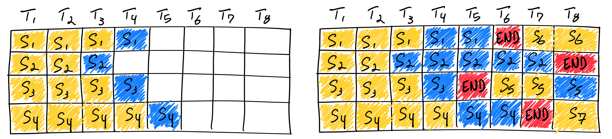
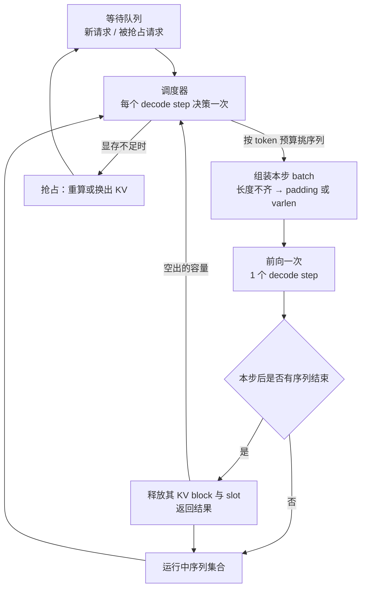
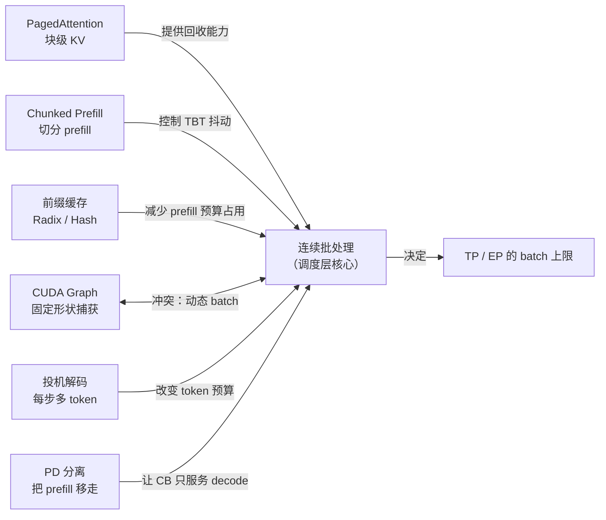

# 连续批处理基本原理

> **一句话总结**：连续批处理（Continuous Batching，又称迭代级调度 iteration-level scheduling）把"批"的生命周期从**一次请求的整个生成过程**缩短到**一次前向迭代**：每个 decode step 结束后重组成 batch，已完成的序列立刻退出、等待中的请求立刻补位。它解决的是**变长输出导致的 GPU 空转与队头阻塞**，代价是**每步都要做调度决策、batch 形状每步都在变**——这恰好是 CUDA Graph、显存管理、公平性三类机制的冲突来源 [1][3]。

本文遵循本仓库的设计原则：**先讲清"为什么"，再谈"怎么做"**，并明确标注**关联技术**与**边界、代价**。

- 适用版本前提：概念源头为 Orca（OSDI'22）的 iteration-level scheduling [1]，工程普及源于 vLLM 与 PagedAttention 的结合 [2][3]。**连续批处理提升的是吞吐与显存利用率，不保证单请求延迟；它与 chunked prefill、CUDA Graph、前缀缓存之间存在真实冲突，需要显式取舍**。

---

## 1. 它为什么存在：静态批处理把 GPU 浪费在"等"

### 1.1 静态批处理的三个浪费

传统的**静态批处理（static batching / request-level batching）**在请求到达时把若干请求凑成一个 batch，然后**整个 batch 一起跑，直到 batch 里最长的序列生成完**才一起返回。这在变长输出场景下造成三重浪费 [3][4]：

| 浪费 | 成因 | 后果 |
| --- | --- | --- |
| **尾部空转（tail effect）** | 短请求早已生成完，但必须陪跑最长的那条 | 已完成的 slot 仍占着 batch，GPU 算力空转 |
| **队头阻塞（head-of-line blocking）** | 新请求必须等当前 batch 整体结束才能进入 | 排队延迟随最长序列线性增长 |
| **padding 浪费** | 同批序列长度不一，需补齐到同一长度才能做批量 GEMM | 大量无效 token 参与计算与访存 |

关键在于：LLM 的输出长度是**不可预知**的（同一 prompt 可能生成 20 token，也可能生成 2000 token）。静态批处理把"不确定的输出长度"硬编码成了"批次内最大值"，于是浪费与最长序列成正比。

### 1.2 一张图看清差别

左边的静态批处理里，短序列生成完就无事可做，但它的 slot 仍被占着，一直空转到批次结束；右边的连续批处理里，同一个 slot 在下一步就被新请求顶替。**同一块 GPU、同样 8 步，后者推进了 7 条序列而前者只有 4 条**——这就是连续批处理的核心收益来源 [4]。

### 1.3 收益的量级

vLLM 的实测表明，相比静态批处理，连续批处理配合 PagedAttention 可带来**最高 23 倍**的吞吐提升（不同模型与硬件下幅度不同，本质来自 GPU 利用率从"被最长序列拖住"变成"始终装满"）[3]。注意这个倍数**不是算法变快**，而是**空闲时间被填满**。

---

## 2. 核心机理

### 2.1 调度循环：把"批次"变成"每步重建"

与静态批处理的差别只有一句话：**调度决策点从"请求级"下移到"迭代级"**。随之而来的是三个必须同时解决的问题——显存怎么回收、形状怎么适配、公平怎么保证。

### 2.2 关键前提一：KV 必须能按块回收（PagedAttention）

连续批处理要求"序列结束时立刻归还显存"，而传统 KV Cache 按"最大长度预分配连续显存"，无法做到细粒度回收。PagedAttention 把 KV 切成固定大小的 block，用页表（block table）做逻辑到物理的映射，才使**序列退出即释放 block、新序列进入即分配 block** 成为可能 [2]。

这也是为什么业界的连续批处理几乎总是与分页式 KV 管理一起出现：**没有块级分配，连续批处理只能在"预留够大"的前提下运行，显存利用率上不去**。

### 2.3 关键前提二：token 预算而不是"序列数"作为约束

调度器真正控制的不是"批里有几条序列"，而是**本步要处理多少 token**：

$$
\mathrm{budget} = \sum_{i \in \mathrm{decode}} 1 + \sum_{j \in \mathrm{prefill}} n_j
$$

其中第一项是每条 decode 序列贡献 1 个 token，第二项是新请求的 prompt 长度之和。由此产生两个后果：

- 只算 decode 时，budget ≈ batch size，受显存与带宽限制；
- 一旦有新请求要 prefill，它的 $n_j$ 可能瞬间吃掉全部预算 → 这就是**新请求插入引起 TBT 抖动**的根源，也是 chunked prefill 要解决的问题（见 3.2）。

vLLM 用 `max_num_seqs` 限制并发序列数、`max_num_batched_tokens` 限制每步 token 预算 [5]；SGLang 对应 `max_running_requests` 与 `chunked_prefill_size` [6]。**这两个参数一起决定了"吞吐上限"与"延迟抖动"的平衡点**。

### 2.4 关键前提三：显存不够时必须有退路（抢占）

当 KV block 用尽而新请求仍在排队时，系统只有三条路：

| 策略 | 做法 | 代价 |
| --- | --- | --- |
| **拒绝 / 排队** | 不接收新请求 | 延迟上升，但不浪费算力 |
| **重算（recompute）** | 丢弃某序列的 KV，稍后重跑 prefill | 浪费算力，但省显存、省带宽 |
| **换出（swap）** | 把 KV 拷贝到 CPU DRAM，之后再拷回 | 省算力，但吃 PCIe 带宽与延迟 |

vLLM 默认倾向 recompute，因为 decode 阶段的 KV 重算成本低于一次往返 PCIe 的搬运成本 [5]。这条选择本身没有对错，取决于序列长度、带宽与 SLO。

---

## 3. 与其他优化方案如何组合（vLLM / SGLang 实践）

连续批处理不是一个孤立开关，它处在调度层的中心，**几乎所有其他优化都要与它协商**。下图是组合关系的全貌：

### 3.1 与 PagedAttention：互补，几乎是绑定关系

PagedAttention 提供块级 KV 的分配与回收，连续批处理提供"何时回收、回收给谁"的决策。两者是**机制与策略**的关系：没有前者，后者无法细粒度运转；没有后者，前者的分页能力也用不满。

### 3.2 与 Chunked Prefill：用"切碎"换"平滑"

新请求的 prefill 一旦整段插入，本步的 token 预算被瞬间占满，正在 decode 的序列就被拉长一步——表现为 **TBT 尖峰**。Chunked prefill 把 prompt 切成固定大小的 chunk，分多步插入，与 decode 混在同一批里 [7]。

- 收益：TBT 平滑，长 prompt 不再造成延迟尖峰；prefill 与 decode 的算力可以互补（prefill 吃算力、decode 吃带宽）；
- 代价：prefill 的 chunk 越小，单次 GEMM 效率越低，**TTFT 变长**；chunk 太大又回到抖动问题。

vLLM 中由 `enable_chunked_prefill` 开启，SGLang 中由 `chunked_prefill_size` 控制块大小 [5][6]。这条是**延迟与吞吐的直接兑换**，没有免费选项。

### 3.3 与前缀缓存：先省算力，再谈调度

多轮对话与 Agent 场景中前缀高度重复，前缀缓存（vLLM 的 hash 前缀缓存、SGLang 的 RadixAttention）让命中部分**直接跳过 prefill** [6]。对连续批处理的影响是双重的：

1. 新请求占用的 token 预算大幅下降 → 同一步能塞进更多请求；
2. 调度器必须**感知缓存位置**，否则会把请求送到没有缓存的实例上，"命中"变"未命中"。

这也解释了为什么"缓存感知调度"会作为独立话题存在——**批处理调度解决"装得满"，缓存感知调度解决"装得对"**。

### 3.4 与 CUDA Graph：最真实的冲突

CUDA Graph 要求**固定形状与固定地址**，而连续批处理每步的 batch 组成都在变。业界主流解法是"**桶化 + padding**"：

- 预先为若干 batch size（如 1/2/4/8/16…）各捕获一张图，运行时把实际 batch padding 到最近的桶；
- 或者把 decode 与 prefill 分开走不同路径（decode 用图、prefill 走 eager）。

代价是**padding 带来的算力浪费**与**桶的粒度选择**：桶太粗浪费大，太细则图数量爆炸、显存与编译时间上升。vLLM 与 SGLang 都提供了 decode 段的图捕获机制，本质都是在"动态 batch"与"静态图"之间取折中 [5][6]。

### 3.5 与投机解码：改变预算的含义

投机解码每步产出多个候选 token，于是"每步 token 预算"的语义从"1 token/序列"变成"$1+k$ token/序列"。调度器必须相应扩大预算，否则 verify 阶段会被截断；同时被接受 token 数的不确定性，让 batch 的**有效工作量**每步波动更大。

### 3.6 与 PD 分离：把 prefill 从批里拿出去

PD 分离（Prefill-Decode Disaggregation）后，decode 实例的 batch 里**永远不会出现 prefill**，于是 3.2 的 TBT 抖动问题在架构层面消失，连续批处理只管"装满 decode"。代价是必须搬运 KV，详见 [Prefill-Decode 分离基本原理](../分布式推理/Prefill-Decode分离基本原理.md)。

### 3.7 与 TP / EP：决定 batch 能开多大

张量并行把单层切到多卡，**每卡显存变小 → batch 上限下降**；专家并行让每卡只放部分专家，**权重显存下降 → batch 上限上升**。连续批处理的收益随 batch 增大而增大，因此"并行策略"实际上是在给连续批处理**设定天花板**。反过来，EP 负载不均会让某些 step 被最慢的专家拖住，表现为批内空转——这也是 [MegaMoE基本原理.md](../分布式推理/MegaMoE基本原理.md) 关注的通信计算重叠问题的来源。

---

## 4. 边界与代价

| 代价 | 具体表现 | 缓解思路 |
| --- | --- | --- |
| **每步调度开销** | 每步都要做选择、组 batch、准备元数据，Python 侧开销可能盖过小模型的计算 | 零开销调度：把下一步的 CPU 调度与当前步的 GPU 计算重叠（SGLang 的双 batch 流水 [8]）；或用 C++ 调度器 |
| **动态形状破坏图捕获** | batch 组成每步变化，CUDA Graph 无法直接复用 | 桶化 padding、decode/prefill 分流（3.4） |
| **批内长度差异损耗** | 短序列先结束，batch 逐渐"变稀"，有效算力利用率下降 | token 预算调度、及时补位（这正是连续批处理本身的动作） |
| **不做 prefill 就抖动** | 新请求整段插入导致 TBT 尖峰 | chunked prefill（3.2） |
| **不保证单请求延迟** | 排队与补位都按吞吐优先，TTFT 可能变差 | SLO 感知调度、优先级队列、抢占 |
| **公平性问题** | 纯 FCFS 下长输出请求长期占用 slot，短请求排队 | 优先级 / SJF / 老化策略；vLLM 支持多种调度策略 [5] |
| **显存压力与抢占成本** | KV 用满必须重算或换出，产生"看不见"的重复计算 | 容量规划、前缀缓存、KV 量化/压缩 |
| **实现复杂度** | 调度器、块管理器、执行器三者状态必须严格一致，出错表现为结果错乱而非崩溃 | 单元测试覆盖抢占/恢复路径；开启 batch invariance 校验 |

**核心边界一句话**：连续批处理优化的是**"GPU 在给定时间内做了多少有效 token"**，它不优化单请求延迟，也不减少每 token 的计算量。当 batch 很小（低并发、单用户）时，它几乎没有收益；当序列长度高度一致（如固定长度批量任务）时，静态批处理反而更简单高效。

---

## 5. 可验证方法

1. **对照实验**：同一模型、同一 GPU，固定请求集合（混合长短输出），分别跑 static batching 与 continuous batching，记录 **吞吐（tokens/s）**、**TTFT p50/p99**、**TBT p99** 与 **GPU SM 利用率**。预期：吞吐与利用率显著上升，TBT p99 变差。
2. **观察尾部空转**：在静态模式下统计"已完成但仍在 batch 中的序列数 × 步数"，这个面积就是被浪费的算力，可直接换算成潜在吞吐提升。
3. **扫 token 预算**：固定并发，逐步调小 `max_num_batched_tokens` / `chunked_prefill_size`，观察 TBT p99 下降与 TTFT、吞吐的变化曲线，找到拐点。
4. **CUDA Graph 开关对比**：分别开启/关闭 decode 段图捕获，比较 step 时间与吞吐；若开启后吞吐下降，通常是 padding 桶过粗。
5. **抢占路径验证**：人为把 `gpu_memory_utilization` 调低，触发抢占，检查输出是否与不抢占时一致（**结果正确性不受抢占影响**是必须验证的性质）。
6. **复现入口**：vLLM 的 scheduler 设计文档给出了调度循环与抢占语义 [5]；SGLang 的 v0.4 博客给出了零开销调度的双 batch 流水实现 [8]。

---

## 6. 对比表：三种批处理范式

| 维度 | 静态批处理 | 连续批处理 | 连续批处理 + chunked prefill |
| --- | --- | --- | --- |
| 调度粒度 | 请求级 | 迭代级（decode step） | 迭代级 + token 级切块 |
| 短请求是否陪跑 | 是 | 否，完成即退出 | 否 |
| 新请求何时进入 | 下一批 | 下一步 | 下一步（chunk 分多步） |
| GPU 利用率 | 低（尾部空转） | 高 | 高且更平滑 |
| TBT 抖动 | 无（因为慢） | 有新请求插入时抖动 | 显著降低 |
| TTFT | 长（排队） | 中 | 较长（prefill 被切碎） |
| 实现复杂度 | 低 | 中 | 高 |
| 依赖 | 无 | 块级 KV 管理（PagedAttention） | 再加 chunk 调度与预算控制 |

---

## 7. 延伸阅读

- 想理解"为什么 KV 能按块回收"：见 [PagedAttention基本原理.md](../Attention优化/PagedAttention基本原理.md) 与 [KV Cache基本原理.md](../Attention优化/KV Cache基本原理.md)。
- 想理解"延迟与吞吐的另一条解法"：见 [Prefill-Decode分离基本原理.md](../分布式推理/Prefill-Decode分离基本原理.md)，它把 3.2 的抖动问题从架构层移除。
- 想理解"每步产出更多 token"的另一条路线：见 [投机采样基本原理.md](../解码优化/投机采样基本原理.md)。
- 想理解"batch 上限被谁卡住"：见 [张量并行推理基本原理.md](../分布式推理/张量并行推理基本原理.md) 与 [专家并行推理基本原理.md](../分布式推理/专家并行推理基本原理.md)。

---

## 8. 参考文献

1. Yu G.-I., Jeong J. S., Kim G.-W., et al. **Orca: A Distributed Serving System for Transformer-Based Generative Models**. OSDI 2022.（iteration-level scheduling 的提出）[论文页](https://www.usenix.org/conference/osdi22/presentation/yu) / [arXiv:2208.03743](https://arxiv.org/abs/2208.03743)
2. Kwon W., Li Z., Zhuang S., et al. **Efficient Memory Management for Large Language Model Serving with PagedAttention**. SOSP 2023. [arXiv:2309.06180](https://arxiv.org/abs/2309.06180)
3. vLLM Blog. **How Continuous Batching Enables 23x Throughput in LLM Inference**. [blog.vllm.ai](https://blog.vllm.ai/2023/06/20/vllm.html)
4. Anyscale Blog. **Continuous Batching for LLM Inference**（静态 vs 连续批处理的图解来源）. [anyscale.com](https://www.anyscale.com/blog/continuous-batching-llm-inference)
5. vLLM Docs. **Scheduler Design / 调度与抢占语义**. [docs.vllm.ai](https://docs.vllm.ai/en/latest/design/scheduler.html)
6. SGLang Docs. **PD Disaggregation 与调度参数**. [docs.sglang.ai](https://docs.sglang.ai/advanced_features/pd_disaggregation.html)
7. Agrawal A., Kedia N., Panwar A., et al. **Taming Throughput-Latency Tradeoff in LLM Inference with Sarathi-Serve**（chunked prefill）. OSDI 2024. [arXiv:2403.02310](https://arxiv.org/abs/2403.02310)
8. LMSYS Blog. **SGLang v0.4: Zero-Overhead Batch Scheduler**（CPU 调度与 GPU 计算的流水重叠）. [lmsys.org](https://lmsys.org/blog/2024-12-04-sglang-v0-4/)

---

## 9. 图片来源声明

| 文件 | 原始出处 | 说明 |
| --- | --- | --- |
| `assets/cb-continuous-batching.png` | Anyscale 博客《Continuous Batching for LLM Inference》（[原文](https://www.anyscale.com/blog/continuous-batching-llm-inference)） | 左：静态批处理下 slot 空转；右：连续批处理下新序列补位（END 标记完成时刻） |

其余示意图为本仓库自绘的 Mermaid 图，不涉及外部版权。
