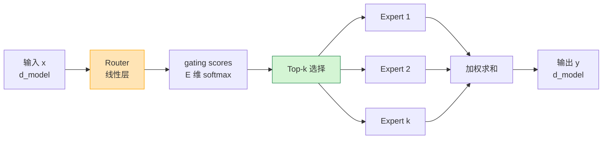
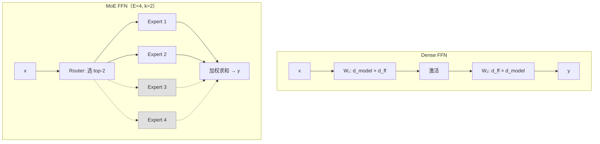
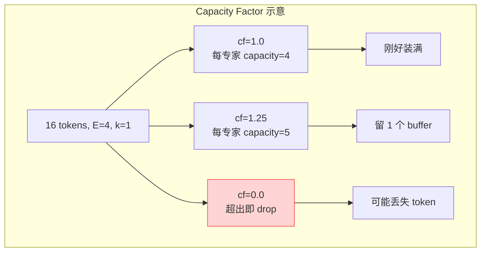
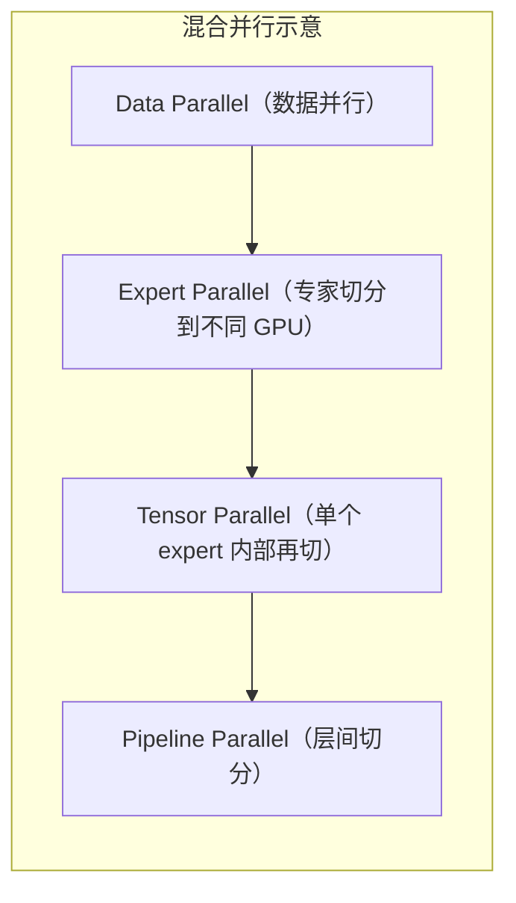
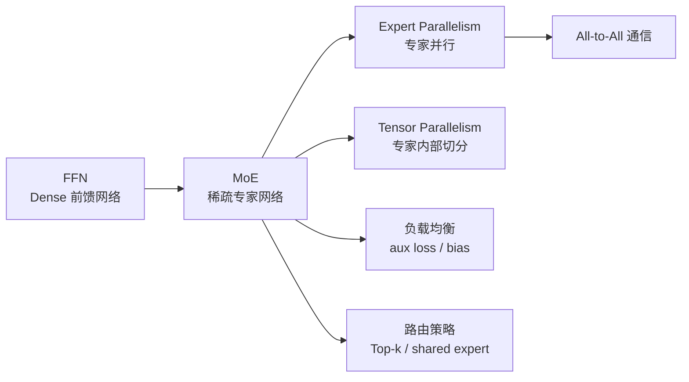

# MoE（Mixture of Experts）基本原理

> **一句话总结**：MoE 用"路由网络 + 多个专家子网络"替换标准 FFN，让模型总参数量可以远大于激活参数量，从而在相同计算成本下获得更强的表达能力，代价是引入路由负载均衡与专家并行通信。

本文遵循本仓库的设计原则：**先讲清"为什么"，再讲"怎么做"**，并明确标注**关联技术**与**边界、代价**。

- 适用版本前提：MoE 路由机制基于 Shazeer et al. (2017) [1]；Switch Transformer 基于 Fedus et al. (2022) [2]；GLaM 基于 Du et al. (2022) [3]；Mixtral 基于 Jiang et al. (2024) [4]；DeepSeek-V3/V4 的 MoE 架构基于 DeepSeek-AI (2024/2025) [5][6]。**脱离路由策略、负载均衡损失与并行拓扑的 MoE 结论不成立**。

---

## 1. 它为什么存在

### 1.1 模型规模与计算成本的矛盾

大模型的能力提升在很大程度上遵循 Scaling Law：模型越大、数据越多，性能越好 [7]。但模型变大带来两个问题：

| 问题 | 说明 |
| --- | --- |
| **计算成本爆炸** | dense 模型每步前向都要激活全部参数，FLOPs 随参数线性增长 |
| **训练时间不可接受** | 1T 参数的 dense 模型训练成本极高 |

MoE 的核心思想是：

> **让总参数量很大，但每次只激活其中一小部分。**

这样可以在不增加单步计算量的前提下，扩大模型容量。

### 1.2 一个直觉类比

把模型想象成一个**大型医院**：

- **Dense 模型**：每个病人（token）都要看全科医生、外科医生、神经科医生、心脏科医生……所有人都参与诊断。
- **MoE 模型**：先由分诊台（router）判断病人需要哪科，然后只让 1–2 个相关科室（experts）参与诊断。

显然，MoE 医院可以容纳更多专科医生（更大总参数量），但每个病人的诊疗流程并不会变慢（激活参数不变）。

### 1.3 MoE 要同时满足的三个目标

| 目标 | 含义 | MoE 的做法 |
| --- | --- | --- |
| **表达能力** | 总参数量要大 | 复制多个专家 FFN |
| **计算效率** | 每 token 激活参数要少 | 路由只选 top-k 专家 |
| **负载均衡** | 专家不能被少数 token 挤爆 | 辅助损失强制均衡 |

---

## 2. 核心结构

### 2.1 Router + Experts

一个 MoE 层由两部分组成：



1. **Router（门控网络）**：一个线性层，把输入映射到 E 维 logits，再 softmax 得到每个专家的概率；
2. **Experts（专家网络）**：E 个独立的 FFN（通常是 SwiGLU），每个结构与标准 FFN 相同；
3. **Top-k 选择**：对每个 token，只选概率最高的 k 个专家参与计算；
4. **加权求和**：最终输出是这 k 个专家输出的加权和，权重来自 router 的 gating score。

### 2.2 数学公式

设专家数量为 $E$，每个 token 激活 $k$ 个专家，输入为 $x \in \mathbb{R}^{d_{model}}$。

**Router**：

$$
g = \text{softmax}(W_r \cdot x) \in \mathbb{R}^E
$$

其中 $W_r \in \mathbb{R}^{E \times d_{model}}$。

**Top-k 选择**：

$$
\mathcal{T} = \text{top-k}(g)
$$

**MoE 输出**：

$$
y = \sum_{i \in \mathcal{T}} g_i \cdot \text{Expert}_i(x)
$$

### 2.3 总参数 vs 激活参数

| 类型 | 公式 | 说明 |
| --- | --- | --- |
| **总参数** | $E \cdot \text{params}(\text{Expert}) + E \cdot d_{model}$ | 所有专家 + router |
| **激活参数** | $k \cdot \text{params}(\text{Expert}) + E \cdot d_{model}$ | 只算被选中的 k 个专家 |
| **激活比例** | $k / E$ | 通常 $k=1$ 或 $2$，$E=8$ 或 $16$ |

例如 Mixtral 8×7B：
- 8 个专家，每个 7B 规模的 expert FFN；
- 激活 2 个专家；
- 总参数约 47B，激活参数约 13B [4]。

### 2.4 与 Dense FFN 的直观对比



> 虚线表示未被激活的专家。它们存在于模型中，但当前 token 不会用到。

---

## 3. 负载均衡

### 3.1 为什么需要负载均衡

如果没有约束，router 会倾向于把所有 token 路由到少数几个"好训练"的专家——这导致：

| 问题 | 后果 |
| --- | --- |
| **专家崩溃（Expert Collapse）** | 少数专家过载，多数专家荒废 |
| **显存不均** | 某些 GPU 的 expert 显存爆炸 |
| **计算不均** | 某些 expert 所在设备成为瓶颈 |
| **泛化下降** | 模型过度依赖少数专家 |

### 3.2 Switch Transformer 的负载均衡损失

Switch Transformer [2] 提出了两个辅助损失：

#### 3.2.1 Importance Loss

衡量每个专家被分配到的总概率质量是否均衡：

$$
\mathcal{L}_{\text{importance}} = E \cdot \sum_{i=1}^{E} f_i \cdot P_i
$$

其中：
- $f_i$：被路由到专家 $i$ 的 token 比例
- $P_i$：所有 token 对专家 $i$ 的 gating score 之和（即专家 $i$ 的重要性）

#### 3.2.2 Load Loss

衡量每个专家实际处理的 token 数量是否均衡：

$$
\mathcal{L}_{\text{load}} = E \cdot \sum_{i=1}^{E} f_i \cdot \frac{1}{E}
$$

目标是让 $f_i \approx 1/E$。

### 3.3 DeepSeek-V3 的辅助损失-free 负载均衡

DeepSeek-V3 提出**无辅助损失的负载均衡策略** [5]：

1. **偏置项（bias term）**：给每个专家加一个可学习的偏置；
2. **动态调整**：如果某个专家负载过高，增大其偏置使其被选中概率下降；
3. **仅用于训练**：推理时不使用偏置。

这样可以在保持负载均衡的同时，不引入额外的辅助损失，避免影响主任务收敛。

### 3.4 容量因子（Capacity Factor）

每个 expert 每次处理的最大 token 数：

$$
\text{capacity} = \frac{\text{batch\_size} \cdot \text{seq\_len} \cdot k}{E} \cdot \text{capacity\_factor}
$$

- `capacity_factor > 1`：给负载波动留 buffer；
- `capacity_factor = 1`：刚好平均分配；
- `capacity_factor = 0`：没有 buffer，超出 token 被 drop（Switch Transformer 早期做法）。



---

## 4. 训练与推理的差异

### 4.1 训练阶段

训练时 MoE 面临的主要挑战：

| 挑战 | 说明 | 解决 |
| --- | --- | --- |
| **梯度稀疏** | 只有被选中的专家参与反向传播 | 正确实现 scatter/gather |
| **负载不均** | 不同 expert 处理的 token 数差异大 | auxiliary loss / bias term |
| **显存峰值** | 需要同时保存所有专家的参数 | 专家并行 EP / ZeRO |
| **通信开销** | token 需要路由到对应 expert | All-to-All |

### 4.2 推理阶段

推理时的 MoE 与训练有几个关键差异：

| 维度 | 训练 | 推理 |
| --- | --- | --- |
| **Batch 大小** | 通常较大且固定 | 可能很小（单条请求），激活稀疏性更明显 |
| **延迟敏感** | 吞吐优先 | TTFT/TPOT 优先 |
| **负载均衡** | 用辅助损失约束 | 辅助损失已固化，靠路由偏置保持 |
| **通信模式** | All-to-All 同步 | 每次前向都可能触发 All-to-All |
| **显存** | 可接受高显存换吞吐 | 需要 EP 或量化减少显存 |

### 4.3 All-to-All 通信

当专家被切分到不同 GPU/节点时，每个 token 需要被发送到拥有目标专家的设备：

```mermaid
flowchart TB
    subgraph "All-to-All 路由""
        direction LR
        G0["GPU 0<br/>token A→E1, token B→E2"] --> DISP["分发"]
        G1["GPU 1<br/>token C→E1, token D→E3"] --> DISP
        G2["GPU 2<br/>token E→E2, token F→E3"] --> DISP
        DISP --> E0["Expert 1 on GPU 0"]
        DISP --> E1["Expert 2 on GPU 1"]
        DISP --> E2["Expert 3 on GPU 2"]
    end
```

这是 MoE 训练和推理的主要通信开销来源。

---

## 5. 并行策略

### 5.1 专家并行（Expert Parallelism, EP）

专家并行把不同的 expert 放到不同的 GPU 上。设世界大小为 $N$，专家数为 $E$：

- 若 $N = E$：每个 GPU 放 1 个专家；
- 若 $N < E$：某些 GPU 放多个专家；
- 若 $N > E$：每个专家被张量并行切分。

EP 通常与数据并行（DP）或张量并行（TP）组合使用。

### 5.2 EP + DP + TP 的组合



DeepSeek-V3 的训练并行策略就是 EP + DP + TP + PP 的组合 [5]。

### 5.3 EP 的边界

| 优势 | 劣势 |
| --- | --- |
| 扩展总参数量不受单卡显存限制 | All-to-All 通信开销大 |
| 激活参数固定，吞吐可扩展 | 负载不均时某些 GPU 成为瓶颈 |
| 适合大 batch 训练 | 小 batch 推理时延迟明显 |

---

## 6. 边界与代价

### 6.1 MoE 的收益

| 收益 | 说明 |
| --- | --- |
| **相同激活参数下更大容量** | 总参数量可达激活参数的 8–16 倍 |
| **训练速度更快** | 相同 FLOPs 下模型质量更高 |
| **更好的下游任务表现** | GLaM、Switch、Mixtral 都验证了这一趋势 |

### 6.2 MoE 的代价

| 代价 | 说明 |
| --- | --- |
| **通信开销** | 每层都有 All-to-All，对网络拓扑敏感 |
| **负载均衡复杂** | 需要 auxiliary loss 或 bias term 精心调参 |
| **推理部署复杂** | 专家分布、KV Cache、batching 都比 dense 难 |
| **小 batch 效率低** | token 数少时，All-to-All 延迟占比高 |
| **微调困难** | 预训练好的 router 对下游任务不一定最优 |

### 6.3 什么时候用 MoE

| 场景 | 建议 |
| --- | --- |
| 训练超大模型（>100B） | ✅ 强烈建议，性价比最高 |
| 追求推理低延迟 | ⚠️ 谨慎，小 batch 通信开销大 |
| 资源受限、希望单卡跑 | ❌ 不建议，总参数量大 |
| 需要强可解释性 | ⚠️ 可分析 expert 特化，但实现复杂 |

---

## 7. 可验证：最小实验

### 7.1 一个可运行的 MoE 层

```python
import torch
import torch.nn as nn
import torch.nn.functional as F

class MoELayer(nn.Module):
    def __init__(self, d_model=512, d_ff=2048, num_experts=4, top_k=2):
        super().__init__()
        self.num_experts = num_experts
        self.top_k = top_k
        self.router = nn.Linear(d_model, num_experts)
        self.experts = nn.ModuleList([
            nn.Sequential(
                nn.Linear(d_model, d_ff),
                nn.GELU(),
                nn.Linear(d_ff, d_model),
            ) for _ in range(num_experts)
        ])
    
    def forward(self, x):
        # x: [batch, seq, d_model]
        orig_shape = x.shape
        x_flat = x.view(-1, x.size(-1))  # [B*S, d_model]
        
        # 路由
        gate_logits = self.router(x_flat)  # [B*S, E]
        gate_scores = F.softmax(gate_logits, dim=-1)
        topk_scores, topk_indices = torch.topk(gate_scores, self.top_k, dim=-1)
        topk_scores = topk_scores / topk_scores.sum(dim=-1, keepdim=True)  # 重归一化
        
        # 初始化输出
        output = torch.zeros_like(x_flat)
        
        # 每个 expert 处理被分配到的 token
        for i in range(self.num_experts):
            mask = (topk_indices == i).any(dim=-1)  # [B*S]
            if mask.any():
                expert_input = x_flat[mask]  # 只取相关 token
                expert_output = self.experts[i](expert_input)
                
                # 收集这些 token 对应的 gating score
                token_indices = torch.where(mask)[0]
                for idx in token_indices:
                    pos = (topk_indices[idx] == i).nonzero(as_tuple=True)[0]
                    weight = topk_scores[idx, pos].sum()
                    output[idx] += weight * expert_output[(token_indices == idx).nonzero(as_tuple=True)[0]]
        
        return output.view(orig_shape)

# 验证
moe = MoELayer(d_model=512, d_ff=2048, num_experts=4, top_k=2)
x = torch.randn(2, 8, 512)
y = moe(x)
print(y.shape)  # [2, 8, 512]

# 参数量对比
dense_ffn = nn.Sequential(nn.Linear(512, 2048), nn.GELU(), nn.Linear(2048, 512))
print(f"Dense FFN params: {sum(p.numel() for p in dense_ffn.parameters()):,}")
print(f"MoE total params: {sum(p.numel() for p in moe.parameters()):,}")
print(f"Ratio: {sum(p.numel() for p in moe.parameters()) / sum(p.numel() for p in dense_ffn.parameters()):.1f}x")
```

> 这是一个教学版实现，没有考虑负载均衡损失和 All-to-All 通信。真实实现请参考 Megatron-LM 或 DeepSeek-MoE。

### 7.2 观察路由分布

```python
with torch.no_grad():
    gate_scores = F.softmax(moe.router(x.view(-1, 512)), dim=-1)
    topk_indices = torch.topk(gate_scores, moe.top_k, dim=-1)[1]
    
    for i in range(moe.num_experts):
        count = (topk_indices == i).sum().item()
        print(f"Expert {i}: {count} token assignments")
```

初始状态下，如果所有 expert 的分配数差异不大，说明初始化较好；否则需要负载均衡损失介入。

---

## 8. 关联：它在知识网络中的位置



- **与 FFN**：MoE 是 FFN 的稀疏化扩展。标准 FFN 是"所有参数都激活"，MoE 是"只激活 top-k 个专家"。
- **与专家并行 EP**：EP 解决 MoE 总参数量太大的问题，把专家分布到不同 GPU。
- **与张量并行 TP**：当单个 expert 本身太大时，TP 对 expert 内部再做列/行切分。
- **与 All-to-All 通信**：EP 引入的跨设备路由，是 MoE 训练和推理的主要通信开销。
- **与负载均衡**：MoE 能否成功训练，很大程度上取决于负载均衡策略。

---

## 9. 延伸阅读

- 本仓库姊妹篇：
  - 《前馈网络FFN基本原理》（本目录）：MoE 的每个 expert 就是一个 FFN
  - 《通信原语基本原理》（训练/通信优化）：All-to-All 的实现与性能分析
  - `训练/MOE/` 系列：路由机制、负载均衡、专家并行、训练与推理差异

---

## 参考文献

1. Shazeer, N., Mirhoseini, A., Maziarz, K., et al. *Outrageously Large Neural Networks: The Sparsely-Gated Mixture-of-Experts Layer*. ICLR 2017. arXiv:1701.06538. <https://arxiv.org/abs/1701.06538> — MoE 路由机制的原始论文。
2. Fedus, W., Zoph, B., & Shazeer, N. *Switch Transformers: Scaling to Trillion Parameter Models with Simple and Efficient Sparsity*. JMLR 2022. arXiv:2101.03961. <https://arxiv.org/abs/2101.03961> — Switch Transformer，top-1 路由与负载均衡损失。
3. Du, N., Huang, Y., Dai, A. M., et al. *GLaM: Efficient Scaling of Language Models with Mixture-of-Experts*. ICML 2022. arXiv:2112.06905. <https://arxiv.org/abs/2112.06905> — GLaM，64B 激活参数、1.2T 总参数的 MoE。
4. Jiang, A. Q., Sablayrolles, A., Roux, A., et al. *Mixtral of Experts*. arXiv:2401.04088 (2024). <https://arxiv.org/abs/2401.04088> — Mixtral 8×7B，激活 2 个专家。
5. DeepSeek-AI. *DeepSeek-V3 Technical Report*. arXiv:2412.19437 (2024). <https://arxiv.org/abs/2412.19437> — DeepSeek-V3 的 MoE 架构、无辅助损失负载均衡、共享专家。
6. DeepSeek-AI. *DeepSeek-V4: Towards Highly Efficient Million-Token Context Intelligence*. arXiv:2606.19348 (2025). <https://arxiv.org/abs/2606.19348> — DeepSeek-V4 的 MoE 与长上下文扩展。
7. Kaplan, J., McCandlish, S., Henighan, T., et al. *Scaling Laws for Neural Language Models*. arXiv:2001.08361 (2020). <https://arxiv.org/abs/2001.08361> — 模型规模与性能关系的 Scaling Law。
8. Fedus, W., Dean, J., & Zoph, B. *A Review of Sparse Expert Models in Deep Learning*. arXiv:2209.01667 (2022). <https://arxiv.org/abs/2209.01667> — MoE 综述。

### 图片来源与许可声明

本文所有图均为 **Mermaid 自绘**（flowchart / graph），GitHub 原生渲染：

| 图 | 类型 | 说明 |
| --- | --- | --- |
| MoE 层结构（第 2.1 节） | Mermaid flowchart | 自绘 |
| Dense FFN vs MoE FFN（第 2.4 节） | Mermaid flowchart | 自绘 |
| Capacity Factor 示意（第 3.4 节） | Mermaid flowchart | 自绘 |
| All-to-All 路由（第 4.3 节） | Mermaid flowchart | 自绘 |
| 混合并行示意（第 5.2 节） | Mermaid flowchart | 自绘 |
| 知识网络位置（第 8 节） | Mermaid flowchart | 自绘 |

> 注：MoE 的结构示意图为工程概念图，无需外部图源；所有数学公式、路由策略与实验结论均已给出可点击来源。
