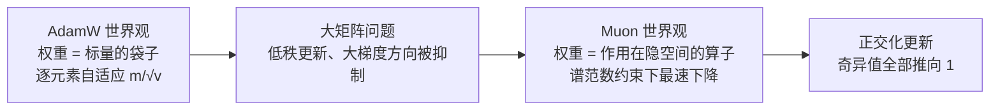
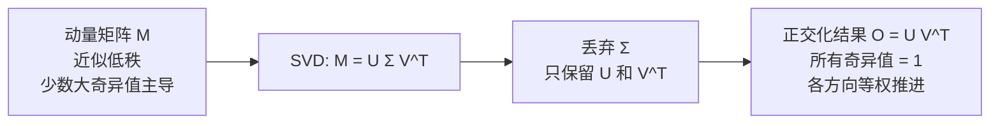
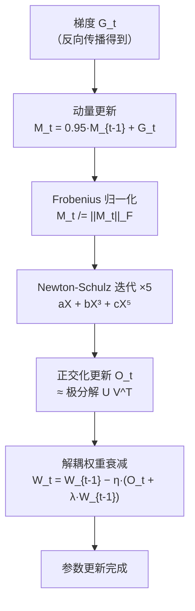
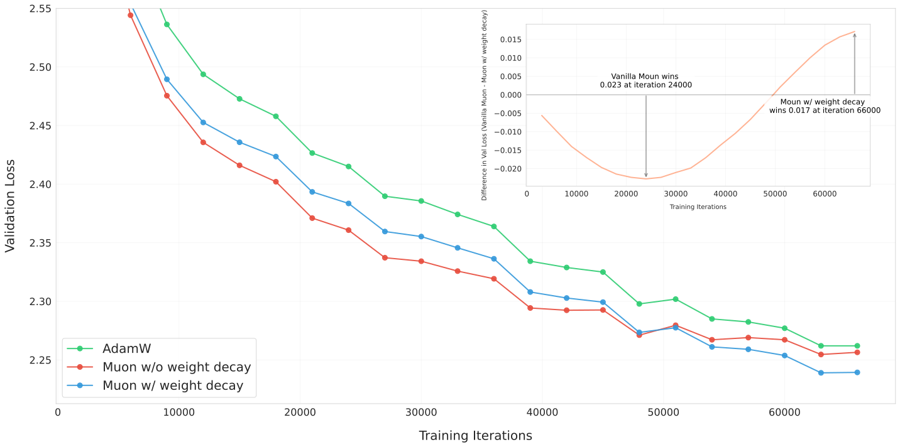
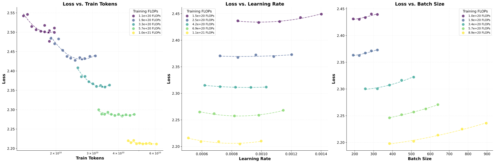
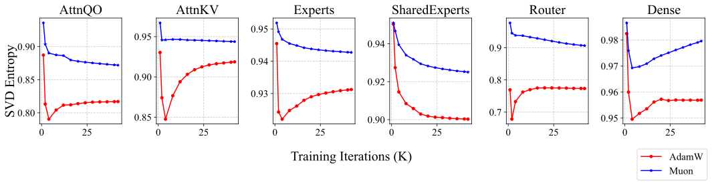
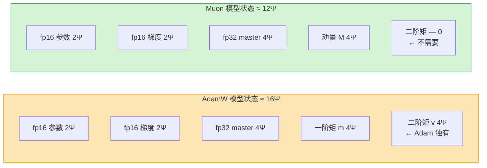
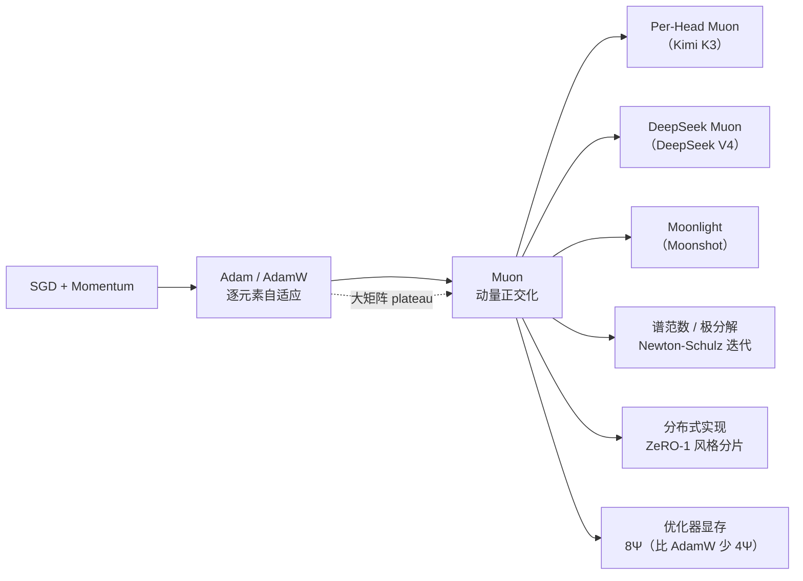

# Muon 优化器基本原理

> **一句话总结**：Muon（MomentUm Orthogonalized by Newton-Schulz）把"权重矩阵"当作**矩阵**而非"一堆标量"来更新——先做 SGD 动量，再用 **Newton-Schulz 迭代**把更新矩阵正交化（把奇异值全部推向 1）。相比 AdamW 的逐元素自适应，Muon 在谱范数意义下做最速下降，在大矩阵（T 级参数 MoE）上收敛更快、计算效率约为 AdamW 的 2 倍，已被 DeepSeek V4、Kimi K3 等前沿模型采用。

本文遵循本仓库的设计原则：**先讲清"为什么"，再讲"怎么做"**，并明确标注**关联技术**与**边界、代价**。

- 适用版本前提：算法描述基于 Keller Jordan 的原始实现 [1]、Moonshot 的规模化实践 [2] 与 DeepSeek V4 技术报告 [3]。**Muon 是 2024 年才提出的新方法，不同实现（Jordan 原版、Moonshot、NVIDIA Nemo、DeepSeek）在细节上有差异，脱离具体实现的结论不成立。**

---

## 1. 它为什么存在：AdamW 在大矩阵上的瓶颈

### 1.1 AdamW 的世界观：每个参数是独立的标量

Adam（及其变体 AdamW）把权重矩阵的每个元素当作**独立的标量**来更新：对每个元素维护一阶矩 `m` 和二阶矩 `v`，然后用 `m / √v` 做逐元素自适应缩放 [4]。

这套机制在中小规模模型上工作得很好，但在**超大参数矩阵**（如 T 级 MoE 的专家权重）上会出问题：

- **大梯度方向被过度抑制**：Adam 的二阶矩 `v` 对大梯度方向累积得更快，导致这些方向的有效步长被压得很小——而大梯度方向往往正是需要大幅更新的方向；
- **低秩更新**：实际观测发现，Transformer 的动量更新矩阵常常**近似低秩**——少数奇异方向占据绝大部分更新量，而许多"稀有"方向的奇异值很小，可能对学习仍然重要 [1]。AdamW 的逐元素缩放无法处理这种矩阵结构。

### 1.2 Muon 的世界观：权重是作用在隐空间上的算子

Muon 的核心洞察来自一个简单的几何事实 [1][5]：

> 神经网络的权重矩阵是**作用在（局部）欧几里得隐空间上的线性算子**，因此对权重的范数约束应当是**诱导算子范数（即谱范数）**，而不是 Adam 所用的逐元素 Max-of-Max 范数。

换句话说：Adam 把权重当成"标量的袋子"，Muon 把权重当成"矩阵/算子"。正交化更新等价于在**谱范数**约束下做最速下降 [1][5]。



---

## 2. 核心机理

### 2.1 Muon 的三步更新

设权重矩阵 `W ∈ R^{m×n}`，梯度 `G_t`，动量缓冲 `M_t`。Muon 的一次更新分为三步 [1][2]：

```
① 动量更新：M_t = β · M_{t-1} + G_t          （标准 SGD 动量，β=0.95）
② 正交化：  O_t = NewtonSchulz5(M_t)         （把 M_t 正交化为最近的半正交矩阵）
③ 参数更新：W_t = W_{t-1} − η · O_t          （沿正交化方向步进）
```

> **注意**：Muon 只用于 **2D 隐藏层权重矩阵**。Embedding、输出头、偏置、标量增益等 1D 参数仍用 AdamW [1]。

### 2.2 正交化 = 极分解（Polar Decomposition）

正交化操作的数学本质是**极分解**：对动量矩阵 `M` 做 SVD 分解 `M = UΣV^T`，然后丢弃奇异值 `Σ`，只保留 `UV^T` [1][5]。

```
若 M = U Σ V^T （SVD），则 Ortho(M) = U V^T
```

效果：**保留 M 的奇异向量方向，但把所有非零奇异值替换为 1**。这意味着更新在所有奇异方向上"等权"推进，而不是让少数大方向主导。



**为什么这样更好？** 实验表明，Transformer 的动量更新矩阵的奇异值分布**高度倾斜**——少数方向占绝对主导。AdamW 让这种倾斜进一步加剧（大方向被二阶矩抑制、小方向反而相对放大），而 Muon 的正交化把所有方向拉平，让"稀有但重要"的方向也能得到充分更新 [1][2]。

### 2.3 Newton-Schulz 迭代：廉价的近似极分解

精确的 SVD 极分解代价太高（`O(min(m,n)²·max(m,n))`），无法每步都做。Muon 用 **Newton-Schulz 迭代**来近似，这是一个固定的五次多项式迭代 [1]：

```python
def newtonschulz5(G, steps=5, eps=1e-7):
    a, b, c = (3.4445, -4.7750, 2.0315)
    X = G.bfloat16()
    X /= (X.norm() + eps)              # Frobenius 归一化
    if G.size(0) > G.size(1):
        X = X.T
    for _ in range(steps):
        A = X @ X.T
        B = b * A + c * A @ A
        X = a * X + B @ X              # 五次多项式: aX + bX³ + cX⁵
    if G.size(0) > G.size(1):
        X = X.T
    return X
```

关键点 [1]：
- **五次多项式** `p(x) = 3.4445x − 4.7750x³ + 2.0315x⁵`：系数经过精心选择，使奇异值在 5 次迭代后被推向 1 附近的一个"带"，而非精确收敛到 1（这反而比精确极分解更适合训练）；
- **bf16 计算**：整个迭代在 bfloat16 下运行，可以充分利用 GPU Tensor Core，每步开销可控；
- **5 次迭代**：每次迭代是 2~3 次矩阵乘法，5 次共约 15 次矩阵乘。对大矩阵来说，这仍然是显著的额外计算。

> **为什么是五次多项式而不是三次？** 原始 Newton-Schulz 用的是三次迭代 `X ← (3X − X³)/2`，但它在 bf16 下数值不稳定。Jordan 的五次多项式系数 `(a,b,c) = (3.4445, −4.7750, 2.0315)` 是为 bf16 稳定性专门调优的 [1]。后续研究（如 NVIDIA 的 cubic5 变体）证明 3 次多项式也可达到相近效果，且计算更省 [6]。

### 2.4 一次完整迭代的流程



---

## 3. 规模化改造：Moonshot 的两个关键修复

原始 Muon 在小模型（NanoGPT、CIFAR-10）上表现优异，但直接用到大模型会遇到两个问题。Moonshot 在《Muon is Scalable for LLM Training》中给出了两个无需调参的修复 [2]：

### 3.1 修复一：权重衰减（Weight Decay）

**问题**：原始 Muon 收敛快，但在过训练（over-train）阶段，部分权重会**爆炸式增长**，导致长期性能下降 [2]。

**修复**：加入**解耦权重衰减**（与 AdamW 同理，直接作用在参数上而非混入梯度）[2]：

```
W_t = W_{t-1} − η · (O_t + λ · W_{t-1})
```

> 下图展示了 800M 参数模型训练 100B tokens（约 5 倍 compute-optimal）时，有无权重衰减的差异。加了 weight decay 后，损失曲线在长训练中保持稳定 [2]。



> 图源：Liu et al., *Muon is Scalable for LLM Training*, arXiv:2502.16982（Figure 5）[2]。

### 3.2 修复二：逐参数更新尺度调整

**问题**：Muon 正交化后的更新尺度与矩阵形状强相关——不同形状的权重矩阵（如 `[768,768]` 的注意力投影 vs `[768,3072]` 的 FFN）会得到差异巨大的更新 RMS，导致训练不稳定 [2]。

**修复**：对每个矩阵的更新乘以一个**形状相关的尺度因子**，使其 RMS 与 AdamW 的更新 RMS 匹配 [2]：

```
scale = 0.2 · √max(m, n)
O_t_scaled = scale · O_t
```

- `0.2` 是经验常数，使 Muon 的更新 RMS 大致等于 AdamW；
- `√max(m,n)` 补偿了矩阵形状对正交化后范数的影响；
- 这样做的好处是 **Muon 可以直接复用 AdamW 的学习率等超参**，无需重新调参 [2]。

### 3.3 效果：约 2 倍计算效率

Moonshot 的 Scaling Law 实验表明：在 compute-optimal 训练设置下，**Muon 仅需约 52% 的训练 FLOPs 就能达到与 AdamW 相同的性能**，即计算效率约为 AdamW 的 2 倍 [2]。



> 图源：Liu et al., *Muon is Scalable for LLM Training*, arXiv:2502.16982（Figure 1a）[2]。横轴为训练 FLOPs，纵轴为验证损失；Muon 曲线始终在 AdamW 左侧，意味着更少计算量即可达到相同损失。

---

## 4. 为什么正交化有效：SVD 熵视角

Moonshot 的论文还从**奇异值熵**的角度解释了 Muon 为什么有效 [2]。

- **SVD 熵**衡量动量矩阵奇异值分布的"均匀程度"：熵越高，各方向更新越均匀；熵越低，少数方向越主导。
- 实验发现，AdamW 训练的矩阵奇异值熵**持续下降**（越来越倾斜），而 Muon 训练的矩阵熵**保持稳定或上升** [2]。



> 图源：Liu et al., *Muon is Scalable for LLM Training*, arXiv:2502.16982（Figure 9）[2]。

**解释**：AdamW 的逐元素自适应让大梯度方向的更新被抑制、小梯度方向相对放大，但动量累积的方向选择性仍然导致少数方向主导。Muon 的正交化**每步强制把奇异值拉平**，保持了各方向的均衡更新，这可能是它在大矩阵上收敛更快的根本原因 [1][2]。

---

## 5. 分布式实现：ZeRO-1 风格

Muon 的 Newton-Schulz 迭代需要对动量矩阵做多次矩阵乘法。在分布式训练中，Moonshot 实现了 **ZeRO-1 风格**的分布式 Muon [2]：

- **动量分片**：每个 rank 只持有动量矩阵的一部分（类似 ZeRO-1 对优化器状态的分片）；
- **通信优化**：正交化所需的全局信息通过 All-Gather 等原语获取，并与计算重叠；
- **内存最优**：不保存完整动量矩阵，内存开销与 ZeRO-1 相当。

DeepSeek V4 在此基础上进一步优化，针对 Muon 在 MoE 模型上的注意力 logit 爆炸问题做了专门处理 [3]。

---

## 6. 应用与实战

### 6.1 已采用 Muon 的前沿模型

| 模型 | 参数量 | Muon 变体 | 说明 |
| --- | --- | --- | --- |
| **Moonlight** | 3B/16B MoE | Moonshot Muon（原始） | 首个大规模验证 Muon 的模型，训练 5.7T tokens [2] |
| **Kimi K2** | 1T MoE | MuonClip | Moonshot 在 Kimi K2 上用 MuonClip（带 clip 的稳定版）[7] |
| **Kimi K3** | 2.8T MoE | Per-Head Muon | 按注意力头独立正交化 [8] |
| **DeepSeek V4 / V4.1** | 1.6T MoE | DeepSeek Muon | 主体用 Muon，少数模块用 AdamW；混合 Newton-Schulz 迭代 [3] |

### 6.2 与 AdamW 的对比

| 维度 | AdamW | Muon |
| --- | --- | --- |
| 世界观 | 权重 = 标量的袋子 | 权重 = 矩阵/算子 |
| 更新规则 | 逐元素 `m/√v` 自适应 | 动量正交化（谱范数最速下降） |
| 目标参数 | 所有参数 | **仅 2D 隐藏层矩阵**，其余用 AdamW |
| 额外计算 | 几乎无 | Newton-Schulz 5 次迭代（约 15 次矩阵乘） |
| 显存状态 | `m` + `v`（8Ψ）+ master（4Ψ）= 12Ψ | 动量 `M`（4Ψ）+ master（4Ψ）= 8Ψ |
| 大矩阵收敛 | 容易 plateau | 更快、更稳定 |
| 计算效率（大模型） | 1×（基准） | ~2× [2] |
| 成熟度 | 工业标准，极度成熟 | 2024 年提出，仍在快速演进 |

> **显存优势**：Muon 只维护一个动量缓冲 `M`（4Ψ），而 AdamW 需要 `m` + `v` 两个缓冲（8Ψ）。加上 fp32 master weights（4Ψ），Muon 的优化器状态共 8Ψ，比 AdamW 的 12Ψ 省 1/3。

### 6.3 显存构成深度对比

设模型参数量为 **Ψ**（不含 Embedding 和输出头，因为 Muon 不处理它们）。"4Ψ" 的意思是：一个与参数**同形状**的缓冲区，用 **fp32**（4 字节/元素）存储，所以大小是 `4 bytes × Ψ = 4Ψ` 字节——参见本仓库《优化器基本原理》第 5 节的推导。

#### 完整模型状态对比（混合精度训练）

把训练时的**全部显存组件**摊开看：

| 组件 | AdamW | Muon | 说明 |
| --- | --- | --- | --- |
| fp16 / bf16 参数 | `2Ψ` | `2Ψ` | 前向计算用 |
| fp16 / bf16 梯度 | `2Ψ` | `2Ψ` | 反向传播产出 |
| fp32 master weights | `4Ψ` | `4Ψ` | 更新用，必须 fp32 保证数值稳定 |
| **一阶矩（动量）** | `4Ψ`（Adam 的 `m`） | `4Ψ`（Muon 的 `M`） | 二者都需要 |
| **二阶矩** | `4Ψ`（Adam 的 `v`） | **0** | **核心差异**：Muon 不需要逐元素自适应 |
| 优化器状态小计 | `12Ψ` | `8Ψ` | |
| **模型状态总计** | **`16Ψ`** | **`12Ψ`** | Muon 净省 **`4Ψ`** |



**省 4Ψ 的实际含义**：以 Moonshot 的 Moonlight 16B MoE 为例（激活参数 Ψ ≈ 16B），单卡 Muon 比 AdamW 省 `4 × 16B = 64 GB` 显存——这对 H800（80GB）来说几乎是一整卡。

#### Newton-Schulz 迭代的临时显存

Muon 每步跑 5 次 Newton-Schulz 迭代，会产生**临时显存**峰值——这些张量迭代结束后立即释放，不累积：

| 临时变量 | 形状 | 精度 | 大小 |
| --- | --- | --- | --- |
| `X`（归一化后的动量） | 与参数相同 | bf16 | `2Ψ` |
| `A = X @ X^T` | `[m, m]` | bf16 | `2m²` |
| `B = b·A + c·A²` | `[m, m]` | bf16 | `2m²` |

- 对于**方阵权重**（如 attention 的 `W_Q, W_K, W_V, W_O`），`m ≈ n`，`X @ X^T` 与 `X` 同量级，约 `2Ψ`；
- 对于**非方阵**（如 FFN 的 `[d_model, d_ff]`），Moonshot 实现只用 `X @ X^T` 或 `X^T @ X` 中**较小的那个**——这被称为 **mat-sq trick** [2]，使非方阵的临时显存降到 `2·min(m,n)²`。

总的临时峰值约 **`4~6Ψ`**（取决于矩阵形状）。作为对比，AdamW 几乎没有额外临时显存（只是逐元素运算的中间标量）。

> So，Muon 真的省显存吗？**永久显存净省 4Ψ**，但每步临时峰值多 ~4Ψ。工程上如果能让 NS 的临时显存及时回收或与计算重叠，就能吃到净省的好处；否则峰值可能与 AdamW 相当。

#### 分布式训练下的 Muon 显存

分布式训练中，所有优化器状态都可以用 ZeRO 风格**分片** [2]：

- **ZeRO-1 风格 Muon**（Moonshot 实现）：每个 rank 只持有动量矩阵的 `1/N`（N 为数据并行度），动量显存从 `4Ψ` 降到 `4Ψ/N`；
- **配合 FSDP**：参数和梯度本身也已分片，每卡完整模型状态从 `12Ψ` 降到 `12Ψ/N`；
- 与 AdamW 的 FSDP 对比：每卡仍省 `4Ψ/N`——N=8 时每卡省 `0.5Ψ`，N=64 时每卡省 `Ψ/16`，随 N 增大省的比例缩小但绝对值仍可观。

Moonshot 的分布式 Muon 通过三点实现了**净省显存 + 计算效率 2×**的双重收益 [2]：
1. 动量分片（ZeRO-1 风格）让永久显存降到 `8Ψ/N`；
2. mat-sq trick 让非方阵的临时显存最小化；
3. All-Gather 与计算重叠，让通信延迟被掩盖。

### 6.4 选型建议

| 场景 | 推荐 | 理由 |
| --- | --- | --- |
| 中小模型（< 10B）、成熟管线 | AdamW | 稳定、文档齐全、生态完善 |
| 大模型预训练（T 级 MoE） | **Muon**（或 Per-Head Muon） | 收敛快、计算效率 2×，前沿模型已验证 |
| 显存受限 | Muon | 优化器状态少 4Ψ |
| 需要快速复现论文 | AdamW | Muon 实现细节因厂商而异 |
| 1D 参数 / Embedding / 输出头 | AdamW | Muon 只处理 2D 矩阵 |

---

## 7. 边界与代价

### 7.1 只适用于 2D 矩阵

Muon 的正交化依赖矩阵结构，**无法直接用于 1D 参数**（偏置、LayerNorm 增益、标量）和非矩阵参数。这些参数必须继续用 AdamW [1]。这意味着训练时需要**分组优化器**：2D 权重用 Muon，其余用 AdamW。

### 7.2 额外计算开销

Newton-Schulz 5 次迭代每步需要约 15 次矩阵乘法。对于大矩阵，这会增加单步计算量。NVIDIA 的研究表明，在大规模 DiT 训练中，Muon 的额外计算可能抵消其步效率优势，因此提出了 **Periodic Row-wise Muon**（每 K 步才做一次完整 NS5）来降低开销 [9]。

### 7.3 实现细节差异大

不同机构的 Muon 实现差异显著：
- Jordan 原版：`lr=0.02, momentum=0.95, nesterov=true, weight_decay=0` [1]
- Moonshot 版：加 weight decay + 0.2·√max(m,n) 尺度因子 [2]
- NVIDIA Nemo 版：支持多种 NS 系数类型（simple/quintic/polar_express）、多种 scale mode [10]
- DeepSeek 版：混合 Newton-Schulz + 注意力 logit 防护 [3]

**结论**：不能直接套用某篇论文的超参到另一个实现上，必须按具体实现调参。

### 7.4 正交化的"度"并非越多越好

研究表明，正交化的精度与训练质量并非单调关系 [6]：
- 5 次 NS 迭代是"学习率鲁棒"的选择；
- 减少到 1 次迭代在小学习率下更快但解不稳定；
- 精确 SVD 极分解不一定比近似 NS 更好。

### 7.5 常见工程陷阱

| 陷阱 | 说明 |
| --- | --- |
| 对所有参数用 Muon | 1D 参数（偏置、Norm）必须用 AdamW，否则训练不稳定 [1] |
| 忘记加 weight decay | 长训练中权重爆炸、损失恶化 [2] |
| 不做尺度调整 | 不同形状矩阵更新 RMS 差异巨大，训练不稳定 [2] |
| 直接抄超参 | 不同 Muon 实现的默认超参不同，需按实现调参 |
| 忽视 NS 迭代的 bf16 精度 | NS 迭代必须在 bf16 下跑才能利用 Tensor Core，fp32 下慢得多 [1] |

---

## 8. 可验证：最小实验

```python
# muon_demo.py —— 最小可用 Muon 实现（Keller Jordan 原版）
import torch
import torch.nn as nn


def newtonschulz5(G, steps=5, eps=1e-7):
    """Newton-Schulz 五次多项式迭代，近似极分解"""
    a, b, c = (3.4445, -4.7750, 2.0315)
    X = G.bfloat16()
    X /= (X.norm() + eps)
    if G.size(0) > G.size(1):
        X = X.T
    for _ in range(steps):
        A = X @ X.T
        B = b * A + c * A @ A
        X = a * X + B @ X
    if G.size(0) > G.size(1):
        X = X.T
    return X


class Muon(torch.optim.Optimizer):
    def __init__(self, params, lr=0.02, momentum=0.95, nesterov=True):
        defaults = dict(lr=lr, momentum=momentum, nesterov=nesterov)
        super().__init__(params, defaults)

    @torch.no_grad()
    def step(self):
        for group in self.param_groups:
            lr = group["lr"]
            mu = group["momentum"]
            nesterov = group["nesterov"]
            for p in group["params"]:
                if p.grad is None:
                    continue
                g = p.grad
                state = self.state[p]
                if "momentum" not in state:
                    state["momentum"] = torch.zeros_like(p)
                m = state["momentum"]
                m.mul_(mu).add_(g)
                if nesterov:
                    g = g.add(m, alpha=mu)   # Nesterov: look-ahead gradient
                else:
                    g = m
                # 只对 2D 参数做正交化
                if g.ndim == 2:
                    g = newtonschulz5(g)
                p.add_(g.to(p.dtype), alpha=-lr)


# 使用：2D 权重用 Muon，1D 参数（偏置、Norm）用 AdamW
model = nn.Linear(256, 256)
muon_params = [p for p in model.parameters() if p.ndim == 2]
adamw_params = [p for p in model.parameters() if p.ndim != 2]
opt = Muon(muon_params, lr=0.02)
adamw_opt = torch.optim.AdamW(adamw_params, lr=1e-3, weight_decay=0.1)

# 训练循环
x = torch.randn(32, 256)
y = torch.randn(32, 256)
for _ in range(100):
    opt.zero_grad()
    adamw_opt.zero_grad()
    loss = ((model(x) - y) ** 2).mean()
    loss.backward()
    opt.step()
    adamw_opt.step()
print(f"final loss: {loss.item():.6f}")
```

> 结构参照 Keller Jordan 原始实现 [1]。生产环境推荐使用成熟实现：[KellerJordan/Muon](https://github.com/KellerJordan/Muon)（MIT）或 NVIDIA Nemo 的 [emerging-optimizers](https://github.com/NVIDIA/emerging-optimizers)（Apache-2.0）。

### 观测要点

| 想验证什么 | 怎么做 |
| --- | --- |
| 正交化是否生效 | 对比 `newtonschulz5(M)` 前后的奇异值分布（`torch.linalg.svdvals`），应观察到奇异值向 1 聚集 |
| Muon vs AdamW 收敛速度 | 相同模型/数据分别用 Muon 和 AdamW 训练，对比达到相同损失所需的 steps/FLOPs |
| 权重衰减的作用 | 去掉 weight decay 长训练，观察是否出现权重爆炸和损失恶化 [2] |
| 尺度因子的影响 | 去掉 `0.2·√max(m,n)` 尺度，观察不同形状层的更新 RMS 是否差异巨大 |
| NS 迭代步数 | 对比 1/3/5 步 NS 的收敛速度与稳定性 [6] |

---

## 9. 关联：它在知识网络中的位置



- **与 SGD/AdamW**：Muon 继承了 SGD 动量，把 AdamW 的逐元素自适应替换为矩阵正交化。
- **与分布式训练**：Muon 的分布式实现沿用 ZeRO-1 的思路对动量分片，与 FSDP/DDP 兼容 [2]。
- **与优化器显存**：Muon 只维护一个动量缓冲，优化器状态比 AdamW 少 4Ψ（参见本仓库《优化器基本原理》第 5 节）。
- **与矩阵理论**：Muon 的数学基础是极分解、矩阵符号函数和谱范数最速下降 [1][5]。

---

## 10. 延伸阅读

- 本仓库《优化器基本原理》：AdamW 与 4Ψ 显存分析，理解 Muon 的对比基准。
- Keller Jordan 官方博客（最详尽的 Muon 设计说明）：<https://kellerjordan.github.io/posts/muon/> [1]
- Moonshot 规模化实践论文：<https://arxiv.org/abs/2502.16982> [2]
- DeepSeek V4 技术报告（Muon 在 T 级模型的应用）：<https://arxiv.org/abs/2606.19348> [3]

---

## 参考文献

1. Jordan, K., Jin, Y., Boza, V., et al. *Muon: An optimizer for hidden layers in neural networks*. Blog post, 2024. <https://kellerjordan.github.io/posts/muon/>
2. Liu, J., Su, J., Yao, X., et al. *Muon is Scalable for LLM Training*. arXiv:2502.16982 (2025). <https://arxiv.org/abs/2502.16982>
3. DeepSeek. *DeepSeek-V4: Towards Highly Efficient Million-Token Context Intelligence*, Section 2.4 Muon Optimizer. arXiv:2606.19348 (2026). <https://arxiv.org/abs/2606.19348>
4. Kingma, D. P., Ba, J. *Adam: A Method for Stochastic Optimization*. ICLR 2015. arXiv:1412.6980. <https://arxiv.org/abs/1412.6980>
5. Bernstein, J., Newhouse, M. *Modular Duality in Deep Learning*. arXiv:2410.21265 (2024). <https://arxiv.org/abs/2410.21265>
6. Huang, H. *How Much Orthogonalization Does Muon Need?* arXiv:2606.00371 (2026). <https://arxiv.org/abs/2606.00371>
7. Moonshot AI. *Kimi K2 Technical Report*. 2025.
8. Moonshot AI. *Kimi K3: Open Frontier Intelligence*. 2026. <https://www.kimi.com/blog/kimi-k3>
9. Li, C., et al. *Scaling Muon for Diffusion Transformers*. arXiv:2608.20818 (2026).
10. NVIDIA. *Emerging Optimizers: Muon implementation*. Apache-2.0. <https://github.com/NVIDIA/emerging-optimizers>

### 图片来源与许可声明

| 文件 | 来源 | 许可 / 说明 |
| --- | --- | --- |
| `assets/muon-scaling-law.svg` | Liu et al., *Muon is Scalable for LLM Training*, arXiv:2502.16982（Figure 1a）[2] | 论文以 arXiv 非独占分发许可发布（<http://arxiv.org/licenses/nonexclusive-distrib/1.0/>）；此处引用用于教学说明 |
| `assets/muon-weight-decay.svg` | 同上（Figure 5）[2] | 同上 |
| `assets/muon-svd-entropy.svg` | 同上（Figure 9）[2] | 同上 |
| 其余 Mermaid 图（Muon 世界观、正交化流程、迭代流程、知识网络关系） | 本文自绘 | 使用 Mermaid 描述，GitHub 原生渲染，无第三方版权 |

> 若版权方要求，可随时移除上述图片，仅保留正文与文字描述。
