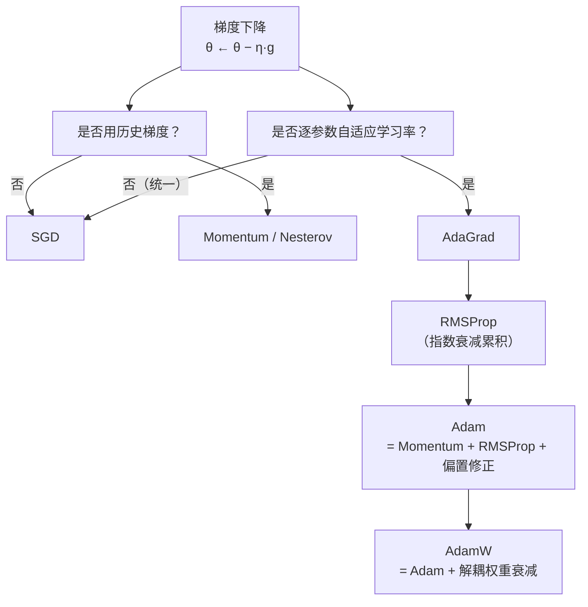
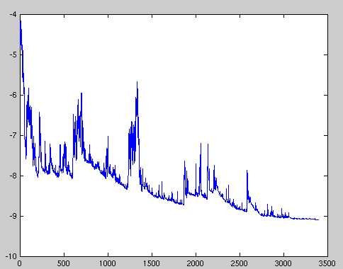
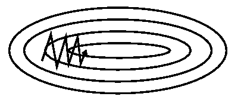
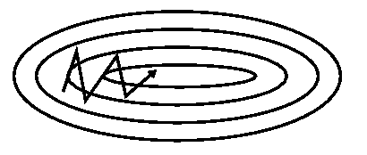
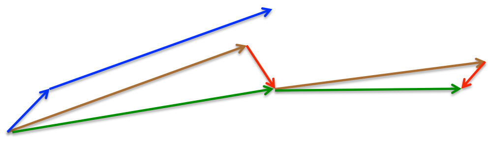
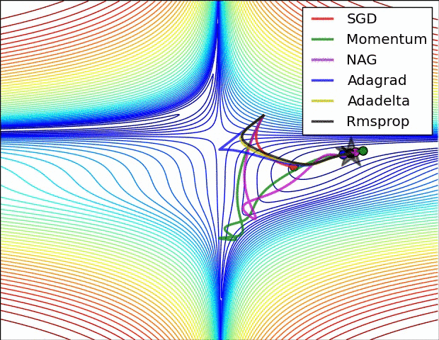
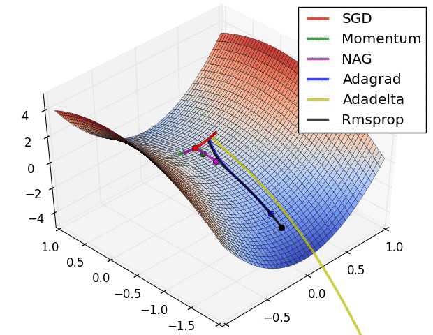
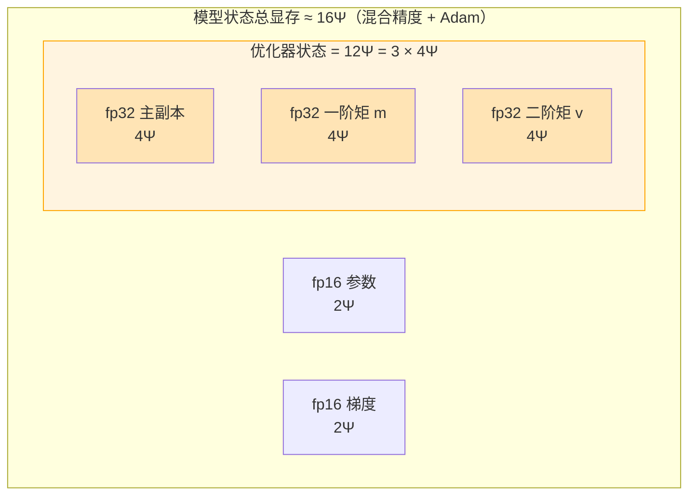
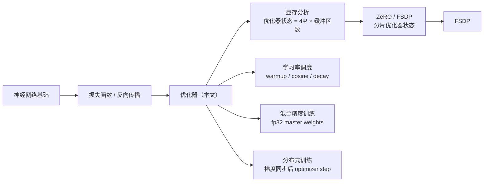

# 优化器（Optimizer）基本原理

> **一句话总结**：优化器决定了"如何用梯度更新参数"。从朴素 SGD 到 Momentum、AdaGrad、RMSProp、Adam，每一步演进都在解决梯度下降的某个具体痛点（震荡、学习率敏感、稀疏梯度、鞍点）。而优化器需要为**每个参数**维护额外状态——这些状态以 fp32 存储，**每个参数元素占 4 字节**，因此每多一个状态缓冲区就多 `4Ψ` 显存（Ψ 为参数量）；Adam 维护 3 个这样的缓冲区，故其优化器状态共 `12Ψ`。

本文遵循本仓库的设计原则：**先讲清"为什么"，再讲"怎么做"**，并明确标注**关联技术**与**边界、代价**。

- 适用版本前提：算法描述基于 Adam 论文 [1]、Sebastian Ruder 综述 [2] 与 PyTorch `torch.optim` 文档 [3]。显存分析参考 ZeRO 论文 [4]。**结论依赖精度设置与优化器类型，脱离上下文的"显存公式"不成立。**

---

## 1. 它为什么存在：问题定义

### 1.1 梯度下降的四个痛点

神经网络训练的核心是最小化损失函数 `L(θ)`。梯度下降给出了最朴素的更新规则：

```
θ ← θ − η · ∇L(θ)
```

但直接用这条规则训练深度网络，会撞上四个问题：

| 痛点 | 表现 | 后果 |
| --- | --- | --- |
| **学习率敏感** | 步长太大震荡、太小收敛极慢 | 需要精心调 η，且不同阶段需要不同 η |
| **病态曲率（ill-conditioned）** | 不同参数方向的梯度尺度差异巨大 | 在"山谷"中沿陡峭方向来回震荡，沿平缓方向缓慢爬行 |
| **鞍点（saddle point）** | 高维空间中局部极值稀少，鞍点居多 | 梯度接近 0 时 SGD 容易停滞在鞍点 |
| **稀疏梯度** | 大部分参数梯度为 0（如 Embedding） | 统一学习率对频繁更新和稀疏更新的参数一视同仁，效率低 |

### 1.2 优化器的角色

优化器本质上是一个函数：**输入当前梯度 `g`（以及历史信息），输出参数更新量 `Δθ`**。各种优化器的差异，体现在两件事上：

1. **是否利用历史梯度**（动量类方法）；
2. **是否对每个参数自适应调整学习率**（自适应方法）。



---

## 2. 基础：SGD 及其批量变体

### 2.1 三种批量粒度

| 变体 | 每次更新用的数据 | 梯度噪声 | 一次更新耗时 |
| --- | --- | --- | --- |
| **Batch GD** | 全量数据集 | 最小（无偏） | 最慢，大数据集不可行 |
| **SGD**（随机） | 单个样本 | 最大（高方差） | 最快，但波动剧烈 |
| **Mini-batch SGD** | 一小批样本（32~1024） | 中等 | 实际训练的标准选择 |

> 深度学习中说的"SGD"通常指 **Mini-batch SGD**——每次用一个 mini-batch 计算梯度并更新 [2]。

### 2.2 SGD 的波动

SGD 用单样本/小批量估计梯度，估计值带有噪声，因此损失函数会**剧烈波动**：



> 图源：Ruder, *An overview of gradient descent optimization algorithms*, arXiv:1609.04747（Figure 1，来源 Wikipedia）[2]。

这种波动有两面性：一方面它让 SGD **难以收敛到精确最小值**（总是在附近来回跳）；另一方面它也提供了**跳出局部最优/鞍点**的可能性。

---

## 3. 动量类：Momentum 与 Nesterov

### 3.1 Momentum（动量）

Momentum 的思想来自物理：像小球从山坡滚下，在梯度方向一致的维度上**加速**，在梯度方向反复变化的维度上**抑制震荡** [2]。

```
v_t = γ · v_{t-1} + η · g_t
θ_t = θ_{t-1} − v_t
```

- `v_t`：累积的"速度"（历史更新方向的加权和）；
- `γ`：动量系数，通常取 0.9；
- `η`：学习率。

直观效果对比：

 

> 图源：Ruder 综述（Figure 2，来源 Genevieve B. Orr）[2]。左图为无动量的之字形震荡，右图为动量加速后沿主方向前进。

### 3.2 Nesterov Accelerated Gradient（NAG）

Nesterov 的改进：**先用动量预测下一步的位置，再在那个"未来位置"计算梯度** [2]。

```
v_t = γ · v_{t-1} + η · ∇L(θ_{t-1} − γ · v_{t-1})
θ_t = θ_{t-1} − v_t
```



> 图源：Ruder 综述（Figure 3，来源 G. Hinton 的 lecture 6c）[2]。

这相当于给小球装上了"预见性"——它知道自己将要往哪走，从而在上坡前提前减速。NAG 在凸优化中有更强的理论收敛保证。

---

## 4. 自适应学习率类

动量类方法用**一个全局学习率**更新所有参数。自适应方法则让**每个参数有自己的学习率**，依据是该参数历史梯度的大小。

### 4.1 AdaGrad：累积平方梯度

AdaGrad 对每个参数 `θ_i` 维护其历史梯度的平方和 `G_{t,i} = Σ g_{τ,i}²`，并用它缩放学习率 [2]：

```
θ_{t+1,i} = θ_{t,i} − η / √(G_{t,i} + ε) · g_{t,i}
```

- 梯度大的参数 → `G` 大 → 学习率被缩小得更多；
- 梯度小（稀疏）的参数 → `G` 小 → 学习率保持较大。

**优点**：天然适合稀疏梯度（如 NLP、推荐系统），减少手动调学习率的需求。
**缺点**：`G` 单调递增，学习率会**持续衰减到 0**，训练后期几乎停滞。

### 4.2 RMSProp：指数移动平均

RMSProp 解决 AdaGrad 学习率衰减到 0 的问题——用**指数移动平均**（EMA）代替累积和，让久远的梯度影响逐渐消失 [2]：

```
E[g²]_t = γ · E[g²]_{t-1} + (1−γ) · g_t²
θ_{t+1,i} = θ_{t,i} − η / √(E[g²]_t + ε) · g_{t,i}
```

`γ` 通常取 0.9。这样学习率不会无限衰减，能持续适应梯度尺度的变化。

### 4.3 Adam：Momentum + RMSProp + 偏置修正

Adam（Adaptive Moment Estimation）是目前深度学习中**最常用**的优化器 [1][3]。它同时维护一阶矩（动量）和二阶矩（梯度平方的 EMA），并做了**偏置修正**以解决初始化时矩估计向 0 偏移的问题 [1]：

```
m_t = β₁ · m_{t-1} + (1−β₁) · g_t              # 一阶矩（动量）
v_t = β₂ · v_{t-1} + (1−β₂) · g_t²             # 二阶矩
m̂_t = m_t / (1 − β₁ᵗ)                           # 一阶矩偏置修正
v̂_t = v_t / (1 − β₂ᵗ)                           # 二阶矩偏置修正
θ_t = θ_{t-1} − η · m̂_t / (√v̂_t + ε)
```

默认超参（PyTorch / 论文推荐）：`β₁=0.9, β₂=0.999, ε=1e-8, lr=1e-3` [1][3]。

> **为什么需要偏置修正？** `m_0 = 0, v_0 = 0`，初始几步 `m_t ≈ (1−β₁)·g_t` 会偏小（因为 `β₁ᵗ` 还没衰减到可忽略）。除以 `1−β₁ᵗ` 把它"放大"回正确量级。训练后期 `t` 很大，修正项趋近于 1，不再起作用 [1]。

### 4.4 AdamW：解耦权重衰减

标准 Adam 把 **L2 正则**和梯度加在一起再做自适应缩放，这导致权重衰减的效果被自适应学习率"吃掉"——大梯度的参数衰减反而少。AdamW 把权重衰减从梯度中**解耦**出来，直接作用在参数上 [5]：

```
# 标准 Adam（L2 耦合在梯度里）
g_t = ∇L(θ) + λ · θ      # L2 正则项混入梯度

# AdamW（解耦）
g_t = ∇L(θ)               # 梯度不含正则项
θ_t = θ_{t-1} − η · (m̂_t/(√v̂_t+ε) + λ · θ_{t-1})   # 衰减直接乘参数
```

**意义**：AdamW 让权重衰减的强度不再依赖自适应学习率，在 Transformer 等大模型上泛化更好，已成为事实上的标准选择 [5]。

### 4.5 各算法在损失面上的对比

下面两张图直观展示了各优化器在等高线和鞍点上的轨迹差异：





> 图源：Ruder 综述（Figure 4，来源与完整动画：Alec Radford）[2]。关键观察：**自适应方法在鞍点附近明显比 SGD 类更快逃离**，这是它们在深度网络中训练更快的重要原因。

---

## 5. 显存分析：为什么优化器状态是 `4Ψ`

这是理解大模型训练显存的关键。设模型参数量为 `Ψ`。

### 5.1 优化器为什么要存额外的东西？

优化器不只是"参数减去梯度×学习率"那么简单——它需要**记住历史信息**才能做出更好的更新：

| 优化器 | 需要维护的状态 | 数量 |
| --- | --- | --- |
| 纯 SGD（无动量） | 无额外状态（只需要梯度本身） | 0 个缓冲区 |
| SGD + Momentum | 速度 `v` | 1 个 |
| RMSProp | 二阶矩 EMA `E[g²]` | 1 个 |
| **Adam** | 一阶矩 `m` + 二阶矩 `v` | **2 个** |
| L-BFGS 等二阶方法 | 近似 Hessian 逆 | 多个（显存极大） |

### 5.2 为什么每个缓冲区是 `4Ψ` 字节？

关键在于**数值精度**：

- 模型参数在**计算**时常用 fp16（2 字节/元素）以加速；
- 但优化器状态必须用 **fp32（4 字节/元素）** 存储，因为：
  - 动量/二阶矩的数值范围大、动态范围广，fp16 精度不够；
  - 参数的**主副本（master weights）**也用 fp32，以保证更新的数值稳定性（fp16 的步长太小可能被舍入掉）。

> 因此，**每一个与参数同形状的优化器缓冲区，占用 `4 bytes × Ψ = 4Ψ` 字节**。这就是 "`4Ψ`" 的由来——它来自 fp32 的 4 字节，乘以参数量。

### 5.3 各优化器的显存开销

下表给出**优化器状态本身**的显存（不含模型参数和梯度）：

| 优化器 | 缓冲区 | 显存（优化器状态） |
| --- | --- | --- |
| 纯 SGD | 无 | 0 |
| SGD + Momentum | 动量 `v`（fp32） | `4Ψ` |
| RMSProp | 二阶矩（fp32） | `4Ψ` |
| **Adam / AdamW** | 一阶矩 `m`（fp32）+ 二阶矩 `v`（fp32） | `8Ψ` |
| **Adam + fp32 主副本** | `m` + `v` + fp32 master weights | **`12Ψ`** |

> ZeRO 论文给出的经典估算：在**混合精度 + Adam** 下，模型状态总显存约为 `16Ψ`，其中 `12Ψ` 正是 Adam 的优化器状态（`4Ψ` fp32 master + `4Ψ` m + `4Ψ` v），剩余 `4Ψ` 是 fp16 参数 + fp16 梯度 [4]。

### 5.4 用 Mermaid 看清楚 16Ψ 的构成



> 每一个标 `4Ψ` 的缓冲区，都是"与参数同形状、用 fp32 存储"的张量——4 字节 × Ψ 个参数 = 4Ψ 字节。这就是 "`4Ψ`" 的本质。

**推论**：
- 把优化器从 Adam 换成 SGD+Momentum，优化器状态从 `12Ψ` 降到 `4Ψ`（省 `8Ψ`），代价是收敛变慢；
- ZeRO 通过把这些状态**分片**到各 rank，让每卡只存 `12Ψ/N`（N 为数据并行度）[4]；
- 用 fp8/bf16 存优化器状态可以进一步降显存，但可能影响收敛。

---

## 6. 对比与选择

### 6.1 各优化器特性对比

| 优化器 | 历史梯度 | 逐参数自适应 | 额外显存 | 典型场景 | 主要缺点 |
| --- | --- | --- | --- | --- | --- |
| SGD | 否 | 否 | 0 | 经典视觉（ResNet 等）、对泛化要求高 | 调参难、收敛慢 |
| SGD + Momentum | 是（一阶） | 否 | `4Ψ` | 视觉任务、需要强泛化 | 仍需调学习率 |
| AdaGrad | 是（二阶累积） | 是 | `4Ψ` | 稀疏梯度（NLP/推荐） | 学习率衰减到 0 |
| RMSProp | 是（二阶 EMA） | 是 | `4Ψ` | RNN、在线学习 | 无偏置修正 |
| **Adam** | 是（一阶+二阶） | 是 | `8Ψ`（+ master 共 `12Ψ`） | 通用、Transformer | 泛化有时不如 SGD |
| **AdamW** | 是（一阶+二阶） | 是 | `8Ψ`（+ master 共 `12Ψ`） | **大模型/Transformer 标准** | 显存开销大 |

### 6.2 应用场景建议

| 场景 | 推荐优化器 | 理由 |
| --- | --- | --- |
| 大语言模型 / Transformer 预训练 | **AdamW** | 收敛快、对稀疏注意力友好，权重衰减解耦保证泛化 [5] |
| 计算机视觉（分类/检测） | SGD + Momentum（或 AdamW） | 视觉任务中 SGD 系列泛化常更好，但 AdamW 也已被广泛采用 |
| 稀疏特征 / 推荐系统 | AdaGrad / Adam | 自适应学习率对稀疏参数友好 |
| 显存极度受限 | SGD + Momentum 或 8-bit Adam | 优化器状态显存从 `12Ψ` 降到 `4Ψ` 或更低 |
| 强化学习 | Adam（或 RMSProp） | 非平稳目标、噪声大，自适应方法更稳 |
| 对最终泛化精度极致追求 | SGD + Momentum + 余弦退火 | 学术界多次观察到 SGD 泛化优于 Adam（非绝对） |

> **没有免费午餐**：Adam 收敛快、调参少，但在某些任务上最终精度略低于精心调过的 SGD；SGD 泛化好但需要更长训练和更细的学习率调度。工程上大模型预训练几乎清一色 AdamW。

---

## 7. 边界与代价

### 7.1 Adam 的泛化问题

多篇研究指出，在相同训练步数下 Adam 往往**收敛更快但最终测试精度略低于 SGD** [5][6]。可能原因：
- Adam 的自适应学习率让"大梯度"参数的步长被压得太小，导致这些参数（通常是高频特征）更新不足；
- 权重衰减与自适应学习率的耦合（AdamW 部分解决了这个问题）。

工程上常见的折中：**用 AdamW 快速收敛，最后几轮切换到 SGD 精调**，或直接用 AdamW + 强正则。

### 7.2 学习率调度仍然必要

即使是自适应优化器，也需要**学习率调度**（warmup + 余弦退火等）：
- **Warmup**：训练初期梯度估计噪声大，用小学习率预热，避免 Adam 的二阶矩被极端值带偏；
- **退火**：后期降低学习率，让参数精细收敛到最小值附近。

### 7.3 梯度裁剪

大模型训练中，梯度可能出现**尖峰**（loss spike），导致 Adam 的二阶矩 `v` 突然变大、后续步长被压死。标准做法是**梯度裁剪**（`clip_grad_norm_`）把梯度范数限制在阈值内 [3]。

### 7.4 混合精度中的 master weights

混合精度（fp16/bf16 计算）下，参数更新必须在 **fp32 master weights** 上进行，再拷贝回 fp16 用于计算 [4]。这是优化器状态必须用 fp32 的根本原因——fp16 的最小步长可能小于其精度分辨率，导致更新被舍入为 0。

### 7.5 常见工程陷阱

| 陷阱 | 说明 | 出处 |
| --- | --- | --- |
| 忘记 zero_grad | 梯度会累加，导致更新错误 | [3] |
| Adam 的 `eps` 设太大 | 会显著改变有效学习率，默认 `1e-8` 即可 | [1][3] |
| 把 L2 正则当权重衰减用 | 在 Adam 中等价于"梯度加 λθ"，效果被自适应缩放削弱；应用 AdamW | [5] |
| 混合精度下更新 fp16 参数 | 步长被舍入，训练发散或停滞；必须更新 fp32 master | [4] |

---

## 8. 可验证：最小实验

```python
# optimizer_demo.py
import torch
import torch.nn as nn

torch.manual_seed(0)
model = nn.Linear(10, 1)
x = torch.randn(100, 10)
y = torch.randn(100, 1)

# 对比 SGD、SGD+Momentum、AdamW 的收敛
for name, opt_fn in [
    ("SGD", lambda p: torch.optim.SGD(p, lr=0.01)),
    ("SGD+Momentum", lambda p: torch.optim.SGD(p, lr=0.01, momentum=0.9)),
    ("AdamW", lambda p: torch.optim.AdamW(p, lr=0.001, weight_decay=0.01)),
]:
    m = nn.Linear(10, 1)
    opt = opt_fn(m.parameters())
    loss_fn = nn.MSELoss()
    for step in range(200):
        opt.zero_grad()
        loss = loss_fn(m(x), y)
        loss.backward()
        opt.step()
    print(f"{name:15s} final loss = {loss.item():.6f}")

# 验证 Adam 的状态数量（应看到 'exp_avg' 和 'exp_avg_sq' 两个缓冲区）
opt = torch.optim.AdamW(model.parameters(), lr=1e-3)
opt.zero_grad()
loss_fn(model(x), y).backward()
opt.step()
state = opt.state_dict()["state"]
for pid, s in state.items():
    print(f"param {pid}: state keys = {list(s.keys())}")  # ['step', 'exp_avg', 'exp_avg_sq']
```

> 结构参照 PyTorch `torch.optim` 文档 [3]。观察 Adam 的 `state` 中包含 `exp_avg`（一阶矩 m）与 `exp_avg_sq`（二阶矩 v），两者形状与参数相同——这就是 `8Ψ` 优化器状态的来源。

### 观测要点

| 想验证什么 | 怎么做 |
| --- | --- |
| 各优化器收敛速度 | 运行上面的脚本，对比 final loss 与收敛步数 |
| Adam 的状态缓冲区 | 打印 `opt.state_dict()["state"]`，确认 `exp_avg` / `exp_avg_sq` 存在且形状等于参数 |
| 优化器显存开销 | 用 `torch.cuda.memory_allocated()` 对比 SGD 与 Adam 的峰值显存（应差约 `8Ψ` + master weights） |
| 权重衰减的耦合 vs 解耦 | 分别用 Adam（`weight_decay`）与 AdamW 训练，对比参数范数的变化 |

---

## 9. 关联：它在知识网络中的位置



- **与反向传播**：优化器消费的是反向传播算出的梯度，二者通过 `.backward()` → `optimizer.step()` 串联。
- **与分布式训练**：DDP/FSDP 先做梯度同步（AllReduce / Reduce-Scatter），再调用 `optimizer.step()`；优化器状态随参数一起被分片（ZeRO）[4]。
- **与混合精度**：优化器必须维护 fp32 master weights，这是 `4Ψ` 显存开销的直接原因 [4]。
- **与学习率调度**：优化器给出"基础步长"，调度器在训练过程中按策略缩放它。

---

## 10. 延伸阅读

- 本仓库 `训练/分布式训练/`：《FSDP 训练基本原理》中详细讨论了优化器状态分片与 `12Ψ` 显存。
- 本仓库 `神经网络基础/`：后续将补充归一化、激活函数等基础。
- Sebastian Ruder 综述（最经典的优化器入门）：<https://arxiv.org/abs/1609.04747> [2]
- Adam 论文：<https://arxiv.org/abs/1412.6980> [1]

---

## 参考文献

1. Kingma, D. P., Ba, J. *Adam: A Method for Stochastic Optimization*. ICLR 2015. arXiv:1412.6980. <https://arxiv.org/abs/1412.6980>
2. Ruder, S. *An overview of gradient descent optimization algorithms*. arXiv:1609.04747 (2017). <https://arxiv.org/abs/1609.04747>
3. PyTorch. *torch.optim*（优化器包文档）。<https://pytorch.org/docs/stable/optim.html>
4. Rajbhandari, S., et al. *ZeRO: Memory Optimizations Toward Training Trillion Parameter Models*. SC20 (2020). arXiv:1910.02054. <https://arxiv.org/abs/1910.02054>
5. Loshchilov, I., Hutter, F. *Decoupled Weight Decay Regularization*（AdamW）。ICLR 2019. arXiv:1711.05101. <https://arxiv.org/abs/1711.05101>
6. Wilson, A. C., Roelofs, R., Stern, M., et al. *The Marginal Value of Adaptive Gradient Methods in Machine Learning*. NeurIPS 2017. arXiv:1705.08292. <https://arxiv.org/abs/1705.08292>

### 图片来源与许可声明

| 文件 | 来源 | 许可 / 说明 |
| --- | --- | --- |
| `assets/opt-sgd-fluctuation.png` | Ruder, *An overview of gradient descent optimization algorithms*, arXiv:1609.04747（Figure 1，原出处 Wikipedia）[2] | 论文以 arXiv 非独占分发许可发布（<http://arxiv.org/licenses/nonexclusive-distrib/1.0/>）；此处引用用于教学说明 |
| `assets/opt-sgd-without-momentum.png`、`assets/opt-sgd-with-momentum.png` | Ruder 综述（Figure 2，原出处 Genevieve B. Orr）[2] | 同上 |
| `assets/opt-nesterov-update.png` | Ruder 综述（Figure 3，原出处 G. Hinton lecture 6c）[2] | 同上 |
| `assets/opt-optimizers-contours.png`、`assets/opt-optimizers-saddle.png` | Ruder 综述（Figure 4，原出处 Alec Radford）[2] | 同上 |
| 其余 Mermaid 图（优化器演进树、16Ψ 显存构成、知识网络关系） | 本文自绘 | 使用 Mermaid 描述，GitHub 原生渲染，无第三方版权 |

> 若版权方要求，可随时移除上述图片，仅保留正文与文字描述。
