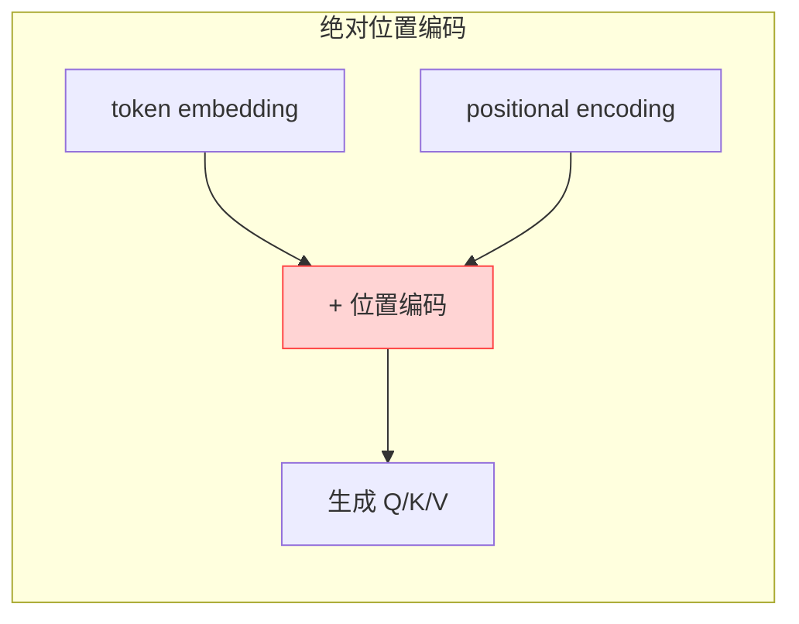
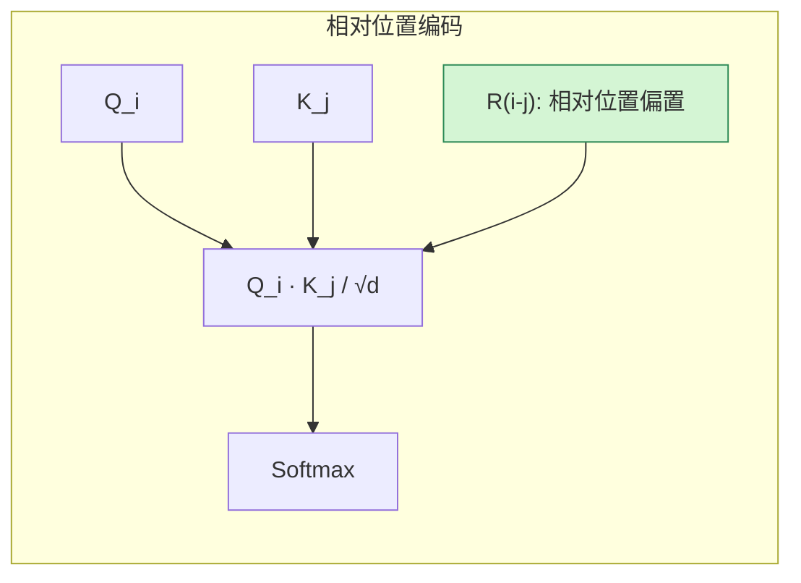
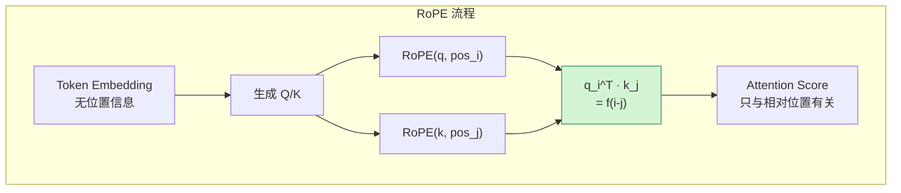
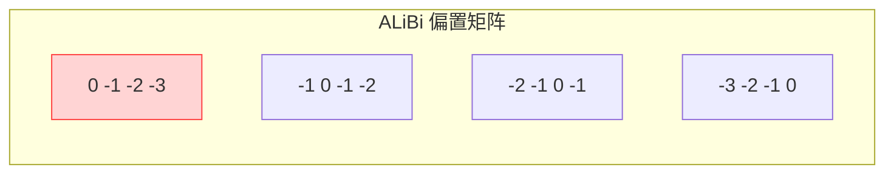
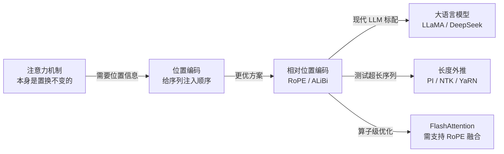

# 位置编码基本原理

> **一句话总结**：位置编码解决的是"Attention 没有位置感"的问题——它通过给每个 token 的向量注入位置信息，让模型知道"谁在第几个位置"，而又不需要让网络自己从头学这套先验。

本文遵循本仓库的设计原则：**先讲清"为什么"，再讲"怎么做"**，并明确标注**关联技术**与**边界、代价**。

- 适用版本前提：绝对位置编码与正弦/可学习编码基于 Vaswani et al. (2017) [1]；RoPE 基于 Su et al. (2021) [2]；ALiBi 基于 Press et al. (2021) [3]；NTK-aware RoPE 基于 Freeman et al. (2023) [4]。**脱离模型架构与目标序列长度的位置编码结论不成立**。

---

## 1. 它为什么存在

### 1.1 序列顺序是语义的一部分

同样三个词，顺序不同，意思完全不同：

> "猫追老鼠" vs "老鼠追猫"

但对 Transformer 的自注意力来说，这两个序列在进入 Attention 之前是**完全等价的**——因为 Attention 的计算对 token 顺序是**置换不变**（permutation invariant）的：

```
Attention(Q, K, V) = Softmax(Q·K^T / √d) · V
```

无论你把 token 顺序怎么打乱，只要 K/V 跟着一起打乱，Attention 的结果**形式不变**。这意味着模型从 Q/K/V 本身**看不到位置**。

### 1.2 为什么 RNN 不需要位置编码

RNN 是一步一步顺序处理的，`h_t` 天然地包含了 "前 t 个 token 的信息"，位置通过时间步隐式编码。但 Transformer 抛弃了循环，换来了并行化，代价就是**必须显式告诉模型位置**。

### 1.3 位置编码要满足的三个性质

一个好的位置编码应该满足 [1][5]：

| 性质 | 含义 | 说明 |
| --- | --- | --- |
| **唯一性** | 每个位置有唯一表示 | 模型能区分第 5 个和第 10 个 token |
| **距离感知** | 位置向量应能反映相对距离 | 模型更容易学 "nearby" vs "far away" |
| **外推性** | 能处理训练时没见过的长度 | 测试序列比训练时长时仍能工作 |
| **可扩展性** | 增加长度不需要重新训练 | 工业部署必需 |

> 注意：**同时满足这四点很难**。早期方案（正弦、可学习）外推性差；RoPE 通过数学设计同时实现了距离感知和相对位置；ALiBi 用惩罚项强行外推；NTK-aware RoPE 在长上下文微调时修复 RoPE 的高频退化。

---

## 2. 绝对位置编码

### 2.1 可学习位置编码（Learned Positional Embedding）

最直观的做法：把位置当做一个离散的 token，学一个位置嵌入矩阵。

```python
import torch.nn as nn

# 最大序列长度 512，d_model=768
pos_emb = nn.Embedding(512, 768)

# token_embed: [batch, seq_len, d_model]
# positions:   [batch, seq_len]
x = token_embed + pos_emb(positions)
```

**优点**：
- 简单直接
- BERT、GPT 早期都用 [6][7]

**缺点**：
- **外推性差**：超过 512 的位置没有嵌入，需要插值或重新训练
- 每个位置是独立学的，没有显式的"距离"先验

### 2.2 正弦位置编码（Sinusoidal）

Transformer 原始论文提出的方案：用不同频率的正弦/余弦函数给每个位置编码。

对于位置 `pos`、维度 `i`，编码为：

$$
PE_{(pos, 2i)}   = \sin\left( \frac{pos}{10000^{2i/d_{model}}} \right)
$$

$$
PE_{(pos, 2i+1)} = \cos\left( \frac{pos}{10000^{2i/d_{model}}} \right)
$$

其中 `2i` 是偶数维，`2i+1` 是奇数维，`d_model` 是模型维度。

#### 为什么用正弦？

核心动机：**相对位置可以用线性变换表达** [1]。

对于固定的偏移 `k`，存在矩阵 `M_k` 使得：

$$
PE_{pos+k} = M_k \cdot PE_{pos}
$$

这意味着模型可以用一个**与绝对位置无关的变换**来处理相对偏移，比可学习位置编码更有结构先验。

**优点**：
- 不需要学习
- 有一定外推能力（虽然实际上也不太好）
- 能表达相对位置关系

**缺点**：
- 绝对位置编码的"绝对"二字仍然意味着：位置编码和 token 嵌入是**相加**的，位置信息被固定地加到每个 token 上
- 超长外推时，高频分量会退化

### 2.3 绝对位置编码的通用问题



绝对位置编码的 Q 和 K 都**同时携带内容和位置信息**，导致 Attention Score 的计算里位置项和内容项会**耦合**在一起。这会带来两个问题：

1. **外推困难**：没见过的位置，模型要重新学习其含义；
2. **相对位置关系不直接**：模型要从两个"绝对位置向量"的相似度中推断相对距离，效率低。

这两个问题推动了**相对位置编码**的发展。

---

## 3. 相对位置编码

### 3.1 基本思想

不再给每个 token  embedding 加上"我在第几位"，而是直接建模 **"我离另一个 token 有多远"**。



代表方法：
- **T5 Relative Bias** [8]
- **Transformer-XL** [9]
- **RoPE** [2]
- **ALiBi** [3]

### 3.2 T5 Relative Bias

T5 的做法最简单：给 Attention Score 直接加一个与相对距离有关的偏置项：

$$
\text{score}(i, j) = \frac{Q_i \cdot K_j}{\sqrt{d}} + b_{i-j}
$$

其中 `b_{i-j}` 是一个可学习的、关于相对距离 `i-j` 的偏置。

**优点**：
- 非常直观
- 对 encoder 很有效

**缺点**：
- 需要限制最大距离（T5 用 32 个桶）
- 外推性仍然有限

### 3.3 Transformer-XL

Transformer-XL 引入了**片段级递归**和**相对位置编码**，核心是：

> 不编码绝对位置，只编码**当前 token 与缓存中 token 的相对距离**。

它的相对位置编码还区分了：
- 同一个 segment 内的相对位置
- 跨 segment 的相对位置

这为超长序列建模奠定了基础，但实现复杂，现代 LLM 较少直接使用。

---

## 4. RoPE：旋转位置编码

### 4.1 核心思想

RoPE（Rotary Position Embedding）是当前 LLM 最主流的位置编码方案 [2]。它的核心洞察是：

> **把位置信息编码进 Q/K 向量的内积运算中，让 Attention Score 天然地只依赖相对位置。**

### 4.2 怎么做

RoPE 不直接给 embedding 加位置向量，而是对 Q 和 K 的每一对维度做**二维旋转**。

假设 Q/K 的维度是 `d`，我们把每两个连续维度 `(x_{2k}, x_{2k+1})` 看成二维向量，然后用一个只与位置 `m` 有关的旋转矩阵去旋转它：

$$
R_{\Theta, m}^{(d)} = \begin{pmatrix}
\cos m\theta_0 & -\sin m\theta_0 & 0 & 0 & \cdots \\
\sin m\theta_0 &  \cos m\theta_0 & 0 & 0 & \cdots \\
0 & 0 & \cos m\theta_1 & -\sin m\theta_1 & \cdots \\
0 & 0 & \sin m\theta_1 &  \cos m\theta_1 & \cdots \\
\vdots & \vdots & \vdots & \vdots & \ddots
\end{pmatrix}
$$

其中旋转角：

$$
\theta_k = 10000^{-2k/d}
$$

对 Q 和 K 分别应用位置 `m` 和 `n` 的旋转矩阵后，Attention Score 变成：

$$
\text{score}(m, n) = (R_{\Theta, m} q_m)^T (R_{\Theta, n} k_n) = q_m^T R_{\Theta, n-m} k_n
$$

关键结论：**Score 只依赖于相对位置 `m-n`，而与绝对位置 `m` 或 `n` 本身无关**。

### 4.3 为什么 RoPE 比绝对位置编码好

| 维度 | 绝对位置编码 | RoPE |
| --- | --- | --- |
| 位置信息注入位置 | 在 embedding 层加 | 在 Q/K 内积中 |
| 相对位置关系 | 间接、要学 | **直接内建于内积** |
| 长度外推 | 差，需插值/重训 | 有，但训练外仍有限 |
| 与 GQA/MQA 兼容 | 兼容 | 兼容 |
| 训练稳定性 | 好 | 好 |



### 4.4 基频 θ 与波长

RoPE 的基频 `θ` 默认是 10000（来自正弦位置编码的底数）。它控制了不同维度的"旋转速度"：

| 维度 | 频率 | 波长 |
| --- | --- | --- |
| 低频维度（i 小） | 慢 | 长，表达长距离依赖 |
| 高频维度（i 大） | 快 | 短，表达短距离/精细位置 |

**基频越大** → 所有维度转得越慢 → 对长距离更有利；
**基频越小** → 高频更快 → 对短距离更敏感。

LLaMA 2/3、Mistral、Gemma 2、DeepSeek V3/V4 等都用 RoPE，基频通常是 **10000** 或 **1000000** [10][11][12]。

### 4.5 长度外推问题

RoPE 训练时见过长度 `L_train`，测试时如果超过这个长度，会有两个问题：

1. **高频维度见过足够多的周期了吗？** 没见过的角度会让内积行为不可控；
2. **内积衰减**：RoPE 的内积本身会随着相对距离增大而衰减，这其实是好事（local bias），但衰减太快会丢失远距离信息。

解决方向有三类：

| 方法 | 思路 | 代表 |
| --- | --- | --- |
| **位置插值（PI）** | 把超出训练长度的位置按比例压缩回训练长度 | Chen et al. 2023 [13] |
| **NTK-aware RoPE** | 低频也外推、高频不插值，保持短距离精度 | Freeman et al. 2023 [4] |
| **Dynamic NTK** | 推理时根据实际长度动态调整基频 | emozilla 2023 [14] |
| **YaRN** | 结合 temperature scaling 和 NTK-aware | Peng et al. 2023 [15] |

DeepSeek V4 等模型在长上下文阶段会做**逐步扩长训练**（从 4K → 32K → 128K），配合 NTK-aware 或 YaRN 外推，才能获得百万级上下文能力 [12]。

---

## 5. ALiBi：不用位置编码的"位置偏置"

### 5.1 核心思想

ALiBi（Attention with Linear Biases）走得更远：它**完全不用位置嵌入**，而是在 Attention Score 上加一个**随距离线性增长的负偏置** [3]：

$$
\text{score}(i, j) = \frac{Q_i \cdot K_j}{\sqrt{d}} - m \cdot |i - j|
$$

其中 `m` 是 head 特定的斜率。

### 5.2 为什么 ALiBi 外推性好

ALiBi 的偏置只依赖于**相对距离** `|i-j|`，而且对任意距离都有定义。因此：

- 训练时见过 `|i-j| <= L`，测试时 `|i-j| > L`，偏置公式**仍然成立**；
- 远处的 attention score 会被压得更低，天然给模型一个**局部性先验**；
- 不需要插值、不需要调整基频。



### 5.3 ALiBi 的边界

| 优点 | 缺点 |
| --- | --- |
| 外推性极强 | 远程信息被强先验压低，长距离依赖建模不如 RoPE 灵活 |
| 不需要位置编码 | 每个 head 的斜率要调 |
| 训练稳定 | 与某些 Attention 优化（如 FlashAttention）的实现要适配 |

MPT-7B 等模型用过 ALiBi [16]。但在 LLaMA 2/3 之后，**RoPE + NTK/YaRN 逐渐成为主流**，因为长距离微调后的 RoPE 上限更高。

---

## 6. 几类位置编码的对比

| 特性 | 可学习绝对 | 正弦绝对 | T5 Relative | RoPE | ALiBi |
| --- | --- | --- | --- | --- | --- |
| **是否加 embedding** | ✅ | ✅ | ❌ | ❌（旋转 Q/K） | ❌ |
| **是否显式建模相对位置** | ❌ | 间接 | ✅ | ✅ | ✅ |
| **是否需要位置编码参数** | ✅ | ❌ | ✅（bias） | ❌ | ✅（斜率） |
| **训练外推性** | ❌ 差 | ⚠️ 一般 | ⚠️ 一般 | ⚠️ 一般（需 PI/NTK/YaRN） | ✅ 好 |
| **长距离依赖能力** | 一般 | 一般 | 一般 | **强**（配合 NTK） | 较弱（被偏置压低） |
| **实现复杂度** | 低 | 低 | 中 | 中 | 低 |
| **现代 LLM 采用情况** | BERT/GPT-1 | Transformer-base | T5 | **LLaMA/Mistral/DeepSeek 主流** | MPT 等少数 |

---

## 7. 边界与代价

### 7.1 没有"最好的"位置编码

位置编码的选择要同时看：

- **目标上下文长度**：短文本（<4K）用什么都行；长文本（>64K）RoPE + NTK/YaRN 或 ALiBi 更有优势；
- **是否需要长距离依赖**：ALiBi 有强局部先验，适合做局部建模；RoPE 上限更高；
- **训练预算**：可学习位置编码简单但外推差；RoPE 需要配套扩长训练；
- **实现生态**：FlashAttention-2/3 对 RoPE 支持最成熟。

### 7.2 常见工程陷阱

| 陷阱 | 说明 |
| --- | --- |
| 训练 4K、直接推理 32K | 绝对位置编码会完全失效；RoPE 需 PI/NTK/YaRN 否则 PPL 爆炸 |
| RoPE 基频选错 | 基频 10000 vs 1000000 对长文本影响显著，需按目标长度设计 |
| GQA/MQA 和 RoPE 的兼容 | RoPE 应用于每个 Q/K 头，GQA/MQA 下 K/V 头数少，只需对存在的头做旋转 |
| 旋转方向 | RoPE 对 Q/K 必须分别用位置 i/j；不能只对 Q 加位置 |
| ALiBi 斜率 | 不同 head 用不同斜率，不能全部一样 |

### 7.3 长度外推的"黄金组合"

现代长上下文 LLM 的标准路径 [12][15]：

```
预训练（4K）
    ↓
长上下文继续预训练（32K）
    ↓
长上下文 SFT（128K / 1M）
    ↓
推理时用 YaRN / Dynamic NTK 微调 RoPE 基频
```

**仅靠位置编码技巧不够**——必须有真实长序列训练数据配合，否则模型即使"能 attend 到"远处，也"不会用"远处信息。

---

## 8. 可验证：最小实验

### 8.1 观察正弦位置编码的周期性

```python
import torch
import matplotlib.pyplot as plt

def sinusoidal_pe(max_len=100, d_model=128):
    pos = torch.arange(max_len).unsqueeze(1).float()
    i = torch.arange(0, d_model, 2).float()
    angle = pos / (10000 ** (i / d_model))
    pe = torch.zeros(max_len, d_model)
    pe[:, 0::2] = torch.sin(angle)
    pe[:, 1::2] = torch.cos(angle)
    return pe

pe = sinusoidal_pe(100, 128)
plt.imshow(pe.T, aspect='auto', cmap='viridis')
plt.xlabel("position")
plt.ylabel("dimension")
plt.title("Sinusoidal Positional Encoding")
plt.colorbar()
plt.show()
```

可以观察到：低维（上部）变化慢，高维（下部）变化快。

### 8.2 验证 RoPE 的相对位置性质

```python
import torch

def apply_rope(x, pos, base=10000):
    """x: [d], pos: int"""
    d = x.shape[0]
    freqs = 1.0 / (base ** (torch.arange(0, d, 2).float() / d))
    angles = pos * freqs
    cos, sin = torch.cos(angles), torch.sin(angles)
    out = torch.empty_like(x)
    out[0::2] = x[0::2] * cos - x[1::2] * sin
    out[1::2] = x[0::2] * sin + x[1::2] * cos
    return out

# 对 q@pos=3 和 k@pos=5 做 RoPE，score 应等于相对距离 2
d = 64
q = torch.randn(d)
k = torch.randn(d)
score_direct = torch.dot(apply_rope(q, 3), apply_rope(k, 5))
score_relative = torch.dot(apply_rope(q, 0), apply_rope(k, 2))  # 差值都是 2
print(score_direct.item(), score_relative.item())
# 两者应相等
```

> 这个实验直接验证 RoPE 的核心性质：**Attention Score 只依赖于相对位置，不依赖于绝对位置**。

---

## 9. 关联：它在知识网络中的位置



- **与注意力机制**：位置编码补偿了 Attention 的置换不变性，两者共同构成 Transformer 的序列建模能力。
- **与 RoPE / ALiBi**：相对位置编码是现代 LLM 的主流，RoPE 因与 FlashAttention 融合好、长上下文上限高而被广泛采用。
- **与长度外推技术**：RoPE 本身外推有限，必须配合 PI、NTK-aware、YaRN 或逐步扩长训练。
- **与推理优化**：FlashAttention-2/3 内置对 RoPE 的融合计算，避免显式构造位置编码矩阵。

---

## 10. 延伸阅读

- 本仓库姊妹篇：
  - 《注意力机制基本原理》（本目录）：自注意力、MHA、GQA/MQA 与位置编码的交互
  - 《FlashAttention 基本原理》（推理/Attention优化）：RoPE 在 FlashAttention 中的融合实现
- Vaswani et al. (2017) 原始 Transformer 论文 [1]
- RoPE 原论文 [2]
- ALiBi 原论文 [3]
- YaRN 长上下文外推 [15]
- DeepSeek V4 长上下文训练报告 [12]

---

## 参考文献

1. Vaswani, A., Shazeer, N., Parmar, N., et al. *Attention Is All You Need*. NeurIPS 2017. arXiv:1706.03762. <https://arxiv.org/abs/1706.03762> — 提出 Transformer 架构、正弦位置编码与可学习位置编码。
2. Su, J., Lu, Y., Pan, S., Murtadha, A., Wen, B., & Liu, Y. *RoFormer: Enhanced Transformer with Rotary Position Embedding*. Neurocomputing, 2024. arXiv:2104.09864. <https://arxiv.org/abs/2104.09864> — 提出 RoPE（旋转位置编码），证明 Attention Score 只依赖相对位置。
3. Press, O., Smith, N. A., & Lewis, M. *Train Short, Test Long: Attention with Linear Biases Enables Input Length Extrapolation*. ICLR 2022. arXiv:2108.12409. <https://arxiv.org/abs/2108.12409> — 提出 ALiBi，用线性偏置替代位置编码。
4. Freeman, C. D., Frey, E., Raichuk, A., et al. *LLaMA-2's Context Window*. arXiv:2306.15595. <https://arxiv.org/abs/2306.15595> — 讨论位置插值与 NTK-aware RoPE 在长上下文上的应用。
5. Huang, A., Vaswani, A., Uszkoreit, J., et al. (blog). *The Illustrated Transformer*. Jay Alammar, 2018. <https://jalammar.github.io/illustrated-transformer/> — 可视化正弦位置编码与 Transformer 流程。
6. Devlin, J., Chang, M. W., Lee, K., & Toutanova, K. *BERT: Pre-training of Deep Bidirectional Transformers*. NAACL 2019. arXiv:1810.04805. <https://arxiv.org/abs/1810.04805> — 使用可学习位置编码。
7. Radford, A., Narasimhan, K., Salimans, T., & Sutskever, I. *Improving Language Understanding by Generative Pre-Training* (GPT-1). OpenAI, 2018. <https://cdn.openai.com/research-covers/language-unsupervised/language_understanding_paper.pdf> — GPT 早期也使用可学习位置编码。
8. Raffel, C., Shazeer, N., Roberts, A., et al. *Exploring the Limits of Transfer Learning with a Unified Text-to-Text Transformer*. JMLR 2020. arXiv:1910.10683. <https://arxiv.org/abs/1910.10683> — T5 的相对位置偏置。
9. Dai, Z., Yang, Z., Yang, Y., et al. *Transformer-XL: Attentive Language Models Beyond a Fixed-Length Context*. ACL 2019. arXiv:1901.02860. <https://arxiv.org/abs/1901.02860> — 片段级递归与相对位置编码。
10. Touvron, H., Lavril, T., Izacard, G., et al. *LLaMA: Open and Efficient Foundation Language Models*. arXiv:2302.13971. <https://arxiv.org/abs/2302.13971> — LLaMA 1 使用 RoPE，基频 10000。
11. Touvron, H., Martin, L., Stone, K., et al. *Llama 2: Open Foundation and Fine-Tuned Chat Models*. arXiv:2307.09288. <https://arxiv.org/abs/2307.09288> — LLaMA 2 继续使用 RoPE。
12. DeepSeek-AI. *DeepSeek-V4: Towards Highly Efficient Million-Token Context Intelligence*. arXiv:2606.19348. <https://arxiv.org/abs/2606.19348> — DeepSeek V4 的长上下文训练与 RoPE 外推实践。
13. Chen, S., Wong, S., Chen, L., & Tian, Y. *Extending Context Window of Large Language Models via Position Interpolation*. arXiv:2306.15595. <https://arxiv.org/abs/2306.15595> — 位置插值（PI）。
14. emozilla (blog). *Dynamically Scaled RoPE Further Increases Performance of Long Context LLaMA*. GitHub Gist, 2023. <https://gist.github.com/emozilla/9c95027e613e37e36e988e9d0c894f7d> — Dynamic NTK。
15. Peng, B., Quesnelle, J., Fan, H., & Shippole, E. *YaRN: Efficient Context Window Extension of Large Language Models*. arXiv:2309.00071. <https://arxiv.org/abs/2309.00071> — YaRN，结合 temperature scaling 与 NTK-aware 的外推方法。
16. MosaicML. *MPT-7B: A New Standard for Open-Source, Commercially Usable LLMs*. 2023. <https://www.mosaicml.com/blog/mpt-7b> — 采用 ALiBi 的代表模型。

### 图片来源与许可声明

本文所有图均为 **Mermaid 自绘**（flowchart / graph / 表格化矩阵示意），GitHub 原生渲染：

| 图 | 类型 | 说明 |
| --- | --- | --- |
| 绝对位置编码流程（第 2.3 节） | Mermaid flowchart | 自绘 |
| 相对位置编码流程（第 3.1 节） | Mermaid flowchart | 自绘 |
| RoPE 流程（第 4.3 节） | Mermaid flowchart | 自绘 |
| ALiBi 偏置矩阵（第 5.2 节） | Mermaid graph | 自绘 |
| 知识网络位置（第 9 节） | Mermaid flowchart | 自绘 |

> 注：位置编码的经典可视化（正弦编码热力图、RoPE 旋转示意图）在原始论文和博客中多为 PDF 内嵌图或无法稳定直链下载的 SVG，因此本文用 Mermaid 自绘表达同一机理。文中所有数学结论与实现细节均已给出可点击来源。
