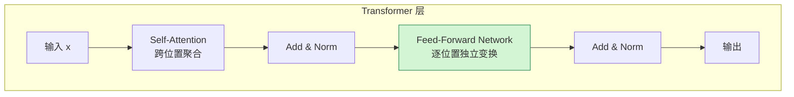
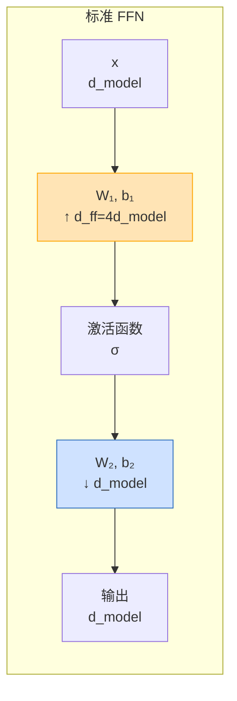
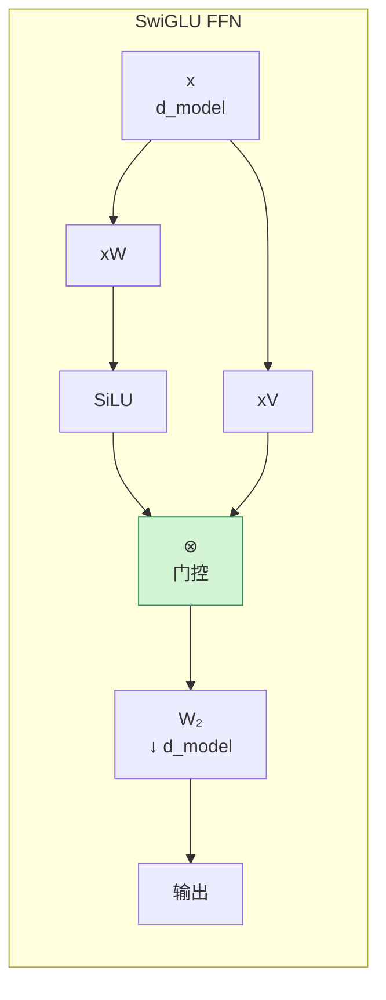
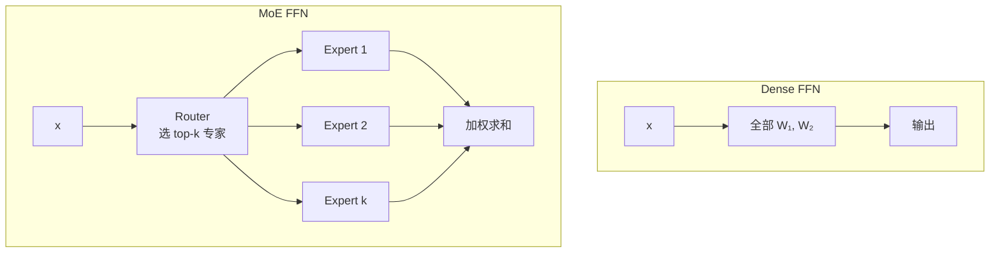
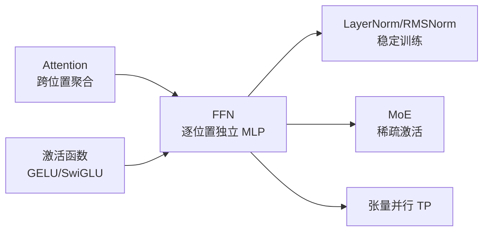

# 前馈网络（FFN）基本原理

> **一句话总结**：FFN 是 Transformer 层中**唯一逐位置独立计算**的子层，它通过一个"扩维 → 非线性 → 缩维"的两层 MLP，为模型提供逐 token 的上下文外非线性变换能力，是现代大语言模型中承担约 2/3 计算量和 1/2 参数量的部分。

本文遵循本仓库的设计原则：**先讲清"为什么"，再讲"怎么做"**，并明确标注**关联技术**与**边界、代价**。

- 适用版本前提：标准 FFN 结构基于 Vaswani et al. (2017) [1]；SwiGLU 门控 FFN 基于 Shazeer (2020) [2]，并在 LLaMA/Touvron et al. (2023) [3] 中大规模验证；MoE 路由机制基于 Shazeer et al. (2017) [4]。**脱离模型架构和激活函数选择谈"最优 FFN 维度"不成立**。

---

## 1. 它为什么存在

### 1.1 单靠 Attention 不够

Attention 的作用是让每个 token 的 hidden state **融合全局上下文信息**：

$$
\text{Attention}(Q, K, V) = \text{softmax}\left(\frac{QK^T}{\sqrt{d_k}}\right)V
$$

但 Attention 本身有几个限制：

| 限制 | 说明 |
| --- | --- |
| **本质是加权和** | 每个 token 的输出都是 value 向量的线性组合，表达能力受限 |
| **没有逐位置非线性变换** | 不同 token 之间的 FFN 不共享信息，需要独立变换增强表达 |
| **上下文外能力弱** | 对单个 token 的局部模式识别（如形态学规则、数字运算）需要额外的非线性层 |

> 如果把 Attention 比作"开会讨论"，那么 FFN 就是会后"每个人独立思考再加工"——两者缺一不可。

### 1.2 FFN 在 Transformer 层中的位置

标准 Transformer Encoder/Decoder 层：



关键点：**FFN 是 Position-wise 的**，即它对序列中每个 token 的 hidden state 独立应用同一个 MLP。

### 1.3 FFN 承担的职责

1. **增强表达能力**：把 Attention 输出的高维表示投影到更大的中间空间，学习更复杂的特征组合；
2. **存储知识**：有研究表明 FFN 层中的某些神经元会编码特定的语义知识（如"某个国家的首都"）[5]；
3. **提供非线性**：没有激活函数的 FFN 等价于单层线性变换，必须有非线性激活。

---

## 2. 标准 FFN 结构

### 2.1 数学公式

原始 Transformer 论文 [1] 中的 FFN：

$$
\text{FFN}(x) = \max(0, xW_1 + b_1)W_2 + b_2
$$

其中：
- $W_1 \in \mathbb{R}^{d_{model} \times d_{ff}}$：输入到隐藏层的权重
- $W_2 \in \mathbb{R}^{d_{ff} \times d_{model}}$：隐藏层到输出的权重
- $d_{ff} = 4 \times d_{model}$：隐藏层维度通常是输入维度的 4 倍
- 激活函数：ReLU（原始），后续模型多用 GELU/SwiGLU

### 2.2 维度关系



典型维度：

| 模型 | d_model | d_ff | 比例 |
| --- | --- | --- | --- |
| Transformer-base [1] | 512 | 2048 | 4× |
| Transformer-big [1] | 1024 | 4096 | 4× |
| BERT-base [6] | 768 | 3072 | 4× |
| GPT-2 [7] | 768 | 3072 | 4× |
| LLaMA-2-7B [3] | 4096 | 11008 | 2.6875× |
| LLaMA-3-8B [8] | 4096 | 14336 | 3.5× |

> **注意**：LLaMA 系列不再严格用 4×，而是选一个更利于硬件对齐的维度（如 11008 = 256×43）。

### 2.3 参数量分析

FFN 的参数量为：

$$
\text{FFN params} = d_{model} \cdot d_{ff} + d_{ff} \cdot d_{model} = 2 \cdot d_{model} \cdot d_{ff}
$$

当 $d_{ff} = 4d_{model}$ 时：

$$
\text{FFN params} = 8 \cdot d_{model}^2
$$

对比 Attention 的参数量：

$$
\text{Attention params} = 4 \cdot d_{model}^2 \quad \text{(Q/K/V/O 四个投影矩阵)}
$$

所以标准 FFN 参数量是 Attention 的 **2 倍**。

### 2.4 计算量分析

对于序列长度 $n$，FFN 的计算量为：

$$
\text{FFN FLOPs} = 2 \cdot n \cdot d_{model} \cdot d_{ff}
$$

当 $d_{ff} = 4d_{model}$ 时：

$$
\text{FFN FLOPs} = 8 \cdot n \cdot d_{model}^2
$$

Attention 的计算量为：

$$
\text{Attention FLOPs} = 2 \cdot n \cdot d_{model}^2 + 2 \cdot n^2 \cdot d_{model}
$$

在长序列时（$n \gg d_{model}$），Attention 的 $n^2$ 项占主导；但在中等长度（如 $n=2048, d_{model}=4096$）时，**FFN 往往承担约 2/3 的总 FLOPs**。

---

## 3. 激活函数的选择

### 3.1 从 ReLU 到 GELU

| 模型 | FFN 激活函数 | 说明 |
| --- | --- | --- |
| Transformer [1] | ReLU | 简单，但有"神经元死亡"问题 |
| BERT [6] | GELU | 更平滑，训练更稳定 |
| GPT-2/3 [7][9] | GELU | OpenAI 系列沿用 |

### 3.2 SwiGLU 门控 FFN

现代 LLM 普遍使用 **SwiGLU** [2]：

$$
\text{SwiGLU}(x) = (xW \cdot \sigma(xV)) \cdot U
$$

或者写成：

$$
\text{FFN}_{\text{SwiGLU}}(x, W, V, W_2) = \left( \text{SiLU}(xW) \otimes xV \right) W_2
$$

其中：
- $W, V \in \mathbb{R}^{d_{model} \times d_{ff}}$：两个并行的升维投影
- $W_2 \in \mathbb{R}^{d_{ff} \times d_{model}}$：降维投影
- $\text{SiLU}(x) = x \cdot \sigma(x)$：Swish 激活
- $\otimes$：逐元素乘法（门控）



### 3.3 为什么 SwiGLU 比标准 FFN 好

1. **门控机制**：SiLU(xW) 作为门控信号，决定 xV 的哪些分量通过，表达能力更强；
2. **两个输入投影**：相当于让模型同时学习"过滤信号"和"传递内容"；
3. **训练更稳定**：相比 ReLU，死亡神经元问题大大减少；
4. **实证更好**：PaLM、LLaMA、Mistral、DeepSeek 等模型都使用 SwiGLU [10][3][11]。

### 3.4 SwiGLU 的维度补偿

SwiGLU 有三个权重矩阵（W, V, W₂），比标准 FFN 多了一个 $d_{model} \times d_{ff}$ 的投影。为了保持总参数量与标准 FFN 相当，通常把中间维度从 $4d_{model}$ 降到 $\frac{8}{3}d_{model}$：

$$
3 \cdot d_{model} \cdot d_{ff} = 2 \cdot d_{model} \cdot d_{ff}^{\text{standard}}
$$

代入 $d_{ff}^{\text{standard}} = 4d_{model}$：

$$
d_{ff}^{\text{SwiGLU}} = \frac{8}{3} d_{model}
$$

| 模型 | d_model | SwiGLU d_ff | 比例 | 说明 |
| --- | --- | --- | --- | --- |
| PaLM [10] | 2048 | 5461 | 2.67× | $\approx 8/3$ |
| LLaMA-2-7B [3] | 4096 | 11008 | 2.6875× | 约等于 8/3，并对齐 256 |
| LLaMA-3-8B [8] | 4096 | 14336 | 3.5× | 因 GQA 头数调整 |

---

## 4. FFN 与 MoE

### 4.1 从 Dense FFN 到 Sparse MoE

标准 FFN 中，每个 token 都会激活全部 $d_{ff}$ 个隐藏单元，称为 **Dense（稠密）FFN**。

当模型规模扩大时，FFN 参数量随 $d_{model} \cdot d_{ff}$ 快速增长。MoE（Mixture of Experts）的思想是：

> **每次只激活 FFN 参数的一小部分，用门控网络选择哪些专家参与计算。**



### 4.2 专家的结构

每个专家通常就是一个标准 FFN 或 SwiGLU FFN，维度与基础模型相同。设：
- 专家总数 $E$
- 每个 token 激活 $K$ 个专家（通常 $K=1$ 或 $2$）
- 每个专家的 FFN 维度 $d_{ff}$

则 MoE 层的总参数为：

$$
\text{MoE params} = E \cdot (2 \cdot d_{model} \cdot d_{ff}) + \text{router params}
$$

但每次前向只激活 $K$ 个专家，实际计算量为：

$$
\text{MoE active FLOPs} = K \cdot (2 \cdot n \cdot d_{model} \cdot d_{ff})
$$

所以 MoE 可以在**激活参数不变**的情况下，把总参数量扩大到 $E$ 倍。

### 4.3 MoE 的边界

MoE 不是免费的午餐，它的代价是：

| 收益 | 代价 |
| --- | --- |
| 参数量 ×E，激活参数不变 | 需要 All-to-All 通信把 token 路由到对应专家 |
| 训练吞吐更高（同样激活参数） | 负载不均会导致某些专家过载、某些专家空闲 |
| 推理时需要加载更多参数 | 显存占用大，需要 EP（专家并行）或量化 |

更多细节见本仓库 `训练/MOE/` 系列文档。

---

## 5. 边界与代价

### 5.1 FFN 不是越大越好

增大 $d_{ff}$ 能提升表达能力，但代价是：

| 维度 | 影响 |
| --- | --- |
| 参数量 | $\propto d_{ff}$ |
| 计算量 | $\propto d_{ff}$ |
| 显存 | 激活占用 $\propto n \cdot d_{ff}$ |
| 训练速度 | $\propto 1/d_{ff}$（近似） |
| 表达能力 | 边际递减 |

经验上，$d_{ff} = 4d_{model}$ 是一个历史默认值，现代模型会根据硬件对齐和总参数量做微调。

### 5.2 FFN 与 Attention 的权衡

| 场景 | 瓶颈 | 优化方向 |
| --- | --- | --- |
| 短序列、大模型 | FFN 计算量大 | 减少 FFN 维度、用 SwiGLU、MoE |
| 长序列 | Attention 计算量大（$n^2$） | FlashAttention、GQA/MQA、序列并行 |
| 推理高并发 | KV Cache 显存大 | GQA/MQA、KV 量化 |

### 5.3 常见工程陷阱

| 陷阱 | 说明 |
| --- | --- |
| 以为 FFN 占参数少 | 实际上 FFN 占 2/3 左右参数，剪枝/量化 FFN 收益很大 |
| 混淆 d_ff 与 d_model | d_ff 是中间隐藏维，d_model 是模型隐藏维，两者不同 |
| SwiGLU 维度直接照搬 4× | 三个矩阵会导致参数量暴涨，应使用 $\frac{8}{3}d_{model}$ |
| 忽略 FFN 的激活显存 | 长序列时 FFN 激活是显存大头，需检查点或序列并行 |

---

## 6. 可验证：最小实验

### 6.1 观察 FFN 的参数量占比

```python
import torch
import torch.nn as nn

d_model = 768
d_ff = 4 * d_model

# Attention 参数量
attn = nn.MultiheadAttention(d_model, num_heads=12, batch_first=True)
attn_params = sum(p.numel() for p in attn.parameters())

# FFN 参数量
ffn = nn.Sequential(
    nn.Linear(d_model, d_ff),
    nn.GELU(),
    nn.Linear(d_ff, d_model),
)
ffn_params = sum(p.numel() for p in ffn.parameters())

print(f"Attention params: {attn_params:,}")
print(f"FFN params: {ffn_params:,}")
print(f"FFN / Attention ratio: {ffn_params / attn_params:.2f}x")
```

预期输出：
```
Attention params: 2,362,368
FFN params: 4,722,432
FFN / Attention ratio: 2.00x
```

### 6.2 观察 FFN 的 Position-wise 特性

```python
import torch
import torch.nn as nn

ffn = nn.Sequential(
    nn.Linear(64, 256),
    nn.GELU(),
    nn.Linear(256, 64),
)

# 输入形状 [batch=2, seq_len=5, d_model=64]
x = torch.randn(2, 5, 64)
out = ffn(x)  # 输出形状仍然是 [2, 5, 64]

# 关键：交换序列中两个 token 的位置
x_swapped = x[:, [0, 2, 1, 3, 4], :]
out_swapped = ffn(x_swapped)

# FFN 对 token 顺序不敏感
assert torch.allclose(out[:, [0, 2, 1, 3, 4], :], out_swapped, atol=1e-5)
print("FFN 是 Position-wise 的：交换 token 顺序，输出也对应交换")
```

---

## 7. 关联：它在知识网络中的位置



- **与 Attention**：Attention 负责"跨位置交流"，FFN 负责"逐位置深加工"，两者交替构成 Transformer 层。
- **与激活函数**：FFN 必须包含非线性激活，SwiGLU 已成为现代 LLM 的标准选择。
- **与 LayerNorm/RMSNorm**：FFN 前后都有归一化，Pre-LN 结构让 FFN 训练更稳定。
- **与 MoE**：MoE 本质上是把 Dense FFN 替换成 Sparse FFN，用路由选择专家。
- **与张量并行 TP**：FFN 的 $W_1$ 按列切、$W_2$ 按行切，是张量并行的标准切法。

---

## 8. 延伸阅读

- 本仓库姊妹篇：
  - 《激活函数基本原理》（本目录）：GELU、SiLU、SwiGLU 的详细机制
  - 《注意力机制基本原理》（本目录）：Attention 与 FFN 如何协同
  - 《归一化基本原理》（本目录）：Pre-LN/Post-LN 与 FFN 的位置关系
  - `训练/MOE/` 系列：专家路由、负载均衡、专家并行

---

## 参考文献

1. Vaswani, A., Shazeer, N., Parmar, N., et al. *Attention Is All You Need*. NeurIPS 2017. arXiv:1706.03762. <https://arxiv.org/abs/1706.03762> — 提出 Transformer 架构和标准 FFN：$\text{FFN}(x) = \max(0, xW_1 + b_1)W_2 + b_2$，$d_{ff}=4d_{model}$。
2. Shazeer, N. *GLU Variants Improve Transformer*. arXiv:2002.05202 (2020). <https://arxiv.org/abs/2002.05202> — 提出 SwiGLU 门控 FFN，并分析其参数量补偿（$\frac{8}{3}d_{model}$）。
3. Touvron, H., Martin, L., Stone, K., et al. *Llama 2: Open Foundation and Fine-Tuned Chat Models*. arXiv:2307.09288 (2023). <https://arxiv.org/abs/2307.09288> — LLaMA 2 使用 SwiGLU，d_ff=11008（d_model=4096）。
4. Shazeer, N., Mirhoseini, A., Maziarz, K., et al. *Outrageously Large Neural Networks: The Sparsely-Gated Mixture-of-Experts Layer*. ICLR 2017. arXiv:1701.06538. <https://arxiv.org/abs/1701.06538> — MoE 路由机制的原始论文。
5. Geva, M., Schuster, R., Berant, J., & Levy, O. *Transformer Feed-Forward Layers Are Key-Value Memories*. EMNLP 2021. <https://arxiv.org/abs/2012.14913> — FFN 层编码语义知识的研究。
6. Devlin, J., Chang, M. W., Lee, K., & Toutanova, K. *BERT: Pre-training of Deep Bidirectional Transformers*. NAACL 2019. arXiv:1810.04805. <https://arxiv.org/abs/1810.04805> — BERT 使用 GELU 激活的 FFN。
7. Radford, A., Wu, J., Child, R., et al. *Language Models are Unsupervised Multitask Learners* (GPT-2). OpenAI, 2019. <https://cdn.openai.com/better-language-models/language_models_are_unsupervised_multitask_learners.pdf> — GPT-2 的 FFN 配置。
8. AI@Meta. *The Llama 3 Herd of Models*. arXiv:2407.21783 (2024). <https://arxiv.org/abs/2407.21783> — LLaMA 3 的 SwiGLU 维度与模型配置。
9. Brown, T., Mann, B., Ryder, N., et al. *Language Models are Few-Shot Learners* (GPT-3). arXiv:2005.14165 (2020). <https://arxiv.org/abs/2005.14165> — GPT-3 使用 GELU 激活。
10. Chowdhery, A., Narang, S., Devlin, J., et al. *PaLM: Scaling Language Modeling with Pathways*. arXiv:2204.05149 (2022). <https://arxiv.org/abs/2204.05149> — PaLM 使用 SwiGLU，验证了门控 FFN 在大规模训练中的效果。
11. DeepSeek-AI. *DeepSeek-V3 Technical Report*. arXiv:2412.19437 (2024). <https://arxiv.org/abs/2412.19437> — DeepSeek-V3 使用 SwiGLU 与 MoE 的 FFN 结构。

### 图片来源与许可声明

本文所有图均为 **Mermaid 自绘**（flowchart / graph），GitHub 原生渲染：

| 图 | 类型 | 说明 |
| --- | --- | --- |
| Transformer 层结构（第 1.2 节） | Mermaid flowchart | 自绘 |
| 标准 FFN 维度变换（第 2.2 节） | Mermaid flowchart | 自绘 |
| SwiGLU FFN 门控结构（第 3.2 节） | Mermaid flowchart | 自绘 |
| Dense FFN vs MoE FFN（第 4.1 节） | Mermaid flowchart | 自绘 |
| 知识网络位置（第 7 节） | Mermaid flowchart | 自绘 |

> 注：FFN 的结构示意图为工程概念图，无需外部图源；所有数学公式、维度关系与实验结论均已给出可点击来源。
