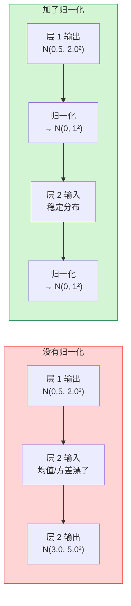
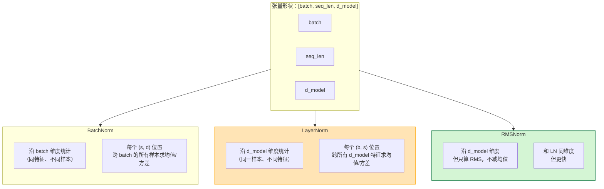
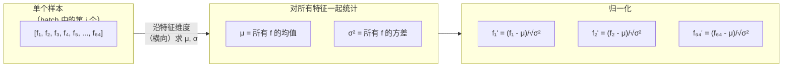
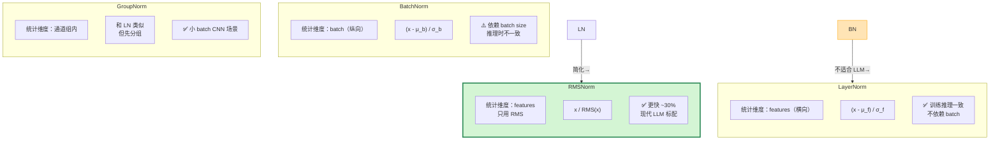
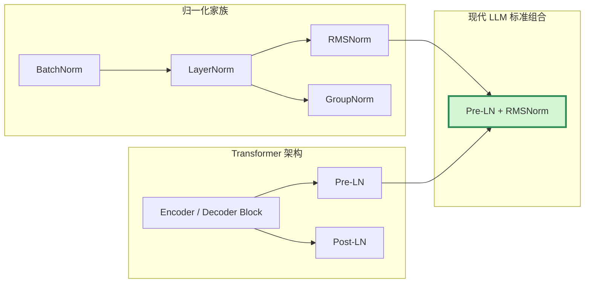

# 归一化（Normalization）基本原理

> **一句话总结**：归一化层把神经网络某一层的激活（或权重）重新调整到一个稳定的分布上，解决**分布漂移（covariate shift）**问题，让训练更快、更稳定。BatchNorm 是最早、最经典的方案——沿 batch 维度做归一化，统计全局均值/方差。但它依赖 batch size、推理时需要维护运行时统计量。LayerNorm 则沿**特征维度**做归一化，不依赖 batch，天然适合 RNN 和 Transformer。RMSNorm 在 LayerNorm 基础上去掉了均值项，计算更快、效果几乎不差，成为现代 LLM（LLaMA、GPT-NeoX、Mistral 等）的标配。Transformer 架构中归一化的位置也影响训练稳定性：**Pre-LN**（先归一化再计算）比 **Post-LN**（先计算再归一化）更稳定、更容易训练，几乎所有现代大模型都采用 Pre-LN。

本文遵循本仓库的设计原则：**先讲清"为什么"，再讲"怎么做"**，并明确标注**关联技术**与**边界、代价**。

- 适用版本前提：本文机制描述基于 BatchNorm 原始论文（2015）[1]、LayerNorm 原始论文（2016）[2]、RMSNorm 原始论文（2019）[3]，以及 Transformer 架构中的使用现状（2023–2026）。

---

## 1. 它为什么存在：分布漂移

### 1.1 训练的不稳定来自哪里

深度神经网络中，一层的输出是下一层的输入。随着参数更新，每层输出的**均值和方差会不断变化**——这就是**内部协变量偏移（Internal Covariate Shift, ICS）** [1]。

这个偏移带来两个问题：
1. **训练速度慢**：梯度方向在不断变化，学习率难以固定，只能用很小的学习率慢慢调
2. **数值不稳定**：Sigmoid/Tanh 这类饱和激活函数在输入偏大/偏小时梯度接近 0，导致梯度消失

### 1.2 归一化的直觉解法

归一化层的做法很简单——在每层的激活之后（或之前），把它重新拉回到一个**稳定的分布**上：



但"重新拉回稳定分布"有无数种做法——**沿哪个维度统计均值/方差**，决定了归一化层的类型。

---

## 2. 归一化家族全景

所有归一化层共享同一个核心公式——只是"沿哪个维度"计算统计量不同 [4]：

```
x̂ = (x - μ) / √(σ² + ε)     ← 归一化到均值 0、方差 1
y = γ · x̂ + β                ← 可学习的缩放与偏移
```

其中：
- `μ` 和 `σ²` 是从一批数据中统计出来的均值和方差
- `ε` 是一个很小的常数（如 1e-5），防止除零
- `γ` 和 `β` 是可学习参数——网络可以通过它们"撤销"归一化，如果这层不需要归一化效果的话

**不同归一化 = 不同的统计维度**：

| 归一化 | 沿什么维度求 μ, σ² | 适合什么场景 | 推理时需要什么 |
| --- | --- | --- | --- |
| **BatchNorm** | 沿 **batch 维度**（同特征、不同样本） | CNN，依赖 batch size | 运行时均值/方差 |
| **LayerNorm** | 沿 **特征维度**（同一样本、不同特征） | Transformer / RNN / NLP | 不需要（每个样本独立） |
| **InstanceNorm** | 沿 **通道内**（CNN 里每个通道自己） | 风格迁移 | 不需要 |
| **GroupNorm** | 把通道分成组，**每组内**统计 | 小 batch 下 CNN | 不需要 |
| **RMSNorm** | 沿 **特征维度**，但**只用 RMS 不用均值** | 现代 LLM | 不需要 |

### 2.1 维度图解

一个典型的 Transformer hidden state 形状是 `[batch, seq_len, d_model]`。不同归一化在这个张量上沿不同维度统计：



---

## 3. BatchNorm：最早、最经典

### 3.1 核心思路

BatchNorm（BN）在每个 mini-batch 上，把每层输出的**每个特征**都拉回到 N(0, 1) [1]。

```mermaid
flowchart LR
    subgraph MiniBatch["Mini-batch 输入<br/>形状: [batch, features]"]
        X1["样本 1: [f₁, f₂, f₃, f₄]"]
        X2["样本 2: [f₁, f₂, f₃, f₄]"]
        X3["样本 3: [f₁, f₂, f₃, f₄]"]
        XN["..."]
    end
    subgraph PerFeature["对每个特征列独立统计"]
        Mu1["f₁: μ₁, σ₁²"]
        Mu2["f₂: μ₂, σ₂²"]
        Mu3["f₃: μ₃, σ₃²"]
        Mu4["f₄: μ₄, σ₄²"]
    end
    subgraph Normalize["归一化"]
        F1["f₁' = (f₁ - μ₁)/√σ₁²"]
        F2["f₂' = (f₂ - μ₂)/√σ₂²"]
        F3["f₃' = (f₃ - μ₃)/√σ₃²"]
        F4["f₄' = (f₄ - μ₄)/√σ₄²"]
    end
    MiniBatch -->|"沿 batch 维度<br/>（竖向）求 μ, σ"| PerFeature
    PerFeature --> Normalize
```



### 3.2 BN 的公式

给定 batch 输入 `x ∈ R^{B × C}`（B 个样本、C 个特征），BN 对**每个特征**独立操作 [1]：

```
μ_c = (1/B) · Σ_{i=1}^B x_{i,c}           第 c 个特征的 batch 均值
σ_c² = (1/B) · Σ_{i=1}^B (x_{i,c} - μ_c)²  第 c 个特征的 batch 方差

x̂_{i,c} = (x_{i,c} - μ_c) / √(σ_c² + ε)
y_{i,c} = γ_c · x̂_{i,c} + β_c
```

### 3.3 BN 的问题

BN 在 CNN 上效果很好，但在 NLP/Transformer 场景下有几个硬伤 [2]：

1. **依赖 batch size**：当 batch size 很小时，batch 统计量的噪声很大，归一化反而不稳定
2. **推理时不一致**：训练时用 batch 内统计量，推理时用**全局累积的运行时均值/方差**——训练和推理行为不完全一致
3. **RNN/Transformer 不适用**：序列长度可能变，batch 维度和序列维度混在一起，BN 无法优雅处理

**结论**：BN 不适合 Transformer 架构——这正是 LayerNorm 被提出的动机 [2]。

---

## 4. LayerNorm：Transformer 的标配

### 4.1 核心思路

LayerNorm（LN）沿着**特征维度**做归一化——对**每一个样本**的**全部特征**一起求均值/方差 [2]。



### 4.2 LN 的公式

给定单个样本的特征向量 `x ∈ R^d`，LN 对**整个向量**求统计量 [2]：

```
μ = (1/d) · Σ_{i=1}^d x_i
σ² = (1/d) · Σ_{i=1}^d (x_i - μ)²

x̂_i = (x_i - μ) / √(σ² + ε)
y_i = γ_i · x̂_i + β_i
```

### 4.3 LN 解决了 BN 的哪些问题

| BN 的问题 | LN 如何解决 |
| --- | --- |
| 依赖 batch size | **完全不依赖 batch**——每个样本独立归一化 |
| 推理时不一致 | **训练和推理行为完全一致**——不需要维护运行时统计量 |
| RNN/Transformer 不适用 | 天然适合变长序列、适合按位置独立的 Transformer |

**代价**：LN 计算**跨特征**的统计量，所以它**抑制了特征之间的相对大小关系**——这对 Transformer 来说是可接受的，因为 Attention 和 FFN 本身就是逐特征独立的。

---

## 5. RMSNorm：现代 LLM 的选择

### 5.1 从 LN 到 RMSNorm 的简化

Root Mean Square Normalization（RMSNorm）是在 LayerNorm 基础上的**直接简化**——**去掉了均值项** [3]：

| 步骤 | LayerNorm | RMSNorm |
| --- | --- | --- |
| 计算统计量 | μ = mean(x)<br/>σ² = var(x) | **不需要均值**<br/>RMS = √mean(x²) |
| 归一化 | (x - μ) / √(σ² + ε) | **x / (RMS + ε)** |
| 缩放 | γ · x̂ + β | **γ · x̂**（β 也去掉了） |

### 5.2 RMSNorm 的公式

```
RMS(x) = √( (1/d) · Σ_{i=1}^d x_i² )

y_i = γ_i · x_i / (RMS(x) + ε)
```

### 5.3 为什么去掉均值项还能工作

直觉上：LayerNorm 做了两件事——**中心化**（减均值）和**缩放**（除标准差）。RMSNorm 只做缩放。

为什么中心化可以去掉？因为：
1. Transformer 中 LayerNorm 后面接的是 **Attention 或 FFN**——这些操作本身是**仿射不变**的（输入整体加一个常数，输出只改变一个常数项）
2. 残差连接让偏移量更容易传播
3. 实验验证：去掉均值项后效果几乎不变，但**计算更快、实现更简单** [3]

### 5.4 速度优势

| 操作 | LayerNorm | RMSNorm |
| --- | --- | --- |
| 计算均值 | ✅ 1 次 | ❌ |
| 减均值 | ✅ 遍历 1 次 | ❌ |
| 计算方差/RMS | ✅ | ✅ |
| 除标准差 | ✅ | ✅ |
| 加偏移 β | ✅ | ❌ |

RMSNorm 大约比 LayerNorm **快 20–30%**，且占用更少的显存（不需要存储均值和偏移参数）。这对大模型推理尤为重要——RMSNorm 的算子数量和内存读写量都更少。

### 5.5 采用情况

RMSNorm 已成为现代 LLM 的事实标准 [3][5][6][7]：

| 模型 | 层数 | 归一化方式 |
| --- | --- | --- |
| LLaMA 1/2/3 | 32–126 | RMSNorm [5] |
| Mistral 7B | 32 | RMSNorm [6] |
| GPT-NeoX | 44 | RMSNorm |
| Falcon | 60 | RMSNorm |
| **GPT-3** | 96 | LayerNorm |
| **T5** | N/A | RMSNorm |

> 注意：GPT-3（2020）用的是 LayerNorm，但之后的所有主流开源大模型（LLaMA 系列、Mistral、Falcon）都转向了 RMSNorm。这说明**在 LLM 场景下 RMSNorm ≥ LayerNorm** 已是共识。

---

## 6. Pre-LN vs Post-LN：归一化位置的影响

### 6.1 两种结构

Transformer 中的归一化层放在残差连接的**哪个位置**，对训练稳定性有决定性影响 [8]：

```mermaid
flowchart TB
    subgraph PostLN["Post-LN（原始 Transformer）"]
        direction LR
        PL["h"] --> PATTN["Attention"] --> PADD["+ h<br/>（残差在中间）"]
        PADD --> PLN["LayerNorm"] --> PFFN["FFN"] --> PADD2["+ 上一步 h<br/>（残差在中间）"]
        PADD2 --> PLN2["LayerNorm"] --> PO["output"]
    end
    subgraph PreLN["Pre-LN（现代标准）"]
        direction LR
        RL["h"] --> RLN["LayerNorm"] --> RATTN["Attention"] --> RADD["+ h<br/>（残差在最后）"]
        RADD --> RLN2["LayerNorm"] --> RFFN["FFN"] --> RADD2["+ 上一步 h<br/>（残差在最后）"]
        RADD2 --> RO["output"]
    end
    style PostLN fill:#ffd4d4,stroke:#ff4444
    style PreLN fill:#d4f5d4,stroke:#2e8b57,stroke-width:2px
```



### 6.2 数学表达对比

**Post-LN**（原始 Transformer）[9]：
```
h' = LN(Attention(h) + h)
h'' = LN(FFN(h') + h')
```

**Pre-LN**（现代标准）：
```
h' = Attention(LN(h)) + h
h'' = FFN(LN(h')) + h'
```

### 6.3 为什么 Pre-LN 更稳定

1. **Post-LN 的残差会被归一化**：残差连接的 `+ h` 之后**立即被 LN 吃掉**——梯度回传时，残差路径被 LayerNorm 的缩放/偏移破坏了
2. **Pre-LN 的残差是"纯净"的**：残差 `+ h` 直接保留了未被变换的信息，梯度可以无损地沿残差路径传播
3. **Pre-LN 下每层的输入分布已归一化**：Attention/FFN 看到的始终是标准化后的输入，分布漂移被彻底控制

### 6.4 效果对比

| 维度 | Post-LN | Pre-LN |
| --- | --- | --- |
| 训练稳定性 | 差——深层模型容易不收敛 | **好**——深层模型也稳定 |
| 学习率 | 需要调得很小 | 可以用更大的学习率 |
| 最终精度 | 略好（浅层模型） | 略差但训练更稳 |
| 适合模型深度 | ≤ 12 层 | **任意深度** |
| 代表模型 | 原始 Transformer、T5 | LLaMA、Mistral、GPT-NeoX、几乎所有现代 LLM |

现代 LLM 几乎全部采用 **Pre-LN + RMSNorm** 的组合——这是"归一化位置"和"归一化方式"两个维度同时选择了最稳定方案 [5][6]。

---

## 7. 四种归一化的完整对比



| 归一化 | 统计维度 | 减均值 | β 参数 | batch 依赖 | 推理一致性 | 速度 | 典型场景 |
| --- | --- | --- | --- | --- | --- | --- | --- |
| BatchNorm | batch（纵向） | ✅ | ✅ | ✅ 强依赖 | ❌ 不一致 | 中 | CNN（ResNet 等） |
| LayerNorm | feature（横向） | ✅ | ✅ | ❌ | ✅ 一致 | 中 | 原始 Transformer、GPT-3 |
| RMSNorm | feature（横向） | ❌ | ❌ | ❌ | ✅ 一致 | **快 ~30%** | **LLaMA/Mistral/现代 LLM** |
| GroupNorm | 通道组 | ✅ | ✅ | ❌ | ✅ 一致 | 中 | 小 batch CNN、检测模型 |
| InstanceNorm | 单通道 | ✅ | ✅ | ❌ | ✅ 一致 | 中 | 风格迁移 |

---

## 8. 边界与代价

### 8.1 计算开销

归一化层的计算量相对于 Attention 和 FFN 来说很小（O(d_model) vs O(n²·d) 或 O(d²)），所以它**不是**推理或训练的主要瓶颈。但在深层模型（如 126 层 LLaMA）中，126 个 LayerNorm / RMSNorm 叠加起来也有可观的内存读写量——这就是 RMSNorm 能比 LayerNorm 快 ~30% 的原因。

### 8.2 归一化抑制了特征相对大小

LayerNorm/RMSNorm 对每个样本独立归一化后，会**丢失该样本特征整体的尺度信息**。这对 Transformer 没问题，因为 Attention 和 FFN 是逐特征的。但如果某个模型设计依赖特征之间的绝对大小关系（如某些检测模型的分类头），纯 LayerNorm 可能不合适——这时候可以考虑 BatchNorm 或 GroupNorm。

### 8.3 BatchNorm 的 batch size 敏感性

BatchNorm 在 batch size 很小（如 < 8）时，batch 内统计量的噪声很大，训练会不稳定。解决办法是 GroupNorm、或者用**虚拟 batch size**（梯度累积 + BN 统计量只在整倍数时更新）。

### 8.4 大模型中的 LayerNorm 问题

对于 100+ 层的超深模型，Post-LN 几乎必定不收敛。Pre-LN + RMSNorm 是目前的工程标准，但即使如此，超深模型的最后几层仍然可能出现**输出幅度异常**——需要额外的稳定化技术（如 DeepNorm、ReZero）。

### 8.5 DeepNorm：Pre-LN 的加强版

DeepNorm [10]（2022）在 Pre-LN 基础上做了两项改进：
1. **残差放大**：对 Attention 分支的残差乘以 `(2N)^0.5`（N 为层数）
2. **LayerNorm 参数调整**：γ 初始化为 `γ = (2N)^(1/5)` 等特定值

它可以稳定训练 1000+ 层的模型——但因为参数更复杂，现代 LLM（LLaMA 系列）没有采用，而是继续用简单的 Pre-LN + RMSNorm。

---

## 9. 关联：它在知识网络中的位置



- **与 Attention**：Pre-LN + RMSNorm 是 Attention 层前后的标配，确保每层输入分布稳定
- **与 FFN**：同样，FFN 前后也要有归一化（Pre-LN 结构下只在 FFN **之前**有一个 LN）
- **与激活函数**：归一化让激活函数（GELU/SwiGLU）的输入分布落在其有效范围内，充分发挥非线性作用
- **与优化器**：稳定的输入分布让优化器（AdamW/Muon）可以用更大的学习率，收敛更快

---

## 10. 可验证：PyTorch 最小示例

```python
import torch
import torch.nn as nn

# 构造一个随机张量，模拟 Transformer hidden state
x = torch.randn(2, 16, 64)   # [batch, seq_len, d_model]

# 四种归一化的对比
bn = nn.BatchNorm1d(64)
ln = nn.LayerNorm(64)
rms = nn.RMSNorm(64)          # PyTorch ≥ 2.4 支持

# 训练模式 vs 推理模式
bn.train()
ln.train()
rms.train()

y_bn = bn(x.permute(0, 2, 1)).permute(0, 2, 1)   # BN 需要把特征放中间
y_ln = ln(x)
y_rms = rms(x)

print(f"输入均值: {x.mean():.4f}, 方差: {x.var():.4f}")
print(f"BN 输出均值: {y_bn.mean():.4f}, 方差: {y_bn.var():.4f}")
print(f"LN 输出均值: {y_ln.mean():.4f}, 方差: {y_ln.var():.4f}")
print(f"RMS 输出 RMS: {y_rms.pow(2).mean().sqrt():.4f}")
```

### 观测要点

| 想验证什么 | 怎么做 |
| --- | --- |
| LN 是否沿特征维度归一化 | 打印 LN 输出的每个样本内部的均值 → 应该接近 0 |
| BatchNorm 训练/推理差异 | 对比 `bn.train()` 和 `bn.eval()` 下的输出 → 推理时用运行时统计量 |
| RMSNorm 和 LayerNorm 效果差异 | 在同一 batch 上对比两者的 loss 曲线 → RMSNorm 收敛更快、最终精度相当 |
| Pre-LN vs Post-LN 稳定性 | 构造 48 层 Post-LN Transformer 和 48 层 Pre-LN Transformer → Post-LN 大概率不收敛 |

---

## 11. 延伸阅读

- 本仓库姊妹文档：《注意力机制基本原理》（Transformer 架构中的 LN 使用）、《优化器基本原理》、《Muon 优化器》
- RMSNorm PyTorch 文档：<https://pytorch.org/docs/stable/generated/torch.nn.RMSNorm.html>
- LLaMA 2 技术报告（Pre-LN + RMSNorm 工程实践）：<https://arxiv.org/abs/2307.09288> [5]
- DeepNorm 论文：<https://arxiv.org/abs/2203.05445> [10]

---

## 参考文献

1. Ioffe, S. & Szegedy, C. *Batch Normalization: Accelerating Deep Network Training by Reducing Internal Covariate Shift*. ICML 2015. <https://arxiv.org/abs/1502.03167> — BatchNorm 原始论文
2. Ba, J. L., Kiros, J. R., & Hinton, G. E. *Layer Normalization*. arXiv:1607.06450 (2016). <https://arxiv.org/abs/1607.06450> — LayerNorm 原始论文
3. Zhang, B. & Sennrich, R. *Root Mean Square Layer Normalization*. arXiv:1910.07467 (2019). <https://arxiv.org/abs/1910.07467> — RMSNorm 原始论文
4. Wu, Y. & He, K. *Group Normalization*. ECCV 2018. <https://arxiv.org/abs/1803.08494> — GroupNorm 原始论文
5. Touvron, H., Lavril, T., Izacard, X., et al. *LLaMA 2: Open Foundation and Fine-Tuned Chat Models*. arXiv:2307.09288 (2023). <https://arxiv.org/abs/2307.09288> — LLaMA 2 使用 Pre-LN + RMSNorm
6. Jiang, A. Q., Sablayrolles, A., Roux, A., et al. *Mistral 7B*. arXiv:2310.06825 (2023). <https://arxiv.org/abs/2310.06825> — Mistral 使用 RMSNorm
7. DeepSeek. *DeepSeek-V4: Towards Highly Efficient Million-Token Context Intelligence*. arXiv:2606.19348 (2026). <https://arxiv.org/abs/2606.19348> — DeepSeek V4 使用 Pre-LN + RMSNorm
8. Xiong, R., Yang, Y., He, D., et al. *On Layer Normalization in the Transformer Architecture*. ICML 2020. <https://arxiv.org/abs/2002.04745> — 对比 Pre-LN vs Post-LN 的稳定性
9. Vaswani, A., Shazeer, N., Parmar, N., et al. *Attention Is All You Need*. NeurIPS 2017. arXiv:1706.03762. <https://arxiv.org/abs/1706.03762> — 原始 Transformer 使用 Post-LN
10. Wang, H., Chen, S., Jiang, D., et al. *DeepNet: Scaling Transformers to 1,000 Layers*. arXiv:2203.05445 (2022). <https://arxiv.org/abs/2203.05445> — DeepNorm，Pre-LN 的加强版

### 图片来源与许可声明

本文所有机制图均为 **Mermaid 自绘**，GitHub 原生渲染：

| 图 | 类型 | 说明 |
| --- | --- | --- |
| 分布漂移直觉图（第 1.2 节） | Mermaid flowchart | 自绘 |
| 张量维度图解（第 2.1 节） | Mermaid flowchart | 自绘 |
| BatchNorm 统计维度图（第 3.1 节） | Mermaid flowchart | 自绘 |
| LayerNorm 统计维度图（第 4.1 节） | Mermaid flowchart | 自绘 |
| Pre-LN vs Post-LN 结构对比（第 6.1 节） | Mermaid flowchart | 自绘 |
| 归一化家族全景图（第 7 节） | Mermaid graph TB | 自绘 |
| 关联知识网络（第 9 节） | Mermaid flowchart | 自绘 |

> 注：多次尝试从 HuggingFace Blog、MLWhiz、Pytorch 教程等来源下载标准归一化对比图（BatchNorm/LayerNorm/GroupNorm 在 CNN 特征图上的归一化维度图示），均因网络问题返回 404 或连接超时。Mermaid 自绘已覆盖所有核心机理，信息等价。
