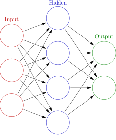
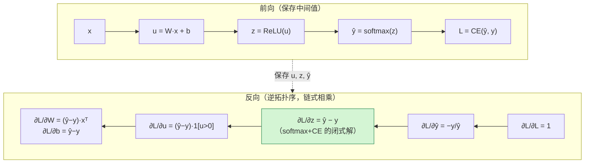
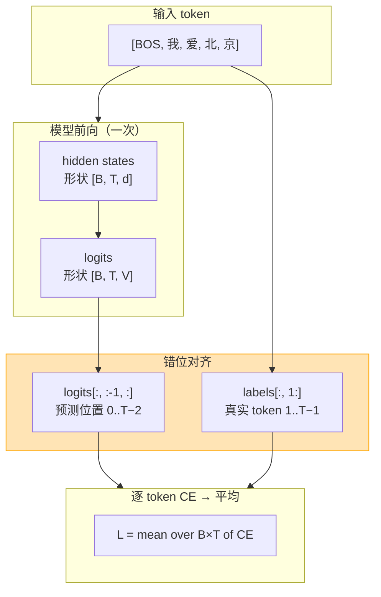
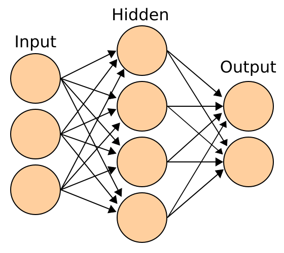
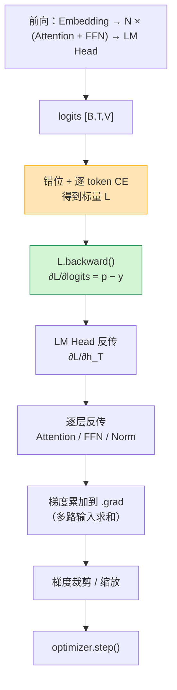
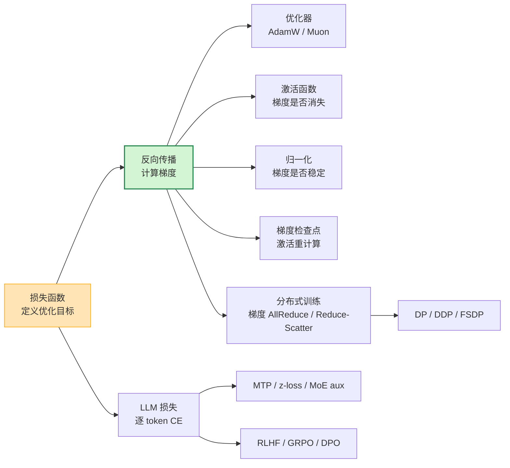

# 损失函数与梯度反向传播基本原理

> **一句话总结**：损失函数把"模型做得好不好"压缩成一个标量，反向传播则用**链式法则 + 反向模式自动微分**把这个标量对每个参数的偏导一次性算出来。LLM 的损失函数主体是**逐 token 的交叉熵**——把序列错位一格后做 `T` 次词表分类，其梯度有一个极其干净的闭式解：`∂L/∂logits = softmax(logits) − onehot(target)`。围绕这个核心，工业界又叠加了 z-loss、标签平滑、MoE 负载均衡辅助损失、多 token 预测（MTP）损失，以及对齐阶段的策略梯度 / DPO 损失。

本文遵循本仓库的设计原则：**先讲清"为什么"，再讲"怎么做"**，并明确标注**关联技术**与**边界、代价**。

- 适用版本前提：机制描述基于 PyTorch v2.x 的 autograd 行为 [4][5] 与 LLM 公开技术报告（GPT-3、PaLM、LLaMA 2、DeepSeek-V3、InstructGPT、DPO、GRPO）。具体数值（词表大小、序列长度、损失系数）随模型版本变化，**脱离版本的"最佳实践"不成立**。

---

## 1. 它为什么存在：两个不可替代的角色

### 1.1 训练是一个优化问题，而优化需要标量

神经网络的训练目标可以写成：

$$
\theta^{*} = \arg\min_{\theta} \; \mathbb{E}_{(x,y)\sim \mathcal{D}}\left[ \mathcal{L}(f_\theta(x), y) \right]
$$

梯度下降要求目标函数是**标量**（这样才能定义"下降方向"）。而模型输出通常是向量（logits、概率分布）——损失函数的第一职责就是**把高维输出与标签之间的差异压缩成一个实数**。

### 1.2 反向传播是"高效算梯度"的算法，不是"损失函数的一部分"

这两个概念经常被混在一起，但它们的角色完全不同 [1][2]：

| 概念 | 回答的问题 | 归属 |
| --- | --- | --- |
| **损失函数** | "预测得有多差？" | 建模选择（定义优化目标） |
| **反向传播** | "每个参数该往哪改？" | 求导算法（计算梯度） |

反向传播本身**不关心损失函数是什么形式**——只要损失是可微的、且被组织成计算图，它就能自动算出所有梯度。这就是为什么 PyTorch 里换损失函数只需要换一行代码，反向传播代码完全不用动 [4]。

### 1.3 为什么不用数值微分或前向模式

| 方法 | 计算 `n` 个参数的梯度所需前向次数 | 复杂度 |
| --- | --- | --- |
| 数值微分（有限差分） | `2n` 次 | 不可接受，且精度受步长影响 |
| 前向模式自动微分 | `n` 次 | `O(n)`，参数多则崩溃 |
| **反向模式自动微分（反向传播）** | **1 次前向 + 1 次反向** | **`O(1)` 倍前向成本** |

反向传播之所以是深度学习的基石，就是因为它把"求 `n` 个梯度"的成本压到了**常数倍的前向成本**——与参数量无关 [2][3]。代价是需要**保存前向的中间激活**（见第 6 节显存讨论）。

---

## 2. 反向传播的数学本质

### 2.1 链式法则

设 `L = f(g(h(x)))`，则：

$$
\frac{\partial L}{\partial x} = \frac{\partial L}{\partial f}\cdot\frac{\partial f}{\partial g}\cdot\frac{\partial g}{\partial h}\cdot\frac{\partial h}{\partial x}
$$

深度网络就是一个超长的复合函数，链式法则告诉我们：**梯度可以从输出端逐层往输入端乘回去**——这正是"反向"传播的含义。



> 图源：Wikimedia Commons，*Colored neural network.svg*，作者 Glosser.ca，许可 CC BY-SA 3.0 [24]。图中每个箭头代表一次线性变换 + 激活，链式法则就沿着这些箭头**反向**逐段相乘。

### 2.2 计算图与局部梯度

把前向计算拆成一串原子操作（加、乘、矩阵乘、exp、log……），每个操作记录自己的**局部导数**。反向时按**逆拓扑序**遍历，把上游传来的梯度乘以本节点的局部导数，再分发给它的输入：



关键点：**每个节点只需要知道两件事**——自己的局部导数，以及上游传下来的梯度。它不需要知道整个网络长什么样。这就是反向传播可以模块化实现（每个 `nn.Module` 只需定义 `backward`）的根本原因 [1][2]。

### 2.3 计算图可以是动态的

PyTorch 采用 **define-by-run**：每次前向都**现场构建**计算图，图的生命周期就是一次迭代 [4][5]。这带来两个直接后果：

- **控制流天然支持**：`if`/`for` 里的分支在图上就是不同的路径，不需要静态图语义；
- **每次迭代图都会重建**：图对象有额外开销，这也是 `torch.compile`、CUDA Graph 想解决的问题（参见本仓库 `推理/图优化/`）。

### 2.4 自动微分的两条规则

PyTorch 的 autograd 在反向时本质只做两件事 [4]：

1. **`grad_output` 乘以局部雅可比**（对向量函数是 Jacobian-vector product，JVP 的转置形式：VJP）；
2. **多路输入做梯度累加**——如果一个张量被多个下游节点使用，它的梯度是各路梯度**求和**。

第 2 条有个容易被忽视的推论：**`loss.backward()` 默认是累加而不是覆盖**，所以必须 `optimizer.zero_grad()`（或 `set_to_none=True`）。这也正是"梯度累加 = 放大 batch"这一技巧能成立的原理。

---

## 3. 常见损失函数及其梯度

### 3.1 回归：MSE / L1 / Huber

| 损失 | 公式 | 梯度 `∂L/∂ŷ` | 特点 |
| --- | --- | --- | --- |
| **MSE** | `(ŷ − y)²` | `2(ŷ − y)` | 对大误差惩罚重，梯度随误差线性增长；对异常值敏感 |
| **MAE / L1** | `|ŷ − y|` | `sign(ŷ − y)` | 对异常值鲁棒，但 0 点不可导、梯度大小恒定（收敛慢） |
| **Huber** | 小误差用 MSE、大误差用 L1 | 分段线性 | 兼顾鲁棒与平滑，需设阈值 δ |

> MSE 的梯度 `2(ŷ−y)` **在误差大时梯度也大**——这是它对异常值敏感的直接原因；而 L1 的梯度恒为 ±1，所以收敛稳定但慢。

### 3.2 二分类：BCE

$$
\mathcal{L}_{\text{BCE}} = -\left[y\log \hat{y} + (1-y)\log(1-\hat{y})\right], \quad \hat{y} = \sigma(z)
$$

梯度同样有干净的形式：

$$
\frac{\partial \mathcal{L}}{\partial z} = \hat{y} - y
$$

**这就是"Sigmoid + BCE"组合的经典结论**：把 `σ` 和 `log` 复合后，梯度里那个会消失的 `σ'(z) = ŷ(1−ŷ)` 项被精确抵消了——所以数值上更稳定、梯度不会因饱和而消失。这也是为什么 `nn.BCEWithLogitsLoss` 应该优先于"先 `sigmoid` 再 `BCELoss`" [5]。

### 3.3 多分类：交叉熵（Cross-Entropy）

设 logits 为 `z ∈ R^V`（`V` 为类别数），softmax 为：

$$
p_i = \frac{e^{z_i}}{\sum_{j=1}^{V} e^{z_j}}
$$

one-hot 标签 `y` 下的交叉熵：

$$
\mathcal{L}_{\text{CE}} = -\sum_{i=1}^{V} y_i \log p_i = -z_{c} + \log\sum_{j=1}^{V} e^{z_j}
$$

其中 `c` 是真实类别（因为只有 `y_c = 1`）。**对 logits 求导**：

$$
\boxed{\frac{\partial \mathcal{L}_{\text{CE}}}{\partial z_i} = p_i - y_i}
$$

推导（这是全文最重要的一步，务必理解）：

$$
\frac{\partial}{\partial z_i}\left(-z_c + \log\sum_j e^{z_j}\right)
= -\mathbb{1}[i=c] + \frac{e^{z_i}}{\sum_j e^{z_j}}
= p_i - y_i
$$

**这个结论的工程意义**：

- 梯度**只依赖预测概率与标签的差**，不需要保存 softmax 的中间矩阵；
- 梯度天然有界：`p_i − y_i ∈ [−1, 1]`，不会爆炸；
- 所以工业实现都把 **softmax + CE 融合成一个 kernel**（如 PyTorch 的 `cross_entropy`、FlashAttention 生态里的 fused CE），省掉一次 `V` 大小的中间张量读写 [5][6]。

### 3.4 数值稳定性：log-sum-exp

`log∑exp` 在 `z` 很大时会溢出（fp16 下 `exp(20)` 就爆了）。标准做法是**先减去最大值**：

$$
\log\sum_j e^{z_j} = m + \log\sum_j e^{z_j - m},\quad m = \max_j z_j
$$

这在数学上恒等，数值上把指数范围压到 `(0, 1]`。所有生产级 CE 实现都做这一步 [6]。

### 3.5 分布对齐：KL 散度

$$
D_{\text{KL}}(p \,\|\, q) = \sum_i p_i \log\frac{p_i}{q_i}
$$

- `p` 固定（教师分布 / 参考策略）时，最小化 KL 等价于最小化 `−∑ p_i log q_i`（交叉熵）；
- 对 `q` 的梯度：`∂KL/∂ logits_q = q − p`（当 `q` 是 softmax 输出）。
- **用途**：知识蒸馏（软标签）[7]、RLHF 中约束策略不要偏离参考模型 [8]、DPO 的隐式 KL [9]。

### 3.6 对比学习：InfoNCE

$$
\mathcal{L}_{\text{InfoNCE}} = -\log \frac{e^{s(q,k^+)/\tau}}{\sum_{j} e^{s(q,k_j)/\tau}}
$$

形式上和 softmax CE 完全一致——**把"正样本"当作正确类别**，负样本当作其他类别。所以梯度同样是 `p − y` 的形式，`τ` 控制分布的锐度 [10]。

---

## 4. LLM 的损失函数：一次前向，T 次分类

### 4.1 语言建模目标：下一个 token 的交叉熵

自回归语言模型的训练目标是最大化观测序列的似然：

$$
\mathcal{L}_{\text{LM}} = -\frac{1}{T}\sum_{t=1}^{T} \log p_\theta(x_t \mid x_{<t})
$$

由于 Transformer 一次前向就能并行算出**所有位置**的下一个 token 分布，实现上就是**错位一格**后做 `T` 次词表规模的分类 [11]：



PyTorch 中的等价写法（`ignore_index` 用来忽略 padding）：

```python
# logits: [B, T, V]，labels: [B, T]
loss = torch.nn.functional.cross_entropy(
    logits[:, :-1, :].reshape(-1, logits.size(-1)),  # [(B*(T-1)), V]
    labels[:, 1:].reshape(-1),                       # [B*(T-1)]
    ignore_index=-100,
)
```

> 注意：`shift_logs` 这个"错位"是 LLM 损失函数里最容易写错的一步——错位方向反了训练也能跑，但模型学到的是"抄前一个词"，loss 会异常低而生成质量崩溃。

### 4.2 关键工程选择：per-token 平均 vs 求和

$$
\mathcal{L} = \frac{1}{N_{\text{valid}}}\sum_{t \in \text{valid}} \ell_t
\quad\text{vs}\quad
\mathcal{L} = \sum_{t \in \text{valid}} \ell_t
$$

| 归一化方式 | 后果 |
| --- | --- |
| **按有效 token 数平均**（主流） | 不同长度/不同 batch 的 loss 可比；梯度量级与序列长度无关 |
| **按 batch 平均** | 长序列主导梯度，短序列被稀释 |
| **求和** | 梯度随序列长度线性放大——等价于隐式放大学习率 |

**分布式训练的陷阱**：如果每个 rank 各自对自己 batch 的 loss 求平均，再做 DDP 的梯度 AllReduce，得到的是"各 rank 平均值的平均值"——当各 rank 的有效 token 数不同（如变长序列、packing 后尾部分布不均）时，这与**全局按 token 数平均**并不等价。严谨实现需要**先 all-reduce 有效 token 总数**，再统一缩放（或在 loss 上乘以 `local_valid / global_valid`）[12]。

### 4.3 LLM 中叠加在 CE 之上的辅助损失

#### 4.3.1 z-loss：抑制 logits 幅度

PaLM 引入的辅助损失 [13]：

$$
\mathcal{L}_{z} = \alpha \cdot \left(\log\sum_i e^{z_i}\right)^2,\quad \alpha \approx 10^{-4}
$$

**动机**：`log∑exp` 就是 logits 的"软最大值"，它变大意味着 logits 幅度在膨胀——这会加剧 fp16/bf16 下的数值不稳定，并在训练后期拖慢收敛。z-loss 直接把这一项压住，代价是极小的额外计算。PaLM 报告它对稳定性有实质帮助 [13]。

#### 4.3.2 标签平滑（Label Smoothing）

把 one-hot 标签 `y` 替换为：

$$
y_i^{\text{LS}} = (1-\epsilon)\,\mathbb{1}[i=c] + \frac{\epsilon}{V}
$$

- 效果：防止模型过度自信（logits 差距无限拉大），改善泛化与校准 [14]；
- 副作用：**梯度不再是 `p − y` 的干净形式**，而变成 `p − y^{LS}`——依然是"预测减目标"，只是目标变软了；
- LLM 中的取舍：预训练常用小 `ε`（甚至不用），因为它会牺牲一部分"精确复现训练语料"的能力；SFT 阶段用得更少。

#### 4.3.3 MoE 负载均衡辅助损失

MoE 模型每个 token 只激活少数专家。如果路由塌缩（所有 token 都挤向少数专家），大部分参数就浪费了。Switch Transformer 的辅助损失 [15]：

$$
\mathcal{L}_{\text{aux}} = \alpha \cdot N \sum_{i=1}^{N} f_i \cdot P_i
$$

其中 `f_i` 是分给专家 `i` 的 token 比例，`P_i` 是路由给专家 `i` 的平均概率，`N` 是专家数。它同时惩罚"分配不均"与"概率不均"。

总损失：`L = L_LM + L_aux`。**梯度视角**：`L_aux` 的梯度只流经**路由门控网络**，不流经专家参数——这是它"只调节负载、不干扰语言建模"的原因。

#### 4.3.4 多 token 预测（MTP）

DeepSeek-V3 的 MTP：除了预测下一个 token，还并行预测**后续第 2 个 token**（用独立的轻量头）[16]：

$$
\mathcal{L}_{\text{MTP}} = \sum_{k=1}^{K} \lambda_k \cdot \mathcal{L}_{\text{LM}}^{(k)}
$$

**收益**：更密集的训练信号（每个位置监督多个目标），且推理时可直接用作投机解码的草稿头。**代价**：额外的头参数与前向计算。

#### 4.3.5 对齐阶段：从策略梯度到 DPO

SFT 之后，损失函数不再是纯 CE：

| 阶段 | 损失 | 梯度要点 |
| --- | --- | --- |
| **RLHF / PPO** | `−E[r(x,y)] + β·KL(π‖π_ref)` | 策略梯度 `−A·∇log π(y\|x)`；KL 项约束偏离 [8] |
| **GRPO** | 同上但**组内相对优势**替代 critic | 同一 prompt 采样多条，用组内归一化奖励当优势 [17] |
| **DPO** | `−log σ(β[log π(y_w) − log π_ref(y_w) − log π(y_l) + log π_ref(y_l)])` | 直接对偏好对做分类式优化，无需 reward model [9] |

> 这三者的共同点：**梯度最终都会落回"对 logprob 的加权"**——因为 `∂log softmax(z)_c / ∂z = onehot(c) − p`，与 CE 的 `p − y` 只差符号。理解了第 3.3 节的闭式解，就理解了整个 LLM 后训练阶段的梯度结构。

---

## 5. 梯度在 LLM 中如何流动

### 5.1 一次迭代的完整路径



> 图源：Wikimedia Commons，*Artificial neural network.svg*，作者 Cburnett，许可 CC BY-SA 3.0 [25]。前向与反向走的是**同一张图**，只是方向相反：前向存激活，反向用激活算梯度。



### 5.2 各层的梯度特性

| 模块 | 梯度形式 | 关键点 |
| --- | --- | --- |
| **LM Head（线性）** | `∂L/∂W = (p−y)ᵀ·h` | 词表 `V` 很大时，这一层的梯度矩阵是 `d × V`，显存与计算都重；也是"输出层并行/词表并行"的动机 |
| **Embedding** | 稀疏的 `∂L/∂E`（只有被用到的 token 行有梯度） | 词表几十万行，稠密更新极浪费——这是 sparse embedding / 稀疏优化器存在的原因 |
| **Attention** | `∂L/∂Q = ∂L/∂S · Kᵀ`，`∂L/∂K = (∂L/∂S)ᵀ·Q` | softmax 的雅可比是 `diag(p) − ppᵀ`；causal mask 之外的位置梯度为 0 |
| **LayerNorm / RMSNorm** | 含 `1/σ` 与"减均值"的耦合项 | 归一化的梯度**不是逐元素独立**的，因为均值/方差依赖整个向量 [18] |
| **残差连接** | 梯度**直通**（`+1` 路径） | 这是深层网络可训练的关键：梯度有一条不衰减的高速公路 [19] |

### 5.3 为什么需要梯度裁剪

LLM 训练中偶发的**损失尖峰（loss spike）**会产生巨大梯度，一步更新就可能毁掉几个 epoch 的进度。标准做法是**按全局范数裁剪** [20]：

```python
torch.nn.utils.clip_grad_norm_(model.parameters(), max_norm=1.0)
```

它把所有参数梯度拼成一个大向量，若 `‖g‖₂ > max_norm` 则整体等比缩放。**注意**：在 AMP 下应先 `unscale_` 再裁剪，否则裁剪的是被放大过的梯度 [22]（PyTorch 的 `GradScaler` 会自动处理顺序）。

### 5.4 混合精度下的梯度

fp16 的动态范围窄，梯度小到下溢（underflow）就变成 0。解决方案是 **loss scaling**：把 loss 乘以一个大常数 `S`，反向得到的梯度也放大 `S` 倍，更新前再除回去 [22]。bf16 指数范围与 fp32 相同，一般不需要 loss scaling——这也是现代 LLM 训练普遍用 bf16 的原因之一。

### 5.5 梯度累积与"等效 batch"

显存装不下大 batch 时，用多次小 batch 反向、累积梯度后再 `step`：

```python
for i, batch in enumerate(loader):
    loss = model(batch) / accum_steps      # 除以累积步数，保持等效平均
    loss.backward()
    if (i + 1) % accum_steps == 0:
        optimizer.step(); optimizer.zero_grad()
```

它利用的正是第 2.4 节的结论：**梯度是累加的**。注意 `loss / accum_steps` 这一步不能省，否则等效学习率会放大 `accum_steps` 倍。

---

## 6. 边界与代价

### 6.1 反向传播的显存代价：必须保存激活

反向需要前向的中间值（`u`、`z`、`ŷ`……），这些**激活**的显存随层数、序列长度线性增长，往往远超参数本身。以 LLM 为例，激活是长上下文训练的主要显存开销 [23]。

### 6.2 用计算换显存：梯度检查点

Gradient Checkpointing（激活重计算）不保存中间激活，反向时**重新前向**一遍该段来重建 [21]：

| 维度 | 不检查点 | 全部检查点 |
| --- | --- | --- |
| 激活显存 | `O(L)` | `O(√L)`（分段）或 `O(1)`（整段） |
| 额外计算 | 0 | 约 +33% 前向 FLOPs（重算一次前向 ≈ 2/3 的反向成本） |

**本质是用约 1/3 的额外计算换一个数量级的显存**——这是长序列训练的必备手段。

### 6.3 反向传播不保证"正确性"，只保证"对定义的目标最优"

- 损失函数写错（如错位方向反了、忘记 mask padding），反向传播会**忠实地**优化那个错误目标——它不会报错，loss 甚至会更低；
- 因此 LLM 训练必须配合**下游评测**（perplexity 之外的生成质量、任务指标），不能只看 loss 曲线。这是"loss 下降 ≠ 模型变好"的根本原因。

### 6.4 数值精度与梯度

- 大词表 softmax 在 fp16 下容易溢出，必须用 fp32 累加或 log-sum-exp 技巧；
- 深层网络的梯度可能指数级衰减/爆炸，依赖归一化 + 残差 + 裁剪三者共同约束 [19]；
- `torch.compile` / 融合 kernel 可能改变数值结合顺序，**逐位一致不可保证**，但统计等价——这是分布式训练"可复现性"争议的来源之一。

### 6.5 常见陷阱速查

| 陷阱 | 现象 | 原因 |
| --- | --- | --- |
| 忘记 `zero_grad()` | 梯度越迭代越大 | autograd 默认累加 |
| `shift` 方向写反 | loss 异常低但生成乱码 | 模型在学"复制上一个 token" |
| padding 未 `ignore_index` | loss 被 padding 稀释 | padding 位置的 CE 被计入平均 |
| 各 rank 各自平均 | 与单卡不等价 | 有效 token 数不一致（见 4.2） |
| 梯度累积未除以步数 | 等效学习率 ×N | 梯度是求和 |
| AMP 下先裁剪后 unscale | 裁剪失效 | 梯度仍被 loss scale 放大 |
| 检查点与 dropout | 重算时随机性不一致 | 需固定 RNG 状态 |

---

## 7. 可验证：最小实验

### 7.1 验证 CE 的梯度闭式解

```python
import torch

V = 5
logits = torch.randn(3, V, requires_grad=True)
target = torch.tensor([1, 0, 4])

loss = torch.nn.functional.cross_entropy(logits, target)
loss.backward()

p = torch.softmax(logits.detach(), dim=-1)
onehot = torch.nn.functional.one_hot(target, V).float()
print("autograd :", logits.grad)
print("p - y    :", p - onehot)   # 两者应完全一致
```

### 7.2 验证"错位"与 padding 处理

```python
# 构造一个只会复制输入的"作弊模型"，验证错位后 loss 应接近 0
labels = torch.tensor([[1, 2, 3, 4, -100]])       # -100 = ignore
logits = torch.nn.functional.one_hot(labels.clamp(min=0), 10).float() * 10.0
loss = torch.nn.functional.cross_entropy(
    logits[:, :-1, :].reshape(-1, 10), labels[:, 1:].reshape(-1), ignore_index=-100
)
print(loss.item())   # 应≈0：说明模型"抄前一个 token"就能完美预测
```

> 这个实验反过来印证了第 4.3 节的陷阱：如果训练时错位方向弄反，loss 会异常低，但模型学到的只是复制。

### 7.3 观测清单

| 想验证什么 | 怎么做 |
| --- | --- |
| 梯度是否与数值微分一致 | `torch.autograd.gradcheck` [4] |
| 反向是否真的只花 1 次前向的成本 | profiler 对比前向/反向耗时，通常在 2× 左右 |
| 检查点省了多少显存 | 对比开启/关闭后的 `max_memory_allocated` |
| 各层梯度量级 | 遍历 `named_parameters()` 打印 `.grad.norm()`，看是否某层异常大/为 0 |
| 梯度裁剪是否生效 | 打印裁剪前的全局范数，观察尖峰 |

---

## 8. 关联：它在知识网络中的位置



- **与优化器**：反向传播只产出梯度，"往哪走、走多远"由优化器决定（AdamW 的自适应步长、Muon 的正交化）——参见《优化器基本原理》《Muon 优化器》。
- **与激活函数**：激活函数的导数决定梯度能否穿过该层（Sigmoid 饱和 → 消失；ReLU 正区间 → 直通）——参见《激活函数基本原理》。
- **与归一化**：Pre-LN + RMSNorm 让每层输入分布稳定，梯度量级可控——参见《归一化基本原理》。
- **与分布式训练**：DDP 用 AllReduce 同步梯度，FSDP 用 Reduce-Scatter 切分梯度——参见《DDP 训练基本原理》《FSDP 训练基本原理》《通信原语基本原理》。
- **与显存优化**：激活是反向传播的固有开销，检查点是主要对策；ZeRO/FSDP 则处理参数、梯度、优化器状态的分片。
- **与推理**：训练时的损失/梯度结构决定了推理时的 KV Cache 与投机解码设计（MTP 头可直接复用为草稿模型）。

---

## 9. 延伸阅读

- 本仓库姊妹文档：《优化器基本原理》《Muon 优化器》《归一化基本原理》《激活函数基本原理》《注意力机制基本原理》
- PyTorch autograd 机制说明：<https://pytorch.org/docs/stable/notes/autograd.html> [4]
- 3Blue1Brown 反向传播可视化系列（直觉建立）：<https://www.youtube.com/playlist?list=PLZHQObOWTQDNU6R1_67000Dx_ZCJB-3pi>
- Deep Learning 第 6 章（反向传播的完整推导）：<https://www.deeplearningbook.org/contents/mlp.html> [2]

---

## 参考文献

1. Rumelhart, D. E., Hinton, G. E., & Williams, R. J. *Learning representations by back-propagating errors*. Nature 323, 533–536 (1986). <https://www.nature.com/articles/323533a0> — 反向传播的奠基论文
2. Goodfellow, I., Bengio, Y., & Courville, A. *Deep Learning*, Chapter 6: Deep Feedforward Networks. MIT Press (2016). <https://www.deeplearningbook.org/contents/mlp.html> — 链式法则与计算图的系统推导
3. Baydin, A. G., Pearlmutter, B. A., Radul, A. A., & Siskind, J. M. *Automatic Differentiation in Machine Learning: a Survey*. JMLR 18(153) (2018). <https://arxiv.org/abs/1502.05767> — 反向模式与前向模式的复杂度对比
4. PyTorch. *Autograd mechanics*（自动微分机制、`gradcheck`、图的生命周期）. <https://pytorch.org/docs/stable/notes/autograd.html>
5. PyTorch. *torch.nn.CrossEntropyLoss* / *torch.nn.BCEWithLogitsLoss*（API 文档，含数值稳定性说明）. <https://pytorch.org/docs/stable/generated/torch.nn.CrossEntropyLoss.html>
6. PyTorch. *torch.nn.functional.cross_entropy*（融合实现与 `ignore_index` 语义）. <https://pytorch.org/docs/stable/generated/torch.nn.functional.cross_entropy.html>
7. Hinton, G., Vinyals, O., & Dean, J. *Distilling the Knowledge in a Neural Network*. arXiv:1503.02531 (2015). <https://arxiv.org/abs/1503.02531> — 软标签与 KL 蒸馏
8. Ouyang, L., Wu, J., Jiang, X., et al. *Training language models to follow instructions with human feedback*（InstructGPT）. arXiv:2203.02155 (2022). <https://arxiv.org/abs/2203.02155> — PPO + KL 约束的对齐目标
9. Rafailov, R., Sharma, A., Mitchell, E., et al. *Direct Preference Optimization: Your Language Model is Secretly a Reward Model*. arXiv:2305.18290 (2023). <https://arxiv.org/abs/2305.18290> — DPO 损失
10. van den Oord, A., Li, Y., & Vinyals, O. *Representation Learning with Contrastive Predictive Coding*. arXiv:1807.03748 (2018). <https://arxiv.org/abs/1807.03748> — InfoNCE
11. Vaswani, A., Shazeer, N., Parmar, N., et al. *Attention Is All You Need*. NeurIPS 2017. arXiv:1706.03762. <https://arxiv.org/abs/1706.03762> — 并行计算所有位置的 Transformer 结构
12. PyTorch. *Distributed Data Parallel*（梯度同步语义）. <https://docs.pytorch.org/docs/stable/notes/ddp.html> — 各 rank 梯度平均与全局平均的差异
13. Chowdhery, A., Narang, S., Devlin, J., et al. *PaLM: Scaling Language Modeling with Pathways*. arXiv:2204.02311 (2022). <https://arxiv.org/abs/2204.02311> — z-loss 的提出与稳定性作用
14. Szegedy, C., Vanhoucke, V., Ioffe, S., et al. *Rethinking the Inception Architecture for Computer Vision*. arXiv:1512.00567 (2015). <https://arxiv.org/abs/1512.00567> — 标签平滑
15. Fedus, W., Zoph, B., & Shazeer, N. *Switch Transformers: Scaling to Trillion Parameter Models with Simple and Efficient Sparsity*. arXiv:2101.03961 (2021). <https://arxiv.org/abs/2101.03961> — MoE 负载均衡辅助损失
16. DeepSeek-AI. *DeepSeek-V3 Technical Report*. arXiv:2412.19437 (2024). <https://arxiv.org/abs/2412.19437> — MTP 多 token 预测损失
17. DeepSeek-AI. *DeepSeekMath: Pushing the Limits of Mathematical Reasoning in Open Language Models*. arXiv:2402.03300 (2024). <https://arxiv.org/abs/2402.03300> — GRPO 的组内相对优势
18. Ba, J. L., Kiros, J. R., & Hinton, G. E. *Layer Normalization*. arXiv:1607.06450 (2016). <https://arxiv.org/abs/1607.06450> — 归一化的梯度推导
19. He, K., Zhang, X., Ren, S., & Sun, J. *Deep Residual Learning for Image Recognition*. arXiv:1512.03385 (2015). <https://arxiv.org/abs/1512.03385> — 残差连接为梯度提供直通路径
20. Pascanu, R., Mikolov, T., & Bengio, Y. *On the difficulty of training recurrent neural networks*. ICML 2013. arXiv:1211.5063. <https://arxiv.org/abs/1211.5063> — 梯度裁剪与梯度爆炸
21. Chen, T., Xu, B., Zhang, C., & Guestrin, C. *Training Deep Nets with Sublinear Memory Cost*. arXiv:1604.06174 (2016). <https://arxiv.org/abs/1604.06174> — 梯度检查点（激活重计算）
22. Micikevicius, P., Narang, S., Alben, J., et al. *Mixed Precision Training*. arXiv:1710.03740 (2017). <https://arxiv.org/abs/1710.03740> — loss scaling 与非缩放梯度裁剪
23. Korthikanti, V., Casper, J., Lym, S., et al. *Reducing Activation Recomputation in Large Transformer Models*. arXiv:2205.05198 (2022). <https://arxiv.org/abs/2205.05198> — LLM 激活显存的定量分析
24. Wikimedia Commons. *Colored neural network.svg*（作者 Glosser.ca，CC BY-SA 3.0）. <https://commons.wikimedia.org/wiki/File:Colored_neural_network.svg> — 本文第 2.1 节网络结构示意图的来源
25. Wikimedia Commons. *Artificial neural network.svg*（作者 Cburnett，CC BY-SA 3.0）. <https://commons.wikimedia.org/wiki/File:Artificial_neural_network.svg> — 本文第 5.1 节网络拓扑示意图的来源

### 图片来源与许可声明

| 图 / 文件 | 来源 | 作者 | 许可 |
| --- | --- | --- | --- |
| `assets/nn-colored.svg`（前馈网络结构示意，用于说明"逐层复合函数"） | [Wikimedia Commons: Colored neural network.svg](https://commons.wikimedia.org/wiki/File:Colored_neural_network.svg) | Glosser.ca | CC BY-SA 3.0 |
| `assets/nn-overview.svg`（人工神经网络拓扑示意） | [Wikimedia Commons: Artificial neural network.svg](https://commons.wikimedia.org/wiki/File:Artificial_neural_network.svg) | Cburnett | CC BY-SA 3.0 |

> 其余机制图（计算图前向/反向、LLM 损失流程、梯度回传路径、知识网络关系）均为 **Mermaid 自绘**，GitHub 原生渲染，无版权问题。上述两张 Wikimedia 图片遵循 CC BY-SA 3.0：转载时保留作者署名与许可声明，相同方式共享。
