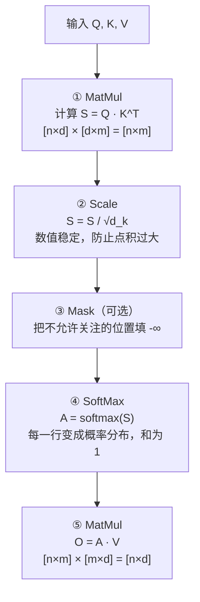
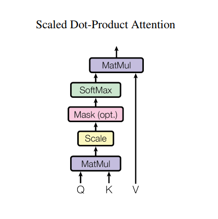
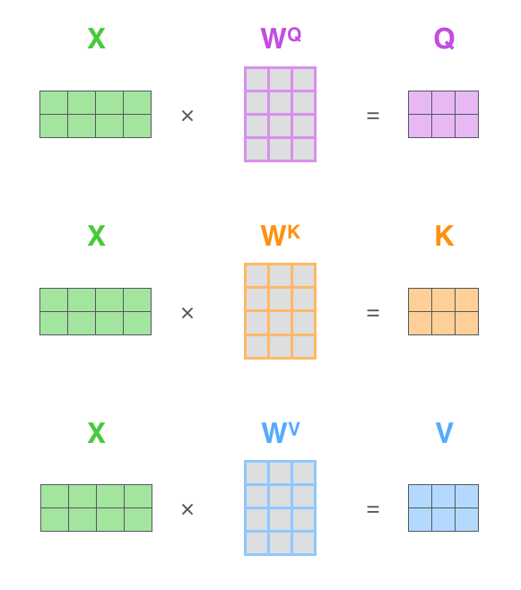
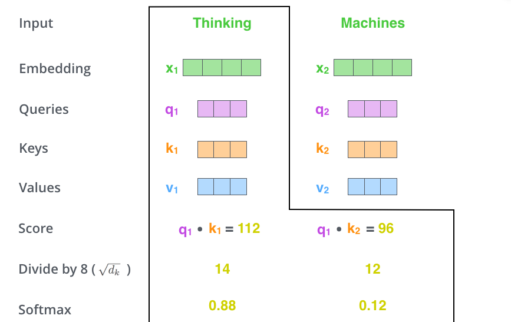
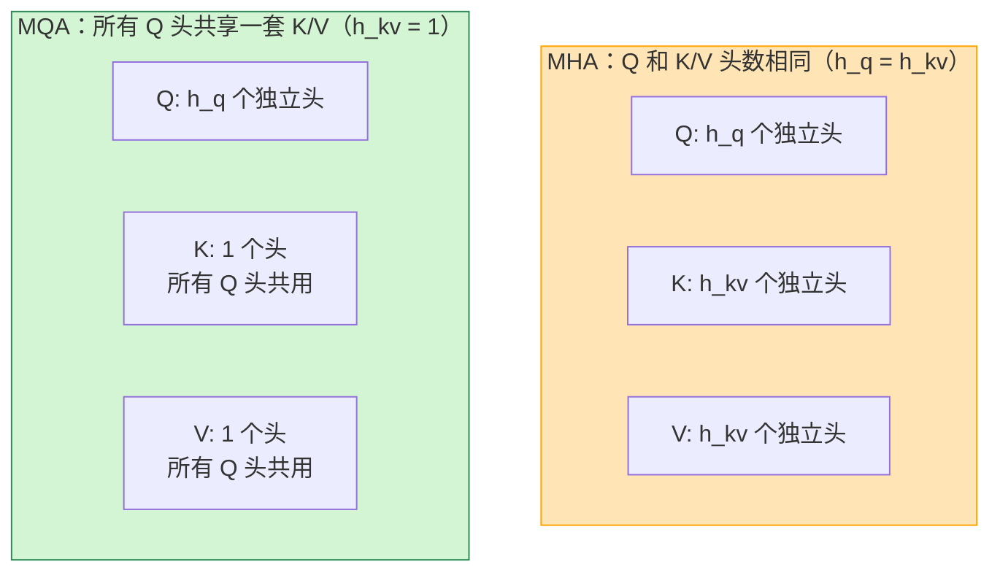
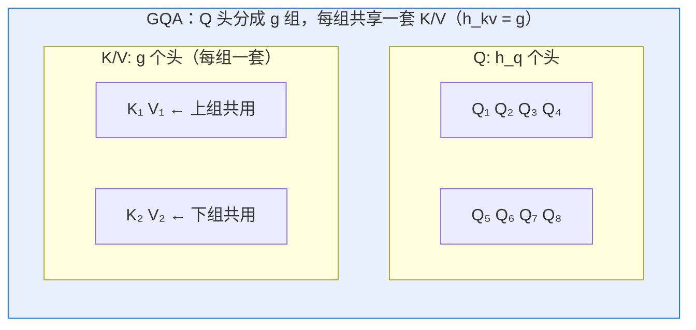
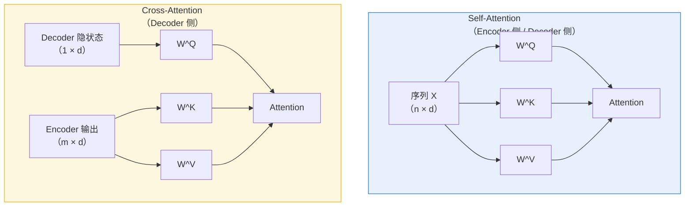
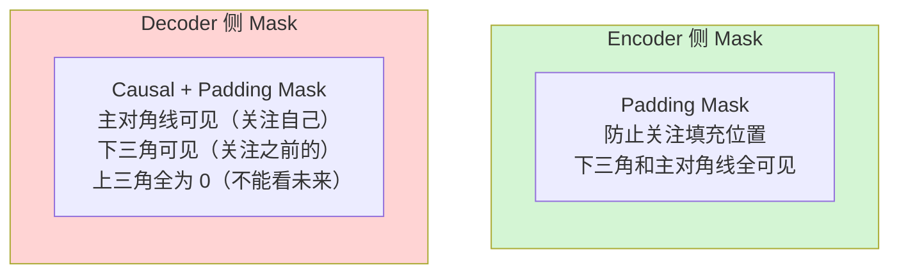
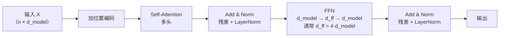
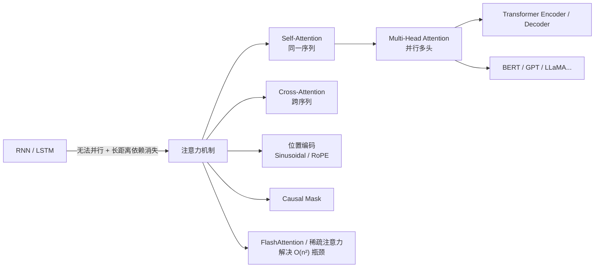

# 注意力机制基本原理

> **一句话总结**：注意力（Attention）是一种"让模型在处理每个位置时，动态地从所有位置中挑选、加权、汇聚相关信息"的机制。核心操作是 **Scaled Dot-Product Attention**：用 Query 与所有 Key 做点积得到相似度分数，经 softmax 归一化后作为权重，对所有 Value 做加权求和。**自注意力（Self-Attention）** 是最常用的变体——同一个序列既当 Query 又当 Key 和 Value，是 Transformer 的基石。

本文遵循本仓库的设计原则：**先讲清"为什么"，再讲"怎么做"**，并明确标注**关联技术**与**边界、代价**。

- 适用版本前提：算法定义基于 Transformer 原始论文 *Attention Is All You Need* [1] 与 PyTorch `torch.nn.MultiheadAttention` 文档 [2]。注意力机制自 2014 年 Bahdanau 提出以来 [3] 有诸多变体（Bahdanau 加性注意力、Luong 乘性注意力、稀疏注意力等），本文聚焦 **Scaled Dot-Product Attention** 及其最核心的两个应用场景：自注意力与 Encoder-Decoder 交叉注意力。

---

## 1. 它为什么存在：从 RNN 到注意力

### 1.1 RNN/LSTM 的短板

在注意力出现之前，序列建模主要靠 RNN/LSTM：沿时间步依次处理，把所有历史信息塞进一个固定大小的隐藏状态里。这种方式有四个根本性问题 [1][4]：

| 问题 | 表现 | 后果 |
| --- | --- | --- |
| **长距离依赖消失** | 序列很长时，早期信息被后面的信息"稀释" | 难以建模跨长距离的依赖关系 |
| **顺序计算，无法并行** | 必须按时间步 t=0,1,2,... 依次算出隐状态 h_t | GPU 无法并行利用训练数据的并行性 |
| **固定维度瓶颈** | 所有历史信息要塞进固定大小的隐状态 h_t | 序列越长，每个位置分配到的表示能力越弱 |
| **隐状态信息瓶颈** | Encoder 把整句源句塞进一个固定向量传给 Decoder | 长句信息严重丢失 |

最后一个问题（隐状态信息瓶颈）正是 Bahdanau 等人 2014 年提出**加性注意力**（Bahdanau Attention）的动机 [3]。2017 年，Transformer 论文用 **Scaled Dot-Product Attention** 和 **Self-Attention** 彻底取代了 RNN，开启了大模型时代 [1]。

### 1.2 注意力的核心思想

注意力机制让模型**跳过** RNN 那一步"把所有历史塞进一个固定向量"的压缩。它直接做一件事：

> 在处理每个位置时，**动态地**从**所有位置**中挑选出与当前位置最相关的那些位置，按"相关程度"加权汇聚它们的表示。

这个"挑出"的过程就是 **Query-Key-Value 三元组**：
- **Query（Q）**：当前位置的"查询意图"——我想从别人那里得到什么信息
- **Key（K）**：每个位置的"标签"——我能提供什么类型的信息
- **Value（V）**：每个位置的"内容"——我实际携带的信息

Q 和 K 做点积得到**相似度分数**，再用 softmax 归一化成**注意力权重**，最后用这些权重对 V 做加权求和得到输出。

---

## 2. 核心操作：Scaled Dot-Product Attention

### 2.1 公式与流程

Scaled Dot-Product Attention 是所有注意力变体的基础 [1]：

```
Attention(Q, K, V) = softmax( Q · K^T / √d_k ) · V
```

其中 `d_k` 是 Key 的维度，除以 `√d_k` 是 **缩放因子**——关键设计，后面会解释。

### 2.2 五步计算流程



PyTorch 官方把这个流程画成一个简洁的方框图 [5]：



> 图源：TensorFlow 官方 Transformer 教程的 Scaled Dot-Product Attention 方框图 [5]。

### 2.3 每一步的详细含义

#### Step ① Q · K^T：计算相似度矩阵

对 Q 中的每个 query 向量 `q_i` 和 K 中的每个 key 向量 `k_j`，做点积：

```
S[i, j] = q_i · k_j = Σ_{d=1}^{d_k} q_i[d] · k_j[d]
```

点积的含义：**两个向量方向越接近，点积越大**。所以 `S[i, j]` 就是"位置 i 对位置 j 的关注程度"。结果矩阵 `S` 的形状是 `[n_q, n_k]`——每个 query 对所有 key 的分数。

#### Step ② Scale：为什么要除以 √d_k

原始论文解释了这个设计的必要性 [1]：

> 当 `d_k` 较大时，Q · K^T 的点积数值会变得很大，导致 softmax 进入**梯度极小的饱和区**。

数值分析：若 `q` 和 `k` 的每个元素是均值 0、方差 1 的独立随机变量，则 `q · k` 的点积是 `d_k` 个这样的变量之和，其**方差**是 `d_k`。所以 `q · k` 的期望接近 0、标准差约 `√d_k`。为了让 softmax 的输入方差回到 1（梯度最大的区域），除以 `√d_k`。

> **直觉**：相当于"信息量大的向量需要更苛刻的打分标准"——维度高时，两个随机向量的点积自然就大（维数诅咒），除以 √d_k 把分数量级拉平到维度无关的水平。

#### Step ③ Mask（可选）

有两种常用 mask：

| Mask 类型 | 作用 | 应用场景 |
| --- | --- | --- |
| **Padding Mask** | 把序列中 padding（填充）位置对应的分数置为 -∞，softmax 后变成 0 | Encoder 侧，处理变长序列 |
| **Causal Mask（因果 Mask）** | 位置 i 不能关注位置 j > i，把上三角置为 -∞ | Decoder 侧，防止看到未来 token |

Mask 后再做 softmax，被 mask 的位置权重变成 0，完全不参与加权。

#### Step ④ SoftMax：变成概率分布

```
A[i, j] = exp(S[i, j]) / Σ_{j'} exp(S[i, j'])
```

softmax 后，**每一行的注意力权重和为 1**——query `q_i` 对所有 key 的注意力是一个合法的概率分布。这使得"加权求和"具有明确的"从所有位置按比例汇聚信息"的含义。

#### Step ⑤ A · V：加权汇聚

`O[i, :] = Σ_j A[i, j] · V[j, :]`

每个 query 位置的输出，是所有 Value 向量按注意力权重做的**加权平均**。权重越大的位置，对输出的贡献越大。

### 2.4 完整的计算示意图

Jalammar 的 The Illustrated Transformer 用一个两行序列 `[Thinking, Machines]` 完整演示了 Q/K/V 计算和注意力打分的每个细节 [4]：


> 图源：The Illustrated Transformer [4]。左图：两个输入 token 的向量；中图：各自乘以不同的权重矩阵得到 Q、K、V。


> 图源：The Illustrated Transformer [4]。完整展示了 `q1 · k1 = 112, q1 · k2 = 96` 的点积，除以 √d_k（示例中 √64=8）得到 14 和 12，softmax 后变成 0.88 和 0.12——位置 1（"Thinking"）主要关注位置 1 自己。

---

## 3. Multi-Head Attention：为什么要多头

单头注意力有一个局限：**每个 query 只能用一种方式"关注"所有 key**。Multi-Head Attention 的核心思想是 [1]：

> 并行地做 `h` 组独立的 Scaled Dot-Product Attention，每组用不同的投影矩阵，然后把结果拼接起来再过一个线性层。

### 3.1 公式

```
MultiHead(Q, K, V) = Concat(head_1, ..., head_h) · W^O

其中 head_i = Attention(Q · W_i^Q, K · W_i^K, V · W_i^V)
```

- `W_i^Q ∈ R^{d_model × d_k}`, `W_i^K ∈ R^{d_model × d_k}`, `W_i^V ∈ R^{d_model × d_v}`：第 i 个头的投影矩阵
- 论文中取 `d_k = d_v = d_model / h`，这样总计算量与单头 `d_model` 的注意力相当 [1]
- `W^O ∈ R^{h·d_v × d_model}`：融合各头输出的投影矩阵

### 3.2 多头的意义——从一个头看到什么

Vaswani 等人在论文中明确指出多头让模型**能在不同子空间中并行关注不同类型的关系** [1]。后续的注意力可解释性研究（如 BERT Viz、GPT-2 "注意力头百科"）进一步证实：

| 头类型 | 注意力模式 | 作用 |
| --- | --- | --- |
| **语法头** | 关注主语→谓语、限定词→名词 | 建模句法依赖 |
| **位置头** | 关注相对位置近的 token | 隐式编码位置关系 |
| **稀有 token 头** | 主要关注少数罕见 token | 处理信息瓶颈 |
| **全局 vs 局部** | 有些头做全局长距离依赖，有些做局部邻域 | 同时捕捉长程和短程依赖 |

单个头只能学到一种注意力模式；多头并行让一个模型同时拥有**多种关注视角**，增强了表示能力。

### 3.3 直观理解

把 `d_model=512, h=8` 的 Multi-Head Attention 想象成：
- 模型有 **8 双眼睛**，每双眼睛只看一个 **64 维**的"窄幅视野"；
- 每双眼睛学一种不同的关注方式；
- 8 双眼睛看完后，把各自的输出**拼起来**（8×64=512），再过一个线性层 **融合** 成整体的表示。

### 3.4 MQA 与 GQA：KV Cache 的内存优化

标准 MHA 的一个工程痛点是 **KV Cache 的显存占用**：模型生成时（Decode 阶段），每生成一个新 token，所有历史 token 的 K 和 V 都要保留在显存里供后续所有步重复使用。对于 `h` 个头、序列长度 `n`、head 维度 `d_k`，KV Cache 的大小是 [8][9]：

```
KV Cache 大小 = 2（K 和 V）· h · n · d_k · batch_size · bytes_per_element
```

头数越多，KV Cache 越大。GPT-3 175B 有 96 个头、`d_k=128`、上下文 2048，单卡 KV Cache 就占 **~3.5 GB**；而 LLaMA 2 70B 有 64 个头、`d_k=128`、上下文 4096，单卡 KV Cache 占 **~4.2 GB**——这对推理部署是很大的负担。

MQA 和 GQA 是两种**减少 K/V 头数、让多个 Q 头共享同一套 K/V** 的方案，由 Shazeer（2019）[8] 首次提出 MQA，由 Ainslie 等人（2023）[9] 拓展为 GQA。

#### MHA → MQA：最极端的共享

**MQA（Multi-Query Attention）** 让**所有 Q 头共享一套 K 头和一套 V 头** [8]：



| 维度 | MHA | MQA |
| --- | --- | --- |
| Q 头数 `h_q` | `h` | `h`（保持不变） |
| K/V 头数 `h_kv` | `h` | **1** |
| KV Cache 大小 | `2·h·n·d_k` | `2·1·n·d_k` = **MHA 的 `1/h`** |
| 参数量（K/V 投影） | `2·h·d_model·d_k` | `2·d_model·d_k` = **MHA 的 `1/h`** |

MQA 把 KV Cache 和 K/V 投影参数的规模都压缩到 MHA 的 `1/h`——极端节省显存和参数。但**精度会下降**：所有 Q 头被迫用**同一套** K/V 来做加权，这让多头"从不同视角关注"的多样性消失了一部分。

#### GQA：折中的中间点

**GQA（Grouped-Query Attention）** 把 Q 头分成 `g` 组，每组内的多个 Q 头共享一套 K/V [9]：



数学表述：给定 Q 头数 `h_q` 和 KV 头数 `h_kv`（GQA 要求 `h_q` 必须能被 `h_kv` 整除），则每组有 `group_size = h_q / h_kv` 个 Q 头 [9]。第 `i` 组的所有 Q 头共享第 `i` 套 K/V 头：

```
head_j = Attention(Q · W_j^Q, K · W_{\lfloor j / group_size \rfloor}^K, V · W_{\lfloor j / group_size \rfloor}^V)
```

| 维度 | MHA | MQA | GQA |
| --- | --- | --- | --- |
| Q 头数 | `h` | `h` | `h_q` |
| KV 头数 | `h` | **1** | `g`（`g < h`） |
| group_size | 1 | `h` | `h_q / g` |
| KV Cache 大小 | `2·h·n·d_k` | `2·n·d_k` | `2·g·n·d_k` |
| KV Cache 压缩比 | 1× | `h×` | `h/g ×` |
| 多头多样性 | 完整 | 丧失 | **部分保留** |

#### MHA / GQA / MQA 三者的直观对比

用具体数字：`h = 32`（GPT-3 small），设 `h_q = 32` 不变：

| 方案 | `h_q` | `h_kv` | `group_size` | KV Cache 压缩比 | 代表性模型 |
| --- | --- | --- | --- | --- | --- |
| **MHA** | 32 | 32 | 1 | 1×（基准） | Transformer 论文、GPT-3 175B、BERT、ViT |
| **GQA** | 32 | 8 | 4 | **4×** | LLaMA 2 70B、LLaMA 3 70B、PaLM 2、Gemma 2、Mistral 7B |
| **GQA（更激进）** | 32 | 4 | 8 | **8×** | LLaMA 3 8B（`h_q=32, h_kv=8`？不，实际是 `h_q=32, h_kv=8` 即 4×；更激进如某些 MoE 模型用 `h_kv=2`） |
| **MQA** | 32 | 1 | 32 | **32×** | LightGPT（Shazeer 2019 原型）、部分早期蒸馏模型 |

#### 为什么 GQA 成为主流选择

Ainslie 等人在论文中证明了：**当 `group_size` 不超过 8 时，GQA 在几乎不损失精度的前提下，能把 KV Cache 和 K/V 参数压缩 4–8 倍** [9]。这是一个极其实用的权衡：

| 方案 | KV Cache 节省 | 精度损失 | 备注 |
| --- | --- | --- | --- |
| MHA（基线） | 无 | — | |
| GQA（`h/h_kv = 4`） | 4× | **几乎无** | LLaMA 2 70B、PaLM 2 选择 |
| GQA（`h/h_kv = 8`） | 8× | **极小** | Gemma 2 选择 |
| MQA（`h/h_kv = h`） | h× | **明显有** | Shazeer 原型验证 |

现代大模型**几乎全部**使用 GQA 而非 MQA：
- LLaMA 2 70B：`h_q = 64, h_kv = 8`，group_size = **8** [10]
- LLaMA 3 70B：`h_q = 64, h_kv = 8`，group_size = **8**
- PaLM 2 540B：`h_q = 48, h_kv = 8`，group_size = **6** [9]
- Mistral 7B：`h_q = 32, h_kv = 8`，group_size = **4**
- GPT-4（推测）：GQA，group_size ≈ 8

只有极少数边缘模型或蒸馏模型会用 MQA（`h_kv = 1`），因为它在长上下文和高 group_size 下精度损失较明显。

#### GQA 的实现细节

计算 GQA 时，需要把 K/V 头**广播（repeat_interleave）** 到与 Q 头数相同的维度，然后做标准的多头注意力 [9]：

```python
# PyTorch 风格的 GQA 实现核心逻辑
# K, V: [B, h_kv, N, d_k]
# Q:    [B, h_q, N, d_k]

# 把 K/V repeat 到 h_q 个头
K_expanded = K.repeat_interleave(group_size, dim=1)  # [B, h_q, N, d_k]
V_expanded = V.repeat_interleave(group_size, dim=1)  # [B, h_q, N, d_k]

# 之后就是标准的 Scaled Dot-Product Attention
scores = torch.matmul(Q, K_expanded.transpose(-2, -1)) / math.sqrt(d_k)
attn = F.softmax(scores, dim=-1)
output = torch.matmul(attn, V_expanded)
```

> **计算量不变，KV Cache 节省**：GQA 不减少计算量（Q 头数 `h_q` 没变，Attention 的矩阵乘还是 `[B, h_q, N, N]`），但 **KV Cache** 和 **K/V 投影参数** 的规模从 `h` 降到 `h_kv`——这正好解决了推理侧 KV Cache 的瓶颈，而不影响训练侧的计算精度。

#### 关于 KV Cache 压缩的延伸

GQA 只是"减少 K/V 头数"的方案。还有其他不改变头数、但通过**量化**或**压缩**来节省 KV Cache 的技术：

| 技术 | 原理 | 代表 |
| --- | --- | --- |
| **KV Cache 量化** | 把 K/V 从 fp16 量化到 INT4/INT8 | vLLM 的 KV Cache 量化、LLM.int8() |
| **Sink Token / StreamingLLM** | 只保留初始 sink token + 滑动窗口 | StreamingLLM、LLaMA 3 原生支持 |
| **PagedAttention** | 把 KV Cache 分页到显存，用碎片复用 | vLLM 核心技术 [11] |
| **DeepSeek V4.1-Flash** | 对 KV Cache 做哈希感知压缩 | 见《推理 / 分布式推理》后续文档 |

这些技术与 GQA 可以**叠加使用**——先 GQA 减少 KV 头数，再量化减少每个元素的位数，最终可以把 KV Cache 压缩到 MHA fp16 基线的 **1/16 ~ 1/32**。

### 3.5 MHA / GQA / MQA 对比总结

| 维度 | MHA | GQA | MQA |
| --- | --- | --- | --- |
| **Q 头数** | `h` | `h_q`（通常 = h） | `h` |
| **KV 头数** | `h` | `g`（1 < g < h） | **1** |
| **group_size** | 1 | `h_q / g` | `h` |
| **多头多样性** | 完整 | **部分保留** | 丧失 |
| **KV Cache 大小** | `2·h·n·d_k` | `2·g·n·d_k` | `2·n·d_k` |
| **KV Cache 压缩比** | 1× | `h/g ×` | `h ×` |
| **K/V 投影参数** | `2·h·d_model·d_k` | `2·g·d_model·d_k` | `2·d_model·d_k` |
| **计算量（FLOPs）** | 基准 | 不变 | 不变 |
| **推理时延影响** | 基准 | KV Cache 更小，更好 | 最好 |
| **训练精度** | 基准 | 几乎无损 | 有损失 |
| **适合场景** | 训练优先、模型较大 | **训练与推理平衡**（主流选择） | 边缘部署、极致推理 |
| **代表模型** | GPT-3、BERT、ViT | LLaMA 2/3、PaLM 2、Gemma 2、Mistral | Shazeer 原型、部分蒸馏模型 |

**结论**：
- **训练场景、显存充足、追求精度** → 用 **MHA**（如 BERT-large、GPT-3 训练）
- **推理场景、KV Cache 受限、精度-内存平衡** → 用 **GQA**（现代大模型的标准选择）
- **极致推理效率、可接受精度损失** → 用 **MQA**（边缘部署、蒸馏模型）

---

## 4. Self-Attention vs Encoder-Decoder Attention

这是注意力最核心的两种应用场景。

### 4.1 Self-Attention：同一序列做 Q/K/V

**Self-Attention（自注意力）** 中，Q、K、V **全部来自同一个序列** [1]：

```
SelfAttention(X) = Attention(X · W^Q, X · W^K, X · W^V)
```

其中 `X ∈ R^{n × d_model}` 是输入序列的 embedding（加上位置编码）。

**含义**：序列中的每个位置，**只看自己和序列中的其他位置**来更新自己的表示。这让每个位置的表示都**融合了整个序列的全局信息**——这正是 Transformer "理解" 一个句子的方式。

#### 数学好处：完全可并行

RNN/LSTM 必须按 `h_t = f(h_{t-1}, x_t)` 顺序计算，但 Self-Attention 的计算图是完全扁平的：每个位置的表示可以**独立并行**计算，因为它只依赖于输入序列 X，不依赖于其他位置的**输出** [1]。这是 Transformer 能高效利用 GPU 并行性的关键。

### 4.2 Encoder-Decoder Attention（Cross-Attention）

在 Encoder-Decoder 架构中，Decoder 需要根据 Encoder 的输出来生成回复。Cross-Attention 让 Decoder 的每个位置做 Q，Encoder 的输出做 K 和 V [1]：

```
CrossAttention(decoder_hidden, encoder_output) = Attention(
    decoder_hidden · W^Q,   # Q 来自 Decoder
    encoder_output · W^K,   # K 来自 Encoder
    encoder_output · W^V   # V 来自 Encoder
)
```

**含义**：Decoder 在生成第 t 个 token 时，可以直接从 Encoder 的**所有位置**中选择性地汇聚信息——比如翻译时，生成"apple"时让 Decoder 关注源句中的"苹果"。

### 4.3 直观类比



| 场景 | Query 来自 | Key / Value 来自 | 含义 |
| --- | --- | --- | --- |
| **Self-Attention** | 序列 X 本身 | 序列 X 本身 | "我"和序列中所有"别人"互相交流 |
| **Cross-Attention** | Decoder 当前状态 | Encoder 的输出 | Decoder 向 Encoder "提问"——"帮我理解一下这个词在源句中是什么意思" |
| **Encoder-Decoder Attention** | 同上 | 同上 | 就是 Cross-Attention 的同义词 [1] |

### 4.4 二者的核心对比

| 维度 | Self-Attention | Cross-Attention |
| --- | --- | --- |
| Q 来源 | 同序列 X | Decoder 隐状态 |
| K / V 来源 | 同序列 X | Encoder 输出 |
| 序列长度 | Q、K、V 同长 n | Q 长度 m（Decoder），K/V 长度 n（Encoder） |
| 注意力矩阵形状 | `[n × n]`（方矩阵） | `[m × n]`（长方矩阵） |
| Mask 需求 | Encoder 侧 padding mask；Decoder 侧 **causal mask** | 只需 padding mask |
| 典型应用 | Transformer Encoder / Decoder 内部 | Transformer Decoder 中连接 Encoder 输出的层 |
| 计算量（n≈m） | O(n²·d) | O(mn·d) |

#### Causal Mask：Decoder 侧的关键差异

Self-Attention 有两种 mask 模式：
- **Encoder 侧**：只需要 padding mask（因为 Encoder 可以看到整句）
- **Decoder 侧**：必须用 **causal mask + padding mask**

Causal Mask 的作用：**位置 i 只能关注位置 ≤ i 的位置**。这是因为 Decoder 是自回归生成——生成第 t 个 token 时，它只有 `0..t-1` 的上下文，绝不能偷看 `t+1...` 的内容。mask 的实现方式是在 `Q · K^T` 矩阵的**上三角（不含对角）** 填入 `-∞`，让这些位置 softmax 后权重变成 0 [1]。



---

## 5. Transformer Encoder Block 的完整结构

Jalammar 的图展示了 Transformer Encoder 层的完整构成 [4]：


> 图源：The Illustrated Transformer [4]。输入先加位置编码，进入 Self-Attention，残差连接 + LayerNorm，再进入 FFN，最后再做残差 + LayerNorm。

一个标准的 Encoder Block 的完整流程：



**关于位置编码（Positional Encoding）**：Self-Attention 本身是**置换不变**的——打乱输入序列的顺序，注意力权重矩阵也会跟着变，但模型无法区分"谁在前谁在后"。因此必须在输入上加位置编码，让模型感知位置信息 [1]。

---

## 6. 复杂度分析

设序列长度为 `n`，隐藏维度为 `d`，FFN 中间维度为 `4d`。

### 6.1 注意力层的计算复杂度

| 操作 | 矩阵形状 | FLOPs 数量级 |
| --- | --- | --- |
| Q · W^Q | `[n×d] × [d×d]` | O(n·d²) |
| Q · K^T | `[n×d] × [d×n]` | **O(n²·d)** |
| softmax | 对每行做 | O(n²) |
| A · V | `[n×n] × [n×d]` | **O(n²·d)** |
| 合计 | | **O(n²·d)** |

**关键发现**：注意力层的**主导项是 O(n²·d)**——即它的计算量随序列长度**平方增长**。这是 Transformer 在长序列上的主要瓶颈，也是 FlashAttention、稀疏注意力、滑动窗口等优化的动机 [6]。

### 6.2 与循环结构的对比

| 层 | 复杂度（按序列长度 n） | 说明 |
| --- | --- | --- |
| Self-Attention | **O(n²·d)** | 长序列时注意力矩阵变巨大 |
| FFN | O(n·d²) | 与序列长度线性增长，但隐藏维度大时也重 |
| RNN / LSTM | O(n·d²) | 比注意力在长序列上更便宜，但无法并行 |

**结论**：短序列时 Self-Attention 的 O(n²) 不是问题；序列长度到几千上万时，注意力矩阵（`n×n`）会变得很大——这就是"长序列训练难"的根本原因 [6]。

---

## 7. 边界与代价

### 7.1 O(n²) 复杂度：长序列的硬伤

注意力矩阵 `[n×n]` 的内存开销也是 O(n²)。当 `n=128K`（Claude 3 支持的上下文长度）时，注意力矩阵是 `128K × 128K ≈ 168 亿` 个元素——fp16 下需要约 **336 GB** 来存一个头的注意力矩阵。即使 FlashAttention 通过分块避免显式物化完整矩阵，**计算量**仍然是 O(n²·d) [6]。

### 7.2 权重矩阵的通信与显存

每个注意力层有 4 个线性投影矩阵（Q, K, V, O），总参数量 `4·d_model²`。在分布式训练中，这些大矩阵是通信热点（AllReduce 梯度、AllGather 参数）。

### 7.3 "注意力即关联"的错觉

注意力权重高 ≠ "真实的因果关联"。注意力权重只是模型学到的**启发式模式**，不能做因果解释——这是可解释性研究的共识 [7]。

### 7.4 常见工程陷阱

| 陷阱 | 说明 |
| --- | --- |
| 忘记加 Scale | 大 `d_k` 时 softmax 梯度饱和，训练变慢 |
| 忘记加 Causal Mask | Decoder 侧"泄露"未来 token，训练通过但推理失败 |
| Q/K/V 维度不匹配 | `d_k = d_v = d_model / h` 是标准配置，别让 K 和 V 的维度不同 |
| Multi-Head 的 `d_model` 不能被 `h` 整除 | PyTorch 会报错，须保证 `d_model % num_heads == 0` [2] |
| 混淆 Self-Attention vs Cross-Attention | Encoder 侧 Q=K=V；Decoder 的 Cross-Attention 中 Q ≠ K/V |

---

## 8. 可验证：最小实验

```python
# attention_demo.py —— 最小可用 Multi-Head Self-Attention
import torch
import torch.nn as nn
import torch.nn.functional as F
import math


class MultiHeadAttention(nn.Module):
    def __init__(self, d_model: int, num_heads: int):
        super().__init__()
        assert d_model % num_heads == 0, "d_model 必须能被 num_heads 整除"
        self.d_model = d_model
        self.num_heads = num_heads
        self.d_k = d_model // num_heads

        self.W_q = nn.Linear(d_model, d_model)
        self.W_k = nn.Linear(d_model, d_model)
        self.W_v = nn.Linear(d_model, d_model)
        self.W_o = nn.Linear(d_model, d_model)

    def forward(self, x: torch.Tensor, causal: bool = True) -> torch.Tensor:
        B, N, _ = x.shape   # batch size, seq len, d_model
        H = self.num_heads

        # 1. 线性投影得到 Q, K, V
        Q = self.W_q(x).view(B, N, H, self.d_k).transpose(1, 2)
        K = self.W_k(x).view(B, N, H, self.d_k).transpose(1, 2)
        V = self.W_v(x).view(B, N, H, self.d_k).transpose(1, 2)
        # Q, K, V shape: [B, H, N, d_k]

        # 2. Scaled Dot-Product
        scores = torch.matmul(Q, K.transpose(-2, -1)) / math.sqrt(self.d_k)
        # scores shape: [B, H, N, N]

        # 3. Causal Mask（Decoder 侧）
        if causal:
            mask = torch.triu(torch.ones(N, N, device=x.device), diagonal=1).bool()
            scores = scores.masked_fill(mask, float("-inf"))

        # 4. Softmax
        attn_weights = F.softmax(scores, dim=-1)

        # 5. 加权求和
        out = torch.matmul(attn_weights, V)  # [B, H, N, d_k]
        out = out.transpose(1, 2).contiguous().view(B, N, self.d_model)

        return self.W_o(out)


# 使用
B, N, d_model, H = 2, 10, 512, 8
attn = MultiHeadAttention(d_model, H)
x = torch.randn(B, N, d_model)
y = attn(x, causal=True)
print(f"input  shape: {x.shape}")   # [2, 10, 512]
print(f"output shape: {y.shape}")   # [2, 10, 512]
```

> 结构参照 Transformer 原始论文 [1] 与 PyTorch 官方 MHA 文档 [2]。生产环境请直接用 `torch.nn.MultiheadAttention`，但自己手写一遍才能真正理解每一步。

### 观测要点

| 想验证什么 | 怎么做 |
| --- | --- |
| Causal Mask 是否生效 | 把 mask 去掉跑相同输入，对比输出是否变化（应该变很多） |
| Scaling 的效果 | 手动改缩放因子（`/ sqrt(d_k)` 改成 `/ d_k` 或 `/ 1`），观察 softmax 分数分布是否饱和 |
| 注意力权重可视化 | 打印 `attn_weights[0, 0]`（batch 0，head 0 的注意力矩阵），观察对角线和下三角是否占主导 |
| 多头的差异 | 打印不同 head 的注意力矩阵，应该看到不同的注意力模式（位置头 vs 全局头 vs 语法头） |
| O(n²) 复杂度 | 用不同 N（100, 500, 1000, 5000）跑 `timeit`，观察运行时间是否随 N 平方增长 |

---

## 9. 关联：它在知识网络中的位置



- **与位置编码**：注意力本身是置换不变的，必须加位置编码才能让模型感知位置（详见后续《位置编码》文档）。
- **与稀疏注意力**：O(n²) 复杂度催生了 FlashAttention、滑动窗口、稀疏注意力等优化（详见本仓库 `推理/Attention优化/`）。
- **与 MoE**：Transformer 中 Self-Attention 和 FFN 交替出现，Self-Attention 是瓶颈层之一，MoE 是 FFN 的稀疏化改造（详见 `训练/MOE/`）。

---

## 10. 延伸阅读

- The Illustrated Transformer（最详尽的图文讲解，本文多张配图来自此）：<https://jalammar.github.io/illustrated-transformer/> [4]
- PyTorch `nn.MultiheadAttention` 官方 API 文档：<https://pytorch.org/docs/stable/generated/torch.nn.MultiheadAttention.html> [2]
- TensorFlow Transformer Tutorial：<https://www.tensorflow.org/tutorials/text/transformer> [5]

---

## 参考文献

1. Vaswani, A., Shazeer, N., Parmar, N., et al. *Attention Is All You Need*. NeurIPS 2017. arXiv:1706.03762. <https://arxiv.org/abs/1706.03762>
2. PyTorch. *torch.nn.MultiheadAttention*（API 文档）。<https://pytorch.org/docs/stable/generated/torch.nn.MultiheadAttention.html>
3. Bahdanau, D., Cho, K., Bengio, Y. *Neural Machine Translation by Jointly Learning to Align and Translate*. ICLR 2015. arXiv:1409.0473. <https://arxiv.org/abs/1409.0473>
4. Alammar, J. *The Illustrated Transformer*. 2018. <https://jalammar.github.io/illustrated-transformer/>
5. TensorFlow. *Transformer model for language understanding*. TensorFlow Text Tutorial. <https://www.tensorflow.org/tutorials/text/transformer>
6. Dao, T., Fu, D. Y., Ermon, S., et al. *FlashAttention: Fast and Memory-Efficient Exact Attention with IO-Awareness*. NeurIPS 2022. arXiv:2205.14135. <https://arxiv.org/abs/2205.14135>
7. Serrano, S., Smith, N. A. *Is Attention Interpretable?* ACL 2019. arXiv:1906.03731. <https://arxiv.org/abs/1906.03731>
8. Shazeer, N. *Fast Transformer Decoding: One Write-Head is All You Need*. NeurIPS 2019 Workshop. arXiv:1911.02150. <https://arxiv.org/abs/1911.02150> — **MQA 原始论文**
9. Ainslie, J., Lee-Thorp, J., de Jong, M., et al. *GQA: Training Generalized Multi-Query Transformer Models from Multi-Head Checkpoints*. Findings of ACL 2023. arXiv:2305.13262. <https://arxiv.org/abs/2305.13262> — **GQA 原始论文**
10. Touvron, H., Lavril, T., Izacard, X., et al. *LLaMA 2: Open Foundation and Fine-Tuned Chat Models*. arXiv:2307.09288 (2023). <https://arxiv.org/abs/2307.09288> — LLaMA 2 使用 GQA，`h_kv = 8`
11. Kwon, W., Li, Z., Zhuang, S., et al. *Efficient Memory Management for Large Language Model Serving with PagedAttention*. SOSP 2023. arXiv:2309.06180. <https://arxiv.org/abs/2309.06180> — vLLM 核心：PagedAttention

### 图片来源与许可声明

| 文件 | 来源 | 许可 / 说明 |
| --- | --- | --- |
| `assets/attn-matrix-calc.png` | Alammar, *The Illustrated Transformer* [4] | JavaScript Media Services Ltd.（个人博客内容）。本文引用用于教学说明，若侵犯版权可移除 |
| `assets/attn-softmax-scores.png` | 同上 [4] | 同上 |
| `assets/attn-transformer-block.png` | 同上 [4] | 同上 |
| `assets/attn-scaled-tf.png` | TensorFlow Transformer Tutorial [5] | Apache License 2.0（TensorFlow 官方教程图） |
| `assets/self-attention-matrix-calculation-2.png` | Alammar, *The Illustrated Transformer*（博客后续文章 "Visualizing A Transformer"） | 同上 |
| 其余 Mermaid 图（五步流程图、MHA 头类型、Encoder/Decoder Mask、Transformer Block 完整流程、知识网络） | 本文自绘 | 使用 Mermaid 描述，GitHub 原生渲染，无第三方版权 |

> 若版权方要求，可随时移除上述图片，仅保留正文与文字描述。
