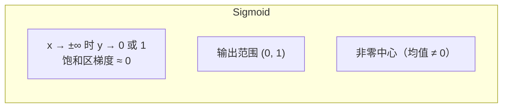
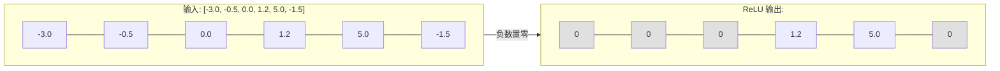
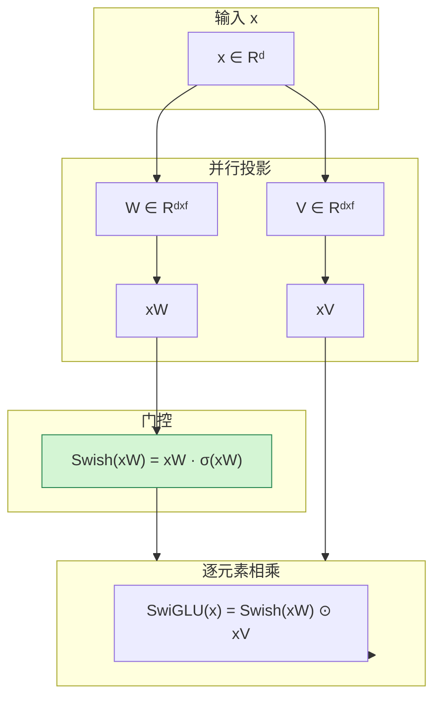
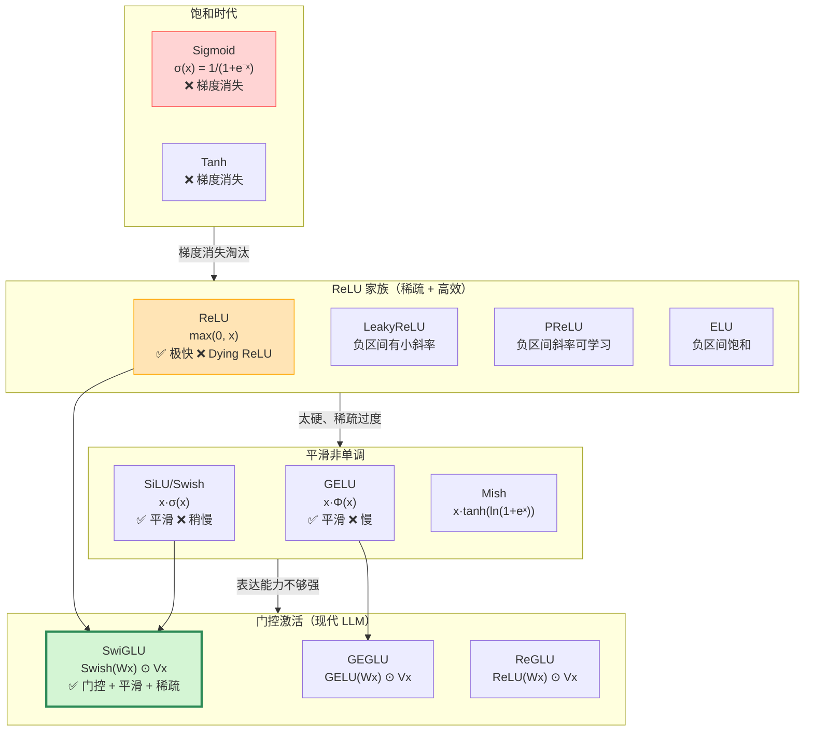
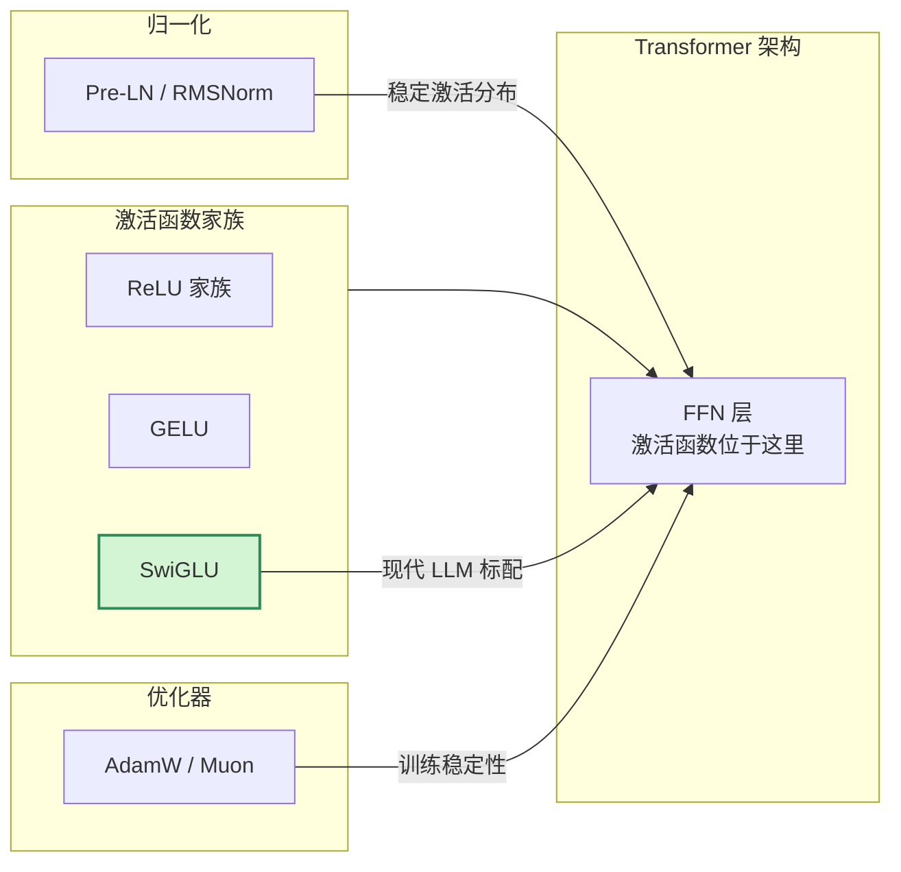

# 激活函数（Activation Function）基本原理

> **一句话总结**：激活函数给神经网络引入**非线性**——没有它，再深的网络也等价于一个线性变换，只能表达线性可分问题。从早期的 Sigmoid/Tanh（饱和、易梯度消失）到 ReLU（稀疏、高效，但有 Dying ReLU），再到 GELU/SwiGLU（平滑、Transformer 标配）、SiLU/Mish（平滑非单调），每一代激活函数的演进都围绕着**梯度流动性、计算效率、稀疏性、表达能力**四个维度做权衡。现代 LLM（LLaMA、Mistral、DeepSeek）几乎全部采用 **SwiGLU**——一种门控的激活函数，比单纯 GELU 更强、参数略多。

本文遵循本仓库的设计原则：**先讲清"为什么"，再讲"怎么做"**，并明确标注**关联技术**与**边界、代价**。

- 适用版本前提：本文覆盖的激活函数及其公式基于 PyTorch v2.x、TensorFlow v2.x 的官方实现与原始论文。现代 LLM 中的激活函数选型基于 LLaMA 2/3、Mistral、DeepSeek V3/V4 等公开技术报告（2023–2026）。

---

## 1. 它为什么存在：非线性是核心

### 1.1 没有激活函数的神经网络能做什么

如果每一层只是线性变换 `W·x + b`，那么：

```
y = Wₙ·(Wₙ₋₁·(…·(W₁·x + b₁) + b₂) …) + bₙ
  = (Wₙ·Wₙ₋₁·…·W₁)·x + const
  = W_total · x + b_total
```

**多层线性网络等价于一层线性变换**——它只能拟合线性可分的问题（如一条直线划分两类）。现实中几乎所有问题都是非线性的：图像识别、语音识别、语言翻译……都需要非线性能力。

### 1.2 激活函数的角色

激活函数 `σ(·)` 插在每一层的线性变换之后：

```
y = σ(W·x + b)
```

这个简单的非线性注入让网络可以**无限逼近任意连续函数**（万能逼近定理）——但代价是：梯度必须通过激活函数回传，如果激活函数的梯度特性不好，训练就会出问题。

### 1.3 一个好的激活函数需要什么

| 特性 | 含义 | 为什么重要 |
| --- | --- | --- |
| **非线性** | 不是线性函数 | 网络才能拟合复杂模式 |
| **可微** | 处处有导数（或几乎处处） | 梯度下降需要 |
| **导数特性好** | 不会让梯度爆炸或消失 | 深层网络训练的前提 |
| **计算高效** | 易于并行计算 | 大模型训练/推理的关键 |
| **稀疏激活** | 大量输出为 0 | 减少无效计算、正则化效果 |

---

## 2. 早期饱和激活函数：Sigmoid 与 Tanh

### 2.1 Sigmoid

$$
\sigma(x) = \frac{1}{1 + e^{-x}}
$$



| 优点 | 缺点 |
| --- | --- |
| 输出范围 (0, 1)，天然适合**二分类概率** | **梯度消失**：|x| 大时梯度 → 0，深层网络训练不动 |
| 平滑、可微 | **非零中心**：均值为 0.5，导致后续层的梯度有"偏置" |
| 早期神经网络标配 | **计算昂贵**：指数运算 |

### 2.2 Tanh

$$
\tanh(x) = \frac{e^x - e^{-x}}{e^x + e^{-x}} = 2 \cdot \sigma(2x) - 1
$$

| 优点 | 缺点 |
| --- | --- |
| 输出范围 (-1, 1) | **仍然饱和**，|x| 大时梯度消失 |
| **零中心**（均值 = 0） | 计算同样昂贵 |
| 比 Sigmoid 收敛略快 | |

### 2.3 为什么被淘汰

Sigmoid/Tanh 最大的问题是**饱和区的梯度消失**：当输入绝对值较大时，它们的导数接近 0，梯度无法有效回传——深层网络（> 5 层）几乎无法训练。此外，Tanh 的零中心虽然比 Sigmoid 好，但计算开销大。

**现代使用场景**：
- Sigmoid：仅用于**二分类输出层**（输出概率）
- Tanh：少数 RNN/LSTM 的遗忘门

---

## 3. ReLU：真正的革命

### 3.1 公式与直觉

$$
\text{ReLU}(x) = \max(0, x)
$$

这是一个非常简单的"截断"函数——负数输入直接置零，正数保持不变。

### 3.2 ReLU 为什么有效

| 特性 | 说明 |
| --- | --- |
| **计算极快** | 一次比较 + 一次赋值，GPU 上一条指令搞定 |
| **缓解梯度消失** | 正区间导数恒为 1，梯度可无损回传 |
| **稀疏激活** | 约 50% 的输出为 0，减少无效计算，同时天然正则化 |
| **生物学动机** | 神经元"全或无"放电的近似 |

ReLU 的稀疏性特别值得强调：



6 个输入中 4 个被置零——这就是**稀疏性**，意味着 4/6 的后续计算量直接消失，且输出向量更"干净"（只有正值激活的特征）。

### 3.3 Dying ReLU 问题

ReLU 的缺点：当输入长期为负时，输出恒为 0，**梯度也恒为 0**——这个神经元就"死"了，永远无法再被激活。

- 原因：学习率太大导致权重大幅更新，使得该神经元对所有样本的输入都变负
- 后果：网络容量下降（一部分神经元永久失效）
- 缓解：用更小的学习率、或者用 ReLU 的变体（LeakyReLU、PReLU）

### 3.4 ReLU 的变体

| 变体 | 公式 | 解决什么问题 |
| --- | --- | --- |
| **LeakyReLU** | `max(0, x) + α·min(0, x)` | Dying ReLU——负区间也有小的斜率 α（如 0.01） |
| **PReLU** | 同上，但 α 是**可学习**参数 | 让网络自己决定负区间斜率 |
| **ELU** | `x`（x > 0），`α·(eˣ − 1)`（x ≤ 0） | 负区间饱和到 α，输出均值接近 0 |
| **SELU** | 自归一化版本的 ELU | 让输出自动保持均值 0、方差 1 |

这些变体在 CNN 中广泛使用（LeakyReLU 用于 GAN 的判别器），但在 Transformer/LLM 中几乎不出现——因为 Transformer 用的是 GELU/SwiGLU 系列。

---

## 4. GELU：Transformer 的第一个标配

### 4.1 公式与直觉

Gaussian Error Linear Unit（GELU）[1] 把输入与**其高斯分布的 CDF** 相乘：

$$
\text{GELU}(x) = x \cdot \Phi(x) = x \cdot \frac{1}{2}\left(1 + \text{erf}\left(\frac{x}{\sqrt{2}}\right)\right)
$$

其中 `Φ(x)` 是标准正态分布的累积分布函数（CDF），`erf` 是误差函数。

### 4.2 GELU 的直觉

GELU 的逻辑是：**输入一个值 x，我们按"它是随机正态分布中大于这个值的概率"来按比例保留或抑制它**。换句话说：

- 很小的负 x → 被大幅抑制（概率很小）
- 很大的正 x → 几乎完整保留（概率接近 1）
- 接近 0 的 x → 平滑过渡

这比 ReLU 的"硬截断"（非 0 即全部）更**平滑**、更**柔和**。

### 4.3 GELU 的近似实现

精确计算 `erf` 比较贵，实践中常用两个多项式近似：

| 近似 | 公式 | 精度 |
| --- | --- | --- |
| **标准近似** | `0.5·x·(1 + tanh[√(2/π)·(x + 0.044715·x³)])` | 好 |
| **GPT-2 近似** | `x·Φ(x) ≈ x·sigmoid(1.702·x)` | 极简单，GPT-2 用这个 |

PyTorch 的 `nn.GELU()` 支持 `approximate='tanh'` 和 `approximate='none'` 两种模式。

### 4.4 GELU vs ReLU

| 维度 | ReLU | GELU |
| --- | --- | --- |
| **平滑性** | 在 0 点不可导（硬截断） | 处处可导、平滑 |
| **稀疏性** | 强（~50% 为 0） | 弱（接近 0 的值仍保留一部分） |
| **计算速度** | 极快 | 较慢（需要 tanh/erf） |
| **Transformer 表现** | 也能收敛但效果略差 | **更好**，GPT/BERT/原始 Transformer 都用 GELU |
| **LLM 中的地位** | 已被 SwiGLU 取代 | 过渡方案，现代 LLM 少用纯 GELU |

**关键差异**：GELU 是**概率门控**，而 ReLU 是**硬门控**。GELU 给每个输入一个"软门控值"，而不是 0 或 1。这种平滑性让 Transformer 的优化更稳定 [2]。

---

## 5. SwiGLU：现代 LLM 的标配

### 5.1 门控激活的想法

门控激活（Gated Activation）的思路是：**让一个分支专门学一个"门"来决定另一个分支的激活程度**。最早的门控可以追溯到 LSTM 的遗忘门和 GRU 的门控机制。

对于 Transformer 的 FFN 层，原始结构是：

```
FFN(x) = W₂ · Activation(W₁ · x)
```

门控版本变成：

```
FFN_Gated(x) = W₂ · [Activation(W₁ · x) ⊙ V(x)]
```

其中 `⊙` 是逐元素相乘，`V(x)` 是门控函数。

### 5.2 SwiGLU 的组成

SwiGLU = **Swish** 作为门 + **Linear** 作为值 + 两者相乘 [3][4]：

$$
\text{SwiGLU}(x, W, V) = (\text{Swish}(xW)) \odot (xV)
$$

其中 Swish [5] 定义为：

$$
\text{Swish}(x) = x \cdot \sigma(x)
$$

（σ 是 Sigmoid）。

### 5.3 具体流程



### 5.4 SwiGLU vs 纯 GELU

| 维度 | GELU（原始 Transformer） | SwiGLU（现代 LLM） |
| --- | --- | --- |
| **计算路径** | 单分支 `W₂·GELU(W₁·x)` | 双分支 `W₂·(Swish(W₁·x) ⊙ V·x)` |
| **参数量** | `2·d·d_ff` | **`3·d·d_ff`**（多了 V 投影） |
| **FFN 维度适配** | `d_ff = 4d_model` | 为保持参数量相当，**`d_ff = 2.67d_model`** [3] |
| **表达能力** | 单分支 | **门控双分支，更强** |
| **训练稳定性** | 好 | **更好** |
| **代表模型** | 原始 Transformer、GPT-2/3、BERT | **LLaMA 1/2/3、Mistral、Gemma 2、DeepSeek V3/V4** |

### 5.5 为什么 SwiGLU 更强

**门控机制让 FFN 层可以学习"选择性激活"**：

- `Swish(xW)` 分支：输出一个 **0–1 之间平滑的门值**（Swish 非负、可大于 1）
- `xV` 分支：输出内容（类似 LSTM 的 cell candidate）
- 逐元素相乘：门值乘以内容 → **只有"该激活的"内容被放大输出**

这比纯 GELU 只能做单分支非线性变换更灵活。Shazeer 2020 的论文实验表明，SwiGLU 在相同参数量下**显著优于** ReLU/GELU/SiLU [3]。

### 5.6 LLaMA 的 FFN 配置

LLaMA 论文专门提到，为了保持模型总参数量与原始 Transformer（GELU + d_ff = 4d）相当，使用 SwiGLU 时把 `d_ff` 从 `4d` 降到 **`(8/3)·d ≈ 2.67d`** [6]。所以 LLaMA 7B 的 `d_ff = 11008`（因为 4096 × 11008 × 2 分支 ≈ 4096 × 16384 × 1 分支）。

---

## 6. 其他值得关注的激活函数

### 6.1 SiLU（Swish）

$$
\text{SiLU}(x) = x \cdot \sigma(x)
$$

SiLU（也叫 Swish）由 Google 2017 提出，是 ReLU 的平滑替代品 [5]：

- 非单调（和 ReLU 不同），在 x < 0 时仍有梯度
- 平滑、处处可导
- 在 CNN 上略优于 ReLU，但训练稍慢
- 单独用 SiLU 做激活的现代 LLM 不多，但它是 **SwiGLU 的门控组件**

### 6.2 Mish

$$
\text{Mish}(x) = x \cdot \tanh(\ln(1 + e^x))
$$

Mish [7]（2019）把 SiLU 内部的 Sigmoid 换成了更平滑的 Softplus。YOLOv4/v5 曾用 Mish，近年已回归 SiLU。在 Transformer 场景下没有优势。

### 6.3 Softmax

严格来说 Softmax 是**归一化函数**而非激活函数，但常在输出层出现：

$$
\text{Softmax}(x_i) = \frac{e^{x_i}}{\sum_j e^{x_j}}
$$

- 输出层把 logits 映射成概率分布
- 注意力层中用来计算 attention weights（但不是激活函数）
- 指数运算昂贵（实践中用 log_softmax 配合 CrossEntropyLoss）

### 6.4 Softplus

$$
\text{Softplus}(x) = \ln(1 + e^x)
$$

ReLU 的平滑版，但在 x > 0 时输出恒大于 0、不对称，使用场景很少。

### 6.5 JLU（Jensen-Shannon 激活）

新兴研究方向，利用 Jensen-Shannon 散度构造的激活函数，在小样本场景下表现更好，尚未进入主流。

---

## 7. 激活函数演进全景



---

## 8. 现代 LLM 的激活函数选型

| 模型 | 架构 | FFN 激活 | FFN 维度 | 出处 |
| --- | --- | --- | --- | --- |
| GPT-1/2/3 | Decoder-only | **GELU**（GPT-2 近似） | 4d | [2] |
| BERT | Encoder-only | **GELU** | 4d | [2] |
| 原始 Transformer | Encoder-Decoder | **ReGLU**（论文里是 ReLU 的门控版本） | 4d | [8] |
| **LLaMA 1/2/3** | Decoder-only | **SwiGLU** | **(8/3)d ≈ 2.67d** | [6] |
| **Mistral** | Decoder-only | **SwiGLU** | (8/3)d | [4] |
| **Gemma 1/2** | Decoder-only | **GEGLU** | 2d（Gemma 2 重新调成标准） | Google |
| **DeepSeek V3/V4** | Decoder-only | **SwiGLU** | (8/3)d | [9] |
| **GPT-NeoX** | Decoder-only | **SwiGLU** | (8/3)d | EleutherAI |
| **Falcon** | Decoder-only | **SwiGLU** | (8/3)d | TII |
| **PaLM 2** | Decoder-only | **SwiGLU** | (8/3)d | Google |
| **Mixtral** | MoE | **SwiGLU**（每层 FFN 每个专家都用） | (8/3)d 每专家 | Mistral |

**结论**：
1. 2020 年之前（GPT-3）→ GELU
2. 2023 年起（LLaMA 1 发布）→ **SwiGLU 成为事实标准**
3. Gemma 用了 GEGLU（GELU 门控），但效果相当

---

## 9. 完整对比表

| 激活函数 | 公式 | 非线性 | 平滑 | 稀疏性 | 计算速度 | 典型场景 | 主要缺点 |
| --- | --- | --- | --- | --- | --- | --- | --- |
| Sigmoid | 1/(1+e⁻ˣ) | ✅ | ✅ | ❌ | 慢 | 二分类输出层 | 梯度消失、非零中心 |
| Tanh | (eˣ−e⁻ˣ)/(eˣ+e⁻ˣ) | ✅ | ✅ | ❌ | 慢 | LSTM 遗忘门 | 梯度消失 |
| ReLU | max(0, x) | ✅ | ❌ | ✅~50% | **极快** | CNN、早期 Transformer | Dying ReLU |
| LeakyReLU | max(0,x)+α·min(0,x) | ✅ | ❌ | 弱 | 极快 | GAN 判别器 | α 需设 |
| ELU | x (x>0)，α(eˣ−1) | ✅ | ✅ | 弱 | 慢 | 早期 CNN | 计算贵 |
| GELU | x·Φ(x) | ✅ | ✅ | 弱 | 中 | GPT-2/3、BERT | 计算稍慢 |
| SiLU | x·σ(x) | ✅ | ✅ | ❌ | 中 | CNN（YOLOv5） | 不如 ReLU 快 |
| Mish | x·tanh(softplus(x)) | ✅ | ✅ | ❌ | 慢 | YOLOv4 | 最慢 |
| **SwiGLU** | Swish(Wx) ⊙ Vx | ✅ | ✅ | 强（门控） | 中 | **现代 LLM 标配** | 参数多 ~1.5× |
| GEGLU | GELU(Wx) ⊙ Vx | ✅ | ✅ | 强 | 中 | Gemma | 参数多 |
| ReGLU | ReLU(Wx) ⊙ Vx | ✅ | ❌ | 强 | 快 | 原始 Transformer | 不平滑 |

---

## 10. 边界与代价

### 10.1 SwiGLU 的参数代价

SwiGLU 多了一个门控分支 `V`，投影参数比 GELU 多 **50%**。LLaMA 论文通过把 `d_ff` 从 `4d` 降到 `(8/3)d ≈ 2.67d` 来补偿——这样每层 FFN 的总参数量大致不变，但计算量略增（因为有 Swish 和逐元素相乘）。

### 10.2 稀疏性 vs 平滑性的权衡

ReLU 是**硬稀疏**（非 0 即全部），稀疏程度最高；GELU 是**软稀疏**（接近 0 的值部分保留）；SwiGLU 的门控让稀疏性"可学习"——网络可以自行决定稀疏程度。

- ReLU 稀疏性高 → 正则化效果好，但容易 Dying ReLU
- GELU/SwiGLU 稀疏性适中 → 稳定，但需要归一化来稳定分布

### 10.3 非单调性

ReLU、GELU、SwiGLU 都是**非单调**的（在某些区间导数为正、某些为负）。虽然这不影响它们的效果，但某些理论分析（如 SGD 收敛性）假设激活函数是单调的——使用非单调激活时这些理论不再直接适用。

### 10.4 计算效率在硬件上的体现

现代 GPU 的 Tensor Core 对简单的逐元素操作（ReLU）做了硬编码优化。GELU/SwiGLU 的内部包含 Sigmoid/Tanh，虽然 PyTorch 用近似多项式实现，比精确 erf 快很多，但还是比 ReLU 慢。实践中这被**更高的精度收益**和**更好的训练稳定性**抵消。

### 10.5 不适用场景

- **极小规模模型**（< 10M 参数）：ReLU 足够简单高效，GELU/SwiGLU 的精度优势不明显
- **需要极致低延迟的推理**（如实时语音）：ReLU 计算开销最低
- **某些神经形态计算硬件**：只支持 ReLU 或 Hard ReLU

---

## 11. 关联：它在知识网络中的位置



- **与 Transformer FFN**：激活函数是 FFN 层非线性来源，SwiGLU + (8/3)d_ff 已是现代 LLM 标配
- **与归一化**：Pre-LN/RMSNorm 把激活输入稳定到 N(0, 1)，让激活函数在其有效工作区间运行，充分发挥非线性
- **与优化器**：稳定的激活分布让 AdamW/Muon 可以用更大学习率收敛更快
- **与稀疏性**：SwiGLU 的门控带来天然稀疏性，与 MoE 的稀疏激活思路同源

---

## 12. 可验证：PyTorch 最小示例

```python
import torch
import torch.nn as nn

x = torch.randn(2, 16, 64)   # [batch, seq_len, d_model]

# PyTorch 中常见激活函数
relu = nn.ReLU()
gelu = nn.GELU(approximate='tanh')
silu = nn.SiLU()
swiglu_ffn = nn.Sequential(
    nn.Linear(64, 128 * 2),   # 两个分支的投影
    nn.GLU(dim=-1),           # GLU = SwiGLU 结构（SwiGLU 用 SiLU 门）
)

y_relu = relu(x)
y_gelu = gelu(x)
y_silu = silu(x)

print(f"ReLU 输出中 0 的比例: {(y_relu == 0).float().mean():.2%}")
print(f"GELU 输出范围: [{y_gelu.min():.2f}, {y_gelu.max():.2f}]")
print(f"SiLU 输出范围: [{y_silu.min():.2f}, {y_silu.max():.2f}]")
```

### 观测要点

| 想验证什么 | 怎么做 |
| --- | --- |
| ReLU 的稀疏性 | 统计 ReLU 输出中 0 的比例 → 应接近 50% |
| GELU 是否真的平滑 | 画出小范围输入的 GELU 和 ReLU 输出对比 |
| SwiGLU vs GELU 精度 | 同一 Transformer 分别用 SwiGLU 和 GELU 训练，对比 loss 曲线 |
| Dying ReLU | 构造大学习率 + ReLU 网络，看输出中 0 的比例是否越来越高 |

---

## 13. 延伸阅读

- 本仓库姊妹文档：《归一化基本原理》、《优化器基本原理》、《注意力机制基本原理》
- GELU 原始论文：<https://arxiv.org/abs/1606.08415> [1]
- SwiGLU 原始论文（Shazeer）：<https://arxiv.org/abs/2002.05202> [3]
- LLaMA 2 技术报告（SwiGLU + 8/3d_ff 配置）：<https://arxiv.org/abs/2307.09288> [6]

---

## 参考文献

1. Hendrycks, D. & Gimpel, K. *Gaussian Error Linear Units (GELUs)*. arXiv:1606.08415 (2016). <https://arxiv.org/abs/1606.08415> — GELU 原始论文
2. Devlin, J., Chang, M.-W., Lee, K., et al. *BERT: Pre-training of Deep Bidirectional Transformers for Language Understanding*. NAACL 2019. <https://arxiv.org/abs/1810.04805> — BERT 使用 GELU
3. Shazeer, N. *GLU Variants Improve Transformer*. arXiv:2002.05202 (2020). <https://arxiv.org/abs/2002.05202> — SwiGLU 原始论文，对比各种 GLU 变体
4. Jiang, A. Q., Sablayrolles, A., Roux, A., et al. *Mistral 7B*. arXiv:2310.06825 (2023). <https://arxiv.org/abs/2310.06825> — Mistral 使用 SwiGLU
5. Ramachandran, P., Zoph, B., & Le, Q. V. *Searching for Activation Functions*. arXiv:1710.05941 (2017). <https://arxiv.org/abs/1710.05941> — SiLU/Swish 原始论文
6. Touvron, H., Lavril, T., Izacard, X., et al. *LLaMA 2: Open Foundation and Fine-Tuned Chat Models*. arXiv:2307.09288 (2023). <https://arxiv.org/abs/2307.09288> — LLaMA 2 使用 SwiGLU + (8/3)d_ff
7. Misra, D. *Mish: A Self Regularized Non-Monotonic Neural Activation Function*. arXiv:1908.08681 (2019). <https://arxiv.org/abs/1908.08681> — Mish 原始论文
8. Vaswani, A., Shazeer, N., Parmar, N., et al. *Attention Is All You Need*. NeurIPS 2017. arXiv:1706.03762. <https://arxiv.org/abs/1706.03762> — 原始 Transformer 使用 ReLU（后来有人发现用 ReGLU 效果更好）
9. DeepSeek. *DeepSeek-V3 Technical Report*. arXiv:2412.19437 (2024). <https://arxiv.org/abs/2412.19437> — DeepSeek V3 使用 SwiGLU

### 图片来源与许可声明

本文所有机制图均为 **Mermaid 自绘**，GitHub 原生渲染：

| 图 | 类型 | 说明 |
| --- | --- | --- |
| Sigmoid/Tanh 饱和示意图（第 2.1 节） | Mermaid graph LR | 自绘 |
| ReLU 稀疏激活示意图（第 3.2 节） | Mermaid flowchart LR | 自绘 |
| SwiGLU 门控流程（第 5.3 节） | Mermaid flowchart TB | 自绘 |
| 演进全景图（第 7 节） | Mermaid graph TB | 自绘 |
| 关联知识网络（第 11 节） | Mermaid flowchart LR | 自绘 |

> 注：尝试下载 Udacity、Rasbt 等来源的标准激活函数对比曲线图（Sigmoid/Tanh/ReLU/GELU 在同一张图上的函数曲线），均返回 404 或超时。Mermaid 流程图 + 公式已覆盖所有核心机理。
