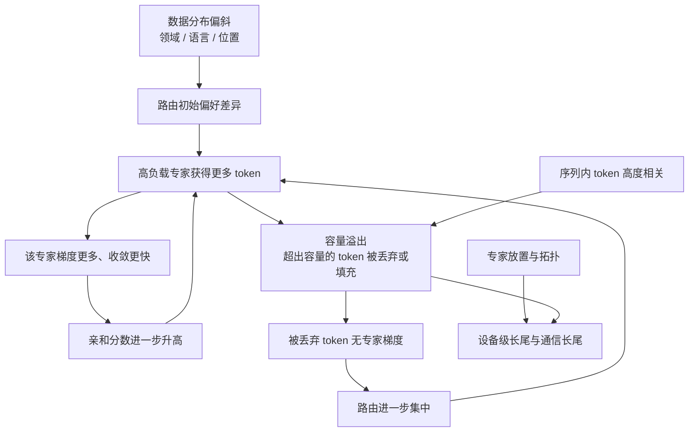
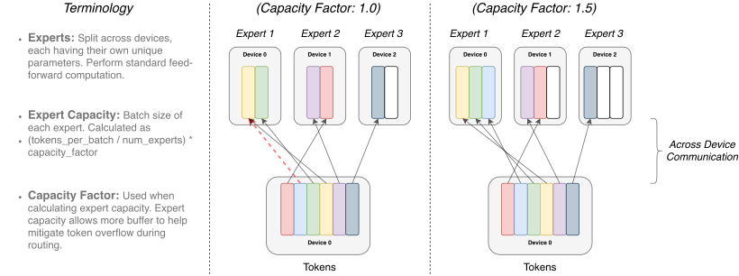
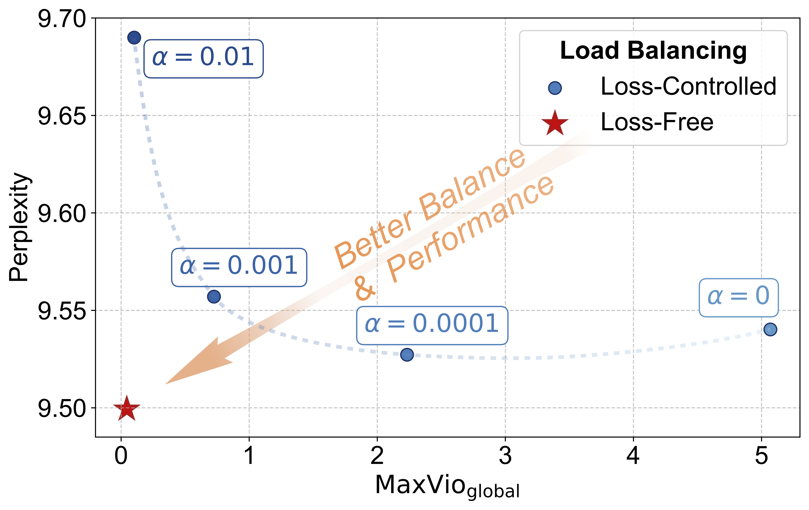
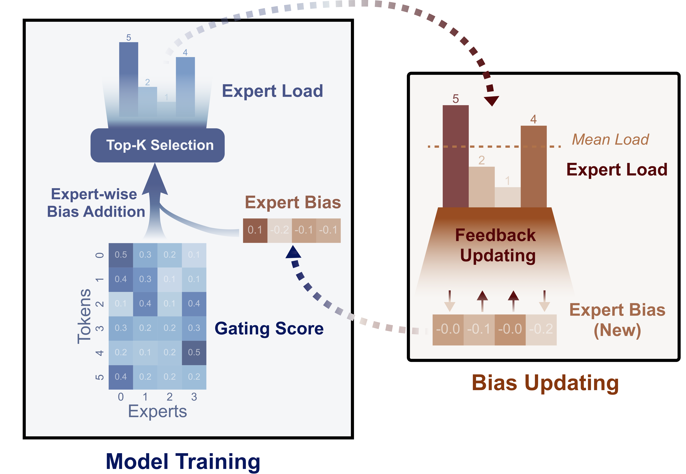
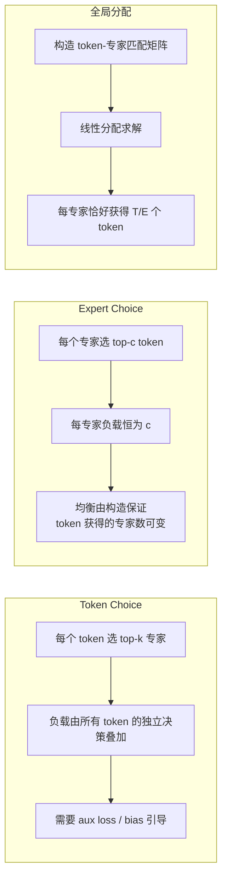
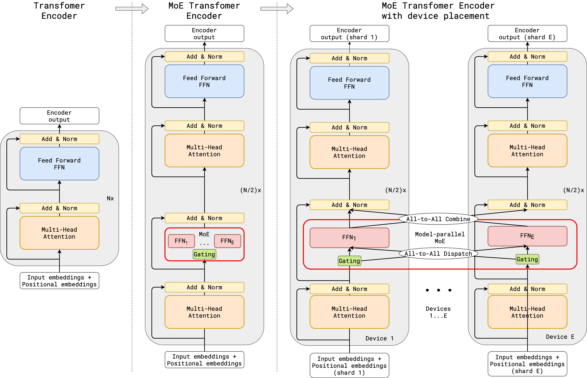
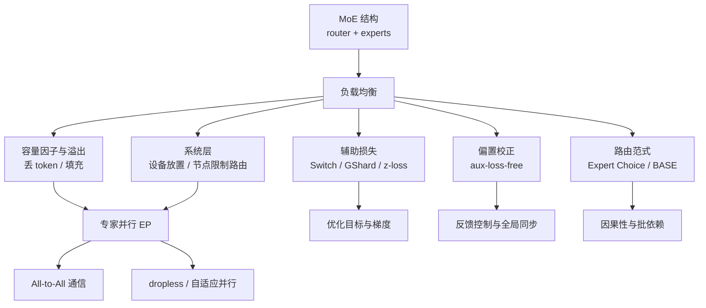
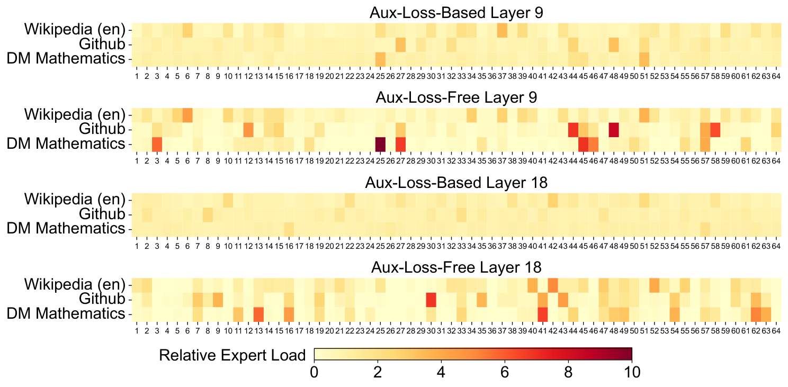
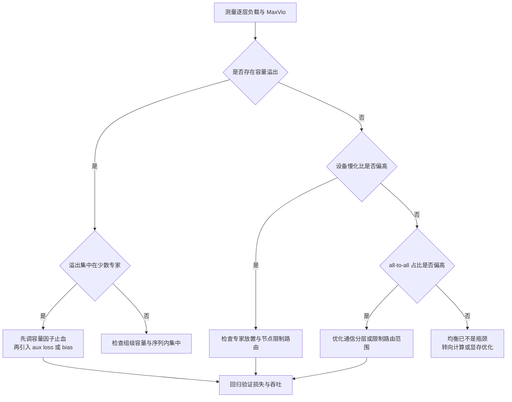

# MoE 负载均衡基本原理

> **一句话总结**：MoE 负载均衡要解决的不是"让路由概率好看"，而是在**有限专家容量**这一硬约束下分配 token 的软/硬机制组合：容量因子决定溢出如何折算为代价，辅助损失与偏置校正改变路由决策的梯度或阈值，专家选择/全局分配则直接替换可行域，专家放置与设备级目标再把均衡从"专家计数"扩展到"通信与步时间"。其收益是消除容量溢出与设备长尾，代价是均衡目标与专家特化存在结构性冲突，且任何均衡手段都只是把不均衡转化为丢弃、填充、通信或计算开销 \[1]\[2]\[3]\[11]。

本文遵循本仓库的设计原则：先界定"负载"的观测对象与度量，再按容量、目标函数、路由范式、系统拓扑四个层次展开机理，最后给出代价边界与可验证方法。

- **边界说明**：路由结构、top-k 选择与门控的定义见 [MoE基本原理](../../神经网络基础/MoE基本原理.md)；EP 下的 all-to-all 实现与并行拓扑见 [专家并行推理基本原理](../../推理/分布式推理/专家并行推理基本原理.md) 与 [通信原语基本原理](../通信优化/通信原语基本原理.md)。本文聚焦**训练侧**的均衡问题，推理侧的冗余专家部署、PD 分离与低延迟批处理只在"反馈到训练策略"的意义上讨论。
- **适用版本前提**：容量与溢出语义源自 GShard \[3] 与 Switch Transformer \[2]；辅助损失族与 router z-loss 源自 Switch \[2]、GShard \[3] 与 ST-MoE \[4]；全局分配与专家选择源自 BASE Layers \[5] 与 Expert Choice \[6]；无辅助损失偏置校正源自 DeepSeek-V2/V3 \[9]\[10] 与 Loss-Free Balancing \[11]；dropless 与自适应并行源自 MegaBlocks \[7] 与 Tutel \[8]。**脱离容量约束、批组成与并行拓扑的"均衡结论"不成立**。

***

## 1. 问题界定

### 1.1 "负载"的四个层面

MoE 中的"负载"不是单一标量。不同文献在不同层面上使用该词，混用会导致优化目标错位。

| 层面 | 观测量 | 决定的对象 | 不均衡的直接后果 |
| --- | --- | --- | --- |
| token 计数 | 专家 $i$ 处理的 token 数 $L_i$ | 单专家计算量与显存 | 溢出丢 token、专家闲置 |
| 概率质量 | 专家 $i$ 的门控概率和 $P_i$ | 路由置信度与梯度流向 | 路由塌缩、专家欠训练 |
| 设备负载 | 设备 $d$ 上的 token 数 $L_d$ | EP 单步执行时间 | 木桶效应、其余设备空转 |
| 通信负载 | 设备 $d$ 收发 token 量 $V_d$ | all-to-all 时长与 buffer 峰值 | 链路饱和、长尾同步 |

四个层面互不蕴含： $L_i$ 均衡不保证 $L_d$ 均衡（专家放置可能把高负载专家集中到同一设备）， $L_d$ 均衡也不保证 $V_d$ 均衡（不同设备的发送/接收方向与链路带宽不同）。DeepSeek-V2 因此显式区分专家级、设备级与通信级三个均衡损失 \[9]，这一分解是本节后续讨论的基本框架。

### 1.2 不均衡的度量

最常用的 max 型指标是**最大偏离**（maximal violation），其定义为

$$
\mathrm{MaxVio} = \frac{\max_i L_i - \bar{L}}{\bar{L}}
$$

其中 $\bar{L}$ 为专家平均负载。该指标只关心最热点，因为 EP 单步时间由最慢设备决定，而不是由平均负载决定；这解释了为何用方差或熵衡量会产生"统计上很均衡、工程上仍然长尾"的误判。

工程上还需区分两个统计口径 \[11]：

- $\mathrm{MaxVio}_{\mathrm{batch}}$：在**单个训练批**内统计，直接对应单步执行效率；
- $\mathrm{MaxVio}_{\mathrm{global}}$：在整个验证集或长窗口内统计，对应批量趋近上限时的利用率上界。

二者可以分离：全局均衡而批内不均衡，是 EP 训练中最常见的失效形态。其余常用量包括丢弃率 $D = N_{\mathrm{drop}} / N_{\mathrm{total}}$、填充率 $P_{\mathrm{pad}} = N_{\mathrm{pad}} / N_{\mathrm{total}}$、设备慢化比 $R = \max_d L_d / \mathrm{mean}_d L_d$，以及路由分布的熵 $H = -\sum_i f_i \log f_i$。熵刻画的是分散程度，MaxVio 刻画的是最坏点；前者适合观察塌缩趋势，后者适合验收。

### 1.3 不均衡的来源

不均衡不是单一原因造成的，而是正反馈、数据分布与系统拓扑叠加的结果。

1. **正反馈与路由塌缩**：被选中的专家获得更多梯度、收敛更快、亲和分数更高，从而继续被选中。Shazeer 等人将这一自增强过程称为 routing collapse \[1]，它是辅助损失存在的根本原因。
2. **数据分布偏斜**：领域、语言、代码与数学 token 天然聚集到不同专家；这种偏斜本身是专家特化的来源，不应当被完全抹平。
3. **序列内相关性**：同一序列的 token 主题高度一致，批级均衡可能掩盖序列内集中；在 EP 下，单个 micro-batch 的溢出即由最集中的序列触发。
4. **容量截断**：溢出 token 被丢弃后不参与专家计算，也不会给对应专家带来梯度，形成"越溢出越不均衡"的二次反馈。
5. **系统放大**：专家放置、节点内/节点间带宽差异与 all-to-all 的分层结构，会把专家级不均衡放大为设备级与通信级长尾。

***

## 2. 核心机理

### 2.1 容量约束：把不均衡折算为代价

每个专家每个 micro-batch 能处理的 token 数由一个静态上界给出：

$$
C = \left\lfloor \frac{c_f \cdot k \cdot T}{E} \right\rfloor
$$

其中 $c_f$ 为容量因子（capacity factor）， $k$ 为每 token 激活的专家数， $T$ 为该批 token 总数， $E$ 为专家数。GShard 采用分组调度时，把 $N$ 个 token 均分为 $G$ 组、每组 $S = N/G$ 个 token，每组独立持有每个专家的容量份额 $2N/(G \cdot E) \cdot c_f = 2S/E \cdot c_f$（对应 top-2 路由）\[3]；这意味着**全局均衡并不能保证组内不溢出**，溢出判定始终是局部的。

图中对比容量因子 1.0 与 1.5 两种状态：取 1.0 时，超出容量的 token 被丢弃（红色虚线），这些 token 在本层不参与任何专家计算；容量因子取 1.5 时为每个专家预留空槽，所有 token 都被处理，但空槽仍要参与通信与矩阵乘。**容量因子不是均衡手段，而是把不均衡折算成丢弃或填充的换算系数**： $c_f$ 偏小则丢弃率上升， $c_f$ 偏大则显存、带宽与无效计算上升 \[2]。

对溢出的处理存在三种工程路线，其代价结构不同：

| 路线 | 做法 | 代价 | 代表工作 |
| --- | --- | --- | --- |
| 丢弃 | 超出容量的 token 置零或跳过 | 容量浪费、梯度缺失 | Switch \[2] |
| 重路由 | 溢出 token 改投次优专家，可迭代 | 路由关联被破坏、额外控制流 | No-Token-Left-Behind \[2] |
| 填充 / dropless | 不设固定容量，按实际负载做块稀疏计算 | 动态形状、填充与 kernel 复杂度 | MegaBlocks \[7] |

Switch 的实验给出一个重要边界：重路由虽然几乎消除了丢弃，但**没有带来可测量的质量收益**，作者推测原因是 token 与专家已学到关联，改投次优专家反而破坏了这种关联 \[2]。因此"不丢 token"并不自动等于"更好"，是否值得取决于丢弃率与任务对路由一致性的敏感度。

### 2.2 辅助损失：用梯度塑造路由分布

辅助损失是 token-choice 路由下最主流的手段。Switch Transformer 将 Shazeer 等人原本分离的 load loss 与 importance loss 合并为一个可微项 \[2]：

$$
\mathcal{L}_{\mathrm{aux}} = \alpha E \sum_{i=1}^{E} f_i P_i
$$

其中

$$
f_i = \frac{1}{T}\sum_{x \in \mathcal{B}} \mathbf{1}\left\{\arg\max_j p_j(x) = i\right\}, \qquad
P_i = \frac{1}{T}\sum_{x \in \mathcal{B}} p_i(x)
$$

$f_i$ 为分派到专家 $i$ 的 token 比例， $P_i$ 为路由分配给专家 $i$ 的平均概率质量， $\alpha$ 为损失系数（Switch 取 $10^{-2}$）。关键实现细节是： $f_i$ 由 $\arg\max$ 产生、不可微，因此实现中把它视为常数，梯度只通过 $P_i$ 回传。这使辅助损失本质上是**对路由概率的软惩罚**，而非对实际分派结果的精确优化。

GShard 的形式略有不同 \[3]：

$$
\ell_{\mathrm{aux}} = \frac{1}{E}\sum_{e=1}^{E} \frac{c_e}{S} m_e, \qquad m_e = \frac{1}{S}\sum_{s=1}^{S} g_{s,e}
$$

其中 $c_e$ 为分派到专家 $e$ 的 token 数， $S$ 为组内 token 数， $m_e$ 为平均门控值。其动机是最小化 $c_e/S$ 的均方，但由于 $c_e$ 不可微，用 $m_e$ 做可微替代。GShard 还引入组级调度与随机路由：第二专家按权重比例随机选择，以缓解 top-2 路由的确定性集中 \[3]。

围绕辅助损失还有三类常见补充：

- **router z-loss**：ST-MoE 提出 $\mathcal{L}_z = \frac{1}{B}\sum_{i=1}^{B}\left(\log Z_i\right)^2$，其中 $Z_i = \sum_{j=1}^{E} e^{x_{i,j}}$，系数取 $10^{-3}$ \[4]。它惩罚过大的路由 logits，主要作用是数值稳定与抑制 softmax 饱和，**不是均衡项**，但常与均衡损失同时使用。
- **多级均衡**：DeepSeek-V2 同时约束专家级、设备级与通信级负载，分别对应 1.1 节的三个层面 \[9]。
- **序列级均衡**：DeepSeek-V3 在主策略之外加入序列级互补损失 $\mathcal{L}_{\mathrm{Bal}} = \alpha \sum_{i=1}^{N_r} f_i P_i$，按单条序列统计 $f_i$ 与 $P_i$，系数取 $10^{-4}$ \[10]。动机是批级均衡无法约束单序列内部的极端集中，而推理时单序列就可能成为热点。

辅助损失的结构性缺陷在于**它修改的是路由梯度**。主任务希望尖锐化正确专家的概率，均衡项希望压低高负载专家的概率，二者在同一组 router 参数上相互拉扯。系数过大时均衡良好但质量下降，系数过小时出现塌缩；Loss-Free Balancing 将这一现象直接刻画为"均衡—性能两难" \[11]。

图中横轴为全局最大偏离，纵轴为验证困惑度。 $\alpha = 0.01$ 时偏离接近 0，但困惑度升至约 9.69； $\alpha = 0$ 时困惑度回落到约 9.54，偏离却扩大到 5 以上；无辅助损失方法（星标）同时取得接近 0 的偏离与最低困惑度。该图说明**均衡与质量并非单调互换，而是辅助损失把二者绑在了同一条曲线上** \[11]。

### 2.3 偏置校正：把均衡从梯度中剥离

DeepSeek-V2/V3 与 Loss-Free Balancing 采用另一条路径：不修改损失函数，而是给每个专家维护一个标量偏置 $b_i$，仅用于 top-k 选择，不参与输出加权 \[10]\[11]。

左图为单步训练：偏置加到门控分数上再做 top-k 选择，得到专家负载；右图为步末反馈：按负载与均值的偏差调整偏置。更新规则可写为

$$
b_i \leftarrow b_i - \gamma \cdot \mathrm{sign}\left(L_i - \bar{L}\right)
$$

其中 $\gamma$ 为偏置更新速率（DeepSeek-V3 取 $10^{-3}$）\[10]。负载高于均值的专家偏置下调、低于均值的上调，下一 step 的 top-k 选择随之改变。

这一机制的性质与前两类手段有本质区别：

1. **不进入梯度**：偏置是外部状态，不参与反向传播，因此不会与主任务梯度冲突；这是它能同时改善均衡与困惑度的直接原因 \[11]。
2. **反馈控制而非优化**：它只观测标量负载并做符号校正，等价于对"负载约束"的对偶变量做次梯度式更新，而不是对某个可微目标求极小。
3. **只改选择、不改加权**：被选中专家的输出权重仍由原始亲和分数决定，因此偏置不会改变已选专家的混合比例 \[10]。
4. **需要全局同步**： $L_i$ 必须跨数据并行组聚合，每步一次 all-reduce；这是它新增的通信与同步点。

工程边界同样明确： $\gamma$ 过大引起选择振荡，过小则收敛缓慢；偏置只能保证批级负载，单序列内部仍可能极端集中，因此 DeepSeek-V3 仍保留一个系数极小的序列级辅助损失作为互补 \[10]。此外，偏置校正对**负载测量延迟**敏感：测量在步末完成，校正只能作用于下一步，突发性的批组成变化无法被同一步吸收。

### 2.4 路由范式：改变可行域而非只改目标

前述手段都在 token-choice 范式内工作：每个 token 独立选择专家，均衡只能被"引导"。另一类做法直接改变分配问题的结构，使均衡成为约束或构造性结果。

**Expert Choice** 让专家而不是 token 做选择：每个专家按亲和分数挑选固定预算的 token，因此每专家负载严格相等，不需要辅助损失 \[6]。代价有三点：每个 token 被选中的专家数可变，重要 token 可被多个专家处理、边缘 token 可能一个专家都没有；选择依赖整批 token，**在自回归生成中会引入未来 token 泄漏**，因为后续 token 会影响先前 token 的归属；批很小时全局 top-c 退化为稀有事件，需要 capped 变体限制每 token 被选次数 \[6]。其原始论文明确将自回归生成列为该方法的限制 \[6]。

**BASE Layers** 把 token-to-expert 分配写成线性分配问题：给定亲和分数矩阵，求一个匹配使每专家获得相同数量的 token，并用拍卖算法求解 \[5]。它在构造上保证均衡、不引入新的辅助损失或超参数，但代价是每层需要求解一个组合优化问题，且解依赖整批信息；分配的计算与显存开销随 token 数增长，在超大 batch 下需要专门实现。

这两类方法与 token-choice 的关系不是替代，而是**可行域的改变**：token-choice 的均衡是软约束，溢出仍会发生；专家选择与全局分配的均衡是硬构造，但把代价转移到"可变专家数、因果性破坏、分配求解"上。

### 2.5 系统层：从专家计数到设备与通信

当专家被切分到不同设备（EP）后，专家级负载通过放置关系映射为设备级负载：

$$
L_d = \sum_{i \in \mathcal{E}_d} L_i
$$

其中 $\mathcal{E}_d$ 为放置在设备 $d$ 上的专家集合。即使 $\max_i L_i$ 很小，只要高负载专家被集中放置， $L_d$ 仍会出现长尾，EP 单步时间由 $\max_d L_d$ 决定。

图中从左到右依次是稠密 Transformer、单设备 MoE Transformer、以及按专家切分到多设备后的形态。最右侧显示 gating 之后的 all-to-all dispatch 与 all-to-all combine：token 必须离开原设备，才能到达持有目标专家的设备。**这使负载不均衡同时成为通信不均衡**——热点专家所在设备收到更多 token，其入向链路与 buffer 先饱和，而其余设备等待 \[3]。

系统层可用的杠杆主要有四类：

| 杠杆 | 作用 | 代价 |
| --- | --- | --- |
| 容量因子 | 控制溢出与填充比例 | 显存、带宽、无效计算 |
| 专家放置 | 把高负载专家分散到不同设备 | 放置是组合问题，需负载统计与重排 |
| 设备级/通信级损失 | 直接约束 $L_d$ 与 $V_d$ | 新增超参数，可能牺牲专家特化 |
| 路由范围限制 | 每 token 只发送到至多 $M$ 个节点 | 限制专家选择自由度 |

DeepSeek-V3 的 node-limited routing 属于第四类：每个 token 至多发送到 $M$ 个节点，节点按其上专家亲和分数之和排序；在 $M=4$ 的约束下，训练框架可以接近完全的计算—通信重叠 \[10]。这把"均衡"从"每个专家都均匀"转为"每个节点的收发量可控"，是用少量路由自由度换取通信可预测性。

dropless 与自适应并行则属于执行层的响应：MegaBlocks 用块稀疏矩阵乘处理不均衡的实际负载，避免固定容量带来的丢弃或填充 \[7]；Tutel 在运行时根据负载在专家并行与数据并行之间切换，并把 all-to-all 组织为二维分层通信 \[8]。二者都不改变路由决策，而是改变"不均衡发生后的执行方式"。

### 2.6 训练动力学：批内、批间与序列内

均衡策略的有效性依赖统计口径，三个口径对应不同失效模式：

- **全局 vs 批内**：全局均衡只说明长期利用率上界，单步仍可能溢出；训练效率由批内口径决定。
- **批内 vs 序列内**：批级损失可以让整个 batch 的 $f_i$ 接近均匀，但单条序列仍可能把 80% 的 token 送到同一专家；推理按序列服务时，这一集中会直接变成设备热点 \[10]。
- **micro-batch vs global batch**：EP 的步时间由每个 micro-batch 的最大设备负载决定，增大全局 batch 只是把不均衡平均掉，不能消除单 micro-batch 的长尾。

此外，router logits 会随训练持续增大，softmax 趋于饱和， $P_i$ 的梯度变小而 top-k 的离散选择更稳定，塌缩风险上升；z-loss 与偏置校正分别从数值与选择两侧抑制这一趋势 \[4]\[10]。

***

## 3. 关联关系

- **与 MoE 结构**：负载均衡是稀疏路由的伴生问题；稠密 FFN 不存在专家选择，因而不存在该问题。详见 [MoE基本原理](../../神经网络基础/MoE基本原理.md)。
- **与专家并行**：EP 把专家级不均衡放大为设备级与通信级不均衡，是均衡策略从"质量约束"变为"性能约束"的转折点。详见 [专家并行推理基本原理](../../推理/分布式推理/专家并行推理基本原理.md)。
- **与 all-to-all**：通信量正比于跨设备发送的 token 数，负载均衡直接决定 all-to-all 的尾部时长与 buffer 峰值。详见 [通信原语基本原理](../通信优化/通信原语基本原理.md)。
- **与容量/显存**：容量因子与填充率直接进入激活显存与通信带宽预算；均衡策略的选择会改变显存—吞吐前沿。
- **与推理部署**：训练期的均衡策略决定推理期的路由分布；推理侧的冗余专家、专家重排与动态路由是对训练期残余不均衡的部署层补偿 \[10]。
- **与优化器**：辅助损失改变 router 梯度，偏置校正绕开梯度但引入外部状态；二者与学习率、warmup 的交互不同，需要分开调参。

***

## 4. 边界与代价

| 手段 | 作用层面 | 均衡保证 | 主要代价 | 典型失效 |
| --- | --- | --- | --- | --- |
| 容量因子 | 容量 | 无（只控制溢出比例） | 丢弃率或填充/通信量 | 取小丢 token，取大浪费带宽 |
| 辅助损失 | 路由梯度 | 软约束，批级统计 | 与主任务梯度冲突、系数敏感 | 系数大降质量，系数小仍塌缩 |
| router z-loss | 数值稳定 | 无 | 额外超参数 | 不能替代均衡损失 |
| 偏置校正 | 路由阈值 | 软约束，批级统计 | 每步全局同步、更新速率敏感 | 振荡或收敛慢，序列内无保证 |
| Expert Choice | 可行域 | 构造性，专家级严格均衡 | 可变专家数、未来 token 泄漏 | 自回归生成与小批不适用 |
| BASE / 线性分配 | 可行域 | 构造性，专家级严格均衡 | 每层组合优化开销、依赖整批 | 大 batch 下分配成本高 |
| dropless / 块稀疏 | 执行 | 无（消除丢弃） | 动态形状、填充与 kernel 复杂度 | 极端不均衡时填充仍浪费算力 |
| 设备级损失 | 设备 | 软约束 | 新增超参数、可能削弱特化 | 与专家级目标冲突 |
| 放置与重排 | 设备/通信 | 启发式 | 组合优化、重排成本 | 负载漂移后失效 |

**核心边界一：均衡不等于越均匀越好。** 专家特化是 MoE 表达能力的来源；过度均衡会把多个专家推向同一分布，等价于把 MoE 退化为参数更多的稠密集成。DeepSeek-V3 的对比给出直接证据：辅助损失模型的专家负载在各领域上更平坦，无辅助损失模型则呈现更强的领域特化，同时取得更好的验证损失 \[10]。

图中每个热力图对应一个 MoE 层（第 9 层与第 18 层）在三个数据域上的 64 个专家相对负载，颜色越深表示负载越高。上两行为辅助损失模型，负载分布明显更平坦；下两行为无辅助损失模型，特定专家在特定领域出现明显高负载。**平坦与特化是两种不同的工作点，均衡策略应当以"不溢出、不产生设备长尾"为目标，而不是以"完全平坦"为目标** \[10]。

**核心边界二：均衡只在给定批组成与拓扑下有意义。** 同一策略在单机 NVLink 拓扑与跨节点 RDMA 拓扑下的收益不同；同一容量因子在不同序列长度分布下的丢弃率不同。任何均衡参数都需要与并行配置、序列打包策略一起标定。

**核心边界三：全局均衡不能替代批内均衡。** 训练步时间由最慢设备与最热专家决定，长期平均指标无法反映单步溢出。

***

## 5. 可验证方法

### 5.1 观测与度量

1. **逐层逐专家负载直方图**：记录 $L_i$ 与 $P_i$，按层绘制热力图，确认是否存在固定层、固定专家的持续热点。
2. **批内最大偏离**：对每个 micro-batch 计算 $\mathrm{MaxVio}_{\mathrm{batch}}$，同时记录其 P99 而非均值；这是 EP 步时间的直接代理。
3. **丢弃率与填充率**：统计 $N_{\mathrm{drop}}/N_{\mathrm{total}}$ 与 $N_{\mathrm{pad}}/N_{\mathrm{total}}$，区分"容量不足"与"容量过剩"两种浪费。
4. **设备慢化比**：记录每卡 token 数与 all-to-all 收发量，计算 $\max_d L_d / \mathrm{mean}_d L_d$；专家级均衡但设备级不均衡是放置问题的典型信号。
5. **通信占比**：用 profiler 测量 dispatch/combine 占单层时间的比例，确认负载不均衡是否已转化为通信长尾。
6. **质量对照**：固定其余变量，比较验证困惑度或下游指标，避免用吞吐提升掩盖质量退化。

### 5.2 实验设计

| 实验 | 自变量 | 观测量 | 目的 |
| --- | --- | --- | --- |
| 容量扫描 | $c_f \in \{1.0, 1.25, 1.5, 2.0\}$ | 丢弃率、填充率、步时间 | 找到溢出与浪费的拐点 |
| 辅助损失扫描 | $\alpha \in \{0, 10^{-4}, 10^{-3}, 10^{-2}\}$ | MaxVio、验证损失 | 复现均衡—性能两难 |
| 偏置消融 | 偏置开/关、 $\gamma$ 扫描 | MaxVio 曲线、损失 | 确认无梯度均衡的收益与振荡边界 |
| 统计口径消融 | 批级 vs 序列级损失 | 批内 MaxVio、单序列 MaxVio | 识别"批级均衡、序列内集中" |
| 放置对照 | 顺序放置 vs 负载感知放置 | 设备慢化比、all-to-all 时长 | 量化系统层收益 |
| dropless 对照 | 固定容量 vs 块稀疏 | 填充率、kernel 时间 | 评估丢弃与填充的等价代价 |

### 5.3 判定流程

验收建议同时满足三条：无容量溢出（或丢弃率低于阈值）、 $\mathrm{MaxVio}_{\mathrm{batch}}$ 的 P99 低于设定值、验证质量不因均衡手段下降。只满足前两条而质量下降，说明均衡过度。

***

## 6. 对比表：均衡手段的取舍

| 维度 | 容量因子 | 辅助损失 | 偏置校正 | Expert Choice / BASE | dropless |
| --- | --- | --- | --- | --- | --- |
| 是否改变路由决策 | 否 | 是（梯度） | 是（阈值） | 是（可行域） | 否 |
| 是否进入反向传播 | 否 | 是 | 否 | 否 | 否 |
| 均衡保证 | 无 | 软约束 | 软约束 | 构造性硬约束 | 无 |
| 主要代价 | 丢弃或填充 | 梯度冲突与调参 | 全局同步与振荡 | 组合优化与因果性 | 动态形状与填充 |
| 适用阶段 | 训练/推理 | 训练 | 训练 | 训练（非自回归） | 训练/推理 |
| 典型组合 | 与任意方案共存 | 与 z-loss 共存 | 与极小序列级损失共存 | 独立替代 token-choice | 与容量因子共存 |

三组关系值得单独说明：

1. **容量因子与均衡手段是正交的**：前者决定溢出后的代价，后者决定溢出是否发生；只调容量因子不改变路由分布，只调均衡不改变容量上界。
2. **辅助损失与偏置校正可叠加但不必叠加**：叠加时偏置承担快速校正、辅助损失承担长期分布约束；DeepSeek-V3 的做法正是"偏置为主 + 极小序列级损失为辅" \[10]。
3. **构造性方法与执行层方法是两个方向**：Expert Choice/BASE 让不均衡不发生，dropless/自适应并行让不均衡发生得更便宜；前者改变路由，后者改变执行。

***

## 7. 延伸阅读

- 路由结构与 top-k 语义：见 [MoE基本原理](../../神经网络基础/MoE基本原理.md)。
- 专家并行与 all-to-all 的实现：见 [专家并行推理基本原理](../../推理/分布式推理/专家并行推理基本原理.md)、[MegaMoE 基本原理](../../推理/分布式推理/MegaMoE基本原理.md)。
- all-to-all 原语与拓扑：见 [通信原语基本原理](../通信优化/通信原语基本原理.md)。
- 容量与显存、吞吐的权衡：见 [计算与显存复杂度估算及分布式策略选择](../分布式训练/计算与显存复杂度估算及分布式策略选择.md)。
- 训练稳定性与损失设计：见 [损失函数与反向传播基本原理](../../神经网络基础/损失函数与反向传播基本原理.md)。

---

## 8. 参考文献

1. Shazeer N., Mirhoseini A., Maziarz K., et al. *Outrageously Large Neural Networks: The Sparsely-Gated Mixture-of-Experts Layer*. ICLR 2017. arXiv:1701.06538. <https://arxiv.org/abs/1701.06538> — 稀疏门控 MoE 的原始论文，提出 routing collapse 与负载均衡损失。
2. Fedus W., Zoph B., Shazeer N. *Switch Transformers: Scaling to Trillion Parameter Models with Simple and Efficient Sparsity*. JMLR 2022. arXiv:2101.03961. <https://arxiv.org/abs/2101.03961> — 容量因子、溢出与重路由、辅助损失的工程化定义。
3. Lepikhin D., Lee H., Xu Y., et al. *GShard: Scaling Giant Models with Conditional Computation and Automatic Sharding*. arXiv:2006.16668 (2020). <https://arxiv.org/abs/2006.16668> — 组级容量、局部调度与辅助损失。
4. Zoph B., Bello I., Kumar S., et al. *ST-MoE: Designing Stable and Transferable Sparse Expert Models*. arXiv:2202.08906 (2022). <https://arxiv.org/abs/2202.08906> — router z-loss 与稀疏模型稳定性。
5. Lewis M., Bhosale S., Dettmers T., et al. *BASE Layers: Simplifying Training of Large, Sparse Models*. ICML 2021. arXiv:2103.16716. <https://arxiv.org/abs/2103.16716> — 用线性分配保证每专家等量 token。
6. Zhou Y., Lei T., Liu H., et al. *Mixture-of-Experts with Expert Choice Routing*. NeurIPS 2022. arXiv:2202.09368. <https://arxiv.org/abs/2202.09368> — 专家选择路由、构造性均衡及其自回归限制。
7. Gale T., Narayanan D., Young C., Zaharia M. *MegaBlocks: Efficient Sparse Training with Mixture-of-Experts*. MLSys 2023. arXiv:2211.15841. <https://arxiv.org/abs/2211.15841> — 块稀疏 dropless MoE。
8. Hwang C., Kim S., Kim S., et al. *Tutel: Adaptive Mixture-of-Experts at Scale*. MLSys 2023. arXiv:2206.03382. <https://arxiv.org/abs/2206.03382> — 运行时自适应并行与分层 all-to-all。
9. DeepSeek-AI. *DeepSeek-V2: A Strong, Economical, and Efficient Mixture-of-Experts Language Model*. arXiv:2405.04434 (2024). <https://arxiv.org/abs/2405.04434> — 专家级、设备级与通信级均衡损失。
10. DeepSeek-AI. *DeepSeek-V3 Technical Report*. arXiv:2412.19437 (2024). <https://arxiv.org/abs/2412.19437> — 无辅助损失偏置校正、序列级互补损失、节点限制路由与不丢 token。
11. Wang L., Gao H., Zhao C., et al. *Auxiliary-Loss-Free Load Balancing Strategy for Mixture-of-Experts*. arXiv:2408.15664 (2024). <https://arxiv.org/abs/2408.15664> — MaxVio 度量、偏置更新算法与均衡—性能两难。
12. Rajbhandari S., Li C., Yao Z., et al. *DeepSpeed-MoE: Advancing Mixture-of-Experts Inference and Training to Power Next-Generation AI Scale*. ICML 2022. arXiv:2201.05596. <https://arxiv.org/abs/2201.05596> — 容量因子、专家并行与系统级权衡。
13. Dai D., Deng C., Zhao C., et al. *DeepSeekMoE: Towards Ultimate Expert Specialization in Mixture-of-Experts Language Models*. ACL 2024. arXiv:2401.06066. <https://arxiv.org/abs/2401.06066> — 细粒度专家切分与共享专家，说明特化与均衡的关系。

---

## 9. 图片来源声明

- `assets/switch-capacity-factor.svg`：取自 Switch Transformer 论文（arXiv:2101.03961）图 3，原始文件由 arXiv HTML 版提供，版权归原作者所有，此处仅用于技术说明。
- `assets/gshard-moe-layer.png`：取自 GShard 论文（arXiv:2006.16668）图 3，原始文件由 arXiv HTML 版提供，版权归原作者所有。
- `assets/dsv3-relative-expert-load.png`：取自 DeepSeek-V3 技术报告（arXiv:2412.19437）图 9，版权归原作者所有。
- `assets/lossfree-bias-update.png`、`assets/lossfree-balance-dilemma.png`：取自 *Auxiliary-Loss-Free Load Balancing Strategy for Mixture-of-Experts*（arXiv:2408.15664）图 1 与图 2，版权归原作者所有。
- 文中其余流程图为 Mermaid 自绘。
- 若需转载上述论文图片，请遵循原论文的许可条款。
