# DDP 训练基本原理

> **一句话总结**：DDP（DistributedDataParallel）用"每个进程一份完整模型 + 反向传播中分桶 AllReduce 梯度"的方式，把数据并行训练做成对用户代码几乎透明、且在通信上接近带宽最优的组件。

本文遵循本仓库的设计原则：**先讲清"为什么"，再讲"怎么做"**，并明确标注**关联技术**与**边界、代价**。

- 适用版本前提：本文机制描述基于 PyTorch v1.4 的设计说明 [1] 与 v2.x 的 API 行为 [2]；通信算法行为随 NCCL 版本变化 [7][8]。脱离版本的"最佳实践"不成立。

---

## 1. 它为什么存在：问题定义

### 1.1 两堵墙

单卡训练同时撞上两堵墙：

- **算力墙**：模型与数据规模的增长速度远超单卡算力增长，训练时间不可接受；
- **数据墙**：想要更大的有效 batch 来稳定/加速优化，但单卡装不下。

数据并行（Data Parallelism）是最"不侵入"的解法：**模型复制到每个设备，数据切分，各自算梯度，再同步梯度**。它适用范围最广、改动最小，是分布式训练的主导策略 [3]。

### 1.2 朴素数据并行的代价

把梯度"收集到一张卡上求平均再发回"是最容易想到的实现，但它把**所有通信都压到单个 reducer 设备**上：该设备成为带宽与计算的双重瓶颈 [4]。下图是这种中心化方案：


> 图源：Andrew Gibiansky, *Bringing HPC Techniques to Deep Learning*（Baidu SVAIL）[4]

### 1.3 DDP 要同时满足的三个目标

PyTorch 官方论文把数据并行的难点归纳为三条，它们也解释了 DDP 的设计取舍 [3]：

| 目标 | 含义 | DDP 的做法 |
| --- | --- | --- |
| **数学等价** | 结果应当与"把所有数据放到单卡上训练"一致 | 所有副本从**同一初始参数**出发，只在梯度上做同步（求和后平均） |
| **非侵入 API** | 用户代码不应为分布式大改 | 以 `nn.Module` 容器的形式包装本地模型，前向/反向接口不变 [1] |
| **高性能** | 必须正视计算与通信的**微妙依赖** | 梯度**分桶** + 计算与通信**重叠** + 可选的梯度同步跳过 [1][3] |

---

## 2. 核心机理

### 2.1 一次迭代的完整流程

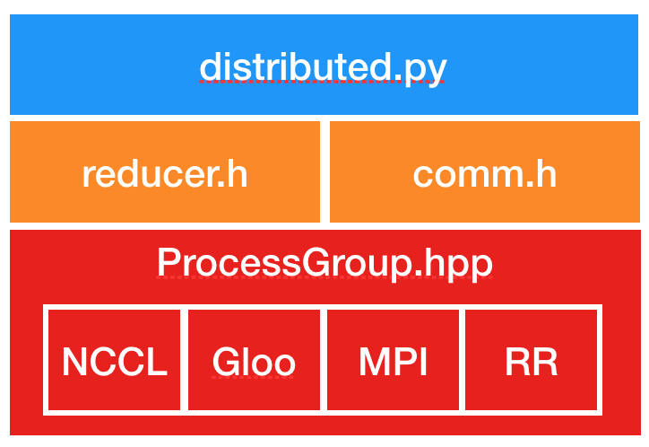

> 图源：PyTorch 官方设计说明 *Distributed Data Parallel* [1]

DDP 的一次迭代可以拆成下面几个阶段（下面的流程图给出因果顺序）：

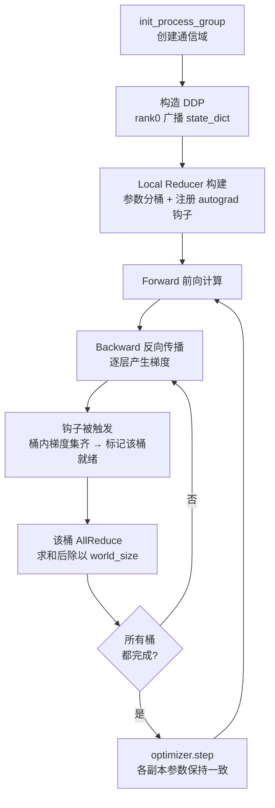

关键点逐条对应到实现 [1][2]：

1. **前提**：DDP 依赖 c10d 的 `ProcessGroup` 通信，因此必须先 `init_process_group`。
2. **构造**：DDP 构造函数把 **rank 0 的 `state_dict()` 广播**给组内其他进程，保证所有副本从完全相同的状态出发。
3. **分桶**：每个进程创建一个本地 `Reducer`，它把参数梯度组织成 **bucket**，一次 reduce 一个桶；桶的划分在构造期确定。
4. **钩子**：`Reducer` 在构造期按"每个参数一个"注册 autograd 钩子，梯度就绪时被触发。

### 2.2 为什么是 AllReduce，以及为什么用 Ring

DDP 同步梯度的原语是 **AllReduce**：所有 rank 的梯度求和，结果再分发回所有 rank（DDP 随后除以 world size 得到平均梯度）[2]。

AllReduce 的高效实现是 **Ring AllReduce**（环形全归约）。它的核心结论是：

> Ring AllReduce 的通信代价与 GPU 数量无关，只由系统中**最慢的那条连接**决定；若只考虑带宽（忽略延迟），它是**带宽最优**的算法 [4][6]。

**Ring AllReduce = Scatter-Reduce + AllGather**，整个过程需要 `2(N-1)` 次点对点通信（N 为 worker 数）[4][6]。

#### 阶段一：环形拓扑与分块

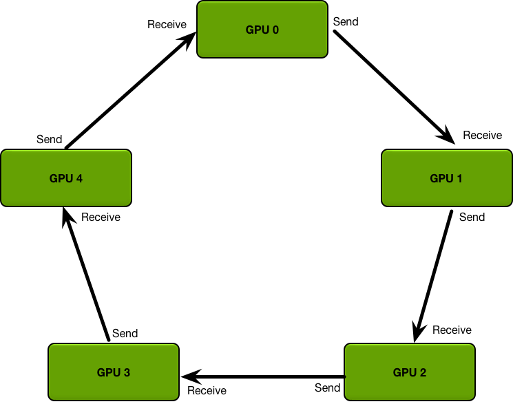

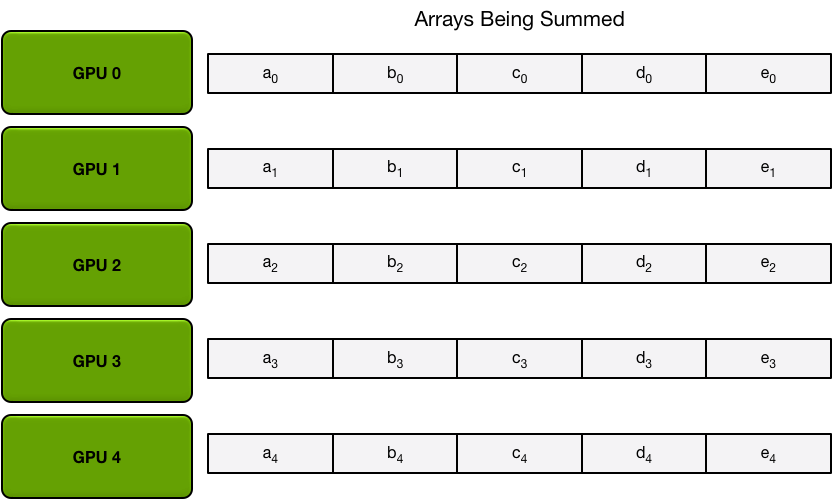

> 图源：[4]

#### 阶段二：Scatter-Reduce（N-1 轮，边传边累加）

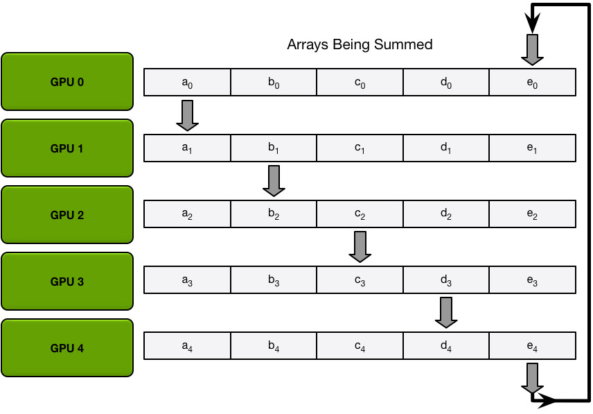

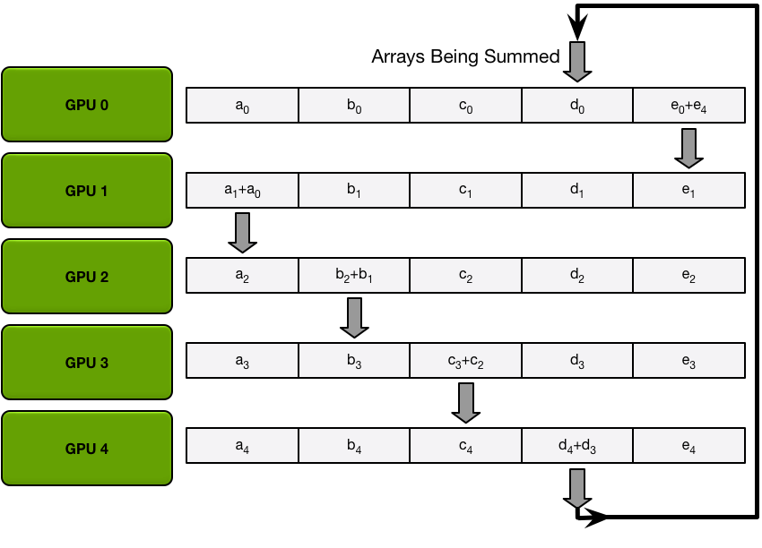

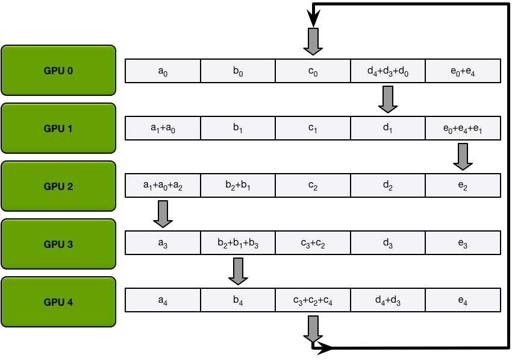

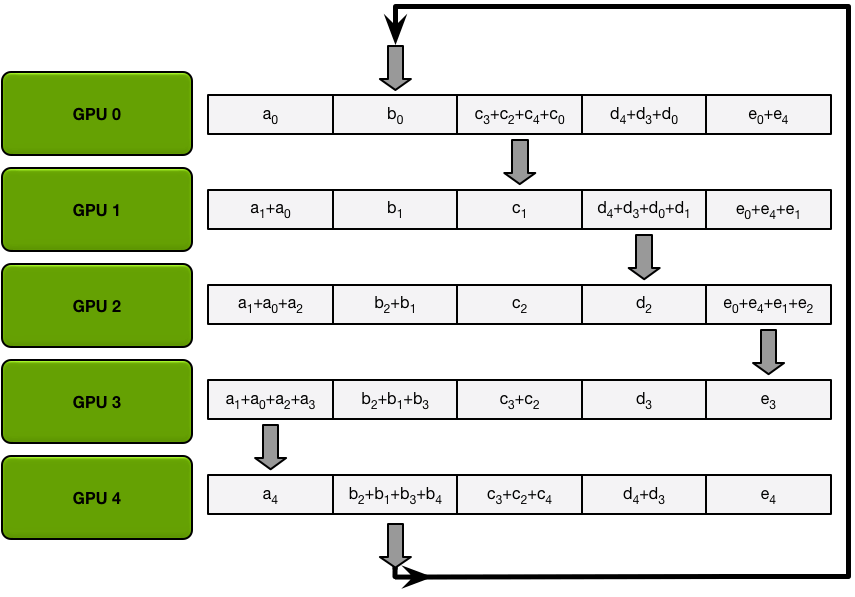

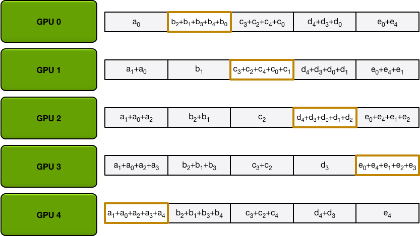

> 图源：[4]。规律是：**第 i 轮里，每个节点发送"自己本地已累加过、且尚未离开本节点"的那一块"**，接收方做加法。

#### 阶段三：AllGather（N-1 轮，把完整结果广播出去）

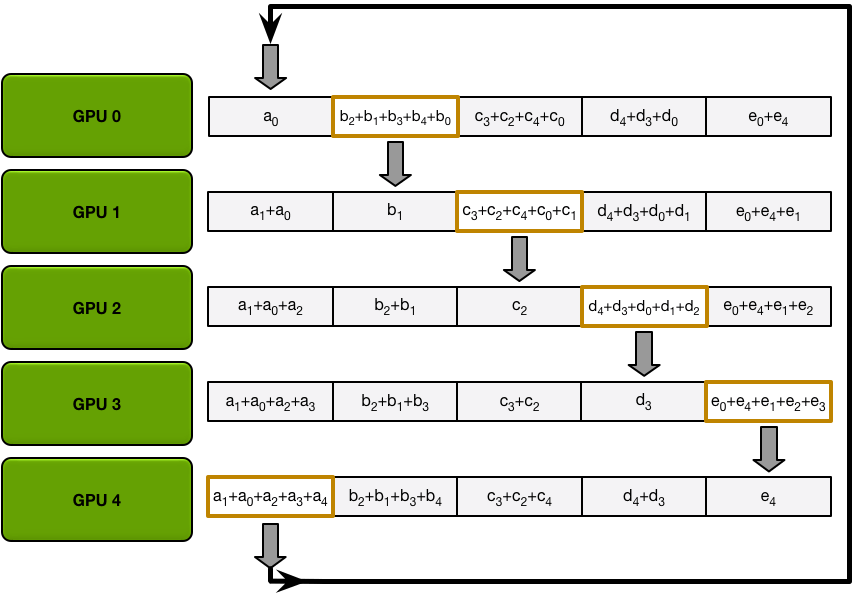

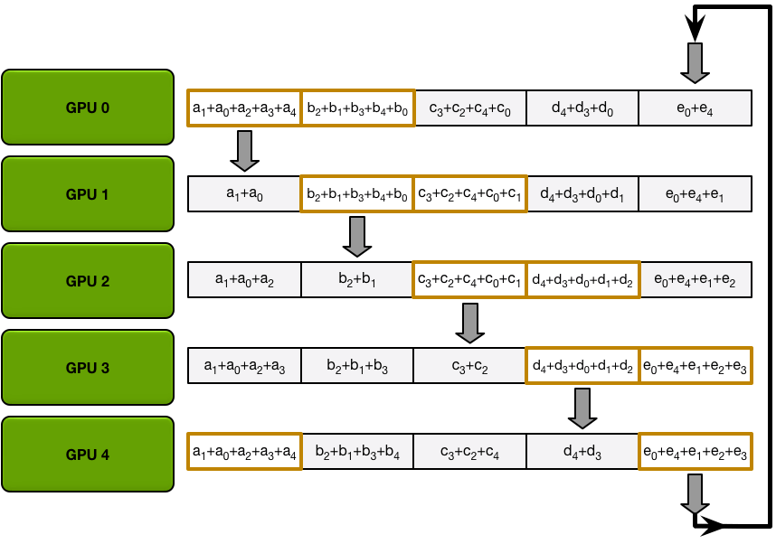

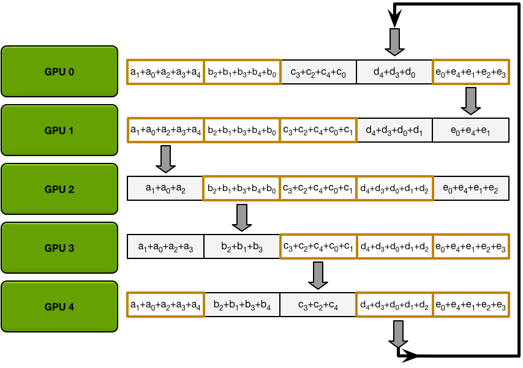

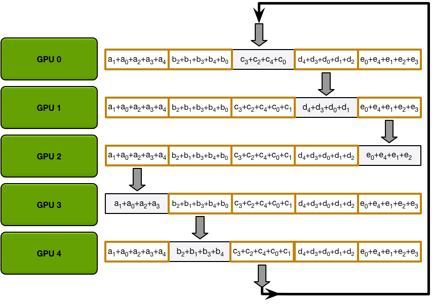

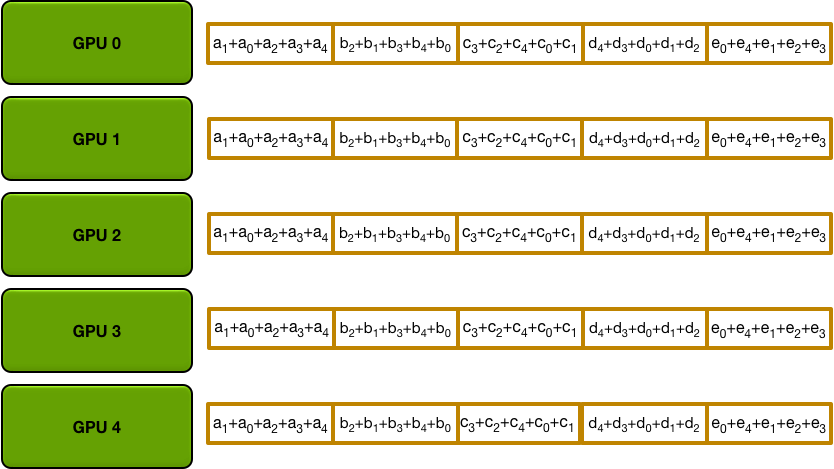

> 图源：[4]。AllGather 与 Scatter-Reduce 的差别在于：**收到的是"替换"而非"累加"** [4][5]。

#### 通信量分析

设单卡梯度总量为 `K` 字节、worker 数为 `N`，则 Ring AllReduce 中**每张卡**发送的数据量为 [4]：

```text
Data Transferred = 2 · (N - 1) · K / N   ≈ 2K   (N 较大时)
```

两个直接推论：

- **每卡通信量与 N 基本无关**（收敛到 `≈2K`）——这正是它带宽最优的含义；
- 但**全网总通信量随 N 线性增长**，所以它无法通过减小 N 来获益，扩展性上限来自带宽与延迟 [7]。

### 2.3 分桶（Bucketing）与计算-通信重叠

如果每算出一个参数梯度就发一次 AllReduce，会产生大量小消息，**延迟与启动开销**（kernel launch、系统开销）会吃掉收益。DDP 的解法是**分桶** [1][3]：

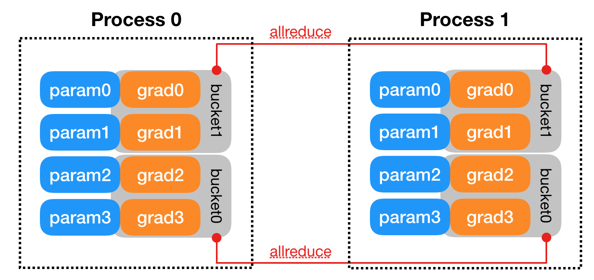

> 图源：PyTorch 官方设计说明 *Distributed Data Parallel* [1]

要点：

- 桶的划分在**构造期**确定，依据是 `bucket_cap_mb`（默认 **25 MB**）与各参数大小 [1][2]。
- 参数大致按 `Model.parameters()` 的**相反顺序**进桶，因为 **反向传播中梯度就绪的顺序大致就是该顺序**（越靠近输出的层越先算出梯度）[1]。
- 每个桶的 AllReduce 是**异步**发起的：当一个桶内所有梯度就绪，就在**独立的 CUDA stream** 上启动 AllReduce，而默认流继续做反向计算——这就是**计算与通信重叠** [1]。
- 反向传播只有在**所有梯度都完成同步**后才会返回 [1]。

```mermaid
gantt
    title 计算-通信重叠（示意：桶就绪后立即异步 AllReduce）
    dateFormat X
    axisFormat %s
    section 默认流 计算
    反向 靠输出的层   :a1, 0, 30
    反向 中间层       :a2, 30, 30
    反向 靠输入的层   :a3, 60, 30
    section 通信流 AllReduce
    bucket1 就绪后 AllReduce :b1, 30, 28
    bucket0 就绪后 AllReduce :b2, 88, 28
```

> 桶大小的核心权衡：桶越大，通信的系统开销在更多梯度上被摊薄；但桶越大，首字节的等待时间（lead time）越长，重叠的机会越少 [3]。

### 2.4 参数与 buffer 的一致性

- **参数不会在进程间广播**。DDP 只对梯度做 AllReduce，并假定各进程的优化器以**相同方式**修改参数 [2]。
- **buffer 会广播**：如 BatchNorm 的统计量等 buffer，每轮从 **rank 0** 广播到其余副本 [2]。
- **初始一致性**由构造函数中的 `state_dict()` 广播保证 [1]。

### 2.5 未使用参数、静态图与内存优化

| 选项 | 作用 | 代价 / 注意 |
| --- | --- | --- |
| `find_unused_parameters=True` | 从模型输出遍历 autograd 图，把不参与反向的参数标记为"已就绪"，避免 DDP 永远等待不存在的梯度 [1] | 需要额外图遍历；只有在确实存在未使用参数时才应开启 |
| `static_graph=True` | 告知 DDP 计算图每次迭代不变，可做更强的优化 | 须保证图与所用参数集确实稳定 |
| `gradient_as_bucket_view=True` | 让 `.grad` 直接**视图**到 bucket，避免额外拷贝、降低显存 [2] | 依赖 DDP 内部布局 |

---

## 3. 关联：它在知识网络中的位置

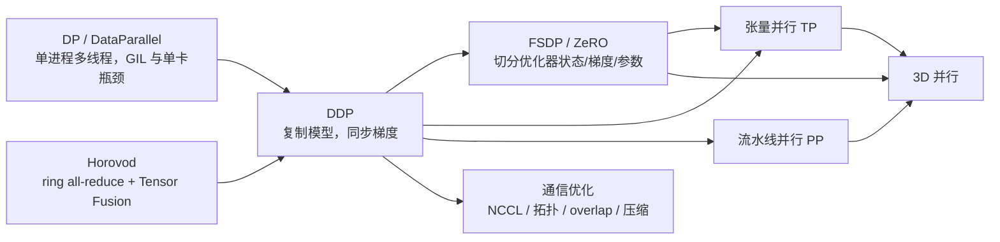

- **对比 `nn.DataParallel`**：DDP 是为单机多卡与多机设计的、基于多进程的方案，官方明确指出它显著快于 `nn.DataParallel`，GPU 场景推荐 `nccl` 后端 [2]。
- **对比 Horovod**：Horovod 把 ring all-reduce（配合 Tensor Fusion 把小张量合并）引入 TensorFlow/PyTorch 生态 [5]，与 DDP 的分桶思想同源——**都是"合并小消息、减少通信次数"**。
- **对比 ZeRO / FSDP**：DDP **不切分**模型状态，每个 rank 都持有完整模型副本、梯度与优化器状态 [2]；ZeRO 则进一步把**优化器状态、梯度、参数**分片以省显存 [9]。FSDP 在 PyTorch 中把 ZeRO 思路工程化。
- **与张量并行/流水线并行**：DDP 解决"数据太多"，TP 解决"单层太大"，PP 解决"层数太多"；三者组合即 3D 并行 [3]。
- **与通信优化**：DDP 的性能上限由集合通信库（NCCL）与拓扑决定——参见本仓库 `训练/通信优化/`。

---

## 4. 边界与代价

### 4.1 扩展性：通信量恒定，但总通信量线性增长

Ring AllReduce 让**每卡**通信量稳定在 `≈2K`，因此当**计算时间 ≫ 通信时间**时可近线性扩展。PyTorch 官方评估显示，配置得当时 DDP 在 **256 张 GPU** 上可取得近线性扩展 [3]；Baidu 的结果也表明吞吐随 GPU 数近似线性增长：

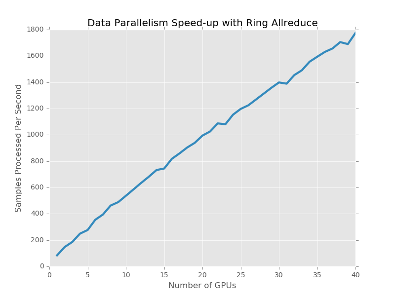

> 图源：[4]

但要注意**异步/环形算法的延迟代价**：flat ring 的延迟随 GPU 数线性增长，在数千卡规模上会成为瓶颈；这正是 NCCL 2.4 引入 **double binary tree** 的原因——用树结构换取对数级延迟，同时保持带宽 [7]。NCCL 会用 `NCCL_TREE_THRESHOLD` 这类阈值决定**小消息走树、大消息走环** [8]。

**适用条件**：梯度规模相对计算量较小（计算/通信比高）。
**不适用场景**：通信带宽受限、梯度极大、节点间带宽远低于节点内带宽时，扩展性会迅速恶化。

### 4.2 显存：DDP 不省显存

DDP 每个 rank 都保留**完整的模型参数、梯度与优化器状态**，只在反向中同步梯度 [2]。因此：

- 显存占用约为单卡的 **1×**（不含激活的额外分片）；
- **显存不够时必须转向 ZeRO/FSDP**，把优化器状态（ZeRO-1）、梯度（ZeRO-2）、参数（ZeRO-3）分片 [9]。

### 4.3 收敛：batch 变大带来的优化难度

DDP 增大的是**全局 batch**（各 rank 梯度求和后平均），这会改变优化动态 [2][10]：

- **线性缩放规则**：minibatch 变为 k 倍时，学习率也乘以 k；配合 **warmup** 才能稳定训练 [10]。
- 更大 batch 下线性缩放会失效，需要 **LARS** 等按层自适应的学习率 [11]。
- PyTorch 文档提醒：若 loss 是**求和**而非平均，M 个节点、每节点 batch=N 的梯度会比单节点 batch=M·N 小 M 倍——做"数学等价"对比时要留意 [2]。

### 4.4 桶大小的取舍

`bucket_cap_mb` 增大 → 通信开销被摊薄，但**首个梯度的等待变长、重叠减少**；减小 → 重叠更好但小消息开销上升 [1][3]。这是典型的**延迟 vs 吞吐**权衡，需要结合模型层序与网络延迟实测。

### 4.5 同步 vs 异步

DDP 是**同步**数据并行：所有 rank 在每个迭代末尾对齐（梯度同步完成后 `backward` 才返回 [1]）。这会带来**木桶效应**——最慢的 rank 拖累全体。异步/梯度陈旧（stale gradient）方案能掩盖这种抖动，但会影响数学等价性与收敛，属于**以正确性换吞吐**。

### 4.6 常见工程陷阱（经验性提示）

> 以下为工程经验，非文档保证；请以实测为准。

- **梯度未被同步**：某些参数若在 `forward` 中完全不参与，需开启 `find_unused_parameters`，否则反向会卡住 [1]。
- **图不稳定**：动态控制流会破坏 `static_graph` 的前提。
- **batch/LR 未同步调整**：扩大 world size 却不调 LR 与 warmup，容易掉点 [10][11]。
- **通信后端选择错**：GPU 场景应使用 `nccl`；用 `gloo` 做 GPU 梯度同步会严重拖慢 [2]。

---

## 5. 可验证：最小实验

### 5.1 一个可运行的 DDP 脚本

```python
# ddp_demo.py
import os
import torch
import torch.distributed as dist
import torch.multiprocessing as mp
import torch.nn as nn
import torch.optim as optim
from torch.nn.parallel import DistributedDataParallel as DDP


def run(rank: int, world_size: int) -> None:
    dist.init_process_group("gloo", rank=rank, world_size=world_size)
    model = nn.Linear(10, 10).to(rank)
    ddp_model = DDP(model, device_ids=[rank])
    loss_fn = nn.MSELoss()
    optimizer = optim.SGD(ddp_model.parameters(), lr=0.001)

    outputs = ddp_model(torch.randn(20, 10).to(rank))
    labels = torch.randn(20, 10).to(rank)
    loss_fn(outputs, labels).backward()
    optimizer.step()
    dist.destroy_process_group()


def main() -> None:
    world_size = 2
    os.environ["MASTER_ADDR"] = "localhost"
    os.environ["MASTER_PORT"] = "29500"
    mp.spawn(run, args=(world_size,), nprocs=world_size, join=True)


if __name__ == "__main__":
    main()
```

> 结构参照 PyTorch 设计说明中的官方示例 [1]；此处用 `gloo` 以便在 CPU 上直接跑通，GPU 上应改用 `nccl` [2]。

### 5.2 观测与验证要点

| 想验证什么 | 怎么做 |
| --- | --- |
| 通信后端与算法、连通性 | 设置 `NCCL_DEBUG=INFO` 观察 NCCL 选择的作用域与算法 [8] |
| 各副本参数是否一致 | 训练若干步后，收集各 rank 的参数做全等比较 |
| 与单卡是否**数学等价** | 固定随机种子与数据，比较 DDP 与单进程同 batch 的 loss 曲线 [3][10] |
| 计算-通信是否重叠 | 用 profiler 观察默认流（计算）与通信流（AllReduce）是否时间上交叠 [1] |
| 分桶与显存 | 调整 `bucket_cap_mb` / 打开 `gradient_as_bucket_view`，比较吞吐与峰值显存 [1][2] |

---

## 6. 与其他数据并行方案对比

| 维度 | `nn.DataParallel` | **DDP** | FSDP / ZeRO |
| --- | --- | --- | --- |
| 并行方式 | 单进程多线程 | 多进程，一进程一卡 | 多进程 + 状态分片 |
| 模型状态 | 每卡完整 | **每卡完整** | **分片**（优化器状态/梯度/参数）[9] |
| 通信 | 中心化，单卡瓶颈 | Ring AllReduce，带宽最优 [4] | Reduce-Scatter + All-Gather / 预取 [9] |
| 显存 | 单卡瓶颈 | 无改善 | 显著改善 [9] |
| 推荐场景 | 小模型、快速试验 | 单机多卡/多机数据并行 [2] | 大模型、显存受限 |

---

## 7. 延伸阅读

- 本仓库 `训练/通信优化/`：集合通信原语、拓扑感知、overlap、通信压缩。
- 本仓库 `训练/分布式训练/`：ZeRO 系列、张量并行、流水线并行、3D 并行。
- PyTorch 分布式总览：<https://pytorch.org/tutorials/beginner/dist_overview.html> [12]

---

## 参考文献

1. PyTorch. *Distributed Data Parallel*（设计说明，基于 v1.4）。<https://docs.pytorch.org/docs/2.3/notes/ddp.html>
2. PyTorch. *torch.nn.parallel.DistributedDataParallel*（API 文档）。<https://pytorch.org/docs/2.3/generated/torch.nn.parallel.DistributedDataParallel.html>
3. Li, S., Zhao, Y., Varma, R., et al. *PyTorch Distributed: Experiences on Accelerating Data Parallel Training*. arXiv:2006.15704 (2020). <https://arxiv.org/abs/2006.15704>
4. Gibiansky, A. *Bringing HPC Techniques to Deep Learning*（Baidu SVAIL，ring allreduce 图解）。<https://andrew.gibiansky.com/blog/machine-learning/baidu-allreduce/>
5. Sergeev, A., Del Balso, M. *Horovod: fast and easy distributed deep learning in TensorFlow*. arXiv:1802.05799 (2018). <https://arxiv.org/abs/1802.05799>
6. Patarasuk, P., Yuan, X. *Bandwidth optimal all-reduce algorithms for clusters of workstations*. J. Parallel Distrib. Comput. 69(2):117–124 (2009). <https://doi.org/10.1016/j.jpdc.2008.09.002>
7. Jeaugey, S. *Massively Scale Your Deep Learning Training with NCCL 2.4*（double binary tree）。NVIDIA Technical Blog (2019). <https://developer.nvidia.com/blog/massively-scale-deep-learning-training-nccl-2-4/>
8. NVIDIA. *NCCL Environment Variables*（含 `NCCL_TREE_THRESHOLD` 等）。<https://docs.nvidia.com/deeplearning/nccl/user-guide/docs/env.html>
9. Rajbhandari, S., et al. *ZeRO: Memory Optimizations Toward Training Trillion Parameter Models*. arXiv:1910.02054 (2020). <https://arxiv.org/abs/1910.02054>
10. Goyal, P., Dollár, P., Girshick, R., et al. *Accurate, Large Minibatch SGD: Training ImageNet in 1 Hour*. arXiv:1706.02677 (2017). <https://arxiv.org/abs/1706.02677>
11. You, Y., Gitman, I., Ginsburg, B. *Large Batch Optimization for Deep Learning: Training BERT in 76 minutes (LARS)*. arXiv:1708.03888 (2017). <https://arxiv.org/abs/1708.03888>
12. PyTorch. *PyTorch Distributed Overview*. <https://pytorch.org/tutorials/beginner/dist_overview.html>

### 图片来源与许可声明

| 文件 | 来源 | 许可 / 说明 |
| --- | --- | --- |
| `assets/ddp-processgroup-stack.png`、`assets/ddp-bucket-example.png` | PyTorch 官方文档 *Distributed Data Parallel* [1] | PyTorch 项目采用 BSD-3-Clause 许可；此处引用用于教学说明 |
| `assets/centralized-reducer.png`、`assets/ring-topology.png`、`assets/array-partition.png`、`assets/scatter-reduce-*.png`、`assets/allgather-*.png`、`assets/ring-allreduce-scaling.png` | Andrew Gibiansky, *Bringing HPC Techniques to Deep Learning* [4] | 该文注明转载自 Baidu Research 技术博客并获授权；此处引用用于教学说明，版权归原作者 |

> 若版权方要求，可随时移除上述图片，仅保留正文与文字描述。
