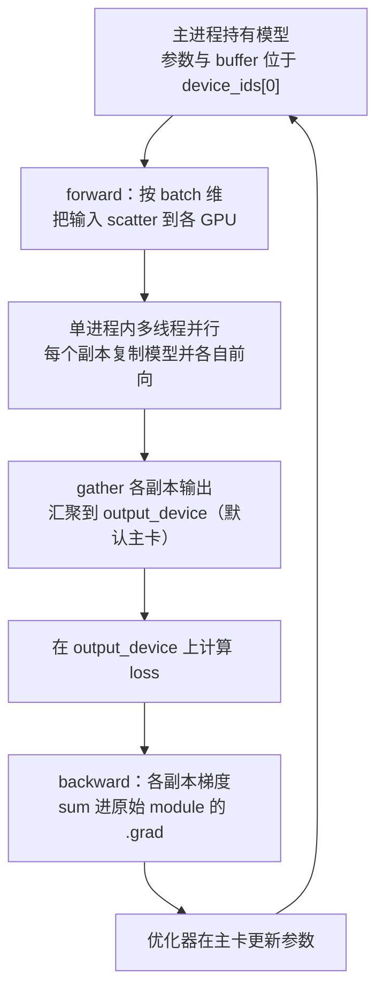
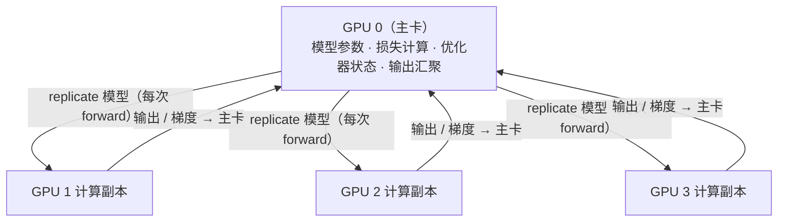
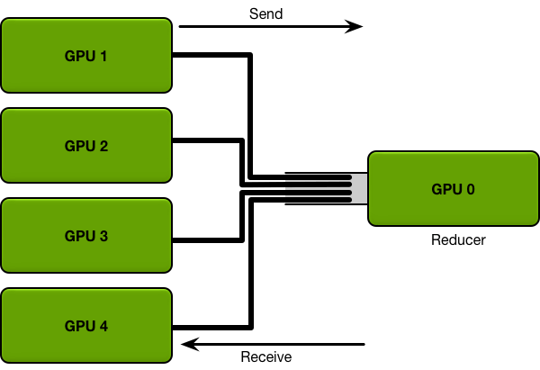
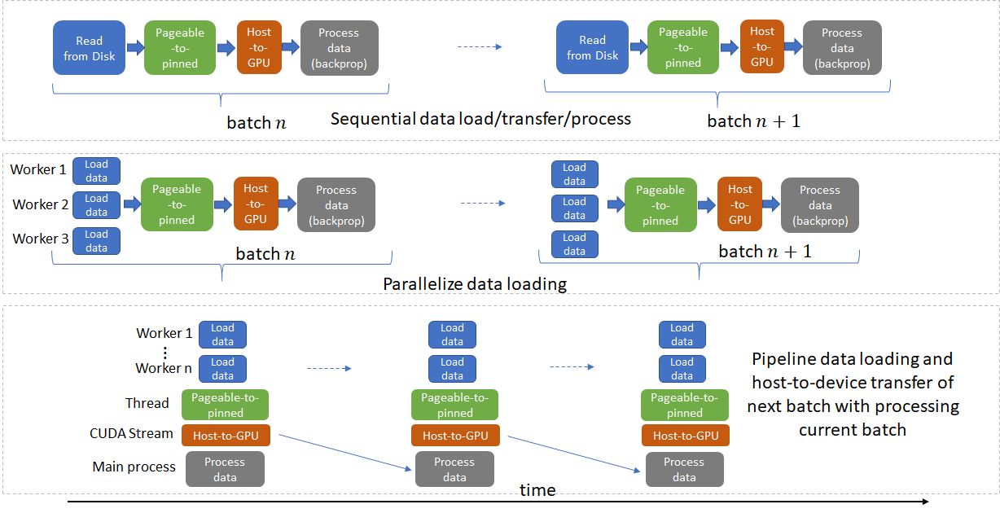
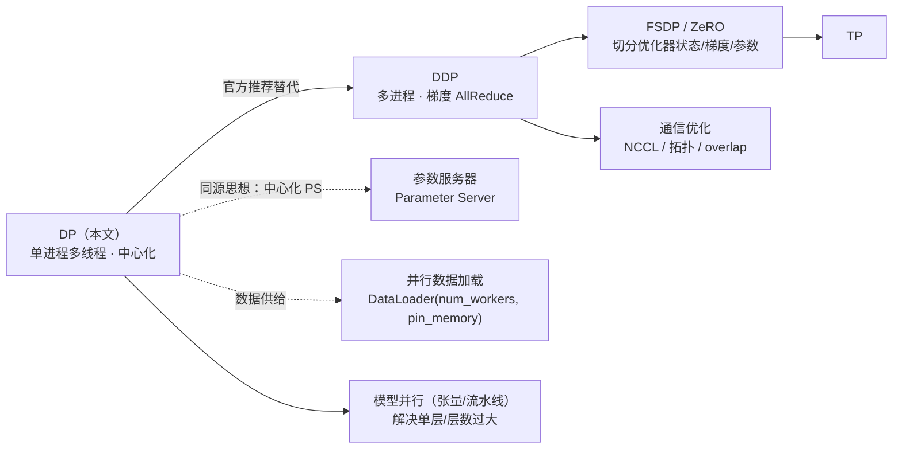

# DP（DataParallel）训练基本原理

> **一句话总结**：DP 是 PyTorch 中最"轻量"的数据并行——**单进程、多线程**，把同一个模型复制到多张卡上跑不同的数据切片，再在**主卡**上收敛输出、计算损失、汇聚梯度并更新参数。它把多卡训练做成了一行 `DataParallel(model)` 的改动，代价是**中心化**：主卡既是计算节点又是"参数服务器"。

本文遵循本仓库的设计原则：**先讲清"为什么"，再讲"怎么做"**，并明确标注**关联技术**与**边界、代价**。

- 适用版本前提：机制描述基于 PyTorch 官方 `torch.nn.DataParallel` API 文档 [1]（本文写作时对应 v2.x）。PyTorch 官方**明确建议**：即使是单机多卡，也应优先使用 DDP 而非 DataParallel [1][3]。**脱离版本的"最佳实践"不成立。**

---

## 1. 它为什么存在：问题定义

### 1.1 从单卡到多卡

模型与数据规模的增长远超单卡算力增长，训练时间不可接受。**数据并行**（Data Parallelism）是最直接的应对方式：**模型复制到多张卡，数据切分，各自计算，再同步**。它不像模型并行那样需要改动网络结构，因此适用范围最广 [1]。

### 1.2 DP 的定位：最小改动的方案

在 PyTorch 中，把模型包一层 `DataParallel` 就能用多张卡，是**改动成本最低**的多卡方案：

```python
net = torch.nn.DataParallel(model, device_ids=[0, 1, 2])
output = net(input_var)   # input_var 可以在任意设备上，包括 CPU
```

> 示例取自官方 API 文档 [1]。注意 `model` 的参数与 buffer 必须已经在 `device_ids[0]` 上 [1]。

### 1.3 它想解决的问题

DP 用**单进程内的多线程**换取"不改代码"：

- 不需要 `init_process_group`、不需要启动多个进程、不需要分布式采样器；
- 对用户而言，前向/反向的调用方式完全不变 [1]。

但正因为它选择了"单进程 + 中心化"，也就**天然继承了中心化的所有代价**（见第 4 节）。

---

## 2. 核心机理

### 2.1 一次迭代的完整流程



这条链路里的每一步都对应官方文档的一条明确约束，逐条列出：

| 步骤 | 官方行为 | 出处 |
| --- | --- | --- |
| 输入切分 | Tensor 按 `dim`（默认 0，即 batch 维）**scatter**；tuple/list/dict 做**浅拷贝**；其他类型在各线程间**共享**，若在前向中被写入可能被破坏 | [1] |
| 模型复制 | **每次 forward 都会在每个设备上重新 replicate 一次** `module` | [1] |
| 前向执行 | 各副本并行处理自己的输入分片 | [1] |
| 输出汇聚 | 结果 **gather** 到 `output_device`（默认 `device_ids[0]`） | [1] |
| 反向 | 各副本的梯度**求和进原始 module** | [1] |
| 参数更新 | 由优化器完成，参数副本在 `device_ids[0]` 上保持一致 | [1][8] |

### 2.2 中心化：主卡既是计算节点又是"参数服务器"

把上面的流程画成拓扑，就是一颗**以主卡为中心的星型结构**：



这与传统分布式机器学习的**参数服务器（Parameter Server）**架构同构：一个中心节点持有全局参数，工作节点计算梯度并汇报 [7]。中心节点的带宽与显存因此成为瓶颈——这与 Ring AllReduce 的"去中心化"思路恰好相反：



> 图源：Andrew Gibiansky, *Bringing HPC Techniques to Deep Learning*（Baidu SVAIL）[10]。对比 DDP 使用的 Ring AllReduce，可见 DP 的中心化代价。

### 2.3 数据供给：并行与流水线化的数据加载

DP 让多卡并行计算，但如果数据加载还是"串行读盘 → 拷到 pinned → 拷到 GPU → 计算"，GPU 会**饿死**。工程上的标准做法是：多进程读取 + 线程做页锁定拷贝 + 用 CUDA Stream 把"下一批数据搬运"与"当前批计算"重叠起来：



> 图源：Telesens 技术博客《Distributed Data Parallel Training using Pytorch on AWS》(2019) [13]。这正是 PyTorch `DataLoader(num_workers>0, pin_memory=True)` 背后的机制。

### 2.4 DP 与 DDP 的梯度处理差异

这是理解二者性能差异的关键 [8]：

| 维度 | **DP（DataParallel）** | **DDP（DistributedDataParallel）** |
| --- | --- | --- |
| 进程模型 | 单进程、多线程 | 多进程，一进程一卡 [2] |
| 模型副本 | 每次 forward **重新复制** [1] | 构造期复制一次，之后只同步梯度 [2][5] |
| 梯度处理 | 各副本梯度 **累加到同一个 `.grad`** [8] | `all_reduce` 求梯度之和并除以 `world_size` 得到均值 [8] |
| 通信拓扑 | 中心化（主卡为枢纽） | Ring AllReduce，带宽最优 [5][10] |
| 显存分布 | **主卡明显偏高**（输出/loss/优化器状态集中） [9] | 各卡基本对称 [2] |
| 跨机能力 | 不支持（单机） | 支持多机 [2][6] |
| 官方建议 | 不推荐用于多卡训练 [1][3] | **推荐**，即使单机 [1][2][3] |

> **为何 DDP 更快**：官方明确给出结论——"`DistributedDataParallel` is proven to be significantly faster than `torch.nn.DataParallel` for single-node multi-GPU data parallel training" [2]。

---

## 3. 关联：它在知识网络中的位置



- **与参数服务器**：DP 的中心化结构与 PS 架构同源 [7]——中心节点既是计算者也是通信枢纽。
- **与 DDP**：见第 2.4 节对比与 [5] 的对偶分析（本文档见《DDP 训练基本原理》）。
- **与 FSDP / ZeRO**：DP 与 DDP 都**不切分**模型状态，每卡（或主卡）持有完整模型；显存不够时需要 ZeRO 类方案把优化器状态、梯度、参数分片 [11]。
- **与模型并行**：DP 解决"数据太多"，张量并行/流水线并行解决"单层太大/层数太多" [4]。

---

## 4. 边界与代价

### 4.1 官方立场：单机也应优先 DDP

PyTorch 在 `DataParallel` 文档里给出的第一条就是警告：

> "It is recommended to use `DistributedDataParallel`, instead of this class, to do multi-GPU training, even if there is only a single node." [1]

并在 CUDA 语义说明中专设一节 *Use nn.parallel.DistributedDataParallel instead of multiprocessing or nn.DataParallel* 来解释原因 [3]。

### 4.2 主卡瓶颈与显存不均衡

- **输出汇聚到主卡**：各副本的输出、ground truth、loss 都落在同一张卡上，主卡显存明显高于其他卡 [9]。
- **优化器状态集中在主卡**：优化器需要保存的状态（如动量、二阶矩）都在主卡 [9]。
- **主卡即通信枢纽**：所有 scatter/gather 都经过主卡，形成类似参数服务器的带宽瓶颈 [7][10]。

`output_device` 参数可以把输出放到另一张卡以**缓解**（而非消除）这种不均衡 [1][9]。

### 4.3 单进程多线程的代价

DP 在**单个进程内用多线程**并行执行各副本的前向/反向 [1][3]：

- 受 **Python GIL** 与线程调度影响，CPU 侧并行度受限；
- 前向/反向的 hook 会被调用 `len(device_ids)` 次，且只保证"与对应设备的操作同序"，**不保证**在全部 `forward` 之前执行 [1]——这让依赖 hook 顺序的逻辑变得脆弱。

### 4.4 每次 forward 重复复制模型

官方警告：**每次前向都会把 `module` 复制到每个设备** [1]。于是：

- 复制本身有开销；
- 反向中在副本上做的**非 in-place 更新会丢失**（副本在 forward 结束后被销毁）；
- 只有 `device[0]` 上的副本与原始 `module` **共享存储**，所以设备 0 上的 in-place 更新才会被记录——`BatchNorm2d`、`spectral_norm()` 依赖这一行为 [1]。

### 4.5 只能单机

DP 依赖单进程内的多 GPU 通信，**不具备跨机能力**；跨节点训练必须使用 DDP [2][6]。

### 4.6 语义陷阱速查

| 陷阱 | 说明 | 出处 |
| --- | --- | --- |
| 非 in-place 更新丢失 | 在 `forward` 中修改副本属性不会保留（每次 forward 重新复制） | [1] |
| buffer 更新 | 只有 `device[0]` 上的 in-place 更新被记录，`BatchNorm2d` 依赖此行为 | [1] |
| 标量输出 | `forward` 返回 0 维张量时，包装器返回**长度为设备数的向量** | [1] |
| 跨线程共享对象 | 非 Tensor 的 tuple/list/dict 之外的对象被线程共享，写入可能被破坏 | [1] |
| RNN pack/unpack | `pack → RNN → unpack` 模式在 DataParallel 下有已知问题 | [1][12] |
| batch 太小 | 官方要求 batch size 应大于所用 GPU 数 | [1] |

### 4.7 那么 DP 还有用吗？

> 以下为工程判断，非官方结论；请以实测为准。

- **原型 / 小模型 / 单机快速试验**：`DataParallel` 一行改动，调试成本最低，此时仍可用；
- **任何需要吞吐或规模化的训练**：应直接使用 DDP [1][2][3]；
- **显存受限的模型**：两者都不解决显存问题，需要 FSDP/ZeRO [11]。

---

## 5. 可验证：最小实验

### 5.1 一个可运行的 DP 脚本

```python
# dp_demo.py
import torch
import torch.nn as nn


def main() -> None:
    device_ids = list(range(torch.cuda.device_count()))
    model = nn.Linear(10, 10).cuda(device_ids[0])   # 参数必须先放到 device_ids[0]
    model = nn.DataParallel(model, device_ids=device_ids)

    loss_fn = nn.MSELoss()
    optimizer = torch.optim.SGD(model.parameters(), lr=0.001)

    x = torch.randn(64, 10)          # 输入可在 CPU，由 DataParallel 负责分发
    y = torch.randn(64, 10)
    optimizer.zero_grad()
    loss_fn(model(x), y).backward()
    optimizer.step()


if __name__ == "__main__":
    main()
```

> 结构与约束参照官方文档 [1]；需多于 1 张 GPU 才能观察到并行效果。

### 5.2 观测与验证要点

| 想验证什么 | 怎么做 |
| --- | --- |
| 主卡显存是否更高 | `torch.cuda.memory_allocated(i)` 对比各卡，或 `nvidia-smi` 观察不均衡 [9] |
| 输出是否汇聚到主卡 | 打印 `output.device`，确认其为 `device_ids[0]`（或 `output_device`）[1] |
| 每次 forward 都复制模型 | 在 `forward` 中改一个非 in-place 计数器，观察其不生效 [1] |
| DP vs DDP 吞吐差异 | 同一模型/同一 batch 分别用 DP 与 DDP 计时对比 [2][3] |
| 数据加载是否已流水线化 | 打开 `DataLoader(num_workers>0, pin_memory=True)` 前后对比 GPU 利用率 [13] |

---

## 6. 与其他方案对比

| 维度 | **DP（DataParallel）** | DDP | FSDP / ZeRO |
| --- | --- | --- | --- |
| 并行方式 | 单进程多线程 | 多进程，一进程一卡 | 多进程 + 状态分片 |
| 模型状态 | 完整（主卡为枢纽） | 每卡完整 [2] | **分片** [11] |
| 通信 | 中心化 scatter/gather [1] | Ring AllReduce，带宽最优 [5][10] | Reduce-Scatter + All-Gather [11] |
| 显存 | **主卡偏高** [9] | 各卡对称 | 显著改善 [11] |
| 跨机 | 否 | 是 [2][6] | 是 [11] |
| 官方建议 | 不推荐 [1][3] | **推荐** [1][2][3] | 大模型、显存受限 |

---

## 7. 延伸阅读

- 本文档姊妹篇：《DDP 训练基本原理》（本目录）。
- 本仓库 `训练/分布式训练/`：ZeRO 系列、张量并行、流水线并行、3D 并行。
- PyTorch 分布式总览：<https://pytorch.org/tutorials/beginner/dist_overview.html> [6]

---

## 参考文献

1. PyTorch. *torch.nn.DataParallel*（API 文档，含机制说明与多条 Warning）。<https://pytorch.org/docs/stable/generated/torch.nn.DataParallel.html>
2. PyTorch. *torch.nn.parallel.DistributedDataParallel*（API 文档）。<https://pytorch.org/docs/stable/generated/torch.nn.parallel.DistributedDataParallel.html>
3. PyTorch. *CUDA semantics* — "Use nn.parallel.DistributedDataParallel instead of multiprocessing or nn.DataParallel"。<https://pytorch.org/docs/stable/notes/cuda.html#cuda-nn-ddp-instead>
4. Li, S., Zhao, Y., Varma, R., et al. *PyTorch Distributed: Experiences on Accelerating Data Parallel Training*. arXiv:2006.15704 (2020). <https://arxiv.org/abs/2006.15704>
5. PyTorch. *Distributed Data Parallel*（设计说明）。<https://docs.pytorch.org/docs/2.3/notes/ddp.html>
6. PyTorch. *PyTorch Distributed Overview*（含 DP 与 DDP 的对比）。<https://pytorch.org/tutorials/beginner/dist_overview.html>
7. Li, M., Andersen, D. G., Park, J. W., et al. *Scaling Distributed Machine Learning with the Parameter Server*. OSDI 2014, pp. 583–598. <https://www.usenix.org/conference/osdi14/technical-sessions/presentation/li_mu>
8. PyTorch Forums. *Comparison Data Parallel / Distributed data parallel*（PyTorch 维护者 Shen Li 关于 DP 累加梯度 vs DDP all_reduce 的回答）。<https://discuss.pytorch.org/t/comparison-data-parallel-distributed-data-parallel/93271>
9. PyTorch Forums. *DataParallel imbalanced memory usage*（主卡内存偏高的机理与缓解）。<https://discuss.pytorch.org/t/dataparallel-imbalanced-memory-usage/22551>
10. Gibiansky, A. *Bringing HPC Techniques to Deep Learning*（Baidu SVAIL，ring allreduce 与中心化 reducer 对比）。<https://andrew.gibiansky.com/blog/machine-learning/baidu-allreduce/>
11. Rajbhandari, S., et al. *ZeRO: Memory Optimizations Toward Training Trillion Parameter Models*. arXiv:1910.02054 (2020). <https://arxiv.org/abs/1910.02054>
12. PyTorch. *Frequently Asked Questions*（"My recurrent network doesn't work with data parallelism"）。<https://pytorch.org/docs/stable/notes/faq.html>
13. Telesens. *Distributed Data Parallel Training using Pytorch on AWS* (2019)（并行/流水线化数据加载图示）。<https://www.telesens.co/2019/04/04/distributed-data-parallel-training-using-pytorch-on-aws/>

### 图片来源与许可声明

| 文件 | 来源 | 许可 / 说明 |
| --- | --- | --- |
| `assets/centralized-reducer.png` | Andrew Gibiansky, *Bringing HPC Techniques to Deep Learning*（Baidu SVAIL）[10] | 该文注明转载自 Baidu Research 技术博客并获授权；此处引用用于教学说明，版权归原作者 |
| `assets/parallel-data-loading.png` | Telesens 技术博客《Distributed Data Parallel Training using Pytorch on AWS》(2019) [13] | 版权归原作者 / Telesens；此处引用用于教学说明 |
| 其余 Mermaid 图（流程图、拓扑图、关系图） | 本文自绘 | 使用 Mermaid 描述，GitHub 原生渲染，无第三方版权 |

> 若版权方要求，可随时移除上述图片，仅保留正文与文字描述。
