# FSDP 训练基本原理

> **一句话总结**：FSDP（Fully Sharded Data Parallel）是 PyTorch 原生的 ZeRO-3 实现——它不再像 DDP 那样让每个 rank 保留一份完整模型，而是把**参数、梯度、优化器状态统统切分到各 rank**，只在计算前用 All-Gather 临时拼出完整参数、算完立刻释放。它用**更多通信**换**更少显存**，让单卡装不下的大模型也能用"纯数据并行"训下去。

本文遵循本仓库的设计原则：**先讲清"为什么"，再讲"怎么做"**，并明确标注**关联技术**与**边界、代价**。

- 适用版本前提：机制描述基于 PyTorch FSDP1（`FullyShardedDataParallel`）API 与设计说明 [1][2]、FSDP2（`fully_shard`）API [6][7]，以及 FSDP 论文 [3]（PVLDB 16(12), 2023）。通信行为随 NCCL 版本变化，**脱离版本的"最佳实践"不成立**。

---

## 1. 它为什么存在：问题定义

### 1.1 DDP 的显存墙

DDP 每个 rank 都保留**完整的参数、梯度与优化器状态**，只在反向传播中 AllReduce 梯度 [8][9]。这三块显存加起来，构成了单卡训练真正的天花板。

以**混合精度 + Adam** 为例（模型参数量记为 Ψ）：

| 模型状态 | 每参数字节数 | 合计 |
| --- | --- | --- |
| fp16 参数 | 2 | 2Ψ |
| fp16 梯度 | 2 | 2Ψ |
| fp32 参数副本（master weights） | 4 | 4Ψ |
| Adam 一阶动量 | 4 | 4Ψ |
| Adam 二阶动量 | 4 | 4Ψ |
| **合计** | | **16Ψ** |

也就是说，模型状态占用约为参数量的 **16 倍**（这是 ZeRO 论文给出的经典估算 [4]）。举例：一个 7.5B 参数模型，仅模型状态就要 `16 × 7.5 = 120 GB`——远超单张 GPU 的容量。这就是 DDP 无法训练大模型的根本原因。

### 1.2 从 ZeRO 到 FSDP：用分片消除冗余

既然每个 rank 都存一份**完全相同**的模型状态，那这份冗余本身就是可优化的空间。微软的 **ZeRO**（Zero Redundancy Optimizer）给出了三个递进的分片阶段 [4]：


> 图源：Rajbhandari et al., *ZeRO: Memory Optimizations Toward Training Trillion Parameter Models*, arXiv:1910.02054（Figure 1）[4]。

- **ZeRO-1（P_os）**：只分片**优化器状态**，显存从 `16Ψ` 降到 `4Ψ + 12Ψ/N`；
- **ZeRO-2（P_os+g）**：再分片**梯度**，降到 `2Ψ + 14Ψ/N`；
- **ZeRO-3（P_os+g+p）**：连**参数**也分片，降到 `16Ψ/N`。

> 论文给出的量级：一个**万亿参数**模型在 16-bit 混合精度 + Adam 下需要约 16 TB 显存；ZeRO 全三阶段开启后，`16TB / 1024 = 16GB`，就能装进 1024 张 32GB 的 GPU [4]。

**FSDP 就是把 ZeRO-3 的思路做成了 PyTorch 原生实现** [1][3]。二者核心思想一致（分片模型状态、计算时按需重建），但 FSDP 是在 PyTorch 核心组件（Tensor 实现、dispatcher、CUDA caching allocator）之上协同设计的，因此更"原生"、对用户代码更少侵入 [3]。

### 1.3 FSDP 要同时满足的四个目标

FSDP 论文把大模型训练的挑战归纳为四条，它们也解释了 FSDP 的设计取舍 [3]：

| 挑战 | 含义 | FSDP 的做法 |
| --- | --- | --- |
| **用户体验** | 模型大到单卡根本装不下，连初始化都做不了 | 支持 **deferred initialization**：先在 meta/dummy 设备上建模型，再逐单元在真实 GPU 上重放并分片 [3][1] |
| **硬件异构** | 机器内高带宽（NVLink）、机器间低带宽（RDMA），呈分层结构 | 提供**可配置的分片策略**（全分片 / 混合分片）以匹配物理拓扑 [3][1] |
| **资源利用率** | 参数分片必然引入通信，可能阻塞计算、产生气泡 | 通过**算子重排 + 参数预取**，把 All-Gather 与计算**重叠**起来 [3][2] |
| **显存规划** | 频繁的显存分配/回收会拖慢训练 | 用 **rate limiter** 严格限制在途（inflight）的未分片参数数量 [3][2] |

---

## 2. 核心机理

### 2.1 分片单元：以 module 为界，而不是以整个模型为界

FSDP 不会把整模型的参数拍平成一个大块再切，而是**以 module 为分片单元** [3][6]：

- 每次对 `module` 调用一次 FSDP，就**创建一个通信组**，其中包含 `module.parameters()` 里**尚未被更深层 FSDP 实例接管**的参数 [2][6]；
- 组内参数先被 **flatten + concat** 成一个一维向量（FSDP1 的 `FlatParameter`），再切成 `world_size` 份 [1][3]；
- 因此每个 FSDP unit 只需要**同时 materialize 一个单元的完整参数**，峰值显存大幅下降 [3]。

FSDP2 改用了更直观的 **per-parameter sharding**：直接用 `DTensor` 把每个参数沿 dim-0 切分，不再 flatten [6]。

> **为什么分片单元要"小"？** 单元的粒度决定了重叠机会。如果把整个模型当成一个单元，就必须一次性 All-Gather 全部参数，既不省峰值显存，也没有重叠空间。经验上，对 LLM **按 transformer block 逐个应用 FSDP** 是个好启发式 [2]。

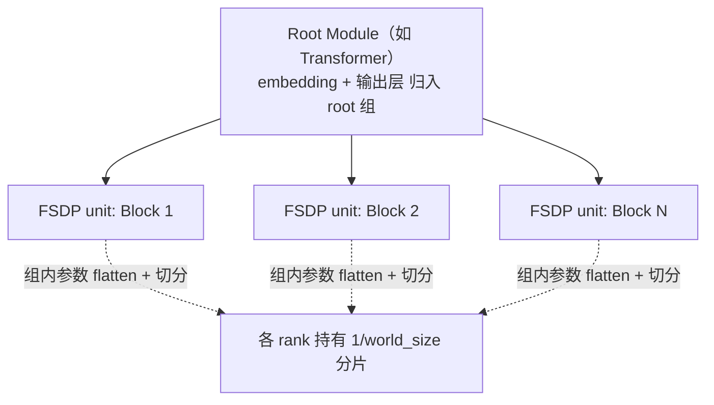

> **应用顺序**：应**自底向上**应用 FSDP——先包装每个 block（或子模块），再包装根模块；后一次调用会自动排除已被前一次接管的参数 [6][1]。

### 2.2 一次迭代的完整流程

FSDP 的一次前向+反向，本质上是一串"**All-Gather → 计算 → 释放**"的循环：


> 图源：PyTorch 官方教程 *Getting Started with Fully Sharded Data Parallel (FSDP2)* [7]。

把它展开成一个单元的生命周期，就是下面这条链路（FSDP 论文 Figure 1 给出的算法总览与此一致）：

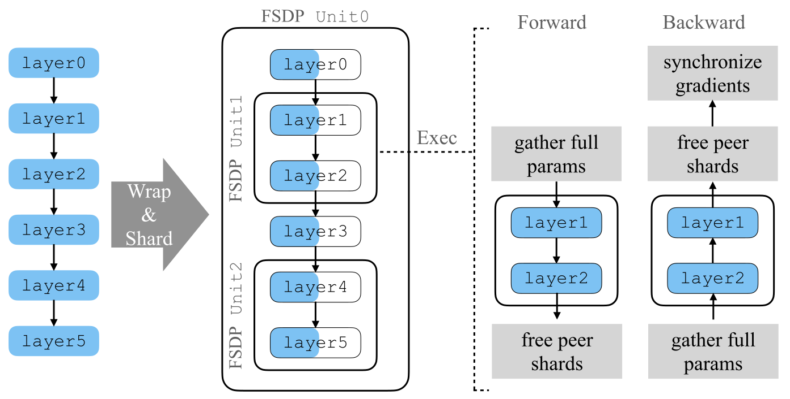

> 图源：Zhao et al., *PyTorch FSDP: Experiences on Scaling Fully Sharded Data Parallel*, arXiv:2304.11277（Figure 1）[3]。

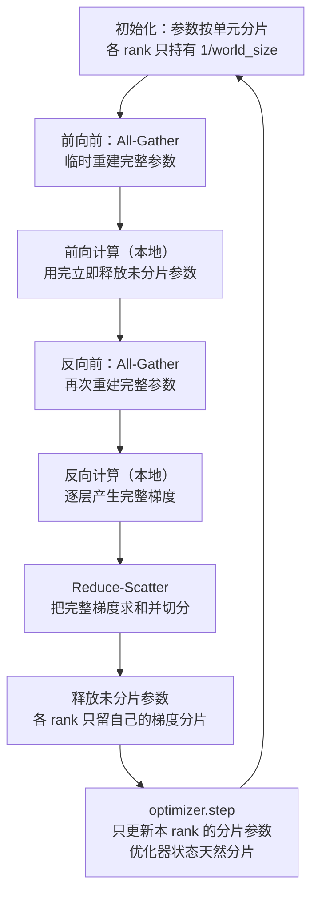

关键点逐条对应到实现 [1][2][3]：

1. **分片发生在构造期**：FSDP 构造时就把参数 flatten、切分，并注册前向/反向 hook [1][6]。
2. **前向 All-Gather**：`pre-forward` hook 在**独立的 CUDA stream** 上发起 All-Gather，重建完整参数；计算在默认流上进行 [2]。
3. **用完即释放**：前向后立刻释放未分片参数（FSDP2 中称为 `reshard`），只保留分片 [6]。
4. **反向再次 All-Gather**：反向需要完整参数才能求梯度，因此要**再拼一次**（除非配置为前向后不释放）[2]。
5. **Reduce-Scatter 梯度**：梯度是"完整"的，需要 reduce-scatter 成"分片"的，各 rank 只保留自己那份 [2][7]。
6. **优化器只碰分片**：优化器状态随参数一起分片，`optimizer.step` 只更新本 rank 的分片 [3][6]。

> **一句话理解**：DDP 让"梯度"从完整变成同步后的完整；FSDP 让"参数"和"梯度"都在**完整**与**分片**之间来回切换。

### 2.3 通信原语：All-Gather + Reduce-Scatter = AllReduce 的分解

FSDP 与 DDP 的通信关系可以用一句话概括：**FSDP 把 DDP 的 AllReduce 拆成了 Reduce-Scatter + All-Gather 两步**，并在这两步之间"插入"了本地计算 [7]。

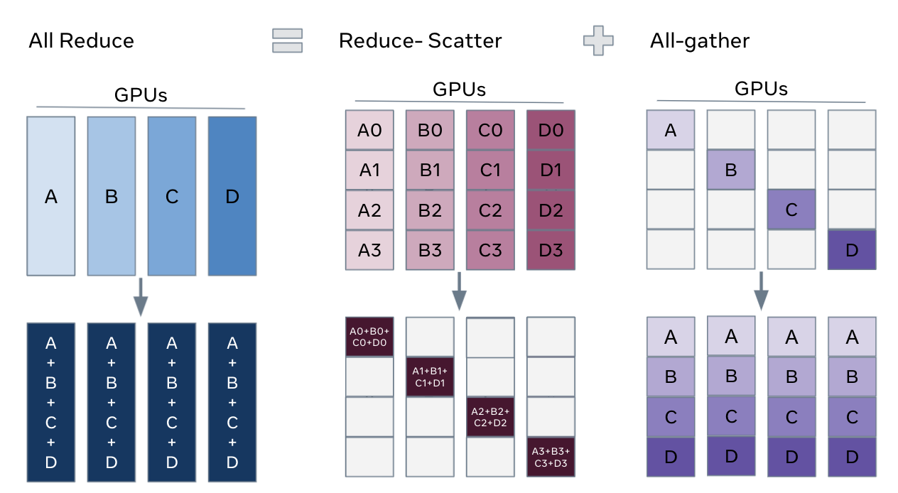

> 图源：PyTorch 官方教程 *Getting Started with Fully Sharded Data Parallel (FSDP2)* [7]。

| 原语 | 作用 | FSDP 中出现的位置 |
| --- | --- | --- |
| **All-Gather** | 各 rank 贡献自己的分片，拼出完整张量 | 前向、反向**各一次**（重建参数） |
| **Reduce-Scatter** | 求和后**切分**，各 rank 只留一份 | 反向一次（把完整梯度变分片梯度） |
| **AllReduce** | 求和后**广播**，各 rank 都拿到完整结果 | DDP 使用；FSDP 中不再直接出现 |

> FSDP 的通信量可以这样推导：以带宽最优的 ring 算法为例，一次 ring All-Gather 每卡搬运约一个**完整**参数量的数据，一次 ring Reduce-Scatter 同理。于是 DDP 一次迭代 ≈ `2K`（K 为完整梯度字节），而 FSDP 全分片 ≈ `3K`（前向 All-Gather + 反向 All-Gather + 反向 Reduce-Scatter）。**FSDP 论文明确指出：全分片相对 DDP 有 1.5 倍的通信开销与通信量** [3]。

### 2.4 分片策略：`sharding_strategy`

分片不是"全有全无"，而是可以按拓扑在**显存**与**通信**之间取折中 [1][3]：

| `ShardingStrategy` | 分片内容 | 类比 | 通信量(每卡/迭代) | 显存 |
| --- | --- | --- | --- | --- |
| `NO_SHARD` | 什么都不分片 | 等价于 DDP | ≈ 2K | 无改善 |
| `SHARD_GRAD_OP` | 分梯度 + 优化器状态 | 等价于 ZeRO-2 | ≈ 2K | 中等改善 |
| `FULL_SHARD`（默认） | 分参数 + 梯度 + 优化器状态 | 等价于 ZeRO-3 | ≈ 3K | 最大改善 |
| `HYBRID_SHARD` | 机内全分片 + 机间复制 | ZeRO-3 与 DDP 的杂交 | 介于两者之间 | 大 |
| `_HYBRID_SHARD_ZERO2` | 机内 ZeRO-2 + 机间复制 | ZeRO-2 与 DDP 的杂交 | 更低 | 中等 |

**全分片（FULL_SHARD）**：参数被切分到所有 rank，每次计算前 All-Gather 重建。下面这张图展示了 16 张 GPU 上把参数切成 16 份的情形：

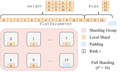

> 图源：FSDP 论文（Figure 3）[3]。

**混合分片（HYBRID_SHARD）**：令全局 world size 为 `W`、分片因子为 `F`（`1 < F < W`），则参数在**分片组** S₁…S_{W/F} 内部分片，在**复制组** R₁…R_F 内部复制。梯度归约相应地变成"分片组内 Reduce-Scatter + 复制组内 All-Reduce" [3]。

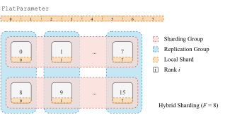

> 图源：FSDP 论文（Figure 4）[3]。

**为什么需要混合分片？** 这正是对**硬件异构**的回应 [3]：机内 NVLink 带宽高，适合全分片（通信贵但值得）；机间带宽低，适合复制（少通信）。把 All-Gather/Reduce-Scatter 尽量限制在机内，把昂贵的跨机通信降级为 All-Reduce，就能在拓扑上"扬长避短"。

> FSDP 文档提示：当 HYBRID_SHARD 的分片组是机内、复制组是机间时，设置 `NCCL_CROSS_NIC=1` 在部分集群上可以改善跨机 All-Reduce 时间 [1]。

### 2.5 计算-通信重叠与预取

FSDP 的通信是"必须发生"的，但在**哪里等**却有讲究。核心手段是：**把 All-Gather 提前发起，让它和上一层的计算重叠** [2][3]。

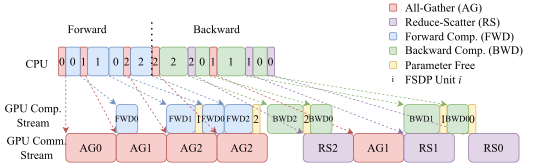

> 图源：FSDP 论文（Figure 5）[3]。

- **前向的隐式预取（永远开启）**：从**独立的 CUDA stream** 发起第 i+1 层的 All-Gather，从而与第 i 层的计算重叠——即使从 CPU 视角看它是"之后"才发起的 [2]。
- **前向的显式预取（`forward_prefetch=True`）**：直接改变 CPU 的发射顺序为 `layer0 AG → layer1 AG → layer0 计算 → …`。**仅适用于静态图模型**（执行顺序逐迭代固定），因为 eager 模式下无从知道"下一层是谁" [2]。
- **反向必须显式预取**：FSDP 只用一个 NCCL process group，All-Gather 与 Reduce-Scatter 在**同一条内部 NCCL stream** 上串行。若不把发射顺序重排成 `下一次 All-Gather → 当前 Reduce-Scatter`，当前 Reduce-Scatter 会挡住下一次 All-Gather，导致反向**零重叠** [2]。

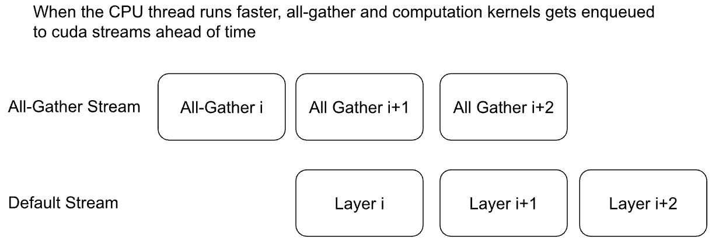

> 图源：PyTorch 官方教程 *Getting Started with Fully Sharded Data Parallel (FSDP2)* [7]。

```mermaid
gantt
    title 计算-通信重叠（示意：下层 All-Gather 与当前层计算在两条 stream 上交叠）
    dateFormat X
    axisFormat %s
    section All-Gather Stream
    AG layer0 :a0, 0, 20
    AG layer1 :a1, 20, 25
    AG layer2 :a2, 65, 25
    section Default Stream 计算
    计算 layer0 :c0, 20, 45
    计算 layer1 :c1, 65, 45
    section 反向（同一 NCCL stream，需显式重排）
    Reduce-Scatter layer1 :r1, 110, 25
    All-Gather layer0 :a3, 110, 25
```

### 2.6 显存管理：FlatParameter 缓冲与 rate limiter

分片虽然省了"静态"显存，但**动态缓冲**同样要精打细算 [2]：

- **前向至少需要 2 份 All-Gather 缓冲**。原因在于 FlatParameter 设计**不做 copy-out**：计算直接"视图"到 All-Gather 缓冲上。于是当 `layer1` 的 All-Gather 与 `layer0` 的计算重叠时，`layer0` 仍在用自己那份缓冲 [2]。
- **反向同样至少 2 份**，且因 `recordStream`（跨流管理分配）与 autograd 的 `ViewBackward`/`SplitWithSizesBackward`，峰值还可能更高，具体取决于 kernel 时序 [2]。

**rate limiter（`limit_all_gathers=True`，默认开启）** 是这里的减压阀：它**故意阻塞 CPU 线程**，保证最多只有**两次**在途的 All-Gather（当前计算的那次 + 预取的那次），从而让 caching allocator 能复用显存块，避免触发阻塞式的 `cudaFree/cudaMalloc` [2][3]。

> FSDP 论文的原文是"allows at most two inflight AllGathers, which is the minimum amount to still achieve communication and computation overlap" [3]。所以你可能会在 profiler 里看到预取前 CPU 有一段"空档"，那是 rate limiter 在起作用，**并不代表 GPU 真的被拖慢** [1]。

### 2.7 其他关键开关

| 选项 | 作用 | 代价 / 注意 |
| --- | --- | --- |
| `cpu_offload` | 把参数/梯度/优化器状态卸载到 CPU | 省显存但受 PCIe 带宽限制；开启时**不支持** `no_sync()` 之外的梯度累积 [1] |
| `mixed_precision` | 原生混合精度：分别指定参数、buffer、梯度归约的 dtype | 需与优化器的 master weights 策略配合 [1][3] |
| `use_orig_params` | 暴露**原始参数**而非 `FlatParameter`，支持逐参数超参；**`torch.compile` 的必要条件** | 分片态下参数结构退化为 1D [1] |
| `auto_wrap_policy` | 自动决定"哪些子模块各成一个 FSDP unit" | 直接影响重叠效果与峰值显存；建议打印模型后按需调整 [1] |
| `sync_module_states` | 构造时从 rank 0 广播参数/buffer，保证各 rank 初值一致 | 增加构造期通信；省显存的 checkpoint 加载依赖它 [1] |

---

## 3. 关联：它在知识网络中的位置

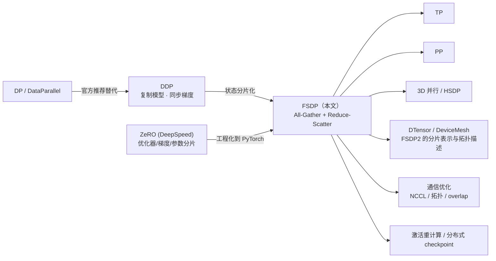

- **与 DDP**：DDP 是"复制模型、同步梯度"；FSDP 是"分片模型状态、按需重建"。二者 API 风格接近（都是包一层 `nn.Module`），但 FSDP 的显存曲线随 world size 下降，代价是通信量上升 [3][8]。
- **与 ZeRO/DeepSpeed**：FSDP 是 ZeRO-3 思路的 PyTorch 原生实现；ZeRO 的 Stage 1/2/3 与 FSDP 的 `NO_SHARD`/`SHARD_GRAD_OP`/`FULL_SHARD` 一一对应 [1][3][4]。
- **与张量并行/流水线并行**：FSDP 切的是"同一份模型的冗余副本"，TP 切的是"单层内部的矩阵"，PP 切的是"层与层的分段"。三者可组合成 3D 并行；FSDP 论文专设章节讨论与 PP/TP 的互操作（2D FSDP + TP 需要传入 `DeviceMesh`）[1][3]。
- **与 DTensor / DeviceMesh**：FSDP2 用 `DTensor` 沿 dim-0 表示分片参数，用 `DeviceMesh` 描述数据并行/张量并行的拓扑，把"分片"从 FSDP 内部实现提升为框架级抽象 [6][12][13]。
- **与通信优化**：FSDP 的性能上限由集合通信库（NCCL）与拓扑决定，参见本仓库 `训练/通信优化/`。

---

## 4. 边界与代价

### 4.1 通信量：这是"用通信换显存"的交易

正如 2.3 节推导的，**FULL_SHARD 的通信量约为 DDP 的 1.5 倍**（`3K` vs `2K`）[3]。这意味着：

- **适用条件**：显存受限、且**计算量相对通信量足够大**（大模型、大 batch、高算力密度时，通信更容易被计算掩盖）；
- **不适用场景**：模型很小（计算太少、通信占比过高）、或网络带宽远低于算力增长时，FSDP 可能比 DDP 更慢。

FSDP 论文的实验结论是：**在小模型上 FSDP 能达到与 DDP 相当的性能**；对更大的模型，FSDP 支撑的规模显著更大，且 TFLOPS 接近线性扩展 [3]。

### 4.2 与 DDP 的性能与显存对比

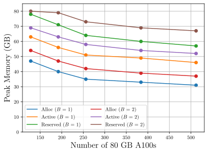

> 图源：FSDP 论文（Figure 8）[3]。

论文在最多 512 张 80GB A100 上评测：FSDP 在小模型上与 DDP 性能相当，在大模型上可支撑显著更大的规模，TFLOPS 近线性扩展 [3]。

### 4.3 官方列出的限制

以下限制来自 FSDP1 官方文档，属**已知边界**而非可绕过的小问题 [1]：

| 限制 | 说明 |
| --- | --- |
| CPU offload 下的梯度累积 | 开启 CPU offload 时，`no_sync()` **之外**的梯度累积不支持（FSDP 用"新归约的梯度"而非累加，结果会错） |
| 子模块的 forward | 不支持直接运行"某个 FSDP 实例内部子模块"的 forward（该子模块参数已分片，但没有 hook 去 All-Gather） |
| double backward | 不支持二次反向（与反向 hook 的注册方式有关） |
| 冻结参数 | `use_orig_params=False` 时，一个 FSDP 实例管理的参数必须**全冻结或全不冻结**；`True` 时支持混合，但显存开销可能偏高 |
| 共享参数 | 自 PyTorch 1.12 起支持有限 |
| 前向/反向间改参数 | 不要在前后向之间修改参数，除非用 `summon_full_params` 上下文，否则修改可能不生效 |

### 4.4 常见工程陷阱（经验性提示）

> 以下为工程经验，非文档保证；请以实测为准。

- **把 FSDP 只包在根模块上**：会退化成一个巨大的分片单元，既没有峰值显存收益，也没有重叠空间。务必**自底向上**包装（如每个 transformer block）[2][6]。
- **前向里保存了参数引用**：FSDP 在前后向会用 `Tensor` 视图替换参数，如果 forward 保存了参数引用而**不是每次重新获取**，autograd 会失效 [1]。
- **忘记 `use_orig_params=True` 就用 `torch.compile`**：官方明确该选项是 `torch.compile` 的必要条件 [1]。
- **通信后端选择错**：GPU 场景应使用 `nccl`；用 `gloo` 做 GPU 集体通信会严重拖慢 [1]。
- **忽略激活重计算**：FSDP 分片了模型状态，但**激活**仍可能成为新的显存瓶颈；此时应配合 activation checkpointing（它不会引入额外通信，因为反向本来就要 All-Gather 参数）[2][15]。

---

## 5. 可验证：最小实验

### 5.1 一个可运行的 FSDP 脚本

```python
# fsdp_demo.py
import functools
import os

import torch
import torch.nn as nn
import torch.distributed as dist
import torch.multiprocessing as mp
from torch.distributed.fsdp import FullyShardedDataParallel as FSDP
from torch.distributed.fsdp.wrap import transformer_auto_wrap_policy


class Block(nn.Module):
    def __init__(self, dim: int = 32) -> None:
        super().__init__()
        self.norm = nn.LayerNorm(dim)
        self.fc = nn.Linear(dim, dim)

    def forward(self, x: torch.Tensor) -> torch.Tensor:
        return x + self.fc(self.norm(x))


class TinyModel(nn.Module):
    def __init__(self, dim: int = 32, num_blocks: int = 4) -> None:
        super().__init__()
        self.embed = nn.Linear(dim, dim)
        self.blocks = nn.ModuleList(Block(dim) for _ in range(num_blocks))
        self.head = nn.Linear(dim, dim)

    def forward(self, x: torch.Tensor) -> torch.Tensor:
        x = self.embed(x)
        for blk in self.blocks:
            x = blk(x)
        return self.head(x)


def run(rank: int, world_size: int) -> None:
    dist.init_process_group("gloo", rank=rank, world_size=world_size)

    model = TinyModel()
    # 关键：按 transformer block 自动分单元（自底向上），才能获得重叠与显存收益
    wrap_policy = functools.partial(
        transformer_auto_wrap_policy,
        transformer_layer_cls={Block},
    )
    model = FSDP(model, auto_wrap_policy=wrap_policy)

    # FSDP 会替换参数变量，因此优化器必须在包装之后初始化
    optimizer = torch.optim.Adam(model.parameters(), lr=1e-3)
    loss_fn = nn.MSELoss()

    x = torch.randn(8, 32)
    y = torch.randn(8, 32)
    optimizer.zero_grad()
    loss_fn(model(x), y).backward()
    optimizer.step()

    dist.destroy_process_group()


def main() -> None:
    world_size = 2
    os.environ["MASTER_ADDR"] = "localhost"
    os.environ["MASTER_PORT"] = "29501"
    mp.spawn(run, args=(world_size,), nprocs=world_size, join=True)


if __name__ == "__main__":
    main()
```

> 结构参照 PyTorch FSDP API 文档的官方示例 [1] 与 FSDP2 教程 [7]；此处用 `gloo` 以便在 CPU 上直接跑通，GPU 上应改用 `nccl` [1]。注意顺序：**先 `FSDP(...)` 包装，再 `optim.Adam(model.parameters())`**——因为 FSDP 会替换参数变量 [1]。

### 5.2 观测与验证要点

| 想验证什么 | 怎么做 |
| --- | --- |
| 参数是否真的被分片 | 包装后打印 `next(model.parameters()).numel()`，与未包装模型对比（注意 `use_orig_params` 的影响）[1] |
| 是否有计算-通信重叠 | 用 profiler 观察 All-Gather stream 与默认计算 stream 是否时间上交叠 [2] |
| rate limiter 是否生效 | 用 `limit_all_gathers=True/False` 对比峰值显存与吞吐，观察 pre-forward 的 CPU 空档 [1][2] |
| 分片策略的显存/吞吐差异 | 分别用 `NO_SHARD` / `SHARD_GRAD_OP` / `FULL_SHARD` 跑同一配置，记录显存与 step 时间 [1][3] |
| 通信量是否符合预期 | 设置 `NCCL_DEBUG=INFO` 观察集合通信，估算每迭代 `2K`(DDP) 与 `3K`(FSDP) 的差异 [3] |

---

## 6. 与其他方案对比

| 维度 | **DP** | **DDP** | **FSDP / ZeRO-3** |
| --- | --- | --- | --- |
| 进程模型 | 单进程多线程 | 多进程，一进程一卡 | 多进程 + 状态分片 |
| 模型状态 | 主卡为枢纽，完整 | 每卡完整 [8][9] | **分片** [1][3][4] |
| 通信原语 | 中心化 scatter/gather | Ring AllReduce，带宽最优 [9] | All-Gather + Reduce-Scatter [2][7] |
| 每卡通信量/迭代 | 中心化瓶颈 | ≈ 2K [9] | ≈ 3K（**1.5×** DDP）[3] |
| 显存 | 主卡偏高 | 无改善 | 随 world size 下降 [4] |
| 跨机 | 否 | 是 [8] | 是（支持 HSDP 分层）[1][3] |
| 推荐场景 | 小模型、快速试验 | 中小模型、单机多卡/多机 | **大模型、显存受限** |

---

## 7. 延伸阅读

- 本文档姊妹篇：《DP 训练基本原理》《DDP 训练基本原理》（本目录）。
- 本仓库 `训练/分布式训练/`：张量并行、流水线并行、3D 并行、序列并行。
- 本仓库 `训练/通信优化/`：集合通信原语、拓扑感知、overlap、通信压缩——FSDP 的性能上限由它们决定。
- PyTorch 分布式总览：<https://pytorch.org/tutorials/beginner/dist_overview.html> [10]

---

## 参考文献

1. PyTorch. *torch.distributed.fsdp.FullyShardedDataParallel*（FSDP1 API 文档，含 ShardingStrategy、Limitations 等）。<https://pytorch.org/docs/stable/fsdp.html>
2. PyTorch. *FSDP Notes*（预取机制、通信 payload 记账、缓冲大小、rate limiter）。<https://pytorch.org/docs/stable/notes/fsdp.html>
3. Zhao, Y., Gu, A., Varma, R., et al. *PyTorch FSDP: Experiences on Scaling Fully Sharded Data Parallel*. PVLDB 16(12): 3848–3860 (2023). arXiv:2304.11277. <https://arxiv.org/abs/2304.11277>
4. Rajbhandari, S., Rasley, J., Ruwase, O., He, Y. *ZeRO: Memory Optimizations Toward Training Trillion Parameter Models*. SC20 (2020). arXiv:1910.02054. <https://arxiv.org/abs/1910.02054>
5. Xu, Y., Lee, H., Chen, D., et al. *Automatic Cross-Replica Sharding of Weight Updates*（FSDP API 文档中引用的 "Xu et al."）。arXiv:2004.13336 (2020). <https://arxiv.org/abs/2004.13336>
6. PyTorch. *torch.distributed.fsdp.fully_shard*（FSDP2 API 文档）。<https://pytorch.org/docs/stable/distributed.fsdp.fully_shard.html>
7. Feng, W., Constable, W., Mao, Y. *Getting Started with Fully Sharded Data Parallel (FSDP2)*（PyTorch 官方教程）。<https://pytorch.org/tutorials/intermediate/FSDP_tutorial.html>
8. PyTorch. *torch.nn.parallel.DistributedDataParallel*（DDP API 文档）。<https://pytorch.org/docs/stable/generated/torch.nn.parallel.DistributedDataParallel.html>
9. PyTorch. *Distributed Data Parallel*（DDP 设计说明）。<https://docs.pytorch.org/docs/2.3/notes/ddp.html>
10. PyTorch. *PyTorch Distributed Overview*. <https://pytorch.org/tutorials/beginner/dist_overview.html>
11. DeepSpeed. *ZeRO*（ZeRO 官方文档与教程）。<https://www.deepspeed.ai/tutorials/zero/>
12. PyTorch. *torch.distributed.tensor*（DTensor API 文档）。<https://pytorch.org/docs/stable/distributed.tensor.html>
13. PyTorch. *Distributed DeviceMesh*（官方 recipe）。<https://pytorch.org/tutorials/recipes/distributed_device_mesh.html>
14. pytorch/torchtitan. *FSDP in TorchTitan*（FSDP2 迁移与参数变更说明）。<https://github.com/pytorch/torchtitan/blob/main/docs/fsdp.md>
15. PyTorch. *torch.utils.checkpoint*（激活重计算）。<https://pytorch.org/docs/stable/checkpoint.html>

### 图片来源与许可声明

| 文件 | 来源 | 许可 / 说明 |
| --- | --- | --- |
| `assets/zero-memory-consumption.png` | Rajbhandari et al., *ZeRO: Memory Optimizations Toward Training Trillion Parameter Models*, arXiv:1910.02054（Figure 1）[4] | 论文以 arXiv 非独占分发许可发布（<http://arxiv.org/licenses/nonexclusive-distrib/1.0/>）；此处引用用于教学说明，版权归原作者（Microsoft） |
| `assets/fsdp-algorithm-overview.svg`、`assets/fsdp-full-sharding.svg`、`assets/fsdp-hybrid-sharding.svg`、`assets/fsdp-overlap.svg`、`assets/fsdp-mem-scaling-175b.svg` | Zhao et al., *PyTorch FSDP: Experiences on Scaling Fully Sharded Data Parallel*, arXiv:2304.11277（Figure 1/3/4/5/8）[3] | 采用 **CC BY-NC-ND 4.0** 许可（<https://creativecommons.org/licenses/by-nc-nd/4.0/>）：需署名、非商业、不得演绎；此处以原始矢量图形式引用，用于教学说明 |
| `assets/fsdp2-workflow.png`、`assets/fsdp2-ddp-decomposition.png`、`assets/fsdp2-implicit-prefetching.png` | PyTorch 官方教程 *Getting Started with Fully Sharded Data Parallel (FSDP2)* [7] | PyTorch 项目采用 BSD-3-Clause 许可；此处引用用于教学说明 |
| 其余 Mermaid 图（分片单元结构图、迭代流程图、重叠甘特图、关系图） | 本文自绘 | 使用 Mermaid 描述，GitHub 原生渲染，无第三方版权 |

> 若版权方要求，可随时移除上述图片，仅保留正文与文字描述。
