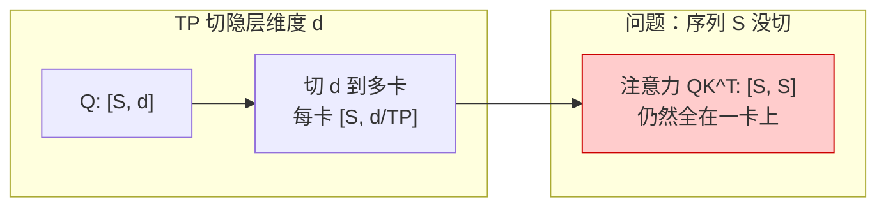
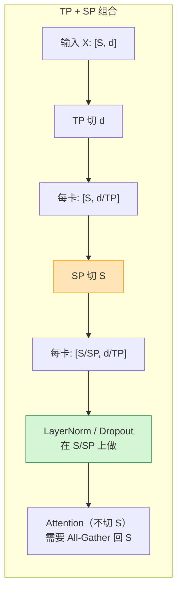
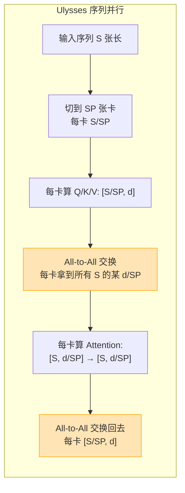
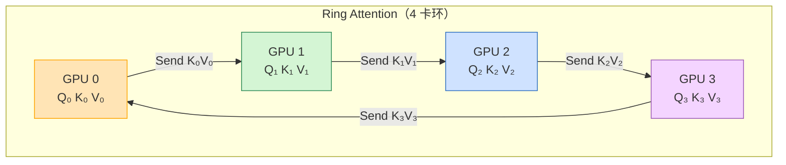
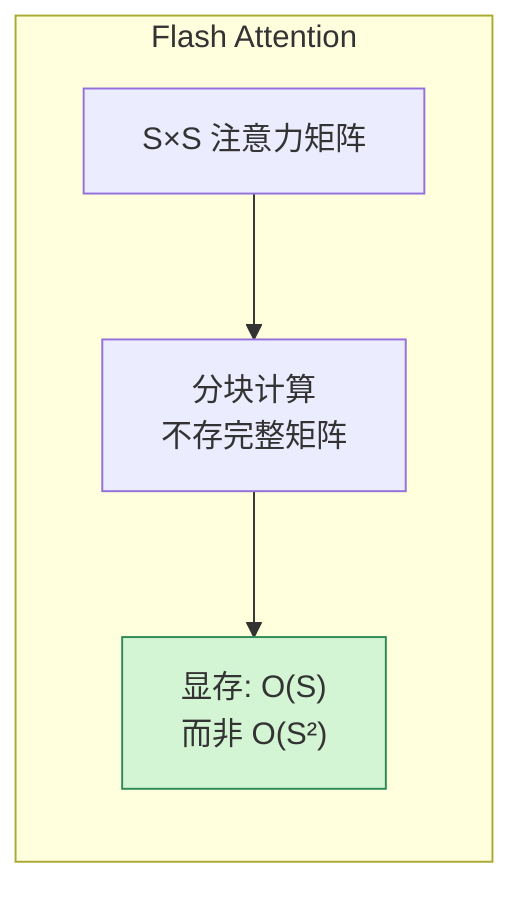
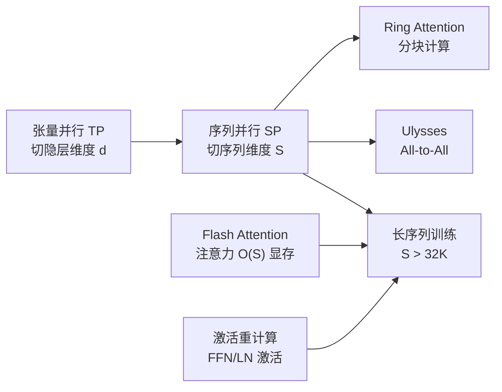

# 序列并行与长序列训练基本原理

> **一句话总结**：序列并行（Sequence Parallelism, SP）把**序列维度**切分到多卡，解决长序列下激活显存爆炸的问题。它常作为张量并行（TP）的补充——TP 切完单层后，用 SP 再切 LayerNorm/Dropout 的激活，几乎零通信代价。长序列训练的核心矛盾是**注意力显存与序列长度的平方关系**。

本文遵循本仓库的设计原则：**先讲清"为什么"，再讲"怎么做"**，并明确标注**关联技术**与**边界、代价**。

- 适用版本前提：SP 基于 Korthikanti et al. (2022) [1]；Ring Attention 基于 Brandon et al. (2023) [2]；Ulysses 基于 Intel 2023 [3]。**脱离序列长度与 TP 配置谈 SP 没有意义**。

---

## 1. 它为什么存在：长序列的显存瓶颈

### 1.1 Transformer 的激活显存

训练时，激活显存主要来自三部分：

| 组件 | 显存（相对序列长度 S） | 说明 |
| --- | --- | --- |
| **注意力矩阵** | $O(S^2)$ | Self-Attention 的 $QK^T$，随序列长度平方增长 |
| **FFN 中间激活** | $O(S \cdot d_{ff})$ | 与序列长度线性增长 |
| **LayerNorm 激活** | $O(S \cdot d)$ | 与序列长度线性增长 |

其中最致命的是**注意力矩阵的 $O(S^2)$ 增长**：

$$
\text{注意力显存} \approx \frac{S^2 \cdot n_{heads}}{2} \text{ bytes}
$$

| 序列长度 S | 注意力显存（fp16） |
| --- | --- |
| 2K | ~4 MB |
| 8K | ~64 MB |
| 32K | ~1 GB |
| 128K | ~16 GB |
| 1M | ~1 TB |

> 当序列长度超过 32K 时，注意力矩阵本身就能吃光单卡显存。

### 1.2 TP 解决不了序列维度

张量并行（TP）切的是**隐层维度**（$d$），不是序列维度（$S$）：

- TP 把 Q/K/V 的列切到多卡，每卡算一部分头；
- 但每卡仍然要处理**完整的序列** $S$；
- 注意力矩阵 $QK^T$ 仍然是 $S \times S$，全部存在一张卡上。



### 1.3 为什么需要序列并行

当序列很长（>32K）时：

1. **注意力矩阵显存爆炸**：$O(S^2)$ 单卡放不下；
2. **LayerNorm/激活显存线性增长**：$O(S \cdot d)$ 也很大；
3. **TP 帮不上忙**：TP 不切序列维度。

> **序列并行（SP）把序列维度 S 切到多卡**，让每张卡只处理一部分序列，从而把激活显存降到原来的 1/SP。

---

## 2. 核心机制

### 2.1 序列并行的两种主流方案

| 方案 | 切什么 | 通信代价 | 代表 |
| --- | --- | --- | --- |
| **SP（Megatron）** | LayerNorm/Dropout 的激活 | 极低（All-Reduce 融合到 TP） | [1] |
| **Ulysses** | Attention 输入序列 | All-to-All | [3] |
| **Ring Attention** | Attention 分块计算 | 点对点通信 | [2] |

### 2.2 Megatron SP：TP 的补充

Megatron 的 SP 是最简单的序列并行——它只切 **LayerNorm 和 Dropout** 的激活，不切 Attention 本身：



**关键**：SP 只在 LayerNorm/Dropout 这些**逐元素操作**上切序列，因为这些操作不需要跨 token 交互。Attention 本身仍然在完整序列上做（通过 All-Gather 恢复）。

**通信代价**：
- SP 的 All-Gather/Reduce-Scatter 可以与 TP 的通信**融合**，几乎零额外开销；
- 所以 SP 通常和 TP 一起使用，度数 = TP 度数。

### 2.3 Ulysses：切 Attention 输入序列

Ulysses 更进一步——直接把 Attention 的输入序列切到多卡：



**通信模式**：All-to-All（所有卡互相交换数据）

**优势**：
- 注意力矩阵从 $O(S^2)$ 降到 $O(S^2 / \text{SP})$；
- 支持更长序列。

**代价**：
- All-to-All 通信量较大：$O(S \cdot d)$；
- 需要 SP 度数 ≤ 头数（每个头不能再切）。

### 2.4 Ring Attention：分块计算注意力

Ring Attention 把注意力计算本身分块，通过环上的点对点通信流式处理：



**流程**：
1. 每张卡持有自己的 $Q_i$ 和初始的 $K_i, V_i$；
2. 每轮计算 $Q_i \times K_j^T$（$j$ 是当前持有的 K/V 的来源）；
3. 然后把 $K_j, V_j$ 传给下一张卡，接收上一张卡传来的 $K$；
4. 循环 SP 轮，每卡算完所有 $Q_i \times K_{all}^T$。

**优势**：
- 注意力显存降到 $O(S^2 / \text{SP}^2)$；
- 支持极长序列（百万级）。

**代价**：
- 点对点通信延迟高；
- 计算与通信需要精细重叠。

---

## 3. 三种方案对比

| 维度 | Megatron SP | Ulysses | Ring Attention |
| --- | --- | --- | --- |
| **切分位置** | LayerNorm/Dropout | Attention 输入 | Attention 计算本身 |
| **注意力显存** | 不降（仍 $O(S^2)$） | $O(S^2/\text{SP})$ | $O(S^2/\text{SP}^2)$ |
| **通信原语** | All-Gather/Reduce-Scatter（融合 TP） | All-to-All | Send/Recv（环） |
| **通信量** | 极低 | $O(S \cdot d)$ | $O(S \cdot d \cdot \text{SP})$ |
| **序列长度上限** | 受单卡注意力显存限制 | 中等 | 极高（百万级） |
| **实现复杂度** | 低 | 中 | 高 |
| **典型度数** | = TP 度数 | ≤ 头数 | 任意 |

---

## 4. 长序列训练的其他手段

序列并行之外，长序列训练还有几个关键技术：

### 4.1 激活重计算（Gradient Checkpointing）

不保存中间激活，反向时重新计算。把显存从 $O(S \cdot d \cdot L)$ 降到 $O(\sqrt{L} \cdot S \cdot d)$，代价是多算一遍前向。

详见本仓库《梯度检查点基本原理》。

### 4.2 Flash Attention

通过分块计算和在线 softmax，把注意力显存从 $O(S^2)$ 降到 $O(S)$，同时更快。



### 4.3 组合策略

长序列训练通常是多种技术的组合：

| 技术 | 解决什么 | 是否必选 |
| --- | --- | --- |
| **Flash Attention** | 注意力矩阵显存 $O(S^2) \to O(S)$ | ✅ 必选 |
| **激活重计算** | FFN/LayerNorm 激活显存 | ⚠️ 长序列必选 |
| **SP / Ulysses** | 进一步切序列维度 | ⚠️ 序列 > 32K 时 |
| **Ring Attention** | 超长序列（> 128K） | ❌ 只在极端场景 |

---

## 5. 边界与代价

### 5.1 序列并行的优势

| 优势 | 说明 |
| --- | --- |
| **显存降低** | 激活显存降到 1/SP |
| **Megatron SP 零开销** | 通信融合到 TP，几乎不增延迟 |
| **支持长序列** | Ulysses/Ring 支持 100K+ 序列 |

### 5.2 序列并行的代价

| 代价 | 说明 |
| --- | --- |
| **Ulysses All-to-All 开销** | 通信量 $O(S \cdot d)$，高带宽需求 |
| **Ring Attention 延迟** | 环上多次点对点通信，延迟高 |
| **头数限制** | Ulysses 的 SP 度数 ≤ 注意力头数 |
| **实现复杂** | Ring Attention 需要精细的计算-通信重叠 |

### 5.3 什么时候用什么

| 序列长度 | 推荐策略 |
| --- | --- |
| < 8K | Flash Attention 足够，不需要 SP |
| 8K–32K | Flash Attention + 激活重计算 |
| 32K–128K | + Megatron SP 或 Ulysses |
| > 128K | + Ring Attention |

### 5.4 常见工程陷阱

| 陷阱 | 说明 |
| --- | --- |
| SP 度数 > 头数 | Ulysses 无法切，必须 ≤ 头数 |
| 忽略 Flash Attention | 不用 Flash Attention，SP 也救不了 $O(S^2)$ |
| SP 与 TP 度数不匹配 | Megatron SP 通常 = TP 度数 |
| Ring Attention 延迟 | 百万级序列才值得，否则不如 Ulysses |

---

## 6. 可验证：显存估算

```python
def estimate_attention_memory(seq_len, num_heads, head_dim, dtype_bytes=2):
    """
    估算注意力矩阵显存
    
    Args:
        seq_len: 序列长度
        num_heads: 注意力头数
        head_dim: 每头维度
        dtype_bytes: 数据类型字节数（fp16=2）
    """
    # 标准 Attention: 存 S×S 矩阵
    std_mem = seq_len**2 * dtype_bytes / 1e9  # GB
    
    # Flash Attention: O(S) 显存
    flash_mem = seq_len * num_heads * head_dim * dtype_bytes / 1e9  # GB
    
    # Ulysses SP: O(S² / SP)
    sp = 8
    uly_mem = (seq_len**2 / sp) * dtype_bytes / 1e9  # GB
    
    # Ring Attention: O(S² / SP²)
    ring_mem = (seq_len**2 / sp**2) * dtype_bytes / 1e9  # GB
    
    print(f"序列长度: {seq_len}")
    print(f"标准 Attention:  {std_mem:.2f} GB")
    print(f"Flash Attention: {flash_mem:.4f} GB")
    print(f"Ulysses (SP=8):  {uly_mem:.2f} GB")
    print(f"Ring (SP=8):     {ring_mem:.4f} GB")

# 示例：128K 序列，32 头，每头 128 维
estimate_attention_memory(128_000, 32, 128)
```

预期输出：
```
序列长度: 128000
标准 Attention:  32.77 GB
Flash Attention: 1.05 GB
Ulysses (SP=8):  4.10 GB
Ring (SP=8):     0.51 GB
```

> 可以看到 Flash Attention 已经把显存从 32GB 降到 1GB，再叠加 Ring Attention 可以降到 0.5GB。

---

## 7. 关联：它在知识网络中的位置



- **与 TP**：SP 是 TP 的补充，TP 切 d，SP 切 S；Megatron SP 度数 = TP 度数。
- **与 Flash Attention**：Flash Attention 是长序列的基础，SP 在其之上进一步扩展。
- **与激活重计算**：两者互补，Flash Attention 解决注意力显存，激活重计算解决 FFN/LN 显存。

---

## 8. 延伸阅读

- 本仓库姊妹篇：
  - 《张量并行训练基本原理》（本目录）：TP 的列切/行切
  - 《梯度检查点基本原理》（训练/训练优化）：激活重计算
  - 《注意力机制基本原理》（神经网络基础）：Self-Attention 复杂度
- Megatron SP 论文 [1]
- Ring Attention 论文 [2]
- Ulysses 论文 [3]

---

## 参考文献

1. Korthikanti, V. A., Jain, A., Shoeybi, M., et al. *Reducing Activation Recomputation in Large Transformer Models*. 2022. arXiv:2205.05198. <https://arxiv.org/abs/2205.05198> — Megatron 序列并行（SP），切 LayerNorm/Dropout 激活，与 TP 通信融合。
2. Brandon, L., Pilligundla, D., Qian, H., et al. *Ring Attention with Blockwise Transformers for Near-Infinite Context*. 2023. arXiv:2310.01889. <https://arxiv.org/abs/2310.01889> — Ring Attention，环上分块计算注意力，支持百万级序列。
3. Intel. *Ulysses: Low-Latency, Memory-Efficient Sequence Parallelism*. 2023. <https://arxiv.org/abs/2309.14509> — Ulysses 序列并行，All-to-All 切 Attention 输入。
4. Dao, T., Fu, D. Y., Ermon, S., et al. *FlashAttention: Fast and Memory-Efficient Exact Attention with IO-Awareness*. NeurIPS 2022. <https://arxiv.org/abs/2205.14135> — Flash Attention，注意力显存从 $O(S^2)$ 降到 $O(S)$。
5. NVIDIA. *Megatron-LM Sequence Parallelism*. <https://github.com/NVIDIA/Megatron-LM> — Megatron SP 的参考实现。

### 图片来源与许可声明

本文所有图均为 **Mermaid 自绘**（flowchart），GitHub 原生渲染：

| 图 | 类型 | 说明 |
| --- | --- | --- |
| TP 不切序列（第 1.2 节） | Mermaid flowchart | 自绘 |
| TP + SP 组合（第 2.2 节） | Mermaid flowchart | 自绘 |
| Ulysses 序列并行（第 2.3 节） | Mermaid flowchart | 自绘 |
| Ring Attention 环（第 2.4 节） | Mermaid flowchart | 自绘 |
| Flash Attention（第 4.2 节） | Mermaid flowchart | 自绘 |
| 知识网络位置（第 7 节） | Mermaid flowchart | 自绘 |

> 注：序列并行的切分示意图为工程概念图，用 Mermaid flowchart 表达数据流向，无需外部图源；所有显存公式、通信量与实验结论均已给出可点击来源。
