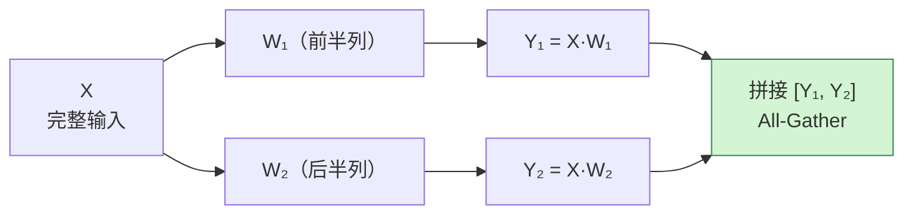
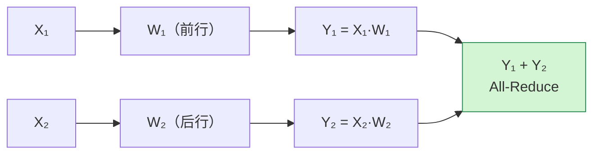
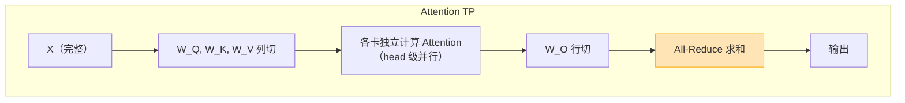
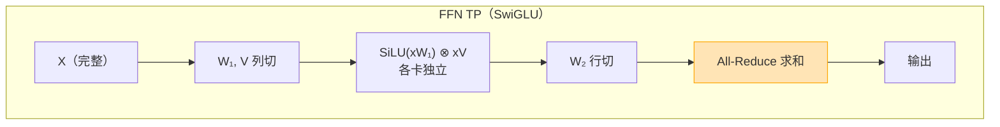
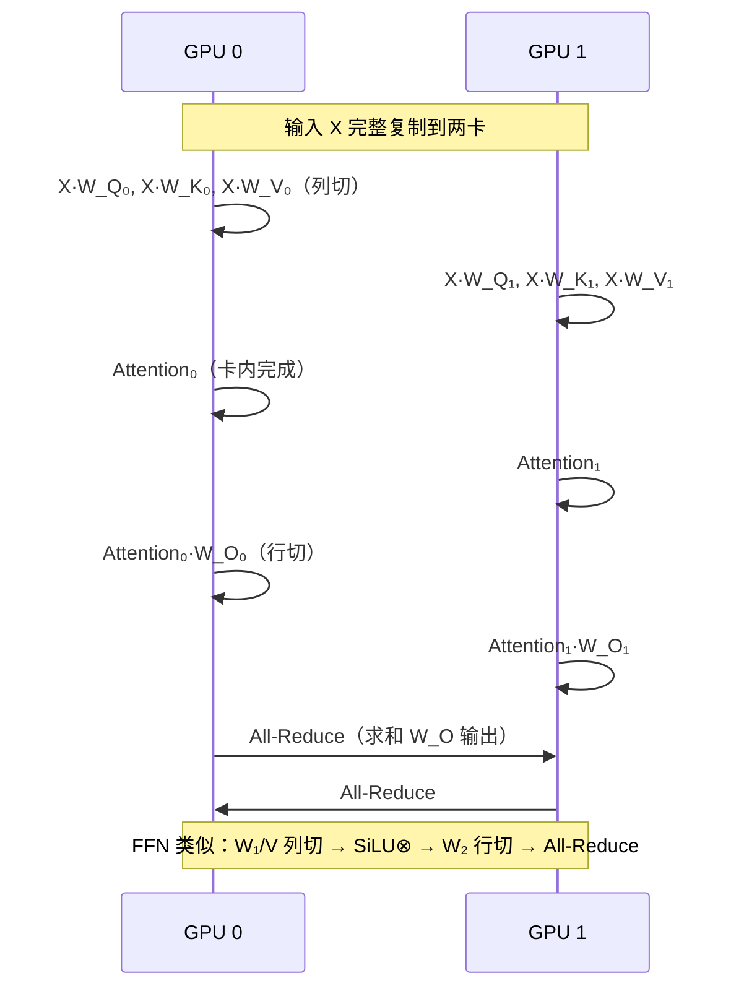
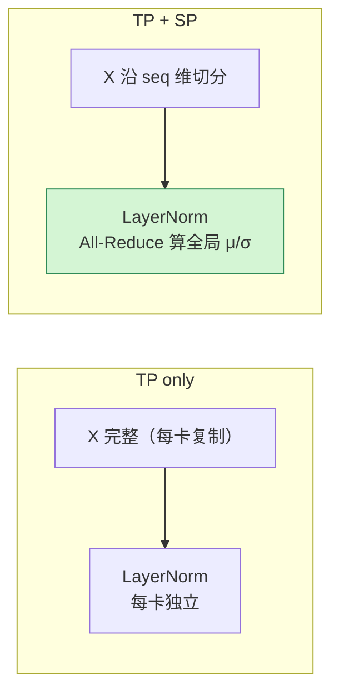
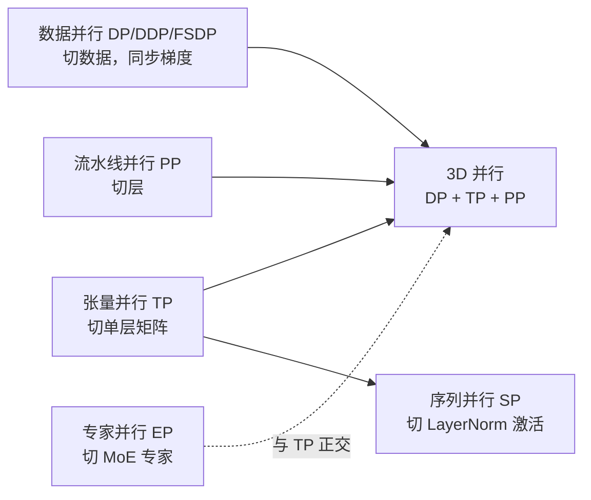

# 张量并行训练基本原理

> **一句话总结**：张量并行（Tensor Parallelism, TP）把**单个矩阵/张量**切分到多张卡上，让每张卡只持有参数的一部分，计算时通过 All-Gather / All-Reduce 协作完成完整的矩阵运算。它解决的是**单层太大、单卡装不下**的问题，代价是**每层都有跨卡通信**。

本文遵循本仓库的设计原则：**先讲清"为什么"，再讲"怎么做"**，并明确标注**关联技术**与**边界、代价**。

- 适用版本前提：张量并行的切分策略与通信模式基于 Megatron-LM [1]（arXiv:1909.08053）的设计；3D 并行基于 Narayanan et al. [2]（arXiv:2104.04473）；序列并行基于 Korthikanti et al. [3]（arXiv:2205.05198）。**脱离网络拓扑与模型规模的"最优 TP 度数"不成立**。

---

## 1. 它为什么存在：问题定义

### 1.1 单卡显存的两个瓶颈

大模型训练面临两堵显存墙：

| 瓶颈 | 原因 | 解法 |
| --- | --- | --- |
| **整模型装不下** | 参数量太大，模型状态（参数+梯度+优化器）超过单卡显存 | ZeRO / FSDP（切分模型状态）、PP（切分层） |
| **单层装不下** | 单个 FFN 或 Attention 层的参数矩阵太大，单卡连一层都存不下 | **张量并行 TP**（切分单层内部的矩阵） |

> FSDP 和 ZeRO 解决的是"整个模型太大"，但它们假设**单层可以装进单卡**。当单层本身就超过单卡显存时（例如 70B+ 模型的 FFN 权重矩阵），必须用张量并行把单层拆开。

### 1.2 一个具体例子

以 LLaMA 3 70B 的某个 FFN 层为例：
- `d_model = 8192`
- `d_ff = 28672`（SwiGLU，约 3.5×）
- 单个 FFN 的参数量：`3 × 8192 × 28672 ≈ 700M` 参数
- 用 fp16 存储需要约 `1.4 GB`，加上梯度和优化器状态（Adam 混合精度约 16 倍）≈ **22 GB**，已经接近单卡容量上限

如果模型更大（如 400B+），单层 FFN 可能超过 80GB 单卡显存，此时**必须**把这个矩阵切到多张卡上。

### 1.3 TP 的核心思想

> **把权重矩阵沿某个维度切开，每张卡只存一片，计算时各算各的局部结果，最后用集合通信拼出完整输出。**

与数据并行不同，TP 切的是**参数矩阵本身**，而不是数据。因此：

- 每张卡处理**同样的数据**，但只持有**部分参数**；
- 通信发生在**层内**（每层都需要通信），而不是层间；
- 通信量与 `batch_size × seq_len` 成正比，而非与参数量成正比。

---

## 2. 两种基本切分方式

### 2.1 列切（Column Parallel）

把权重矩阵 $W \in \mathbb{R}^{d_{in} \times d_{out}}$ 按**列**切分：

$$
W = [W_1, W_2, \ldots, W_N], \quad W_i \in \mathbb{R}^{d_{in} \times (d_{out}/N)}
$$

计算 $Y = XW$ 时，每张卡独立计算局部输出 $Y_i = X W_i$，最后拼接：

$$
Y = [Y_1, Y_2, \ldots, Y_N]
$$



**特点**：
- 输入 X 每张卡都有**完整副本**（需复制或广播）；
- 输出是**局部的**，需要 **All-Gather** 拼接成完整 Y；
- 反向传播时，梯度沿列切分，无需通信。

### 2.2 行切（Row Parallel）

把权重矩阵 $W \in \mathbb{R}^{d_{in} \times d_{out}}$ 按**行**切分：

$$
W = \begin{bmatrix} W_1 \\ W_2 \\ \vdots \\ W_N \end{bmatrix}, \quad W_i \in \mathbb{R}^{(d_{in}/N) \times d_{out}}
$$

相应地，输入 X 也按最后一维切分 $X = [X_1, X_2, \ldots, X_N]$，每张卡计算 $Y_i = X_i W_i$，最后求和：

$$
Y = \sum_{i=1}^{N} Y_i
$$



**特点**：
- 输入 X 是**切分的**（每张卡只有一片）；
- 输出是**局部的**，需要 **All-Reduce** 求和得到完整 Y；
- 反向传播时，需要 All-Gather 恢复完整的输入梯度。

### 2.3 列切 vs 行切对比

| 维度 | 列切（Column Parallel） | 行切（Row Parallel） |
| --- | --- | --- |
| 权重切分方向 | 按列（输出维） | 按行（输入维） |
| 输入 X | 完整（每卡复制） | 切分（每卡一片） |
| 输出 Y | 局部，需 All-Gather 拼接 | 局部，需 All-Reduce 求和 |
| 前向通信 | All-Gather | All-Reduce |
| 反向通信 | 无（梯度自然切分） | All-Gather（恢复输入梯度） |
| 显存 | 输出激活是局部的 | 输入激活是局部的 |

---

## 3. Transformer 中的切分策略

Megatron-LM [1] 确立了 Transformer 中张量并行的标准切法。核心原则是：**列切后接行切**，让中间激活不需要全量通信。

### 3.1 Attention 层的切分

Attention 的计算流程：

$$
\text{Attention}(X) = \text{softmax}\left(\frac{(XW_Q)(XW_K)^T}{\sqrt{d_k}}\right)(XW_V) W_O
$$

切分策略：

| 投影矩阵 | 切分方式 | 说明 |
| --- | --- | --- |
| $W_Q, W_K, W_V$ | **列切** | 每个 head 完整地落在一张卡上，Attention 计算无需跨卡通信 |
| $W_O$ | **行切** | 各卡算出局部输出后，All-Reduce 求和 |



**关键洞察**：因为 Q/K/V 按列切，每个注意力头完整地在一张卡上，所以 **Attention 的 softmax 和加权求和可以在卡内完成，不需要跨卡通信**。只有最后的 $W_O$ 投影需要 All-Reduce。

### 3.2 FFN 层的切分

FFN（以 SwiGLU 为例）的计算流程：

$$
\text{FFN}(X) = \left( \text{SiLU}(XW_1) \otimes XV \right) W_2
$$

切分策略：

| 投影矩阵 | 切分方式 | 说明 |
| --- | --- | --- |
| $W_1, V$ | **列切** | 升维，各卡独立算局部结果 |
| $W_2$ | **行切** | 降维，各卡算局部后 All-Reduce |



### 3.3 完整的一层 Transformer TP 流程



**每一层 Transformer 需要 2 次 All-Reduce**（Attention 的 $W_O$ + FFN 的 $W_2$），以及 2 次卡内独立计算。

---

## 4. 通信量分析

### 4.1 单层的通信量

设：
- 序列长度 $s$，batch size $b$，模型维度 $d$，TP 度数 $N$
- 每个 token 的激活是 $d$ 维

| 操作 | 通信量（每卡发送） | 说明 |
| --- | --- | --- |
| 列切输出 All-Gather | $2 \cdot b \cdot s \cdot d \cdot (N-1)/N$ | 把局部输出拼成完整 |
| 行切输出 All-Reduce | $2 \cdot b \cdot s \cdot d \cdot (N-1)/N$ | 把局部输出求和 |
| **每层总计** | $\approx 4 \cdot b \cdot s \cdot d$ | 两层 All-Reduce（Attention + FFN） |

> 注意：通信量与**参数量无关**，只与 **batch × seq_len × d_model** 成正比。这意味着 TP 通信量不会随模型变大而爆炸，但会随 batch 和序列长度增长。

### 4.2 与数据并行通信量对比

| 并行方式 | 通信内容 | 通信量 | 与什么成正比 |
| --- | --- | --- | --- |
| **DP（DDP）** | 梯度 | $2 \cdot \Psi$（全模型梯度） | 参数量 $\Psi$ |
| **TP** | 激活 | $4 \cdot b \cdot s \cdot d$ 每层 | batch × seq × d |

**关键结论**：
- DP 通信量随**模型规模**增长，TP 通信量随 **batch × 序列长度**增长；
- 模型越大，DP 的通信压力越大，TP 相对越划算；
- 但 TP **每层都要通信**，总层数 L 倍放大。

### 4.3 为什么 TP 通常只在机内做

TP 的通信是**同步的、每层都要等的**，对延迟和带宽都极其敏感。

- **机内 NVLink**：带宽 ~600 GB/s，延迟 < 1μs，适合 TP；
- **跨节点 RDMA**：带宽 ~50 GB/s，延迟 ~10μs，TP 性能急剧下降。

因此工业界的惯例是：**TP 度数 = 单机 GPU 数**（通常 8），跨节点用 DP 或 PP。

---

## 5. 序列并行（Sequence Parallelism, SP）

### 5.1 TP 的显存问题

标准 TP 中，LayerNorm 和 Dropout 的输入激活是**完整复制**在每张卡上的（因为列切需要完整输入）。这部分激活显存不会随 TP 度数下降。

### 5.2 SP 的做法

序列并行 [3] 把 LayerNorm 的输入沿**序列维**切分：

- 每张卡只处理序列的一段；
- LayerNorm 的均值和方差需要 **All-Reduce** 计算全局统计量；
- Dropout 也在序列维上切分。



**收益**：LayerNorm/Dropout 的激活显存从 $O(b \cdot s \cdot d)$ 降到 $O(b \cdot s \cdot d / N)$；
**代价**：LayerNorm 多了一次 All-Reduce，但开销很小（只通信均值和方差两个标量）。

现代大模型训练几乎都开启 SP（Megatron-LM、DeepSpeed、vLLM 都支持）。

---

## 6. 边界与代价

### 6.1 TP 的优势

| 优势 | 说明 |
| --- | --- |
| **切超大单层** | 解决单卡装不下一层的问题 |
| **数学等价** | 切分前后计算结果完全一致，不影响收敛 |
| **显存随 N 线性下降** | 参数和梯度显存降到 1/N |
| **实现成熟** | Megatron-LM、DeepSpeed、PyTorch 都有实现 |

### 6.2 TP 的代价

| 代价 | 说明 |
| --- | --- |
| **每层都有通信** | 不像 DP 只在反向末通信一次，TP 每层都要 All-Reduce |
| **对网络极度敏感** | 跨节点 TP 性能差，通常只限机内 |
| **TP 度数受限** | 受限于单机 GPU 数（通常最多 8） |
| **编译优化困难** | All-Reduce 插入让算子融合变复杂 |
| **小 batch 效率低** | 通信量与 batch 无关（只与 seq×d 有关），小 batch 时通信占比高 |

### 6.3 TP 度数怎么选

| 场景 | 建议 TP 度数 | 理由 |
| --- | --- | --- |
| 小模型（< 7B） | 1（不开 TP） | 单层能装下，DP 足够 |
| 中等模型（7B–30B） | 2 或 4 | 平衡显存与通信 |
| 大模型（30B–200B） | 8 | 用满单机 NVLink |
| 超大模型（> 200B） | 8 + PP + DP | TP 到顶后叠加 PP 和 DP |

> **经验法则**：优先把 TP 开到单机卡数（8），如果还装不下再加 PP；如果 batch 太小导致 TP 通信占比过高，考虑减小 TP 度数、增大 DP 度数。

### 6.4 常见工程陷阱

| 陷阱 | 说明 |
| --- | --- |
| TP 跨节点 | 性能急剧下降，应限制在机内 |
| 忽略 All-Reduce 开销 | TP 度数翻倍，通信量也翻倍 |
| 不开启 SP | LayerNorm 激活显存不下降，浪费 TP 的显存收益 |
| TP + FSDP 混用 | 两者都切参数，需小心不重叠切分同一维度 |
| 通信后端选错 | TP 必须用 NCCL，不能用 Gloo |

---

## 7. 可验证：最小实验

### 7.1 用 PyTorch 模拟列切和行切

```python
import torch
import torch.nn as nn
import torch.distributed as dist

# 假设 world_size=2，模拟两卡 TP
d_in, d_out = 8, 16
x = torch.randn(2, 4, d_in)  # [batch, seq, d_in]

# 完整权重
W_full = torch.randn(d_in, d_out)

# 列切：每张卡存一半列
W_col_0 = W_full[:, :d_out//2]  # GPU 0
W_col_1 = W_full[:, d_out//2:]  # GPU 1
y0 = x @ W_col_0
y1 = x @ W_col_1
y_col = torch.cat([y0, y1], dim=-1)

# 行切：每张卡存一半行
W_row_0 = W_full[:d_in//2, :]  # GPU 0
W_row_1 = W_full[d_in//2:, :]  # GPU 1
x0, x1 = x[:, :, :d_in//2], x[:, :, d_in//2:]
y_row = x0 @ W_row_0 + x1 @ W_row_1

# 验证：列切拼接 == 行切求和 == 完整计算
y_full = x @ W_full
assert torch.allclose(y_col, y_full, atol=1e-5), "列切结果不一致"
assert torch.allclose(y_row, y_full, atol=1e-5), "行切结果不一致"
print("列切和行切的结果都与完整计算一致 ✓")
```

### 7.2 观察 TP 的显存收益

```python
import torch

d_model = 4096
d_ff = 11008  # LLaMA-2 7B 的 FFN 维度

# 完整 FFN 参数（SwiGLU：W1, V, W2）
full_params = 3 * d_model * d_ff * 2  # fp16, bytes
print(f"完整 FFN 显存: {full_params / 1024**3:.2f} GB")

# TP=8 后每卡
tp8_params = full_params / 8
print(f"TP=8 每卡 FFN 显存: {tp8_params / 1024**3:.2f} GB")
```

预期输出：
```
完整 FFN 显存: 0.51 GB
TP=8 每卡 FFN 显存: 0.06 GB
```

> 注意：这只是参数量显存，实际还要加上梯度、优化器状态、激活等，完整收益约 8 倍（参数和梯度部分）。

---

## 8. 关联：它在知识网络中的位置



- **与数据并行 DP**：DP 解决"数据太多/全局 batch 不够"，TP 解决"单层太大"。两者正交，常组合使用（DP 跨节点、TP 机内）。
- **与流水线并行 PP**：PP 解决"层数太多"，TP 解决"单层太大"。3D 并行 = DP + TP + PP。
- **与序列并行 SP**：SP 是 TP 的补充，切 LayerNorm 的激活显存，几乎无额外通信代价。
- **与专家并行 EP**：EP 切的是 MoE 的不同专家，TP 切的是单个专家内部的矩阵，两者正交可叠加。
- **与 FSDP**：两者都切参数，但维度不同。FSDP 切整个模型的扁平参数，TP 切单层矩阵。混用需注意不重叠。

---

## 9. 延伸阅读

- 本仓库姊妹篇：
  - 《FSDP 训练基本原理》（本目录）：ZeRO 风格的参数分片，与 TP 互补
  - 《DDP 训练基本原理》（本目录）：数据并行的 AllReduce 机制
  - 《通信原语基本原理》（训练/通信优化）：All-Gather、All-Reduce 的实现细节
  - 《MoE基本原理》（神经网络基础）：专家并行 EP 与 TP 的关系
- Megatron-LM 论文 [1]：TP 的原始设计与实现
- Efficient Large-Scale Language Model Training on GPU Clusters [2]：3D 并行
- Reducing Activation Recomputation [3]：序列并行 SP

---

## 参考文献

1. Shoeybi, M., Patwary, M., Puri, R., et al. *Megatron-LM: Training Multi-Billion Parameter Language Models Using Model Parallelism*. arXiv:1909.08053 (2019). <https://arxiv.org/abs/1909.08053> — 张量并行的原始设计，列切/行切策略与 Transformer 切分方案。
2. Narayanan, D., Shoeybi, M., Casper, J., et al. *Efficient Large-Scale Language Model Training on GPU Clusters Using Megatron-LM*. SC 2021. arXiv:2104.04473. <https://arxiv.org/abs/2104.04473> — 3D 并行（DP+TP+PP）的设计与性能分析。
3. Korthikanti, V., Jain, A., Shoeybi, M., et al. *Reducing Activation Recomputation in Large Transformer Models*. arXiv:2205.05198 (2022). <https://arxiv.org/abs/2205.05198> — 序列并行（SP）的设计，把 LayerNorm 激活沿序列维切分。
4. Rajbhandari, S., Rasley, J., Ruwase, O., & He, Y. *ZeRO: Memory Optimizations Toward Training Trillion Parameter Models*. arXiv:1910.02054 (2019). <https://arxiv.org/abs/1910.02054> — ZeRO 分片策略，与 TP 互补。
5. PyTorch. *Distributed Pipeline Parallelism Using TP+PP*. <https://pytorch.org/tutorials/intermediate/pipeline_tutorial.html> — PyTorch 官方 TP 教程。
6. NVIDIA. *Megatron-LM: Ongoing Research in Training Large-Scale Language Models*. <https://github.com/NVIDIA/Megatron-LM> — Megatron-LM 代码库。

### 图片来源与许可声明

本文所有图均为 **Mermaid 自绘**（flowchart / sequenceDiagram），GitHub 原生渲染：

| 图 | 类型 | 说明 |
| --- | --- | --- |
| 列切流程（第 2.1 节） | Mermaid flowchart | 自绘 |
| 行切流程（第 2.2 节） | Mermaid flowchart | 自绘 |
| Attention TP 切分（第 3.1 节） | Mermaid flowchart | 自绘 |
| FFN TP 切分（第 3.2 节） | Mermaid flowchart | 自绘 |
| 单层 TP 通信时序（第 3.3 节） | Mermaid sequenceDiagram | 自绘 |
| TP vs TP+SP（第 5.2 节） | Mermaid flowchart | 自绘 |
| 知识网络位置（第 8 节） | Mermaid flowchart | 自绘 |

> 注：张量并行的切分示意图为工程概念图，无需外部图源；所有数学公式、通信量分析与实验结论均已给出可点击来源。
