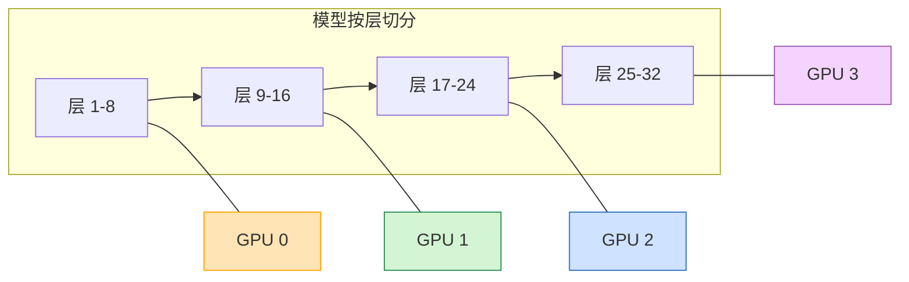
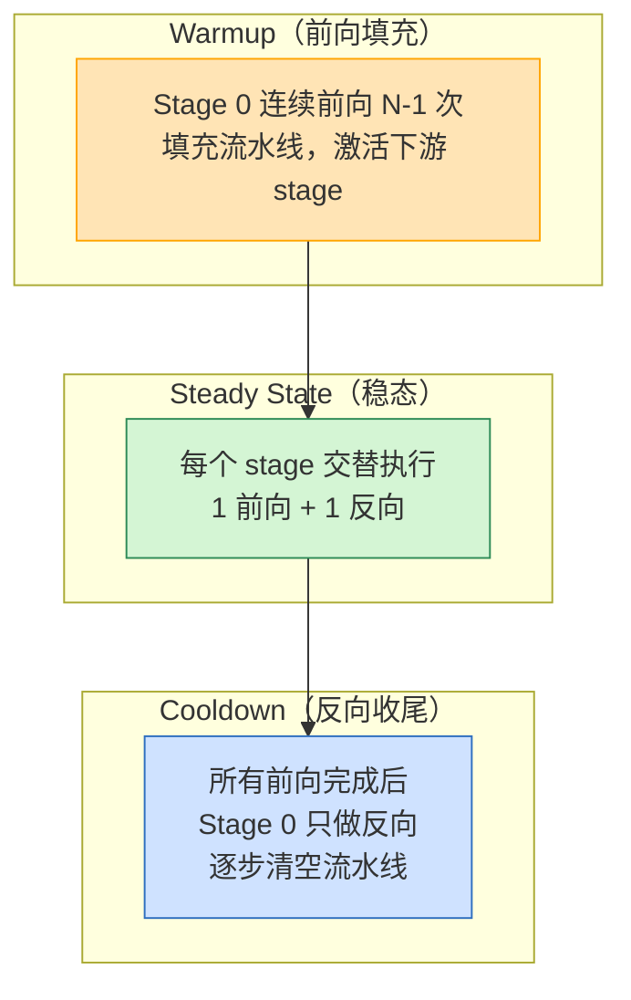
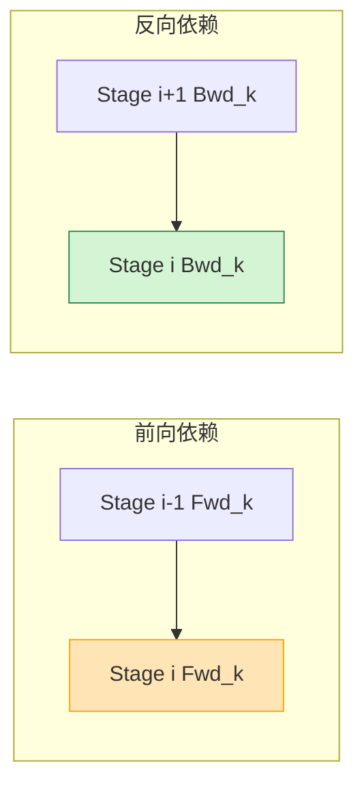
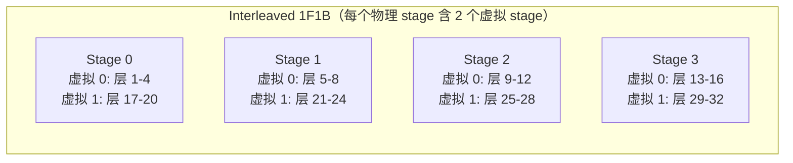
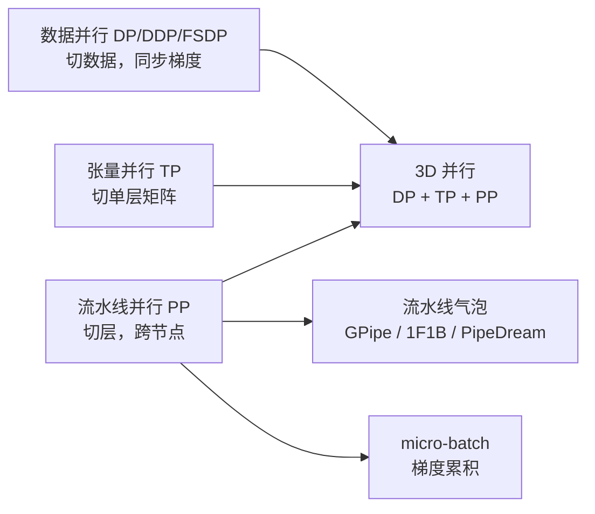

# 流水线并行训练基本原理

> **一句话总结**：流水线并行（Pipeline Parallelism, PP）把模型按**层**切分成多个 stage，放到不同设备上，数据像流水线一样逐层流过。它解决的是"层数太多、TP 已到顶仍装不下"的问题，代价是**流水线气泡（设备空闲）**和更复杂的调度。

本文遵循本仓库的设计原则：**先讲清"为什么"，再讲"怎么做"**，并明确标注**关联技术**与**边界、代价**。

- 适用版本前提：GPipe 基于 Huang et al. (2018) [1]；1F1B 基于 Narayanan et al. (2021) [2]；PipeDream 基于 Harlap et al. (2018) [3]；Interleaved 1F1B 基于 NVIDIA Megatron-LM [4]。**脱离调度策略与 micro-batch 数的"PP 效率"不成立**。

---

## 1. 它为什么存在：问题定义

### 1.1 三种并行的分工

大模型训练有三种基本并行策略，各解决一个维度的问题：

| 并行方式 | 切什么 | 解决什么 |
| --- | --- | --- |
| **数据并行 DP** | 数据 | batch 太小、需要更大全局 batch |
| **张量并行 TP** | 单层矩阵 | 单层太大、单卡装不下 |
| **流水线并行 PP** | 层 | 层数太多、整模型装不下 |

TP 的度数受限于**单机 GPU 数**（通常 8），因为 TP 需要极高带宽的通信。当模型大到 8 卡 TP 仍装不下时，必须把**层**切到多台机器上——这就是 PP。

### 1.2 PP 的核心思想

把模型按层切成 N 段（stage），每段放到不同设备：



数据被分成多个 **micro-batch**，依次流过各个 stage。每个 stage 只持有模型的一段层，因此：

- 每张卡只存 **1/N** 的模型参数；
- 计算时只跑自己负责的那几层；
- 层间通过 **Send/Recv** 传递激活值。

### 1.3 PP 与 TP 的本质区别

| 维度 | TP | PP |
| --- | --- | --- |
| 切分粒度 | 层内（矩阵元素级） | 层间（整层级） |
| 通信方式 | All-Reduce / All-Gather（集合通信） | Send / Recv（点对点） |
| 通信位置 | 每层内部 | 层与层之间 |
| 跨节点能力 | ❌（只限机内 NVLink） | ✅（可跨节点 RDMA） |
| 主要开销 | 每层通信 | 流水线气泡 |

> PP 的通信是**点对点**的，对网络要求比 TP 的集合通信低，因此可以跨节点扩展。

---

## 2. 核心机制

### 2.1 micro-batch 与梯度累积

为了让流水线"流起来"，需要把一个 mini-batch 拆成多个 **micro-batch**：

- mini-batch：一次参数更新的数据总量（如 1024 tokens）
- micro-batch：流水线中每次流过一个 stage 的数据量（如 256 tokens）

每个 micro-batch 流过所有 stage 完成前向和反向后，梯度累积起来，最后统一更新一次参数。

### 2.2 GPipe：先全部前向，再全部反向

GPipe 是最简单的流水线调度 [1]：

1. 所有 micro-batch 依次前向流过所有 stage；
2. 全部前向完成后，再依次反向流过所有 stage。

```mermaid
gantt
    title GPipe 调度（4 stage, 4 micro-batch）
    dateFormat X
    axisFormat %s
    section Stage 0
    Fwd1 :a1, 0, 1
    Fwd2 :a2, 1, 1
    Fwd3 :a3, 2, 1
    Fwd4 :a4, 3, 1
    Bwd1 :a5, 8, 1
    Bwd2 :a6, 9, 1
    Bwd3 :a7, 10, 1
    Bwd4 :a8, 11, 1
    section Stage 1
    idle :b1, 0, 1
    Fwd1 :b2, 1, 1
    Fwd2 :b3, 2, 1
    Fwd3 :b4, 3, 1
    Fwd4 :b5, 4, 1
    idle2 :b6, 5, 1
    Bwd1 :b7, 9, 1
    Bwd2 :b8, 10, 1
    Bwd3 :b9, 11, 1
    Bwd4 :b10, 12, 1
    section Stage 2
    idle :c1, 0, 2
    Fwd1 :c2, 2, 1
    Fwd2 :c3, 3, 1
    Fwd3 :c4, 4, 1
    Fwd4 :c5, 5, 1
    idle2 :c6, 6, 1
    Bwd1 :c7, 10, 1
    Bwd2 :c8, 11, 1
    Bwd3 :c9, 12, 1
    Bwd4 :c10, 13, 1
    section Stage 3
    idle :d1, 0, 3
    Fwd1 :d2, 3, 1
    Fwd2 :d3, 4, 1
    Fwd3 :d4, 5, 1
    Fwd4 :d5, 6, 1
    Bwd1 :d6, 7, 1
    Bwd2 :d7, 8, 1
    Bwd3 :d8, 9, 1
    Bwd4 :d9, 10, 1
```



**GPipe 的问题**：
- 前向阶段和反向阶段之间有**大段空闲**（Stage 3 前向完后要等所有 stage 前向完才能开始反向）；
- 显存峰值高：需要保存所有 micro-batch 的激活值。

### 2.3 1F1B：前向反向交替

1F1B（One Forward One Backward）是目前工业界的主流调度 [2]。核心思想：

> **前向一个 micro-batch，紧接着反向一个 micro-batch，交替进行。** 让前向和反向在不同 stage 上重叠，从而减少气泡。

#### 2.3.1 完整时序图

```mermaid
gantt
    title 1F1B 调度（4 stage, 4 micro-batch）
    dateFormat X
    axisFormat %s
    section Stage 0
    Fwd1 :a1, 0, 1
    Fwd2 :a2, 1, 1
    Fwd3 :a3, 2, 1
    Fwd4 :a4, 3, 1
    Bwd1 :a5, 4, 1
    Bwd2 :a6, 5, 1
    Bwd3 :a7, 6, 1
    Bwd4 :a8, 7, 1
    section Stage 1
    idle :b1, 0, 1
    Fwd1 :b2, 1, 1
    Fwd2 :b3, 2, 1
    Fwd3 :b4, 3, 1
    Bwd1 :b5, 4, 1
    Fwd4 :b6, 5, 1
    Bwd2 :b7, 6, 1
    Bwd3 :b8, 7, 1
    Bwd4 :b9, 8, 1
    section Stage 2
    idle :c1, 0, 2
    Fwd1 :c2, 2, 1
    Fwd2 :c3, 3, 1
    Bwd1 :c4, 4, 1
    Fwd3 :c5, 5, 1
    Bwd2 :c6, 6, 1
    Fwd4 :c7, 7, 1
    Bwd3 :c8, 8, 1
    Bwd4 :c9, 9, 1
    section Stage 3
    idle :d1, 0, 3
    Fwd1 :d2, 3, 1
    Bwd1 :d3, 4, 1
    Fwd2 :d4, 5, 1
    Bwd2 :d5, 6, 1
    Fwd3 :d6, 7, 1
    Bwd3 :d7, 8, 1
    Fwd4 :d8, 9, 1
    Bwd4 :d9, 10, 1
```



#### 2.3.2 三个阶段

1F1B 的调度可以分成三个阶段，每个阶段的行为不同：



**阶段一：Warmup（前向填充）**

Stage 0（最上游）先连续做前向，把数据"喂"进流水线。此时下游 stage 被逐步激活：

| 时刻 | Stage 0 | Stage 1 | Stage 2 | Stage 3 |
| --- | --- | --- | --- | --- |
| t=0 | Fwd1 | idle | idle | idle |
| t=1 | Fwd2 | Fwd1 | idle | idle |
| t=2 | Fwd3 | Fwd2 | Fwd1 | idle |
| t=3 | Fwd4 | Fwd3 | Fwd2 | Fwd1 |

- Stage 0 做了 $N-1=3$ 个前向才进入稳态；
- Stage 1 做了 $N-2=2$ 个前向；
- Stage 2 做了 $N-3=1$ 个前向；
- Stage 3（最下游）不需要 warmup，做完第一个前向就可以开始反向。

> **规律**：第 $i$ 个 stage（从 0 开始）的 warmup 前向数 = $N-1-i$。

**阶段二：Steady State（1F1B 交替）**

流水线填满后，每个 stage 交替执行前向和反向。看 Stage 3 的稳态：

```
Fwd1 → Bwd1 → Fwd2 → Bwd2 → Fwd3 → Bwd3 → Fwd4 → Bwd4
```

关键在于**前向和反向在不同 stage 上重叠**：

- 当 Stage 3 在做 Bwd1 时，Stage 2 可以做 Fwd3（前向）；
- 当 Stage 2 在做 Bwd1 时，Stage 1 可以做 Fwd4（前向）；
- 当 Stage 1 在做 Bwd1 时，Stage 0 可以做 Bwd1（反向）。

这样每个 stage 几乎没有空闲，设备利用率最大化。

**阶段三：Cooldown（反向收尾）**

所有前向完成后，Stage 0 不再有新的前向任务，只做反向。流水线从上游开始"排空"：

| 时刻 | Stage 0 | Stage 1 | Stage 2 | Stage 3 |
| --- | --- | --- | --- | --- |
| t=7 | Bwd4 | Bwd3 | Bwd3 | Bwd3 |
| t=8 | done | Bwd4 | Bwd4 | Bwd4 |
| t=9 | done | done | Bwd4? | Bwd4 |
| t=10 | done | done | done | Bwd4 |

> Cooldown 阶段也有气泡，但比 GPipe 小得多，因为只有 Stage 0 在等，其他 stage 还在做反向。

#### 2.3.3 为什么 1F1B 比 GPipe 快

GPipe 的问题是**前向和反向完全串行**——必须等所有 micro-batch 前向完，才能开始反向。这导致 Stage 3（最下游）在前向完成后要等 $N-1$ 个时间步才能开始反向。

1F1B 通过**交错前向和反向**，让反向尽早开始：

```
GPipe:  Fwd Fwd Fwd Fwd ... Bwd Bwd Bwd Bwd   （中间大段空闲）
1F1B:   Fwd Fwd Fwd Fwd Bwd Fwd Bwd Fwd Bwd   （反向尽早开始）
```

具体收益：

| 维度 | GPipe | 1F1B |
| --- | --- | --- |
| 反向开始时刻 | 所有前向完成后 | Stage 3 第一个前向完成后立刻开始 |
| 气泡来源 | 前向-反向之间的大段空闲 | 只有 warmup 和 cooldown 的小段空闲 |
| 显存峰值 | 所有 micro-batch 激活同时存在 | 每个 stage 只存当前处理的 1–2 个 micro-batch |
| 气泡比例 | $(N-1)/M$ | $(N-1)/(2M)$ |

#### 2.3.4 依赖关系与正确性

1F1B 能正确工作的关键是**依赖关系不被破坏**：

- **前向依赖**：Stage $i$ 的前向需要 Stage $i-1$ 的前向输出（激活）；
- **反向依赖**：Stage $i$ 的反向需要 Stage $i+1$ 的反向输出（梯度）。

1F1B 的调度保证：
- 做 Bwd$_k$ 时，Stage $i+1$ 的 Bwd$_k$ 已经完成（因为下游更早开始反向）；
- 做 Fwd$_k$ 时，Stage $i-1$ 的 Fwd$_k$ 已经完成（因为上游更早开始前向）。



#### 2.3.5 数学等价性

1F1B 与单卡训练**不是严格数学等价**，原因是权重更新时序：

- **单卡 / GPipe**：所有 micro-batch 的梯度都累积完后，用**同一组权重**更新；
- **1F1B**：某些 micro-batch 的反向可能发生在权重更新之后（如果 micro-batch 数不够多）。

不过在实际训练中：

- 当 $M \geq N$ 时，1F1B 的权重更新时序差异很小，对收敛几乎无影响 [2]；
- Megatron-LM 的实测表明，1F1B 与 GPipe 的最终精度差异在统计噪声范围内。

> **经验**：确保 $M \geq 4N$（micro-batch 数至少是 stage 数的 4 倍），可以让 1F1B 的数学近似误差可忽略。

#### 2.3.6 1F1B 的显存特征

1F1B 的显存峰值远低于 GPipe，因为：

- **GPipe**：所有 $M$ 个 micro-batch 的激活值都要同时保存在显存中（前向完才能反向）；
- **1F1B**：每个 stage 只需要保存当前正在处理的 1–2 个 micro-batch 的激活，反向完立刻释放。

显存峰值对比：

| 调度 | 每 stage 激活显存 | 说明 |
| --- | --- | --- |
| GPipe | $O(M \cdot \text{activation})$ | 所有 micro-batch 同时存在 |
| 1F1B | $O((N-i) \cdot \text{activation})$ | 第 $i$ 个 stage 最多存 $N-i$ 个激活 |

**1F1B 的优势**：
- 前向和反向**重叠**，气泡显著减小；
- 显存峰值更低（不需要同时存所有 micro-batch 的激活）；
- 反向尽早开始，缩短整体训练时间。

1F1B 的气泡比例约为 GPipe 的一半，是 Megatron-LM、DeepSpeed 等框架的默认调度。

### 2.4 流水线气泡分析

**气泡（bubble）**：设备等待数据的空闲时间。

设 stage 数为 $N$，micro-batch 数为 $M$，每个 micro-batch 的计算时间为 $t$：

- **GPipe 气泡比例**：$\frac{N-1}{M}$
- **1F1B 气泡比例**：$\frac{N-1}{2M}$

例如 $N=8, M=32$：

| 调度 | 气泡比例 | 设备利用率 |
| --- | --- | --- |
| GPipe | $(8-1)/32 = 21.9\%$ | 78.1% |
| 1F1B | $(8-1)/(2 \times 32) = 10.9\%$ | 89.1% |

> **micro-batch 越多，气泡越小**，但调度开销和内存占用也越大。实际中通常 $M \geq 4N$ 才能让气泡占比降到可接受范围。

---

## 3. 调度策略演进

### 3.1 PipeDream：异步流水线

PipeDream [3] 走得更远——它允许不同 stage 同时处理**不同 mini-batch** 的前向和反向，进一步减少气泡：

- 每个 stage 可以处理不同 mini-batch 的数据；
- 用权重版本号（weight versioning）保证参数一致性；
- 气泡接近 0，但实现复杂，且可能引入"陈旧梯度"问题。

### 3.2 Interleaved 1F1B

Megatron-LM 提出的优化 [4]：把每个 stage 的层分成多个"虚拟 stage"（virtual stage），让设备在多个虚拟 stage 之间切换：



收益：
- 气泡进一步减小（虚拟 stage 数 $v$ 越多，气泡越小）；
- 设备利用率更高。

代价：
- 调度更复杂；
- 需要保存更多中间激活。

### 3.3 三种调度对比

| 调度 | 气泡比例 | 显存 | 实现复杂度 | 数学等价 |
| --- | --- | --- | --- | --- |
| GPipe | $(N-1)/M$ | 高 | 低 | ✅ |
| 1F1B | $(N-1)/(2M)$ | 中 | 中 | ⚠️ 近似（权重更新时序略有差异） |
| PipeDream | ~0 | 低 | 高 | ❌（引入陈旧梯度） |
| Interleaved 1F1B | $(N-1)/(2vM)$ | 中高 | 高 | ⚠️ 近似 |

---

## 4. 边界与代价

### 4.1 PP 的优势

| 优势 | 说明 |
| --- | --- |
| **跨节点扩展** | 通信是点对点 Send/Recv，可跨节点 RDMA |
| **切分整模型** | 解决层数太多的问题 |
| **与 TP 正交** | 可与 TP 组合成 3D 并行 |
| **通信量小** | 只传层间激活，不传全模型梯度 |

### 4.2 PP 的代价

| 代价 | 说明 |
| --- | --- |
| **流水线气泡** | 设备空闲时间，随 stage 数增长 |
| **调度复杂** | micro-batch 管理、前向反向交替 |
| **激活显存** | 每个 stage 要保存流经的 micro-batch 激活 |
| **跨节点延迟** | 层间通信走网络，延迟影响吞吐 |
| **batch 约束** | 需要足够多的 micro-batch 才能填满流水线 |

### 4.3 什么时候用 PP

| 场景 | 是否用 PP | 理由 |
| --- | --- | --- |
| 模型 < 30B | ❌ | DP + TP（8）足够 |
| 30B–200B | ⚠️ 可选 | TP 到顶后可用 2–4 stage PP |
| > 200B | ✅ 必须 | 必须 PP 跨节点扩展 |
| 推理低延迟 | ❌ | PP 引入串行延迟 |
| 层数少但单层大 | ❌ | 该用 TP，不是 PP |

### 4.4 常见工程陷阱

| 陷阱 | 说明 |
| --- | --- |
| stage 数太少 | 气泡占比高，不如不加 PP |
| micro-batch 太少 | 流水线填不满，气泡大 |
| 各 stage 计算量不均 | 慢的 stage 成为瓶颈，快的 stage 等待 |
| 跨节点 PP 延迟高 | 需用 RDMA，且 stage 间通信量要小 |
| 与 TP 切分冲突 | PP 切层、TP 切单层，需规划好不重叠 |

---

## 5. 可验证：计算气泡比例

```python
def bubble_ratio(num_stages, num_microbatches, schedule="1f1b"):
    """计算流水线气泡比例"""
    n = num_stages
    m = num_microbatches
    if schedule == "gpipe":
        return (n - 1) / m
    elif schedule == "1f1b":
        return (n - 1) / (2 * m)
    elif schedule == "interleaved":
        v = 2  # 虚拟 stage 数
        return (n - 1) / (2 * v * m)
    else:
        raise ValueError(f"Unknown schedule: {schedule}")

# 示例：8 stage, 32 micro-batch
for sched in ["gpipe", "1f1b", "interleaved"]:
    ratio = bubble_ratio(8, 32, sched)
    print(f"{sched:12s}: 气泡 {ratio*100:5.1f}%, 利用率 {(1-ratio)*100:5.1f}%")
```

预期输出：
```
gpipe       : 气泡  21.9%, 利用率  78.1%
1f1b        : 气泡  10.9%, 利用率  89.1%
interleaved : 气泡   5.5%, 利用率  94.5%
```

---

## 6. 关联：它在知识网络中的位置



- **与 TP**：TP 切单层（机内），PP 切层（可跨节点），两者正交。TP 到顶后用 PP 继续扩展。
- **与 DP**：DP 负责扩展全局 batch，PP 负责切层，常组合使用。
- **与气泡调度**：PP 的效率由调度策略决定，1F1B 是当前主流，Interleaved 1F1B 进一步优化。

---

## 7. 延伸阅读

- 本仓库姊妹篇：
  - 《张量并行训练基本原理》（本目录）：TP 的列切/行切与通信模式
  - 《FSDP 训练基本原理》（本目录）：ZeRO 风格的参数分片
  - 《通信原语基本原理》（训练/通信优化）：Send/Recv 点对点通信
- GPipe 论文 [1]
- Megatron-LM 3D 并行论文 [2]
- PipeDream 论文 [3]

---

## 参考文献

1. Huang, Y., Cheng, Y., Bapna, A., et al. *GPipe: Efficient Training of Giant Neural Networks using Pipeline Parallelism*. NeurIPS 2019. arXiv:1811.06965. <https://arxiv.org/abs/1811.06965> — GPipe 流水线并行，先全部前向再全部反向。
2. Narayanan, D., Shoeybi, M., Casper, J., et al. *Efficient Large-Scale Language Model Training on GPU Clusters Using Megatron-LM*. SC 2021. arXiv:2104.04473. <https://arxiv.org/abs/2104.04473> — 1F1B 调度与 3D 并行设计。
3. Harlap, A., Narayanan, D., Phanishayee, A., et al. *PipeDream: Fast and Efficient Pipeline Parallel DNN Training*. SOSP 2019. arXiv:1806.03377. <https://arxiv.org/abs/1806.03377> — 异步流水线与权重版本号。
4. NVIDIA. *Megatron-LM: Interleaved Pipeline Parallelism*. <https://github.com/NVIDIA/Megatron-LM> — Interleaved 1F1B 的实现。
5. PyTorch. *Pipeline Parallelism*. <https://pytorch.org/docs/stable/pipeline.html> — PyTorch 官方 PP 接口。

### 图片来源与许可声明

本文所有图均为 **Mermaid 自绘**（flowchart / gantt），GitHub 原生渲染：

| 图 | 类型 | 说明 |
| --- | --- | --- |
| 模型按层切分（第 1.2 节） | Mermaid flowchart | 自绘 |
| GPipe 调度甘特图（第 2.2 节） | Mermaid gantt | 自绘 |
| 1F1B 调度甘特图（第 2.3 节） | Mermaid gantt | 自绘 |
| Interleaved 1F1B（第 3.2 节） | Mermaid flowchart | 自绘 |
| 知识网络位置（第 6 节） | Mermaid flowchart | 自绘 |

> 注：流水线并行的调度示意图为工程概念图，用 Mermaid gantt 表达时序，无需外部图源；所有公式、调度策略与实验结论均已给出可点击来源。
