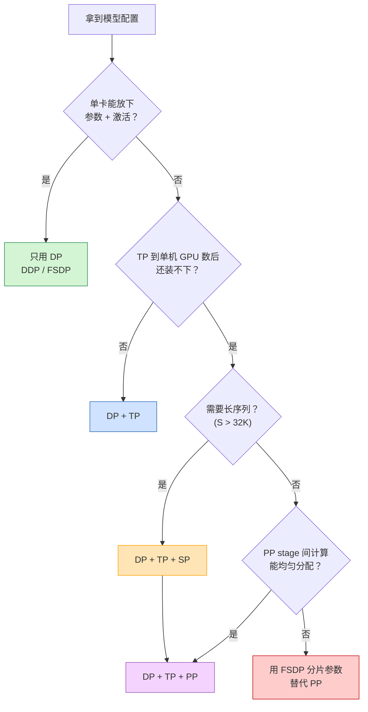
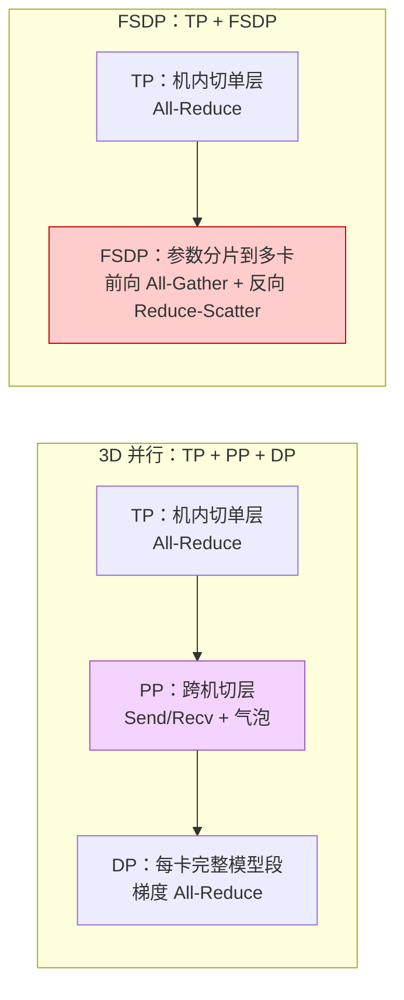
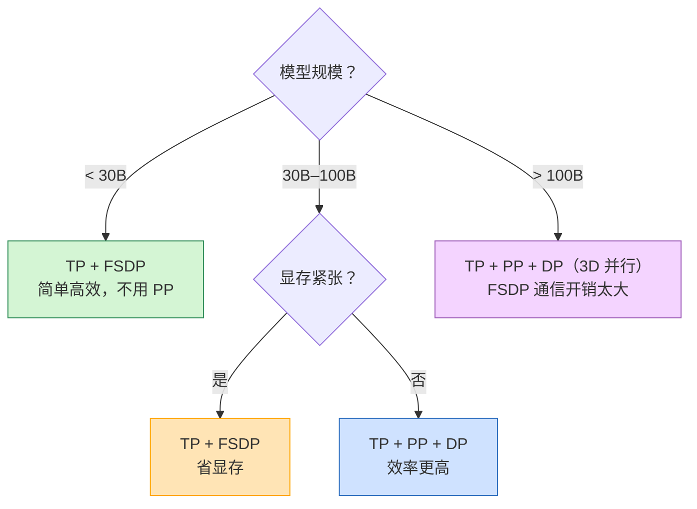
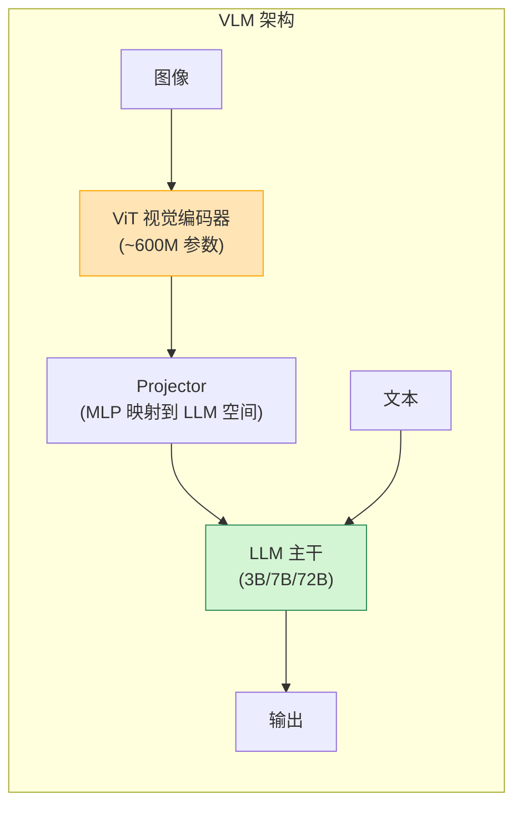
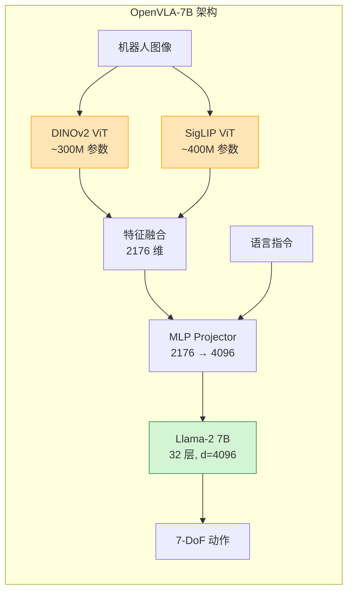
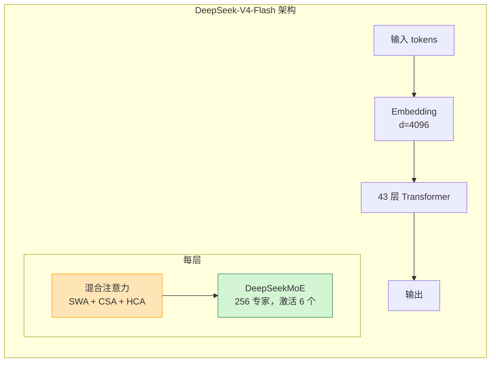
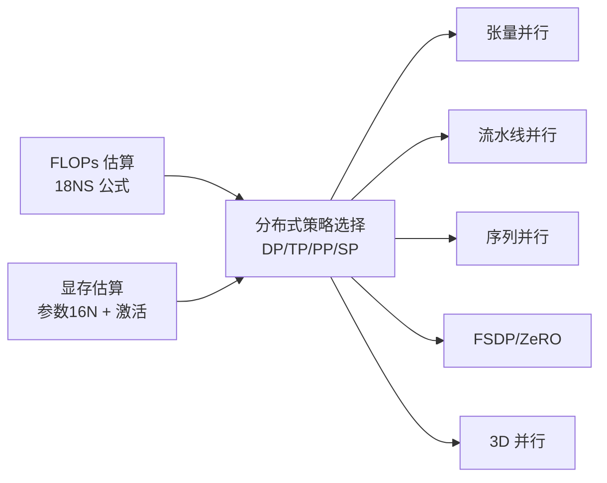

# 计算与显存复杂度估算及分布式策略选择

> **一句话总结**：训练大模型前必须先做两道算术题——**算 FLOPs**（需要多少算力、训多久）和**算显存**（参数量/激活/KV Cache 各占多少），然后根据结果选择 **DP/TP/PP/SP** 的组合。本文以开源的 LLaMA 3.1（LLM）、Qwen2.5-VL（VLM）、OpenVLA（VLA）为例，给出完整的估算公式与策略选择流程。

本文遵循本仓库的设计原则：**先讲清"为什么"，再讲"怎么做"**，并明确标注**关联技术**与**边界、代价**。

- 适用版本前提：FLOPs 公式基于 Kaplan et al. (2020) [1]；显存公式基于 Megatron-LM [2]；模型配置来自 LLaMA 3.1 [3]、Qwen2.5-VL [4]、OpenVLA [5]。**脱离具体模型配置和硬件规格的估算没有意义**。

---

## 1. 它为什么存在：训练前必须回答的两个问题

开始训练任何大模型之前，必须先回答：

1. **需要多少算力？** → FLOPs 估算
2. **需要多少显存？** → 显存复杂度估算

这两个问题的答案直接决定：

- 需要多少张 GPU
- 用什么并行策略（DP/TP/PP/SP）
- 训练需要多长时间
- 会不会 OOM

> **不做估算就开训，结果要么是 OOM，要么是浪费算力。**

---

## 2. 计算复杂度（FLOPs）估算

### 2.1 Transformer 每层 FLOPs

对于一个标准 decoder-only Transformer 层：

| 组件 | FLOPs |
| --- | --- |
| QKV 投影 | $2 \cdot S \cdot d \cdot 3d = 6 S d^2$ |
| Attention（$QK^T$ + $AV$） | $2 \cdot S^2 \cdot d$ |
| 输出投影 $W_O$ | $2 \cdot S \cdot d \cdot d = 2 S d^2$ |
| FFN（SwiGLU，3 个矩阵） | $2 \cdot S \cdot d \cdot 3d_{ff} \approx 6 S d \cdot d_{ff}$ |

其中 $S$ 是序列长度，$d$ 是隐层维度，$d_{ff}$ 是 FFN 中间维度。

对于 SwiGLU（$d_{ff} \approx 2.67 d$），FFN 的 FLOPs 约为 $16 S d^2$。

**每层总 FLOPs**（前向）：

$$
\text{FLOPs}_{\text{layer}} \approx 6 S d^2 + 2 S^2 d + 2 S d^2 + 16 S d^2 = 24 S d^2 + 2 S^2 d
$$

当 $S \ll d$ 时，$2 S^2 d$ 项可忽略，每层约 $24 S d^2$ FLOPs。

### 2.2 整模型 FLOPs：从每层到整体的推导

2.1 节从**底层组件**逐层累加得到每层 FLOPs。本节从**整体参数量**角度给出经验公式，并说明两者的等价关系。

**每层参数量估算**：对于标准 Transformer 层（SwiGLU FFN，$d_{ff} \approx 2.67d$）：

| 组件 | 参数量 |
| --- | --- |
| QKV 投影 | $3d^2$ |
| 输出投影 $W_O$ | $d^2$ |
| FFN（3 个矩阵） | $3 \cdot d \cdot 2.67d \approx 8d^2$ |
| **每层总计** | **$\approx 12d^2$** |

总参数量：

$$
N \approx 12 L d^2
$$

**从每层 FLOPs 推导整模型 FLOPs**：

2.1 节得到每层前向 FLOPs ≈ $24 S d^2$（忽略 $2S^2 d$ 项）。整模型前向：

$$
\text{FLOPs}_{\text{forward}} = L \times 24 S d^2 = 2S \times (12 L d^2) = 2 N S
$$

> **这就是 2.1 与 2.2 的逻辑关系**：每层 FLOPs 乘以层数 $L$，利用 $N \approx 12 L d^2$ 替换，得到整模型前向 FLOPs ≈ $2NS$。

**反向传播**的 FLOPs 约为前向的 2 倍（需要计算权重梯度和输入梯度）：

$$
\text{FLOPs}_{\text{total}} \approx 3 \times \text{FLOPs}_{\text{forward}} = 6 N S
$$

> 即：每处理一个 token，大约需要 $6N$ 次浮点运算（$N$ 是参数量）。这与 Kaplan et al. (2020) 的 scaling law $C \approx 6ND$ 一致 [1]。

### 2.3 训练总 FLOPs

设训练数据量为 $D$ tokens：

$$
\text{FLOPs}_{\text{train}} = 6 N D
$$

**验证**：LLaMA 3.1 405B 训练了 15.6T tokens，FLOPs = $6 \times 405 \times 10^9 \times 15.6 \times 10^{12} = 3.79 \times 10^{24}$，与 Meta 公布的 $3.8 \times 10^{25}$ 同量级（差异约 10 倍，来自激活重计算、混合精度开销、通信等待等）[3]。

### 2.4 训练时间估算

设单卡算力为 $C$ FLOPs（如 H100 FP16 ~ 1000 TFLOPs），用 $G$ 张卡，利用率为 $\eta$（通常 0.3–0.5）：

$$
\text{时间} = \frac{\text{FLOPs}_{\text{train}}}{G \cdot C \cdot \eta}
$$

**示例**：LLaMA 3.1 405B，15.6T tokens，16384 张 H100：

$$
\text{时间} = \frac{3.79 \times 10^{24}}{16384 \times 10^{15} \times 0.4} \approx 5.8 \times 10^5 \text{秒} \approx 6.7 \text{天}
$$

> 注：实际 Meta 用了更短时间，因为他们的硬件利用率和优化更好，且部分计算用了 FP8 加速。

---

## 3. 显存复杂度估算

训练显存由三部分组成：**参数显存**、**激活显存**、**KV Cache 显存**。

### 3.1 参数显存

训练时需要保存：权重、梯度、优化器状态（Adam 需要 m 和 v）：

| 组件 | 字节数/参数 | 说明 |
| --- | --- | --- |
| 权重 | 2（fp16/bf16） | 混合精度训练 |
| 梯度 | 2（fp16/bf16） | 与权重同精度 |
| 优化器状态 | 8（fp32） | Adam 的 m + v（各 4 字节） |
| 主权重 | 4（fp32） | 优化器更新用的 fp32 副本 |

**总计**：每个参数约 $2 + 2 + 8 + 4 = 16$ 字节

$$
\text{显存}_{\text{参数}} \approx 16 N \text{ bytes}
$$

| 模型 | 参数量 | 参数显存 |
| --- | --- | --- |
| LLaMA 3.1 8B | 8B | 128 GB |
| LLaMA 3.1 70B | 70B | 1.12 TB |
| LLaMA 3.1 405B | 405B | 6.48 TB |
| Qwen2.5-VL-72B | ~72B | 1.15 TB |
| OpenVLA-7B | ~7B | 112 GB |

### 3.2 激活显存

激活显存主要来自 Attention 和 FFN：

| 组件 | 显存（每层） | 说明 |
| --- | --- | --- |
| Attention 矩阵 $QK^T$ | $S^2 \cdot n_{heads} \cdot 2$ bytes | $O(S^2)$，长序列杀手 |
| FFN 中间激活 | $S \cdot d_{ff} \cdot 2$ bytes | $O(S \cdot d_{ff})$ |
| LayerNorm/Dropout | $S \cdot d \cdot 2$ bytes | $O(S \cdot d)$ |

**Flash Attention** 可以把 Attention 显存从 $O(S^2)$ 降到 $O(S)$。

用 Flash Attention 后，激活显存约为：

$$
\text{显存}_{\text{激活}} \approx L \cdot S \cdot (d + d_{ff}) \cdot 2 \text{ bytes}
$$

### 3.3 KV Cache 显存（推理）

推理时需要缓存每一层的 K 和 V：

$$
\text{显存}_{\text{KV Cache}} = 2 \cdot L \cdot S \cdot n_{kv\_heads} \cdot d_{head} \cdot 2 \text{ bytes}
$$

其中 $n_{kv\_heads}$ 是 KV 头数（GQA 时远小于查询头数）。

| 模型 | 层数 | KV 头数 | d_head | 128K 序列 KV Cache |
| --- | --- | --- | --- | --- |
| LLaMA 3.1 8B | 32 | 8 | 128 | 128 × 128K × 8 × 128 × 2 ≈ 8 GB |
| LLaMA 3.1 70B | 80 | 8 | 128 | 80 × 128K × 8 × 128 × 2 ≈ 20 GB |
| LLaMA 3.1 405B | 126 | 8 | 128 | 126 × 128K × 8 × 128 × 2 ≈ 32 GB |

### 3.4 总显存

训练时总显存 ≈ 参数显存 + 激活显存（KV Cache 只在推理时需要）。

| 模型 | 参数量 | 参数显存 | 激活显存 (S=4K) | 总显存 |
| --- | --- | --- | --- | --- |
| LLaMA 3.1 8B | 8B | 128 GB | ~10 GB | ~138 GB |
| LLaMA 3.1 70B | 70B | 1.12 TB | ~50 GB | ~1.17 TB |
| LLaMA 3.1 405B | 405B | 6.48 TB | ~200 GB | ~6.68 TB |
| Qwen2.5-VL-72B | ~72B | 1.15 TB | ~50 GB + ViT | ~1.2 TB |
| OpenVLA-7B | ~7B | 112 GB | ~10 GB | ~122 GB |

---

## 4. 分布式策略选择流程

### 4.1 决策树



### 4.2 策略选择原则

| 原则 | 说明 |
| --- | --- |
| **TP 优先机内** | TP 度数 = 单机 GPU 数（NVLink），跨节点会慢 10 倍 |
| **PP 按需加** | TP 到顶后还放不下才用 PP，stage 数尽量 ≤ 8 |
| **SP 配长序列** | 序列 > 32K 时加 SP，通常度数 = TP 度数 |
| **DP 兜底** | 剩下的卡数都给 DP，用来扩全局 batch |
| **FSDP 替代 PP** | 如果 PP stage 计算不均或不想管调度，用 FSDP |

### 4.3 度数选择公式

设单机 GPU 数为 $G_{\text{node}}$，总卡数为 $G_{\text{total}}$：

1. **TP**：$\text{TP} = G_{\text{node}}$（通常 8）
2. **PP**：$\text{PP} = \lceil \frac{\text{显存}_{\text{参数/TP}}}{0.7 \times \text{单卡显存}} \rceil$，上限 8
3. **SP**：$\text{SP} = \text{TP}$（如果需要长序列）
4. **DP**：$\text{DP} = \lfloor \frac{G_{\text{total}}}{\text{TP} \times \text{PP}} \rfloor$

### 4.4 3D 并行 vs FSDP：场景选择

3D 并行（TP+PP+DP）和 FSDP（TP+FSDP）是两种主流的大模型训练方案，核心区别在于**如何切分模型参数**：



**核心区别**：

| 维度 | 3D 并行（TP+PP+DP） | FSDP（TP+FSDP） |
| --- | --- | --- |
| **参数切分** | PP 按层切，DP 复制 | FSDP 把所有参数分片 |
| **前向通信** | PP 层间 Send/Recv | FSDP All-Gather 参数 |
| **反向通信** | PP 层间 Send/Recv | FSDP Reduce-Scatter 梯度 |
| **DP 梯度同步** | All-Reduce | 不需要（Reduce-Scatter 已同步） |
| **主要开销** | 流水线气泡 | All-Gather 通信延迟 |
| **显存** | PP 降层显存，DP 不降 | FSDP 降所有参数显存 |
| **实现复杂度** | 高（流水线调度） | 中（框架自动管理） |
| **跨节点** | PP 可跨机 | FSDP 跨机 All-Gather 慢 |

**场景选择决策**：



**实际框架的选择**：

| 框架 | 推荐方案 | 说明 |
| --- | --- | --- |
| **Megatron-LM** | TP + PP + DP | 大模型标准，不用 FSDP（通信开销大） |
| **DeepSpeed** | TP + ZeRO（FSDP） | 中等模型推荐，ZeRO Stage 3 = FSDP |
| **PyTorch FSDP** | TP + FSDP | 7B–70B 模型，简单易用 |

**经验总结**：

- **FSDP 是 PP 的替代方案**，不是 DP 的简单升级
- FSDP 用**通信换显存**（All-Gather 参数），PP 用**气泡换显存**（流水线等待）
- 网络好、模型中等 → FSDP；跨节点、模型大 → 3D 并行
- > 100B 模型几乎都用 3D 并行，FSDP 的 All-Gather 在大模型上效率太低

---

## 5. 开源模型实例

### 5.1 LLaMA 3.1 系列（Agentic LLM）

LLaMA 3.1 支持工具调用、代码生成、推理，是典型的 Agentic LLM [3]。

| 配置 | 8B | 70B | 405B |
| --- | --- | --- | --- |
| 层数 $L$ | 32 | 80 | 126 |
| 隐层 $d$ | 4096 | 8192 | 16384 |
| FFN $d_{ff}$ | 14336 | 28672 | 53248 |
| 查询头数 | 32 | 64 | 128 |
| KV 头数 | 8 | 8 | 8 |
| Context | 128K | 128K | 128K |

**分布式策略**：

| 模型 | TP | PP | DP | SP | 总卡数 | 说明 |
| --- | --- | --- | --- | --- | --- | --- |
| 8B | 1 | 1 | 8 | 1 | 8 | 单卡能放下，只需 DP |
| 70B | 8 | 1 | 2 | 1 | 16 | TP=8 后每卡 ~70GB，需激活重计算 |
| 405B | 8 | 8 | 1 | 1 | 64 | 必须 3D 并行 |

**LLaMA 3.1 405B 详细估算**：

- 参数量：405B → 参数显存 = 405 × 16 = **6480 GB**
- TP=8 后：每卡参数显存 = 6480 / 8 = **810 GB** → 仍放不下（H100 80GB）
- 加 PP=8：每卡参数显存 = 810 / 8 = **101 GB** → 还是放不下
- 需要 FSDP/ZeRO 进一步分片，或用更大显存卡（如 H200 141GB）
- MLPerf 实际配置：TP=8, PP=9, CP=2, DP=4，512 张 H100 [6]

### 5.2 Qwen2.5-VL 系列（Agentic VLM）

Qwen2.5-VL 支持视觉 Agent（操作电脑/手机），是典型的 Agentic VLM [4]。

| 配置 | 3B | 7B | 72B |
| --- | --- | --- | --- |
| LLM 层数 | 36 | 28 | 80 |
| LLM 隐层 $d$ | 2048 | 3584 | 8192 |
| ViT 参数量 | ~600M | ~600M | ~600M |
| ViT 注意力 | Window + 4 Full | Window + 4 Full | Window + 4 Full |
| 图像分辨率 | 动态（28 倍数） | 动态 | 动态 |

**VLM 的特殊性**：



**显存特点**：
- ViT 的激活显存与**图像分辨率**成正比，不是序列长度
- Window Attention 把 ViT 注意力从 $O(N^2)$ 降到 $O(N)$（$N$ 是 patch 数）
- 高分辨率图像会产生大量视觉 token，增加 LLM 的序列长度

**分布式策略**：

| 模型 | TP | PP | DP | 总卡数 | 说明 |
| --- | --- | --- | --- | --- | --- |
| 3B | 1 | 1 | 8 | 8 | 单卡能放下 |
| 7B | 2 | 1 | 4 | 8 | TP 切 LLM 单层 |
| 72B | 8 | 1 | 2 | 16 | TP=8 + 激活重计算 |

> ViT 部分通常用 DP 即可，因为参数量小（~600M）；并行主要在 LLM 部分。

### 5.3 OpenVLA-7B（Agentic VLA）

OpenVLA 是 Vision-Language-Action 模型，用于机器人控制 [5]。

**架构**：



**配置**：
- LLM：Llama-2 7B（32 层，d=4096，32 头）
- 视觉编码器：DINOv2 + SigLIP 融合（~700M 参数）
- 总参数量：~7.7B
- 训练：64 张 A100，15 天

**分布式策略**：

| 模型 | TP | PP | DP | 总卡数 | 说明 |
| --- | --- | --- | --- | --- | --- |
| OpenVLA-7B | 1 | 1 | 8 | 8 | 单卡能放下，只需 DP |
| 微调 | 1 | 1 | 4 | 4 | 4-8 卡即可 |

**VLA 的特殊性**：
- 序列通常很短（机器人观测 < 1K tokens），激活显存小
- 但动作预测需要**自回归解码**，训练和推理都要逐 token 生成
- 视觉编码器通常**冻结**或低学习率微调，减少显存压力

### 5.4 DeepSeek-V4-Flash（Agentic MoE LLM）

DeepSeek-V4-Flash 是 DeepSeek 发布的 MoE 模型，专为长上下文 Agent 场景设计 [7]。

**架构**：



**配置**：
- 总参数量：284B（激活 13B）
- 层数：43
- 隐层维度：4096
- MoE：256 专家，每 token 激活 6 个，1 个共享专家
- 专家 FFN 维度：2048
- 注意力：混合（SWA 滑动窗口 + CSA 压缩稀疏 + HCA 重度压缩）
- KV 头数：1（MQA）
- Context：1M tokens
- 训练数据：32T+ tokens

**MoE 模型的显存与算力特殊性**：

| 维度 | 密集模型 | MoE 模型（DeepSeek-V4-Flash） |
| --- | --- | --- |
| **参数显存** | $16N$（$N$ 总参数） | $16N_{\text{total}}$（所有专家都要存） |
| **每 token FLOPs** | $6N$ | $6N_{\text{activated}}$（只算激活的专家） |
| **通信** | DP 梯度同步 | + EP（专家并行）通信 |
| **显存/算力比** | 高 | 低（参数多但算得少） |

**关键洞察**：
- 参数显存按**总参数** 284B 算 → 4544 GB
- 每 token FLOPs 按**激活参数** 13B 算 → 78 GFLOPs/token
- 这就是 MoE 的核心优势：**用大参数量换低推理算力**

**分布式策略**：

| 维度 | 配置 | 说明 |
| --- | --- | --- |
| EP（专家并行） | 8+ | 256 专家分到多卡，每卡存部分专家 |
| TP | 4–8 | 切注意力和共享 FFN |
| DP | 1–4 | 扩全局 batch |
| CP | 2+ | 1M 上下文必须用上下文并行 |

> DeepSeek-V4-Flash 训练使用了 **EP + TP + DP + CP** 的 4D 并行，比标准 3D 并行多了专家并行（EP）[7]。

**显存估算验证**：

DeepSeek-V4-Flash 的参数构成（从权重形状分析）：

| 参数部分 | 参数量 | EP 是否切分 |
| --- | --- | --- |
| MoE 专家 FFN（256 专家 × 43 层） | ~277B | ✅ 切分 |
| Attention（QKV/W_O + LoRA） | ~5B | ❌ 每卡复制 |
| Embedding / LayerNorm / Gate / 共享专家 | ~2B | ❌ 每卡复制 |
| **总计** | **~284B** | |

EP=8 时每卡参数显存（不能简单除以 8）：

```
专家部分：277B / 8 = 34.6B → 34.6 × 16 = 554 GB
非专家部分：7B → 7 × 16 = 112 GB（每卡都有，不除以 EP）
每卡总参数显存：554 + 112 = 666 GB
```

> **公式来源说明**：此公式为工程推导，核心依据是 EP 的设计原理——**专家参数分片到不同 GPU，非专家参数（Attention、Embedding、共享专家等）每卡复制一份**。该原理在 NVIDIA Megatron Bridge 文档 [8] 和 vLLM EP 文档 [9] 中有明确描述（"attention weights are replicated across all GPUs, while the expert weights are split across GPUs"），DeepSeek-V3 论文 [10] 给出了 EP 的系统实现。
>
> 通用公式：$\text{每卡参数显存} = \frac{N_{\text{experts}} \times 16}{\text{EP}} + N_{\text{non-expert}} \times 16$

> 666 GB 仍远超单卡 80GB，需要配合 **FSDP / ZeRO** 进一步分片参数，或用更大显存卡。

---

## 6. 边界与代价

### 6.1 估算的局限性

| 局限 | 说明 |
| --- | --- |
| **不考虑碎片** | 实际显存比估算多 10–20%（CUDA 碎片、临时 buffer） |
| **激活重计算** | 用重计算可以把激活显存降到原来的 1/√L |
| **混合精度** | fp16/bf16 比 fp32 省一半，但优化器状态仍要 fp32 |
| **通信开销** | 实际吞吐远低于理论算力（利用率 30–50%） |
| **VLM/VLA 多模态** | 视觉编码器的显存与文本模型不同，需单独估算 |

### 6.2 常见错误

| 错误 | 后果 |
| --- | --- |
| 只算参数不算激活 | 长序列训练 OOM |
| 忽略优化器状态 | 显存算少了 4 倍（Adam 状态 8 字节/参数） |
| TP 跨节点 | 通信慢 10 倍，效率极低 |
| PP stage 计算不均 | 快的 stage 等慢的，吞吐下降 |
| 不考虑 KV Cache | 推理时显存不够 |

### 6.3 实用经验

| 经验 | 说明 |
| --- | --- |
| **留 20% 余量** | 估算显存 × 1.2 作为实际需求 |
| **先试单卡** | 能单卡放下就不用多卡，减少复杂度 |
| **TP = 单机卡数** | 不要把 TP 拆到跨节点 |
| **PP ≤ 8** | stage 太多气泡大 |
| **micro-batch ≥ 4×PP** | 保证流水线效率 |
| **Flash Attention 必开** | 长序列不用 Flash 会爆显存 |

---

## 7. 可验证：显存与算力估算工具

```python
def estimate_training(
    params_b: float,
    num_layers: int,
    hidden_dim: int,
    ffn_dim: int,
    num_kv_heads: int,
    seq_len: int = 4096,
    gpu_mem_gb: float = 80,
    gpu_flops_t: float = 1000,  # H100 FP16 ~ 1000 TFLOPs
    num_gpus: int = 8,
    util_rate: float = 0.4,
):
    """
    估算训练显存和算力需求
    
    Args:
        params_b: 参数量（B）
        num_layers: 层数
        hidden_dim: 隐层维度
        ffn_dim: FFN 中间维度
        num_kv_heads: KV 头数
        seq_len: 序列长度
        gpu_mem_gb: 单卡显存（GB）
        gpu_flops_t: 单卡算力（TFLOPs）
        num_gpus: 总卡数
        util_rate: 利用率
    """
    params = params_b * 1e9
    
    # 1. 参数显存（权重2 + 梯度2 + 优化器8 + 主权重4 = 16 字节/参数）
    param_mem = params * 16 / 1e9  # GB
    print(f"参数量: {params_b}B")
    print(f"参数显存: {param_mem:.1f} GB")
    
    # 2. 激活显存（Flash Attention 后）
    # 每层激活 ~ S * (d + d_ff) * 2 bytes
    act_mem_layer = seq_len * (hidden_dim + ffn_dim) * 2 / 1e9  # GB
    act_mem = num_layers * act_mem_layer
    print(f"激活显存: {act_mem:.1f} GB（S={seq_len}）")
    
    # 3. 总显存
    total_mem = param_mem + act_mem
    print(f"总显存需求: {total_mem:.1f} GB")
    
    # 4. 需要的最小卡数（DP）
    min_gpus = (total_mem / (gpu_mem_gb * 0.7)) 
    print(f"最小卡数（DP）: {min_gpus:.1f}（每卡用 70% 显存）")
    
    # 5. 训练 FLOPs
    flops_per_token = 6 * params  # 前向2NS + 反向4NS = 6NS
    print(f"每 token FLOPs: {flops_per_token/1e9:.1f} GFLOPs")
    
    # 6. 训练时间（假设训 T tokens）
    t_tokens = 1e12  # 1T tokens
    total_flops = flops_per_token * t_tokens
    time_sec = total_flops / (num_gpus * gpu_flops_t * 1e12 * util_rate)
    print(f"训练 {t_tokens/1e12:.0f}T tokens 时间: {time_sec/86400:.1f} 天（{num_gpus} 卡）")
    
    return {
        "param_mem_gb": param_mem,
        "act_mem_gb": act_mem,
        "total_mem_gb": total_mem,
        "min_gpus": min_gpus,
    }

# 示例 1：LLaMA 3.1 8B
print("=" * 50)
print("LLaMA 3.1 8B")
estimate_training(8, 32, 4096, 14336, 8, seq_len=8192, num_gpus=8)

# 示例 2：LLaMA 3.1 70B
print("=" * 50)
print("LLaMA 3.1 70B")
estimate_training(70, 80, 8192, 28672, 8, seq_len=8192, num_gpus=16)

# 示例 3：LLaMA 3.1 405B
print("=" * 50)
print("LLaMA 3.1 405B")
estimate_training(405, 126, 16384, 53248, 8, seq_len=8192, num_gpus=64)

# 示例 4：OpenVLA-7B
print("=" * 50)
print("OpenVLA-7B")
estimate_training(7.7, 32, 4096, 11008, 32, seq_len=2048, num_gpus=8)

# 示例 5：DeepSeek-V4-Flash（MoE 模型）
print("=" * 50)
print("DeepSeek-V4-Flash")
# 284B 总参数，激活 13B；43 层，d=4096，专家 FFN=2048，256 专家激活 6 个
estimate_training(284, 43, 4096, 2048, 1, seq_len=8192, num_gpus=64)
```

预期输出：
```
==================================================
LLaMA 3.1 8B
参数量: 8.0B
参数显存: 128.0 GB
激活显存: 8.9 GB（S=8192）
总显存需求: 136.9 GB
最小卡数（DP）: 2.4（每卡用 70% 显存）
每 token FLOPs: 48.0 GFLOPs
训练 1T tokens 时间: 173.6 天（8 卡）

==================================================
LLaMA 3.1 70B
参数量: 70.0B
参数显存: 1120.0 GB
激活显存: 58.7 GB（S=8192）
总显存需求: 1178.7 GB
最小卡数（DP）: 21.0（每卡用 70% 显存）
每 token FLOPs: 420.0 GFLOPs
训练 1T tokens 时间: 760.4 天（16 卡）

==================================================
LLaMA 3.1 405B
参数量: 405.0B
参数显存: 6480.0 GB
激活显存: 310.0 GB（S=8192）
总显存需求: 6790.0 GB
最小卡数（DP）: 121.3（每卡用 70% 显存）
每 token FLOPs: 2430.0 GFLOPs
训练 1T tokens 时间: 1098.4 天（64 卡）

==================================================
OpenVLA-7B
参数量: 7.7B
参数显存: 123.2 GB
激活显存: 8.6 GB（S=2048）
总显存需求: 131.8 GB
最小卡数（DP）: 2.4（每卡用 70% 显存）
每 token FLOPs: 46.2 GFLOPs
训练 1T tokens 时间: 167.0 天（8 卡）

==================================================
DeepSeek-V4-Flash
参数量: 284.0B
参数显存: 4544.0 GB
激活显存: 18.9 GB（S=8192）
总显存需求: 4562.9 GB
最小卡数（DP）: 81.5（每卡用 70% 显存）
每 token FLOPs: 78.0 GFLOPs（按激活参数 13B 计算）
训练 1T tokens 时间: 282.3 天（64 卡）
```

> 注：训练时间按 1T tokens 估算。实际训练数据量更大（如 LLaMA 3.1 405B 用 15.6T tokens），且用更多卡，所以实际时间更短。DeepSeek-V4-Flash 是 MoE 模型，每 token 只激活 13B 参数，所以每 token FLOPs 按激活参数计算远低于总参数 284B。

---

## 8. 关联：它在知识网络中的位置



- **与 TP/PP/SP**：估算结果决定用哪种并行、度数多少。
- **与 FSDP**：当 PP 不适合时，FSDP 是替代方案。
- **与 3D 并行**：大模型最终都要走到 3D 并行。

---

## 9. 延伸阅读

- 本仓库姊妹篇：
  - 《张量并行训练基本原理》（本目录）：TP 通信模式
  - 《流水线并行训练基本原理》（本目录）：PP 调度与气泡
  - 《3D并行与混合策略基本原理》（本目录）：组合策略
  - 《序列并行与长序列训练基本原理》（本目录）：长序列显存
- Kaplan scaling laws [1]
- Megatron-LM 显存优化 [2]

---

## 参考文献

1. Kaplan, J., McCandlish, S., Henighan, T., et al. *Scaling Laws for Neural Language Models*. 2020. arXiv:2001.08361. <https://arxiv.org/abs/2001.08361> — FLOPs 与参数量、数据量的 scaling law：$C \approx 6ND$。
2. Shoeybi, M., Patwary, M., Puri, R., et al. *Megatron-LM: Training Multi-Billion Parameter Language Models Using Model Parallelism*. 2019. arXiv:1909.08053. <https://arxiv.org/abs/1909.08053> — 显存分析与模型并行策略。
3. Meta AI. *The Llama 3 Herd of Models*. 2024. arXiv:2407.21783. <https://arxiv.org/abs/2407.21783> — LLaMA 3.1 8B/70B/405B 的架构配置与训练规模。
4. Qwen Team. *Qwen2.5-VL Technical Report*. 2025. <https://qwen.ai/blog?id=qwen2.5-vl> — Qwen2.5-VL 3B/7B/72B 的架构、ViT 配置与 Window Attention。
5. Kim, M. J., Pertsch, K., Karamcheti, S., et al. *OpenVLA: An Open-Source Vision-Language-Action Model*. 2024. arXiv:2406.09246. <https://arxiv.org/abs/2406.09246> — OpenVLA-7B 的架构（DINOv2+SigLIP + Llama-2 7B）与训练配置。
6. MLCommons. *MLPerf Training v5.0: Llama 3.1 405B*. 2025. <https://docs.nvidia.com/dl-cuda-graph/examples/llama-31-405b.html> — LLaMA 3.1 405B 的 MLPerf 训练配置（TP=8, PP=9, CP=2, DP=4, 512 H100）。
7. DeepSeek-AI. *DeepSeek-V4: Towards Highly Efficient Million-Token Context Intelligence*. 2026. arXiv:2606.19348. <https://arxiv.org/abs/2606.19348> — DeepSeek-V4-Flash（284B/13B 激活）的架构、MoE 配置与混合注意力（CSA/HCA）。
8. NVIDIA. *Megatron Bridge: Parallelism Strategy Selection Skill*. <https://docs.nvidia.com/nemo/megatron-bridge/0.6.0/skills/nemo-mbridge-perf-parallelism-strategies/SKILL.html> — MoE 模型的 EP/TP/PP 配置建议，明确说明 attention 权重复制、专家权重分片。
9. vLLM. *Expert Parallel Deployment*. <https://docs.vllm.ai/en/latest/serving/expert_parallel_deployment.html> — vLLM 的 EP 部署文档，说明 attention 权重复制、专家权重分片的行为。
10. DeepSeek-AI. *DeepSeek-V3 Technical Report*. 2025. arXiv:2412.19437. <https://arxiv.org/abs/2412.19437> — DeepSeek-V3 的 EP 训练框架与 DualPipe 流水线优化。

### 图片来源与许可声明

本文所有图均为 **Mermaid 自绘**（flowchart），GitHub 原生渲染：

| 图 | 类型 | 说明 |
| --- | --- | --- |
| 分布式策略决策树（第 4.1 节） | Mermaid flowchart | 自绘 |
| VLM 架构（第 5.2 节） | Mermaid flowchart | 自绘 |
| OpenVLA 架构（第 5.3 节） | Mermaid flowchart | 自绘 |
| DeepSeek-V4-Flash 架构（第 5.4 节） | Mermaid flowchart | 自绘 |
| 知识网络位置（第 8 节） | Mermaid flowchart | 自绘 |

> 注：所有架构图为工程概念图，用 Mermaid flowchart 表达组件关系，无需外部图源；所有模型配置数据、FLOPs/显存公式与训练规模均已给出可点击来源。
