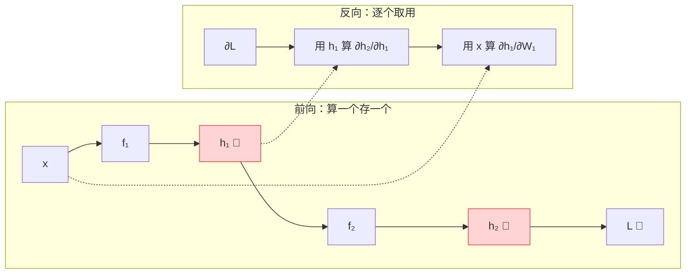
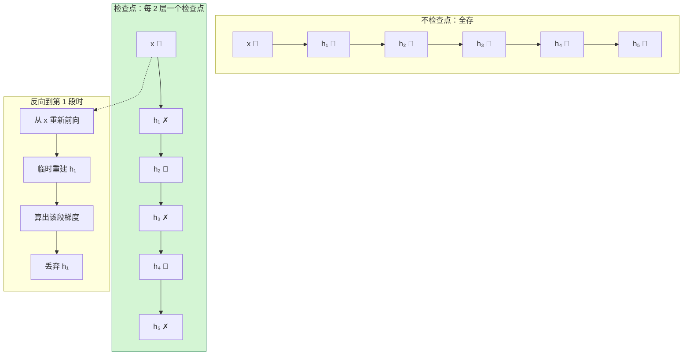
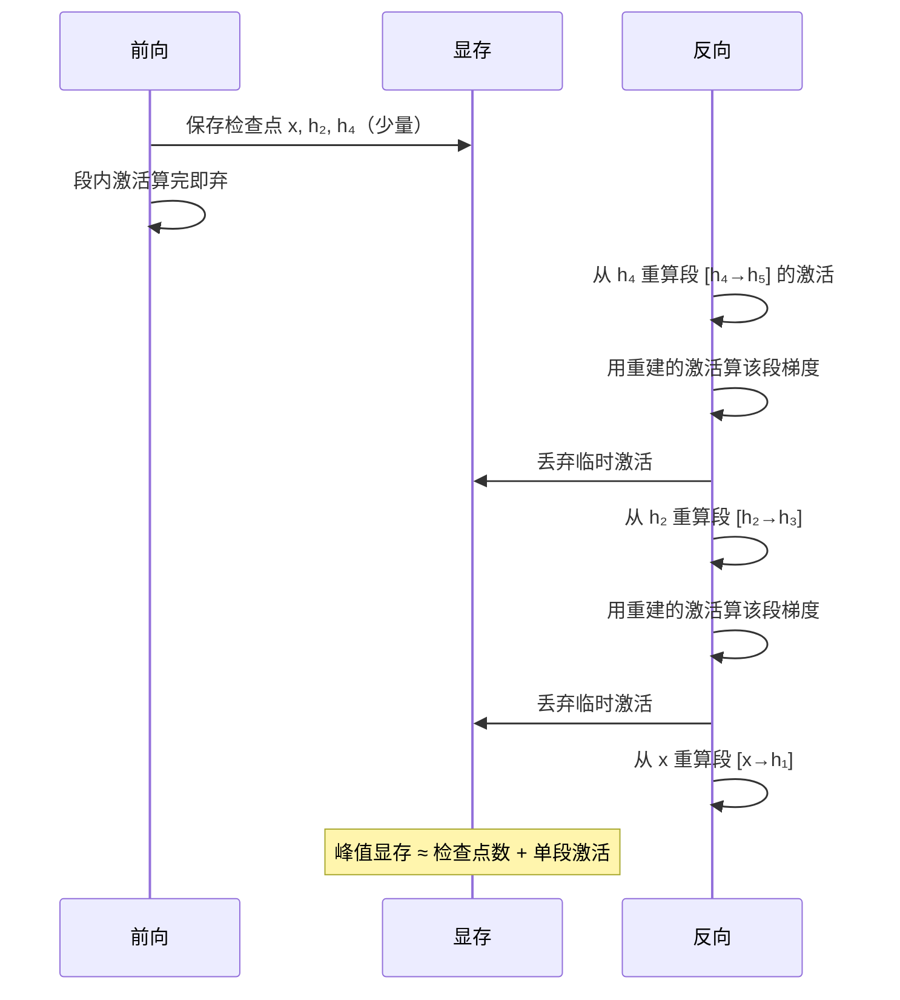
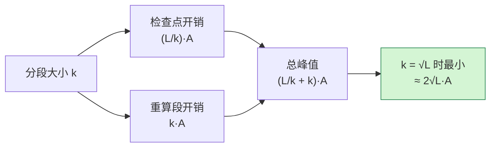
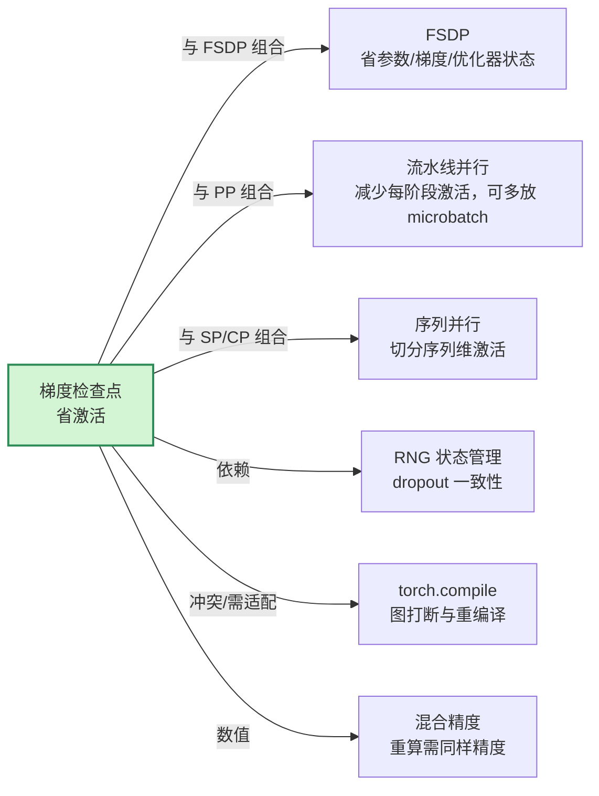
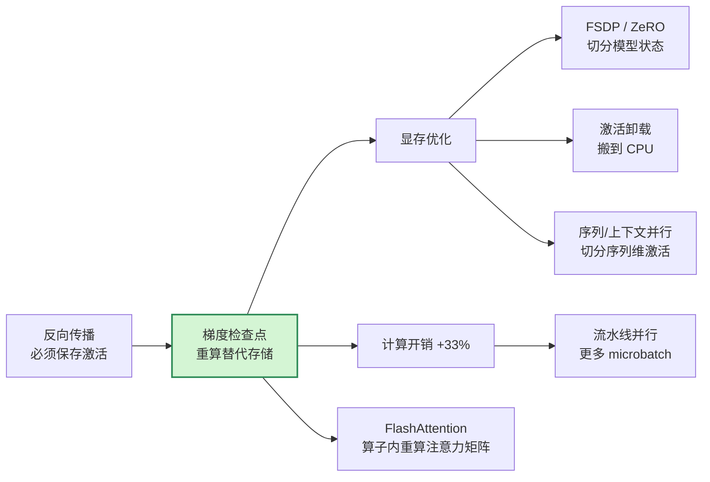

# 梯度检查点（Gradient Checkpointing）基本原理

> **一句话总结**：反向传播必须用到前向的中间激活，而保存全部激活的显存随层数/序列长度线性增长。梯度检查点（又称**激活重计算**，Activation Recomputation）只保存少量"检查点"边界，反向时**从最近的检查点重新前向**一遍来重建区间内的激活——用**约 1/3 的额外计算**换取**从 `O(L)` 降到 `O(√L)`、甚至 `O(1)` 的激活显存**。它省的是激活，不是参数。

本文遵循本仓库的设计原则：**先讲清"为什么"，再讲"怎么做"**，并明确标注**关联技术**与**边界、代价**。

- 适用版本前提：机制描述基于 PyTorch v2.x 的 `torch.utils.checkpoint` 语义 [4]、Chen 等人 2016 年的子线性显存方案 [1]、Megatron-LM 的选择性重计算 [2]，以及 FSDP 的激活检查点接口 [5]。**具体收益倍率随模型结构、序列长度、是否融合算子而变化，脱离前提的"省 X 倍显存"不成立。**

---

## 1. 它为什么存在：激活显存墙

### 1.1 训练显存的四块构成

一次 LLM 训练迭代的显存大致分四块，它们**性质完全不同**、需要**不同手段**来解决：

| 组成 | 量级 | 随什么增长 | 主要对策 |
| --- | --- | --- | --- |
| **参数**（含 fp32 master） | `≈ 12Ψ`（AdamW） | 模型规模 | ZeRO / FSDP 分片（见《FSDP 训练基本原理》） |
| **梯度** | `≈ 2Ψ ~ 4Ψ` | 模型规模 | ZeRO-2 / FSDP Reduce-Scatter |
| **优化器状态** | `≈ 4Ψ ~ 8Ψ` | 模型规模 | ZeRO-1 分片 |
| **激活（activations）** | **`O(L · B · s · d)`** | **层数 × batch × 序列长度** | **梯度检查点（本文）** |

前三种都与**参数量 Ψ** 成正比，可以用"切分"解决；**激活与参数量无直接关系，却与序列长度和层数成正比**——这是长上下文训练最先撞上的墙 [2]。

### 1.2 一个具体的量级感

以 Korthikanti 等人对 Transformer 的统计 [2]：在**不使用 FlashAttention** 的 GPT 类模型里，单个 Transformer 层的激活约为

```text
每层激活 ≈ s · b · h · (34 + 5 · a · s / h)  字节
```

其中 `s` 为序列长度、`b` 为 micro-batch、`h` 为隐藏维度、`a` 为注意力头数。注意第二项含 **`s²`**——**序列长度翻倍，注意力相关的激活涨 4 倍**。这就是"32K 上下文比 4K 难训得多"的显存原因。

> 采用 FlashAttention 后，`O(s²)` 那一项被消除（注意力矩阵不再落显存），每层激活降到 `34·s·b·h` [2][6]。但即便如此，它仍与 `L · s` 成正比。

### 1.3 为什么不能只靠"切分参数"解决

FSDP 把参数/梯度/优化器状态按卡分片，每卡只剩 `1/N`。但**激活是每卡私有的**——每张卡都要为自己那份数据保存完整的激活链，无法跨卡切分（除非用序列并行/上下文并行，那是另一套机制）。所以 FSDP 之后，**激活往往成为第一大显存项**，检查点从"可选优化"变成"必选项"。

---

## 2. 核心机理

### 2.1 反向传播为什么必须保存激活

以最简单的两层为例。设 `h₁ = f₁(x)`、`h₂ = f₂(h₁)`、`L = ℓ(h₂)`：

$$
\frac{\partial L}{\partial W_1} = \frac{\partial L}{\partial h_2}\cdot\frac{\partial h_2}{\partial h_1}\cdot\frac{\partial h_1}{\partial W_1}
$$

其中 `∂h₂/∂h₁` 是 `f₂` 在 `h₁` 处的**局部雅可比**——**它必须知道 `h₁` 的值**。于是前向时每个中间结果都得留着，等反向用。



`L` 越大（层数越多），红色的"存"就越多——这就是 `O(L)` 的来源。

### 2.2 检查点的基本做法

把网络的 `L` 层切成若干**段**，只保存每段**入口**的激活（检查点）；段内的中间激活**不保存**。反向走到某一段时，**从该段入口重新前向**一次，临时重建段内激活，算完这一段就丢弃。



**要点**：

1. **前向只多存"段边界"**——存储量从 `L` 降到"段数"；
2. **反向时每段被重算一次**——计算量增加"一次前向"；
3. **重算出来的激活是临时的**——算完即弃，不参与峰值累积。

### 2.3 PyTorch 的实现语义

```python
from torch.utils.checkpoint import checkpoint

class Block(nn.Module):
    def forward(self, x):
        # 包装一个"段"：forward 只记录边界，backward 时自动重算
        return checkpoint(self._forward_impl, x, use_reentrant=False)
```

`torch.utils.checkpoint` 在反向时的关键动作 [4]：

| 动作 | 说明 |
| --- | --- |
| `torch.no_grad()` 下跑前向 | 第一次前向**不建图**、不保存中间激活，只算输出 |
| 保存输入张量 | 存的是段入口的输入（而不是内部激活） |
| 反向时重跑前向 | 在**开启梯度**的状态下再跑一次，这次建图、得中间值 |
| **恢复 RNG 状态** | 保存前向时的随机数状态，重算时还原，保证 dropout 结果一致 |
| 只对"需要梯度"的输入生效 | 若所有输入都不 `requires_grad`，检查点不会触发重算 |

两个工程细节：

- **`use_reentrant=False`（推荐）**：新版实现，兼容 `torch.compile`、支持非张量输入、支持在 `no_grad` 上下文中跳过重算（例如冻结的层）；
- **`use_reentrant=True`（旧版）**：要求至少一个输入 `requires_grad=True`，否则报错；且与 `torch.compile` 兼容性差。

### 2.4 一次迭代的执行时序



**注意顺序**：反向是从后往前的，但**重算在每段内部是从前往后的**——这也是为什么检查点会打断某些跨段的算子融合。

---

## 3. 代价模型：到底亏多少

### 3.1 计算开销 ≈ 33%

设前向成本为 1 个单位，反向约为 2 个单位，一次迭代总计 3 个单位。

全量检查点时，每段在反向中被重算一次，**合计相当于多跑一次前向**：

$$
\text{开销} = \frac{1\ (\text{额外前向})}{3\ (\text{原总成本})} \approx 33\%
$$

这与实测基本一致：训练吞吐通常下降 **20%~35%**，取决于模型结构、重算段的大小、以及重算能否与通信重叠 [1][2]。

### 3.2 为什么是 `O(√L)`：最优分段

设总层数 `L`，每段 `k` 层，则段数 `L/k`。显存由两部分组成：

```text
峰值激活 ≈ (L/k) 个检查点 × 单层激活  +  k 层重算段 × 单层激活
        = (L/k + k) · A
```

对 `k` 求最小值：`k = √L` 时取到 `2√L · A`——**从 `O(L)` 降到 `O(√L)`** [1][3]。



**极端情况**：

- `k = 1`（每层都是检查点）：显存 `≈ 2L·A`——反而**更差**，因为你什么都没省还多存了边界；
- `k = L`（整网一个检查点）：显存 `≈ A`（`O(1)`），但反向要**重算整网 `L` 次**（每次往前推进一段），计算开销变成 `O(L²)` 级——不可接受。

所以实践中既不用 `k=1` 也不用 `k=L`，而是 `√L` 附近的折中，或者按"层的显存/计算比"做**非均匀分段**。

### 3.3 计算与显存的权衡曲线


---

## 4. 变体与工程实践

### 4.1 全量检查点（Full）

对**每个 Transformer Block** 都开检查点。实现最简单，收益最大（激活降到接近 `O(√L)`），代价是约 33% 计算 [1]。

这是绝大多数训练框架的默认选项（Megatron 的 `--recompute-activations`、DeepSpeed 的 `activation_checkpointing`、FSDP 的 `apply_activation_checkpointing`）[2][5]。

### 4.2 选择性重算（Selective）

**核心洞察**：不同算子"显存占用 / 重算成本"的比例差别巨大 [2]。

| 子模块 | 激活显存 | 重算计算量 | 性价比 |
| --- | --- | --- | --- |
| Attention 里的 softmax / dropout | **大**（`O(s²)`，未融合时） | **小**（只是逐元素） | **重算很划算** |
| FFN（两层大矩阵乘） | 中 | **大**（占前向 FLOPs 大头） | 重算不划算 |

所以 Megatron 的做法是：**只重算注意力中的 softmax/dropout，保留 FFN 的激活**。这样能省掉大部分激活，而额外计算远小于 33% [2]。

> 当代价模型从"全量重算"变成"挑着重算"，梯度检查点就从"暴力省显存"进化成"按性价比分配计算预算"。

### 4.3 激活卸载（Activation Offload）

另一种思路：不重算，而是把激活**搬到 CPU 内存**，反向时再搬回来。

| 维度 | 检查点（重算） | 激活卸载（Offload） |
| --- | --- | --- |
| 消耗什么 | GPU 计算（+33%） | PCIe/NVLink 带宽 |
| 省什么 | GPU 显存 | GPU 显存 |
| 适合场景 | 计算不是瓶颈 | 计算是瓶颈、且有富余主机内存与带宽 |
| 典型实现 | `torch.utils.checkpoint` | PyTorch FSDP `activation_checkpointing` + offload、DeepSpeed |

两者**可以叠加**：段内重算 + 检查点本身卸载到 CPU。代价是重算时还要先把检查点搬回 GPU。

### 4.4 可逆网络（Reversible Layers）

RevNet 一类的设计让每层**可逆**：反向时由输出直接反解出输入，因此**完全不需要保存激活**（`O(1)`）[7]。

- 优点：零激活存储；
- 代价：**网络结构被强约束**（必须成对设计可逆变换），与主流 Transformer 架构不兼容，LLM 中基本不用。

它说明了这个问题的理论下界：**要么多存、要么多算、要么改结构**。

### 4.5 FlashAttention 的"内置重算"

FlashAttention 在反向时**不保存 `s × s` 的注意力矩阵**，而是用 Q、K 重新计算（分块、在 SRAM 内完成）[6]。

这本质上是**在算子内部做了一次检查点**：把 `O(s²)` 的存储换成一次额外的前向计算。它属于"选择性重算"的极致案例——把最占显存的那一块单独干掉。

---

## 5. 与其它技术的关系



### 5.1 与 FSDP

两者**正交且互补**：FSDP 切分模型状态，检查点削减激活。大模型训练的常见配方是 **FSDP + 逐 Block 检查点 +（可选）激活卸载** [5]。

FSDP 的注意点：检查点要包在 **FSDP 包装之后的 block 上**，否则重算会绕过 FSDP 的 All-Gather 逻辑；官方提供 `apply_activation_checkpointing()` 按类型批量施加 [5]。

### 5.2 与流水线并行

流水线并行（PP）要求同时驻留多个 micro-batch 的激活（1F1B 下至少 `pipeline_depth` 份）。检查点让**每个 micro-batch 的激活变小**，从而能开更多 micro-batch，缓解气泡——这两者是**乘性收益**。

### 5.3 与 `torch.compile`

- `use_reentrant=True` 会让编译器在图中间遇到一个"黑盒"，**打断图优化**；
- `use_reentrant=False` 兼容性更好，但重算本身仍会引入额外的图节点与 kernel；
- 实测中，检查点会**削弱算子融合的收益**——这是"省显存"必须交的税。

### 5.4 与混合精度

重算必须使用**与前向相同的精度和相同的数值路径**，否则梯度会与"不检查点"版本产生偏差。bf16 下通常无感；fp16 + loss scaling 时要确保重算也在 autocast 上下文内。

---

## 6. 边界与代价

### 6.1 它不省什么

| 你以为省了 | 实际 |
| --- | --- |
| 参数显存 | ❌ 完全不变，要用 ZeRO/FSDP |
| 优化器状态显存 | ❌ 完全不变 |
| KV Cache | ❌ 那是推理期概念，与训练激活无关 |
| 峰值显存一定能降 | ⚠️ 若分段不当（如 `k=1` 或整网一段），可能**不降反升或不划算** |

### 6.2 常见陷阱速查

| 陷阱 | 现象 | 原因 / 对策 |
| --- | --- | --- |
| **dropout 不一致** | 重算出的激活与前向不符，loss 抖动 | RNG 状态未正确保存/恢复；`use_reentrant=False` 会自动处理，自定义实现需手动 `get_rng_state`/`set_rng_state` |
| **BatchNorm 统计量被更新两次** | BN 的 running mean/var 偏移 | 重算的前向会再次更新 buffer；对策：改用 LayerNorm/RMSNorm（LLM 天然满足），或冻结统计量 |
| **输入不 `requires_grad`** | 检查点静默不生效（旧版）或报错 | `use_reentrant=True` 要求至少一个输入需梯度；冻结层本就无需重算，属预期行为 |
| **冻结层也被重算** | 白白增加计算 | 在 `no_grad` 下跳过，或用 `use_reentrant=False` 的 `context_fn` 区分 |
| **分段过细** | 显存没降、速度还慢了 | `k=1` 时检查点数量爆炸；应取 `√L` 量级 |
| **包在了错误的位置** | FSDP 下通信行为异常 | 检查点应包在 FSDP wrapper 内部的 block 上 [5] |
| **与梯度累积混用** | 计算开销被放大 | 每累积一步都要重算一次；总开销仍是 33%，但绝对时间变长 |
| **以为能提升精度** | — | 检查点只影响显存/速度，数学上与原实现等价（RNG 正确时） |

### 6.3 什么时候不该用

- **显存充足**：33% 的计算换不需要的显存，纯亏；
- **计算是绝对瓶颈**（如小模型、短序列、算力紧张）：优先用 FSDP/ZeRO 或序列并行；
- **层本身很小**：重算的 kernel launch 开销可能超过省下的显存收益——只对 Attention/FFN 这类"大层"开。

### 6.4 一个经验判断

> 先看 `max_memory_allocated` 里激活占多少。**若激活 < 总显存的 20%，检查点收益有限；若 > 50%，几乎必开。** 这个比例决定了它是不是当前的头号瓶颈。

---

## 7. 可验证：最小实验

### 7.1 量化激活与收益

```python
import torch
from torch.utils.checkpoint import checkpoint

def measure(use_ckpt: bool, layers=24, seq=1024, dim=512, batch=2):
    torch.cuda.reset_peak_memory_stats()
    x = torch.randn(batch, seq, dim, device="cuda", requires_grad=True)
    blocks = [torch.nn.TransformerEncoderLayer(dim, 8, batch_first=True).cuda()
              for _ in range(layers)]
    for blk in blocks:
        x = checkpoint(blk, x, use_reentrant=False) if use_ckpt else blk(x)
    x.sum().backward()
    return torch.cuda.max_memory_allocated() / 2**30   # GiB

print(f"不检查点: {measure(False):.2f} GiB")
print(f"检查点  : {measure(True):.2f} GiB")
```

### 7.2 观测清单

| 想验证什么 | 怎么做 |
| --- | --- |
| 激活到底占多少 | `torch.cuda.memory_allocated()` 在"前向结束、反向开始"时采样 |
| 检查点是否真的降峰值 | 对比 `max_memory_allocated`，预期降到 `O(√L)` 量级 |
| 计算开销是否 ≈33% | 用 profiler 对比每 iteration 时间；若远高于 33%，检查分段是否过细 |
| 数值是否等价 | 固定随机种子，对比开/关检查点的 loss 与梯度范数（应几乎一致） |
| 是否打断了编译/融合 | 对比开/关下的 kernel 数量（`torch.profiler` 或 Nsight） |

---

## 8. 关联：它在知识网络中的位置



- **与反向传播**：检查点是反向传播"必须保存激活"这一约束的直接产物——参见《损失函数与反向传播基本原理》。
- **与 FSDP/ZeRO**：解决不同显存项，必须组合使用。
- **与序列并行**：序列并行切分激活的**序列维度**，检查点削减激活的**层维度**，两者可叠加。
- **与流水线并行**：检查点降低每 stage 激活，从而允许更多 microbatch。
- **与 FlashAttention**：注意力矩阵的 `O(s²)` 存储被"算子内重算"消除，是同一思想在算子层面的实现。

---

## 9. 延伸阅读

- 本仓库姊妹文档：《FSDP 训练基本原理》《损失函数与反向传播基本原理》《通信原语基本原理》
- PyTorch 官方 API：<https://pytorch.org/docs/stable/checkpoint.html> [4]
- PyTorch FSDP 激活检查点教程：<https://pytorch.org/tutorials/intermediate/fsdp_advanced_tutorial.html> [5]
- Megatron-LM 激活重计算说明（选择性重算的工程实现）：<https://github.com/NVIDIA/Megatron-LM> [2]

---

## 参考文献

1. Chen, T., Xu, B., Zhang, C., & Guestrin, C. *Training Deep Nets with Sublinear Memory Cost*. arXiv:1604.06174 (2016). <https://arxiv.org/abs/1604.06174> — 提出以 `√L` 分段把激活显存降到 `O(√L)`，并量化"一次额外前向"的代价
2. Korthikanti, V., Casper, J., Lym, S., et al. *Reducing Activation Recomputation in Large Transformer Models*. arXiv:2205.05198 (2022). <https://arxiv.org/abs/2205.05198> — Transformer 逐层激活显存的定量拆解与选择性重算
3. Griewank, A. *Achieving logarithmic growth of temporal and memory requirements for differentiable codes*. SIAM J. Sci. Stat. Comput. (1992). <https://epubs.siam.org/doi/10.1137/0913048> — 检查点分段的理论基础（时间/空间的支配权衡）
4. PyTorch. *torch.utils.checkpoint*（`checkpoint`、`use_reentrant`、RNG 保存与恢复语义）. <https://pytorch.org/docs/stable/checkpoint.html>
5. PyTorch. *Getting Started with Fully Sharded Data Parallel (FSDP) — Advanced*（`apply_activation_checkpointing` 与激活卸载）. <https://pytorch.org/tutorials/intermediate/fsdp_advanced_tutorial.html>
6. Dao, T., Fu, D. Y., Ermon, S., Rudra, A., & Ré, C. *FlashAttention: Fast and Memory-Efficient Exact Attention with IO-Awareness*. arXiv:2205.14135 (2022). <https://arxiv.org/abs/2205.14135> — 反向不保存注意力矩阵，改为重算
7. Gomez, A. N., Ren, M., Urtasun, R., & Grosse, R. B. *The Reversible Residual Network: Backpropagation Without Storing Activations*. arXiv:1707.04585 (2017). <https://arxiv.org/abs/1707.04585> — 可逆网络，激活显存 `O(1)` 的结构性方案
8. Rajbhandari, S., Rasley, J., Ruwase, O., & He, Y. *ZeRO: Memory Optimizations Toward Training Trillion Parameter Models*. arXiv:1910.02054 (2019). <https://arxiv.org/abs/1910.02054> — 模型状态分片，与激活优化互补
9. Micikevicius, P., Narang, S., Alben, J., et al. *Mixed Precision Training*. arXiv:1710.03740 (2017). <https://arxiv.org/abs/1710.03740> — 混合精度下重算必须保持同一数值路径

### 图片来源与许可声明

本文所有机制图均为 **Mermaid 自绘**（flowchart / sequenceDiagram），GitHub 原生渲染：

| 图 | 类型 | 说明 |
| --- | --- | --- |
| 反向传播必须保存激活（第 2.1 节） | Mermaid flowchart | 自绘 |
| 检查点存储对比与重算（第 2.2 节） | Mermaid flowchart | 自绘 |
| 一次迭代的执行时序（第 2.4 节） | Mermaid sequenceDiagram | 自绘 |
| `√L` 最优分段推导（第 3.2 节） | Mermaid flowchart | 自绘 |
| 计算/显存权衡曲线（第 3.3 节） | Mermaid flowchart | 自绘 |
| 与其它技术的关系（第 5 节） | Mermaid flowchart | 自绘 |
| 知识网络位置（第 8 节） | Mermaid flowchart | 自绘 |

> 注：本文主题的核心图是"显存-计算权衡曲线"，各来源（论文、框架文档）的同类图多为论文内嵌 PDF 图形，未提供可稳定直链的独立图片文件，故统一采用 Mermaid 自绘表达同一机理，避免引用不可核验的图片地址。文中所有事实性结论均已在参考文献中给出可点击来源。
