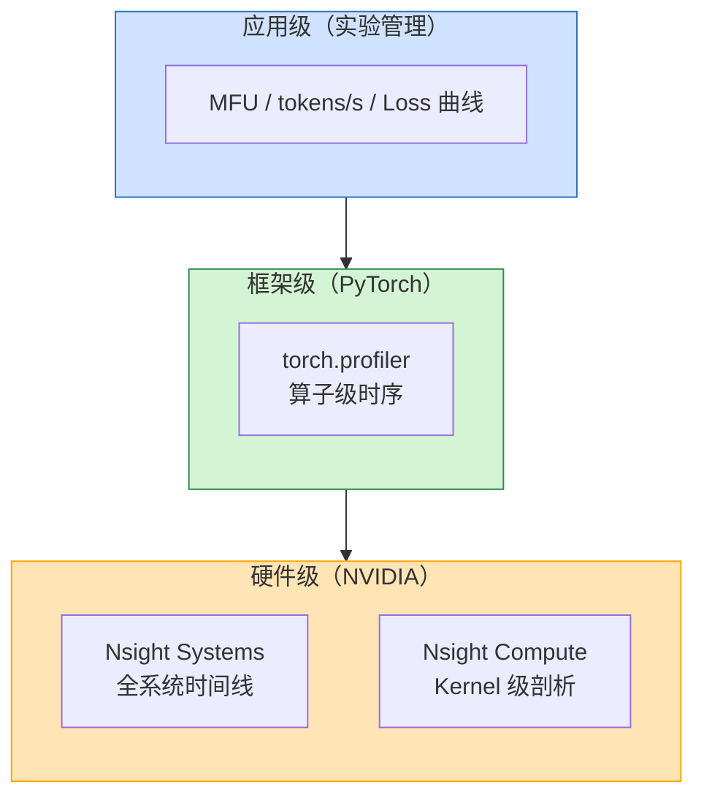
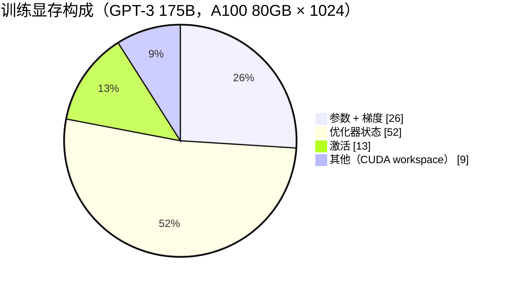
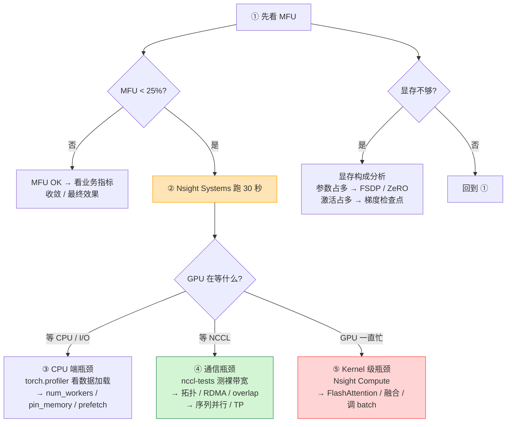

# 训练性能指标与瓶颈分析

> **一句话总结**：训练性能的核心是 **"硬件算力用了多少"**（MFU），而不是"跑了多少 tokens"。本文把训练侧的性能指标体系从**硬件级 → 框架级 → 应用级**分层讲清，给出每层的量化指标、观测工具、以及一条可复现的瓶颈定位流程。

本文遵循本仓库的设计原则：**先讲清"为什么"，再讲"怎么做"**，并明确标注**关联技术**与**边界、代价**。

- 适用版本前提：MFU 定义基于 PaLM/GPT-3 的原始推导 [1][2]；Nsight 系列工具功能基于 2024 版 [5][6]；torch.profiler 基于 PyTorch v2.x [8]。**脱离硬件版本与框架版本的"最优 MFU"不成立**。

---

## 1. 为什么需要性能分析

### 1.1 性能 ≠ 吞吐

大模型训练最容易犯的错误是**只看 tokens/s**。但 tokens/s 高可能只是 batch 大、或牺牲了并行效率换的——真正要回答的问题是：

> **我花这么多卡和这么多电，硬件算力到底用了多少？**

MFU（Model FLOPs Utilization，模型 FLOPs 利用率）就是直接回答这个问题的黄金指标 [1]。

### 1.2 典型的性能黑洞

一个 LLM 训练 job 常见的性能黑洞：

| 问题 | 外在表现 | 真实原因 |
| --- | --- | --- |
| GPU 偶尔"喘气" | step time 周期性波动 | 某张卡温度/功耗墙触发降频（DCGM 才能看到） |
| 训练"慢但能跑" | MFU 只有 20% | 通信占了 40% 时间（Nsight Systems 一眼看到） |
| 开了检查点反而更快 | 吞吐不降反升 | 重算 kernel 比"存了再取"更省带宽（FlashAttention 的本质） |
| 扩大 batch 吞吐不变 | tokens/s 饱和 | 计算已到上限，再扩 batch 只会让通信更重 |

这些问题**不靠指标是感知不到的**——"感觉慢"不如"拿出数字来"。

### 1.3 三层分析体系

本文按**硬件级 → 框架级 → 应用级**三层展开：



**定位顺序**永远是**自顶向下**——先用硬件级看 30 秒 timeline，90% 的问题在这一步就能定性；再下钻到 kernel 级。别一上来就看 Nsight Compute。

---

## 2. 核心指标体系

### 2.1 MFU：训练性能的黄金指标

#### 2.1.1 定义

$$
\text{MFU} = \frac{\text{实际 FLOPs/s}}{\text{硬件峰值 FLOPs/s}}
$$

分子是训练中**真正执行的 FLOPs**，分母是硬件**理论峰值**。两者相除，给出一个 0–100% 的数字。

#### 2.1.2 分子怎么算

训练一个 token 的 FLOPs 可以近似为 [1]：

```text
单 token FLOPs ≈ 2 × 层数 × (4 × d_model² + 2 × d_model × d_ff)
                 + 2 × 层数 × (d_model × seq_len × d_head × n_heads)
```

前半部分是 FFN（两层大矩阵乘），后半部分是 Attention（QK^T 和 P·V 两次）。

对于现代 Transformer，**FFN 占约 2/3 FLOPs，Attention 占约 1/3** [1]。

#### 2.1.3 硬件峰值怎么取

| 硬件 | 峰值（fp16/bf16） | 来源 |
| --- | --- | --- |
| H800 | 989 TFLOPS | NVIDIA 官方规格 |
| H100 | 989 TFLOPS（稀疏）/ 494 TFLOPS（稠密） | NVIDIA 官方规格 |
| A100 | 312 TFLOPS（稀疏）/ 19.5 TFLOPS（稠密 FP32） | NVIDIA 官方规格 |
| A800 | 312 TFLOPS | — |

> **注意**：H800 的峰值是 fp16/bf16 Tensor Core 的**稀疏**峰值；稠密计算约为一半。实际训练的有效 FLOPs 在这两个之间，要看稀疏率。

#### 2.1.4 一个计算示例

以 LLaMA-2-7B 为例：
- **单 token FLOPs** ≈ 20 GFLOPs（7B 参数 × ~3 GFLOPs/参数）
- **H800 峰值** = 494 TFLOPS（稠密）
- **MFU = (tokens/s × 20e9) / 494e12**

实测中 LLaMA-2 在 H800 上 MFU 约 **30–35%**，GPT-3 约 **35–40%** [1][2]。

#### 2.1.5 MFU 的合理区间

| MFU | 评价 | 说明 |
| --- | --- | --- |
| < 20% | **严重低效** | 要么训练脚本写得差，要么有资源瓶颈 |
| 20–30% | 可用但有优化空间 | 通信/调度/数据加载可能是瓶颈 |
| 30–40% | **行业优秀水平** | GPT-3 / LLaMA-2 的实测区间 |
| 40–50% | 顶级 | 需要硬件+算子+通信全套优化 |
| > 50% | 罕见 | 通常需要专用硬件或极端的算子融合 |

### 2.2 吞吐与 step time

MFU 是最底层的指标，但**工程上还要看**几个辅助指标：

| 指标 | 定义 | 为什么看 |
| --- | --- | --- |
| **Throughput（tokens/s）** | 全局每秒处理的 token 数 | 直观反映速度，但**必须结合 MFU**——吞吐高可能只是 batch 大 |
| **Step Time** | 每个 iteration 的时间 | 能拆成 forward / backward / optimizer step 三段看 |
| **Step Time 抖动** | step time 的标准差 | 抖动大说明有间歇性瓶颈（某卡降频、数据加载不均） |
| **Step Time 三段比** | forward : backward : optimizer | 典型比例：**forward ~30% : backward ~50% : optimizer ~20%**（反向 ≈ 2× 前向）。比例偏离太多说明有问题 |

### 2.3 显存构成

显存是训练的第一约束。**必须拆成四块分别量**：



| 组成 | 量级 | 随什么增长 | 主要对策 |
| --- | --- | --- | --- |
| **参数 + 梯度** | `≈ 4Ψ`（fp16） | 模型规模 | FSDP / ZeRO 分片 |
| **优化器状态** | `≈ 8Ψ ~ 12Ψ`（AdamW） | 模型规模 | ZeRO-1 / FSDP |
| **激活** | `O(L · B · s · d)` | 层数 × batch × 序列长度 | 梯度检查点 |
| **其他** | ~5% | 固定开销 | CUDA workspace |

> FSDP 之后，**参数+梯度+优化器状态**都被分片，激活往往成为**第一大显存项**——这正是"FSDP + 梯度检查点"几乎总是成对出现的原因（见《梯度检查点基本原理》第 5.1 节）。

### 2.4 通信耗时

分布式训练的**第二大瓶颈**：

| 指标 | 定义 | 阈值 |
| --- | --- | --- |
| **通信耗时占比** | `(AllReduce + AllGather + ReduceScatter 时间) / 总时间` | **>20%** 时说明通信是瓶颈 |
| **计算-通信重叠率** | `被隐藏的通信时间 / 总通信时间` | < 50% 说明 overlap 做得不好 |
| **单卡 AllReduce 时间** | NCCL 实测 | 对比 nccl-tests 裸带宽，差太多就是拓扑/RDMA 问题 |

---

## 3. 观测工具链

### 3.1 硬件级：全系统时间线（Nsight Systems）

#### 3.1.1 这是什么

**NVIDIA Nsight Systems** 是训练性能分析的**首选工具**——它能采集**CPU + GPU + CUDA API + NCCL 通信 + 内存拷贝**的统一时间轴 [5]。

#### 3.1.2 用它看什么

启动命令：

```bash
nsys profile \
    --capture-range=cudaProfilerApi \
    --trace=cuda,nvtx,osrt,nccl \
    --sample=none \
    --output=train_profile \
    python train.py  # 在训练脚本里用 torch.cuda.cudart().cudaProfilerStart() 包一段
```

典型的时间线图：

```mermaid
gantt
    title Nsight Systems 时间线（示意）
    dateFormat X
    axisFormat %s
    section CPU Thread 0
    数据加载 :a1, 0, 10
    CUDA Launch :a2, 10, 2
    等待 GPU   :crit, a3, 12, 8
    CUDA Launch :a4, 20, 2
    section GPU Compute
    Forward :b1, 2, 10
    Forward :b2, 22, 10
    section GPU NCCL
    AllReduce :c1, 14, 6
    AllReduce :c2, 34, 6
```



一眼就能看出三类问题：

| 现象 | 说明 |
| --- | --- |
| **CPU 长时间空等 GPU** | GPU 是瓶颈（好现象） |
| **GPU 长时间空等 CPU / 通信** | 不好——数据加载或通信挡住了计算 |
| **NCCL 通信与 GPU 计算不重叠** | overlap 没做好，通信完全暴露 |
| **GPU kernel 极短（< 10 µs）且密集** | kernel launch 开销占比太高，该做算子融合 |

#### 3.1.3 常见误区

| 误区 | 事实 |
| --- | --- |
| "Nsight Systems 会让训练变慢" | 采样模式 (`--sample=none` + `--capture-range=cudaProfilerApi`) 下开销 < 5%；全量追踪约 20–30% |
| "只追 GPU 就够了" | 90% 的性能问题在 CPU / NCCL 层暴露 |
| "看全量跑 1000 step" | 追 50–100 step 就够了，时间越长文件越大 |

### 3.2 硬件级：Kernel 级剖析（Nsight Compute）

#### 3.2.1 什么时候用

当 Nsight Systems 告诉你"**GPU 一直在忙但 MFU 还是低**"时——说明瓶颈在某个 kernel 内部，需要下钻。

#### 3.2.2 用它看什么

启动命令：

```bash
ncu --set full \
    --target-processes all \
    --launch-skip 100 --launch-count 10 \
    -o kernel_profile \
    python train.py
```

Nsight Compute 会给每个 kernel 一份"诊断"：

| 指标 | 含义 | 问题信号 |
| --- | --- | --- |
| **SM 利用率** | 活跃 warps / 最大 warps | < 50% 说明并行度不够或有 tail effect |
| **HBM 带宽利用率** | 实际带宽 / 峰值带宽 | > 90% 说明**内存瓶颈**（典型于 Decode 阶段） |
| **Tensor Core 利用率** | Tensor Core 活跃时间 / kernel 时间 | < 80% 说明没有用 Tensor Core 或格式不对 |
| **寄存器压力** | 单线程占用的寄存器数 / 上限 | 太高导致 occupancy 低 |
| **warp 分歧率** | 同 warp 内走不同分支的比例 | 高说明 kernel 有控制流 |
| **Memory Coalescing** | 全局内存访问是否合并 | 低说明访存模式差 |

#### 3.2.3 典型瓶颈与对策

| 诊断结果 | 对应瓶颈 | 对策 |
| --- | --- | --- |
| HBM 带宽饱和 + SM 低 | 内存受限 kernel | FlashAttention / 算子融合 / 改访存模式 |
| SM 高 + Tensor Core 利用率低 | 没用 Tensor Core | 确认精度（fp16/bf16）、确认矩阵形状（是 8/16 的倍数） |
| 两个都高但 MFU 仍低 | kernel launch 开销 | 算子融合 / CUDA Graph |
| 只有某一个 attention softmax kernel 异常慢 | 注意力计算瓶颈 | FlashAttention / 更长头 |

### 3.3 硬件级：实时监控（DCGM）

#### 3.3.1 做什么

**DCGM（Data Center GPU Manager）** 是 NVIDIA 提供的**实时 GPU 健康监控工具** [7]。

```bash
# 实时查看所有 GPU 的关键指标
dcgm dmon -s p,t,u,g,m  # 功耗、温度、SM 利用率、GPU 内存、HBM

# 查看 ECC 错误（可能导致训练不稳定）
dcgm test --gpu 0 --test bandwidth
dcgm test --gpu 0 --test smoke
```

#### 3.3.2 关键指标

| 指标 | 阈值 | 说明 |
| --- | --- | --- |
| **功耗** | 接近 TDP（H800 ≈ 350W） | 低于 TDP 说明没跑满；周期性掉下去说明有功耗墙 |
| **温度** | < 85°C | 超过 85°C 会触发降频 |
| **ECC 错误** | 0 | 如果不为 0，硬件有问题 |
| **PCIe / NVLink 带宽** | 接近理论值 | 低于理论值说明拓扑或线缆问题 |

> 一个典型场景：训练刚开始 MFU 是 35%，跑 2 小时后掉到 20%——用 DCGM 一看，某张卡温度 92°C 触发降频。

### 3.4 硬件级：裸带宽测试（nccl-tests）

#### 3.4.1 做什么

单独测 NCCL 集合通信的**裸带宽与延迟** [3]。用来隔离：训练通信慢是因为"通信本身慢"，还是因为"通信与计算没重叠好"。

```bash
# 单机 8 卡 AllReduce 测试
mpirun -np 8 ./all_reduce_perf -b 8 -e 8G -f 2 -g 1

# 预期：H800 NVLink 下 AllReduce 单向带宽 ≈ 300–400 GB/s
```

#### 3.4.2 如何解读

| 实测带宽 / 理论带宽 | 结论 |
| --- | --- |
| > 90% | 通信硬件没问题，瓶颈在 overlap 或算法 |
| 50–90% | 拓扑可能没走最优路径，或 RDMA/NVLink 配置不对 |
| < 50% | 网络/硬件有问题，先修这个 |

### 3.5 框架级：torch.profiler

#### 3.5.1 做什么

PyTorch 内置的 profiler，记录**算子级时序、kernel 级时序、内存事件** [8]。

```python
import torch
with torch.profiler.profile(
    activities=[torch.profiler.ProfilerActivity.CPU,
                torch.profiler.ProfilerActivity.CUDA],
    schedule=torch.profiler.schedule(wait=1, warmup=1, active=3),
    on_trace_ready=torch.profiler.tensorboard_trace_handler("./profiler"),
    record_shapes=True, with_stack=True,
) as prof:
    for batch in dataloader:
        train_step(model, batch)
        prof.step()
```

#### 3.5.2 能看到什么

| 输出 | 含义 |
| --- | --- |
| **算子时间排序** | 哪几个算子最耗时（通常是 `aten::mm` / `aten::bmm` / `aten::softmax`） |
| **Kernel 时间排序** | 与 Nsight Compute 类似，但更方便（不用换工具） |
| **内存时间线** | 哪一步分配了大块显存 |
| **栈追踪** | 算子是哪一行代码调出来的 |

配合 TensorBoard 查看：

```bash
tensorboard --logdir=./profiler
```

### 3.6 框架级：显存分析

```python
# 峰值显存
torch.cuda.max_memory_allocated() / 2**30  # GiB

# 当前显存构成
print(torch.cuda.memory_summary(abbreviated=True))

# 每一步的显存快照
torch.cuda.memory._record_memory_history()
# ... 训练若干 step ...
torch.cuda.memory._dump_snapshot("memory_snapshot.pickle")
```

**显存分解**：

```python
def analyze_memory():
    print("参数:", sum(p.numel() * p.element_size() for p in model.parameters()) / 2**30, "GiB")
    print("梯度:", sum(p.numel() * p.element_size() for p in model.parameters()
                  if p.grad is not None) / 2**30, "GiB")
    # 优化器状态要遍历 optimizer.state
    opt_bytes = 0
    for state in optimizer.state.values():
        for v in state.values():
            if isinstance(v, torch.Tensor):
                opt_bytes += v.numel() * v.element_size()
    print("优化器状态:", opt_bytes / 2**30, "GiB")
    print("总峰值:", torch.cuda.max_memory_allocated() / 2**30, "GiB")
    print("（差值 = 激活 + workspace）")
```

### 3.7 应用级：实验跟踪（W&B / MLflow）

| 工具 | 做什么 |
| --- | --- |
| **Weights & Biases** | 追踪 loss、梯度范数、MFU、显存；跨 run 对比 |
| **MLflow** | 开源替代，自部署友好 |
| **Megatron-LM profiler** | Megatron 用户，内置 MFU 自动计算 |
| **NCCL_DEBUG=INFO** | 打印 NCCL 算法选择、拓扑、每次通信耗时；代价是日志量大，用完关掉 |

---

## 4. 瓶颈定位流程

### 4.1 总览流程图



### 4.2 Step 1：先量 MFU

**目的**：判断是不是"真的低效"。MFU 30% 的训练已经是行业优秀水平，没必要硬抠到 40%。

**怎么做**：Megatron-LM 内置 profiler，或自己算：

```python
# 粗略计算 MFU
B = 2          # micro-batch
s = 4096       # 序列长度
num_tokens = B * s
step_time = ...  # 实测 step time (秒)
flops_per_token = 20e9  # 7B 参数约 20 GFLOPs / token
peak_tflops = 494e12    # H800 稠密

mfu = (num_tokens * flops_per_token / step_time) / peak_tflops
print(f"MFU: {mfu*100:.1f}%")
```

### 4.3 Step 2：Nsight Systems 定性

**目的**：30 秒 timeline 定性问题方向。

**怎么看**：

| 时间线现象 | 定性 |
| --- | --- |
| GPU 长时间被 NCCL 挡住 | 通信瓶颈 → 去 Step 4 |
| GPU 长时间等 CPU 数据 | 数据加载瓶颈 |
| GPU kernel 排得很密但 MFU 低 | 计算效率低 → 去 Step 5 |
| GPU kernel 极短（< 10 µs）且密集 | kernel launch 开销大 → 算子融合 |
| 某张卡比其他卡慢一截 | 负载不均 / 硬件问题 → DCGM |

### 4.4 Step 3：CPU / 数据加载瓶颈

典型症状：GPU 利用率 < 50%，CPU 某几个核占 100%。

**检查清单**：

| 项 | 对策 |
| --- | --- |
| `DataLoader(num_workers=0)` | 改成 `num_workers=4~8` |
| 没开 `pin_memory=True` | 打开，CPU→GPU 拷贝快 ~2× |
| 没开 `persistent_workers=True` | 打开，worker 不被销毁重建 |
| 没开 `prefetch_factor` | 设成 2–4，提前取数据 |
| 数据预处理在 CPU 做 | 搬到 GPU（如 tokenize 后固定） |
| 单卡数据量不均 | 检查 DistributedSampler |

### 4.5 Step 4：通信瓶颈

典型症状：Nsight Systems 里 NCCL 时间占 > 20%。

**检查清单**：

| 项 | 怎么做 |
| --- | --- |
| 裸带宽达标吗 | `nccl-tests` |
| 拓扑走对了吗 | `NCCL_DEBUG=INFO` 看 NCCL 选了什么算法（Ring / Tree） |
| overlap 开了吗 | DDP / FSDP 默认开启，但要确认 |
| 通信量能不能减 | 序列并行（激活分片减少通信）、更低精度 |
| 用不用 TP / PP | TP 减少单层通信，PP 把通信分摊到时间上 |

### 4.6 Step 5：Kernel 级瓶颈

典型症状：GPU 一直忙但 MFU 低。Nsight Compute 逐个 kernel 看。

| 诊断 | 对应瓶颈 | 对策 |
| --- | --- | --- |
| HBM 带宽饱和 + SM 低 | 内存受限 | FlashAttention / 算子融合 / 更大 batch |
| SM 高 + Tensor Core 低 | 没用 Tensor Core | bf16/fp16 + 形状对齐 16/8 的倍数 |
| 两个都高但 MFU 仍低 | launch 开销 | `torch.compile` / CUDA Graph |
| 只有 attention softmax 慢 | Attention 瓶颈 | FlashAttention-2 / 更长 head_dim |
| LayerNorm 慢 | — | Apex Fused LayerNorm |

### 4.7 Step 6：显存瓶颈

典型症状：OOM 或显存接近上限。

**先拆分**（见 3.6 节的 `analyze_memory()`）：

| 占比最高 | 对策 |
| --- | --- |
| 参数 + 梯度 | FSDP / ZeRO 分片 |
| 优化器状态 | ZeRO-1 分片 / 换 Muon（省 4Ψ） |
| 激活 | 梯度检查点（+33% 计算） / 序列并行 |
| KV Cache（推理） | GQA / 量化 / PagedAttention / Sink Token |

### 4.8 循环验证

每做一次改动，**回 Step 1 量 MFU**——性能调优不是一次性的，是**反复迭代**：

```
改 batch size → 量 MFU
    ↓ 没变好
开 FlashAttention → 量 MFU
    ↓ 没变好
调 overlap / 拓扑 → 量 MFU
    ↓ 没变好
降精度 / 算子融合 → 量 MFU
    ↓ 还不够
上 TP / PP / SP → 量 MFU
```

---

## 5. 边界与代价

### 5.1 什么会影响 MFU 上限

| 因素 | 能把 MFU 拉低多少 |
| --- | --- |
| 序列长度变长 | Attention 部分权重上升，整体 MFU 略降 |
| batch size 变小 | kernel launch 开销占比高，MFU 降 ~5–10% |
| 通信路径变长（跨节点） | NCCL 时间翻倍，MFU 降 ~10–20% |
| 模型是 MoE | 专家并行的 All-to-All 开销 |
| 检查点开启 | 激活显存降但计算涨 33%，**MFU 可能不变**（因为总 FLOPs 变多了） |

### 5.2 什么不会影响 MFU

| 因素 | 为什么 |
| --- | --- |
| 多卡并行度 | MFU 是**单卡**指标，理想情况下不随卡数变化 |
| 学习率 / 优化器 | 影响收敛，不影响硬件利用率 |
| 损失函数 | 影响收敛速度，不影响 FLOPs |

### 5.3 调优的代价

| 动作 | 代码改动 | 训练速度影响 | 精度影响 |
| --- | --- | --- | --- |
| FlashAttention | `attn_impl="flash_attention_2"` | **↑ 快 2×+** | 无损 |
| 梯度检查点 | 包一层 `checkpoint_wrapper` | **↓ 慢 ~33%** | 无损（RNG 正确时） |
| 混合精度 | `autocast + GradScaler` | **↑ 快 2×** | 需防溢出 |
| TP / PP | 大改 | 各有利弊 | 无损 |
| `torch.compile` | 一行 | **↑ 快 10–30%** | 与部分算子不兼容 |

### 5.4 一个经验阈值

> **MFU 从 15% 调到 30% 是 ROI 最高的阶段**（花一天时间，吞吐翻倍）。从 30% 调到 40% 投入翻倍、收益 33%。到 40% 以上，每提 1% 都可能要架构级改动。

---

## 6. 关联：它在知识网络中的位置

```mermaid
flowchart LR
    subgraph Hardware["硬件层"]
        H1["Nsight Systems"]
        H2["Nsight Compute"]
        H3["DCGM"]
        H4["nccl-tests"]
    end
    subgraph Metrics["指标层"]
        M1["MFU"]
        M2["显存构成"]
        M3["通信占比"]
        M4["Step Time 三段比"]
    end
    subgraph Diagnosis["诊断层"]
        D1["CPU / 数据加载"]
        D2["通信"]
        D3["Kernel 效率"]
        D4["显存"]
    end
    subgraph Fix["对策层"]
        F1["FlashAttention / 算子融合"]
        F2["FSDP / 梯度检查点"]
        F3["拓扑 / Overlap / TP / PP / SP"]
        F4["优化数据管道"]
    end
    Hardware --> Metrics --> Diagnosis --> Fix
    style Metrics fill:#ffe4b5,stroke:#ffa500
    style Diagnosis fill:#d4f5d4,stroke:#2e8b57
```



- **与 FSDP**：FSDP 分片模型状态，让显存瓶颈从参数转移到激活——激活又要靠检查点和序列并行解决。三者形成**乘性收益**。
- **与梯度检查点**：重算增加 FLOPs，但**可能不降反升吞吐**——因为"存激活再取"的访存带宽开销可能比重算更大（FlashAttention 的本质）。
- **与通信优化**：通信是分布式训练的第一可优化瓶颈（通常占 20–40% 时间），nccl-tests + overlap + 拓扑是三件套。
- **与序列并行 / 流水线并行**：TP/PP/SP 都是在不同维度上切分计算，分别解决单层太大、层数太多、序列太长的问题，每加一个 MFU 有损失但显存/吞吐的约束变松。

---

## 7. 延伸阅读

- 本仓库姊妹文档：《梯度检查点基本原理》《FSDP 训练基本原理》《通信原语基本原理》
- PaLM 论文（MFU 原始定义）：<https://arxiv.org/abs/2204.05149> [1]
- GPT-3 训练细节（MFU 实测 30–40%）：<https://arxiv.org/abs/2005.14165> [2]
- Nsight Systems 官方文档：<https://docs.nvidia.com/nsight-systems/> [5]
- Nsight Compute 官方文档：<https://docs.nvidia.com/nsight-compute/> [6]
- PyTorch Profiler 教程：<https://pytorch.org/tutorials/recipes/recipes/profiler_recipe.html> [8]

---

## 参考文献

1. Chowdhery, A., Narang, S., Devlin, J., et al. *PaLM: Scaling Language Modeling with Pathways*. arXiv:2204.05149 (2022). <https://arxiv.org/abs/2204.05149> — 定义 Model FLOPs Utilization（MFU），给出在 540B 参数模型上的实测值与硬件峰值的关系
2. Brown, T., Mann, B., Ryder, N., et al. *Language Models are Few-Shot Learners* (GPT-3), Section 5.3 Training Efficiency. arXiv:2005.14165 (2020). <https://arxiv.org/abs/2005.14165> — GPT-3 在 175B 参数上 MFU ≈ 30–40% 的实测数据
3. NVIDIA. *NVIDIA Collective Communications Library (NCCL) — Test Suite*（`all_reduce_perf`、`all_gather_perf` 等裸带宽测试工具）. <https://github.com/NVIDIA/nccl-tests>
4. Rajbhandari, S., Rasley, J., Ruwase, O., & He, Y. *ZeRO: Memory Optimizations Toward Training Trillion Parameter Models*. arXiv:1910.02054 (2019). <https://arxiv.org/abs/1910.02054> — ZeRO 的显存分解与吞吐分析
5. NVIDIA. *Nsight Systems Documentation*（全系统时间线 profiling 工具）. <https://docs.nvidia.com/nsight-systems/>
6. NVIDIA. *Nsight Compute Documentation*（kernel 级剖析工具）. <https://docs.nvidia.com/nsight-compute/>
7. NVIDIA. *DCGM (Data Center GPU Manager) User Guide*. <https://docs.nvidia.com/dcgm/>
8. PyTorch. *Profiler Recipe — Use PyTorch Profiler to Measure Performance*. <https://pytorch.org/tutorials/recipes/recipes/profiler_recipe.html>

### 图片来源与许可声明

本文所有图均为 **Mermaid 自绘**（flowchart / gantt / pie），GitHub 原生渲染：

| 图 | 类型 | 说明 |
| --- | --- | --- |
| 三层分析体系（第 1.3 节） | Mermaid flowchart | 自绘 |
| 显存构成饼图（第 2.3 节） | Mermaid pie | 数据来自 GPT-3 训练配置，自绘 |
| Nsight Systems 典型时间线（第 3.1.2 节） | Mermaid gantt | 自绘（示意） |
| 瓶颈定位流程图（第 4.1 节） | Mermaid flowchart | 自绘 |
| 知识网络位置（第 6 节） | Mermaid flowchart | 自绘 |

> 注：本文的核心是**指标定义 + 工具使用 + 定位流程**，工具截图会随版本变化、且无法稳定直链下载，因此统一采用 Mermaid 自绘表达同一机理。文中所有事实性结论（MFU 定义、典型数值区间、工具功能）均已在参考文献中给出可点击来源。

---

### 附：快速检查清单

下面这张表可以直接贴到训练 start script 的末尾，快速诊断：

```python
def quick_diagnostics():
    import torch
    print("=== 快速诊断 ===")
    print(f"GPU 数量: {torch.cuda.device_count()}")
    for i in range(torch.cuda.device_count()):
        props = torch.cuda.get_device_properties(i)
        print(f"GPU {i}: {props.name}, {props.total_memory / 2**30:.1f} GiB")
    print(f"当前峰值显存: {torch.cuda.max_memory_allocated() / 2**30:.2f} GiB")
    # 在训练循环里每 N step 调用一次
    # 对照 MFU、显存构成、step time 抖动做判断
```

| 要量什么 | 最快的方法 |
| --- | --- |
| MFU | `tokens/s × 每 token FLOPs / 硬件峰值` |
| 显存峰值 | `torch.cuda.max_memory_allocated()` |
| 显存构成 | 见 3.6 节 `analyze_memory()` |
| Step time | `time.time()` 包一层 step |
| 通信占比 | `NCCL_DEBUG=INFO` + grep NCCL 时间 |
| kernel 最慢 | `torch.profiler` 或 Nsight Compute |
| GPU 健康 | `dcgm dmon -s p,t,u,g,m` |
