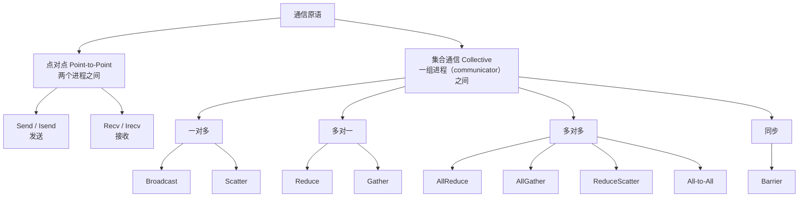
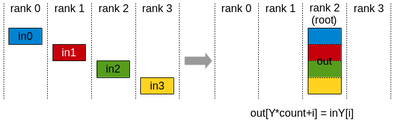
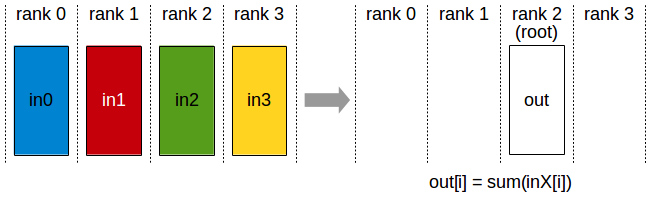
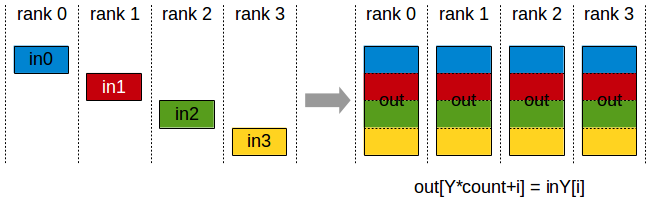
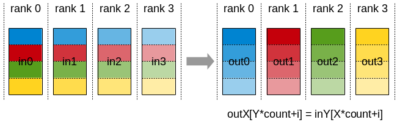
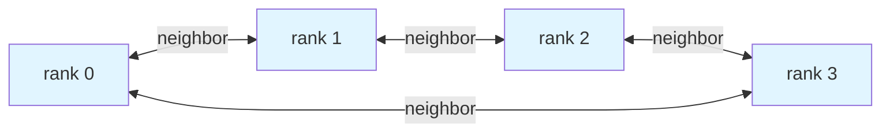
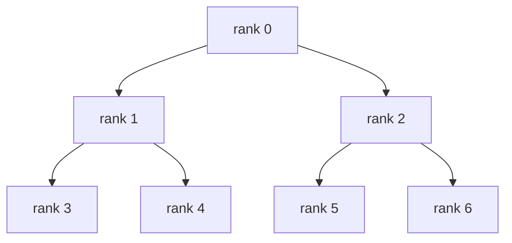
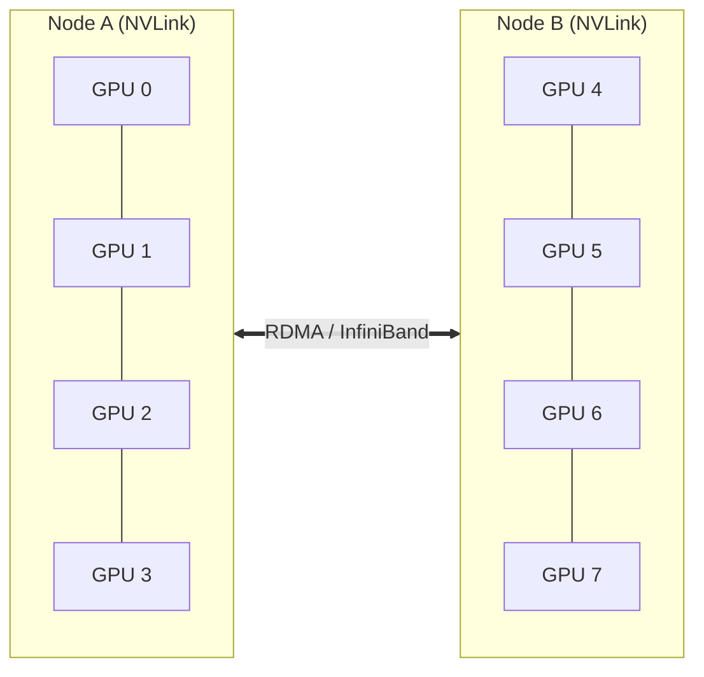
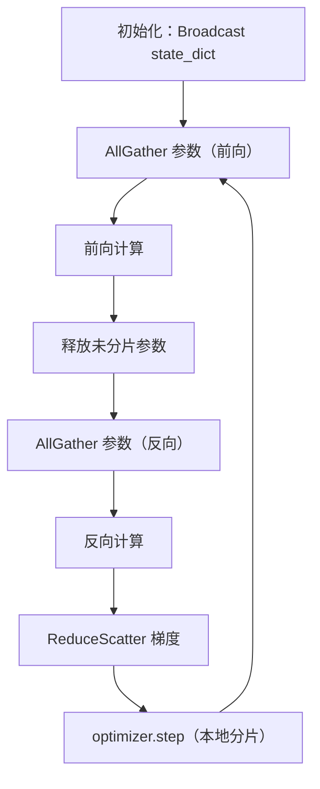
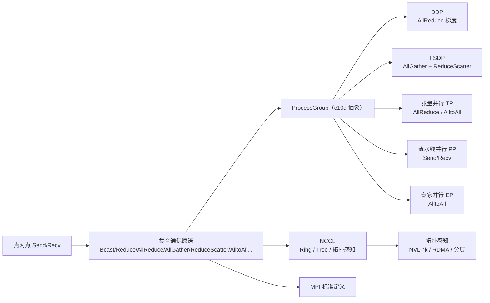

# 通信原语基本原理

> **一句话总结**：通信原语是分布式训练的"积木"——**点对点原语**（Send/Recv）处理两个进程间的数据交换，**集合通信原语**（Broadcast / AllReduce / AllGather / ReduceScatter / All-to-All 等）处理一组进程间的协调。所有并行策略（DP / DDP / FSDP / TP / PP / EP）都是这些原语的不同组合；理解原语的**语义、实现与代价**，是判断并行方案的基础。

本文遵循本仓库的设计原则：**先讲清"为什么"，再讲"怎么做"**，并明确标注**关联技术**与**边界、代价**。

- 适用版本前提：API 语义基于 MPI 标准 [1]、NCCL 用户指南 [2][3] 与 PyTorch `torch.distributed`（c10d）文档 [4]。通信实现细节随 NCCL 版本与硬件拓扑变化，**脱离版本与拓扑的"最优解"不成立**。

---

## 1. 它为什么存在：问题定义

### 1.1 从单机到多机：协调是新问题

单机训练时，数据、模型、梯度都在同一块 GPU 的显存里，不存在"交换"问题。一旦把训练扩展到多卡多机，就出现了新的本质需求：

- **数据分发**：如何把输入 batch 切到各卡？
- **梯度同步**：各卡算出的梯度如何合并？
- **模型状态同步**：参数、优化器状态如何保持一致？
- **执行协调**：流水线各阶段如何交接？

这些需求最终都落到"**进程间传递张量**"这件事上。直接用裸 socket / CUDA IPC 手写传输，既易错又低效。于是有了**通信原语（Collective Communication Primitives）**——把常见的"一组进程之间的数据移动模式"封装成标准化的操作 [1][5]。

### 1.2 原语是分布式系统的"积木"

通信原语不是为某一种并行策略专门设计的，而是从更一般的"进程群协调"问题中抽象出来的：

- 早在 MPI 标准中，集合通信原语就已被系统定义 [1]；
- NCCL 把它们实现为**对 GPU 友好**的版本（每个集合操作用单个 kernel 同时处理通信与计算，最小化同步开销）[2]；
- PyTorch 的 c10d（ProcessGroup）则把它们统一抽象成跨后端（gloo / nccl / mpi）的接口 [4]。

> 关键认知：**所有分布式训练并行策略，本质上都是"在合适的时机调用合适的通信原语"**。DDP 用 AllReduce，FSDP 用 All-Gather + Reduce-Scatter，张量并行用 AllReduce / All-to-All，流水线并行用 Send/Recv，专家并行用 All-to-All。

---

## 2. 通信原语的分类

通信原语按"参与方数量"分为两大类：



下面逐一详解。约定：用 `k` 表示参与进程数（world size），用 `N` 表示每个进程发送/接收的**元素个数**，用 `root` 表示特定的源/目的进程。

---

## 3. 点对点原语：Send / Recv

### 3.1 语义

- **Send**：把数据从**本进程**发往指定的对端进程；
- **Recv**：从指定的对端进程（或任意源）接收数据。

这是最基础的通信原语，其他所有集合通信在底层都可以看作 Send/Recv 的组合。MPI 还提供非阻塞版本 `Isend` / `Irecv`，调用后立即返回，通过 `Wait` / `Test` 检查完成——这是实现**计算-通信重叠**的关键 [1]。

### 3.2 应用场景

- **流水线并行（PP）**：相邻 stage 之间通过 Send/Recv 交接激活值与梯度 [6]。
- **张量并行（TP）中的点对点**：部分 TP 实现用 Send/Recv 在特定 rank 间传递分片结果。
- **任意自定义通信模式**：当没有现成的集合原语能精确描述需求时（例如不规则的稀疏交换），退回点对点。

> **代价**：点对点是"手工拼装"，灵活但需要程序员显式管理匹配（谁发给谁、tag 对齐），容易死锁。集合原语正是为了屏蔽这种复杂性。

---

## 4. 集合通信原语详解

### 4.1 Broadcast（广播）

**语义**：`root` 进程把一份长度为 `N` 的数据复制给所有进程（包括自己）。


> 图源：NVIDIA NCCL User Guide [2]。

| 维度 | 说明 |
| --- | --- |
| 数据移动方向 | 一 → 多 |
| 输出位置 | 每个进程都得到 root 的完整副本 |
| root 参数 | 必须，且在所有进程上一致 |
| 典型应用 | 同步模型初始参数（DDP 构造期从 rank 0 广播 `state_dict`）[4]、广播超参/控制信号 |

**实现**：常用**树（tree）**结构，对数级延迟；NCCL 在小消息时用 tree，大消息时用 ring 以榨取带宽 [2]。

### 4.2 Scatter（分发）

**语义**：`root` 持有 `k*N` 个元素，切成 `k` 份，第 `i` 份发给第 `i` 个进程。


> 图源：NVIDIA NCCL User Guide [2]。

| 维度 | 说明 |
| --- | --- |
| 数据移动方向 | 一 → 多（但每个进程拿到**不同**的一片） |
| 与 Broadcast 区别 | Broadcast 是"复制同一份"，Scatter 是"切分后各拿一片" |
| 典型应用 | 把一个大张量按 dim 切到各 rank（数据并行的数据切分、参数分片的初始化） |

### 4.3 Gather（收集）

**语义**：每个进程持有 `N` 个元素，`root` 收集所有进程的数据，按 rank 顺序拼接成 `k*N` 个元素。



> 图源：NVIDIA NCCL User Guide [2]。

| 维度 | 说明 |
| --- | --- |
| 数据移动方向 | 多 → 一 |
| 输出位置 | 仅 root 得到完整拼接结果；其他进程结果无定义 |
| 与 Scatter 互为逆操作 | Scatter(Gather(x)) ≈ x（在 root 上） |
| 典型应用 | 把各 rank 的分片结果收回 root（例如汇总验证指标、聚合日志） |

### 4.4 Reduce（归约）

**语义**：每个进程持有 `N` 个元素，对**相同位置**的元素做规约运算（SUM / MAX / MIN 等），结果只放在 `root` 的接收缓冲区。



> 图源：NVIDIA NCCL User Guide [2]。

| 维度 | 说明 |
| --- | --- |
| 数据移动 + 计算 | 既有通信，也有规约运算 |
| 规约算子 | SUM、PROD、MAX、MIN、AND、OR 等（MPI 还支持自定义）[1] |
| 输出位置 | 仅 root |
| 典型应用 | 各 rank 算出局部 loss/梯度后，在 root 上求和（但 DDP/FSDP 通常直接用 AllReduce 而非 Reduce） |

> NCCL 文档指出：**Reduce + Broadcast = AllReduce** [2]。这是理解 AllReduce 的一个等价关系。

### 4.5 AllReduce（全归约）—— 分布式训练中用得最多的原语

**语义**：每个进程持有 `N` 个元素，对相同位置做规约，**每个进程都得到相同的规约结果**。


> 图源：NVIDIA NCCL User Guide [2]。

| 维度 | 说明 |
| --- | --- |
| 数据移动 + 计算 | 规约 + 广播 |
| 输出位置 | **每个进程**都得到完整规约结果 |
| 等价分解 | Reduce(root) + Broadcast = AllReduce；或 ReduceScatter + AllGather = AllReduce [2] |
| 典型应用 | **DDP 梯度同步**：各 rank 的梯度 AllReduce（求和）后除以 world_size 得到平均梯度 [4][7] |

**为什么它这么重要？** 数据并行的核心就是"各算各的梯度，然后求平均"——这正是 AllReduce 的语义。DDP 的分桶、Ring AllReduce、NCCL 的 double binary tree，本质上都是在优化这一个原语 [7][8]。

**实现方式对比**（详细机制见第 5 节）：

| 算法 | 结构 | 延迟 | 带宽 | 适用 |
| --- | --- | --- | --- | --- |
| Ring AllReduce | 环 | O(k) | **带宽最优** | 大消息 |
| Tree AllReduce | 二叉树 | O(log k) | 非带宽最优 | 小消息（延迟敏感）|
| Double Binary Tree | 两棵二叉树 | O(log k) | 接近带宽最优 | NCCL 默认小消息算法 [8] |

### 4.6 AllGather（全收集）

**语义**：每个进程持有 `N` 个元素，所有进程互相收集，结果每个进程都得到按 rank 拼接的 `k*N` 个元素。



> 图源：NVIDIA NCCL User Guide [2]。

| 维度 | 说明 |
| --- | --- |
| 数据移动方向 | 多 → 多（无计算，纯搬运拼接） |
| 输出位置 | 每个进程都得到完整拼接结果 |
| 与 Gather 区别 | Gather 结果只在 root；AllGather 结果在所有进程 |
| 典型应用 | **FSDP 前向/反向重建完整参数**：各 rank 把自己的参数分片 All-Gather，拼出完整 W [9][10]；张量并行中收集分片输出 |

> 注意输出按 rank 顺序排列，因此对 rank-device 映射敏感 [2]。

### 4.7 ReduceScatter（归约分发）

**语义**：每个进程持有 `k*N` 个元素，对相同位置规约后，把结果切成 `k` 份，第 `i` 个进程只得到第 `i` 份（大小为 `N`）。


> 图源：NVIDIA NCCL User Guide [2]。

| 维度 | 说明 |
| --- | --- |
| 数据移动 + 计算 | 规约 + 切分 |
| 输出位置 | 每个进程只得到**自己的一片**规约结果 |
| 与 AllReduce 关系 | **AllReduce = ReduceScatter + AllGather** [2] |
| 典型应用 | **FSDP 反向梯度分片**：各 rank 算出完整梯度后，Reduce-Scatter 把求和结果切分，各 rank 只留自己那份 [9][10]；ZeRO-2/3 的梯度分片 |

> 可以这样记：AllGather 是"把碎片拼成整块，每人一份"；ReduceScatter 是"先把整块求和，再切成碎片各拿一片"。两者组合恰好覆盖 AllReduce，但允许在中间插入计算——这就是 FSDP 省显存的关键。

### 4.8 All-to-All（全互换）

**语义**：每个进程持有 `k*N` 个元素，其中第 `j` 片发给第 `j` 个进程；每个进程也从所有进程各收一片，按 rank 拼接成 `k*N`。



> 图源：NVIDIA NCCL User Guide [2]。

| 维度 | 说明 |
| --- | --- |
| 数据移动方向 | 多 → 多（**每个进程发出和接收的数据都不同**） |
| 通信量 | 全网最大，是"完全交换" |
| 典型应用 | **专家并行（EP / MoE）**：token 按路由分配到不同专家，计算完再收回，两次 All-to-All [11]；张量并行中也常用于特定层的输入重排 |

> All-to-All 是通信量最大的原语，对网络带宽与拓扑极其敏感，因此 EP 的扩展性高度依赖跨机带宽与负载均衡。

### 4.9 Barrier（屏障同步）

**语义**：所有进程都调用 Barrier 后才继续，否则阻塞等待。

| 维度 | 说明 |
| --- | --- |
| 有无数据移动 | 通常无（纯同步），底层可能用空消息实现 |
| 典型应用 | 调试、测量、阶段对齐（例如 FSDP 中的 `no_sync()` 末尾的同步边界） |
| 注意 | 会引入**木桶效应**——最慢的进程拖慢全体；生产训练中应尽量避免显式 Barrier |

---

## 5. 实现机制：Ring、Tree 与拓扑

理解原语的"语义"还不够，性能取决于"怎么实现"。同一个 AllReduce，用 Ring 还是 Tree，在不同消息规模和拓扑下表现可能差好几倍。

### 5.1 两个核心维度：延迟 vs 带宽

集合通信的代价可以用 α-β 模型粗略估算：

```
t_comm = α × (消息轮数) + β × (传输字节数 / 带宽)
```

- **α（latency，延迟）**：每次通信的启动开销（kernel launch、系统调用、握手），与消息大小无关；
- **β（bandwidth，带宽）**：单位数据传输的耗时；
- **消息轮数**决定延迟项的倍数，**总传输量**决定带宽项。

### 5.2 Ring（环）：带宽最优，延迟线性

以 Ring AllReduce 为例（DDP 文档已详述 [7]，这里给出要点）：



- **Ring AllReduce = Scatter-Reduce（N-1 轮，边传边累加）+ AllGather（N-1 轮，转发替换）**；
- 每卡传输量 ≈ `2 × (k-1)/k × K ≈ 2K`（K 为单卡数据量），与 k 基本无关 → **带宽最优** [5]；
- 但轮数是 `2(k-1)`，延迟随 k 线性增长 → **大规模下延迟成瓶颈**。

### 5.3 Tree（树）：延迟对数，带宽次优



- 树高 `log k`，延迟随 k 对数增长；
- 但非带宽最优（靠近根的链路承载更多流量）；
- **适合小消息**（延迟主导）。

### 5.4 NCCL 的策略：按消息大小自动选择

NCCL 不会只用一种算法。它的核心策略是 [2][8]：

- **小消息 → Tree / Double Binary Tree**：对数级延迟；
- **大消息 → Ring**：榨取带宽；
- 切换阈值由 `NCCL_TREE_THRESHOLD` 等环境变量控制 [8]；
- **拓扑感知**：NCCL 自动探测 NVLink / PCIe / InfiniBand 拓扑，在节点内用 NVLink ring，跨节点用 InfiniBand，必要时构建分层（hierarchical）结构——例如 **HSDP（Hybrid Sharded Data Parallel）就利用了这一点：机内全分片走 NVLink，机间复制走 RDMA** [10][12]。



> 机内 NVLink 带宽远高于机间 RDMA，因此集合通信应尽量"机内 ring + 机间分层"，而不是把所有 GPU 当成一个扁平的环。

---

## 6. 应用场景映射：原语 → 并行策略

这是理解分布式训练的核心：**哪种并行策略在什么环节用了什么原语**。

| 并行策略 | 环节 | 用到的原语 | 说明 |
| --- | --- | --- | --- |
| **DP（DataParallel）** | 主卡分发输入 | Scatter（中心化 scatter） | 主卡把 batch 切到各卡 [13] |
| **DP** | 主卡收集输出/梯度 | Gather | 各卡输出/梯度汇总到主卡 |
| **DDP** | 梯度同步 | **AllReduce** | 分桶 AllReduce 求梯度之和 [7] |
| **DDP / FSDP** | 初始化参数一致性 | **Broadcast** | rank 0 广播 `state_dict` [4][10] |
| **FSDP（FULL_SHARD）** | 前向重建参数 | **AllGather** | 各 rank 拼出完整 W [9][10] |
| **FSDP（FULL_SHARD）** | 反向梯度分片 | **ReduceScatter** | 完整梯度求和后切分 [9][10] |
| **FSDP（SHARD_GRAD_OP）** | 梯度同步 | ReduceScatter + AllGather | 等价于 AllReduce，但拆开以省显存 |
| **TP（列并行 Linear）** | 输出拼接 | **AllGather**（或 AllReduce，依实现） | 各 rank 的分片输出拼回完整输出 |
| **TP（行并行 Linear）** | 输入/输出规约 | **AllReduce** | 行并行的矩阵乘结果需规约求和 |
| **TP（注意力）** | KV/输出重排 | **All-to-All**（序列并行中） | 按序列维或头维重排 |
| **PP（流水线）** | stage 间交接 | **Send / Recv** | 相邻 stage 传激活与梯度 [6] |
| **EP / MoE** | token 路由分发 | **All-to-All** | token 按路由发到专家所在 rank [11] |
| **EP / MoE** | 结果收回 | **All-to-All** | 专家输出按 token 收回 |
| **梯度压缩** | 量化/稀疏后同步 | AllReduce（或 ReduceScatter） | 通信量降低但引入误差 |
| **验证 / 日志** | 汇总指标 | Reduce / Gather | 局部指标汇总到 root |

> **一句话记忆**：
> - "需要大家都拿到同一份" → AllReduce（要算）或 AllGather（只搬）；
> - "需要各拿一片" → ReduceScatter（要算）或 Scatter（只搬）；
> - "token 在 rank 间乱序流动" → All-to-All；
> - "两个相邻节点传话" → Send/Recv。

### 6.1 一个例子：FSDP 一次迭代的原语序列

把第 6 节映射到 FSDP（详见姊妹篇《FSDP 训练基本原理》[10]）：



---

## 7. 边界与代价

### 7.1 原语不是免费的：通信量公式速查

设世界大小为 `k`，单卡数据量为 `K` 字节。下表给出带宽最优实现下每卡的**渐近通信量**（忽略常数因子）[5]：

| 原语 | 每卡通信量 | 说明 |
| --- | --- | --- |
| Broadcast | ≈ K | root 发出 K，其他接收 |
| AllReduce | ≈ 2K | Ring 下的 Scatter-Reduce + AllGather |
| AllGather | ≈ K | 每卡收到其他 k-1 份 |
| ReduceScatter | ≈ K | 规约后切分，每卡发 K，收 K |
| All-to-All | ≈ (k-1)/k × K_total | 完全交换，**全网总通信量最大** |
| Reduce | ≈ K | 类似 AllReduce 但结果只到 root |

> 关键结论：**All-to-All 的通信量随 k 增长最快**，这就是为什么专家并行（EP）的扩展性受跨机带宽制约最严重 [11]。

### 7.2 同步与木桶效应

集合通信要求**所有进程都参与**（相同 count、相同 datatype），否则行为未定义（挂死、崩溃或数据损坏）[2]。这带来：

- **木桶效应**：最慢的 rank 决定全体速度；
- **负载不均的代价**：MoE 中专家负载倾斜、PP 中 stage 计算时间不均，都会被集合通信放大；
- **不可跳过**：不能让某个 rank "不参与"这一步，必须显式用 `no_sync()` 等机制控制。

### 7.3 小消息的启动开销

每条集合通信都有固定的 kernel launch / 同步开销。因此：

- **小消息太多 → 延迟主导**：DDP 用**分桶**把多个小梯度合并成一次 AllReduce [7]；FSDP 用 auto_wrap 把多个参数合并成一次 AllGather/ReduceScatter [9]；
- 通信效率 ≈ 有效带宽 / 峰值带宽，消息越大越容易打满带宽 [2]。

### 7.4 拓扑异构

不是所有链路都是平等的（机内 NVLink >> 机间 RDMA）。因此：

- **扁平环在跨机时性能差**：把跨机链路当普通邻居会浪费 NVLink；
- **分层集合（Hierarchical Collective）**是解法：机内先做一次 ring，再把机内结果跨机规约（HSDP / 分层 AllReduce）[12]；
- 这也是为什么 PyTorch 引入 `DeviceMesh`：让用户显式描述拓扑维度，框架据此选择通信组 [14]。

### 7.5 常见工程陷阱

| 陷阱 | 说明 | 出处 |
| --- | --- | --- |
| 忘记所有 rank 必须调用 | 部分 rank 未参与集合通信会导致**死锁** | [2] |
| count/dtype 不一致 | NCCL 要求所有 rank 传入相同 count 与 datatype，否则 UB | [2] |
| 在 GPU 集合通信中用 gloo | GPU 梯度同步必须用 nccl，gloo 做 GPU 通信会严重拖慢 | [4] |
| AllGather 输出顺序依赖 rank | rank-device 映射变化会改变结果布局 | [2] |
| All-to-All 消息过小 | 启动开销主导，吞吐崩塌 | [2] |

---

## 8. 可验证：最小实验

下面用 PyTorch c10d 的 `ProcessGroup` 直接调用各原语，直观感受语义（CPU + gloo，可直接跑通）：

```python
# comm_primitives_demo.py
import os
import torch
import torch.distributed as dist
import torch.multiprocessing as mp


def run(rank: int, world_size: int) -> None:
    dist.init_process_group("gloo", rank=rank, world_size=world_size)

    # 1. Broadcast：rank 0 的数据广播到所有 rank
    if rank == 0:
        x = torch.tensor([1.0, 2.0, 3.0])
    else:
        x = torch.zeros(3)
    dist.broadcast(x, src=0)
    print(f"[rank {rank}] after broadcast: {x.tolist()}")

    # 2. AllReduce：各 rank 的 x 求和，结果每个 rank 都有
    y = torch.tensor([float(rank), float(rank), float(rank)])
    dist.all_reduce(y, op=dist.ReduceOp.SUM)
    print(f"[rank {rank}] after all_reduce: {y.tolist()}")  # 期望 [6,6,6] (0+1+2+3)

    # 3. AllGather：各 rank 的 z 收集拼接，每个 rank 都拿到全部
    z = torch.tensor([float(rank)])
    out = [torch.zeros(1) for _ in range(world_size)]
    dist.all_gather(out, z)
    print(f"[rank {rank}] after all_gather: {[t.item() for t in out]}")  # [0,1,2,3]

    # 4. ReduceScatter：先规约再切分，各 rank 拿一片
    full = torch.tensor([float(rank) * 4 + i for i in range(world_size)])
    rs_out = torch.zeros(1)
    dist.reduce_scatter_tensor(rs_out, full, op=dist.ReduceOp.SUM)
    print(f"[rank {rank}] after reduce_scatter: {rs_out.item()}")

    # 5. All-to-All：每 rank 向其他 rank 发不同数据
    a2a_in = torch.tensor([float(rank) * 10 + i for i in range(world_size)])
    a2a_out = torch.zeros(world_size)
    dist.all_to_all_single(a2a_out, a2a_in)
    print(f"[rank {rank}] after all_to_all: in={a2a_in.tolist()} out={a2a_out.tolist()}")

    dist.destroy_process_group()


def main() -> None:
    world_size = 4
    os.environ["MASTER_ADDR"] = "localhost"
    os.environ["MASTER_PORT"] = "29502"
    mp.spawn(run, args=(world_size,), nprocs=world_size, join=True)


if __name__ == "__main__":
    main()
```

> 结构参照 PyTorch `torch.distributed` 官方 API [4]。GPU 场景应改用 `nccl` 后端并将张量 `.cuda(device_id)` [4]。

### 观测要点

| 想验证什么 | 怎么做 |
| --- | --- |
| 各原语的语义是否符合预期 | 运行上面的脚本，对照输出与第 4 节的语义描述 |
| 不同后端的能力差异 | 用 `gloo` / `nccl` 分别跑，对照 PyTorch 后端能力表 [4] |
| 通信是否真的发生 | 设置 `NCCL_DEBUG=INFO` 观察 NCCL 选择的算法与拓扑 [8] |
| Ring vs Tree 的切换 | 调整 `NCCL_TREE_THRESHOLD`，对比小/大消息的吞吐 [8] |

---

## 9. 与其他概念的关系



- **与并行策略**：原语是"动词"，并行策略是"把动词串起来的剧本"。本文档与《DP》《DDP》《FSDP》互为对照。
- **与 NCCL / gloo / MPI**：这些是原语的**实现库**，语义一致但性能特性不同；c10d 的 `ProcessGroup` 把它们统一成同一套接口 [4]。
- **与拓扑**：原语的性能高度依赖拓扑，分层集合、DeviceMesh 是把拓扑信息喂给通信库的手段 [14]。

---

## 10. 延伸阅读

- 本仓库 `训练/分布式训练/`：《DP 训练基本原理》《DDP 训练基本原理》《FSDP 训练基本原理》——看这些原语在各并行策略中如何被组合。
- 本仓库 `训练/通信优化/`：拓扑感知通信、计算通信 overlap、通信压缩（梯度量化/稀疏化）。
- NCCL User Guide：<https://docs.nvidia.com/deeplearning/nccl/user-guide/docs/overview.html> [2]
- MPI Forum 标准：<https://www.mpi-forum.org/docs/mpi-5.0/mpi50-report/node116.htm> [1]

---

## 参考文献

1. MPI Forum. *MPI-5 Standard, Section 7.1: Collective Communication — Introduction and Overview*。<https://www.mpi-forum.org/docs/mpi-5.0/mpi50-report/node116.htm>
2. NVIDIA. *NCCL User Guide — Overview & Collective Operations*。<https://docs.nvidia.com/deeplearning/nccl/user-guide/docs/usage/collectives.html>
3. NVIDIA. *NCCL Collective Communication Functions API*。<https://docs.nvidia.com/deeplearning/nccl/user-guide/docs/api/colls.html>
4. PyTorch. *torch.distributed*（分布式通信包，含后端能力表与各原语 API）。<https://pytorch.org/docs/stable/distributed.html>
5. Patarasuk, P., Yuan, X. *Bandwidth optimal all-reduce algorithms for clusters of workstations*. J. Parallel Distrib. Comput. 69(2):117–124 (2009). <https://doi.org/10.1016/j.jpdc.2008.09.002>
6. Huang, Y., Cheng, Y., Bapna, A., et al. *GPipe: Efficient Training of Giant Neural Networks using Pipeline Parallelism*. arXiv:1811.06965 (2018). <https://arxiv.org/abs/1811.06965>
7. PyTorch. *Distributed Data Parallel*（设计说明，含分桶 AllReduce）。<https://docs.pytorch.org/docs/2.3/notes/ddp.html>
8. Jeaugey, S. *Massively Scale Your Deep Learning Training with NCCL 2.4*（double binary tree、Tree/Ring 切换）。NVIDIA Technical Blog (2019). <https://developer.nvidia.com/blog/massively-scale-deep-learning-training-nccl-2-4/>
9. PyTorch. *FSDP Notes*（All-Gather / Reduce-Scatter 的通信与缓冲）。<https://pytorch.org/docs/stable/notes/fsdp.html>
10. 本仓库. *FSDP 训练基本原理*。`训练/分布式训练/FSDP训练基本原理.md`
11. Shazeer, N., Mirhoseini, A., Maziarz, K., et al. *Outrageously Large Neural Networks: The Sparsely-Gated Mixture-of-Experts Layer*. arXiv:1701.06538 (2017). <https://arxiv.org/abs/1701.06538>
12. Korthikanti, V. A., et al. *Reducing Activation Recomputation in Large Transformer Models*（HSDP / 分层并行）。arXiv:2205.05198 (2022). <https://arxiv.org/abs/2205.05198>
13. PyTorch. *torch.nn.DataParallel*（中心化 scatter/gather）。<https://pytorch.org/docs/stable/generated/torch.nn.DataParallel.html>
14. PyTorch. *Distributed DeviceMesh*（用 Mesh 描述拓扑维度）。<https://pytorch.org/tutorials/recipes/distributed_device_mesh.html>

### 图片来源与许可声明

| 文件 | 来源 | 许可 / 说明 |
| --- | --- | --- |
| `assets/comm-broadcast.png`、`assets/comm-scatter.png`、`assets/comm-gather.png`、`assets/comm-reduce.png`、`assets/comm-allreduce.png`、`assets/comm-allgather.png`、`assets/comm-reducescatter.png`、`assets/comm-alltoall.png` | NVIDIA *NCCL User Guide — Collective Operations* [2] | NVIDIA 文档，版权归 NVIDIA；此处引用用于教学说明 |
| 其余 Mermaid 图（分类树、Ring/Tree 拓扑、FSDP 原语序列、关系图） | 本文自绘 | 使用 Mermaid 描述，GitHub 原生渲染，无第三方版权 |

> 若版权方要求，可随时移除上述图片，仅保留正文与文字描述。
